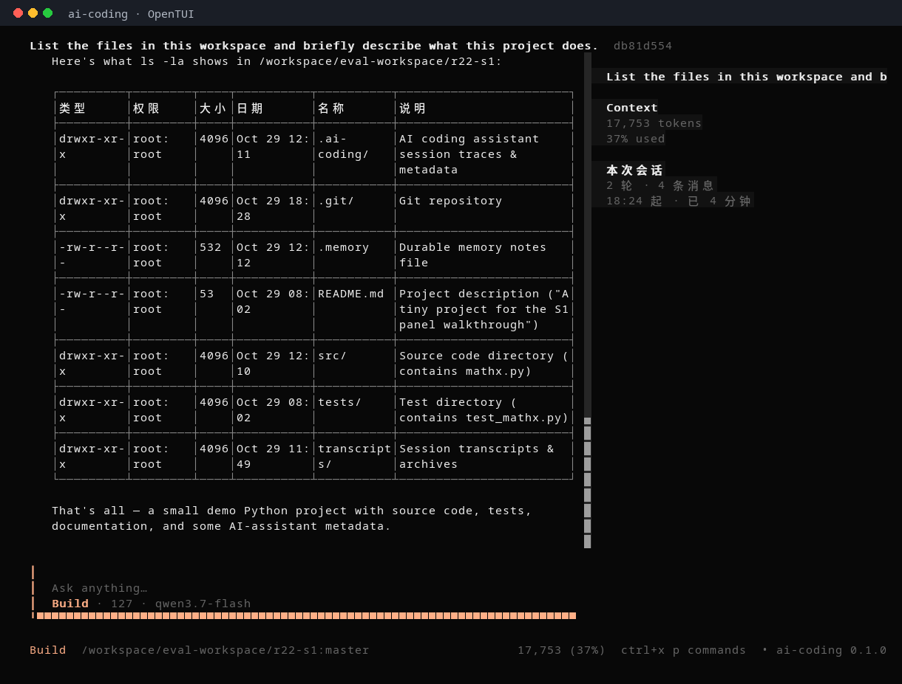
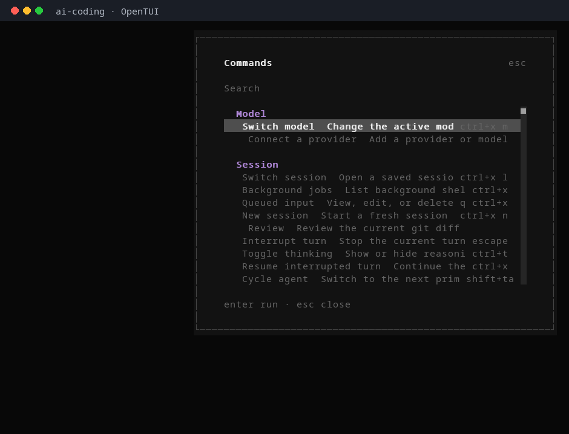
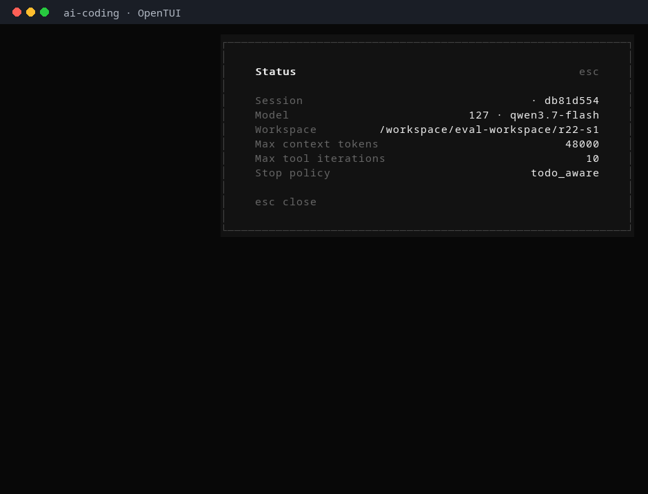

# AI-Coding

**在终端里干活的 AI 编程代理。** 你说清楚要改什么，它自己读代码、改文件、跑命令、跑测试，
一步一步把事情做完；每一步都在你眼前，危险操作先问你。

它不依赖任何 agent 框架：ReAct 循环、工具分发、权限、上下文压缩、记忆和会话都在本仓库里。
模型调用只是一个可替换的 `ChatEngine` 端口，默认直连任何 OpenAI 兼容的 `chat.completions`。



## 它能做什么

- **改代码**：按行号读文件、精确编辑/写入、glob/grep 搜索，改完用命令或测试验证。
- **跑命令**：bash 前台/后台作业、git、包管理；写操作与危险命令逐次审批，红线命令直接拒绝。
- **做多步计划**：`/plan <topic>` 先生成计划再逐步执行；每步带验收命令，失败先修一次，再失败标 `blocked`。
- **委派子任务**：`subAgent` 在独立 git worktree 里并行干活，可后台运行，父回合不必等。
- **记住项目**：跨会话记忆（事实、决策、偏好），按相关度注入；细节用 `memory_search` 按需召回。
- **接外部能力**：MCP 服务器、`SKILL.md` 技能、项目规则（`AGENTS.md` 等）。
- **可观测**：每回合落轨迹；`/trace` 看摘要，`/export html|otlp` 导出可视化页面或 OTLP span 树。
- **随时收尾**：Esc 中断、超时、预算、审批拒绝都会产生结构化终态，不会无声卡死。

## 界面

**命令面板** —— `/` 或 `ctrl+x p` 唤起，按层聚合命令，支持搜索与整屏翻页。



**状态面板** —— `/status` 展示当前会话、模型、工作区与运行限制。



所有行都来自真实 TUI 画面（`ai_coding/frontend`，OpenTUI + SolidJS，经 Unix socket 与 Python 后端通信）。

## 快速开始

需要 Python ≥ 3.10；用 bash 工具时仅支持 Linux。首次启动还需要 [bun](https://bun.sh) ≥ 1.2
与一次网络（安装前端依赖），之后离线复用。

```bash
uv tool install --from .      # 或：pipx install .
ai-coding config init         # 生成 ~/.config/ai-coding/config.yaml
export DEEPSEEK_API_KEY=sk-...   # 或任何 OpenAI 兼容端点的 key
ai-coding                      # 启动全屏 TUI
```

配置示例（`~/.config/ai-coding/config.yaml`）：

```yaml
models:
  deepseek:
    name: deepseek-chat
    provider: deepseek          # 自动带 base_url 与约定的 DEEPSEEK_API_KEY
    api_key: ${DEEPSEEK_API_KEY}
default_model: deepseek
```

更多配置、快捷键与故障排查见 [运行指南](docs/how-to-run.md)。

## 用法

### 两种 agent

- **build**（默认）：全权限，能改文件、跑命令、委派子任务。
- **plan**：只读，只允许写 `.ai-coding/plan/`；用于探索陌生代码库或先出方案。

`shift+tab` 切换 agent；`/plan <topic>` 直接进入计划模式并逐步执行。

### 常用命令

| 命令 | 作用 |
| --- | --- |
| `/plan <topic>` | 生成计划并逐步执行，每步带验收 |
| `/review` | 审查当前 git diff |
| `/model [name]` | 查看/切换模型 |
| `/permissions [auto\|confirm]` | 查看/切换审批策略 |
| `/todo` | 当前任务清单（目标、进度、下一步） |
| `/tasks [stop <id>]` | 后台子代理与作业；可停止 |
| `/memory` | 记忆面板（搜索/钉住/删除） |
| `/compact` | 主动压缩上下文 |
| `/undo` · `/redo` | 回滚/恢复上一回合（历史 + 文件） |
| `/resume` | 恢复历史会话 |
| `/trace` · `/export html\|otlp` | 轨迹摘要与导出 |
| `/help` | 全部命令 |

### 内置工具

| 工具 | 用途 |
| --- | --- |
| `read` / `write` / `edit` | 按行读写文件，带 stale-read 保护 |
| `glob` / `grep` | 文件与内容搜索 |
| `bash` | 前台/后台命令、作业管理；受进程沙箱与审批约束 |
| `todo_write` / `present_plan` | 任务清单与计划提交 |
| `subAgent` | 委派子任务（可后台、可要求 JSON 结论） |
| `skill` / MCP | 按需加载技能与外部工具 |
| `memory_search` / `memory_write` | 跨会话记忆 |
| `ask_user` | 需要人拍板时暂停并提问 |

## 它是怎么工作的

```text
ai_coding/frontend (OpenTUI/SolidJS)
        │  Unix socket JSON-RPC
        ▼
ai_coding/server  ──  ai_coding/core/agent_loop.py
                          │  每轮：压缩 → 组装提示 → 调模型 → 执行工具 → 落盘
                          ├─ core/dispatch.py   权限门 + 审批 + 有界并发
                          ├─ core/guard.py      重复调用/失败升级/红线
                          ├─ core/context_compression.py  四层压缩（L1–L4）
                          ├─ security/process_sandbox.py  bwrap 进程沙箱
                          └─ tools/             内置工具、MCP、子代理、技能
```

**安全默认值**：`write`/`edit`/`bash` 默认逐次审批；`rm -rf /`、`sudo`、`mkfs`、强推等直接拒绝；
`process_sandbox.mode: enforce` 时，没有可用沙箱的机器上 bash 会被拒绝（可用 `warn` 降级并显式告知）。
审批卡、红灯、拒绝原因都会以结构化结果回给模型和界面，而不是静默失败。

**上下文**：长会话按 L1 裁剪、L2 占位、L3 持久化、L4 摘要逐级压缩；读过的行段记在
read ledger 里，引用校验只接受真正读过的内容。轨迹与导出是确定性的（同输入两次导出字节一致）。

## 文档

- [运行指南](docs/how-to-run.md) —— 安装、配置、入口、端到端示例、故障排查
- [功能清单](docs/features.md) —— 全屏 TUI、slash 命令、工具、权限、上下文、记忆、子代理、技能、MCP
- [架构设计](docs/architecture.md) —— 分层与依赖方向、模块职责、回合数据流
- [数据契约](docs/data-contracts.md) —— 域模型、会话 JSON、配置 schema、不变量
- [文档导航](docs/README.md) —— 全部文档与里程碑演进记录（R1…R22）

## 开发

```bash
python -m venv .venv && source .venv/bin/activate
pip install -e ".[dev]"

pytest                    # 后端测试
ruff check .              # 静态检查
mypy ai_coding            # 类型检查

cd ai_coding/frontend
bun test                  # 前端测试
bun run typecheck
```

## 状态与限制

- 个人项目，接口与配置仍会随版本演进。
- bash 工具仅 Linux；进程沙箱依赖 `bwrap` 与用户命名空间（不可用时按 `enforce` 拒绝，或显式降级）。
- TUI 首次启动需要 bun 与网络安装前端依赖。
