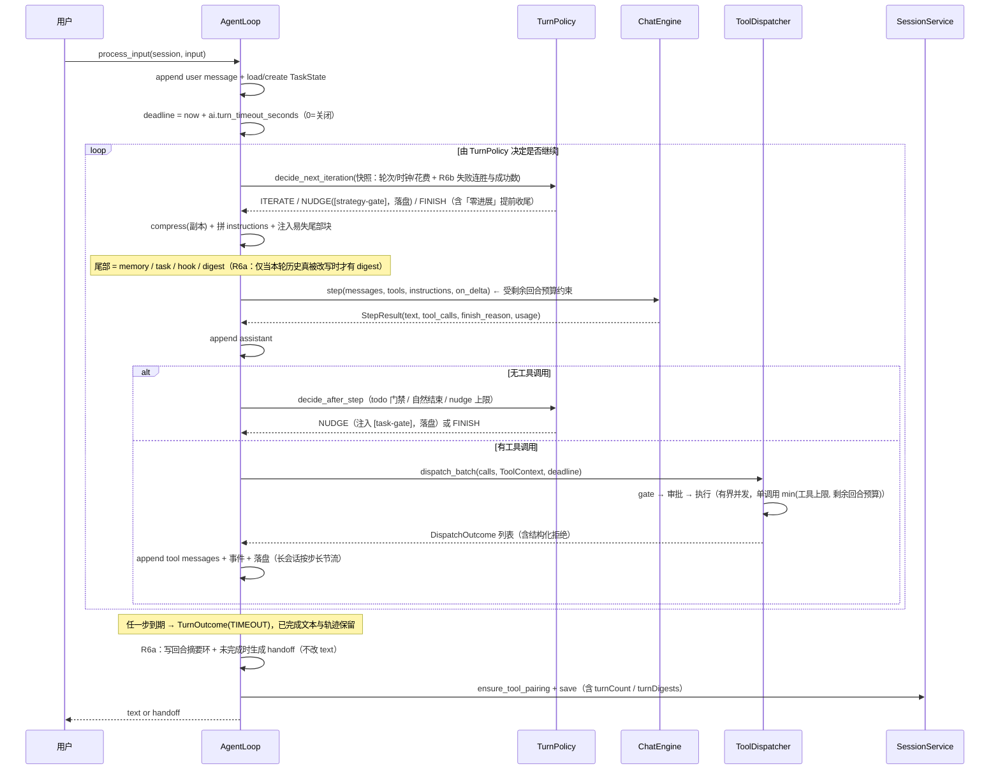
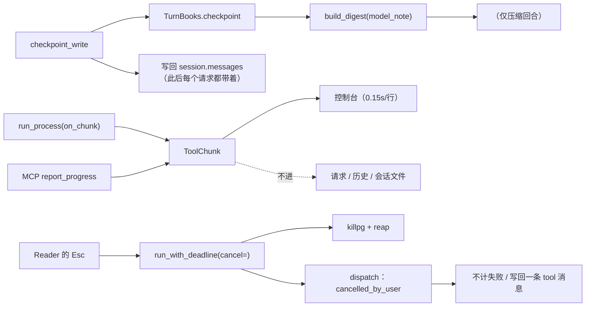
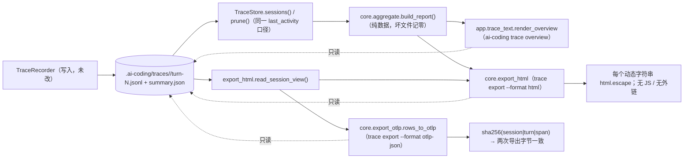
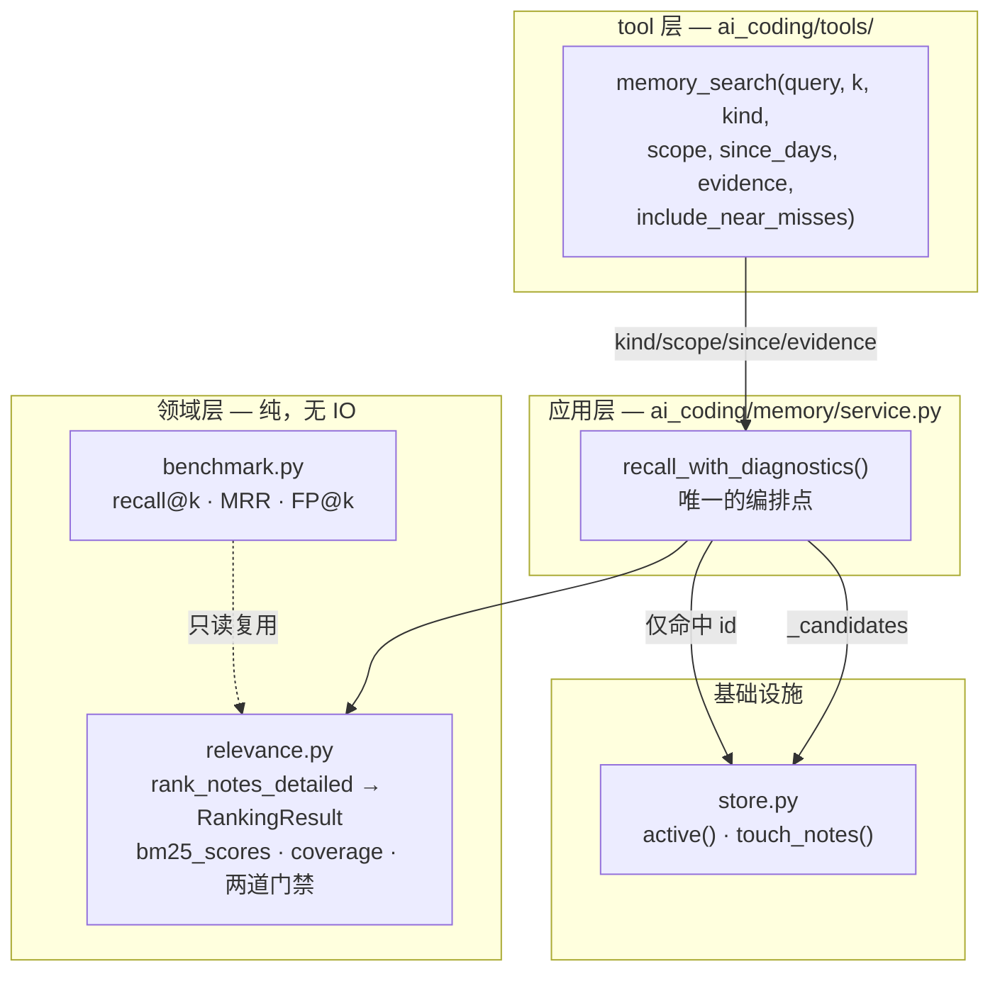

# 架构设计

ai-coding 是一个分层、**引擎可替换**的对话式编码助手：领域契约、编排循环、工具分发、
上下文压缩、记忆与会话全部是自家实现；模型调用只经由一个薄薄的 `ChatEngine` 端口。

> R1（编排层重构）之后，项目**不再依赖任何 agent 框架**：循环归我们，SDK 已彻底移除。

## 包结构与依赖方向

```
ai_coding/
├─ cli.py          entrypoint：命令注册 + 组合根装配（唯一接触全部层的编排）
├─ domain/         纯数据契约 dataclass，零业务依赖，最底层
│                  R6 追加：turn_digest（回合摘要环 + 收尾交接渲染）
├─ config/         配置模型（Pydantic）与 YAML 加载，仅依赖 domain
├─ infra/          标准库封装：json / file / time / logger
├─ security/       沙箱、权限门、审批回调、过期读保护；R6 追加 user_prompt（模型主动提问的通道）
├─ tools/          工具契约 + 8 个内置工具 + 注册表 + schema 转换 + 装配
├─ ai/             引擎端口（ChatEngine）与直连 chat.completions 的实现、映射、提示装配
├─ core/           自持循环、工具分发、事件、上下文压缩、MCP、子智能体、worktree、项目说明
│                  R4 追加：observers（扇出）、trace（轨迹+脱敏）、budget（账本）、guard（门卫）、hooks（钩子）
│                  R5 拆出：turn_report / memory_turn / compaction / request_builder
│                  R7e 追加：steering（转向队列）
│                  R7 拆出：turn_books（回合账本 + TurnFrame）/ turn_close（收尾交接）
│                              request_assembly（一次请求的组装）/ turn_hooks（钩子的两次调用）
├─ service/        会话持久化
├─ memory/         记忆检索 / 提取 / 聚合
├─ skills/         技能目录注册表
├─ app/            命令分发与行式输出：slash / commands（handle_input）/ console（DialogueConsole）
└─ server/         后端 IPC：world（组合根）、service（Unix socket）、handlers、launcher（起 bun 前端）
        前端本体在 `ai_coding/frontend/`（TypeScript + OpenTUI）：types/ → ipc / keymap → state/ → component/ → routes/
```

依赖方向单向：`domain` 不被任何层反向 import；`config`/`infra` 只依赖 `domain`/标准库；
`ai` 只依赖 `domain`（**不依赖 `tools`** —— 工具 schema 由调用方以 `list[dict]` 传入，
否则会与 `tools → security` 形成环）；`core` 是唯一同时编排各层的层；`cli` 提供装配原语，
`server/world.py::build_world` 是运行时组合根。

## 模块职责

| 包 | 职责 | 关键入口 |
|---|---|---|
| `domain` | 不可变数据契约，跨层边界 | `ChatMessage`、`TaskState`、`StepResult`、`ToolResult`、`SessionData`；R6 起 `TurnDigest`（回合摘要 + 收尾交接，与 `TaskState` 一样自带 `render()`） |
| `config` | 配置模型、YAML 加载、camel→snake 归一化 | `ConfigLoader`、`ConfigManager`、`AppConfig`、`AIConfig` |
| `infra` | JSON/文件/时间/日志工具 | `json_utils`、`file_utils`、`time_utils`、`logger_setup` |
| `security` | 失败关闭的安全层 | `Sandbox`、`PermissionGate`、`ApprovalCallback`、`FileStateTracker`；R6 起 `UserPromptCallback`（模型主动提问的通道，`ask_user` 用） |
| `tools` | 工具契约、实现、注册表、schema | `BaseTool`、`ToolContext`、`ToolRegistry`、`build_tool_registry` |
| `ai` | 引擎端口 + 实现 + 映射 + 提示装配 | `ChatEngine`、`OpenAIChatEngine`、`PromptAssembler` |
| `core` | 编排与增强 | `AgentLoop`、`ToolDispatcher`、`ContextManager`、`MCPManager`、`SubAgentRunner`；R5 起另有 `TurnReporter`（对外陈述）、`TurnMemory`（记忆侧）、`Compactor`（压缩）、`request_builder`（易失尾部）；R9 起 `aggregate`（跨会话聚合）、`export_html` / `export_otlp`（两个渲染器） |
| `service` | 会话读写（原子） | `SessionService` |
| `memory` | 记忆三层操作与持久化 | `MemoryService`、`MemoryStore` |
| `skills` | 技能目录扫描与目录文本 | `SkillRegistry` |
| `app` | 命令分发与行式输出（无 UI 依赖，可离线测） | `slash.parse_slash`、`commands.handle_input`、`console.DialogueConsole` |
| `server` | 后端 IPC 服务端（一个 TUI 客户端） | `world.build_world`（组合根）、`service.IpcService`、`handlers.make_handlers`、`launcher.run_tui` |

## 引擎边界

`ChatEngine` 是唯一的模型调用端口，语义是**跑一步**而不是跑完一个回合：

```python
class ChatEngine(ABC):
    async def step(self, messages, *, tools, instructions=None, on_delta=None) -> StepResult: ...
    async def aclose(self) -> None: ...
```

`messages` **已包含本轮用户消息**，引擎不得追加任何东西（历史 bug：早期实现每回合发两条
相同的 user 消息，现在有回归测试兜住）。`tools` 是已经构建好的 OpenAI function schema。

默认实现 `OpenAIChatEngine` 直连 `chat.completions(stream=True)`：把 `delta.content` 累积成文本，
把按 `index` 分片的 `tool_calls` 增量合并成调用（`ai/toolcalls.py`，纯函数），
并可选地请求 `stream_options.include_usage` 取回 token 用量。

**换引擎只需实现 `ChatEngine`**：领域层、编排、分发、会话、记忆均不受影响。

## 组合根与装配

`cli.py` 提供装配原语，`server/world.py::build_world` 是运行时组合根：

```
cli.py::main(path, workspace, skills)
   └─ server/launcher.py::run_tui(path, workspace, skills)
         world = await server/world.py::build_world(path, workspace, skills)
            ├─ ConfigManager.initialize(path) ─→ AppConfig
            ├─ build_engine_from_config(app_cfg) ─→ OpenAIChatEngine
            ├─ _build_tool_registry(app_cfg, workspace, skills, user_prompt=…)
            │     └─ Sandbox + FileStateTracker + 8 个工具（含 subAgent）+ 可选 skill
            ├─ MCPManager(app_cfg.mcp).open_all() ─→ 远端工具注册进同一个 registry
            ├─ _build_loop(...) ─→ AgentLoop(engine, sessions, registry,
                                          gate, approval, context, memory, prompt,
                                          skills, project, settings, trace, guards,
                                          hooks, steering)
            └─ approval = CLIApprovalCallback()（provider 由 handlers._wire_approval 安装）
         service = IpcService(/tmp/ai-coding-<pid>.sock) + make_handlers(world, service)
         spawn bun ai_coding/frontend/src/index.tsx（AI_CODING_SOCKET 环境变量；tty 归前端）
```

> ⚠️ **已被 M3 取代**：M3 起 `open_all()` 改为非阻塞（只起 supervisor 即返回），
> 签名是 `async def open_all(self) -> None`，**不返回工具列表**。上图是旧设计分析，
> 保留作为历史记录。工具表面请读 `MCPManager.available()`。

两条关键接线规则：

- **审批策略在组合根决定**：`build_world` 显式传 `CLIApprovalCallback`，其 provider 由
  `handlers._wire_approval` 装到 IPC 服务端——前端的审批面板把答案作为
  server-initiated request 的应答发回。子智能体内部走 `AutoApproveCallback`（无人可问）。
- **权限门属于分发器，不属于注册表**：注册表只装工具，门与回调由 `AgentLoop` 注入。

> `build_world` 构造 `AgentLoop` 时仍传 `observer=None`：普通回合由 `session.prompt` 的
> runner 传回合级 observer，loop 事件经 `server/bridge.py` 的映射后作为 `event` 通知推给前端。

## 一次回合的数据流



## 扩展点

| 想改什么 | 怎么做 |
|---|---|
| 换模型引擎 | 实现 `ChatEngine` 并在 `build_engine_from_config` 里返回它 |
| 新增工具 | 继承 `BaseTool`（实现 `execute(params, ctx)`），在 `build_tool_registry` 注册 |
| 改审批策略 | 实现 `ApprovalCallback`，在 `server/world.py::build_world` 传入 |
| 观察循环 | 实现 `LoopObserver`（`on_event`）并 braid 进 loop；`server/bridge.py` 把事件映射成 IPC `event` 通知推给前端 |
| 改 TUI 布局 / 渲染 | 改 `ai_coding/frontend/`（TypeScript + OpenTUI）：布局在 `component/`，事件→视图在 `state/` |
| **加一个运行时守卫**（R4b） | 在 `core/guard.py` 实现 `check()`（返回 `GuardDecision`），加进 `GuardChain`；在 `cli._make_guards` 装配 |
| **挂钩子**（R4c） | 配置 `hooks.events`，写脚本（stdin/stdout JSON）或放 `<workspace>/.ai-coding/hooks/*.py`（进程内） |
| **改可观测**（R4a） | 自己实现 `LoopObserver` 并 `Braid` 进去；或改 `core/trace.py` 的落盘与脱敏策略 |
| **让模型主动提问**（R6c） | 实现 `UserPromptCallback`（`async ask`）并在 `build_world` 传给 `_build_tool_registry(user_prompt=...)`；不传即不注册该工具（M0 起 IPC 路径的默认值就是 "no user"） |
| **改回合摘要/交接的措辞与边界** | 改 `domain/turn_digest.py`（纯函数，无 IO）：`build_digest` 的一行内容、`render_working_memory` 的注入规则、`render_handoff` 的报告 |
| 接入外部工具集 | 用 `MCPManager` 的模式：把远端工具适配成 `BaseTool` 注册进同一个注册表 |
| 换压缩/记忆实现 | `AgentLoop` 的 `context` / `memory` 都是可注入的可选组件 |
| 改「什么时候继续/停止」的规则 | 改 `core/turn_policy.py`（纯单元，19 条决策表测试），不要动编排器 |
| 给某个工具加/改调用上限 | 覆盖该工具的 `max_duration_seconds`（`None` = 只受回合预算约束） |
| 新增一种「等外部世界」的 IO | 走 `infra/deadline.run_with_deadline`；子进程走 `infra/subprocess_runner` |

## 设计取舍

- **失败关闭**：未知工具与无回调的 WARN 默认拒绝；DENY 永不因回调而放行。审批回调自身抛异常
  也按拒绝处理。
- **组合根决定策略、机制层保持中立**：分发器对 WARN 的处理是「问回调、无回调即拒」，
  「非交互该自动批准」是 CLI 组合根的政策。
- **静默降级**：记忆、L4 摘要、MCP 连接、worktree 隔离等增强组件失败时回退而非中止会话。
  模型调用失败则分成三类：**换个模型能解决的**——限流、5xx、网络抖动、认证失败——
  按配置的 `fallback_models` 在本回合内换模型重试（M2）；**上下文超长**的——同一份
  messages 在每个模型上都会超，所以不换模型，而是强制压缩一次历史再重发当前 step，
  每次回合至多一次（G5-1）；**换谁都不行的**（请求本身不合法）以及**已经吐字后流断的**，
  一律以 `ERROR` 结束并保留已完成轨迹。后者绝不换模型：第二个模型会重复已显示的文本、
  拼接半个 tool call。
- **易失 vs 持久**：每轮注入的任务状态块是视图（不落盘），todo 门禁提醒是指令（落盘）。
- **只改副本**：上下文压缩在历史副本上进行，绝不污染调用方状态。
- **结构化优先**：工具结果、拒绝、子智能体回包都带机器可读的 `data`，而不是只有一段文本。
- **任何等待都有上限（R2）**：模型步、工具调用、子智能体、MCP 连接、压缩/记忆都受
  `infra/deadline` 约束；到期是**放弃式取消**（不等对方响应取消），因此
  「工具卡住 ⇒ 回合永远不结束」这类故障不可能再出现。回合上限见 `ai.turn_timeout_seconds`。
- **进程执行只有一个出口（R2）**：`infra/subprocess_runner`（线程 + `killpg`），
  不再让业务代码各自 `create_subprocess_*`——那样会各自踩一次「取消要等管道 EOF」的坑。

## R8 新增/改变的三条边

包结构上多了一个工具与一个验收用 server：
`tools/checkpoint_tool.py`（`checkpoint_write`）、`scripts/mcp_progress_server.py`。



内容分层（哪一层被谁动过，R8 的讨论都按这套编号）：

| 层 | 是什么 |
|---|---|
| L1 | 系统提示词（静态，永不含记忆 / digest） |
| L2 | 持久历史（`session.messages` 经压缩后的 `history`） |
| L3 | 易失尾块（memory → task → hook → digest，每轮重渲染后追加） |
| L4 | 写回的工具消息（L2 的子集） |
| L5 | 会话文件（messages / task / turn_digests / 收割游标） |
| L6 | 记忆库 `.memory` |
| L7 | 观测事件与控制台（`ToolChunk` 属于这里） |
| L8 | 在跑的子进程（R2b 的 runner） |

R8 的结论：**R8b 只动 L6**；**R8a 动 L2/L3/L4/L5/L7（并间接影响 L6 的 evidence）**；
**R8c 动 L2/L4/L7/L8**。

## R9：策略在工具层，观测是一个数据源三个出口

### 依赖门禁的边界（谁拥有策略）

R1 把 `depends_on` 记进了数据，却把「要不要执行」留空。R9 补的是**判断权的位置**：
领域层只回答「谁挡着我」（`blockers()`，纯查询、零策略），工具层才回答「所以你不许动」
（`todo_write` 的两个拒绝）。这样 `TaskState.update()` 的宽松语义、`<task-state>` 的渲染形状、
停止判定全都不动，也不需要为了门禁给领域对象引入状态机。

```mermaid
flowchart TB
    M["模型"] -->|todo_write(add, depends_on)| T["TodoWriteTool (enforce_dependencies)"]
    T -->|未知 / 自指 / 重复| RJ["拒绝：unknown_dependency / self_dependency，清单不变"]
    T -->|合法| D["TaskState.add (next_id)"]
    M -->|todo_write(update, status)| G{"in_progress / completed?"}
    G -->|否| OK["直接放行（pending / blocked / dropped）"]
    G -->|是| Q["TaskState.blockers(id)"]
    Q -->|空| UP["TaskState.update"]
    Q -->|"open / unknown / cycle"| RB["拒绝：blocked_by_dependencies + 三条出路"]
    D --> INV["dependency_invariant(): 新数据天然是 DAG"]
```

### 观测：一个数据源、三个出口

写入侧一个字都没改（`turn-*.jsonl` + `summary.json`）。R9 加的是**读路径**：
`TraceStore.sessions()` 枚举目录，`build_report()` 折成一份纯数据，三个渲染器把它变成
表格 / HTML / OTLP-JSON。



三条边界：**只读**（三个出口没有一个会写轨迹或改会话）、**格式冻结**（轨迹行的字段名与
`v/ts/session/turn/span/parent/iter/evt/data` 都不动）、**对账优先**（`summary` 与磁盘回合数不一致
时只标注 `mismatch`，不用它去猜真相）。

## R10：检索变成可测量的，诊断落在服务层

一句话：**排序是纯函数，门禁是纯函数，「为什么没命中」是服务的职责，工具只负责把诊断排成人能读的话。**



三条边界：

- **`benchmark.py` 只 import `ai_coding.memory.note`**（全模块唯一的项目内依赖），`store` /
  `service` / `relevance` 一个都不 import。它要评分的那个排序器是**注入**进去的：
  `evaluate(rank, cases)` 收一个 `Callable[[str], Sequence[str]]`，由
  `scripts/retrieval_cases.py` 在脚本里用 `rank_notes` 拼出来。方向是单向的——
  `relevance.py` 不 import 基准。否则基准就在给自己打分，一次重构能不改检索质量而移动所有数字。
- **`relevance.py` 不 import 服务层**。它只拿 `MemoryNote` 序列和一个钉死的 `now`，所以
  `scripts/retrieval_cases.py` 能在没有 store、没有 config、没有网络的条件下跑完整张表。
- **`RecallScorer` 是接缝**。未来的 embedding 打分器实现同一个 `rank_notes` 形状，store 与
  service 两层不动。**R10d 落地时没走这条缝**：语义分是以可选参数进 `rank_notes_detailed` 的，
  因为门（`coverage>=0.25 or cos>=min_cosine`）和排序（0.5/0.5 融合）都要同时看到两路分数，
  一个只返回排序的接缝装不下。接缝本身保留（向后兼容），但新代码不经过它。

### 内容分层：R10 动了哪几层

按上面那张 L1–L8 表（R8 的编号，R10 沿用）：

| 层 | R10 的变化 |
|---|---|
| L4 | **变了**：工具消息的 payload 从「id/kind/score」扩到「score/relevance/`matched_terms`/updated_time/pinned/evidence」，未命中时再加 `terms_known`/`terms_unknown`/`near_misses`/有界的 `index`。这条消息进历史并长期命中缓存，所以**每一次未命中都在为一个会话的剩余部分付 token**——这就是为什么 `index` 概览被硬性限制在 ~400 字符 |
| L6 | **变了，且本轮没有新文件**：召回命中现在经 `MemoryStore.touch_notes` 写 `hits` + `last_used`，所以 `consolidate` 的 `hits >= 3 → importance + 1` 第一次真正可达。`.memory` 的 schema 没变（字段早就存在），变的是**谁写**。顺带一处诚实化：`MemoryStore` 的类 docstring 原本宣称线程安全，`_mutate` 在 `_save` 之前放锁、`_save` 无锁读 `self._notes`，并发写会落到同一个 `<path>.tmp` 上（实测 4 线程 25 次里有 6 次产出非法 JSON，下次加载读到 0 条）——docstring 现在说的是这件事，`docs/features.md` 也记了 |
| L7 | **变了**：`memory_search` 的未命中文案现在能说清「索引里没有这些词 / 是你这个过滤排掉的 / 门槛把它挡了」，轨迹和 transcript 因此可以解释**一次搜索为什么失败**，而不只是「没结果」。这是 L7 第一次承载失败的解释 |
| L1/L2/L3/L5/L8 | 不变。系统提示逐字节静态这条测试锁死的东西没动，易失尾块 `<memory-constraints>` 没动，会话文件没动，子进程没动 |
