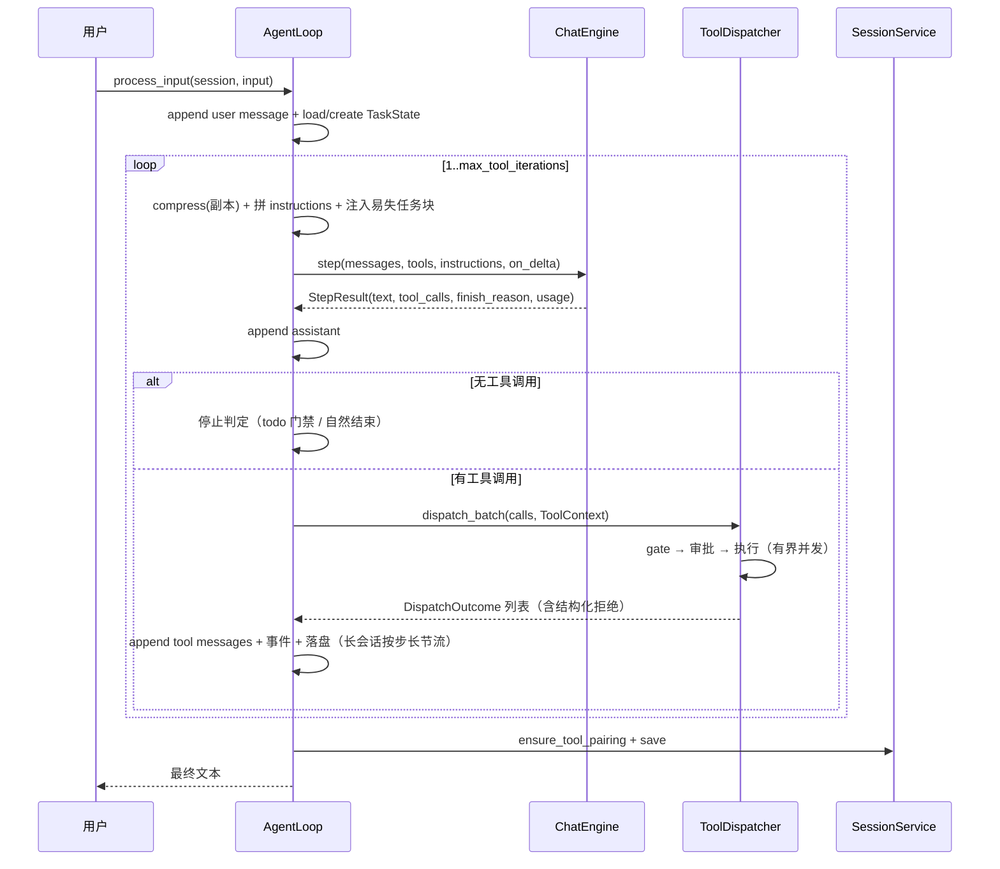

# 架构设计

ai-coding 是一个分层、**引擎可替换**的对话式编码助手：领域契约、编排循环、工具分发、
上下文压缩、记忆与会话全部是自家实现；模型调用只经由一个薄薄的 `ChatEngine` 端口。

> R1（编排层重构）之后，项目**不再依赖任何 agent 框架**：循环归我们，SDK 已彻底移除。

## 包结构与依赖方向

```
ai_coding/
├─ cli.py          entrypoint：命令注册 + 组合根装配（唯一接触全部层的编排）
├─ domain/         纯数据契约 dataclass，零业务依赖，最底层
├─ config/         配置模型（Pydantic）与 YAML 加载，仅依赖 domain
├─ infra/          标准库封装：json / file / time / logger
├─ security/       沙箱、权限门、审批回调、过期读保护
├─ tools/          工具契约 + 8 个内置工具 + 注册表 + schema 转换 + 装配
├─ ai/             引擎端口（ChatEngine）与直连 chat.completions 的实现、映射、提示装配
├─ core/           自持循环、工具分发、事件、上下文压缩、MCP、子智能体、worktree、项目说明
├─ service/        会话持久化
├─ memory/         记忆检索 / 提取 / 聚合
├─ skills/         技能目录注册表
└─ ui/             REPL 交互 + slash 解析 + 富文本控制台 + 事件渲染
```

依赖方向单向：`domain` 不被任何层反向 import；`config`/`infra` 只依赖 `domain`/标准库；
`ai` 只依赖 `domain`（**不依赖 `tools`** —— 工具 schema 由调用方以 `list[dict]` 传入，
否则会与 `tools → security` 形成环）；`core` 是唯一同时编排各层的层；`cli` 是组合根。

## 模块职责

| 包 | 职责 | 关键入口 |
|---|---|---|
| `domain` | 不可变数据契约，跨层边界 | `ChatMessage`、`TaskState`、`StepResult`、`ToolResult`、`SessionData` |
| `config` | 配置模型、YAML 加载、camel→snake 归一化 | `ConfigLoader`、`ConfigManager`、`AppConfig`、`AIConfig` |
| `infra` | JSON/文件/时间/日志工具 | `json_utils`、`file_utils`、`time_utils`、`logger_setup` |
| `security` | 失败关闭的安全层 | `Sandbox`、`PermissionGate`、`ApprovalCallback`、`FileStateTracker` |
| `tools` | 工具契约、实现、注册表、schema | `BaseTool`、`ToolContext`、`ToolRegistry`、`build_tool_registry` |
| `ai` | 引擎端口 + 实现 + 映射 + 提示装配 | `ChatEngine`、`OpenAIChatEngine`、`PromptAssembler` |
| `core` | 编排与增强 | `AgentLoop`、`ToolDispatcher`、`ContextManager`、`MCPManager`、`SubAgentRunner` |
| `service` | 会话读写（原子） | `SessionService` |
| `memory` | 记忆三层操作与持久化 | `MemoryService`、`MemoryStore` |
| `skills` | 技能目录扫描与目录文本 | `SkillRegistry` |
| `ui` | 交互终端与命令解析 | `run_repl`、`parse_slash`、`DialogueConsole`、`ConsoleObserver` |

## 引擎边界

`ChatEngine` 是唯一的模型调用端口，语义是**跑一步**而不是跑完一个回合：

```python
class ChatEngine(ABC):
    async def step(self, messages, *, tools, instructions=None, on_delta=None) -> StepResult: ...
    async def aclose(self) -> None: ...
```

`messages` **已包含本轮用户消息**，引擎不得追加任何东西（历史 bug：早期实现每回合发两条
相同的 user 消息，现在有回归测试兜住）。`tools` 是已经构建好的 OpenAI function schema。

默认实现 `OpenAIChatEngine` 直连 `chat.completions(stream=True)`：把 `delta.content` 累积成文本，
把按 `index` 分片的 `tool_calls` 增量合并成调用（`ai/toolcalls.py`，纯函数），
并可选地请求 `stream_options.include_usage` 取回 token 用量。

**换引擎只需实现 `ChatEngine`**：领域层、编排、分发、会话、记忆、UI 均不受影响。

## 组合根与装配

`cli.py` 是组合根：

```
ConfigManager.initialize(path) ─→ AppConfig
   ├─ build_engine_from_config(app_cfg) ─→ OpenAIChatEngine
   ├─ build_tool_registry(app_cfg, workspace, skills) ─→ ToolRegistry
   │     └─ Sandbox + FileStateTracker + 8 个工具（含 subAgent）+ 可选 skill
   ├─ MCPManager(app_cfg.mcp).open_all() ─→ 远端工具注册进同一个 registry
   └─ _build_loop(...) ─→ AgentLoop(engine, sessions, registry,
                                     gate, approval, context, memory, prompt,
                                     skills, project, settings, observer, workspace)
```

两条关键接线规则：

- **审批策略在组合根决定**：`ask` 是非交互入口，`approval=None` 被解释为
  「自动批准 WARN 级」（DENY 级照旧拦截）；`repl` 显式传 `CLIApprovalCallback` 弹 y/N/s。
- **权限门属于分发器，不属于注册表**：注册表只装工具，门与回调由 `AgentLoop` 注入。

## 一次回合的数据流



## 扩展点

| 想改什么 | 怎么做 |
|---|---|
| 换模型引擎 | 实现 `ChatEngine` 并在 `build_engine_from_config` 里返回它 |
| 新增工具 | 继承 `BaseTool`（实现 `execute(params, ctx)`），在 `build_tool_registry` 注册 |
| 改审批策略 | 实现 `ApprovalCallback`，在组合根传入 |
| 观察循环 | 实现 `LoopObserver`（`on_event`），挂到 `AgentLoop` 或 `process_input` |
| 接入外部工具集 | 用 `MCPManager` 的模式：把远端工具适配成 `BaseTool` 注册进同一个注册表 |
| 换压缩/记忆实现 | `AgentLoop` 的 `context` / `memory` 都是可注入的可选组件 |

## 设计取舍

- **失败关闭**：未知工具与无回调的 WARN 默认拒绝；DENY 永不因回调而放行。审批回调自身抛异常
  也按拒绝处理。
- **组合根决定策略、机制层保持中立**：分发器对 WARN 的处理是「问回调、无回调即拒」，
  「非交互该自动批准」是 CLI 组合根的政策。
- **静默降级**：记忆、L4 摘要、MCP 连接、worktree 隔离等增强组件失败时回退而非中止会话；
  但**模型调用失败不降级**——那是主链路断裂，必须显式以 `ERROR` 结束并保留已完成轨迹。
- **易失 vs 持久**：每轮注入的任务状态块是视图（不落盘），todo 门禁提醒是指令（落盘）。
- **只改副本**：上下文压缩在历史副本上进行，绝不污染调用方状态。
- **结构化优先**：工具结果、拒绝、子智能体回包都带机器可读的 `data`，而不是只有一段文本。
