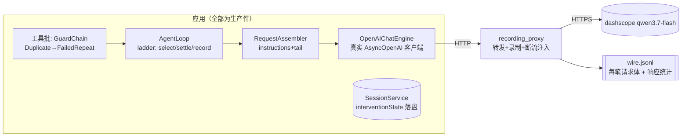

# 16 · 阶段一验收报告（真机流量接管）

> 角色：测试工程师 / 验收负责人。对象：`13`（设计）+ `15`（T1–T9 实施）在分支 `feat/orchestration-cognition` 的实现。
> **裁决：通过。** 0 阻断缺陷；2 条观察项（F1/F2）列入后续阶段。
> 证据目录（真机一键可复跑）：`/tmp/opencode/r19-run4/{simple,ladder,broken,closing}/`（`wire.jsonl` 全量报文录制、`session.json` 会话副本、脱敏后的临时 `config.yaml`）；离线验收 `tests/test_orchestration_wire.py`；代理与驱动脚本 `scripts/recording_proxy.py`、`scripts/r19_acceptance.py`。

---

## 1. 验收方法：三层证据 + 流量接管

不重跑单元测试式验收，而是**在真实 HTTP 边界上接管流量**：应用与模型之间插入录制代理（原样转发、逐笔落盘请求体、统计响应事件），所有断言读的是**线上报文**，因此"阶梯与线上之间的任何漂移"（注入消息丢失、`tools` 该无却有、环境块缺失、重试复读文本）都会在断言处失败。



**三层证据**：
1. **离线线上报文验收**（`tests/test_orchestration_wire.py`，假模型服务器 + 真 `cli._build_loop` 全栈）：阶梯闭环 / 断流续写 / 空步重试 / 收尾无工具，4 例全绿；
2. **真机四场景**（`scripts/r19_acceptance.py`，真模型 + 录制代理）：simple（结构不变量）/ ladder（阶梯真爬梯）/ broken（真实断流）/ closing（预算结局收尾）；
3. **门禁全量**：pytest 全量 exit 0、mypy 134 files clean、ruff 改动面 clean。

（req/model 流量说明：回合末记忆抽取器与主对话共用同一端点，录制中为独立一笔、独立 system 提示词——验收分类时区分对待，见 F3。）

**数据流（一次普通回合；★=阶段一触点，(W)=线上可观察物）**：

```
用户输入 ─▶ process_input ─▶ _begin_turn（★F1: git_branch）
  ┌─▶ [决策·前] policy.decide_next_iteration
  │      ├ deadline / token / C3 死亡门                    （不动）
  │      └ ★D select(账本) ──(W) [strategy/fatigue-gate] 消息
  │   ★record（搭 checkpoint 落盘；条件写 session）
  │   assemble：system(base+project+★A:methods+skills)     (W)
  │             tail 序：★F2 environment → … → task → …    (W)
  │   engine.step ──HTTP──▶ (W) 请求体（tools 有无可观察）
  │      ├ ★B 已输出中断 → [stream-interrupted] → 续写一次  (W)
  │      └ ★H 三无空步 → 静默重试一次（请求不变）
  │   有工具 → _run_tools：GuardChain ★D4 FailedRepeat
  │            （武装期拒，文案 change approach）           (W)
  │   无工具 → [决策·后] acceptance/task 阶梯（★D3）
  │            └ FINISH(迭代预算尽) ─▶ ★G 收尾调用 tools=[] (W)
  └─ _close_turn：★D5 settle(turn_end) ─▶ session.json     (W: interventionState)
```

## 2. 数据契约对照（字段级）

| 契约字段 | 生产者 | 消费者 | 持久化 | 线上/磁盘可观察 | 证据 |
|---|---|---|---|---|---|
| `intervention_state`（账本，五键 `level/at/outcome/fires/ref`） | `loop._note_intervention`（record）/ `_settled_interventions`（settle） | policy→interventions；`armed()`→guard 武装 | `session.json` 键 `interventionState`（条件写、任务完成清空） | 真机 ladder 场景账本原文 `{"strategy":{...level:4...exhausted...}}` | r19-run4/ladder/session.json；`test_interventions_loop` |
| `TurnDecision.intervention/level` | policy `_as_turn_decision` | loop 记账分支、`record` | 不落盘（派生） | 阶梯消息序列（gate 6 处） | 同上 |
| `TurnSnapshot.intervention_ledger/ask_user_calls` | loop（settle replace / books.snapshot） | interventions.select/settle | 不落盘（快照） | — | `test_interventions_loop` 跨回合 |
| `TurnView.strict_repeats` | `agent_loop:1271 ← interventions.armed(state)` | `FailedRepeatGuard.check` | 不落盘 | 拒绝文案 `change approach` | 离线 wire 测试 r4 断言；tmux 真机（G1 实录） |
| `git_branch`（runtime） | `_begin_turn ← infra.vcs` | environment 块 | **不落盘** | 真机每笔请求 `分支: main` | r19 simple 报文断言 |
| `<environment>` 块（tail 首位） | `request_assembly._environment_block` | 模型 | 不落盘（volatile） | 每笔请求首 tail 块 | r19 四场景 + 离线 wire |
| `<methods>` 段 | `prompt.METHODS_SECTION` | 模型（含子代理） | 不落盘 | 每笔请求 system | 同上 |
| `stream_deltas/stream_continued/empty_retries/ask_user_calls` | `TurnBooks` notes | 续写条件 / 阶梯 helped 信号 | 不落盘（回合内） | `[stream-interrupted]` 消息 | r19 broken（真实断流） |
| 合成消息（gate nudge / 断流注记 / 收尾 prompt） | loop / interventions | 模型 + 历史 | 随 checkpoint/close 落盘 | 报文 user 消息序列 | 离线 wire 测试逐条 |

**缺漏字段检查**：账本五键 + 各门 `ref` 基准全部存在生产者/消费者/可观察位（表内），无"写了没人读"或"读了没人写"字段；`ref.acc` 含 `null`（未检查态）经 JSON 往返由 `test_interventions_loop` 的落盘读回断言背书。

## 3. 13/15 逐条核对

| # | 设计主张（13 §） | 验收证据 | 结论 |
|---|---|---|---|
| D 阶梯结构 | 四门一账本、窗口/三态结算/同级重试 | `test_interventions*` 全绿 + 真机 ladder 账本 L4 exhausted + tmux 回合边界同级重试实录 | ✅ |
| D 触发 | failed_streak≥2 或 stall；strategy>fatigue 优先 | 单元表测 + 真机 ladder 6 处 gate 消息 | ✅（盲区见 F1） |
| L2 武装拒绝 | `FailedRepeatGuard` 常备休眠、武装期拒、成功删指纹 | 离线 wire r4/r5：`reuse the earlier result`→`change approach` 均在报文；tmux 真机拒绝实录 | ✅ |
| A methods | 每笔请求 system 含 `<methods>`，子代理同享 | r19 全部场景 + 离线 wire 每笔断言 | ✅ |
| F environment | tail 首位、`工作区/分支/日期`、git 缺失不炸 | r19 报文含真实 `分支: main`；离线 wire 序断言（env 先于 task-state） | ✅ |
| B 续写 | 已输出中断→一次续写、消息持久化、无重复文本 | 离线 wire（切除后无"前半"泄漏）+ r19 broken（真实 RST 断流，续写注记上线路、回复完整） | ✅ |
| G 收尾禁工具 | 收尾请求 `tools` 缺席 | 离线 wire 13 笔（12 工具 + 收尾无 tools）+ r19 closing（预算结局、收尾 prompt、无 tools） | ✅ |
| H 空步重试 | 一次静默重试、请求不变 | 离线 wire：两笔请求消息数相等、无注入 | ✅ |
| 持久化纪律 | 条件写、搭车保存、不新增 save 时机 | session.json 键存在性与清空（任务完成）两向断言 | ✅ |
| 零改面 | 事件/前端/审批/快照/压缩不动 | `git show c98749b --stat`：无 events/frontend/approval 文件；golden 仅白名单 diff | ✅ |

## 4. 真机结果（r19-run4，qwen3.7-flash）

| 场景 | 对话请求 | 结果 | 关键证据 |
|---|---|---|---|
| simple | 2（+1 抽取器） | PASS | methods/env/`分支: main` 每笔成立；干净回合账本 null（不误触发） |
| ladder | 5（+1） | PASS | 线上 6 处 `[strategy-gate]`；账本 **L4 exhausted 落盘**：`{"strategy":{"level":4,"at":[9,11],"outcome":"exhausted","fires":1,"ref":{"asks":0}}}` |
| broken | 2（+1） | PASS | `aborted:true`（代理 RST）；续写请求含 `[stream-interrupted]`；散文 255 字完整 |
| closing | 2（+1） | PASS | 收尾请求无 `tools`；`_CLOSING_PROMPT` 在末条消息；回复=移交报告+模型收尾 |

> 备注：ladder 场景 walk 到 L4 的路径为"每次读取一个不存在的文件"的自然失败（非强迫复读）；第二版压力提示词被模型以 alignment 拒复读而作废——**模型拒绝复读时阶梯沉默是正确行为**（无失败连击即无触发），已固化为场景设计经验。

## 5. 发现清单

**F1 · 观察（非缺陷，建议列阶段二议题）**：strategy 触发面为"连续失败"与"零成功停滞"。真机实证：模型在每次失败 read 之间穿插**成功的 todo_write 杂务**时，两者均不触发（成功调用重置连击、且 `successful_calls>0` 使 stall 失活）——交替"失败+杂务"的卡死回合可绕过阶梯。与 13 §2.1 的触发定义一致（dsh 亦为 reminder-only），非本次实现偏差；是否加"失败密度"类触发器属阶段二决策。
**F2 · 文档缺漏（低）**：`config.example.yaml` 未收录 `guard.duplicate_threshold`（默认 2 由代码兜底）。非本次改动面，建议顺手补一行示例。
**F3 · 信息性**：回合末记忆抽取器与主对话共享端点（每回合 +1 笔流量）。验收/观测工具需按 system 提示词区分对话与抽取（`r19` 已实现分类）。
**F4 · 信息性（固化口径）**：收尾调用只在"迭代预算用尽"结局发生；模型自行文本收尾不带收尾调用（G8-2 既有设计）。G 的验收据此定场景。

**漂移/重复轮子 grep 结论（全 clean）**：`server.vcs` 零引用；门常量唯一在 `interventions.py`；`strict_repeats` 单生产者单消费者；`interventionState` 单写入口（session codec）；环境块文本无第二构建处；L2 站在既有 `DuplicateCallGuard/call_fingerprint/GuardChain` 上，无第二账本/第二快照类。

## 6. 复用件与后续

- `tests/test_orchestration_wire.py`：**线上报文层**验收基座（假 OpenAI 服务器 + 真全栈），后续阶段可直接扩场景；
- `scripts/recording_proxy.py`：通用流量接管（转发/录制/断流注入），与业务无关，阶段二 `/plan` 重定义验收可原样复用；
- `scripts/r19_acceptance.py`：真机四场景驱动（`--only` 可选），产物自带证据链。

**裁决：阶段一通过验收。** F1 列入阶段二触发面议题；F2 为独立小修。
