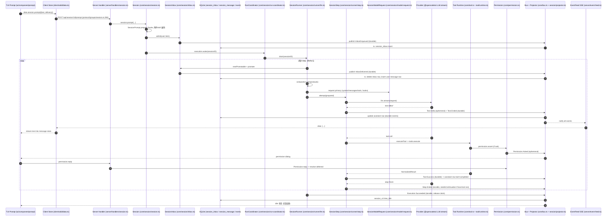

> 来源：并行调研 agent 产出（只读调查），高级工程师复核。
> 抽检通过：`runner/llm.ts:54 drain` + `:188-195` while、`step.ts:269-275 needsContinuation`、`inbox.ts:169 admit`——行号与代码一致。
> 未确认项保留在文末（§12），未做猜测性补全。

# opencode 编排数据流报告（一回合对话全链路）

- 仓库：`/home/linsir365/projects/opencode`
- HEAD：`0a46301e36d7edd517dd89736acc5daf9c74898e`（`git log -1` 确认）
- 范围：用户输入一句话 → agent 跑一轮（可能含 1 个工具调用）→ 模型回答 → 回合结束
- 方法：纯只读代码调查；所有论断带 `文件:行号`，无法证实的点集中在文末"未确认"。

术语对应（代码里真实存在的模块名）：

| 概念 | 代码模块 |
|---|---|
| 会话服务（对外 API） | `packages/core/src/session.ts`（`Session.Service`）与 `packages/core/src/session/session.ts`（`Session.make` 的 per-session 句柄） |
| 入口队列（steering/queue） | `packages/core/src/session/inbox.ts`（`SessionInbox`，落 SQLite 表 `session_inbox`） |
| 执行驱动/门铃 | `packages/core/src/session/execution.ts`（`SessionExecution`）、`packages/core/src/session/run-coordinator.ts`（`SessionRunCoordinator`） |
| agent 循环 | `packages/core/src/session/runner/llm.ts`（`SessionRunnerLLM`） |
| 单步执行 | `packages/core/src/session/runner/step.ts`（`SessionStep`） |
| 模型请求装配 | `packages/core/src/session/model-request.ts`（`SessionModelRequest`）+ `packages/core/src/session/context.ts`（`SessionContext`） |
| 事件总线 | `packages/core/src/bus.ts`（`Bus`）+ `packages/core/src/session/projector.ts`（`SessionProjector`） |
| 消息折叠 | `packages/core/src/session/message-updater.ts`（`SessionMessageUpdater`） |
| 工具注册/执行 | `packages/core/src/tool.ts`（`Tool.Service`）+ `packages/core/src/tool/runtime.ts` |
| 权限 | `packages/core/src/permission.ts`（`Permission.Service`） |
| 压缩 | `packages/core/src/session/compaction.ts`（`SessionCompaction`） |
| skill | `packages/core/src/skill.ts` + `packages/core/src/skill/*.ts` + `packages/core/src/tool/plugin/skill.ts` |
| HTTP server | `packages/server/src/handlers/*.ts`、`packages/server/src/event-feed.ts` |
| TUI | `packages/tui/src/**`，经 `packages/client/src/solid/*` 与服务端交互 |

---

## 1. 入口：用户输入从哪进入

主链路（TUI 为第一现场；web/desktop 走同一 server 路由）：

1. TUI 捕获提交：`packages/tui/src/component/prompt/index.tsx:1092`（`submit(delivery = "steer")`）→ `:1109`（`submitInner`）→ `:1356-1368` 调 `data.session.prompt({ sessionID, text, files, agents, skills, delivery, ... })`。
2. 客户端层（乐观写入 + HTTP 调用）：`packages/client/src/solid/data.ts:1544`（`prompt(input: SessionPromptInput ...)`）；本地乐观插入在 `:1550-1568`，真正发送在 `:1575`：`api().session.prompt({ ...request, id })`。
3. HTTP 路由定义：`packages/protocol/src/groups/session.ts:394`，`POST /api/session/:sessionID/prompt`。
4. 服务端 handler：`packages/server/src/handlers/session.ts:307-343`（`.handle("session.prompt", ...)`），调用 Session 服务 `session.prompt({...})`（`:311-319`）。
5. 核心 Session 服务：`packages/core/src/session.ts:416`（`prompt: (input) => sessions.forSession(input.sessionID).prompt(input)`）→ `packages/core/src/session/session.ts:145-178`：
   - `SessionPrompt.prepare`（`:159`，定义在 `packages/core/src/session/prompt.ts:29-91`）过 `session.prompt` 插件 hook（prompt.ts:40-51）、物化文件附件与 skill 附件（prompt.ts:53-76）；
   - `admission.admit`（`session.ts:166`）把 user 消息写进 Inbox：`packages/core/src/session/inbox.ts:169-202` 发布 durable 事件 `SessionEvent.InboxEnqueued`（inbox.ts:177）；
   - `execution.wake(sessionID)`（`session.ts:174`）唤醒执行。
6. 唤醒到循环：`packages/core/src/session/execution.ts:172`（`wake: coordinator.wake`）→ `packages/core/src/session/run-coordinator.ts:136-145`（`wake`，空闲则 `start`，忙则按 doorbell 合并）→ `run-coordinator.ts:97-110` 起 execution fiber → `loop`（`:74-85`）调 `options.drain` → `execution.ts:117` 的 drain 回调 → `execution.ts:95-97` 调 `SessionRunner.Service.drain`。

注意：`Session.prompt` 默认 `delivery: "steer"`（`session/session.ts:155`；预处理 hook 事件里同样是 `?? "steer"`，`session/prompt.ts:50`）。"发送成功"只代表**入队 durably 成功**，不代表模型已回复（客户端也是乐观渲染，client/solid/data.ts:1550-1568）。

---

## 2. 循环结构：ReAct/agent 循环在哪、一次迭代做什么、终止条件、续跑/steering/queue

循环本体在 `packages/core/src/session/runner/llm.ts`（`drain`，`:54-196`），配合 `run-coordinator.ts` 的"忙周期"语义。

### 2.1 外层：drain 的 step 循环

`llm.ts:188-195`：

```ts
while (true) {
  const next = yield* advanceToStep()
  if (next._tag !== "Ready") return next
  continuing = yield* runStep(next.context, step)
  step++
  force = false
  entering = false
}
```

- `DrainResult` 三态：`Complete | Moved | Reloaded`（`packages/core/src/session/runner/index.ts:23-28`）；`Continuation`（跨 Location 续跑）定义在 `runner/index.ts:21`。
- `advanceToStep`（`llm.ts:71-186`）在每次"步边界"做门禁：
  1. Location 关闭 → `Reloaded`（llm.ts:75-78）；
  2. 从 Inbox 取下一批可晋升项：`SessionInbox.nextPromotable`（llm.ts:83-87；inbox.ts:407-424）；
  3. 若队首是 control item（`compaction`/`move`）：compaction 就地执行（llm.ts:112-160），move 返回 `Moved`（llm.ts:93-102, 110-111）；
  4. 否则 `SessionInbox.promote`（llm.ts:166；inbox.ts:496-531）把 pending 行转成可见 user/system 消息（同一事件事务里删 inbox 行、插 message 行，见 §7）；
  5. 首次晋升且无标题 → 异步生成标题 `SessionTitle`（llm.ts:174-177）；
  6. `context.load(selected)`（llm.ts:179；context.ts:163-179）读取"当前 selection 下"的历史与模型。
- 无可晋升项且非 force → `DrainResult.Complete()`（llm.ts:161-162），busy period 结束。

### 2.2 内层：runStep 的 attempt 循环

`runStep`（llm.ts:206-297）每个逻辑 step 内可能多 attempt：

每次 attempt 的顺序（核心问题"一次迭代做哪几件事"）：

1. `prepareContext`（llm.ts:215；`llm.ts:198-203`）= `context.select`（session/agent/instructions/tools snapshot）+ `InstructionState.prepare`；
2. **自动压缩检查**：`compaction.compact({ reason: "auto", context: loaded })`（llm.ts:217-222）；若刚完成 → 换新 assistantMessageID 后 continue（llm.ts:219-222）；
3. step 上限判断：`loaded.agent.info.steps`（llm.ts:223），达到后请求尾附 `MAX_STEPS_PROMPT` 且 `toolChoice: "none"`（llm.ts:237-241；max-steps.ts:1-22）；
4. **组装 transcript**：`SessionModelRequest.baseTranscript(...)`（llm.ts:224-230；model-request.ts:100-120）；
5. **准备请求**（含插件 hook）：`context.request.primary(...)`（llm.ts:231-244；model-request.ts:407-408 → prepare 219-401）；
6. **第 6 步（真正执行）**：`steps.attempt({...})`（llm.ts:245-269；`SessionStep.attempt` step.ts:72-276）：流式读 provider、并发执行工具、发布事件、结账（详见 §4/§5）；
7. outcome 分发（llm.ts:270-294）：
   - `Completed`：`needsContinuation` 决定 frame 外层是否继续下一步（llm.ts:270-271, 295）；
   - `Retry`：等待重试（llm.ts:272-277；retry.wait 定义在 runner/retry.ts:101-115）；
   - `Continue`：流中断后发 `SessionEvent.Synthetic` "继续" 提示并换新 assistant ID（llm.ts:278-286；常量 `CONTINUE_AFTER_INCOMPLETE_STREAM` llm.ts:35-36）；
   - `Compacted`：关闭 overflow 恢复后 continue（llm.ts:287-290）；
   - `RecoverFull`：关闭 continuation 恢复（llm.ts:291-293）。

### 2.3 终止条件

- 模型回复**没有本地工具调用**时，`publisher.record().needsContinuation === false`（publish-llm-event.ts:609-619，判据：有 `!providerExecuted && (called || settled)` 的工具）→ `Completed(needsContinuation=false)`（step.ts:271-273）→ `runStep` 返回 → drain while 退出（llm.ts:295）→ `DrainResult.Complete`。
- 有工具调用 → `needsContinuation=true` → drain 循环 step++，重新 `advanceToStep`（会 promote 新 steer 输入、做 auto compaction）→ 下一 step 带着工具结果再请求模型。这就是 ReAct 循环的"迭代"。
- 会话空闲的对外终态由执行层发出：`SessionEvent.Execution.Succeeded / Failed / Interrupted`（execution.ts:119-147），并释放执行 claim（`:124-125, 130-146`）。

### 2.4 续跑 / steering / queue

- **steering**：`delivery: "steer"` 的输入在步边界即可晋升（`promote(scope)`；inbox.ts:43-48、496-531）；TUI 默认 steer（prompt/index.tsx:1092）。
- **queue**：`delivery: "queue"` 只允许在进入新 turn（entering）时整条目晋升（llm.ts:80-87, 161-171 的 `promotable === "steer"` 判断；inbox.ts:512-522）。
- 队列命令：`Session.cancelInbox/steerInbox/queueInbox`（session/session.ts:130-144）；delivery 变更事件 `InboxDeliveryChanged`（inbox.ts:240-260）。
- **门铃（doorbell）**：执行中到达的输入只 ring doorbell（run-coordinator.ts:136-145），drain 在退出前会再 drain 一次（run-coordinator.ts:74-85），doorbell 跨 drain 存活（settle 时重新起 successor，run-coordinator.ts:114-120）。
- **中断后恢复**：`SessionExecution.interrupt(..., { resume: true })` 会按 inbox 里 steer/control 项唤醒（execution.ts:153-170）；进程崩溃后的恢复靠 durable claim + `SessionRestart`（`packages/core/src/session/execution/restart.ts:203-222`）。
- **重试**：`SessionRunnerRetry.policy`（runner/retry.ts:64-99）：按 2s 指数（cap 10s/间隔）最多 10 次 + provider `retry-after`（上限 15 分钟，retry.ts:32-56）；`RetryScheduled` 事件投影到 assistant 消息 retry 字段（message-updater.ts:403-410）。

---

## 3. 模型请求装配

### 3.1 系统提示词

- 默认系统提示模板：`packages/core/src/session/runner/prompt/system.txt`（15 行）；渲染器 `packages/core/src/session/system-prompt.ts:5-27`（`make(tools)`，并按工具集合注入 `${OPENCODE_TOOL_GUIDANCE}` 行：`system-prompt.ts:10-27`）。
- `baseTranscript`（model-request.ts:100-120）：`system = [agent.system ?? SessionSystemPrompt.make(toolNames), initial]`：
  - `agent.system`：agent 文件自带 system（agent 加载见 §8）；
  - `initial`：**在此会话里冻结的 instructions 基线文本**，来自 `SessionHistory.entriesForRunner`（history.ts:118-135）里的 `InstructionState.initial(db, sessionID, instructions)`（history.ts:129；`packages/core/src/session/instruction-state.ts:165+`）。baseline 只在初始化/变更 epoch 时更新（instruction-state.ts:119-149）。
- instructions 的合成顺序（prompt-cache 友好）：`SessionContext.select` 里 `Instructions.combine([CodeMode catalog, MCP, references, skills, discovery, builtins, entries])`（context.ts:144-159），注释明确"从最共享到最局部"。

### 3.2 历史选择

- `SessionHistory.entriesForRunner`（history.ts:118-135）→ `messageEntries`（history.ts:78-108）：
  - 找最近一条 `status=completed` 的 compaction 作为边界（`latestCompaction` history.ts:28-60），只取 `seq >= boundary` 行；
  - native checkpoint（provider 侧 window）按 provenance 过滤（history.ts:23-26、102-107）。
- 历史 → LLM 消息：`toLLMMessages`（`packages/core/src/session/runner/to-llm-message.ts:327-331`），单条转换 `toLLMMessage`（同文件 250-324）：user/synthetic/skill/system/shell/assistant/compaction 各自映射；compaction（summary 型）渲染为 `<conversation-checkpoint>...<summary>...<recent-context>...`（to-llm-message.ts:303-322）。

### 3.3 工具 schema 生成

- 注册表快照：`Tool.snapshot(permissions)`（`packages/core/src/tool.ts:225-287`）产出 `Snapshot { definitions: ToolDefinition[], execute }`；definitions 由 `tool/runtime.ts:20-26`（`definition()`）生成，input schema 经 JSON Schema 转换/简化（tool/runtime.ts:155-186）。
- CodeMode：除 `codemode:false` 的直连工具外，其余工具聚合为一个 `execute` 工具（tool.ts:234-262）。

### 3.4 请求组装与 hook

- `SessionModelRequest.prepare`（model-request.ts:219-401）：
  - 先跑 `session.context` hook 让插件改 system/messages/tools（model-request.ts:236-247, 403-408）；
  - hook 可改名工具，按"对象同一性优先、其次 key"匹配回真实工具（model-request.ts:229-257）；
  - 输出上限计算 `outputLimit`（model-request.ts:88-98）：catalog limit ∩ 上下文余量，compaction 另有 32k 上限；
  - 构造 `LLM.request`：headers 注入 session/parent session 亲和性、`promptCacheKey`（model-request.ts:262-285）；`session.model.request` hook 可改 baseURL/headers（model-request.ts:288-303）；
  - image 数量/大小兜底裁剪：`boundImages`/`unsupportedParts`（model-request.ts:169-199, 280）。
- provider 选择：`SessionRunnerModel.resolve`（runner/model.ts:75-91）由 `ModelResolver` 解析 provider/model/variant；路由信息用于 headers 与 WS 判定。
- 真正的网络请求：`LLMClient.stream(request, options)`（`packages/ai/src/llm.ts:48-60`），支持 provider 支持时的 WebSocket session transport（model-request.ts:351-375）。

---

## 4. 工具调用解析与分发

### 4.1 工具定义与注册

- 工具以 `Tool.Info` 定义（name/description/input/output/execute）；注册通过各插件的 `ctx.tool.transform(editor => editor.add(...))`（例：`packages/core/src/tool/plugin/read.ts:40`、`shell.ts:188-216`、`skill.ts:38-70`）。
- 内置工具插件统一挂载在 `packages/core/src/plugin/internal.ts:239-245`（Read/Shell/Skill/Write/Edit/...）；插件生命周期服务在 `internal.ts:107+`。
- registry 状态更新后产生新状态（`State.create`，tool.ts:158-219）；会话选择时快照（context.ts:132-142）。

### 4.2 从流事件到执行（dispatch 链）

1. `SessionStep.attempt` 读 provider 流：`llm.stream(input.prepared.request, input.prepared.options)`（step.ts:104-133）。
2. 流里 `tool-call` 事件（非 provider 托管）触发并发 fork（step.ts:117-129）：
   `executeTool`（step.ts:88-98）→ `input.prepared.executeTool`（model-request.ts:385-399）→ `tools.execute`（tool.ts:263-284）。
3. `tools.execute` 内：`tool.execute.before` hook（tool.ts:271；hook 定义 tool.ts:103-111）→ 名字/可用性校验（tool.ts:272-283）→ `executeTool`（tool.ts:113-156）：`runtime.execute`（tool/runtime.ts:28-60，输入解码 62-85、输出编码 109-132）→ 具体 tool 的 `execute` → `tool.execute.after` hook（tool.ts:137/149）→ `normalizeImages`（tool.ts:74-101）。
4. 144-151 行为修正：`Tool.Error` 与 declines 的处理——declines（权限拒绝等）通过与 `SessionModelRequest.executeTool` 的 defect 隧道约定显式化（model-request.ts:383-399；§4.4）。

### 4.3 并发规则

- 每个 `tool-call` 一个 fiber，**并发执行**（step.ts:117-129，`Effect.forkScoped`）；provider 流与工具 fiber 之间靠"per-source 顺序"保证事件不交错（注释 step.ts:100-101）。
- 步结束前 `Fiber.awaitAll` 汇总（step.ts:143）；逐个分类成败（`classifyToolExits` step.ts:288-311）。
- 流中断/decline → `interruptTools`（step.ts:87, 142-146）。
- provider 托管工具（如内置 web 搜索）不发本地执行，直接由 `tool-result` 事件结算（publish-llm-event.ts:478-514）。

### 4.4 权限/approval 拦截

- 权限服务：`packages/core/src/permission.ts`；规则求值 `evaluate`（:87-97）/`evaluateInput`（:173-189）；决策 `deny | ask | allow`。
- 工具层拦截点（`permission.assert`，permission.ts:231-263）：
  - shell 命令解析成资源后 assert（`packages/core/src/tool/plugin/shell.ts:134-142`；解析链 shell.ts:116-152）；
  - write/edit 等文件工具（write.ts:78、edit.ts:117）；skill 工具（skill.ts:51-58）；外部目录访问（`packages/core/src/file-access.ts:135,154`）。
- `assert` 在 `ask` 时创建 pending 请求并发布 ephemeral 事件 `Permission.Event.Asked`（permission.ts:204-229, 246-247；事件定义 `packages/schema/src/permission.ts:44-53`）；用户回复走 `Permission.reply`（permission.ts:265-325，支持 `once/always/reject`，reject 携反馈时抛 `CorrectedError`，批量同会话请求一并联结）。
- TUI 侧：权限对话框 `packages/tui/src/routes/session/permission.tsx:136-139` 调 `data.session.permission.reply` → `packages/client/src/solid/data.ts:1738-1745` → `POST .../permission/reply`；server handler `packages/server/src/handlers/permission.ts:77-88`。TUI 订阅 `permission.asked/replied` 更新 UI（client/solid/data.ts:1160-1170）。
- 拒绝的模型可见性：无反馈拒绝以 defect 抛出（permission.ts:248-259 注释"故意隧道"），在 `SessionModelRequest.executeTool` 恢复为 typed failure（model-request.ts:385-399），最终由 step 把该 tool 记成 `Tool.Failed`（step.ts:199-207）而不是把 "user said no" 当工具输出喂给模型。

---

## 5. 结果回写

- 工具结果数据结构：`Tool.NormalizedResult { output?, content: Content[], metadata? }`（tool.ts:46-49）；内容规范化 `runtime.normalizeContent`（tool/runtime.ts:259-263）。
- 回写路径：step.ts:122-123 —— `toolOutput.truncate`（`packages/core/src/tool-output.ts`，参见 step.ts:30 导入与 `:122`）→ `publisher.toolExecution(id, name, outcome)`（publish-llm-event.ts:574-592）→ 发布 durable `SessionEvent.Tool.Success`（同文件 584-591）。
- 事件 → 历史消息：projector 订阅（`packages/core/src/session/projector.ts:703-705`）→ `message-updater.ts:342-358`：
  - 找到该 assistant 消息里对应 tool 条目；把 `state.status` `running → completed/error`，写入 `content/metadata/input/providerResultState`（message-updater.ts:342-377）。
  - `Tool.Called` 事件先把条目置为 `running`（message-updater.ts:323-339）。
- 下一步衔接：`runStep` 的 `Completed(needsContinuation)`（step.ts:271-273）驱动外层循环调用下一 step；下一 step 的 `context.load` 重新从 DB 读历史（llm.ts:163-179, 215），`to-llm-message.ts` 把 `AssistantTool(state=completed)` 转成 `ToolCallPart + ToolResultPart`（to-llm-message.ts:111-151, 184-206）。
- 关键并发不变式（务必保留）：publisher 的每个方法"先同步标记再 await"，不让两个来源（provider 流 fiber、每个工具 fiber）需要全局顺序；消费者按 id/ordinal 折叠（publish-llm-event.ts:65-77 注释）。

---

## 6. 事件流（Bus → SSE → TUI）

- 总线：`packages/core/src/bus.ts`（`Bus.Service`）。
  - durable 事件：同一事务内跑 projectors、写 `event` 表与 `event_sequence` 表（bus.ts:284-448；表定义 `packages/core/src/event/sql.ts:4-29`）；发布前经 `durableLocks` 按 aggregate 串行（bus.ts:469-477）。
  - ephemeral 事件：只通知监听者，不落库（bus.ts:479-483）。
  - 订阅面：`subscribe()`（live/typed，bus.ts:748-762）、`log()`（durable 回放 + follow，bus.ts:828-871）、`project()`（事件投影注册，bus.ts:882-890）。
- 会话事件的 durability 划分在 `packages/schema/src/session-event.ts`：`Text.Started/Ended (392/415)`、`Tool.Called/Success/Failed (507/530/551)` 等 durable；`Text.Delta (404)`、`Reasoning.Delta (443)`、`Tool.Input.Delta (487)`、`Tool.Progress (520)` 等 ephemeral。即**流式增量不进消息表，只走实时通道**。
- 消息持久化折叠：projector 把 Step/Text/Tool/Reasoning/Compaction 事件交给 `SessionMessageUpdater.update`（projector.ts:382），由 `message-updater.ts:31-485` 的判别式匹配维护 assistant 消息的分段内容与状态；`insertMessage`（projector.ts:386-401）写入 `session_message` 行。
- 出服务端（SSE）：
  - 路由：`packages/server/src/handlers/event.ts:11-27`（`handleRaw("event.subscribe")`，`contentType: "text/event-stream"`，先寄 `server.connected` 帧）。
  - feed：`packages/server/src/event-feed.ts:33-81`（`bus.listen` 收全部事件 → 过滤 `isOpenCodeEvent`（:49；判定 `packages/protocol/src/groups/event.ts:65-67`）→ `data: {json}\n\n` 帧（:29-31）→ 每订阅者一个 capacity 4096 的 Queue（:8, :76））。
- 到客户端：
  - 连接器：`packages/client/src/solid/connection.ts:97-133`（异步迭代 `api.event.subscribe`；要求首帧 `server.connected`；带 idle watchdog/重连/resync，:82-235）。
  - TUI 挂载：`packages/tui/src/context/client.tsx:25-35`（`createClientConnection(api, { onEvent })`）。
  - 事件应用：`packages/client/src/solid/data.ts:593`（`handleEvent`）大 switch：`session.text.delta` 追加文本（:909-917）、`session.tool.called/progress/success` 改 tool 状态（:940+）、`permission.asked`（:1160-1170）等；组件从该 store 渲染。
  - 生成客户端 `event.subscribe` 定义：`packages/client/src/promise/generated/client.ts:1690`。

---

## 7. 持久化触点（什么时候写什么）

存储为 SQLite（drizzle）。相关表（`packages/core/src/session/sql.ts`）：

- `session_v2`（:22-77）：会话行（含 `time_suspended` 执行 claim、tokens/cost 累计）。
- `session_message`（:79-98）：会话消息（assistant/user/compaction/... 的 JSON `data` + `seq`）。
- `session_inbox`（:125-145）：pending 输入（user/synthetic/compaction/move + delivery）。
- `instruction_entry/blob/state`（:147-176）：instructions 条目与 epoch 状态。
- 事件日志：`event` + `event_sequence`（`packages/core/src/event/sql.ts:4-29`）。
- `session_pending`（sql.ts:100-123）：仅在定义处出现、全仓未见其他引用，疑似遗留表（未确认其用途）。

回合内写入时刻：

| 时刻 | 触发 | 写了什么 | 证据 |
|---|---|---|---|
| prompt 到达 | `SessionInbox.admit` 发布 durable `InboxEnqueued` | `session_inbox` 插一行（pending） | inbox.ts:169-202；投影 `projectAdmitted` inbox.ts:277-317 |
| drain 晋升输入 | `InboxDelivered`（durable） | 同事务删 inbox 行 + 把 payload 插入 `session_message`（user/synthetic） | `projectDelivered` inbox.ts:324-336；producer `publish()` inbox.ts:458-488；projector 注册 projector.ts:609-640 |
| 执行开始 | `Execution.Started` durable，`commit` 钩子 | `session_v2.time_suspended = now`（写前意图 claim） | execution.ts:81-83, 111-116；`SessionStore.claim` store.ts:205-215 |
| 每个 step | `Step.Started` durable | `session_message` 插 assistant 行（或复用） | message-updater.ts:214-256 |
| 流式增量 | `Text.Delta` **ephemeral** | 不落库 | schema session-event.ts:404；bus.ts:479-483 |
| 文本/工具段结束 | `Text.Ended`/`Tool.Success` durable | 更新 assistant 行 content/state | message-updater.ts:293-301, 342-358 |
| step 收尾 | `Step.Ended`/`Step.Failed` durable | assistant 行补 `time.completed/finish/tokens/cost/snapshot` | message-updater.ts:262-287；事件构造 step.ts:241-250 |
| 整轮结束 | `Execution.Succeeded/Failed/Interrupted` durable，`commit` 钩子 | `session_v2.time_idle/idle_outcome`；失败/主动中断释放 claim（shutdown 中断例外，保留 claim 以便续跑） | projector.ts:403-432；execution.ts:119-147, 81-86 |
| compaction | `Compaction.Started/Ended/Failed` durable | 插/改 compaction 消息行 | message-updater.ts:412-478 |
| usage | `UsageRecorded` durable | `session_v2` tokens/cost += （applyUsage） | projector.ts:58-73, 607 |

---

## 8. skill 层（opencode 的"可加载说明/能力包"）

opencode 有原生 skill 概念（目录化的 `SKILL.md` + frontmatter），同时还有等价层级：agent 定义、command、plugin hook。

1. **skill 服务与发现**：
   - `packages/core/src/skill.ts:87-133`（`Skill.Service`：id/name/description/content/path 增删查）；
   - 发现/加载：`packages/core/src/skill/discovery.ts`（+ `config/plugin/skill.ts` 监听目录与 config 变化，`:150-183`，`editor.add(skill)` 在 `:179-181`；内置 `SkillPlugin` 在 `plugin/internal.ts:98`）。
2. **注入模型上下文**（两条路）：
   - 系统提示列出可用 skill 清单（id/name/description），由 `SkillInstructions.load` 生成并由 `SessionContext.select` 合并进 instructions（`packages/core/src/skill/instructions.ts:73-92`；`context.ts:137,150-158`）；
   - 模型主动加载：调 `skill` 工具（`packages/core/src/tool/plugin/skill.ts:38-70`），输出 `<skill_content>` 包体（`skill.ts:36-53`；文件列表采样 `skill.ts:55-68`），并过权限（skill.ts:51-58）。
3. **用户显式调用**：prompt 可带 `skills` 附件（`packages/core/src/session/prompt.ts:56-76` 将其展开为文本），随 user 消息进历史（to-llm-message.ts:266-283）；另有 `session.skill` 端点（server handler `packages/server/src/handlers/session.ts:380-397`）→ `Session.skill`（session/session.ts:223-245）发布 durable `SessionEvent.Skill.Activated`，投影成一条 skill 消息（message-updater.ts:173-185）。
4. **与工具层交互**：skill 工具本身是普通工具（权限 action 名就是 `"skill"`，skill.ts:51-58）；skill 内容最终是注入历史文本，不会改变工具表。
5. **等价物**：
   - agent 定义（含 system prompt、模型、steps、permissions、mode）在 `packages/core/src/agent.ts` 与 `config/plugin/agent.ts`（`.md` agents 加载、`ctx.agent.transform`）；
   - slash command：`packages/core/src/command.ts`（Command.Service）与 `config/plugin/command.ts:76-120`（模板求值 + 可 spawn subagent）；服务端入口 `session.command`（handlers/session.ts:345+）；核心执行 `session/command.ts:11-35`；
   - plugin hook：`packages/core/src/plugin/hooks.ts`（`session.prompt`/`session.context`/`session.model.request`/`tool.execute.before|after` 等，贯穿本报告各环节）。

---

## 9. 压缩（compaction）

- 触发时机（三个入口，全部收敛到 `SessionCompaction.compact`）：
  1. **auto**：每个 step 开始前无条件调用，内部按 `due()` 判断（llm.ts:217；compaction.ts:199-225；阈值 `estimateContext >= ceiling` compaction.ts:227-236，ceiling 默认留 10% buffer，compaction.ts:38-44, 205-213）；
  2. **overflow**：provider 以 "too long" 拒绝且尚未输出 → `Outcome.Compacted`（step.ts:147-159），由 runner 调 `compact({ reason: "overflow" })`（llm.ts:262-268）——收缩策略按首个被拒请求的 70%→50%→35%（compaction.ts:91-92, 388-439）；
  3. **manual**：`/compact` 入队为 control item（session/session.ts:246-264 admitCompaction；inbox 优先级 inbox.ts:533-549），在步边界执行（llm.ts:112-160）。
- 数据变换：
  - summary 型：把历史切成 older+recent（保留 `keep`≈15000 tokens，compaction.ts:38-44, 257-295），旧段落发给模型生成结构化 summary（模板 `SUMMARY_TEMPLATE` compaction.ts:101-140），lude 一次 nudge 重试（:274-291）；结果 = `{ text: summary, recent: 原文保留段, providerState }` 或 native `{ providerContext }`（compaction.ts:69-77）；
  - native 型（provider 支持时优先）：调用 provider 压缩（`LLMClient.canCompact`，compaction.ts:339-354），保留加密 window（compaction.ts:297-357）。
- 落库与后续历史：`Compaction.Ended` durable（compaction.ts:628-641）→ 一条 compaction 消息（message-updater.ts:425-461，含 summary/recent/providerContext/cost/tokens）；后续 `SessionHistory.latestCompaction` 以此为历史边界（history.ts:28-60），`to-llm-message.ts:303-322` 把它还原为 `<conversation-checkpoint>` 注入（native checkpoint 走 `SessionProviderContext.decode`，:306-307）。
- 附带效应：压缩的 token 花费记账（compaction.ts:595-606）；失败/中断有 `Compaction.Failed`（compaction.ts:617-625，进程崩溃遗留 `running` 由 `settleStaleCompactions` 清算 llm.ts:299-327）。

---

## 10. Mermaid sequence diagram（真实模块名）



（若发生压缩：Step 前 `SessionCompaction.compact` → `Compaction.Ended` durable → 新 checkpoint 行，下个 step 历史从 checkpoint 重放。）

---

## 11. 步骤表

| 步骤 | 调用者 file:line → 被调用者 file:line | 数据结构 in/out | 备注 |
|---|---|---|---|
| TUI 提交 | tui/src/component/prompt/index.tsx:1092,1109,1356 → client/src/solid/data.ts:1544 | in: prompt text/attachments/delivery；out: 本地乐观 user 行 | 乐观渲染，失败回滚 :1578-1583 |
| HTTP 发送 | client/src/solid/data.ts:1575 → protocol/src/groups/session.ts:394 | out: `POST /api/session/:id/prompt` | id 客户端生成，服务端幂等（data.ts:1550-1568 注释） |
| 服务端接收 | server/src/handlers/session.ts:307-343 → core/src/session.ts:416 | in: payload；out: 入队结果 | 错误映射 NotFound/Conflict/Attachment |
| 预处理入队 | core/src/session/session.ts:159 → session/prompt.ts:29-91；:166 → inbox.ts:169-202 | in: Input；out: `SessionInbox.Item`（user payload+delivery） | `session.prompt` hook 可改文本/附件/delivery |
| 唤醒 | session/session.ts:174 → execution.ts:172 → run-coordinator.ts:136-145 | — | 忙时只 ring doorbell（合并 scope） |
| drain 启动 | run-coordinator.ts:97-110 → execution.ts:117 → runner/llm.ts:54 | — | 每 session 单 execution fiber |
| 晋升输入 | runner/llm.ts:166 → inbox.ts:496-531 | in: pending rows；out: 可见 user/synthetic 消息 | 步边界：steer 全升，queue 仅 entering |
| 上下文装载 | runner/llm.ts:179 → session/context.ts:163-179 → session/history.ts:118-135 | in: Selection；out: Loaded{session,agent,model,initial,messages,tools} | 历史过最近 compaction 边界 |
| 自动压缩 | runner/llm.ts:217 → session/compaction.ts:199-225 | in: Loaded；out: skipped/completed/failed | completed 则换 assistant ID 重跑 |
| transcript 组装 | runner/llm.ts:224 → session/model-request.ts:100-120 | out: `{system: SystemPart[], messages: Message[]}` | system = agent.system ?? 默认模板 + instructions baseline |
| 请求准备 | runner/llm.ts:231 → session/model-request.ts:219-401 | out: `Prepared{request: LLMRequest, options, executeTool, retry}` | hooks 可改 tools/system/model route/headers |
| 单步执行 | runner/llm.ts:245 → runner/step.ts:72-276 | in: Prepared；out: Outcome(Completed/Retry/Continue/Compacted/RecoverFull) | 内含流读取+工具执行 |
| provider 流 | runner/step.ts:104 → @opencode/ai src/llm.ts:48-60 | out: `Stream<LLMEvent>` | WS 或 HTTP 由 transport 决定 |
| 事件发布 | runner/step.ts:116 → runner/publish-llm-event.ts:401-558 | in: LLMEvent；out: durable/ephemeral SessionEvent | 文本 delta 100ms 批量（:79, 162-177） |
| 工具分发 | runner/step.ts:88-98 → session/model-request.ts:385 → core/tool.ts:263-284 → tool/runtime.ts:28-60 | in: ToolCall；out: NormalizedResult | 每 call 并发 fiber |
| 权限拦截 | tool/plugin/shell.ts:135 / write.ts:78 / skill.ts:51 → permission.ts:231-263 | in: action/resources；out: allow/deny/ask | ask → Asked 事件 → TUI 对话框 |
| 权限回复 | tui/src/routes/session/permission.tsx:136 → client/solid/data.ts:1738 → server/src/handlers/permission.ts:77 → permission.ts:265-325 | in: once/always/reject(+feedback)；out: Deferred 结算 | reject 无反馈 = defect 隧道 |
| 工具结果回写 | runner/step.ts:122-123 → publish-llm-event.ts:574-592 → bus.ts → session/projector.ts:703-705 → message-updater.ts:342-358 | out: `Tool.Success{sessionID,assistantMessageID,id,content,metadata}`；assistant 行 tool=completed | 数据 fold 幂等：终态事件自包含 |
| 步收尾 | runner/step.ts:226-251 → bus（Step.Ended/Failed）→ message-updater.ts:262-287 | out: assistant 行 completed + usage + snapshot | files diff 计算 step.ts:227-235 |
| 循环续跑 | runner/step.ts:271-273 → runner/llm.ts:270-271,295 → llm.ts:188-195 | in: needsContinuation；out: 下一 step 或退出 | 本地工具→必续；无工具→结束 |
| 回合结束 | execution.ts:119-147 → bus（Execution.Succeeded 等）→ projector.ts:403-432 | out: session_v2.time_idle；释放 claim | shutdown 中断保留 claim 供重启续跑 |
| SSE 广播 | bus.ts:494-505 → server/event-feed.ts:48-79 → server/handlers/event.ts:11-27 | out: `data: {event}\n\n` | subscriber 溢出即断开（:65-67） |
| 客户端消费 | client/src/solid/connection.ts:97-133 → client/src/solid/data.ts:593 | in: OpenCodeEvent；out: store 更新 | 断线重连 + resync |

---

## 12. 未确认清单

1. `packages/ai` 内部把 `LLMRequest` 映射到具体 provider 协议（HTTP/SSE/WS）的实现细节未逐行确认；本报告只到 `LLMClient.stream` 入口（`packages/ai/src/llm.ts:48-60`）与 `SessionModelTransport` 的 WS 绑定处（`session/model-request.ts:351-375`）。
2. `session_pending` 表（`packages/core/src/session/sql.ts:100-123`）全仓仅见定义、未见使用方，疑似遗留；其迁移职责未确认。
3. TUI 渲染组件层（`packages/session-ui`、`packages/tui/src/component/*` 的消息渲染）只追到 client store（`client/src/solid/data.ts:593`），未追溯到具体 DOM/TUI 组件树。
4. `packages/tui/src/mini/*`（另一套轻量客户端，`mini/stream-v2.transport.ts:1739` 直接 `client.session.prompt`）与主 TUI 的差异未展开；`packages/sdk`/`sdk-next` 与主链路关系未核。
5. `subagent` 工具（`tool/plugin/subagent.ts`）触发的子会话完整回合链路、以及 `SessionTitle`/`SessionGenerate` 的独立请求链路未展开（已确认它们复用 `SessionModelRequest` 的 title/generate 变体：model-request.ts:407-412）。
6. `compaction` 的 native 路径依赖 provider 支持（`LLMClient.canCompact`），其 provider 端语义未核；summary 路径的 token 估算误差补偿参数（compaction.ts:53-57）未验证实际效果。
7. 事件 `session.usage.updated`（ephemeral）与 `UsageRecorded` 的聚合时序（projector.ts:75-104）在并发多 step 下的精确顺序未单独验证。
