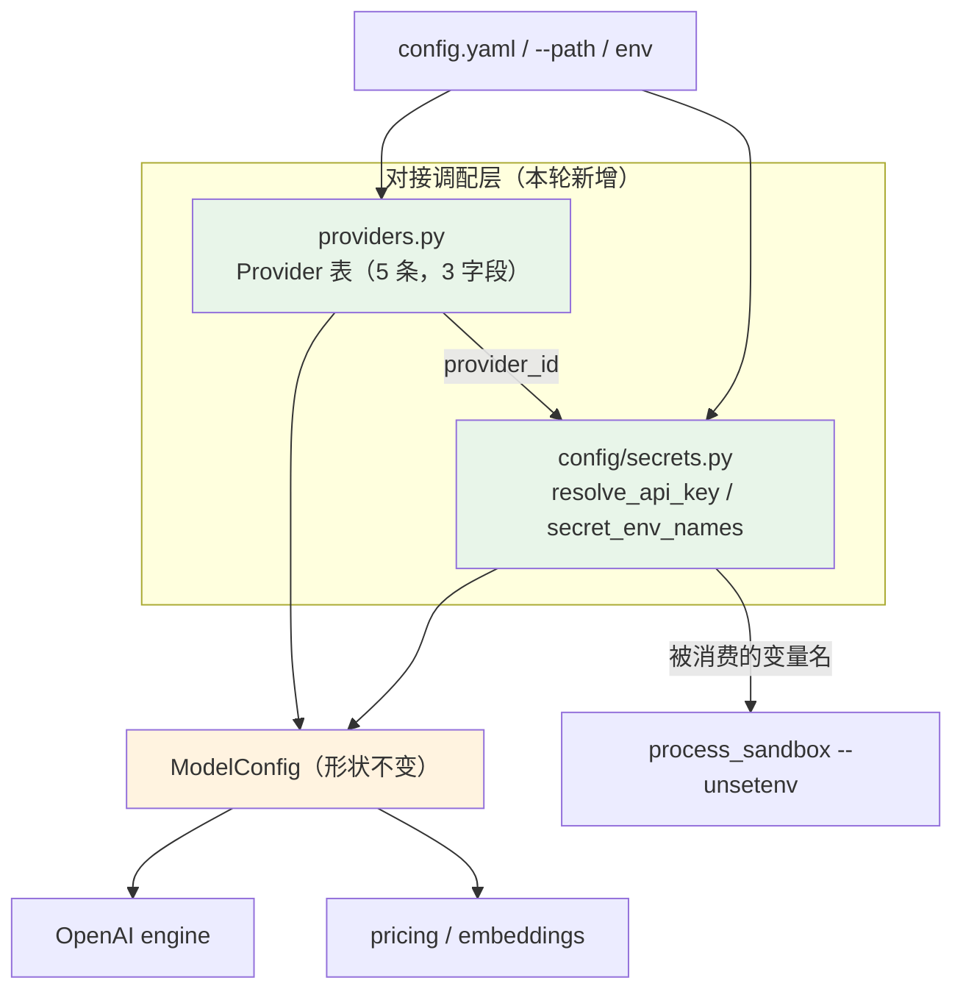

# 配置密钥 + 多 provider 适配 方案 v2

> 状态：**待你拍板 §3 的 4 个分叉**。
> v1 → v2：两轮子智能体评审共 **2 P0 + 8 P1 + 12 P2 + 7 P3**，逐条实测复核后收口。
> 修订记录见 §11。所有"现状"附实测证据；所有"改动"标注**为什么不是别的做法**。

---

## 0. 一句话结论

**多 provider 适配这件事，代码里已经做了大半 —— 只是散着、隐式、且没有名字。**
`domain/usage.py::cache_from_usage` 已能认 5 种 usage 形状；`openai_engine` 已能认两种 reasoning
字段、已用文本匹配认 context overflow、已在空 `tools` 时省略参数；`/embeddings` 能力已用 404
探测。**这些不需要推倒重来，本轮一行都不动。**

真正的缺口只有两个：

1. **密钥只能是一个写在 YAML 里的字面值** —— 全仓没有环境变量承载配置（`AI_CODING_*` 全是门控）。
   于是密钥必须落盘。
2. **provider 不是一等概念** —— `ModelConfig` 没有 `provider`，只有自由字符串 `base_url`。
   而一旦密钥可以来自环境，就必须知道"该读哪个变量名"。

所以本轮交付**一个薄对接层**，不是 LiteLLM：

```
ai_coding/providers.py          provider 表（3 个字段，零内部依赖）
ai_coding/config/secrets.py     密钥解析（${VAR} / 字面值 / provider 约定变量）
```

两者在 `_coerce_model` 一处汇合：**YAML → 可用连接**。`ModelConfig` 形状不变，所以
engine / pricing / embeddings / trace **一行都不用改** —— 这是本方案"最小"的来源。

**v2 相比 v1 砍掉了什么**：`Provider.label` 与整个 `display.py` 改动（见 §11 的 R-1）、
`CREDENTIAL_NAMES` 改动（见 §11 的 R-2）。

---

## 1. 现状核实（实测，不是推断）

### 1.1 配置与密钥

| 事实 | 证据 |
|---|---|
| `ModelConfig` 是裸 `@dataclass`，**15 个字段，没有 `provider`** | [model_config.py:8-41](file:///workspace/ai-coding/ai_coding/domain/model_config.py#L8-L41) |
| `api_key`/`base_url` 缺省变 `""`；但 `str(raw.get("api_key", ""))` 在 YAML 写 `api_key:`（空值）时得到字面串 **`"None"`** | [models.py:754-755](file:///workspace/ai-coding/ai_coding/config/models.py#L754-L755) |
| **没有任何环境变量承载配置值**；11 处 `os.environ` 全是门控/路径/白名单/透传 | `loader:84`(门控)、`static_check:73`(门控)、`paths:43,53`(路径)、`launcher:37,65`、`bash_redlines:139`、`hooks:172`(**白名单**)、`jobs:330`/`static_check:83`/`sandbox_bridge:256`(全量透传) |
| 无 `.env`、无 keyring、无加密存储 | `pyproject.toml` 无依赖 |
| 用户层是 **`~/.config/ai-coding/config.yaml`** | [paths.py:110-113](file:///workspace/ai-coding/ai_coding/paths.py#L110-L113) |
| **项目层不能新增 models 条目**，已有条目剥掉 `base_url`/`api_key` | [loader.py:209-221](file:///workspace/ai-coding/ai_coding/config/loader.py#L209-L221)、`MODEL_DESTINATION_MEMBERS`([:62](file:///workspace/ai-coding/ai_coding/config/loader.py#L62)) |
| 凭据词表**不含** `config.local.yaml` / `config.yaml` | `CREDENTIAL_NAMES`([credentials.py:34-36](file:///workspace/ai-coding/ai_coding/security/credentials.py#L34-L36)) |
| 沙箱 `read_deny_paths` 覆盖用户层 `config_home()`，**明确不含工作区配置** | [models.py:65-95](file:///workspace/ai-coding/ai_coding/config/models.py#L65-L95)，docstring 原文承认这一点 |
| `Redactor` 4 条密钥形状 + 1 条 KV；**不认 `Authorization: Bearer <不透明串>`** | [trace.py:65-77](file:///workspace/ai-coding/ai_coding/core/trace.py#L65-L77)；实测 `Bearer gw_7f3c9a2b41d84e6f9c0a` 原样返回 |
| 日志与 `/export` **完全不脱敏** | `logger_setup.py` 无 Redactor；`export_html/otlp.py` 零命中 |
| `jobs`/`static_check`/`sandbox_bridge`/`launcher` **全量透传 `os.environ`** | 见上 |
| `process_sandbox` **已有** `_PROXY_ENV_NAMES` + `--unsetenv` 循环 | [process_sandbox.py:186-195](file:///workspace/ai-coding/ai_coding/security/process_sandbox.py#L186-L195)、[:907-908](file:///workspace/ai-coding/ai_coding/security/process_sandbox.py#L907-L908) |

### 1.2 provider

| 事实 | 证据 |
|---|---|
| `provider_from_base_url` 从 host 猜，**已经猜得很准** | [display.py:21-35](file:///workspace/ai-coding/ai_coding/server/display.py#L21-L35)；实测 `api.deepseek.com→deepseek`、`openrouter.ai→openrouter`、`api.siliconflow.cn→siliconflow`、`localhost:8000→localhost`、`127.0.0.1:11434→"127"` |
| **usage 形状是"挨个试"，不依赖 provider** | [usage.py:40-69](file:///workspace/ai-coding/ai_coding/domain/usage.py#L40-L69)：flat / OpenAI `prompt_tokens_details` / Anthropic `cache_read_input_tokens` / DeepSeek `prompt_cache_hit_tokens` |
| reasoning 字段也是"挨个试" | `reasoning_content` → `reasoning`（openai_engine:443-447） |
| context overflow 靠英文文本子串 | `_OVERFLOW_MARKERS`（openai_engine:65-81） |
| 空 `tools` 省略参数；`stream_options` 由**全局** `ai.stream_usage` 控制 | openai_engine:344-349、factory:61-62 |
| `streaming` 字段**生产代码零消费者**，只有一条测试断言它 | `grep -rn "\.streaming" ai_coding/` → 0；[test_config_loader.py:108](file:///workspace/ai-coding/tests/test_config_loader.py#L108) 有断言 |
| `pricings` 按 **wire name** 索引，`default_price` 按 **配置 key** 取 | [cli.py:270](file:///workspace/ai-coding/ai_coding/cli.py#L270) vs [:278](file:///workspace/ai-coding/ai_coding/cli.py#L278) |
| `ai/factory.py` import `config.models` → 把新模块放 `ai/` 会成环 | [factory.py:6](file:///workspace/ai-coding/ai_coding/ai/factory.py#L6) |
| 顶层零依赖模块是既有范式 | `paths.py` / `shell_parse.py` / `attachments.py` / `cli.py` |

**结论**：provider 差异已经被"挨个试 + 文本匹配 + 404 探测"消化掉了，**这是对的、不该推翻**。
缺的只有两样，且都需要知道"这是哪个 provider"：**该读哪个环境变量**、**`base_url` 能不能省略**。

### 1.3 实测出来的三个真缺陷

**缺陷 A（onboarding 断头）**：文档让人 `cp config.example.yaml config.local.yaml`，但不传
`--path` 时它被当作**项目层**，`models` 整条被信任过滤丢掉。实测：

```console
project config ignored for default_model, models.deepseek-chat
models        : []
default_model : ''
# → 启动报 "no default model configured"
```

而 `config.example.yaml` 的**第一行**写着 "Copy to config.local.yaml (git-ignored) and edit."，
同一个文件的头部又写着 "Put them in the user layer instead" —— **自相矛盾**。
`how-to-run.md:23-31` 抄的是前半句，并且第 31 行还有一句独立错误（"不传 `--path` 默认加载空配置"，
而 `world.py:136` 用的是 `load_layers`，用户层存在就能启动）。

**缺陷 B（密钥保护反了）**：agent 能直接 `read` 一个含明文 `api_key` 的项目层 `config.local.yaml`，
而 `.env` 反而在凭据词表里。

**缺陷 C（配置撒谎）**：`streaming: true` 写在示例里、被 `_coerce_model` 读进来，然后**没人用**。

---

## 2. 外部调研结论（只留可迁移的，附来源）

| 结论 | 来源与可信度 |
|---|---|
| **适配层主流是两层**：协议层锚定 OpenAI 形状，能力差异用**数据表**；没有头部项目靠运行时探测当主手段 | LiteLLM `get_supported_openai_params`、LangChain `init_chat_model`、opencode（AI SDK + models.dev）、Aider（复用 LiteLLM）——四条独立路径收敛【官方文档】 |
| **能力表分"模型固有能力"与"宿主提供方式"**，`context` 拆 input/output | models.dev：`[capabilities]` + `[limit]`，reasoning/structured_output/cache 属 **per-host**【官方文档】 |
| **命名约定跟随产品形态**：网关型用 `provider/model`（model 串同时是路由键），编辑器扩展型用分离字段 | LiteLLM/Aider/OpenRouter vs opencode/Cline/Continue【官方文档】。**我们属于后者** |
| **错误归一化三件套**：统一异常类型 + `status_code/message/llm_provider` + provider 细节放独立字段 | LiteLLM exception mapping【官方文档】 |
| **密钥优先级**：env > 文件是主流；但**文件内部项目级覆盖用户级** | Aider（`.env` 多路径后加载优先）、Claude Code（Managed > CLI args > Local > Project > User）【官方文档】 |
| **存储两派**：keychain 优先失败回退 0600 文件（Claude Code）；或明文 + 严格 chmod + 密钥文件与配置分离（Codex `auth.json` 独立于 `config.toml`，文档明写 chmod 600） | 【官方文档】 |
| **agent 能读自己的密钥，没有官方 CLI 宣称解决了**。三件套：denylist 路径 + 权限门 + sandbox 凭证 mask | opencode Permissions【官方文档】、Claude Code Sandboxing【官方文档】；Claude Code 自己承认"文件工具、MCP、hooks 在 sandbox 之外运行" |
| **`${ENV_VAR}` 引用是常见做法** | 腾讯 CodeBuddy（`${ENV_VAR}` 避免明文）、Codex（`env_key` 存**变量名**而非明文）【官方文档】 |
| **兼容端点大量"静默忽略"而非报错**（`cache_control`、`disable_parallel_tool_use`、`thinking.budget_tokens` 全被忽略） | DeepSeek Anthropic 兼容表【官方文档】 |
| **不该抄的**：LiteLLM 的 100+ provider 与每日价目表、Proxy 的错误归因体系、opencode 的 models.dev + 事件驱动凭证、Claude Code 的 OS 级 sandbox | 同上 |

**直接含义**：只做"协议不变、能力用数据表、密钥可来自环境"，不做第二套协议、不做价目表、
不做 keychain。

---

## 3. 待你拍板的 4 个分叉（方案默认取推荐值）

### 分叉 1：密钥从哪里来？

| 选项 | 取舍 |
|---|---|
| **A（采用）环境变量 + `${VAR}` 引用** | 密钥不必落盘，CI/Docker/shell 直接给。不加 `.env`（会重新引入一个 agent 能读的磁盘文件，opencode 默认就 deny 它），不加 keychain（新依赖，CI/SSH 常失败、回退路径仍写文件） |
| B：A + `.env` | roadmap M-H2 点名了它，便利性最高；代价是多一个磁盘密钥文件 |
| C：A + OS keychain | Claude Code 的做法；代价是新依赖 + 无头环境不可用 |

**优先级（v2 修正，见 §11 R-3）**：`${VAR}`（显式）> 字面值 > provider 约定变量（仅在**文件没说**时）。
**env 永不覆盖你明写的 key** —— v1 的"env > 字面值"会让导出了 `DEEPSEEK_API_KEY` 的机器静默用错账号，
而且仓库里现成有一条测试会因此变红（[test_config_loader.py:60-81](file:///workspace/ai-coding/tests/test_config_loader.py#L60-L81)
断言 `apiKey: sk-test` → `api_key == "sk-test"`）。

### 分叉 2：含密钥的配置文件要不要对 agent 设防？

| 选项 | 取舍 |
|---|---|
| **A（采用，v2 改）不改凭据词表，改"丢弃时的提示"** | v1 想把 `config.local.yaml` 加进 `CREDENTIAL_NAMES`，评审发现它的**第二个消费者是 bash 硬拒绝**：`cp config.example.yaml config.local.yaml`（旧文档教的第一步）会被**硬拒**且无同意出口。改为：项目层 `api_key` 被丢弃时，警告里写明"这个 key 被忽略，而且 agent 能读到它 —— 移到用户层"。加上 `config init` 让用户层成为默认路径（用户层已被沙箱 read_deny 遮住） |
| B：仍加进凭据词表 | agent 的 `read`/`grep` 变 ASK；代价是 bash 硬拒 `cp`/`mv`/`git checkout` 这些文件名，且 basename 语义会误伤**任何仓库**的同名文件 |
| C：新增"ASK 级"文件名集合，只喂 `credential_rules` | 精确；代价是给一个刻意只有一级的模块加第二级 |

### 分叉 3：provider 抽象做到哪一层？

| 选项 | 取舍 |
|---|---|
| **A（采用）可选 `provider` 配置字段 + 3 字段描述表** | 表里只有 `id / default_base_url / api_key_env`，**每个字段都有指名消费者**。`provider` 只作**输入**，不进 `ModelConfig`（无下游消费者）。解析：显式 → `base_url` 推断（host+port 精确匹配）→ `generic` |
| B：不加字段，只把推断搬进模块 | 零配置变更；但自建网关永远识别不出 provider，**用错环境变量名取密钥** |
| C：`provider` 必填 + 双协议 | 最干净；但破坏所有现有配置，且 Anthropic 原生要第二套协议 |

**v2 砍掉了 `label` 字段**（见 §11 R-1）：现有 `provider_from_base_url` 已经猜得很准，
加表反而会让 `localhost:8000` 变成 `ollama`、把两条现有测试弄红。**`display.py` 一行不改。**

### 分叉 4：§1.3 的 onboarding 断头要不要一起修？

| 选项 | 取舍 |
|---|---|
| **A（采用）加 `ai-coding config init` / `config path`** | 把用户层配置**写出来（目录 0700、文件 0600）**，文档改成「init → 填 key → 直接跑」。信任边界（N-4b）是对的 —— 仓库不该能指定端点和凭据；缺的是**可写用户层的工具** |
| B：只改文档 + 升级提示 | 改动最小；用户仍要自己知道并创建那个路径 |
| C：放宽项目层（允许新增 models 条目并保留 `base_url`） | **不建议**：仓库又能指定端点，正是 N-4b 要防的外发风险 |

---

## 4. 设计

### 4.1 三个模块与边界

```
ai_coding/providers.py          新增，~55 行，**零内部依赖**
  Provider(id, default_base_url, api_key_env)
  PROVIDERS: openai / deepseek / qwen / ollama / generic
  host_port(base_url) -> tuple[str, int | None]     唯一一处 URL 解析
  provider_id_for(base_url, *, explicit="") -> str
  default_base_url(provider_id) -> str
  api_key_env(provider_id) -> str

ai_coding/config/secrets.py     新增，~70 行，只依赖 providers
  MissingSecret(ValueError)
  resolve_api_key(raw_api_key, provider_id, *, env) -> str
  secret_env_names(models_doc) -> frozenset[str]    给子进程脱敏用（纯函数）

ai_coding/config/models.py      改 _coerce_model（唯一汇合点）
```

**为什么放 `ai_coding/providers.py` 顶层**：`config/` 要用它，而 `ai/factory.py` 已 import
`config.models` —— 放 `ai/` 会成环（实测 [factory.py:6](file:///workspace/ai-coding/ai_coding/ai/factory.py#L6)）。
顶层零依赖模块是既有范式（`paths.py` / `shell_parse.py` / `attachments.py`）。

**为什么不放 `config/`**：`server/` 也要用它（`handlers.py:460,1092` 的 `/model` 列表），
顶层让两边都只依赖一个叶子模块。

### 4.2 `Provider` 的 3 个字段，每个都有指名消费者

| 字段 | 消费者 | 作用 |
|---|---|---|
| `id` | `_coerce_model` | 表键；`provider:` 的合法值 |
| `default_base_url` | `_coerce_model` | 允许 `provider: deepseek` 而不写 `base_url`（少一个能写错的字段） |
| `api_key_env` | `config/secrets.py` | 约定变量名；`ollama`/`generic` 为空 |

```python
PROVIDERS = {
    "openai":   Provider("openai",   "https://api.openai.com/v1",                       "OPENAI_API_KEY"),
    "deepseek": Provider("deepseek", "https://api.deepseek.com/v1",                     "DEEPSEEK_API_KEY"),
    "qwen":     Provider("qwen",     "https://dashscope.aliyuncs.com/compatible-mode/v1", "DASHSCOPE_API_KEY"),
    "ollama":   Provider("ollama",   "http://localhost:11434/v1",                       ""),
    "generic":  Provider("generic",  "",                                                ""),
}
```

**为什么只有 5 条**：LiteLLM 的 100+ 条是数百贡献者的持续投入；我们只需覆盖"实际会用的 + generic
兜底"。**新增一条 = 加一行**，这是表的全部意义。

**为什么 `provider` 不进 `ModelConfig`**：下游没有消费者（engine 用 `base_url`、pricing 用 `name`、
display 用 `base_url`）。加了就是第二个 `streaming`。

### 4.3 推断用 host+port 精确匹配

```python
def provider_id_for(base_url: str, *, explicit: str = "") -> str:
    if explicit:
        if explicit not in PROVIDERS:
            raise UnknownProvider(f"unknown provider {explicit!r}; known: {sorted(PROVIDERS)}")
        return explicit
    key = host_port(base_url)
    for provider in PROVIDERS.values():
        if provider.default_base_url and host_port(provider.default_base_url) == key:
            return provider.id
    return "generic"
```

**为什么必须带 port**：只按 host 匹配会让 `http://localhost:8000/v1` 命中 `ollama`（默认
`localhost:11434`），而 `test_server_display.py` 与用户直觉都认为那是 `localhost`。带 port 后
`localhost:8000 ≠ localhost:11434`。

**未知 `explicit` 是硬错**（列合法值），不是静默回落 —— 与 §4.4 的严格哲学一致；拼写错
（`deapsek`）必须当场说。

### 4.4 密钥解析：`${VAR}` > 字面值 > provider 约定变量

```python
_REF = re.compile(r"^\$\{([A-Za-z_][A-Za-z0-9_]*)\}$")

def resolve_api_key(raw_api_key, provider_id, *, env=None) -> str:
    env = os.environ if env is None else env
    raw = (raw_api_key or "").strip()
    m = _REF.match(raw)
    if m:
        name = m.group(1)
        if not env.get(name):                      # 空串按未设置处理
            raise MissingSecret(f"api_key references ${{{name}}}, which is not set; export {name}")
        return env[name]
    if raw:
        return raw                                  # 明写的 key 永不被覆盖
    name = api_key_env(provider_id)
    if name and env.get(name):
        return env[name]
    return ""
```

三个决定，都要写进文档：

- **env 只在文件没说时生效**。v1 的"env 覆盖字面值"会让导出过 `DEEPSEEK_API_KEY` 的机器
  静默用错账号，且让现有测试看机器环境。
- **`${VAR}` 缺失/为空是硬错**，消息给出变量名。今天 `api_key: ""` 会一路走到
  `AsyncOpenAI(api_key="")` 才炸，错误信息是 `The api_key client option must be set` ——
  不告诉用户该设哪个变量。
- **`MissingSecret` 继承 `ValueError`**，因为 [cli.py:81](file:///workspace/ai-coding/ai_coding/cli.py#L81)
  只捕获 `(ValueError, FileNotFoundError)`。否则用户看到的是 traceback。

### 4.5 `provider` 是"凭据选择器"，项目层必须剥掉

`loader.py:44-48` 的注释已经把规则写清楚了：

> Members that decide *where* a request goes or *which secret* it carries.

`provider` 同时决定这两件事（`default_base_url` + `api_key_env`），所以：

```python
MODEL_DESTINATION_MEMBERS = frozenset({"base_url", "api_key", "provider"})
```

否则一个仓库可以写 `provider: openai` 覆盖用户条目，让 agent 拿 `OPENAI_API_KEY` 当密钥。
这是**凭据注入**，不是配置微调。

### 4.6 子进程脱敏（env 密钥引入的**新**泄漏面）

引入 env 密钥后，`bash` 子进程会继承 `DEEPSEEK_API_KEY`，agent 一句 `echo $DEEPSEEK_API_KEY`
就读走了。仓库**已经有这个钩子**：

```python
# process_sandbox.py:186-195 + :907-908
_PROXY_ENV_NAMES = ("HTTP_PROXY", ...)
for name in _PROXY_ENV_NAMES:
    prefix += ["--unsetenv", name]
```

数据通路（v2 补全，v1 在这里是断的 —— 见 §11 R-4）：

```
load_layers_report 合并后的**原始** models 文档
   └─ secrets.secret_env_names(doc)       纯函数：每条的 api_key_env + 每个 ${VAR} 的名字
        └─ LayeredConfig.secret_env_names   （与 sources/layers 同类信息，不是死字段）
             └─ 组合根 world.py 传给 build_process_sandbox
                  └─ BwrapBackend._build: for name in (*_PROXY_ENV_NAMES, *self._secret_env_names)
```

**为什么必须从原始文档算**：`resolve_api_key` 解析完，`${MY_GATEWAY_KEY}` 这个名字就丢了，
而 `ModelConfig` 不加字段。纯函数在汇合点之前扫一遍文档，是唯一不需要全局状态的做法。

**边界要写清楚**（照 Claude Code 的诚实度）：

1. `--unsetenv` 只在 bwrap 生效时有效。`process_sandbox.mode=off`、bwrap 不可用、或
   **`sandbox_policy is None`**（脚本/测试里 `build_tool_registry(AppConfig(), ws)` 的默认）
   时，子进程仍继承环境。
2. 沙箱生效时，`/proc/<pid>/environ` 那条"从父进程读回"的路也是关着的 —— `full`/`no-proc`
   tier 分别带 `--unshare-pid --proc /proc` 与 `--tmpfs /proc`。**这才是"子进程看不到密钥"
   的完整前提**，不能只说 `--unsetenv`。
3. `static_check` 不在沙箱内且全量透传 env；它的命令来自用户声明 + 工具白名单，模型塞不进任意
   命令，风险低，但"子进程看不到密钥"这句话对它**不成立**。限定为"agent 可控的 bash/job 子进程"。
4. 按 provider 表推导会剥掉"配置里有、本次没用"的变量 —— 宁可多剥，不叫"精确"。

### 4.7 数据流（before / after）

**Before**

```
YAML api_key: "sk-xxx"（字面值，落盘）
  └─ _coerce_model ─► ModelConfig{api_key:"sk-xxx", base_url:"https://..."}
        ├─ build_engine_from_config ─► AsyncOpenAI(api_key="sk-xxx")
        ├─ _make_recorder ─► pricings[wire_name]
        ├─ _embeddings_for ─► EmbeddingIndex(models[key] 的 base_url/api_key)
        └─ server/display ─► provider 标签 = 从 hostname 猜（不动）
```

**After**

```
YAML provider: deepseek            ← 可选，决定 base_url 与 env 名
     base_url: (可省略)            ← 省略时取 provider.default_base_url
     api_key: ${DEEPSEEK_API_KEY}  ← 或省略，取 DEEPSEEK_API_KEY
        │
        ├─ providers.provider_id_for(base_url, explicit=provider) → "deepseek"
        ├─ providers.default_base_url("deepseek")                → "https://api.deepseek.com/v1"
        └─ secrets.resolve_api_key(...)                          → os.environ["DEEPSEEK_API_KEY"]
                    │
                    └─► ModelConfig{api_key:"<resolved>", base_url:"..."}   ← 下游零改动
                              ├─ build_engine_from_config ─► AsyncOpenAI(...)
                              ├─ _make_recorder ─► pricings（不动）
                              ├─ _embeddings_for ─► EmbeddingIndex（不动）
                              └─ server/display ─► provider_from_base_url（不动）
        │
        └─ secrets.secret_env_names(models_doc) ─► --unsetenv（agent 的 bash 看不到）
```

**关键不变量**：`ModelConfig` 形状不变，`api_key` 始终是**已解析的可用值**。

**边界**：本轮只覆盖 **model `api_key`**。`ai.websearch_api_key`（Tavily）与
`mcp.servers[].headers` 的 `Authorization` 仍是字面值，**不支持 `${VAR}`、也不在脱敏范围内** ——
后续里程碑处理。

### 4.8 架构图



---

## 5. 逐文件改动

### 5.1 新增 `ai_coding/providers.py`（§4.1-4.3）

零内部依赖。`host_port` 复用 `urlparse`（`display.py` 现有实现搬过来，`display.py` 不动）。

### 5.2 新增 `ai_coding/config/secrets.py`（§4.4 / §4.6）

- `MissingSecret(ValueError)`
- `resolve_api_key(raw, provider_id, *, env=None)` — `env = os.environ if env is None else env` 在第一行
- `secret_env_names(models_doc)` — 纯函数：每条 `provider_id_for(...)` → `api_key_env`，
  加上 `_REF` 命中的名字

### 5.3 改 `ai_coding/config/models.py::_coerce_model`

```python
def _coerce_model(raw: dict[str, Any], *, env: Mapping[str, str] | None = None) -> ModelConfig:
    base_url = str(raw.get("base_url") or raw.get("baseURL") or "").strip()   # 顺手修 "None"
    provider_id = provider_id_for(base_url, explicit=str(raw.get("provider") or "").strip())
    base_url = base_url or default_base_url(provider_id)
    api_key = resolve_api_key(str(raw.get("api_key") or ""), provider_id, env=env)
    if not base_url:
        _log.warning("model %r has no base_url and no provider default; the SDK will fall back "
                     "to OPENAI_BASE_URL", raw.get("name") or "")
    return ModelConfig(...)  # 其余字段不变
```

`env` 沿 `load_app → app_from_doc → _coerce_model` 与 `load_layers_report → app_from_doc` 透传
（4 个入口加一个 `env=None` 形参；默认回落 `os.environ`，现有调用方不受影响）。

### 5.4 改 `ai_coding/config/loader.py`

- `MODEL_DESTINATION_MEMBERS` 加 `"provider"`（§4.5）。
- `LayeredConfig` 加 `secret_env_names: frozenset[str]`（§4.6）。
- "project config ignored for ..." 的警告补一句：被丢的 `api_key` **在文件里仍然可读**，
  请移到用户层（`ai-coding config path`）。

### 5.5 改 `ai_coding/security/process_sandbox.py`

`BwrapBackend` 构造加 `secret_env_names: tuple[str, ...] = ()`，`_build` 里
`for name in (*_PROXY_ENV_NAMES, *self._secret_env_names)`（§4.6）。

### 5.6 改 `ai_coding/core/trace.py`

```python
_BEARER_PATTERN = re.compile(r"(?i)\bBearer\s+[A-Za-z0-9._~+/=\-]{20,}")
def _bearer_replace(m: re.Match[str]) -> str:
    return f"Bearer {REDACTION_MARK}"
```

**为什么是 20 位**：实测 v1 的 `{8,}` 会把 `Bearer authentication is required` 误伤
（"authentication" 14 字符）；`{8,}` 还会漏 base64 的 `+ / =`。20 位以上几乎不可能是英文单词，
且覆盖 `gw_7f3c9a2b41d84e6f9c0a`(21) 与 `abcdefgh+ijkl/mnop==`(20)。

**为什么不用 `Authorization: Bearer` 锚定**：trace 里 header 常以 dict repr 出现
（`{'Authorization': 'Bearer ...'}`），中间隔着引号与冒号，锚定写法会漏。

**为什么不加 query string 的 `key=`**：`_KV_PATTERN` 已覆盖 `token=`/`api_key=`/`secret=`；
再加裸 `key=` 会误伤普通文本。

### 5.7 改 `ai_coding/cli.py`

```
ai-coding config path                  # 打印 config_home()/config.yaml
ai-coding config init [--force]        # 写用户层
```

`init` 的实现要点（v1 只说了 0600，评审指出不够）：
- `os.makedirs(config_home(), mode=0o700, exist_ok=True)`
- 文件用 `os.open(path, O_WRONLY|O_CREAT|O_EXCL, 0o600)`（`--force` 用 `O_TRUNC` + `chmod`）——
  避免 umask 与"写完到 chmod"之间的 0644 窗口
- 已存在且无 `--force` → 非零退出，打印现有路径
- 成功后提示："若工作区里有旧的 `config.local.yaml` 含明文 key，请删除或改成 `${VAR}`"

模板：`provider: deepseek` + `api_key: ${DEEPSEEK_API_KEY}` + `default_model`。

### 5.8 改 `scripts/cache_probe.py`

它绕过 `_coerce_model` 直接构造 `ModelConfig`（[cache_probe.py:53-58](file:///workspace/ai-coding/scripts/cache_probe.py#L53-L58)），
新配置形态下会 `KeyError`/把 `${VAR}` 当字面 key 发出去。改成调 `_coerce_model(raw)`。

### 5.9 文档

- `config.example.yaml`：删掉自相矛盾的 "Copy to config.local.yaml"；改成 `ai-coding config init`，
  并给 `provider` / `${VAR}` 示例；注明 `memory.embeddings.provider` **是 models 的键名，不是 provider id**。
- `how-to-run.md:21-31`：整节重写为 `config init → 填 key → ai-coding`；同时修第 31 行
  "不传 `--path` 默认加载空配置" 这句错话。
- `data-contracts.md`：新增 `Provider` / `resolve_api_key` 契约行；`ModelConfig` 那节注明
  `api_key` 是**已解析值**。
- `features.md`：密钥来源与优先级；`streaming` 是死字段。

---

## 6. 影响范围

| 面 | 影响 | 风险 |
|---|---|---|
| **现有配置** | 字面 `api_key` 仍原样生效（**env 不覆盖**）；`provider` 可选 | 无 |
| **engine / pricing / embeddings / trace / display** | **零改动**（`ModelConfig` 形状不变） | 无 |
| **项目层信任过滤** | 多剥一个 `provider` | 字段是新的，无人已在用 |
| **启动** | `${VAR}` 缺失由"静默空串"变成**加载期硬错**（`MissingSecret(ValueError)` → CLI 一行提示） | 一个引用未设变量的模型会让整次加载失败 —— **接受的取舍**：引用了不存在的密钥，配置就是坏的；错误里给出变量名与模型名 |
| **子进程环境** | 少了几个被消费的变量 | 用户自己在 bash 里用 `$DEEPSEEK_API_KEY` 会拿不到 —— **必须写进文档** |
| **`_coerce_model`** | 多两次纯函数调用 + 一次表查找 | 可忽略 |
| **`streaming`** | 见 §9 | 不处理则继续撒谎 |
| **`cache_probe.py`** | 改一行，行为与主路径一致 | 无 |

---

## 7. RIPR 用例

| # | 用例 | 钉什么 |
|---|---|---|
| 1 | `test_an_env_var_reference_resolves` | `api_key: ${FOO}` + `env={"FOO":"k"}` → `"k"` |
| 2 | `test_a_missing_env_reference_is_a_hard_error` | `${FOO}` 未设 → `MissingSecret`，消息含 `FOO` |
| 3 | `test_an_empty_env_reference_is_a_hard_error` | `env={"FOO":""}` → 同样抛（空串按未设置） |
| 4 | `test_a_literal_key_is_never_overridden_by_the_environment` | **回归钉子**：`apiKey: sk-test` + `env={"DEEPSEEK_API_KEY":"other"}` → `"sk-test"` |
| 5 | `test_the_provider_env_var_fills_an_absent_key` | `provider: deepseek`、无 `api_key`、`env={"DEEPSEEK_API_KEY":"k"}` → `"k"` |
| 6 | `test_a_provider_supplies_the_default_base_url` | `provider: deepseek` 无 `base_url` → `https://api.deepseek.com/v1` |
| 7 | `test_an_explicit_base_url_beats_the_provider_default` | 两者都给 → `base_url` 赢 |
| 8 | `test_a_project_cannot_choose_the_provider` | 项目层 `provider: openai` 被剥（与 `api_key` 同级） |
| 9 | `test_an_unknown_provider_id_is_a_hard_error` | `provider: deapsek` → 抛，消息列合法 id |
| 10 | `test_an_unknown_host_falls_back_to_generic` | 自建网关 → `generic`，`api_key_env == ""` |
| 11 | `test_localhost_with_another_port_is_not_ollama` | `http://localhost:8000/v1` → `generic`（**不是** `ollama`） |
| 12 | `test_the_existing_provider_label_is_unchanged` | 回归钉子：`display.provider_from_base_url` 的 8 条断言原样（尤其 `localhost:8000 → "localhost"`） |
| 13 | `test_a_bearer_token_is_redacted` | `Bearer gw_7f3c9a2b41d84e6f9c0a` 与 `Bearer abcdefgh+ijkl/mnop==` 都被替换 |
| 14 | `test_a_short_bearer_word_is_not_redacted` | `Bearer authentication is required` 不动（误伤反例） |
| 15 | `test_consumed_secret_env_names_are_stripped` | `BwrapBackend(secret_env_names=("DEEPSEEK_API_KEY",)).wrap(...)` 的 argv 含 `--unsetenv DEEPSEEK_API_KEY` |
| 16 | `test_secret_env_names_covers_custom_refs` | `api_key: ${MY_GATEWAY_KEY}` → `secret_env_names` 含 `MY_GATEWAY_KEY`（v1 在这里是断的） |
| 17 | `test_config_init_writes_the_user_layer_at_0600` | 目录 0700、文件 0600、内容可被 `load_app(env={"DEEPSEEK_API_KEY":"x"})` 解析出一个模型 |
| 18 | `test_config_init_refuses_to_overwrite_without_force` | 第二次调用非零退出，原文件不变 |
| 19 | `test_config_path_prints_the_user_layer` | 输出等于 `config_home() / "config.yaml"`（**不是** `Paths()` —— 它是 frozen 且 workspace 必填） |
| 20 | `test_the_documented_onboarding_path_works` | **端到端**：`config init` → 注入 env → `load_layers_report` 得到非空 `models` 与 `default_model`（今天这条会红） |
| 21 | `test_the_embeddings_provider_is_a_models_key` | `memory.embeddings.provider` 指向 models 键名时工作；指向 provider id 时给出可行动的警告 |

**变异计划（P 相）**：`${VAR}` 缺失改回静默、env 改回覆盖字面值、`provider` 不进 destination
集合、host 匹配去掉 port、`--unsetenv` 去掉、Bearer 阈值改回 8、`config init` 不 chmod、
`secret_env_names` 只按 provider 表算（漏掉 `${VAR}`）。

---

## 8. 修改成功后的样子

```console
$ ai-coding config init
wrote /home/me/.config/ai-coding/config.yaml (0600)
next: export DEEPSEEK_API_KEY=..., or edit api_key: ${DEEPSEEK_API_KEY}

$ export DEEPSEEK_API_KEY=sk-...
$ ai-coding                       # 不需要 --path
# TUI 顶栏：deepseek · deepseek-chat     ← 标签逻辑未变，只是现在真能启动了

$ ai-coding config path
/home/me/.config/ai-coding/config.yaml

$ ai-coding                       # 忘了 export
ai-coding: api_key references ${DEEPSEEK_API_KEY}, which is not set; export DEEPSEEK_API_KEY
```

```yaml
# ~/.config/ai-coding/config.yaml（config init 写出，0600）
models:
  deepseek-chat:
    provider: deepseek            # base_url 由表补齐
    name: deepseek-chat
    api_key: ${DEEPSEEK_API_KEY}  # 密钥不落盘
default_model: deepseek-chat
```

---

## 9. 本方案**不做**的事

1. **不做第二套协议**（Anthropic 原生 `thinking`/`tool_use`/`cache_control`）。
2. **不做 provider 能力矩阵** —— `usage.py` 与 engine 已经"挨个试"，加矩阵没有消费者。
3. **不做 `.env`、不做 keychain**（分叉 1 = A）。
4. **不做价目表** —— 价格仍靠用户填。
5. **不做密钥轮换 / TTL**。
6. **不改 N-4b 的信任边界**（分叉 4 = A）。
7. **不动 `pricings` 的 key 空间不一致**（既有隐患，与本轮无关，单独记待办）。
8. **不给 `streaming` 接线** —— 删字段会破坏配置兼容且要改 `test_config_loader.py:108`；
   本轮只在文档标注它是死字段。
9. **不给 `ai.websearch_api_key` / MCP `headers` 加 `${VAR}`** —— 本轮只覆盖 model `api_key`，
   边界写进 §4.7。
10. **不改 `display.py`** —— 现有 host 推断已经够准，加表只会把 `localhost:8000` 弄成 `ollama`。

---

## 10. 需要在实现时留意的两处既有隐患（不在本轮修）

1. **`pricings` 的 key 空间**：按 wire name 索引，`default_price` 按配置 key 取。`key != name`
   时 `default_price` 为 `None`（per-model pricing 仍工作）。
2. **`memory.embeddings.provider` 与新的 `provider` 同名不同义**：前者是 **models 的键名**，
   后者是 **provider id**。§5.9 要求写进文档，用例 21 加一条可行动的警告。

---

## 11. v1 → v2 修订记录

| 来源 | 级别 | 问题 | 修订 |
|---|---|---|---|
| 评审 A | **P0** | "env 覆盖字面值"会让导出了 `DEEPSEEK_API_KEY` 的机器**静默用错账号**，且 `test_config_loader.py:60-81` 会看机器环境变红 | **优先级改为 `${VAR}` > 字面值 > provider 约定变量**；env 只在文件没说时生效；加回归钉子（用例 4） |
| 评审 A | **P0** | `MissingSecret(Exception)` 绕过 `cli.py:81` 的 `(ValueError, FileNotFoundError)` → traceback；且与用例 15 自相矛盾 | 改 `MissingSecret(ValueError)`；用例 17 显式注入 env |
| 评审 A/B | P1 | `secret_env_names` 设计是死的：解析后名字已丢，`process_sandbox` 拿不到参数 | 改为**在汇合点之前扫原始 models 文档**的纯函数 + `LayeredConfig` 字段 + 组合根透传；加用例 16 |
| 评审 B | **R-1（砍功能）** | `Provider.label` 与 `display.py` 改动会让 `localhost:8000` 变成 `ollama`，**两条现有测试必红**；而现有推断已经猜对 deepseek/openrouter/siliconflow | **砍掉 `label` 字段与整个 `display.py` 改动**；`Provider` 从 4 字段降到 3 字段；加用例 12 做回归钉子 |
| 评审 A | **R-2（砍功能）** | `config.local.yaml` 加进 `CREDENTIAL_NAMES` 的**第二个消费者是 bash 硬拒绝** → `cp config.example.yaml config.local.yaml`（旧文档第一步）被硬拒且无同意出口 | **不改凭据词表**；改为升级"项目层 key 被丢弃"的警告，写明"文件里仍然可读" |
| 评审 A | P1 | Bearer 正则 `{8,}` 漏 base64（`+/=`）、漏短 token、误伤 `Bearer authentication` | 改 `\bBearer\s+[A-Za-z0-9._~+/=\-]{20,}`；加误伤反例（用例 14） |
| 评审 A | P1 | `--unsetenv` 的边界漏了 `sandbox_policy is None`（脚本/测试默认）；且没提 `/proc/environ` 那条路 | §4.6 边界改成 4 条，含 `--unshare-pid`/`--tmpfs /proc` 才是完整前提 |
| 评审 B | P1 | `provider_id_for` 的匹配键未定义（host vs host+port） | 明确 **host+port 精确匹配**（§4.3）；加用例 11 |
| 评审 B | P1 | `EmbeddingsConfig.provider`（models 键名）与新 `provider`（provider id）**同名不同义** | §5.9 文档 + §10 待办 + 用例 21 的可行动警告 |
| 评审 A | P2 | `str(raw.get(...))` 把 YAML 空值变成字面串 `"None"` | 改 `str(raw.get(...) or "")` |
| 评审 A | P2 | `${VAR}` 值为空串会静默返回 `""` | `if not env.get(name): raise`；加用例 3 |
| 评审 A | P2 | `config init` 只 chmod 文件，不建目录、有 umask/TOCTOU 窗口 | 目录 0700 + `O_EXCL` 0600 |
| 评审 A | P2 | `Paths()` 是 frozen 且 `workspace` 必填，用例 17 编译不过 | 改用 `config_home() / "config.yaml"` |
| 评审 B | P2 | `resolve_provider` 签名两处不一致；`env=None` 未处理 | 统一 `provider_id_for(base_url, *, explicit="")`；`env` 第一行归一 |
| 评审 A/B | P2 | `cache_probe.py` 绕过 `_coerce_model`，新配置形态下会 `KeyError` | §5.8 改成调 `_coerce_model` |
| 评审 A/B | P2 | `ai.websearch_api_key` 与 MCP `headers` 也是密钥，方案没划边界 | §4.7 末段 + §9 第 9 条 |
| 评审 B | P2 | 未知 `provider` id 的处理未定义 | 硬错并列合法值（§4.3、用例 9） |
| 评审 B | P2 | §6 漏了"启动期新增失败模式" | §6 加一行 |
| 评审 A/B | P3 | `launcher:65` 重复计数、漏 `hooks:172`；`how-to-run.md:31` 另一句错话；`streaming` 有测试消费者；§10 悬空引用；`secret_env_names` 的"精确"措辞 | 全部修正（§1.1 表、§5.9、§9 第 8 条、§10、§4.6 第 4 点） |
