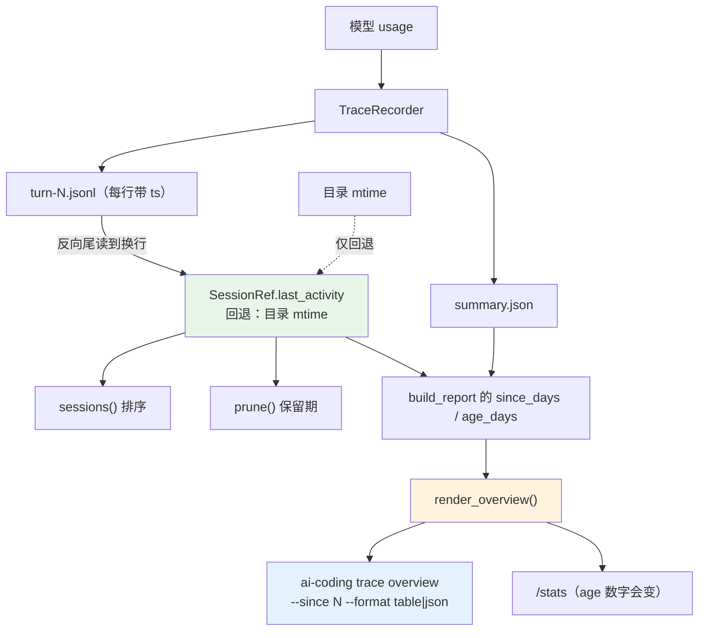
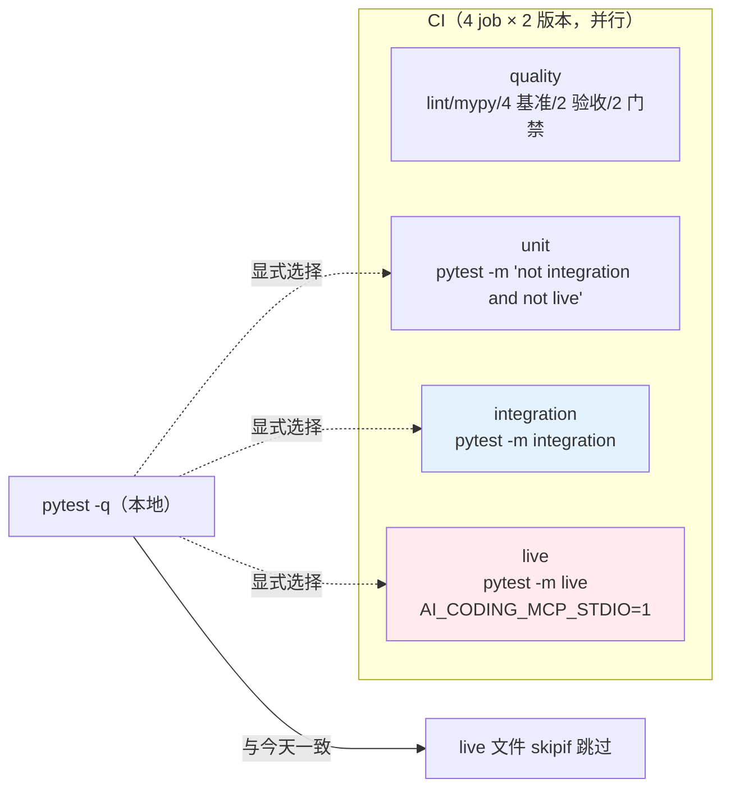
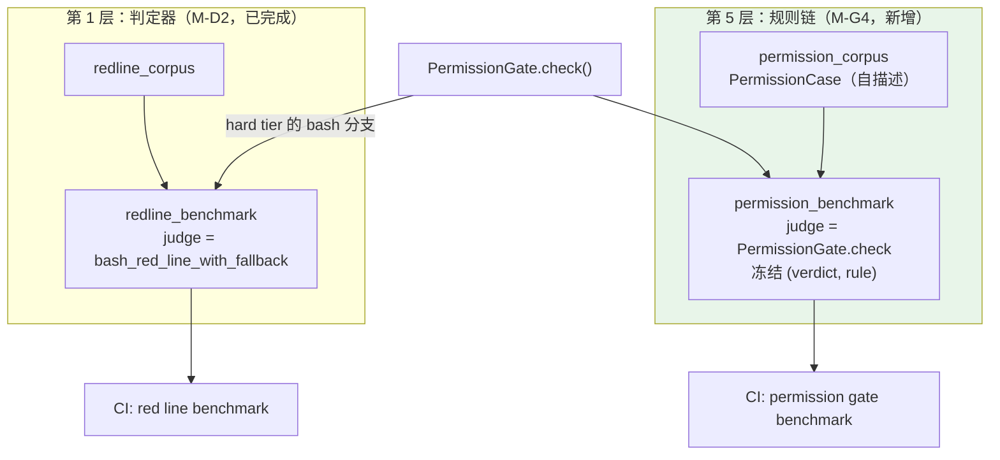

# 领域 G（可观测与质量 M-G1~G4）方案 v3

> 状态：**待用户拍板**。
> v1 → v2：两轮评审 **2 P0 + 10 P1 + 15 P2 + 5 P3**。
> v2 → v3：第三轮复审 **0 P0 + 0 P1 + 5 P2 + 10 P3**（全部实测复核后收口）。
> 修订记录见 §10。
> 所有"现状"都附实测证据；所有"改动"都标注**为什么不是别的做法**。

---

## 0. 一句话结论

四个里程碑里，**只有 M-G4 是"从零建新东西"**；另外三个都是**把已有设计接上已有的数据流**：

| 里程碑 | 真实缺口（实测） | 已有可复用的设计 | 新造的东西 |
|---|---|---|---|
| **M-G1** 基准回归门禁 | roadmap 说接 `memory_cases`/`trace_cases`，但**这两个已在 CI**（[ci.yml:83](file:///workspace/ai-coding/.github/workflows/ci.yml#L83)、[:86](file:///workspace/ai-coding/.github/workflows/ci.yml#L86)）。真缺口只有 `retrieval_cases.py --check` 与 `r18_acceptance.py` | CI step 范式、`--check` 开关约定 | 2 个 CI step + 1 个钉住测试 |
| **M-G2** 成本看板 | `--since` 是**死参数**（3 个生产调用方都不传）；`prune` 读目录 mtime，rsync 后永久失效 | `render_overview()` **还在**（[trace_text.py:406](file:///workspace/ai-coding/ai_coding/app/trace_text.py#L406)，`__all__` 已导出）但**零消费者** | 1 个 Typer 子命令 |
| **M-G3** 测试分层 | 4170 用例、276 文件、**零自定义 marker**；`tests/integration/` 靠目录约定；live 层靠"环境变量 + 单独 CI step"隐式承担 | `AI_CODING_MCP_STDIO` 门控约定、`refused` fixture | 2 个 marker + CI 拆 job |
| **M-G4** 危险命令端到端基准 | 判定级基准**已成熟且在 CI**（`redline_corpus` + `redline_benchmark`）；缺的是**规则链层** | `RedlineCase` / `Metrics` / 退出码 / 规模下限 的 golden 语料范式 | 1 个语料模块 + 1 个基准脚本 |

---

## 1. 现状核实（每条都有实测证据）

### 1.1 M-G1

| 事实 | 证据 |
|---|---|
| CI 只有 1 个 job `quality`，matrix `[3.10, 3.13]`，**13 个 step**（含 checkout / setup-python） | [ci.yml:14-86](file:///workspace/ai-coding/.github/workflows/ci.yml#L14-L86) |
| CI **已经**直连 `redline_benchmark.py`、`memory_cases.py`、`trace_cases.py` | [ci.yml:71](file:///workspace/ai-coding/.github/workflows/ci.yml#L71)、[:83](file:///workspace/ai-coding/.github/workflows/ci.yml#L83)、[:86](file:///workspace/ai-coding/.github/workflows/ci.yml#L86) |
| `retrieval_cases.py --check` **不在 CI** | ci.yml 全文无该调用；脚本头 [:10](file:///workspace/ai-coding/scripts/retrieval_cases.py#L10) 自述 "what CI should call" |
| `--check` 默认 off：失败时 `return 1 if args.check else 0` | [retrieval_cases.py:174](file:///workspace/ai-coding/scripts/retrieval_cases.py#L174) |
| GUARDRAILS = `{reachable_R@3: 0.95, reachable_FP@5: 0.50}`，只覆盖 `REACHABLE` 子集 | [retrieval_cases.py:73](file:///workspace/ai-coding/scripts/retrieval_cases.py#L73)、[:68-72](file:///workspace/ai-coding/scripts/retrieval_cases.py#L68-L72) |
| **`retrieval_cases.py --check` 今天通过** | 实测：`guardrails OK`，exit 0（约 2.2s） |
| **`r18_acceptance.py` 离线通过、不触网** | 实测：`36 passed, 0 failed`，exit 0（约 2s）；需 `rg` + `git`，CI 已装 rg |
| `r18_acceptance.main` 是 **`async def`** | [r18_acceptance.py:324](file:///workspace/ai-coding/scripts/r18_acceptance.py#L324)；入口用 `asyncio.run` |
| **离线门禁今天的真实退出码**（逐个实测） | `r6=0 r7=**1** r7e=0 r8=0 r9=0 r10=0 r11c=**2** m1b=0 m2=0 m3=0 m4=0 r18=0` |
| `r7_cases` / `r11c_cases` **今天就是红的** | `r7`：`SUMMARY 10/11 passed`，1 条 FAIL；`r11c`：`FAIL C5 navigation`，exit 2 |
| 退出码约定：offline 红 = `1`，live/real 红 = `2`，但 **r11c 的离线红是 2** | 见上表；`r11c_cases.py` 的失败走 live 分支语义 |

**结论**：roadmap 的"接入 CI；`memory_cases`、`r18_acceptance`、`trace_cases` 一并接"**半句是错的**（前两个已在），真缺口是 2 个脚本。**另外 r7/r11c 两个离线门禁今天是红的** —— 它们不是"忘了接"，而是"接了会立刻红"，必须显式说明。

### 1.2 M-G2

| 事实 | 证据 |
|---|---|
| `build_report(store, *, since_days=0, now=None)` 是唯一读盘入口 | [aggregate.py:107-130](file:///workspace/ai-coding/ai_coding/core/aggregate.py#L107-L130) |
| **3 个生产调用方都不传 `since_days`** → 永远是 0 | [commands.py:1200](file:///workspace/ai-coding/ai_coding/app/commands.py#L1200)（`/stats`）、[:1262](file:///workspace/ai-coding/ai_coding/app/commands.py#L1262)（`/export html`）、[:1270](file:///workspace/ai-coding/ai_coding/app/commands.py#L1270)（`/export otlp`） |
| **另有第 4 个调用方传了 `since_days=7`**：`scripts/r9_cases.py:199`，docstring 写 "Both must use the directory mtime (D-R9-8)" | [r9_cases.py:194-200](file:///workspace/ai-coding/scripts/r9_cases.py#L194-L200) |
| `since_days` 过滤用 `ref.mtime` | [aggregate.py:119](file:///workspace/ai-coding/ai_coding/core/aggregate.py#L119) |
| `SessionRef.mtime` = 会话**目录** mtime | [trace.py:302](file:///workspace/ai-coding/ai_coding/core/trace.py#L302) |
| `prune()` 也过滤 `ref.mtime`，且**真被调用** | [trace.py:379](file:///workspace/ai-coding/ai_coding/core/trace.py#L379)；调用点 [cli.py:255](file:///workspace/ai-coding/ai_coding/cli.py#L255) |
| `sessions()` 用 `-mtime` 排序 | [trace.py:307](file:///workspace/ai-coding/ai_coding/core/trace.py#L307) |
| docstring 承诺"与 prune 同口径" | [aggregate.py:112-113](file:///workspace/ai-coding/ai_coding/core/aggregate.py#L112-L113) |
| `render_overview(report)` **存在、已导出、零消费者** | [trace_text.py:406](file:///workspace/ai-coding/ai_coding/app/trace_text.py#L406)、[:17](file:///workspace/ai-coding/ai_coding/app/trace_text.py#L17)；grep 全仓无调用 |
| `/stats` 自己拼表格，没用 `render_overview`，且**会打印 `age_days`** | [commands.py:1188-1216](file:///workspace/ai-coding/ai_coding/app/commands.py#L1188-L1216)、[:1208](file:///workspace/ai-coding/ai_coding/app/commands.py#L1208) |
| `ai-coding trace` CLI 在 R10 被删 | [how-to-run.md:237](file:///workspace/ai-coding/docs/how-to-run.md#L237) |
| 契约文档指向已搬走的文件 | [data-contracts.md:584](file:///workspace/ai-coding/docs/data-contracts.md#L584) 写 `ui/trace_render.py`，实际在 `app/trace_text.py` |

**`SessionRef.mtime` 的全部消费者**（改动面，已 grep 全仓）：

| 消费者 | 位置 | 用途 | 改后 |
|---|---|---|---|
| `sessions()` 排序 | [trace.py:307](file:///workspace/ai-coding/ai_coding/core/trace.py#L307) | 倒序 | → `last_activity` |
| `prune()` 过滤 | [trace.py:379](file:///workspace/ai-coding/ai_coding/core/trace.py#L379) | 保留期 | → `last_activity` |
| `build_report` 过滤 | [aggregate.py:119](file:///workspace/ai-coding/ai_coding/core/aggregate.py#L119) | `since_days` | → `last_activity` |
| `row_from_summary(mtime=...)` | [aggregate.py:126](file:///workspace/ai-coding/ai_coding/core/aggregate.py#L126) | `age_days` | → `last_activity` |
| `scripts/r9_cases.py::prune_and_overview_agree` | [r9_cases.py:194-200](file:///workspace/ai-coding/scripts/r9_cases.py#L194-L200) | 用 `os.utime` 造旧 | **必须改**（docstring + 造旧方式） |
| 测试 | [test_trace_store.py:100](file:///workspace/ai-coding/tests/test_trace_store.py#L100) | 断言等于 `stat().st_mtime` | **必红**（字段改名 → AttributeError） |
| 测试 | [test_trace_store.py:103-110](file:///workspace/ai-coding/tests/test_trace_store.py#L103-L110) | `os.utime` 造新旧 | 仍绿（回退逻辑），但应加固 |
| 测试 | [test_trace_store.py:69-83](file:///workspace/ai-coding/tests/test_trace_store.py#L69-L83) | prune + `os.utime` | 仍绿（回退），应加固 |
| 测试 | [test_trace_store.py:124-133](file:///workspace/ai-coding/tests/test_trace_store.py#L124-L133) | prune + `os.utime` | 仍绿（回退），应加固 |
| 测试 | [test_trace_aggregate.py:69-76](file:///workspace/ai-coding/tests/test_trace_aggregate.py#L69-L76) | `os.utime` 造旧 | 仍绿（回退），应加固 |

**in-file 时间戳的可行性（已实测）**：

```
line: {"v": 1, "ts": "2026-10-27T07:24:54.623Z", "session": "s1", ...}
parsed epoch: 1793085894.623
after os.utime(dir, (1000,1000)):  dir mtime = 1000.0   <- 漂移
                                       in-file ts = 1793085894.623  <- 不动
```

每行 trace 都带 `ts`（[trace.py:568](file:///workspace/ai-coding/ai_coding/core/trace.py#L568)），格式 `%Y-%m-%dT%H:%M:%S.%fZ`，`strptime` 可解析（实测）。截断标记行也带 `ts`（[trace.py:228-241](file:///workspace/ai-coding/ai_coding/core/trace.py#L228-L241)），是完整行。

### 1.3 M-G3

| 事实 | 证据 |
|---|---|
| `pyproject.toml` **无 `markers`、无 `--strict-markers`**；仓库无 `pytest.ini`/`setup.cfg`/`tox.ini` | [pyproject.toml:55-60](file:///workspace/ai-coding/pyproject.toml#L55-L60) |
| `addopts = "-q -rs"`，`testpaths = ["tests"]` | 同上 |
| 实测收集 **4170** 个用例，**276** 个测试文件（272 顶层 + 4 integration） | `pytest --collect-only -q` |
| `tests/integration/` 4 个文件，**无模块级 `pytestmark`**（只用逐条 `@pytest.mark.asyncio`） | grep 确认 |
| marker：`asyncio` 1397 处、`parametrize` 66 处、`skipif` 9 处；**`xfail` 0 处** | grep |
| `asyncio` 由 **pytest-asyncio 插件注册**（不是内置）；实测 `pytest --collect-only -q --strict-markers` exit 0 | 实测 |
| live 层现状：3 个 MCP 文件靠 `AI_CODING_MCP_STDIO` 门控；CI 只跑了其中 2 个 | [test_mcp_stdio.py:29-38](file:///workspace/ai-coding/tests/test_mcp_stdio.py#L29-L38)、[test_mcp_end_to_end.py:43-49](file:///workspace/ai-coding/tests/test_mcp_end_to_end.py#L43-L49)、[test_mcp_progress.py:28-37](file:///workspace/ai-coding/tests/test_mcp_progress.py#L28-L37)；[ci.yml:74](file:///workspace/ai-coding/.github/workflows/ci.yml#L74)、[:80](file:///workspace/ai-coding/.github/workflows/ci.yml#L80) |
| **`test_mcp_progress.py` 从未在 CI 跑过** | ci.yml 全文无 progress |
| 3 个 MCP 文件的 `pytestmark` 是**列表** `[asyncio, skipif]` | 见上 |
| 其余 `pytest.skip` 是"外部工具缺失"（bwrap/rg/git），不是 live | `test_process_sandbox.py`、`test_worktree.py` 等 |
| **`addopts` 里的 `-m` 会级联到所有调用**（实测：`-m 'not live'` + 标了 `live` 的单文件 → **exit 5**） | 实测（临时目录复现） |

### 1.4 M-G4

| 事实 | 证据 |
|---|---|
| `security/redline_corpus.py` 是成熟 golden 语料，6 个类别 + 规模下限 | [redline_corpus.py:68-87](file:///workspace/ai-coding/ai_coding/security/redline_corpus.py#L68-L87) |
| `scripts/redline_benchmark.py` 报 FN/FP/mismatches/known_miss/known_fp + 规模下限，退 0/1 | [redline_benchmark.py:80-134](file:///workspace/ai-coding/scripts/redline_benchmark.py#L80-L134)、[:218](file:///workspace/ai-coding/scripts/redline_benchmark.py#L218) |
| 已在 CI | [ci.yml:70-71](file:///workspace/ai-coding/.github/workflows/ci.yml#L70-L71) |
| `Metrics.__init__` **直接读模块全局量**（`CORPUS`/`MUST_DENY`/`MUST_ALLOW`…），不能 import 复用 | [redline_benchmark.py:83-107](file:///workspace/ai-coding/scripts/redline_benchmark.py#L83-L107)、[:54-60](file:///workspace/ai-coding/scripts/redline_benchmark.py#L54-L60) |
| `PermissionGate.check(tool_name, params, *, session_rules, agent_rules, posture)` **完全离线可调用，无 workspace 参数** | [permission_gate.py:401-409](file:///workspace/ai-coding/ai_coding/security/permission_gate.py#L401-L409) |
| `check()` 是**五步链**：hard tier → agent veto → 规则链 → grant → workspace 边界 | [permission_gate.py:410-427](file:///workspace/ai-coding/ai_coding/security/permission_gate.py#L410-L427)、实现 [:428-536](file:///workspace/ai-coding/ai_coding/security/permission_gate.py#L428-L536) |
| `PermissionGate.__init__` **全关键字、全默认、不需要 `app_cfg`** | [permission_gate.py:259-280](file:///workspace/ai-coding/ai_coding/security/permission_gate.py#L259-L280) |
| **`PermissionDecision` 的 `.value` 是小写**（`'allow'`/`'warn'`/`'deny'`），`.name` 才是大写 | 实测 |
| `Ruleset = tuple[Rule, ...]`；`FileRules(base/standing/agent/user/project/policy)`；`NO_FILE_RULES` | [permissions.py:94-120](file:///workspace/ai-coding/ai_coding/security/permissions.py#L94-L120) |
| `redline_benchmark` 只测第 1 步里的 `bash_denied` 一个判定器 | [redline_benchmark.py:63-65](file:///workspace/ai-coding/scripts/redline_benchmark.py#L63-L65) |
| `sample_tasks.s4_bash_deny` 是单例、需真模型、不在 CI、无指标 | [sample_tasks.py:194-223](file:///workspace/ai-coding/scripts/sample_tasks.py#L194-L223) |
| **规则链层没有 golden 基准**，但不是"只有单元测试"：`test_permission_gate.py` 43 条、`test_m1b_agent_rules.py` 已测 agent veto、`m2/m3/m4/r7/r8/r18` 都直接驱动 `check()` | grep 确认 |
| "只读授权不进 roots" **不在 `check()` 里**，在 `authorized_roots()` / `path_allowed()` | [permission_gate.py:823-853](file:///workspace/ai-coding/ai_coding/security/permission_gate.py#L823-L853)、[:879-899](file:///workspace/ai-coding/ai_coding/security/permission_gate.py#L879-L899) |

---

## 2. 复用的方法契约（不新造轮子）

| 契约 | 位置 | 本轮怎么用 |
|---|---|---|
| `--check` 开关 + 默认 off | `retrieval_cases.py:174` | M-G1 沿用，不改 |
| `GUARDRAILS = {name: threshold}` + 显式比较 | `retrieval_cases.py:73` | M-G1 沿用并**加测试钉住** |
| CI step = `python scripts/<x>.py` | ci.yml 既有 3 处 | M-G1 加 2 处同构 step |
| CI step + pytest 钉住测试 双保险 | `test_trace_cases_smoke.py`、`test_redline_benchmark.py` | M-G1 / M-G4 沿用 |
| `SessionRef` / `TraceStore.sessions()` | `core/trace.py:181,289` | M-G2 **改时间语义**，保留形状 |
| `build_report` / `row_from_summary` / `aggregate_sessions` | `core/aggregate.py` | M-G2 只改时间源，纯函数不动 |
| `render_overview(report) -> str` | `app/trace_text.py:406` | M-G2 **让它第一次被消费** |
| `PermissionGate.__init__(**kwargs)` 全默认 | `permission_gate.py:259-280` | M-G4 每个 case 构造一个 gate |
| `PermissionGate.check(...) -> Decision` | `permission_gate.py:401-409` | M-G4 的 judge |
| `Ruleset` / `FileRules` / `NO_FILE_RULES` | `permissions.py:94-120` | M-G4 的 case 字段类型 |
| `RedlineCase` / `Metrics` / `format_metrics` / 规模下限 / 退 0-1 | `redline_corpus.py` + `redline_benchmark.py` | M-G4 沿用**契约**（见 §3.4 取舍） |
| `pytest.mark.<layer>` + `--strict-markers` | NeMo Voice Agent 官方做法 | M-G3 沿用 |
| `AI_CODING_MCP_STDIO` 门控 + 独立 CI step | ci.yml 既有 2 处 | M-G3 把它升级成 `live` marker |

---

## 3. 逐文件实现步骤

### 3.1 M-G1 · 基准回归门禁

#### `.github/workflows/ci.yml`

在 `Observability / guard / hook acceptance cases` 之后追加两个 step：

```yaml
      # M-G1: these two were local-only gates -- the script header said "what CI
      # should call" and CI never called it.  Both pass today, so wiring them in
      # is a pure tightening: a regression in the retrieval guardrails or in the
      # rg contract now turns the build red instead of waiting for a human.
      - name: Retrieval guardrails (golden corpus, R@3 / FP@5)
        run: python scripts/retrieval_cases.py --check

      # r18 is offline (36 checks over the rg branch and the fallback); it needs
      # ripgrep, which the step above already installed.
      - name: R18 acceptance (rg contract, offline)
        run: python scripts/r18_acceptance.py
```

**为什么只加这两个（这是本轮最容易被误判成"漏了"的地方，逐条说明）**：

| 脚本 | 今天退出码 | 为什么不接 |
|---|---|---|
| `memory_cases` / `trace_cases` / `redline_benchmark` | 0 | **已在 CI** |
| `r6/r7e/r8/r9/r10/m1b/m2/m3/m4` | 0 | 离线分支基本是把已有单测重跑一遍，接进去只拖慢 CI |
| **`r7_cases`** | **1（红）** | 离线且**今天就是红的**（`SUMMARY 10/11 passed`，1 条 FAIL 属 domain-B 过期期望）。接进去 CI 立刻红。**不在本轮范围**：要接必须先修那条期望，属另一个里程碑 |
| **`r11c_cases`** | **2（红）** | 离线且**今天就是红的**（`FAIL C5 navigation`：手工库未产出 scene，而断言要求 miss 文案列出 scene）。同上 |
| `r19/n1/t12/w2/plan_lifecycle_live_check` | — | 需真模型/真网络，属 live 层（与 M-G3 的 `live` 对齐，不在本轮） |

**结论**：M-G1 的"只接 2 个"不是偷懒，是"其余要么已在、要么今天红、要么属 live"。r7/r11c 两个红门禁**必须在文档里点名**，否则后人会当成"没人想起"。

#### `tests/test_gate_ci_wiring.py`（新）

```python
"""M-G1: the two local-only gates must stay runnable under the arguments CI uses.

A step that silently stops failing is worse than no step: ``--check`` defaults
off, so ``main([])`` exits 0 no matter what the guardrails say.  These pin the
*CI* invocations, so weakening a guardrail constant fails here too, not only in
a workflow file nobody runs locally.
"""
```

用例：

1. `retrieval_cases.main(["--check"]) == 0`
2. `asyncio.run(r18_acceptance.main(live=False)) == 0`（`main` 是协程，必须 `asyncio.run`）
3. 断言 `GUARDRAILS["reachable_R@3"] >= 0.95` 且 `GUARDRAILS["reachable_FP@5"] <= 0.50` —— 防止有人为了变绿而调宽门槛

---

### 3.2 M-G2 · 成本看板

#### 步骤 1：`SessionRef` 的时间语义（`ai_coding/core/trace.py`）

```python
@dataclasses.dataclass(frozen=True)
class SessionRef:
    """One session directory on disk (R9b)."""

    session: str
    path: Path
    #: When the session was last active, as an epoch second.  From the last
    #: parseable ``ts`` in the highest-numbered turn file, falling back to the
    #: directory mtime when there is nothing readable.  The directory mtime
    #: alone cannot answer this: an ``rsync`` without ``-t`` rewrites it to the
    #: transfer time, so every session looks brand new and ``prune`` never
    #: deletes anything again.
    last_activity: float
    turn_files: tuple[Path, ...]
```

新增模块级 helper：

```python
_TS_FORMAT = "%Y-%m-%dT%H:%M:%S.%fZ"


def _parse_ts(stamp: object) -> float | None:
    """``2026-10-27T07:24:54.623Z`` → epoch second, or ``None``."""
    if not isinstance(stamp, str):
        return None
    try:
        parsed = datetime.strptime(stamp, _TS_FORMAT).replace(tzinfo=timezone.utc)
    except ValueError:
        return None
    return parsed.timestamp()


def _last_line(path: Path, *, chunk: int = 8192) -> str:
    """The last **non-empty** line of ``path``, reading backwards to a newline.

    A fixed tail window is not enough: ``capture: full`` writes untrimmed
    payloads, so one line can exceed any constant.  The file itself is capped
    at ``max_turn_bytes`` (2 MB), so the scan is bounded by that.

    ``buffer[:-1]`` on purpose: ``buffer`` is always a suffix of the file, so its
    last byte is the file's last byte.  Without excluding it, a trailing newline
    would match on the first read and the answer would be the second-to-last
    line.
    """
    try:
        with path.open("rb") as handle:
            handle.seek(0, os.SEEK_END)
            end = handle.tell()
            if end == 0:
                return ""
            position = end
            buffer = b""
            while position > 0:
                step = min(chunk, position)
                position -= step
                handle.seek(position)
                buffer = handle.read(step) + buffer
                if b"\n" in buffer[:-1] or position == 0:
                    break
    except OSError:
        return ""
    text = buffer.decode("utf-8", "replace")
    lines = [line for line in text.splitlines() if line.strip()]
    return lines[-1] if lines else ""


def _last_activity(turn_files: Sequence[Path], fallback: float) -> float:
    """The last parseable ``ts`` in the highest-numbered turn file.

    Falls back to the previous turn file when the newest has no ``ts`` (an empty
    file, or a hand-written one), and to ``fallback`` when none does.  Turn
    numbers come from ``next_turn_number``, so the highest-numbered file is the
    latest activity.
    """
    for path in reversed(turn_files):
        line = _last_line(path).strip()
        if not line:
            continue
        try:
            payload = json.loads(line)
        except ValueError:
            continue
        if not isinstance(payload, dict):
            continue
        parsed = _parse_ts(payload.get("ts"))
        if parsed is not None:
            return parsed
    return fallback
```

`sessions()` 改动：算 `last_activity`，排序键改 `(-last_activity, session)`。
`prune()` 改动（[:379](file:///workspace/ai-coding/ai_coding/core/trace.py#L379)）：`ref.mtime` → `ref.last_activity`。

**为什么排序也换**：`sessions()` 的 "newest first" 是同一个问题的另一个面 —— rsync 后所有目录 mtime 都是传输时间，顺序变成任意的。既然要改就一次改到根源，不留第二个时间源。

**为什么保留回退**：历史/手工会话可能没有可解析的 `ts`。回退保证"总有年龄可算"，代价是这些会话仍受 rsync 影响 —— **这一点在 §7.2 明说，不夸大**。

#### 步骤 2：`build_report`（`ai_coding/core/aggregate.py`）

- `ref.mtime` → `ref.last_activity`（过滤 + 传给 `row_from_summary`）
- `row_from_summary(..., mtime=...)` 形参改名 `last_activity=`
- docstring 改写：不再承诺"与 prune 同口径"，改说**两者读同一个 `SessionRef.last_activity`**

`aggregate_sessions` / `SessionRow` / `_int` **不动**。

#### 步骤 3：恢复 CLI（`ai_coding/cli.py`）

```python
trace_app = typer.Typer(help="Inspect traced sessions.", no_args_is_help=True)


@trace_app.command("overview")
def trace_overview(
    workspace: str = typer.Option(".", "--workspace", "-w"),
    since: int = typer.Option(
        0,
        "--since",
        min=0,
        help="Only sessions active in the last N days (0 = all). "
        "This is a view window, not the delete threshold -- "
        "deletion is tracing.retention_days.",
    ),
    output_format: str = typer.Option(
        "table", "--format", help="table | json"
    ),
) -> None:
    """One table for every traced session in this workspace (R9b; restored in M-G2).

    ``render_overview`` already existed and was exported; R10 deleted the command
    that called it and left the renderer with no consumer.  This is that command
    again, and ``--since`` gets its first production caller.
    """
    import json
    from dataclasses import asdict

    from ai_coding.app.trace_text import render_overview
    from ai_coding.core.aggregate import build_report
    from ai_coding.core.trace import TraceStore

    if output_format not in ("table", "json"):
        typer.secho(
            f"error: --format must be table or json, got {output_format!r}",
            fg=typer.colors.RED,
            err=True,
        )
        raise typer.Exit(code=2)

    ws = Path(workspace).expanduser().resolve()
    root = ws / ".ai-coding" / "traces"
    report = build_report(TraceStore(root, workspace=ws), since_days=since)
    if not report.rows:
        typer.echo(f"(no traced sessions under {root})")
        raise typer.Exit()
    if output_format == "json":
        typer.echo(
            json.dumps(
                {
                    "sessions": [
                        {
                            "session": row.session,
                            "turns": row.turns,
                            "files": row.files,
                            "steps": row.steps,
                            "prompt_tokens": row.prompt_tokens,
                            "completion_tokens": row.completion_tokens,
                            "cached_tokens": row.cached_tokens,
                            "cache_ratio": row.cache_ratio,
                            "age_days": row.age_days,
                            "mismatch": row.mismatch,
                        }
                        for row in report.rows
                    ],
                    "totals": asdict(report.totals),
                },
                ensure_ascii=False,
                indent=2,
            )
        )
        return
    typer.echo(render_overview(report))


app.add_typer(trace_app, name="trace")
```

**为什么复用 `render_overview`**：它已存在、是纯函数、已进 `__all__`，缺的只有调用方。新写一份就是造轮子 + 冗余。

#### 步骤 4：`scripts/r9_cases.py`

`prune_and_overview_agree` 的造旧方式从 `os.utime` 改为"写一行带旧 `ts` 的 trace"，docstring 里的 "Both must use the directory mtime (D-R9-8)" 改成 `SessionRef.last_activity`。

#### 步骤 5：文档

- `docs/data-contracts.md:575-577`：`SessionRef(session, path, last_activity, turn_files)`；`sessions()` 的"mtime 倒序"→"`last_activity` 倒序"；`:577` 的"`--since` 与 prune 同口径＝目录 mtime"改成 `last_activity`
- `docs/data-contracts.md:580`：`build_report` 的时间源说明
- `docs/data-contracts.md:584`：`ui/trace_render.py` → `app/trace_text.py`（顺带修既有漂移）
- `docs/architecture.md:259`：`sessions() / prune()（同一 mtime 口径）` → `last_activity`
- `docs/architecture.md:261`：`ui.trace_render.render_overview（trace overview）` → `app.trace_text.render_overview`（同一处漂移）
- `docs/how-to-run.md:237,242-244`：删掉"R10 起暂无 CLI 入口"，改成 `ai-coding trace overview [--since N] [--format table|json]`

#### 测试（RIPR 红相）

| 用例 | 钉什么 | 新/改 |
|---|---|---|
| `test_r9_sessions_lists_directories_with_last_activity` | `refs[0].last_activity` 等于 turn 文件里的 `ts`，**不再**等于 `stat().st_mtime`。**该用例的写入行必须从 `"{}"` 改成带 `ts` 的 JSON** —— 否则 `last_activity` 走回退，断言空转 | 改（字段改名必红） |
| `test_r9_sessions_are_newest_first` | 用"写带旧 `ts` 的行"造新旧 | 改（加固） |
| `test_r9_since_filters_by_in_file_ts` | `since_days` 按 `ts` 过滤 | 改（加固） |
| `test_r9_an_rsync_does_not_move_last_activity` | **验收判据**：把目录 mtime **推到最新**（`os.utime(dir, (now, now))`，模拟 rsync 不带 `-t`），`last_activity` 仍是旧的 in-file `ts`，`build_report(since_days=7)` 仍过滤掉它 | **新** |
| `test_r9_prune_survives_a_newer_directory_mtime` | 同上前提下 `prune()` **仍然删掉**旧会话 —— "prune 永久失效"的直接反证。旧 `ts` 用 `time.time() - 30*86400` **现算**（不硬编码日期） | **新** |
| `test_r9_no_ts_falls_back_to_the_directory_mtime` | turn 行无 `ts` → `last_activity == 目录 mtime`（**明说回退的存在**） | **新** |
| `test_r9_an_empty_newest_turn_file_falls_back_to_the_previous_one` | 最高号文件为空 → 读上一个 | **新** |
| `test_r9_last_line_longer_than_the_tail_window` | 最后一行 > 8 KB（`capture: full` 形态）仍能解析出 `ts` | **新** |
| `test_r9_equal_last_activity_breaks_ties_by_session_id` | 同 `last_activity` 时按 session id 稳定排序 | **新** |
| `test_parse_ts_rejects_malformed_values` | `None` / 非串 / 坏格式 → `None` | **新** |
| `test_the_trace_overview_cli_renders` | 输出含表头 + `TOTAL` + `!mismatch` 标注 | **新** |
| `test_the_trace_overview_cli_matches_render_overview` | **行为等价**：CLI 的 stdout == `render_overview(build_report(同一 store))`。替代"读源码断言 `render_overview(` 出现"那种坏味道。**必须冻结时钟**（monkeypatch `aggregate.time.time`），否则两次 `build_report` 各取一次 `time.time()`，`age_days` 跨 0.1d 舍入边界会 flaky | **新** |
| `test_the_trace_overview_cli_emits_json` | `--format json` 是合法 JSON，含 `sessions` / `totals` | **新** |
| `test_the_trace_overview_cli_rejects_an_unknown_format` | `--format xml` → exit 2 + 错误信息 | **新** |
| `test_the_trace_overview_cli_on_an_empty_store` | 空目录不抛错 | **新** |

**必须改测试的说明（修正 v1 的夸大）**：v1 说"3 条前提失效"，实测推演后**只有 1 条必红**（`test_trace_store.py:100`，字段改名 → AttributeError）；另 2 条因"回退目录 mtime"仍绿，但**它们测的是回退而不是真行为**，所以要加固。另外 v1 漏了 2 条 prune 测试（`:69-83`、`:124-133`）和 `scripts/r9_cases.py`，一并纳入。改动只涉及**造旧数据的机制**（`os.utime` → 写带旧 `ts` 的行），断言意图不变。

---

### 3.3 M-G3 · 测试分层

#### 步骤 1：`pyproject.toml`

```toml
[tool.pytest.ini_options]
testpaths = ["tests"]
# M-G3: two explicit layers.  The unit layer is "everything else", selected by
# exclusion -- marking 272 top-level files would be churn for no signal.
#
# `--strict-markers` makes an undeclared marker a collection error instead of a
# warning: a typo'd marker would otherwise silently select nothing, which is how
# a "layer" becomes a hole.  (asyncio is registered by pytest-asyncio, so the
# 1397 existing @pytest.mark.asyncio lines are unaffected -- verified.)
#
# NO `-m` here on purpose: addopts is prepended to *every* invocation, so
# `-m 'not live'` would make `pytest tests/test_mcp_stdio.py` collect zero tests
# and exit 5 (verified).  CI selects the layer explicitly instead.
markers = [
    "integration: real I/O inside one process (the tests/integration/ suite)",
    "live: needs an external mechanism (a real MCP server); CI runs it with the gate variable",
]
addopts = "-q -rs --strict-markers"
```

**为什么 `-m` 不能进 `addopts`（P0，实测）**：

```
$ pytest tests/test_mcp_stdio.py -o addopts="-m 'not live'"     # 文件已标 live
EXIT=5                                  # 0 tests collected
$ pytest tests/test_mcp_stdio.py -o addopts="-m 'not live'" -m live
EXIT=0                                  # 命令行 -m 覆盖 addopts
```

所以：新 `live` job 用 `pytest -m live` 没问题；坏的是**所有单文件调用**（含 ci.yml 现有的两个 MCP step 和三个测试文件 docstring 里的命令）。

**为什么不注册 `unit` marker**：全仓 0 处 `pytest.mark.unit`，注册它只会让 `-m unit` 选 0 条、`-m "not unit"` 等于不加。unit 层用 `-m "not integration and not live"` 表达，语义等价且没有死 marker。

#### 步骤 2：给文件打 marker

| 文件 | 写法 | 为什么 |
|---|---|---|
| `tests/integration/test_m3_flow.py` | `pytestmark = pytest.mark.integration`（新增，模块级无既有 `pytestmark`） | 已在 `tests/integration/` 目录约定里 |
| `tests/integration/test_r17_dataflow.py` | 同上 | 同上 |
| `tests/integration/test_r17_defects.py` | 同上 | 同上 |
| `tests/integration/test_r17_parity.py` | 同上 | 同上 |
| `tests/test_mcp_stdio.py` | **追加**到既有列表：`pytestmark = [pytest.mark.asyncio, pytest.mark.skipif(...), pytest.mark.live]` | 直接赋值会**覆盖** `asyncio` + `skipif` |
| `tests/test_mcp_end_to_end.py` | 同上 | 同上 |
| `tests/test_mcp_progress.py` | 同上 | 同上 |

**为什么不能直接 `pytestmark = pytest.mark.live`（P1，实测）**：3 个 MCP 文件的 `pytestmark` 是**列表**（[test_mcp_stdio.py:29-38](file:///workspace/ai-coding/tests/test_mcp_stdio.py#L29-L38)）。直接赋值会丢掉 `asyncio`（async 用例不再被当协程用例）和 `skipif`（本地不带 gate 变量会真的 spawn 子进程）。

**为什么 `test_process_sandbox.py` 等不打 `live`**：它们 skip 的原因是**外部工具缺失**（bwrap/rg/git），不是"需要真服务"。混为一谈会让"本地跑不了"和"CI 不跑"失去区分 —— 这正是调研里 LangChain/NeMo 强调要分开的两种语义。

#### 步骤 2b：`tests/test_live_gate.py`（新）—— live 层不能静默跳过自己

```python
"""M-G3: the live layer must not skip itself into a green build.

Every live test is ``skipif`` on ``AI_CODING_MCP_STDIO``.  A CI job that forgets
to set it collects the whole layer, skips it, and exits 0 -- green while covering
nothing, which is the exact failure this milestone exists to remove (``-rs`` only
prints the reason; it does not fail).

This file is marked ``live`` but deliberately **not** skipif-gated, so it runs in
that job and fails when the variable is missing.
"""

import os

import pytest

pytestmark = pytest.mark.live

GATE = "AI_CODING_MCP_STDIO"


def test_the_live_gate_variable_is_set() -> None:
    assert os.environ.get(GATE) == "1", (
        f"{GATE} is not set, so every other live test just skipped: "
        "this job would be green while covering nothing"
    )
```

**代价（明说）**：本地 `pytest -m live` 不带 gate 变量时会**失败**而不是跳过。这是有意的 —— 你显式要求跑 live 层，就该给出 gate。默认 `pytest -q` 不受影响（这个文件带 `live` marker，本地默认不选它）。

#### 步骤 3：CI 拆 job（`.github/workflows/ci.yml`）

```yaml
jobs:
  quality:                     # lint + mypy + 基准 + 验收脚本（不含 pytest）
    runs-on: ubuntu-latest
    timeout-minutes: 15
    strategy: { fail-fast: false, matrix: { python-version: ["3.10", "3.13"] } }
    steps: [checkout, setup-python, Install,
            "Install ripgrep (r18 needs it)",          # ← 必须，见下
            Lint, Type-check,
            "Red line benchmark", "Permission gate benchmark",
            "Memory acceptance cases", "Observability cases",
            "Retrieval guardrails (--check)", "R18 acceptance"]   # ← M-G1 的两个

  unit:                        # pytest -m "not integration and not live"
    runs-on: ubuntu-latest
    timeout-minutes: 15
    strategy: { fail-fast: false, matrix: { python-version: ["3.10", "3.13"] } }
    steps: [checkout, setup-python, Install, ripgrep, bubblewrap,
            "Unit tests"]

  integration:                 # pytest -m integration
    runs-on: ubuntu-latest
    timeout-minutes: 10
    strategy: { fail-fast: false, matrix: { python-version: ["3.10", "3.13"] } }
    steps: [checkout, setup-python, Install, ripgrep, "Integration tests"]

  live:                        # AI_CODING_MCP_STDIO=1 pytest -m live
    runs-on: ubuntu-latest
    timeout-minutes: 10
    strategy: { fail-fast: false, matrix: { python-version: ["3.10", "3.13"] } }
    steps: [checkout, setup-python, Install, "Live tests (real MCP server)"]
```

**关键点（逐条对应评审）**：

1. `quality` **必须装 ripgrep**：`r18_acceptance` 的 parity 段在 `shutil.which("rg") is None` 时只打印 NOTE 并 `return`，退出码仍 0 —— 那正是它自己警告的"两边都跑 fallback 不能算绿"。它还 **`subprocess.run(["git", ...])`**，git 由 `ubuntu-latest` 预装（不额外装，但要知道这个依赖）。
2. `quality` **不需要 bubblewrap**：`redline_benchmark` / `memory_cases` / `trace_cases` / 新 permission benchmark 都不 spawn 子进程（实测 imports 无 `subprocess`；`trace_cases` 的"真实工具"是进程内的 `_EchoTool`）。
3. **三个测试层都保留 matrix 3.10/3.13**：当前 CI 的 MCP 两个 step 在两个版本都跑，3.10 是声明下限；不因为"看起来不敏感"就砍掉覆盖。代价是 job 实例从 **2**（1 job × 2 版本）变成 **8**（4 job × 2 版本），冷启动成本约 **×4**；若实测墙钟反而上升，退路是把 `integration`/`live` 收成单版本，并**在方案里写明实测依据**。
4. **每个 job 都有 `timeout-minutes`**：`live` 会 spawn 子进程，不设上限时 hang 要等默认 360 分钟。
5. **必须删除 ci.yml 现有的两个 MCP step**（[:73-80](file:///workspace/ai-coding/.github/workflows/ci.yml#L73-L80)）——它们的功能被 `live` job 吸收。否则同一个用例跑两遍。**同时更新 ci.yml 头部注释**（[:3-7](file:///workspace/ai-coding/.github/workflows/ci.yml#L3-L7) 说"在设了 gate 变量的 step 里跑"，拆 job 后该 step 已移入 `live` job）。
6. **`integration` job 也需要 git**（`test_r17_dataflow.py:132`、`test_r17_defects.py:451`、`test_r17_parity.py:196` 都 shell out 到 git）。git 由 runner 预装；`bwrap` 不需要（`test_m3_flow.py` 用的 `Sandbox` 是纯路径逻辑）。

#### 测试（RIPR 红相）

| 用例 | 钉什么 |
|---|---|
| `test_the_layer_markers_are_declared` | `pyproject.toml` 的 `markers` 含 `integration`/`live`；`addopts` 含 `--strict-markers` 且**不含 `-m`**（这条同时守住 P0 不复发） |
| `test_the_live_layer_is_exactly_the_gated_files` | 子进程 `pytest --collect-only -q -m live` 的文件集合 == `{test_mcp_stdio, test_mcp_end_to_end, test_mcp_progress, test_live_gate}`。用**收集结果**而不是文本匹配 —— `test_r17_dataflow.py:404` 的 docstring 里就有 "integration"、`test_mcp_oauth.py` 里有 "live"，文本匹配会被骗。`--collect-only` 不评估 `skipif`（运行期才评估），所以不需要 gate 变量 |
| `test_the_live_gate_canary_fails_without_the_variable` | `tests/test_live_gate.py` 的 canary（见下）在**没有** `AI_CODING_MCP_STDIO` 时失败 —— 用 monkeypatch 清掉变量后直接调它 |
| `test_the_integration_layer_is_exactly_the_suite` | 子进程 `pytest --collect-only -q -m integration` 的文件集合 == `tests/integration/` 的 4 个文件 |
| `test_a_gated_file_keeps_its_asyncio_and_skipif_marks` | 3 个 MCP 文件的 `pytestmark` 同时含 `asyncio`、`skipif`、`live` —— 守住 P1 不复发 |
| `test_an_undeclared_marker_is_a_collection_error` | 子进程 `pytest --collect-only -c <repo>/pyproject.toml <临时文件>`，临时文件里有未声明 marker → 非零退出。**必须显式传 `-c`**，否则 rootdir 落在 `/tmp`，`addopts` 不生效 |

---

### 3.4 M-G4 · 危险命令与权限的端到端基准

#### 步骤 1：`ai_coding/security/permission_corpus.py`（新）

沿用 `redline_corpus.py` 的**范式**，但 case 必须**自描述**（每个 case 自带它需要的 gate 配置）：

```python
"""M-G4 golden corpus for the permission gate (the whole check() chain).

``redline_corpus`` freezes one judge: ``bash_red_line_with_fallback``.  The gate
is five steps -- hard tier, agent veto, the rule chain, a saved grant, the
workspace edge -- and only the first step's bash branch had a benchmark.  The
risk that matters lives in the other four.

Same contract as ``redline_corpus`` (frozen rows, a verdict copied from a run, a
size floor per class); a different layer.

Scope note: ``authorized_roots()`` / ``path_allowed()`` are NOT in ``check()``,
so "a read grant must not become a writable root" is out of scope here -- it is
covered by ``test_dispatch_grants.py`` / ``test_gate_grants.py`` and would need a
second judge.  Named rather than silently skipped.
"""

@dataclasses.dataclass(frozen=True)
class PermissionCase:
    tool: str
    #: Sorted key/value pairs, not a dict: a frozen dataclass with a dict field
    #: is unhashable, and the corpus is deduplicated as a set.  Values must be
    #: hashable too, so the corpus uses strings only (a nested dict/list would
    #: make the row unhashable again).
    params: tuple[tuple[str, Any], ...]
    label: str
    #: ``PermissionDecision.name`` -- uppercase, which is what ``judge`` returns.
    verdict: str
    #: ``rule_of(Decision.reason)`` -- which layer decided, not just the verdict.
    rule: str = ""
    # gate configuration this row needs
    grants: tuple[str, ...] = ()
    denied_tools: tuple[str, ...] = ()
    allowed_tools: tuple[str, ...] = ()
    skill_permissions: tuple[tuple[str, str], ...] = ()
    workspace: str | None = None
    rules: FileRules = NO_FILE_RULES
    # per-call
    session_rules: Ruleset = ()
    agent_rules: Ruleset = ()
    posture: str = "build"
```

**类别与规模下限**（显式三组，`fn`/`fp` 的映射不再是隐式的）：

```python
MUST_DENY  = DENY_HARD_TIER + DENY_AGENT_VETO + DENY_RULE_CHAIN
MUST_ALLOW = ALLOW_SAFE + ALLOW_GRANT_ANSWERS
MUST_WARN  = WARN_UNKNOWN
```

| 类别 | 覆盖的链 | 下限 |
|---|---|---|
| `DENY_HARD_TIER` | bash 红线 / `denied_tools` / skill 策略 | 10 |
| `DENY_AGENT_VETO` | agent 层 DENY 不被 session 规则重开 | 6 |
| `DENY_RULE_CHAIN` | base/standing/agent/user/project/session 后写胜出 | 10 |
| `ALLOW_GRANT_ANSWERS` | 已存 grant 让"询问"变"允许"（step 4） | 6 |
| `ALLOW_SAFE` | 普通工作不被误拦 | 15 |
| `WARN_UNKNOWN` | 未知工具 → WARN | 4 |
| `KNOWN_MISS` / `KNOWN_FP` | GuardFall 类已知缺口（先留空，与 redline 一致） | 0 |

`MIN_*` 常量仿 `redline_corpus.py:77-87`。

**三条 corpus 约束（不满足就会静默退化，必须写成注释 + 自检测试）**：

1. **`ALLOW_GRANT_ANSWERS` 必须用 `write` / `edit`，不能用 `read` / `glob` / `grep`。**
   原因（实测）：`check()` 的两个 ALLOW 出口 reason 都是空串 —— step 4 的 grant（[permission_gate.py:505](file:///workspace/ai-coding/ai_coding/security/permission_gate.py#L505)）与 step 5 的规则链允许（[:532](file:///workspace/ai-coding/ai_coding/security/permission_gate.py#L532)）。所以 `rule` 对 ALLOW 行**零区分力**。但 `read`/`glob`/`grep` 本来就在 `_allow_tools` 里 → 删掉 step 4 它们仍 ALLOW，基准不会红。改用 `write`/`edit`：没有 grant 时是 WARN、有 grant 时是 ALLOW —— 删掉 step 4 会变成 WARN，`verdict` 立刻 mismatch。
   → 自检测试：`ALLOW_GRANT_ANSWERS` 的每一行 `tool in {"write", "edit"}`。

2. **测 workspace 边界的行必须显式设 `workspace`。**
   原因（实测）：`PermissionGate.__init__` 的 `workspace=None` 会让 `self._workspace=""`，而 `_outside_resource_reason` 第一行就是 `if not self._workspace: return None`（[permission_gate.py:731-732](file:///workspace/ai-coding/ai_coding/security/permission_gate.py#L731-L732)）—— 边界检查整体失效，越界路径也判 ALLOW。
   → 自检测试：`label` 属于"越界应 WARN"的行必须 `workspace is not None`。

3. **`grants` 用 `grant_key()` 生成，不要手写。**
   原因（实测）：`read` 的 key 是 `read:<dirname>`（**目录**，不是文件）；`write`/`edit` 是 `<tool>:<normpath>`；`glob`/`grep` 是 `<tool>:<dir>`；`bash` 返回 `None`（不可授）。手写 `read:src/foo.py` 会静默不命中。
   → corpus 里用 `grants=(grant_key("read", {"path": str(root / "src" / "a.py")}),)` 这种形式生成。

`Metrics.by_rule` **只在 `rule` 非空时计数**（与 [redline_benchmark.py:91-92](file:///workspace/ai-coding/scripts/redline_benchmark.py#L91-L92) 一致），否则 21 条 ALLOW 会堆进空桶。

#### 步骤 2：`scripts/permission_benchmark.py`（新）

```python
def rule_of(reason: str) -> str:
    """The rule a verdict came from, without its command-shaped tail.

    Mirrors ``redline_benchmark.rule_of``: ``bash command blocked: recursive
    root deletion (rm -rf /)`` and ``... ('rm -rf /')`` are the same rule.
    """
    if not reason:
        return ""
    return reason.split(" (", 1)[0]


def judge(case: PermissionCase) -> tuple[str, str]:
    """``(decision name, rule)`` for one case, from a gate built for that case.

    ``PermissionGate`` is fully keyword-only with defaults, so no app config is
    needed -- the row carries the configuration it is testing.
    """
    gate = PermissionGate(
        grants=case.grants,
        denied_tools=case.denied_tools,
        allowed_tools=case.allowed_tools,
        skill_permissions=dict(case.skill_permissions),
        workspace=case.workspace,
        rules=case.rules,
    )
    decision = gate.check(
        case.tool,
        dict(case.params),
        session_rules=case.session_rules,
        agent_rules=case.agent_rules,
        posture=case.posture,
    )
    return decision.decision.name, rule_of(decision.reason)
```

**`judge` 返回 `.name` 而不是 `.value`（P0，实测）**：`PermissionDecision.ALLOW.value == 'allow'`，而 corpus 冻结的是 `"ALLOW"`。用 `.value` 会让 53 条全部 mismatch、`main` 退 1、CI 立刻红。

**`judge` 同时返回 `rule`（P1）**：只冻结三态时，"agent veto 拒绝"和"规则链拒绝"都是 `DENY`，无法区分；删掉 agent veto 但 session 规则恰好也 DENY，基准不会红。冻结 `rule` 才能证明**是哪一层**胜出。

`Metrics` 沿用 `redline_benchmark.py` 的**契约**（`mismatches` / `fn` / `fp` / `known_miss_still_open` / `known_fp_still_open` / `problems` / `ok` / `by_rule`；退 0/1）。

**这里有一个必须明说的取舍**：`redline_benchmark.py` 的 `Metrics` 绑在 `CORPUS`/`MUST_DENY`/`MUST_ALLOW` 模块全局量上，**不能直接 import 复用**。三选一：

| 做法 | 取舍 |
|---|---|
| **A. 新脚本自带一份 `Metrics`（采用）** | 两份并行实现，契约相同。**好处**：不碰 CI 里已经绿了的代码，零回归风险。**坏处**：有重复 |
| B. 把 `Metrics` 抽到公共模块，两个基准都改 | 消除重复。**坏处**：为零行为收益重构 CI 绿代码，违反最小化；`rule_of`/`_corpus_problems` 都带 redline 语义，抽出来的"公共"部分很薄 |
| C. 不新建脚本，M-G4 只做测试 | 零新脚本，但语料就只剩测试消费者 → 违反"被测试文件消费不算被消费" |

**采用 A**，并在 `docs/data-contracts.md` 写明"B 被显式推迟"。

#### 步骤 3：CI + 文档 + 测试

- `ci.yml`：`quality` job 加 `- name: Permission gate benchmark (golden corpus, FN/FP)` / `run: python scripts/permission_benchmark.py`
- `docs/data-contracts.md`：新增 `PermissionCase` / `permission_benchmark` 契约行；`redline_benchmark` 那节加一句"它只覆盖第 1 步"
- 新测试 `tests/test_permission_benchmark.py`：

| 用例 | 钉什么 |
|---|---|
| `test_the_benchmark_passes_on_the_frozen_corpus` | `main([]) == 0` |
| `test_every_class_meets_its_floor` | 每个类别 ≥ `MIN_*`；`CORPUS` ≥ 总数下限 |
| `test_the_corpus_has_no_duplicate_rows` | 去重键 `(tool, params)` 唯一 |
| `test_agent_veto_is_not_reopened_by_a_session_rule` | **定向**：agent DENY + 一条 ALLOW 的 session 规则 → 仍 DENY，且 `rule` 是 agent veto 那条（M1b 不变量，之前只有单元测试） |
| `test_a_fn_and_a_fp_are_counted_apart` | **合成负例**：构造 `label=DENY` 但判定为 ALLOW 的行 → `fn == 1`；构造 `label=SAFE` 但判定为 DENY 的行 → `fp == 1`。否则在"全绿语料"上 `fn=fp=0`，把两者写反也测不出来 |
| `test_the_judge_returns_the_decision_name_not_the_value` | `judge(case)[0] in {"ALLOW","WARN","DENY"}` —— 守住 P0 不复发 |
| `test_grant_rows_use_a_tool_that_needs_a_grant` | `ALLOW_GRANT_ANSWERS` 每行 `tool in {"write","edit"}` —— 否则 step 4 被删也测不出来（`rule` 对 ALLOW 行恒空） |
| `test_boundary_rows_set_a_workspace` | 测越界的行 `workspace is not None` —— 否则 `_outside_resource_reason` 直接短路，边界静默关闭 |
| `test_grant_keys_are_generated_not_hand_written` | 每行的 `grants` 都能被 `gate.grant_key(...)` 复现（或 corpus 里根本没有手写字符串常量） |

---

## 4. 数据流影响

### 4.1 M-G1：无生产数据流变化

CI 多两个 step。新数据流只有"门禁失败 → 构建红"。

### 4.2 M-G2：时间源换了，形状没换

```
模型 usage → TraceRecorder → summary.json + turn-N.jsonl（每行带 ts）
                                     ↓
        SessionRef.last_activity  ←  ←  （新：读 turn 文件最后一行）
             ├─→ sessions() 排序（原来读目录 mtime）
             ├─→ prune() 保留期（原来读目录 mtime）
             └─→ build_report 的 since_days / age_days（原来读目录 mtime）
                                     ↓
             render_overview(report) ←  （新消费者：CLI）
```

**不变**：`summary.json` schema、`turn-N.jsonl` schema、`AggregateReport`/`SessionRow` 形状、三个导出的**字段集合**。

**会变（v1 说错了两次，这里更正）**：

1. `/stats` 打印的 `age=` 会变 —— 它来自 `age_days`，时间源换了。这是**修正**（rsync 后不再显示 `0.0d`），不是回归。
2. **会话的行顺序会变** —— `/stats`（[commands.py:1204](file:///workspace/ai-coding/ai_coding/app/commands.py#L1204)）、`/export html` 索引（[:1266](file:///workspace/ai-coding/ai_coding/app/commands.py#L1266)）、`/export otlp`（[:1271](file:///workspace/ai-coding/ai_coding/app/commands.py#L1271)）都直接用 `report.rows` 的顺序，而顺序跟随 `sessions()` 的排序键。健康会话下 `last_activity ≈ 目录 mtime`，顺序基本不变；rsync/复制过或手工文件下会明显变。**这是修正**（顺序终于反映真实活动时间），但必须明说，不能写成"输出不变"。

**新读盘成本**：`sessions()` 从 O(目录数) 变 O(目录数 × 1 次反向尾读)。尾读从文件末尾向前扫到换行为止，上界是 `max_turn_bytes`（2 MB）。

### 4.3 M-G3：pytest 选择集变了，被跑的测试没变

```
pytest -q                    →  与今天一致（live 文件靠 skipif 跳过）  ← 不变
pytest -m "not integration and not live"  →  unit 层
pytest -m integration        →  tests/integration/ 4 个文件
pytest -m live               →  3 个 MCP 文件
```

**唯一的行为变化**：`test_mcp_progress.py` 第一次在 CI 里真的跑（以前只 skip，没有专门 step）。这是修一个既有遗漏 —— 实现时先本地带 gate 变量跑一次确认它能过；若它本来就坏，那是**发现了一个既有问题**。

### 4.4 M-G4：纯新增

新语料 + 新脚本 + 新 CI step。`PermissionGate.check()` 签名与行为**不动**。

---

## 5. 架构设计图

### 5.1 M-G2



### 5.2 M-G3



### 5.3 M-G4



---

## 6. RIPR 用例总表与变异计划

| 里程碑 | 红相用例 | 证明什么 |
|---|---|---|
| **M-G1** | `test_gate_ci_wiring.py` 3 条 | 两个脚本在 CI 参数下退 0；GUARDRAILS 没被调宽 |
| **M-G2** | 改 3 条 + 新 12 条（§3.2 表） | `last_activity` 来自 in-file `ts`；**rsync 后不漂移**；`prune` 仍删得掉；回退路径明说；CLI 表格/JSON/坏格式/空目录；行为等价于 `render_overview` |
| **M-G3** | `test_test_layering.py` 5 条 + `test_live_gate.py` 1 条 | marker 已声明；`addopts` 不含 `-m`；live/integration 的**收集集合**正确；MCP 文件保留 asyncio+skipif；未声明 marker 真报错；**live 层缺 gate 变量会失败而不是静默跳过** |
| **M-G4** | `test_permission_benchmark.py` 9 条 | 基准退 0；规模下限；无重复；agent veto 不被重开；**fn/fp 可分辨**；`judge` 返回 `.name`；grant 行用对了工具；边界行设了 workspace；grant key 可复现 |

**变异测试（P 相）计划**：

| 变异 | 应被抓 |
|---|---|
| `_last_activity` 直接 `return fallback` | rsync 用例 + `last_activity` 用例 |
| `_last_line` 固定尾窗（去掉反向扫描） | "最后一行 > 8 KB" 用例 |
| `prune` 改回读 `path.stat().st_mtime` | prune 用例 |
| `build_report` 改回读目录 mtime | since 用例 |
| `sessions()` 排序键改回 `-path.stat().st_mtime` | 排序用例 |
| `--since` 参数被忽略（恒 0） | CLI 用例 |
| `trace_overview` 自拼表格（不用 `render_overview`） | 行为等价用例 |
| `addopts` 加回 `-m 'not live'` | `addopts` 不含 `-m` 用例 |
| `addopts` 去掉 `--strict-markers` | 未声明 marker 用例 |
| MCP 文件改成 `pytestmark = pytest.mark.live`（覆盖） | asyncio+skipif 保留用例 |
| 某个 integration 文件去掉 `pytestmark` | 收集集合用例 |
| `judge` 改回 `.value` | `judge` 返回 `.name` 用例 |
| `MUST_DENY` / `MUST_ALLOW` 对调 | fn/fp 可分辨用例 |
| agent veto 分支改成"后写胜出" | agent veto 用例 |
| `rule_of` 返回空串 | agent veto 用例（`rule` 断言） |
| canary 文件去掉 `live` marker | live 收集集合用例 |
| canary 文件加上 `skipif`（自己也跳过） | `test_the_live_gate_canary_fails_without_the_variable` |
| `ALLOW_GRANT_ANSWERS` 换成 `read` | `test_grant_rows_use_a_tool_that_needs_a_grant` |
| 某行去掉 `workspace` | `test_boundary_rows_set_a_workspace` |

---

## 7. 修改成功后的样子

### 7.1 M-G1

```console
$ python scripts/retrieval_cases.py --check
...
guardrails OK                                  # exit 0
```

CI 新增两个 step；任一不达标 → 构建红。

### 7.2 M-G2

```console
$ ai-coding trace overview --workspace . --since 7
SESSION              TURNS  FILES  STEPS    PROMPT   COMPL   CACHED    HIT%    AGE
20261027-063217          3      3      8     12.4k     2.1k     9.8k   78.9%   0.0d
20261026-181500          1      1      2      3.2k     0.4k     2.9k   90.6%   1.0d
-------------------- ----- ----- ----- --------- ------- -------- ------ ------
TOTAL                    4      4     10     15.6k     2.5k    12.7k   81.4%

$ ai-coding trace overview --format json | head -6
{
  "sessions": [ { "session": "20261027-063217", "turns": 3, ... } ],
  "totals": { "session": "(all)", "turns": 4, ... }
}
```

**rsync 场景（修复本体）**：

```console
$ rsync -r src/ dst/          # 不带 -t：所有目录 mtime = 传输时间
# 修复前：last_activity ≈ now → prune() 认为全都新鲜 → 旧会话永久堆积
# 修复后：last_activity 仍来自 turn 文件里的 ts → prune() 正常删除过期会话
```

**明说的边界**：**读不到可解析 `ts` 的会话仍回退目录 mtime，rsync 修复对它无效**。这类会话是历史/手工文件；生产写入的 turn 文件每行都带 `ts`。

**效果**：
1. `--since` 第一次有生产调用方，且不再漂移
2. `prune` 在 rsync/复制过的目录上恢复正常（对带 `ts` 的会话）
3. `render_overview` 从"零消费者的死代码"变成 CLI 的实际渲染器
4. `ai-coding trace` 命令回来了
5. `/stats` 的 `age=` 数字会变 —— 修正而非回归

### 7.3 M-G3

```console
$ pytest -q                                  # 与今天一致（live 文件靠 skipif 跳过）
$ pytest -m "not integration and not live"   # unit 层
$ pytest -m integration                      # 集成层
$ pytest -m live                             # live 层（需 gate 变量；缺变量会失败，见 canary）
$ pytest tests/test_mcp_stdio.py             # 单文件调用仍可用（addopts 无 -m）
$ pytest -q tests/test_x.py                  # marker 拼错 → collection error（--strict-markers）
```

CI 从 1 job 变 4 job × 2 版本。

**效果**：
1. "环境不具备"与"代码有错"在 CI 语义上分开
2. marker 拼错会报错，不会静默不跑
3. `live` 挂了不阻塞 `quality`/`unit`
4. **顺带修一个既有遗漏**：`test_mcp_progress.py` 第一次在 CI 里真的跑

### 7.4 M-G4

```console
$ python scripts/permission_benchmark.py
# M-G4 permission gate benchmark

| 指标 | 值 |
|---|---|
| 语料总数 | 51 |
| golden 一致 | 51/51 |
| FN（该拒未拒） | 0 |
| FP（普通操作误拦） | 0 |
| known_miss（仍漏报） | 0 |
| known_fp（仍误报） | 0 |

## 分类计数
| 类别 | 条数 |
|---|---|
| deny_hard_tier | 10 |
| deny_agent_veto | 6 |
| deny_rule_chain | 10 |
| allow_grant_answers | 6 |
| allow_safe | 15 |
| warn_unknown | 4 |

## 按规则分类的命中
| 规则 | 命中数 |
|---|---|
| bash command blocked: recursive root deletion | 3 |
| agent rules deny | 6 |
| ...

permission gate benchmark OK
```

**效果**：
1. 权限的**规则链层**第一次有基准
2. M1b 的核心不变量（agent DENY 不被 session 规则重开）从"只有单元测试"变成"golden 语料 + 基准 + CI"
3. 与 `redline_benchmark` 形成两层互补：**判定器** + **规则链**
4. 冻结 `(verdict, rule)` —— **对 DENY / WARN 行**能证明是哪一层决定的；**ALLOW 行的 `rule` 恒为空串**（gate 的两个 ALLOW 出口都不给 reason），所以 ALLOW 行的归因靠**类别约束**（`ALLOW_GRANT_ANSWERS` 只用 `write`/`edit`，删掉 step 4 会掉成 WARN）而不是靠 `rule`。这是 gate 的现状，不是本轮能改的，明说而不夸大。

---

## 8. 风险与取舍（明说）

| 风险 | 影响 | 处置 |
|---|---|---|
| 改 `SessionRef` 时间语义要动 1 条必红 + 4 条"测回退"的测试 + 1 个脚本 | 违反"不改测试"的默认 | 已逐条推演：只有 `test_trace_store.py:100` 必红（字段改名）；其余 4 条因回退仍绿但测的是回退，需加固。属"测试用例出错"例外，改动只涉及造旧机制 |
| `_last_activity` 要读 turn 文件 | `sessions()` 变 O(目录数 × 尾读) | 反向尾读到换行为止，上界 `max_turn_bytes`；实现时测量 100/1000 会话的额外开销 |
| 回退目录 mtime 让 rsync 修复对"无 ts"会话失效 | 效果被高估 | §7.2 明写边界，并加 `test_r9_no_ts_falls_back_to_the_directory_mtime` |
| `/stats` 的 `age=` 会变 | 用户可见变化 | 明说为"修正"；`/export` 不受影响 |
| CI 拆 4 job × 2 版本 = 8 实例，冷启动 ×8 | 总墙钟可能反而上升 | 每个 job 都有 timeout；退路是把 integration/live 收成单版本，但**要附实测依据** |
| `test_mcp_progress.py` 第一次在 CI 跑 | 可能暴露既有失败 | 实现时先本地带 gate 变量跑；若本来就坏，是**发现**而非引入 |
| M-G4 新脚本与 `redline_benchmark` 有重复 | 与"不造轮子"有张力 | 已给 A/B/C 三选项与取舍，采用 A 并写明 B 被显式推迟 |
| `--since` 与 `prune` 方向相反易混 | 用户误解 | `--since` 的 help 里明写"这是查看窗口，不是删除阈值" |
| canary 让本地 `pytest -m live` 缺 gate 变量时**失败**而非跳过 | 本地体验变严 | 有意为之：显式要求 live 层就该给出 gate。默认 `pytest -q` 不受影响 |
| ALLOW 行的 `rule` 恒为空串（gate 现状） | "哪一层"的归因只对 DENY/WARN 成立 | 靠 corpus 类别约束兜住（`ALLOW_GRANT_ANSWERS` 只用 `write`/`edit`）；§7.4 已收窄声明。**不改 gate**（见 §9） |

---

## 9. 本方案**不做**的事（防止范围蔓延）

1. **不接其余离线门禁脚本**（r6/r7e/r8/r9/r10/m1b~m4）—— 离线分支基本重跑已有单测，只拖慢 CI
2. **不修 `r7_cases` / `r11c_cases` 的两条红**（domain-B 过期期望 / C5 场景未产出）—— 属另一个里程碑；本轮**点名**但不接
3. **不改 `GUARDRAILS` 的阈值** —— 阈值是保护对象，不是调整对象
4. **不动 `/stats` 的渲染**（只接受 `age` 数字变化）与 `/export`
5. **不给 272 个顶层测试文件加 `unit` marker** —— 用 `-m "not integration and not live"` 表达，避免死 marker
6. **不把"外部工具缺失"的 skip 归为 `live`** —— 那是环境不具备
7. **不抽公共基准核心**（`golden_benchmark`）—— 为零行为收益重构 CI 绿代码
8. **不做 `sample_tasks` 的 live 基准** —— 用户已拍板走闸门级
9. **不动 `PermissionGate.check()` 的签名与行为**
10. **不覆盖 `authorized_roots()` / `path_allowed()`**（"只读授权不进 roots"不在 `check()` 里）—— 已在 corpus docstring 点名，留待后续加第二个 judge
11. **不给 `live`/`integration` 砍 3.10 覆盖** —— 3.10 是声明下限，当前 MCP 在两版本都跑
12. **不改 `check()` 的 ALLOW 出口 reason** —— 让 `rule` 对 ALLOW 行有区分力需要动生产代码的返回值，属行为变更；本轮用 corpus 类别约束绕开，把"给 ALLOW 加 reason"留给后续

---

## 10. v1 → v2 修订记录

| 来源 | 级别 | 问题 | 修订 |
|---|---|---|---|
| 评审 B | **P0** | `addopts` 加 `-m 'not live'` 会级联到所有单文件调用 → 0 用例 / exit 5 | **从 addopts 移除 `-m`**，改为 CI 显式选择；加测试守住 |
| 评审 B | **P0** | `judge` 返回 `.value`（小写），corpus 冻结大写 → 全 mismatch | `judge` 改返回 `.name`；加测试守住 |
| 评审 A | P1 | `_last_line` 固定 8 KB 尾窗，`capture: full` 的长行会漏 `ts` | 改为**反向扫到换行为止**；加长行用例 |
| 评审 A | P1 | rsync 验收用例 `os.utime((1000,1000))` 方向反了（改旧 ≠ rsync 的改新） | 改为把目录 mtime **推到最新** |
| 评审 A | P1 | `r18_acceptance.main` 是协程，`== 0` 恒假 | 改 `asyncio.run(...)` |
| 评审 A | P1 | r7/r11c 离线门禁今天就是红的，v1 却归为"重跑单测" | §3.1 点名 + 逐条说明为什么不接 |
| 评审 B | P1 | `pytestmark = pytest.mark.live` 会覆盖既有 `[asyncio, skipif]` | 改为**追加**；加测试守住 |
| 评审 B | P1 | `PermissionCase` 不自描述（grants/配置/workspace 无处表达） | 每个 case 自带 gate 配置；`judge` 每 case 构造 gate |
| 评审 B | P1 | "只读授权不进 roots" 不在 `check()` 里 | 从 corpus 删除，docstring 点名 + 列入"不做" |
| 评审 B | P1 | `quality` job 漏装 ripgrep、漏掉 M-G1 的两个 step | 补上；说明 bubblewrap 确实不需要 |
| 评审 B | P1 | fn/fp 对调在全绿语料上不可观测 | 加合成负例用例 |
| 评审 B | P1 | 只冻结 verdict，无法证明"哪一层"胜出 | 加 `rule` 字段，`judge` 返回 `(name, rule)` |
| 评审 A | P2 | `age_days` 改用 `last_activity` 会改变 `/stats`，与"行为不动"矛盾 | 更正为"`/stats` 的 age 会变，是修正" |
| 评审 A | P2 | 消费者清单漏 `scripts/r9_cases.py` | 补入并列入改动 |
| 评审 A | P2 | "3 条测试前提失效"夸大（实际 1 条必红） | 逐条推演后更正，并补 2 条 prune 测试 |
| 评审 A | P2 | `test_render_overview_is_consumed` 是源码文本断言 | 改为**行为等价**断言 |
| 评审 A | P2 | 没有"无 ts 回退"用例 | 补用例 + §7.2 明写边界 |
| 评审 A | P2 | 漏 `_parse_ts` / tie-break / 空文件 用例 | 补齐 |
| 评审 A | P2 | CLI 片段缺 `import json` / `asdict` | 补上 |
| 评审 A | P2 | `_last_activity` docstring 措辞不精确 | 改为"最高号文件 → 上一个文件 → fallback" |
| 评审 B | P2 | 声明了 `unit` marker 但 0 处使用 | 不注册；用排除法表达 unit 层 |
| 评审 B | P2 | 未声明 marker 用例有 rootdir 陷阱 | 显式传 `-c <repo>/pyproject.toml` |
| 评审 B | P2 | `frozen=True` + `dict` 字段 → 不可 hash | `params` 改 `tuple[tuple[str, Any], ...]` |
| 评审 B | P2 | meta 测试用文本匹配会被 docstring 骗 | 改用 `--collect-only -m` 的**收集集合** |
| 评审 B | P2 | label 词表不一致、fn/fp 映射未定义 | 统一词表 + 显式 `MUST_DENY`/`MUST_ALLOW`/`MUST_WARN` |
| 评审 B | P2 | integration/live 只跑 3.13 丢 3.10 覆盖 | 三个测试层都保留 matrix |
| 评审 A/B | P3 | 12→13 step、274→276 文件、asyncio 是插件注册、`-m integration` 笔误、缺 timeout、`--format` 无校验 | 全部修正 |

### v2 → v3（第三轮复审）

| 来源 | 级别 | 问题 | 修订 |
|---|---|---|---|
| 评审 C | P2 | §4.2 说 `/export html`/`/export otlp` 输出"不变"，但**行顺序**跟随 `sessions()` 排序键，会变 | 更正为"字段集合不变，行顺序可能变"，并点名 3 个消费方 |
| 评审 D | P2 | `rule` 对 ALLOW 行零区分力（gate 两个 ALLOW 出口 reason 都是空串），step 4 与 step 5 不可区分 | 加 corpus 约束：`ALLOW_GRANT_ANSWERS` 只用 `write`/`edit`；§7.4 声明收窄为"对 DENY/WARN 行" |
| 评审 D | P2 | `workspace=None` 让 `_outside_resource_reason` 直接短路，边界检查静默关闭 | 加 corpus 约束 + 自检测试 |
| 评审 D | P2 | `grants` 手写易错（`read` 的 key 是**目录**不是文件） | 加 corpus 约束：用 `grant_key()` 生成 |
| 评审 D | P2 | `live` job 漏设 gate 变量时全部 skip、exit 0、CI 仍绿 —— 正是本轮要消灭的静默 | 新增 `tests/test_live_gate.py` canary（标 `live` 但不 skipif），缺变量即失败 |
| 评审 C | P3 | `architecture.md:259,261` 两处陈旧引用未列入 | 补入步骤 5 |
| 评审 C | P3 | 改名用例若仍写 `"{}"`，`last_activity` 走回退、断言空转 | 用例里明写"必须改成带 `ts` 的 JSON" |
| 评审 C | P3 | 行为等价用例两次 `build_report` 各取一次 `time.time()`，跨 0.1d 舍入会 flaky | 要求冻结时钟 |
| 评审 C | P3 | prune 用例硬编码旧日期会随运行日期漂 | 改为 `time.time() - 30*86400` 现算 |
| 评审 C | P3 | `_last_line` docstring 说"last line"，实现返回"最后一个非空行" | 改措辞 + 解释 `buffer[:-1]` |
| 评审 D | P3 | `quality` 的 `r18_acceptance` 需要 git（未点名） | 补一句"git 由 runner 预装" |
| 评审 D | P3 | `integration` 的 3 个文件 shell out 到 git（未点名） | 补一句 |
| 评审 D | P3 | `ci.yml:3-7` 头部注释拆 job 后失效 | 列入改动 |
| 评审 D | P3 | `Metrics.by_rule` 是否计入空 `rule` 未明确 | 明确"只在非空时计数" |
| 评审 D | P3 | §3.3 "冷启动 ×8" 算错（应为 ×4） | 更正 |
| 评审 D | P3 | §7.3 有一行重复的 `pytest -q` | 合并 |
