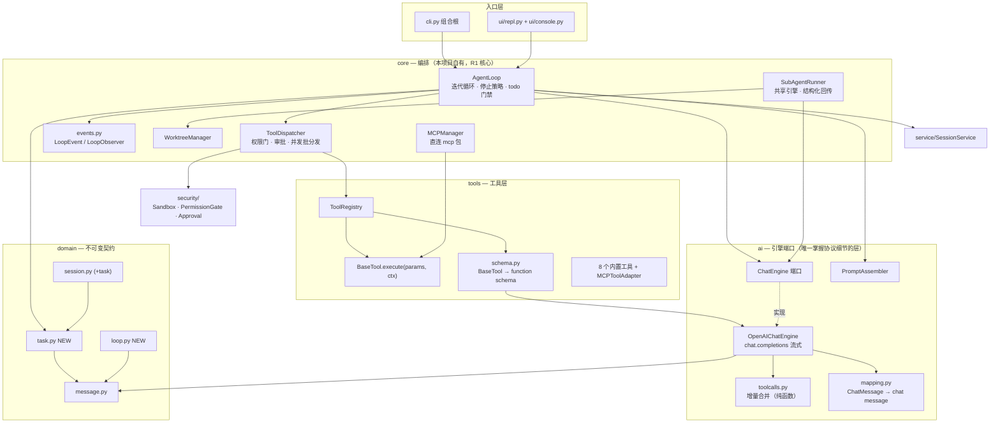
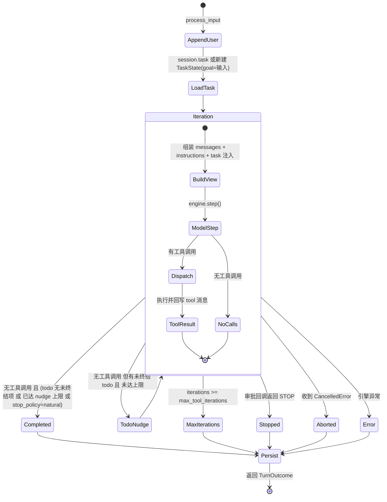
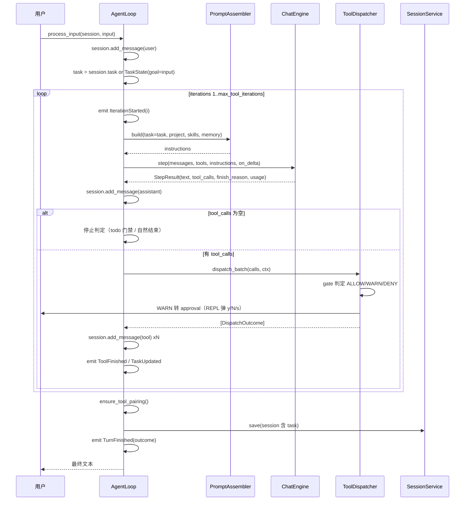
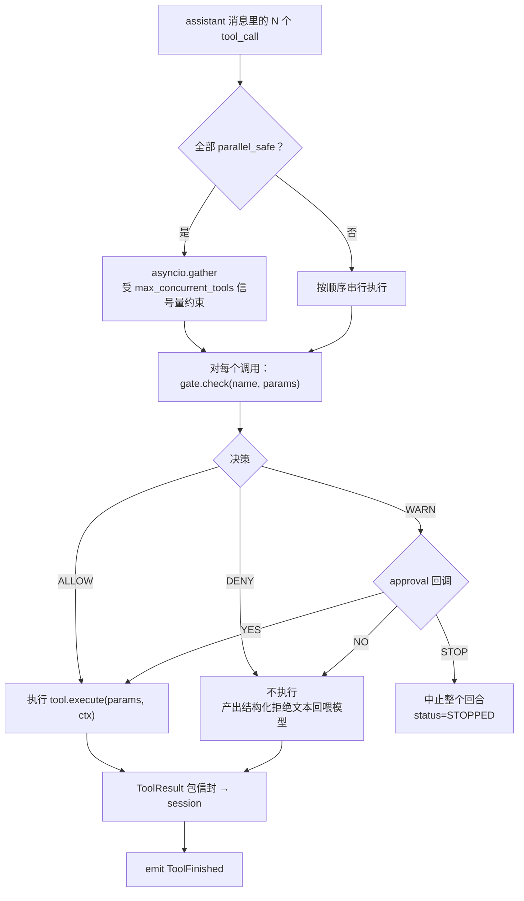

# AI-Coding — R1 阶段分析方案（编排层重构：自持循环 + Todo 驱动的 ReAct）

> 定位：在 M0–M6 已交付的「SDK 驱动单回合」之上，把**循环控制权从 OpenAI Agents SDK 收回本项目**，
> 落地「Todo 清单作为一等公民 + 显式迭代循环 + 按需工具分发（含子智能体）」的编排层。
> 依据：已核验的 M0–M6 实际代码、`docs/architecture.md` 的既有承诺、`docs/m2-analysis.md` 的工具/权限契约。
> 决策前提：编排方案 A（完全自持循环）已由需求方拍板。

---

## 0. 决策前提与不可逆后果（先摆清楚）

已拍板：**方案 A — 完全自持循环**。本项目自己调 chat.completions、自己跑迭代、自己执行工具；
runtime 的 tracing / guardrails / hooks 后续自建。

这个选择的直接后果，必须知情：

| 后果 | 具体表现 | 处置 |
|---|---|---|
| `openai-agents` 出局 | 全项目不再有 `import agents`；`AgentsSDKChatService`、`sdk_adapter`、`agents.mcp` 三条依赖路径全部消失 | 从 `pyproject.toml` 依赖中移除，改为直接依赖 `openai` 与 `mcp` |
| MCP 需要自研 | 现行 `MCPManager` 产出的是 `agents.mcp.MCPServerStdio`，SDK 一走就失效 | 用 `mcp` 包直连（stdio），把远端工具适配成 `BaseTool` 注册进同一个注册表；R1-6 交付 |
| 「SDK 只是可替换引擎」的承诺改写 | 原承诺靠「只有 2 个文件 import agents」证明；新承诺是「只有 `ai/engine.py` + `ai/openai_engine.py` 掌握协议细节」 | 更新 `docs/architecture.md`（R1a-6） |
| tracing / guardrails / hooks 归零 | 现无自建替代 | 本阶段不补，只把扩展点（`LoopObserver`）预留出来 |
| 项目定位表述 | README 现在写「基于 OpenAI Agents SDK」 | R1a-6 同步为「自持 ReAct 循环 + 可替换 ChatEngine 端口」 |

**风险声明**：R1a 期间 `mcp.enabled=true` 会失效。因为 `MCPConfig.enabled` 默认 `false`、
`config.example.yaml` 里没有任何 MCP server，实际影响为零；R1-6 补齐后恢复。

### 0.1 需求方追加约束（已锁定，覆盖前一版）

在方案评审中追加了三条约束，它们**改变数据契约本身**，不是加字段：

| # | 约束 | 对设计的影响 |
|---|---|---|
| C1 | **工具调用必须返回结构化信息**，不是一段裸文本 | `ToolResult` 从「bool + str」升级为携带 `data` 与 `artifacts`；工具输出信封相应改形；`ToolFinished` 事件与落盘都带结构化部分。详见 §3.5 D9 / §4.18 |
| C2 | **分发子智能体时必须给它相同的上下文**；子智能体内部的思考过程不必回传；它要返回自己的信息包与最终成果，且这些**必须回写** | `ToolContext` 增加父回合的历史视图与系统提示；`SubAgentRunner` 从「空历史 `[]` 起跑」改为「共享父上下文 + 独立 todo + 结构化回包」；回包落盘为独立 ledger 文件并在会话中留指针。详见 §3.5 D10 / §4.13 |
| C3 | **忘掉 Java 兼容，这是新项目** | 「会话 JSON 与 Java 字节兼容」这项承诺**正式退役**；会话文件可自由增删字段，不再受 Jackson 未知字段问题的约束；Q1 从「要不要写」变成「怎么写更干净」 |

---

## 1. 影响分析（对代码的影响 / 执行范围）

### 1.1 影响判定

这不是新增功能，是**替换核心执行路径**。判据：

- 现有控制流 `AgentLoop.process_input` → `AIService.execute_turn` → `Runner.run_streamed`（内部循环）
  被整体替换为 `AgentLoop.process_input`（**循环本体**）→ `ChatEngine.step`（单次模型调用）→ `ToolDispatcher`（单步工具）。
- 被替换的接口被 3 个调用方依赖：`cli.py`、`ui/repl.py`、以及 6 个测试文件里的 `FakeAIService`。
- 314 个既有测试中，预计 **~70 个需要改写**（见 §6.6 测试迁移映射），其余 ~244 个保持不动。

### 1.2 执行范围（R1 交付物）

| # | 件 | 归属 |
|---|---|---|
| 1 | `domain/task.py`：`TodoItem` / `TodoStatus` / `TaskState` + 渲染 | R1-1 |
| 2 | `domain/loop.py`：`StepResult` / `TurnOutcome` / `TurnStatus` | R1-1 |
| 3 | `tools/schema.py`：`BaseTool` → OpenAI function schema | R1-1 |
| 4 | `tools/base.py`：`ToolContext` + `execute(params, ctx)` + `parallel_safe` | R1-1 |
| 5 | `ai/engine.py`：`ChatEngine` 端口 | R1-2 |
| 6 | `ai/toolcalls.py`：流式 tool_call 增量合并（纯函数） | R1-2 |
| 7 | `ai/openai_engine.py`：直连 chat.completions 流式适配 | R1-2 |
| 8 | `ai/mapping.py` 重写：`ChatMessage` → OpenAI chat message | R1-2 |
| 9 | `core/dispatch.py`：权限门 + 审批 + 并发批分发的唯一放行通道 | R1-3 |
| 10 | `core/events.py`：`LoopEvent` + `LoopObserver` | R1-4 |
| 11 | `core/agent_loop.py` 重写：循环本体 + 停止策略 + todo 门禁 | R1-4 |
| 12 | `core/subagent.py` 重写：共享引擎 + 结构化回传 + 并发上限 | R1-5 |
| 13 | `core/mcp.py` 重写：直连 `mcp` 包 + `MCPToolAdapter` | R1-6 |
| 14 | `cli.py` / `ui/repl.py`：工具活动可见、事件接线、回合中断 | R1-7 |
| 15 | `pyproject.toml`：移除 `openai-agents`，显式声明 `openai` + `mcp` | R1-7 |
| 16 | `AIConfig` 新增编排参数；淘汰语义失效的旧参数 | R1-1 |
| 17 | `docs/`：architecture / features / data-contracts / README 同步 | R1-7 |
| 18 | `domain/message.py` + `domain/run.py`：`ToolResult` 结构化 + 新信封 | R1-1 |
| 19 | `tools/subagent_tool.py` + `core/subagent.py`：共享上下文 + 结构化信息包 | R1-5 |
| 20 | `transcripts/subagents/` ledger：子智能体回包落盘 | R1-5 |

### 1.3 与既有设计承诺的偏离（需要你知情）

| 原承诺 | 出处 | R1 后的状态 |
|---|---|---|
| 「全项目只有两个模块 import `agents`」 | architecture.md | **退役**，替换为「只有 `ai/openai_engine.py` + `ai/toolcalls.py` 掌握 SDK 协议细节」 |
| 「SDK 的 `needs_approval` 是唯一放行通道」 | m2-analysis §8 | **替换**为「`ToolDispatcher` 的 gate + approval 是唯一放行通道」 |
| 「会话 JSON 与 Java 旧格式字节兼容」 | m0/m1 | **正式退役**（C3：忘掉 Java，新项目）。会话文件可自由增删字段 |
| 「压缩只改副本，绝不污染调用方状态」 | m3 §5-2 | **保留**（R1 不动压缩，R2 重做时继续遵守） |
| 「增强组件静默降级、永不阻塞主链路」 | m3 §5-11 | **保留**，并扩展到 MCP 与子智能体 |

---

## 2. 目前设计（现状基线，核验过的事实）

### 2.1 控制权在哪

```
cli.ask / repl
  └─ AgentLoop.process_input(session, user_input)      # 五步直线脚本，零控制点
       ├─ session.add_message(user)                    # agent_loop.py:60
       ├─ ContextManager.compress(history)             # 只改副本，结果不落盘
       ├─ PromptAssembler.build(...)                   # 纯字符串拼接
       ├─ AIService.execute_turn(history, user_input)  # ← 循环在这里面
       │    └─ Runner.run_streamed(agent, inputs)      # SDK 内部自动多轮
       │         └─ 我们只 async for 收集事件           # agents_sdk_service.py:96-150
       ├─ session.add_message(assistant) + tool msgs
       └─ sessions.save(session)
```

**决定性事实**：`AgentLoop` 没有 while 循环。模型跑几轮工具、什么时候停，全部由 SDK 决定，
我们只有「事件收集」和「事后落盘」两个动作。

### 2.2 现状与目标的差距

| 维度 | 现状（核验过） | R1 目标 |
|---|---|---|
| 迭代控制 | 在 SDK 内，不可见不可控 | 我们自己的 `while`，每次迭代落一条可观察事件 |
| 轮次上限 | `ai.max_tool_iterations=10` **是死配置**，全代码库无人读取 | 真正生效，耗尽即 `MAX_ITERATIONS` 并保留部分成果 |
| 停止条件 | 只有「模型不再调工具」 | 显式 5 条：自然结束 / 轮次耗尽 / todo 门禁 / 用户中断 / 审批 STOP |
| todo | `TodoWriteTool` 纯内存 list，不注入 prompt、不被循环读取、不落盘 | `TaskState` 随会话持久化，每轮注入模型可见，可门禁停止 |
| 计划模式 | `PromptAssembler(plan_mode=True)` 生产路径不可达（cli.py:197 永远 False） | 由 `TaskState.goal` + 停止策略承载，不再依赖不可达开关 |
| 工具执行 | SDK 内部执行，我们只能听事件 | `ToolDispatcher` 显式执行，逐次过权限门 |
| 并发 | `max_concurrent_subagents=3` **是死配置**；工具全串行 | 同一条 assistant 消息里的并行安全工具并发执行，受信号量约束 |
| 子智能体 | 空历史 `[]` 起跑，只回传一段文本，无结构化结果 | 共享引擎、自带 todo、结构化回传、真实的并发上限 |
| 中断 | 无。模型跑起来就只能等 | 回合可取消，取消后保留部分 transcript |
| 用户消息 | **每回合发两条完全相同的 user 消息**（agent_loop.py:60 + agents_sdk_service.py:76-78） | 只发一条 |

### 2.3 会被动到的既有测试（回归边界）

| 测试文件 | 原因 |
|---|---|
| `test_agent_loop.py` / `_tools.py` / `_m3.py` | `FakeAIService` 实现的是 `execute_turn` 端口，端口被换 |
| `test_ai_service.py` / `test_agents_sdk_stream_helpers.py` | 断言的是 SDK 的 `Agent` 构造与事件解析 |
| `test_ai_mapping.py` | 断言的是 SDK 的 `function_call` 输入项形态 |
| `test_sdk_adapter.py` | 断言的是 `FunctionTool` 包装 |
| `test_builder.py` | `_names(sdk_tools)` 依赖 SDK 工具的 `.name` |
| `test_mcp.py` | 断言的是 `MCPServerStdio` 构造 |
| `test_tool_*.py`（约 20 个） | `execute(params)` 签名变为 `execute(params, ctx)` |
| `test_cli.py` | `_build_loop` 装配签名变化 |

**规则**：这些测试是行为规格，R1 允许改写它们，但**每一条改写都必须在提交信息里写明「为什么原断言不再是正确规格」**，
并遵循 TDD：先改测试→跑红→实现→跑绿。

---

## 3. 目标设计

### 3.1 分层与依赖方向（架构图 1）



依赖方向仍是单向的：`domain` 不被反向 import；`ai` 依赖 `domain`，不被 `core` 之外反向依赖；
`core` 是唯一同时编排 `ai` / `tools` / `security` / `service` 的层；`cli` 是组合根。

### 3.2 循环状态机（架构图 2）



### 3.3 一次回合的时序（架构图 3）



### 3.4 工具分发与权限（架构图 4）



**并发安全规则**：`BaseTool.parallel_safe` 类属性，默认 `False`（保守，串行）。
`read` / `glob` / `skill` / `todo_write` / `subAgent` 覆写为 `True`；`bash` / `write` / `edit` 保持 `False`。
判定规则：**一批调用只要有一个 `parallel_safe=False`，整批串行**——因为写操作之间存在隐式依赖。

### 3.5 关键设计决策（逐条给理由与代价）

**D1 — 循环放在 `core/agent_loop.py` 里重写，不新开 `core/runtime.py`。**
理由：`AgentLoop` 与 `process_input` 是 `cli.py`、`ui/repl.py` 和 3 个测试文件的既有入口，
保留类名与入口签名可把改动集中在一处。代价：该文件会变大（预计 250–300 行），
因此把工具分发拆到 `core/dispatch.py`、事件拆到 `core/events.py` 来控体量。

**D2 — 端口从 `AIService.execute_turn` 换成 `ChatEngine.step`。**
`execute_turn(history, user_input, token_sink, instructions)` 的语义是「跑完整个回合」，
与自持循环的「跑一步」根本冲突。新端口：

```python
class ChatEngine(ABC):
    @abstractmethod
    async def step(
        self,
        messages: list[ChatMessage],          # 已含本轮 user 消息，引擎不再自行追加
        *,
        tools: list[dict[str, Any]],          # OpenAI function schema
        instructions: str | None,
        on_delta: Callable[[str], None] | None,
    ) -> StepResult: ...

    async def aclose(self) -> None: ...
```

代价：6 个测试文件里的 `FakeAIService` 全部改写为 `ScriptedEngine`（队列化返回 `StepResult`），
这反而让循环测试更好写——可以脚本化「模型连续三次调工具再给答案」。

**D3 — 工具签名加 `ctx`：`execute(params, ctx) -> ToolResult`。**
理由（这是当前设计的真实缺陷，不是洁癖）：`build_tool_stack` 产出的工具是**单例**，
而 `repl` 只在启动时构建一次工具栈、`/clear` 后复用同一批实例。所以 `TodoWriteTool` 的内存 list
**会跨会话泄漏**——你 `/clear` 之后，模型还能看到上一个会话的 todo。
`ToolContext{task, workspace, session_id, emit}` 让工具无状态、状态随会话流动，
并且是下一步记忆层工具的必备参数。
代价：8 个工具 + 约 20 个 `test_tool_*.py` 机械改写。

**D4 — todo 渲染的注入位置：默认走「每轮最后一条易失消息」，不走 system prompt。**
这是本次最需要想清楚的细节。三个候选：

| 方案 | 优点 | 缺点 |
|---|---|---|
| 放进 system prompt | 存活于压缩、始终可见 | **system prompt 是前缀，改一次就让整段历史 KV cache 失效**；todo 一个回合会变几次 |
| 只放在 `todo_write` 的工具结果里 | 零额外成本，模型在变更点看到 | 新回合/新会话开头模型看不到既有清单 |
| **每轮请求末尾注入一条易失消息（默认）** | 前缀稳定（cache 友好），模型每步都看到最新清单，不污染持久化历史 | 每次迭代多一条 ~200 token 的消息 |

默认取第三个，`ai.task_injection="message"` 可切回 `"system"`。
同时 `todo_write` 的工具结果**也**返回渲染后的清单（双保险，且变更点即时可见）。

**D5 — todo 门禁：`stop_policy="todo_aware"` 为默认。**
模型给出终答、但还有未终结 todo 时，注入一次提醒（最多 `max_todo_nudges=2` 次），
要求它「要么继续做，要么把条目标记为 `dropped` 并说明原因」。这正是 Claude Code
Stop hook「可连续阻断 8 次」的语义，也是让 todo **驱动**循环而不是当装饰的关键机制。
代价：可能多花 1–2 次模型调用。可切 `natural`（关闭门禁）或 `strict`（不设上限）。

**D6 — 同一条 assistant 消息里的工具调用并发执行。**
这是「真正的子智能体并发」的**最小实现**：不需要后台任务调度器，
模型在一个回合里发起 3 个 `subAgent` 调用，`ToolDispatcher` 就会并发跑 3 个子智能体，
由 `asyncio.Semaphore(ai.max_concurrent_subagents)` 限流。`max_concurrent_subagents` 从此不再是死配置。

**D7 — `TaskState` 写进会话 JSON（已定：非空才写）。**
C3 之后 Java 兼容不再是约束，`SessionData.to_dict()` 可自由增加 `task` 键。
仍然采用「`task` 为空时不写该键」——理由不再是兼容性，而是**文件干净**：
绝大多数一次性问答不会产生 todo，没必要每个会话文件都挂一个空壳。
`from_dict` 对缺失键默认 `None`，旧文件照样能读（顺带保留了向下兼容，零成本）。

**D8 — 引擎异常的处置：区分「可降级」与「致命」。**
模型调用失败（网络/限流）→ 若已有部分迭代成果，落盘并返回 `ERROR` 且保留已完成的工具轨迹；
工具执行失败 → **不是**回合失败，把失败文本作为工具结果回喂模型（现有 `ToolResult.success=False` 语义），
让模型自己决定重试或改道。这与现有 fail-closed 原则一致：拒绝要显式回喂，不能静默吞掉。

**D9 — 工具结果必须是结构化的：`ToolResult` 升级（对应约束 C1）。**

现状 `ToolResult(success: bool, output: str)` 只有一段文本，两个后果：
模型要自己去猜文本里的结构（比如 `glob` 到底返回了几条、有没有被截断），
而运行时/UI/落盘要拿到结构只能去正则解析文本。改成：

```python
@dataclass(frozen=True)
class ToolArtifact:
    path: str                 # 相对 workspace
    kind: str = "file"        # file | dir | url | ref
    bytes: int | None = None
    description: str = ""

@dataclass(frozen=True)
class ToolResult:
    success: bool
    output: str = ""                              # 给模型读的渲染文本
    data: dict[str, Any] | None = None            # 给程序读的结构化结果
    artifacts: tuple[ToolArtifact, ...] = ()      # 副作用产物（新建/改动的文件等）
    error: str | None = None                      # 失败时机器可读的原因
```

输出信封相应改形（`domain/run.py::wrap_tool_output`）：

```
<tool_output tool="glob" ok="true">
<data>
{"matches": ["a.py", "b.py"], "total": 2, "truncated": false}
</data>
</tool_output>
```

规则与理由：

- **`data is None` 时省略 `<data>` 块**，信封退化回今天的形状 —— 现有工具一行不改也能跑，改造成本可控。
- 「模型的输入通道只能是字符串」是硬约束（`role=tool` 的 `content` 必须是 str），
  所以 `data` 必须序列化进 `content` 才能被模型看到；同时 `data` 作为领域字段存在，
  运行时/UI/落盘无需解析。**一份数据两个出口**，避免「让模型读 JSON、程序还在正则解析文本」的双份维护。
- `data` 必须可 JSON 序列化，且受 `ai.max_result_data_bytes`（默认 8000）限制：
  超限时降级为 `{"truncated": true, "preview": ...}`，并把完整内容留给 `output` 或 L3 落盘。

**D10 — 子智能体共享父上下文、只回结构化信息包（对应约束 C2）。**

现状 `SubAgentRunner._run_in` 用**空历史** `[]` 起跑：子智能体对当前任务、项目指令、
技能目录、记忆一无所知，只能靠 `task` 字符串里的自述，这是它的能力上限所在。

改法三条：

1. **共享上下文**：`ToolContext` 携带父回合的**请求视图快照**（`messages`）与组装好的
   `instructions`；`SubAgentRunner` 用它作为子智能体的起始输入。
   注意「相同上下文」的精确含义：给的是**与父回合当次请求完全一致的那份视图**
   （已压缩、已注入项目指令/技能/记忆），而不是原始持久化历史——这样既可复现，
   又不会把未压缩的长历史灌给子智能体。
2. **不回传思考**：子智能体的推理文本与逐次工具调用**不回流**（需求方明确「思考不用管」）。
   父会话里只出现一条 `subAgent` 的工具结果。
3. **结构化回包 + 回写**：

```python
@dataclass(frozen=True)
class SubagentResult:
    status: str                              # completed | max_iterations | timeout | error
    conclusion: str | None = None            # 最终成果
    todos: tuple[dict[str, Any], ...] = ()   # 子智能体 todo 的终态
    artifacts: tuple[ToolArtifact, ...] = ()
    iterations: int = 0
    workdir: str | None = None               # worktree 路径（若启用隔离）
    ledger_path: str | None = None           # 完整回包落盘位置
```

   回写分三层：**(a)** 作为 `subAgent` 工具结果的结构化 `data` 进入会话（模型能看到）；
   **(b)** 完整回包写 `transcripts/subagents/<call_id>.json`，工具输出里只留路径指针；
   **(c)** 子智能体的 todo **默认不自动并入父任务清单**——并行子任务各有各的计划，
   自动合并会把父清单搅乱。父模型应当**显式**决定要不要用 `todo_write` 采纳。
   这是刻意的选择，不是遗漏。
   长回包保护：`conclusion` 超过 `ai.max_subagent_conclusion_chars`（默认 4000）截断，
   全文只存在于 ledger。

---

## 4. 逐文件「新增功能 + 实现步骤」

### 4.1 `ai_coding/domain/task.py`（新增）

职责：todo 的不可变边界 + 渲染。零业务依赖。

```python
TodoStatus = Literal["pending", "in_progress", "completed", "blocked", "dropped"]
_TERMINAL = frozenset({"completed", "dropped"})

@dataclass
class TodoItem:
    id: str
    content: str
    status: TodoStatus = "pending"
    depends_on: list[str] = field(default_factory=list)
    evidence: str | None = None      # 完成依据（文件路径 / 命令 / 结论）
    created_at: str = ""
    updated_at: str = ""

@dataclass
class TaskState:
    goal: str = ""
    items: list[TodoItem] = field(default_factory=list)
```

方法（逐步）：`next_id()` 返回递增 id 但跳过已占用；`add(content, depends_on=None, ts="")` 追加 pending 项并返回它；
`update(item_id, *, status=None, evidence=None, content=None, ts="")` 找不到抛 `KeyError`，
状态值非法抛 `ValueError`；`open_items()` 过滤非终态；
`is_complete()` = `open_items()` 为空；`focus()` 返回第一个「非终态且 `depends_on` 全为终态」的条目
（无则返回第一个非终态条目，便于渲染「下一步」）；`render(max_items=40)` 产出：

```
<task-state>
目标: 重构编排层
进度: 2/5
[x] 1. 读通 agent_loop.py
[>] 2. 设计 TaskState
[!] 3. 重写循环 (blocked by 2)
[ ] 4. 写测试
下一步: 2. 设计 TaskState
</task-state>
```

`to_dict()/from_dict()` 走 camelCase 键（`dependsOn`、`createdAt`、`updatedAt`），与 Java 风格一致。
**YAGNI 声明**：`depends_on` 本阶段**只做渲染提示与 `focus()` 选择，不做硬门禁**
（不阻止 `todo_write` 把有未完成依赖的条目置为 completed），因为硬门禁需要环检测与更复杂的错误语义，
留待有真实需求再加。

### 4.2 `ai_coding/domain/loop.py`（新增）

```python
class TurnStatus(enum.Enum):
    COMPLETED = "completed"          # 模型自然结束（含 todo 门禁通过）
    MAX_ITERATIONS = "max_iterations"
    STOPPED = "stopped"              # 审批回调 STOP
    ABORTED = "aborted"              # 用户中断
    ERROR = "error"

@dataclass(frozen=True)
class StepResult:
    text: str | None = None
    tool_calls: list[ToolCallRef] = field(default_factory=list)
    finish_reason: str | None = None
    usage: dict[str, int] | None = None

@dataclass(frozen=True)
class TurnOutcome:
    status: TurnStatus
    text: str | None
    iterations: int
    reason: str = ""
```

`domain/run.py` 里 `TurnResult` 退役（`assistant_message` 改签名为 `assistant_message(step, ts)`），
`wrap_tool_output` / `tool_message` / `ToolOutput` **保留**（tool 消息信封是历史结构不变量，压缩与配对逻辑依赖它）。
为避免破坏面扩大，`TurnResult` 保留为一个已标注 deprecated 的别名类，R2 再删。

### 4.3 `ai_coding/tools/base.py`（修改）

```python
@dataclass
class ToolContext:
    task: TaskState
    workspace: str
    session_id: str
    messages: tuple[ChatMessage, ...] = ()     # 父回合当次请求的历史视图（只读快照）
    instructions: str | None = None            # 父回合组装好的系统提示
    emit: Callable[[Any], None] = lambda _e: None

class BaseTool(ABC):
    parallel_safe: bool = False       # 保守默认：串行
    # name / description / params_json_schema 不变
    @abstractmethod
    async def execute(self, params: dict[str, Any], ctx: ToolContext) -> ToolResult: ...
```

步骤：加 `ToolContext`；`execute` 签名加第二个位置参数；`parallel_safe` 作为类属性。
8 个工具逐个改签名（多数 `_ = ctx` 即可），`read/glob/skill/todo_write/subAgent` 置 `parallel_safe=True`。
`messages` / `instructions` 是给 `subAgent` 用的（D10 的「共享相同上下文」）；
其余工具不读它们，但统一放在 `ctx` 里，避免为子智能体开特例通道。

### 4.4 `ai_coding/tools/schema.py`（新增）

```python
def tool_schema(tool: BaseTool) -> dict[str, Any]:
    return {"type": "function", "function": {
        "name": tool.name, "description": tool.description,
        "parameters": tool.params_json_schema}}

def tool_schemas(registry: ToolRegistry) -> list[dict[str, Any]]: ...
```

步骤：纯函数、零网络；保证 `parameters` 是 dict、缺 `type` 时补 `"object"`；
顺序按 `registry.list_names()` 排序（稳定 → 请求体稳定 → 对服务端 prompt cache 友好）。

### 4.5 `ai_coding/ai/engine.py`（新增）

承载 D2 的 `ChatEngine` 端口（签名见 D2）。文件顶部注释写明：**这是唯一允许出现「协议细节」的抽象层**；
`step` 每次只跑一次模型调用，绝不自行循环。

### 4.6 `ai_coding/ai/toolcalls.py`（新增，纯函数）

流式 `tool_calls` 是**按 index 分片**送达的：首个分片带 `id` 与 `name`，后续分片只带 `arguments` 片段。
合并逻辑必须可单测，因此单独成模块：

```python
def merge_tool_call_delta(acc: dict[int, dict[str, str]], delta: Any) -> None:
    """把一次 delta.tool_calls[i] 合并进累加器（id/name 首片，arguments 追加）。"""

def finalize_tool_calls(acc: dict[int, dict[str, str]]) -> list[ToolCallRef]:
    """按 index 升序产出 ToolCallRef；缺 id 时合成 'call_{index}'；缺 arguments 补 '{}'。"""
```

### 4.7 `ai_coding/ai/openai_engine.py`（新增）

```python
class OpenAIChatEngine(ChatEngine):
    def __init__(self, model_config: ModelConfig, *, client: AsyncOpenAI | None = None) -> None: ...
    async def step(self, messages, *, tools, instructions, on_delta) -> StepResult: ...
    async def aclose(self) -> None: ...
    @staticmethod
    def build_request_messages(messages, instructions) -> list[dict[str, Any]]: ...
```

实现步骤：
1. 构造：`AsyncOpenAI(base_url, api_key, timeout, max_retries=0)`（与现有 `llm_helpers` 一致）；`client` 可注入以便测试。
2. `build_request_messages`：`instructions` 非空时把 `{"role":"system","content":instructions}` 放首位；
   其后逐条 `mapping.to_chat_message(msg)`。**不追加 user 消息**（修复双份 bug）。
3. `step`：`client.chat.completions.create(model=..., messages=..., tools=tools or None,
   stream=True, stream_options={"include_usage": True}, temperature, max_tokens, top_p)`。
4. 遍历 chunk：`delta.content` → `on_delta` + 文本累加；`delta.tool_calls` → `merge_tool_call_delta`；
   记录最后一个非空 `finish_reason`；`chunk.usage` → `usage` dict。
5. 返回 `StepResult(text=text or None, tool_calls=finalize_tool_calls(acc), finish_reason, usage)`。
6. 网络/协议异常包成 `EngineError`（本模块自定义）向上抛，由循环决定是否降级。

**离线可测性**：`build_request_messages` 与 `toolcalls` 纯函数全测；`step` 用一个假的
`AsyncOpenAI`（`client.chat.completions.create` 返回异步迭代器）覆盖，包括
「多分片 tool_calls」「文本与工具参数交错」「usage 缺失」「异常抛出」四种形态。

### 4.8 `ai_coding/ai/mapping.py`（重写）

```python
def to_chat_message(msg: ChatMessage) -> dict[str, Any]:
    # user       -> {"role":"user","content":...}
    # assistant  -> {"role":"assistant","content":..., "tool_calls":[{id,type:"function",function:{name,arguments}}]}
    #              （tool_calls 为空时省略该键；仅 calls 无文本时 content=None）
    # tool       -> {"role":"tool","tool_call_id":..., "content":...}
```

**这是一个净收益**：原生 `tool_calls` 是 Chat Completions 的标准形态，
M3 曾为「assistant 缺 `function_call` 项导致回放 400」打的那个补丁（把 tool_calls 分流成
`function_call` 输入项）整类问题消失。
`chat_message_to_input` / `chat_message_to_inputs` / `history_to_inputs` 退役。

### 4.9 `ai_coding/core/dispatch.py`（新增）

```python
@dataclass(frozen=True)
class DispatchOutcome:
    call: ToolCall
    result: ToolResult
    denied: bool = False
    halted: bool = False      # approval 返回 STOP

class ToolDispatcher:
    def __init__(self, registry: ToolRegistry, gate: PermissionGate,
                 approval: ApprovalCallback | None = None, *,
                 max_parallel: int = 4, observer: LoopObserver | None = None) -> None: ...
    async def dispatch_batch(self, calls: list[ToolCallRef], ctx: ToolContext) -> list[DispatchOutcome]: ...
```

步骤：
1. 解析每个 `ToolCallRef` → `ToolCall`（复用 `tool_call_from_ref`，非法 JSON 退化为 `{}`，不抛）。
2. 未知工具：不执行，产出 `ToolResult(success=False, output="error: unknown tool 'x'")` 回喂模型
   （工具列表由我们生成，模型幻觉出工具名时这是唯一合理的处理）。
3. 并发判定：查 `registry.get(name).parallel_safe`；全为真 → `asyncio.gather` 且受 `Semaphore(max_parallel)`；
   否则按顺序串行。
4. 每个调用：`gate.check(name, params)` → ALLOW 直接执行；DENY 产出拒绝文本（含 `decision.reason`）；
   WARN 调 `approval.approve(...)`，YES 执行 / NO 产出拒绝文本 / STOP 置 `halted=True`。
5. `approval is None` 时 WARN **fail-closed**（拒绝），与现有 `approve_from_gate_decision` 语义一致。
6. 执行异常一律捕获为 `ToolResult(success=False, ...)`，绝不让工具异常掀翻回合。
7. 复用现有 `security/approval.py`（`ApprovalCallback` / `ApprovalResult` / `AutoApproveCallback` /
   `CLIApprovalCallback` **完全不改**）与 `security/permission_gate.py`（**完全不改**）——
   它们已经是对的，只是换了个调用方。

`DispatchOutcome.result` 现在携带 `data` 与 `artifacts`（D9），因此拒绝路径也要产出结构化结果：
`ToolResult(success=False, error="denied", data={"decision": "deny", "reason": ...})`。
模型拿到的不再是「一句拒绝」，而是可判断的 `decision` 字段。

### 4.10 `ai_coding/core/events.py`（新增）

```python
@dataclass(frozen=True) class IterationStarted:  index: int; max_iterations: int
@dataclass(frozen=True) class AssistantTextDelta: text: str
@dataclass(frozen=True) class AssistantMessage:  text: str | None; tool_calls: tuple[ToolCallRef, ...]
@dataclass(frozen=True) class ToolApprovalRequested: tool_name: str; params: dict; reason: str
@dataclass(frozen=True) class ToolStarted:  call_id: str; tool_name: str; params: dict
@dataclass(frozen=True) class ToolFinished: call_id: str; tool_name: str; success: bool
                                            output_preview: str; duration_ms: int
@dataclass(frozen=True) class TaskUpdated:  task: TaskState
@dataclass(frozen=True) class TurnFinished: outcome: TurnOutcome

LoopEvent = Union[IterationStarted, AssistantTextDelta, AssistantMessage,
                  ToolApprovalRequested, ToolStarted, ToolFinished, TaskUpdated, TurnFinished]

class LoopObserver(Protocol):
    def on_event(self, event: LoopEvent) -> None: ...

class NullObserver:  ...       # 全部空实现
class RecordingObserver: ...   # 测试用，把事件收进 list
```

`output_preview` 截断到 500 字符，避免事件层把巨型工具输出带进 UI 与日志。

### 4.11 `ai_coding/core/agent_loop.py`（重写，R1 核心）

```python
class AgentLoop:
    def __init__(
        self,
        engine: ChatEngine,
        sessions: SessionService,
        tools: ToolRegistry,
        *,
        gate: PermissionGate | None = None,
        approval: ApprovalCallback | None = None,
        prompt: PromptAssembler | None = None,
        context: ContextManager | None = None,     # R2 重做，本阶段保持原样接入
        memory: MemoryService | None = None,       # R3 重做
        skills: SkillRegistry | None = None,
        project: ProjectInstructionsLoader | None = None,
        settings: AIConfig | None = None,
        observer: LoopObserver | None = None,
    ) -> None: ...

    async def process_input(self, session, user_input, on_delta=None,
                            observer: LoopObserver | None = None) -> str: ...
    async def aclose(self) -> None: ...
    last_outcome: TurnOutcome | None = None
```

`process_input` 步骤（这是方案的主体，逐条落到实现）：

1. `ts = now_utc()`；`session.add_message(user_message(user_input, ts))`。
2. `task = session.task or TaskState(goal=user_input)`；把 `task` 挂回 `session.task`。
3. 组装 dispatcher（若未在构造期注入）。
4. `for index in range(1, max_tool_iterations + 1)`：
   1. `emit(IterationStarted(index, max_tool_iterations))`。
   2. `compact = await context.compress(session.messages)`（可选组件，缺省用原历史）。
   3. `instructions = prompt.build(...)`（可选组件）。
   4. 任务注入：`task_injection == "system"` 时把 `task.render()` 追加到 instructions 末尾；
      为 `"message"` 时构造 `request_messages = compact + [task_block_message(task)]`（**易失，不入 session**）。
   5. `step = await engine.step(request_messages, tools=tool_schemas(registry), instructions=..., on_delta=on_delta)`。
   6. `session.add_message(assistant_message(step, now_utc()))`。
   7. 若无 `tool_calls`：
      - `open_count = len(task.open_items())`；
      - `stop_policy == "natural"` 或 `open_count == 0` 或 `nudges >= max_todo_nudges` → 结束（`COMPLETED`）；
      - 否则 `nudges += 1`，追加一条 **user 角色的门禁消息**（`[task-gate] 仍有 N 项未完成：…；请继续，或将其标记为 dropped 并说明原因`）后 `continue`。
   8. 有 `tool_calls`：`outcomes = await dispatcher.dispatch_batch(...)`；
      若任一 `halted` → 回写已产生的 tool 消息后以 `STOPPED` 结束；
      否则逐条 `session.add_message(tool_message(...))`
      （`todo_write` 走的是同一条路径，因为它的结果是从 `ctx.task` 渲染出来的，
      不需要在循环里特判；循环只额外补一个 `emit(TaskUpdated(task))` 供 UI 刷新）。
   9. `ensure_tool_pairing()` + `sessions.save(session)` —— **每次迭代都落盘**，
      这样中断/崩溃后会话仍停在最后一次完整迭代（这是自持循环换来的真实能力）。
5. 循环自然走完 → `MAX_ITERATIONS`。
6. `except asyncio.CancelledError:` → 落盘 → `ABORTED`（先 `ensure_tool_pairing` 清理半截配对）。
7. `except EngineError as exc:` → 落盘 → `ERROR`，`reason=str(exc)`。
8. `finally`：`emit(TurnFinished(outcome))`；`self.last_outcome = outcome`；返回 `outcome.text or ""`。

**todo_write 的接线**：`TodoWriteTool.execute(params, ctx)` 直接读写 `ctx.task`；
循环把 `session.task` 放进 `ctx`。工具保持无状态单例，跨会话泄漏问题（D3）被根除。
`todo_write` 的结果文本**包含渲染后的完整清单**，模型在变更点立刻看到全貌。

### 4.12 `ai_coding/tools/todo_write_tool.py`（重写）

签名改为 `execute(self, params, ctx)`，动作扩展为 `add / update / list / clear`，
`update` 接受 `id` + 可选 `status` / `evidence` / `content`；
所有变更走 `ctx.task`，返回 `ToolResult(output=ctx.task.render())`。
`list` 是只读，返回同一渲染。`parallel_safe = True`。
非法 status → `ToolResult(success=False, ...)`（与现有错误语义一致，不抛）。

### 4.13 `ai_coding/core/subagent.py`（重写）

```python
class SubAgentRunner:
    def __init__(self, app_config, engine_factory, build_tools, *,
                 max_concurrent: int = 3, timeout_seconds: int = 600) -> None: ...
    async def run(self, task, name="sub-agent", *, worktree_manager=None,
                  isolate=True, parent: ParentContext | None = None,
                  call_id: str = "") -> SubagentResult: ...
```

步骤：
1. **共享引擎**：`engine_factory()` 造一个与主循环同型的引擎（同一 `ModelConfig`）；
   超时用 `asyncio.wait_for`，超时返回 `SubagentResult(status="timeout")`。
2. **自建 AgentLoop**：子智能体跑**同一套循环**（自己的 `TaskState`、自己的工具栈、
   `include_subagent=False` 防递归、`subagent_worktree_isolation` 决定是否 worktree）；
   这是本次重构的额外收益——子智能体自动获得 todo 能力与迭代上限。
3. **信号量**：类级 `asyncio.Semaphore(max_concurrent)`，把死配置 `max_concurrent_subagents` 变成真约束。
4. **共享上下文（C2）**：`parent` 由 `ToolContext` 提供，含 `messages`（父回合当次请求视图快照）
   与 `instructions`。子智能体以 `parent.messages + [user(task)]` 为起始输入，
   `parent.instructions` 作为其系统提示基础 —— 这样「相同上下文」是**精确可复现**的，
   而不是把原始未压缩历史灌过去。父上下文缺失（`parent is None`）时退化为今天的空历史行为，
   保证既有单测与 `--func` 式调用不被破坏。
5. **结构化回包（D10）**：返回 `SubagentResult`（见 §3.5 D10），
   `SubAgentTool` 把它拆成两个出口：
   - `data` = `result.to_dict()` 去掉 `conclusion` 全文（含 status / todos / artifacts / iterations / ledger_path）；
   - `output` = 渲染文本（结论 + 未完成项 + 改动文件），结论超 `max_subagent_conclusion_chars` 时截断并附 ledger 路径。
6. **回写落盘**：完整回包写 `{workspace}/transcripts/subagents/{call_id}.json`（原子写）；
   写失败静默降级（增强组件不阻塞主链路），此时工具输出附 `ledger_path: null`。
7. **不回收思考**：子智能体的 assistant 文本与其中的工具调用**不进入父会话**，只留一条工具结果。
8. **不自动合并 todo**：子智能体的 todo 只作为信息包内容呈现，父模型需显式 `todo_write` 才会采纳。
9. worktree 失败仍降级到主工作区（保留现有 `WorktreeError` 兜底语义）。

### 4.18 `ai_coding/domain/message.py` + `domain/run.py`（修改：结构化工具结果）

对应 D9。改动点：

1. `ToolResult` 增加 `data: dict | None`、`artifacts: tuple[ToolArtifact, ...]`、`error: str | None`；
   `output` 保留且默认为 `""`（现有 `ToolResult(success=True, output="...")` 的调用点全部仍然合法）。
2. 新增 `ToolArtifact`（不可变，`to_dict()/from_dict()`）。
3. `wrap_tool_output(name, output, *, success=True, data=None)`：`data` 非空时在信封内插入 `<data>` 块；
   `ok="false"` 由 `success` 决定。
4. `tool_message(out, ts)` 保持不变，但它读的 `ToolOutput` 增加 `data` / `artifacts` / `success` 字段
   （由 dispatcher 从 `ToolResult` 填入），使落盘的 tool 消息带上结构化部分。

**兼容性说明**：`ToolOutput` / `tool_message` 的旧调用形态（只给 `call_id/tool_name/output`）
必须继续可用，新字段全部有默认值。`test_domain_message` / `test_domain_run` 里断言旧信封形状的
用例需要审计——**旧形状在 `data is None` 时必须仍然成立**，这条要有测试锁住。

### 4.14 `ai_coding/core/mcp.py`（重写）

```python
class MCPManager:
    async def open_all(self) -> list[BaseTool]   # 连接 stdio server + list_tools → MCPToolAdapter
    async def aclose(self) -> None
class MCPToolAdapter(BaseTool):
    parallel_safe = False        # 远端副作用未知 → 保守串行
```

> ⚠️ **已被 M3 取代**：M3 起 `open_all()` 改为非阻塞（只起 supervisor 即返回），
> 签名是 `async def open_all(self) -> None`，**不返回工具列表**。本节是旧设计分析，
> 保留作为历史记录。工具表面请读 `MCPManager.available()`。

步骤：用 `mcp` 包的 stdio client 连接（`command` + `args`）；`list_tools()` 后为每个远端工具
建一个 `MCPToolAdapter`（name 加 `{server}__{tool}` 前缀防冲突，description 与
`inputSchema` 直传）；`execute` 调 `client.call_tool(name, params)`，把返回内容拼成文本；
连接/发现失败静默降级为空列表（MCP 是增强组件）。
权限：前缀工具跑到 `PermissionGate` 的「未知工具」分支 → WARN（fail-closed），
与现有一致；后续可在配置里给 server 声明 allow 策略。
生命周期：`cli` 在 `AgentLoop` 运行前 `await mcp.open_all()`，把返回工具注册进注册表，
`finally` 里 `aclose()`。

> ⚠️ **已被 M3 取代**：M3 起 `open_all()` 改为非阻塞（只起 supervisor 即返回），
> 签名是 `async def open_all(self) -> None`，**不返回工具列表**。本节是旧设计分析，
> 保留作为历史记录。工具表面请读 `MCPManager.available()`。

### 4.15 `ai_coding/tools/builder.py`（修改）

返回类型从 `list[FunctionTool]` 改为 `ToolRegistry`（并新增 `build_runtime(...)` 组装
`AgentLoop` 需要的整包依赖）。其余装配逻辑（sandbox / FileStateTracker / gate / 各工具开关 /
`include_subagent` 递归保护）**保持不变**，只把末端的 `registry_to_sdk_tools(...)` 删掉。

### 4.16 `ai_coding/config/models.py`（修改）

`AIConfig` 新增：

| 参数 | 默认 | 作用 |
|---|---|---|
| `stop_policy` | `"todo_aware"` | 停止策略（`natural` / `todo_aware` / `strict`） |
| `max_todo_nudges` | `2` | todo 门禁最多提醒次数 |
| `task_injection` | `"message"` | 任务清单注入位置（`message` / `system`） |
| `max_concurrent_tools` | `4` | 同批工具并发上限 |
| `subagent_timeout_seconds` | `600` | 子智能体超时 |

接线（把死配置复活）：`max_tool_iterations` → 循环上限；`max_concurrent_subagents` → 子智能体信号量。
**淘汰**：`auto_process_tool_results` —— 自持循环里「工具结果是否回喂」不再是可选项
（不回喂就不是工具循环），该键保留在模型里但标为 deprecated，避免旧 YAML 报错。

### 4.17 `ai_coding/cli.py` / `ai_coding/ui/*`（修改）

- `_build_loop` 改为构造 `ToolRegistry` + `OpenAIChatEngine` + `AgentLoop`；
- `ask` / `repl` 传入 `ConsoleObserver`：`ToolStarted` 打印 `[tool: read] {"path": ...}`，
  `ToolFinished` 打印成功/失败与预览，`TaskUpdated` 打印 todo 清单，`IterationStarted` 打印 `[turn 2/10]`；
- REPL 捕获 `KeyboardInterrupt` → 取消当前回合任务 → 打印 `[aborted]` 并保留部分成果；
- `ui/repl.py` 的 `handle_input` 签名与 `REPLAction` **不变**（只换内部调用），
  现有的 `test_repl.py` / `test_slash.py` 基本不动。

---

## 5. 数据流影响

### 5.1 回合内数据流（before → after）

```
BEFORE（每回合一次线性穿越）
  session.messages --compress(副本,丢弃)--> 喂给 SDK
  SDK 内部自己循环 N 轮                        <- 我们看不见
  收集到的 events --> TurnResult --> 全部一次性回写 session --> save 一次

AFTER（每次迭代一次可观察穿越）
  session.messages --compress(副本)--+
  + task 易失注入消息（不入 session） -+- engine.step --> StepResult
      |- assistant 回写 --> dispatcher 执行 --> tool 回写 --> save（每轮）
      |- emit 事件 --> UI 实时可见
```

### 5.2 契约影响清单

| 契约 | 变化 | 影响面 |
|---|---|---|
| `ChatMessage` | **不变** | 会话格式与压缩逻辑不受扰动 |
| `ToolResult` | **升级**：`output` + `data` + `artifacts` + `error`（D9） | 8 个工具的能力面扩大；旧调用形态仍合法 |
| `wrap_tool_output` | **改形**：`data` 非空时信封内嵌 `<data>` JSON 块；`data is None` 时形状不变 | `domain/run.py`、`test_domain_run` |
| `ToolOutput` / `tool_message` | 增加 `success` / `data` / `artifacts`，全部带默认值 | 落盘的 tool 消息带上结构化部分 |
| `SessionData` | 新增可选 `task` 字段（D7：非空才写） | 会话 JSON；`ensure_tool_pairing` 不变 |
| `SubAgentRunner.run` | 签名加 `parent: ParentContext`（D10） | `core/subagent.py`、`tools/subagent_tool.py` |
| `ToolContext` | 增加 `messages` / `instructions`（D10 的共享上下文） | 8 个工具签名，但只有 subAgent 读它们 |
| `TurnResult` | 退役（保留 deprecated 别名） | `domain/run.py`、旧测试假对象 |
| `AIService` | 退役，换 `ChatEngine` | `ai/base.py` 删除；6 处测试假对象 |
| `BaseTool.execute` | 加 `ctx` 参数 | 8 工具 + 约 20 测试 |
| `FunctionTool` / SDK 输入项 | 全消失 | `sdk_adapter.py`、`mapping.py` 旧实现、2 个测试文件 |
| `MCPManager.build_servers()` | 换 `open_all()/aclose()` | `core/mcp.py`、`test_mcp.py` |

### 5.3 数据流层面的风险点

1. **每轮落盘 x N 次**：一次 10 轮迭代的回合会写 10 次会话文件（每次全量 JSON）。
   长会话下这是可感知的 IO 放大。**处置**：会话超过 `persist_checkpoint_messages`（默认 200 条）时，
   只在 `iterations % 3 == 0` 与回合结束时落盘（R1-4 内实现，加测试）。
2. **易失任务消息与深拷贝**：任务注入消息永远不进 `session.messages`，
   否则会被 `to_dict` 持久化、被压缩逻辑当成真实历史。实现时用局部变量拼接，禁止 `append` 到 session。
3. **并发工具与 `FileStateTracker`**：它是内存字典，并发写有竞态；
   因为 `write`/`edit` 的 `parallel_safe=False`，整批串行，所以实际上不会并发——
   这条因果关系必须有测试锁住（见 §6.4）。

---

## 6. TDD 用例（验收锚点，先写后实现）

规则沿用 M0：**测试是行为规格，先写→跑红→实现→跑绿**；除用例本身写错外不得为了让实现通过而改断言。

### 6.1 R1-1 契约与工具签名（约 32 例）

`tests/test_domain_task.py`（16）
- `test_todo_item_defaults` / `test_taskstate_add_assigns_incrementing_ids`
- `test_add_with_depends_on` / `test_update_status` / `test_update_unknown_id_raises_keyerror`
- `test_update_invalid_status_raises_valueerror` / `test_update_records_evidence`
- `test_open_items_excludes_terminal` / `test_is_complete_when_all_terminal`
- `test_focus_prefers_unblocked` / `test_focus_falls_back_to_first_open` / `test_focus_none_when_complete`
- `test_render_shape_and_markers` / `test_render_marks_next_step`
- `test_taskstate_to_dict_from_dict_roundtrip` / `test_from_dict_tolerates_missing_keys`

`tests/test_loop_types.py`（5）
- `test_step_result_defaults` / `test_turn_outcome_fields` / `test_turn_status_members`
- `test_step_result_is_frozen` / `test_turn_outcome_is_frozen`

`tests/test_tool_schema.py`（6）
- `test_schema_wraps_name_description_parameters` / `test_schema_preserves_params_json_schema`
- `test_schema_sorted_by_registry_order` / `test_schema_defaults_missing_type_to_object`
- `test_schemas_returns_one_per_tool` / `test_schema_is_json_serializable`

`tests/test_tool_context.py`（4）
- `test_context_carries_task_and_session_id` / `test_context_emit_default_is_noop`
- `test_base_tool_default_parallel_safe_false` / `test_parallel_safe_overrides_per_tool`

`tests/test_tool_todo_write.py`（重写，8）
- `test_add_creates_item_in_ctx_task` / `test_update_sets_status_and_evidence`
- `test_list_returns_rendered_task` / `test_clear_empties_task`
- `test_add_returns_error_on_blank_content` / `test_update_returns_error_on_bad_status`
- `test_update_returns_error_on_unknown_id` / `test_tool_is_stateless_across_contexts`

### 6.2 R1-2 引擎端口（约 28 例）

`tests/test_ai_toolcalls.py`（10）
- `test_single_fragment_full_call` / `test_arguments_split_across_three_fragments`
- `test_two_parallel_calls_interleaved` / `test_missing_id_synthesizes_call_index`
- `test_missing_arguments_defaults_to_empty_object` / `test_finalize_sorts_by_index`
- `test_unicode_arguments_preserved` / `test_empty_acc_returns_empty_list`
- `test_name_arrives_once_only` / `test_fragment_without_name_still_merges_arguments`

`tests/test_ai_mapping_v2.py`（重写，8）
- `test_user_message_maps_to_role_content` / `test_assistant_text_only`
- `test_assistant_with_tool_calls_emits_native_tool_calls`
- `test_assistant_tool_calls_shape_is_openai_standard`（`id` / `type=function` / `function.name` / `function.arguments`）
- `test_assistant_calls_without_text_sets_content_none`
- `test_tool_message_uses_tool_call_id` / `test_history_order_preserved`
- `test_no_extra_user_message_appended`（**锁定双份 user bug 不再复发**）

`tests/test_openai_engine.py`（10）
- `test_build_request_messages_prepends_system_when_instructions`
- `test_build_request_messages_omits_system_when_no_instructions`
- `test_step_streams_text_deltas_to_sink`
- `test_step_assembles_tool_calls_from_stream` / `test_step_returns_finish_reason`
- `test_step_captures_usage_when_present` / `test_step_tolerates_missing_usage`
- `test_step_returns_none_text_when_only_tool_calls`
- `test_step_raises_engine_error_on_client_failure`
- `test_aclose_closes_client`

### 6.3 R1-3 工具分发（约 16 例）

`tests/test_tool_dispatch.py`
- `test_allow_tool_executes_directly` / `test_warn_tool_asks_approval_yes_executes`
- `test_warn_tool_approval_no_returns_denied_result` / `test_warn_tool_without_callback_is_denied`
- `test_deny_tool_never_executes` / `test_deny_result_carries_reason`
- `test_approval_stop_halts_batch` / `test_unknown_tool_returns_error_result`
- `test_malformed_arguments_degrade_to_empty_params`
- `test_tool_exception_becomes_failed_result` / `test_sequential_batch_preserves_order`
- `test_parallel_safe_batch_runs_concurrently`（用 `asyncio.Event` 证明确实并发）
- `test_batch_with_one_unsafe_tool_goes_serial` / `test_parallelism_bounded_by_semaphore`
- `test_dispatch_emits_tool_started_and_finished` / `test_output_preview_truncated`

### 6.4 R1-4 循环本体（约 29 例，R1 的重心）

`tests/test_agent_loop_react.py`（用 `ScriptedEngine` 脚本化 `StepResult` 队列）

基础不回归（4）
- `test_single_step_no_tools_persists_user_and_assistant`
- `test_returns_final_text` / `test_delta_callback_forwarded`
- `test_engine_receives_history_including_user_once`

多轮工具（7）
- `test_three_iterations_persist_all_assistant_and_tool_messages`
- `test_tool_messages_pair_with_call_ids`
- `test_loop_stops_when_model_returns_no_tool_calls`
- `test_tool_result_is_fed_back_to_next_step`
- `test_multiple_calls_in_one_message_all_executed`
- `test_loop_persists_after_each_iteration`（每次迭代后 `svc.load` 可见）
- `test_checkpoint_throttling_on_long_sessions`

停止条件（8）
- `test_max_iterations_enforced`（**锁定死配置复活**）
- `test_max_iterations_keeps_partial_transcript`
- `test_stop_policy_natural_ignores_open_todos`
- `test_todo_aware_nudges_when_open_items_remain`
- `test_todo_aware_gives_up_after_max_nudges`
- `test_todo_aware_does_not_nudge_when_all_terminal`
- `test_approval_stop_sets_stopped_status`
- `test_turn_outcome_records_iterations_and_reason`

todo 注入与门禁（5）
- `test_task_injection_message_is_not_persisted`
- `test_task_injection_message_appears_last`
- `test_task_injection_system_mode_puts_render_in_instructions`
- `test_todo_write_updates_session_task`
- `test_task_updated_event_emitted`

健壮性（2）
- `test_engine_error_yields_error_status_and_persists`
- `test_cancellation_yields_aborted_and_cleans_pairing`

`tests/test_loop_events.py`（3）
- `test_event_sequence_for_single_iteration` / `test_tool_lifecycle_events_emitted`
- `test_null_observer_never_raises`

`tests/test_agent_loop_optional_components.py`（3，迁移自 `test_agent_loop_m3.py`）
- `test_compression_applied_when_context_injected`
- `test_instructions_assembled_when_prompt_injected`
- `test_components_absent_behaves_like_bare_loop`

### 6.5 R1-5 / R1-6 / R1-7（约 25 例）

`tests/test_subagent_runner.py`（重写，9）
- `test_subagent_runs_full_loop_with_own_task` / `test_subagent_tools_exclude_nested_subagent`
- `test_subagent_respects_worktree_isolation` / `test_worktree_failure_degrades_to_main_workspace`
- `test_subagent_timeout_returns_timeout_status` / `test_subagent_semaphore_bounds_concurrency`
- `test_subagent_result_is_structured` / `test_subagent_seed_context_prepended`
- `test_subagent_engine_error_returns_error_status`

`tests/test_mcp.py`（重写，8）
- `test_disabled_config_yields_no_tools` / `test_enabled_server_tools_become_base_tools`
- `test_tool_names_prefixed_with_server` / `test_schema_passed_through`
- `test_call_tool_result_rendered_to_text` / `test_connection_failure_degrades_silently`
- `test_aclose_closes_sessions` / `test_mcp_tool_is_not_parallel_safe`

`tests/test_builder.py`（修改，4）
- `test_main_stack_returns_registry_with_subagent` / `test_subagent_stack_excludes_nested_subagent`
- `test_disabled_tool_not_registered` / `test_registry_passes_to_schemas`

`tests/test_cli.py`（增补，4）
- `test_build_loop_wires_registry_and_engine` / `test_ask_streams_and_prints_tool_activity`
- `test_ask_no_default_model_errors_nonzero`（保留）
- `test_repl_interrupt_aborts_turn_gracefully`

### 6.7 R1-1b / R1-5b 结构化结果与子智能体上下文（追加，约 22 例）

对应 C1 / C2，是本次追加需求的验收锚点。

`tests/test_domain_tool_result.py`（9）
- `test_tool_result_defaults_keep_old_shape`（**锁定向后兼容**：`ToolResult(True, "x")` 仍合法）
- `test_tool_result_carries_data_and_artifacts`
- `test_tool_artifact_to_dict_from_dict_roundtrip`
- `test_wrap_tool_output_omits_data_block_by_default`（**旧信封形状不变**）
- `test_wrap_tool_output_includes_data_block_when_present`
- `test_wrap_tool_output_marks_failure_with_ok_false`
- `test_tool_output_carries_structured_payload`
- `test_tool_msg_envelope_contains_data_block`
- `test_data_block_is_json_serializable`

`tests/test_tool_structured_results.py`（5）
- `test_glob_returns_structured_matches_and_truncation`
- `test_read_returns_structured_line_metadata`
- `test_bash_returns_exit_code_and_truncation_flag`
- `test_write_returns_artifact_for_created_file`
- `test_oversized_data_degrades_to_truncated_preview`（受 `max_result_data_bytes` 约束）

`tests/test_subagent_context.py`（11）
- `test_subagent_receives_parent_messages_snapshot`
- `test_subagent_receives_parent_instructions`
- `test_subagent_without_parent_falls_back_to_empty_history`（**锁定向后兼容**）
- `test_subagent_snapshot_is_not_mutated_by_child`
- `test_subagent_returns_structured_packet`（status / conclusion / todos / artifacts / iterations）
- `test_subagent_ledger_written_to_transcripts`
- `test_subagent_ledger_write_failure_degrades_silently`
- `test_subagent_conclusion_truncated_with_ledger_pointer`
- `test_parent_todos_not_auto_merged_into_child`

其中最后两条是刻意设计的锁：
- `test_child_todos_not_auto_merged_into_parent`
- `test_subagent_reasoning_not_written_to_parent_session`

**合计新增/改写约 155 例**（§6.1–§6.5 约 130 + §6.7 的 25），
加上保持不动的约 244 例，R1 结束时目标测试总数 ≈ 400。

### 6.6 测试迁移映射（哪来哪去）

| 现有文件 | 处置 |
|---|---|
| `test_agents_sdk_stream_helpers.py` | **删除** → 由 `test_ai_toolcalls.py` + `test_openai_engine.py` 覆盖 |
| `test_ai_service.py` | **重写** → `test_openai_engine.py` |
| `test_sdk_adapter.py` | **重写** → `test_tool_schema.py` + `test_tool_dispatch.py` |
| `test_ai_mapping.py` | **重写** → `test_ai_mapping_v2.py` |
| `test_agent_loop.py` / `_tools.py` / `_m3.py` | **重写** → `test_agent_loop_react.py` / `_optional_components.py` |
| `test_mcp.py` | **重写** → `test_mcp.py`（新语义） |
| `test_builder.py` | **修改**（返回值类型变化） |
| `test_cli.py` | **增补**（保留既有 9 例中的 4 例） |
| `test_tool_*.py`（20 个） | **机械修改**（`execute` 加 `ctx`） |
| `test_domain_*` / `test_config_loader` / `test_infra_*` / `test_sandbox` / `test_permission_gate` / `test_approval` / `test_file_state_tracker` / `test_context_compression*` / `test_memory_*` / `test_skill_registry` / `test_project_instructions` / `test_prompt` / `test_worktree` / `test_session_service` / `test_repl` / `test_slash` / `test_m6_contract_coverage` | **保持不动**（`test_m6_contract_coverage` 里若有断言 SDK 工具形态的用例需单独评估） |

---

## 7. 成功之后是什么样（验收效果）

**行为上可观察的变化**

```bash
$ ai-coding ask --prompt "把 utils.py 里的 print 换成 logging" --path config.local.yaml -w /tmp/demo
[turn 1/10]
[tool: read] {"path": "utils.py", "limit": 200}
  -> ok (1.2KB, 41 行)
[tool: todo_write] {"action":"add","content":"替换 print 为 logging"}
  -> <task-state> 目标: ... | 进度: 0/2 ... </task-state>
[turn 2/10]
[tool: edit] {"path":"utils.py","old_string":"print(","new_string":"log.info("}
  -> ok
[turn 3/10]
已完成：utils.py 中 3 处 print 已替换为 log.info，并补了 logger 初始化。
```

对比今天：`ask` 没有任何工具活动输出，模型跑了 3 轮还是 1 轮你都看不到。

**能力上新增的**

1. `ai.max_tool_iterations` 真正生效——超限返回 `MAX_ITERATIONS` 并保留部分成果，而不是无声地由 SDK 决定。
2. todo 清单跨迭代、跨回合、跨会话存活，并以「进度 2/5 + 下一步」的形态持续注入。
3. 模型提前收工但有未完成项时会被门禁提醒（最多 2 次），todo 真正**驱动**循环。
4. 一条 assistant 消息里的 3 个 `subAgent` 会**真的并发跑**，受配置限流。
5. REPL 里 Ctrl+C 能中断长回合，保留已完成的工具轨迹，会话不会半破损。
6. 每次迭代都落盘，崩了也能从最后一次完整迭代继续。

**质量门禁（每个子交付都必须全绿）**

```bash
pytest          # 约 370 例全绿
ruff check .    # 0 问题
mypy ai_coding  # strict 0 问题
```

**提交节奏**：R1a 六个 + R1b 一个，共七个渐进提交推送到 `main`，每个提交自身可运行、可回滚。

---

## 8. 自我核验（对方案本身做压力测试）

**核验通过的点**

- ✅ 依赖方向无环：`domain` ← `ai` ← `core` ← `cli`；`tools` 依赖 `domain` + `security`，不反向依赖 `core`。
- ✅ 「循环归我们」是真的：`AgentLoop` 里有 `for index in range(...)`，
  每次迭代有明确的落盘与事件，SDK 不再是隐式循环体。
- ✅ 死配置复活有测试锁：`test_max_iterations_enforced`、`test_subagent_semaphore_bounds_concurrency`。
- ✅ 已有正确资产不被动：`PermissionGate`、`ApprovalCallback` 系列、`Sandbox`、`FileStateTracker`、
  `WorktreeManager`、`SessionService`、`PromptAssembler`、`SkillRegistry`、`ProjectInstructionsLoader`
  全部零改动复用。
- ✅ 权限语义不劣化：ALLOW/WARN/DENY 三分 + fail-closed + STOP 中止，全部保留，只是换了调用方。
- ✅ 离线可测：所有新测试不触网；`OpenAIChatEngine` 用注入的假 client 覆盖流式解析。

**核验中发现的问题与代价（诚实标注）**

- ⚠️ **`test_m6_contract_coverage.py` 有 26 例，需先审计**：它以「契约覆盖」为名，
  可能断言了 SDK 适配层与 `needs_approval` 的具体形态。R1-1 的第一步应该是审计它，
  把「与 SDK 绑定的断言」和「真正的契约断言」分开，前者随 SDK 一起退役。
- ⚠️ **`test_tool_*.py` 20 个文件的机械改写是本次最大的纯体力成本**，
  且容易改错（漏一处 `ctx` 就 `TypeError`）。缓解：先改 `BaseTool` 并让 mypy 指出所有调用点，
  再批量修，最后靠 `pytest` 兜底。
- ⚠️ **`ContextManager` 在 R1 里是「保持接口、内容不动」**：它今天每回合重算、不落盘、
  L3 会空转、没有单条消息兜底。R1 只把它的调用点挪进循环（更合理的位置），
  **不修行算法缺陷**——那些属于 R2。如果不明确标注，容易误以为 R1 已经把压缩修好了。
- ⚠️ **每轮落盘带来 IO 放大**（已给缓解方案与测试，但阈值 200 条是可调的经验值，不是推导值）。
- ⚠️ **task 注入走「易失消息」有语义风险**：模型可能把它当成用户发言。
  缓解是明确的 `<task-state>` 包裹 + 前置说明；这一点**只能靠真实联调验证**，
  建议 R1-4 完成后跑一次真实 `ask` 观察模型是否被误导（列入 `scripts/integration_smoke.py` 的扩展）。
- ⚠️ **本阶段不做 tracing / guardrails / hooks**：`LoopObserver` 只是事件出口，
  不是完整的可观测性方案。tracing 作为 `LoopObserver` 的一个实现后续挂上即可（§9 Q3）。
- ⚠️ **`mcp` 包的 stdio 客户端 API 我尚未在本机实跑验证**（该包现随 `openai-agents` 传递装入，
  移除 `openai-agents` 后需显式声明）。R1-6 的第一步必须是「确认 `mcp` 版本与
  `ClientSession` / `stdio_client` 的实际签名」，不允许凭记忆写。
- ⚠️ **信封改形是本次最容易被低估的风险**：`wrap_tool_output` 是既有不变量，
  L2 占位符、`sanitize_pairs`、会话回放都建立在它之上。缓解：`data is None` 时形状**逐字节不变**，
  并把这条用 `test_wrap_tool_output_omits_data_block_by_default` 锁死；
  先让改动「对现有工具零影响」，再逐个把工具改成产出 `data`。
- ⚠️ **「共享相同上下文」有成本**：父回合的请求视图（可能几万 token）会整体成为子智能体的起始输入，
  子智能体的单次调用成本因此显著上升，且多个子智能体并发时是**倍数放大**。
  这是需求明确要的，但必须让你知道账单变化。可选缓解（本阶段不实现，留开关位）：
  `subagent.context_mode = "full" | "task_only"`，默认 `full`（符合需求）。
- ⚠️ **子智能体的 todo 不自动合并**是刻意设计，已加两条测试锁住。若你希望自动合并，
  需要额外定义「同名条目的去重与冲突规则」，那是一个独立的小设计，不宜顺手做。
- ⚠️ **方案规模不小**：R1 动 20 个件、改写约 149 个测试。

**与既有不变量的对照**

| 不变量 | R1 后 |
|---|---|
| `role=tool` 必须带 `tool_call_id` | 保持（`ChatMessage.__post_init__` 不动） |
| assistant 必须有 content 或 tool_calls | 保持 |
| 工具输出用 `<tool_output tool="X">` 信封 | 保持 |
| 压缩只改副本 | 保持（R1 不碰压缩内部） |
| 增强组件静默降级 | 保持并扩展到 MCP / 子智能体 / 引擎异常 |
| 会话 JSON 与 Java 字节兼容 | **已退役**（C3）；改为「会话文件可自由演进，`task` 非空才写」 |

---

## 9. 已裁决事项（不再待定）

| # | 问题 | 裁决 | 落地位置 |
|---|---|---|---|
| Q1 | `TaskState` 写不写进会话 JSON | **非空才写**（C3 之后动机从「兼容」改为「文件干净」） | D7 / §4.18 |
| Q2 | R1 一次做完还是拆两步 | **拆 R1a + R1b**。R1a 交付「自持循环 + todo + 子智能体 + CLI 可见」；R1b 补 MCP 直连 | §10 排期 |
| Q3 | tracing / guardrails 是否进 R1 | **后续**。R1 只做 `LoopObserver` 事件出口，tracing 作为它的一个实现再挂 | D1 / §4.10 |
| C1 | 工具结果要结构化 | **`ToolResult` 升级**，信封在 `data` 非空时嵌 `<data>`；`data is None` 时形状不变 | D9 / §4.18 |
| C2 | 子智能体共享相同上下文、只回结构化信息包、成果回写 | **共享父回合请求视图 + 结构化 `SubagentResult` + ledger 落盘 + 不自动合并 todo** | D10 / §4.13 |
| C3 | Java 兼容 | **退役**，会话格式可自由演进 | §1.3 |

## 10. R1a / R1b 排期

R1a（交付一个真正可用的自持循环）：

| 提交 | 内容 |
|---|---|
| R1a-1 | 契约层：`domain/task.py`、`domain/loop.py`、`ToolResult`/`ToolArtifact`/信封改形、`ToolContext`、`tools/schema.py`、`AIConfig` 新参数；8 个工具的 `ctx` 适配 |
| R1a-2 | 引擎端口：`ai/engine.py`、`ai/toolcalls.py`、`ai/openai_engine.py`、`ai/mapping.py` 重写 |
| R1a-3 | 分发器：`core/dispatch.py`（权限门 + 审批 + 并发批 + 结构化拒绝） |
| R1a-4 | 循环本体：`core/events.py`、`core/agent_loop.py` 重写（迭代 / 停止策略 / todo 门禁 / 中断 / 每轮落盘） |
| R1a-5 | 子智能体：`core/subagent.py` + `tools/subagent_tool.py` 重写（共享上下文 + 结构化回包 + ledger + 并发信号量） |
| R1a-6 | 接线与收尾：`tools/builder.py`、`cli.py`、`ui/*`、`pyproject.toml` 依赖替换、`docs/` 同步 |

R1b（恢复 MCP）：`core/mcp.py` 用 `mcp` 包直连 + `MCPToolAdapter` + 生命周期接线 + 测试。

**期间的状态**：`mcp.enabled` 默认 `false` 且示例配置无 MCP server，所以 R1a 结束时
除「MCP 不可用」外功能不回退；R1b 补齐后对齐。

---

*Acknowledge：本方案基于已核验的 M0–M6 实际代码（§2 表中每一条都有代码出处）、
既有设计文档（architecture / m0 / m1 / m2 / m3）的不变量，以及外部对标
（GenericAgent 的 `StepOutcome(next_prompt, should_exit)` 循环、Claude Code 的 plan mode 与
Stop hook 门禁、Hermes Agent 的「自持学习闭环」定位）。方案规模、代价与不确定项已在 §8 逐条标注，
未做任何夸张。若你认可 Q1/Q2/Q3 的裁决，我即按 TDD 逐子交付落地 R1。*
