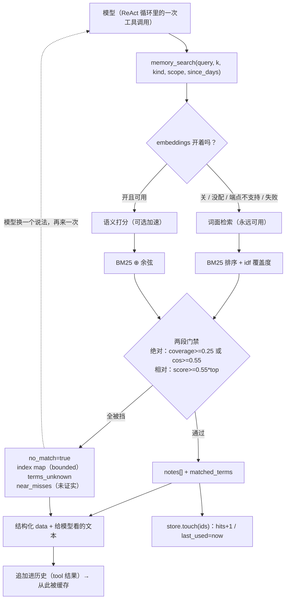

# AI-Coding — R10 分析方案（grep 式按需检索 + 可选语义加速）

> **状态**：待拍板。本文只写「为什么这么设计、动哪些文件、怎么测」，不含实现。
> 拍板后走 `writing-plans` 出 `docs/r10-plan.md`，再按 TDD 逐任务实现。
>
> **用户已明确的两条约束**（写进 Global Constraints，实现时不得违反）：
> 1. **embeddings 是可选的**：没配置、端点不支持、网络失败、缓存损坏——任何情况下
>    「搜索记忆」都必须正常工作，只是少了语义那一档。
> 2. **主轴是 Claude Code 那套 grep 式按需检索**：模型拿着便宜、精确、可迭代的工具查，
>    而不是「一次算分给答案」。语义检索只是加速器。

---

## 0. 结论先行

R10 做四件事，其中**三件零新依赖、零网络**：

| 切片 | 做什么 | 依赖 | 实测收益（同一套 52 条语料 / 46 条问法） |
|---|---|---|---|
| **R10a** | 把检索变成**可测量的**：`scripts/retrieval_cases.py`（离线基准，按类别分列指标） | 无 | 让后面每一步改动都**可反驳**；本轮所有数字都由它复现 |
| **R10b** | 换打分与门禁：**BM25 排序 + 绝对相关度地板 + 相对带宽**；召回真正更新 `hits/last_used` | 无 | R@1 **0.68 → 0.85**、R@3 0.85 → 0.93、FP@5 0.48 → 0.26；说「我没有」时从 4/6 提到 4/6（BM25 裸用是 0/6） |
| **R10c** | 让「搜不到」**可行动**：`memory_search` 返回结构化诊断（索引地图 + 未命中的词 + 未经证实的最接近候选） | 无 | 6 条同义改述失败里有 3 条是「零词面重叠」可被识别；死胡同 `(no matching memories)` 消失 |
| **R10d** | **可选**的语义第二意见：`memory/embeddings.py`，默认关，只在 `memory_search` 里用 | 复用已有 provider，**零新增依赖** | 同义改述 6/12 → 9/12（带我们的门禁）/ 10/12（不带） |

**明确否掉**（每一条都有实测或一手材料支撑，见 §1.4 / §2）：
SQLite + FTS5（旧的 backlog 方案）、embedding-first、向量库 / numpy、
知识图谱记忆、LLM rerank、写时关键词富化当主方案、机器生成的中文同义词建议、
「命中列表 + 预览 + `memory_get`」的渐进披露。

---

## 1. 现状核验（全部本轮实测）

### 1.1 现状的打分函数：一条腿站着（`ai_coding/memory/relevance.py`）

今天的行为是：

```
relevance = idf 加权覆盖度(query, note)          # 纯词面
score     = 0.55*relevance + 0.20*recency + 0.15*importance + kind_boost
注入条件   = score >= threshold(0.25) 且 relevance >= min_relevance(0.05)
```

实测（52 条真实项目语料，`scripts` 之外的一次性 spike）：

```
query='which relevance algorithm do we use'
  query tokens(3)=['relevance', 'algorithm', 'we']   corpus-known=[]
  top n20 score=0.456 (rel=0.000 -> 0.000 + fresh0.156 + imp0.150)   # 全部通过了 0.25 阈值
  top n07 score=0.430 (rel=0.000 -> 0.000 + fresh0.067 + imp0.112)
  gate: score>=0.25 = True;  relevance>=0.05 = False   ← 唯一拦住它们的是那 0.05
```

**结论 1**：`0.20 + 0.15 = 0.35 > 0.25`，所以**新近+重要单独就能过阈值**——对任何新鲜或重要的
笔记，`threshold` 是**空门**。真正干活的只有 `min_relevance=0.05` 这一个纯词面闸门。

**结论 2**：0.05 太低。实测「CLI 命令怎么加一个新子命令」（语料里根本没有答案）：

```
top n52 score=0.554 (rel=0.371 -> 0.204 + fresh0.200 + imp0.150) imp=5
    今天要把 docs 目录里的 CLI 章节重写一遍。      ← 当天新写、重要度 5、只共享一个 cli 词
```

一条**无关**记忆靠「新鲜 + 重要 + 半个词重叠」稳居第一。这不是打分公式的边角料，是**骗过门禁**。

### 1.2 使用信号是死的（`hits` / `last_used` 从不更新）

```bash
$ rg -n "\.touch\(|last_used" ai_coding/
ai_coding/memory/service.py:448:  self._store.supersede(drop.id, keep.touch(moment.isoformat()))
```

全仓**只有** `consolidate` 合并重复项那一次调用了 `touch()`。也就是说：

- 召回路径**从不**记录「这条被用过」；
- `consolidate` 里 `hits >= 3 → importance + 1` 的提权，**几乎不可能因真实使用触发**；
- 驱逐函数 `_value_of = importance + 0.5*min(hits,4) + 0.5*freshness` 里那 +2.0 是空转。

顺带一条一手材料：Generative Agents 原版的 recency 是
*"exponential decay function over the number of sandbox game hours since the memory was
last retrieved"*（**按上次取用衰减**），而我们的 `recency()` 用的是 `created_time`。
我们抄了公式的形状，没抄「按取用衰减」这一半。

### 1.3 规模与成本（不是瓶颈，但要有数）

| 语料规模 | `rank_notes` 单次 | `.memory` JSON |
|---:|---:|---:|
| 200（配置上限） | **11.3 ms** | 0.09 MB |
| 1 000 | 60.2 ms | 0.47 MB |
| 5 000 | 302.2 ms | 2.35 MB |
| 20 000 | 1 291.8 ms | 9.41 MB |

每次查询都会对**全部 active 笔记重新分词**并重算 df，所以是 O(N) 线性。
另外：**venv 里没有 numpy**（`ModuleNotFoundError`），任何稠密向量方案都得自带依赖或自己写点积。

### 1.4 评测：现状强在哪、弱在哪（本轮新建的 52 条语料 / 46 条问法）

问法分五类：`lexical`（词面重叠）、`identifier`（精确标识符）、`paraphrase`（同义改述，
零或极少词面重叠）、`multi`（需要两条笔记）、`no-answer`/`trap`（语料里没有答案，
其中 `trap` 故意放了 §1.1 那条「新鲜+重要+半个词」的诱饵）。

| 策略 | lexical | identifier | paraphrase | multi | R@1 | R@3 | FP@5 | 无答案时正确拒绝 |
|---|---|---|---|---|---|---|---|---|
| **现状（coverage + gate）** | 15/15 | 9/9 | **6/12** | 4/4 | 0.68 | 0.85 | 0.48 | 4/6 |
| bm25（无门禁） | 15/15 | 9/9 | 6/12 | 4/4 | 0.75 | 0.85 | 0.80 | **0/6** |
| bm25 + 绝对相关度地板 | 15/15 | 9/9 | 6/12 | 4/4 | 0.75 | 0.85 | 0.37 | 4/6 |
| hybrid50（BM25+dense，无门禁） | 15/15 | 9/9 | **10/12** | 4/4 | **0.88** | **0.95** | 0.78 | 0/6 |
| hybrid + 绝对地板 | 15/15 | 9/9 | 6/12 | 4/4 | 0.80 | 0.85 | 0.36 | 4/6 |
| **hybrid + 绝对地板 OR + 相对带宽** | 15/15 | 9/9 | **9/12** | 4/4 | **0.85** | **0.93** | **0.26** | 4/6 |

四条读数：

1. **词面能干的活，现状已经干得很好**：lexical 15/15、identifier 9/9、multi 4/4。
   这两类是**编程助手记忆的主要用法**（「我们用的哪个包管理器」「`todo_write` 的
   `depends_on` 强制吗」）。
2. **同义改述是唯一的硬缺口**：6/12。而且这 6 条里**只有 3 条是「返回空」**（可检测），
   另外 3 条是**自信地返回错误答案**——所以「返回空才降级」只兜住一半。
3. **排序与门禁是两个问题**：BM25 排序更强（R@1 +0.07），但**没有任何绝对门禁**
   （无答案 0/6 拒绝，现状是 4/6）；现状门禁更好但排序弱。**正确答案是合成的**：
   BM25 的排序 + coverage 的绝对地板。
4. **精度可以被门禁救回来**：hybrid 裸用 FP@5 = 0.78（比现状还差），
   但加上「相对带宽」（`score >= 0.55 × top_score`）后降到 0.32，再加绝对地板到 **0.26**——
   **比现状的 0.48 好一倍**。也就是说：语义召回和精度不矛盾，前提是门禁设计对。

### 1.5 三个被实测否掉的候选设计（写下来，免得下次重提）

| 候选 | 假设 | 实测 | 判决 |
|---|---|---|---|
| **命中列表 + 预览（160 字符）+ `memory_get` 读全文** | 「少注入 token」 | 我们的笔记就是**一句话**（min 8 / p50 40 / max 88 字符，`detail_max_chars=1200` 是上限，永远够不着）；预览行的**每行元数据**反而让输出 **+15%** | **否**。没有可截断的东西，多一个工具还要每步付 schema 成本 |
| **机器生成的「你是不是想搜 X」**（对未命中词给最接近的索引词） | 「提示一下模型就能换个词」 | 用 bigram 算：**0/6** 落到目标笔记；改用字级窗口算：**1/5**（且那 1 条是 `我不 → 要不` 的巧合） | **否**。没有分词器就做不出可靠的中文同义词建议；装 jieba 是新增依赖，而它解决的是「模型本来就能自己换词」的问题 |
| **写时关键词富化**（A-MEM / 上下文检索那一派：写入时生成同义词关键词） | 「索引时就补上用户会用的词」 | 让**真模型**为 6 条失败目标生成关键词（得到 `prompt cache` / `免审批` / `杀进程` / `记忆搜索`），再跑词面检索：**paraphrase 6/12 → 6/12，一条都没救回来**。模型写的是**它的词**，不是用户的词（用户说「被问要不要批准」，模型写「默认询问」） | **降为 P2**（对英文/标识符查询有用），**不当语义方案** |

---

## 2. 外部对标（只看一手材料）

### 2.1 Claude / Anthropic：just-in-time 才是主线

Anthropic《Effective context engineering for AI agents》(2025-09-29) 原文：

> "Today, many AI-native applications employ some form of embedding-based pre-inference time
> retrieval… As the field transitions to more agentic approaches, we increasingly see teams
> augmenting these retrieval systems with **"just in time" context strategies**. Rather than
> pre-processing all relevant data up front, agents built with the "just in time" approach
> maintain **lightweight identifiers** (file paths, stored queries, web links, etc.) and use
> these references to **dynamically load data into context at runtime using tools**."
>
> "Claude Code … CLAUDE.md files are **naively dropped into context up front**, while primitives
> like **glob and grep** allow it to navigate its environment and **retrieve files just-in-time**,
> effectively bypassing the issues of **stale indexing** and complex syntax trees."
>
> 同一篇也把代价说清楚了："runtime exploration is **slower** than retrieving pre-computed data."

它的 memory tool 也是**文件系统**（"a file-based system"），不是向量库。

**映射到我们**（这张表就是 R10 的设计骨架）：

| Claude Code | 我们现在的对应物 | R10 之后 |
|---|---|---|
| `CLAUDE.md` 直接塞进上下文 | 常驻的 `<memory-constraints>` 块（pinned / decision） | **不动**（这一块本来就不走相关性排序） |
| `glob` / `grep` 精确检索 | `memory_search`（idf 覆盖度） | BM25 + 过滤（`kind` / `scope` / `since`）+ 明确「命中/没命中」 |
| 搜不到 → 换个模式再搜 | `(no matching memories)` **死胡同** | 结构化诊断：索引地图 + 未命中的词 + 未经证实的最接近候选 → 模型换词 |
| 不建索引（无 stale index） | JSON 单文件、查询时现算 | **保持**（规模实测不是瓶颈） |
| 语义检索作为补充 | 无 | **可选**的 embeddings 第二意见（默认关） |

### 2.2 Cursor / Aider / Cline：程序化检索的三种形态

- **Cursor**（官方文档，Agent 路径）：Instant Grep 支持完整正则与词边界；
  **"it does not store embeddings of your codebase for search"**——语义检索退到 `@codebase` 那条线，
  Agent 主线是本地检索。
- **Aider**（repo map 文档）：tree-sitter 抽符号 + **在文件依赖图上做 graph ranking（PageRank）**，
  按 token 预算挑最重要的部分。巧思在**结构**，不在语义。
- **Cline**（Memory Bank）：**结构化 markdown 文件**，按需读。
- **Qdrant**（hybrid 指南，工程口径最实在）：
  > "Dense retrieval can return a document on the right topic but **miss an exact identifier**
  > copied into the query. Sparse retrieval can miss a relevant document when the query
  > **describes it with different words**."
  > "**Start with BM25, which needs no model at query time, then measure a learned model against it
  > before adopting one.**"
  > 融合要用 **RRF**："Dense similarity and BM25 scores use different scales… a fixed weight on the
  > raw scores may balance one query but let BM25 dominate another."

这三条与我们的实测**互相印证**：标识符类靠词面、改述类靠语义、而 agentic 系统的补偿手段是
「让模型换个词再来一次」。

### 2.3 记忆系统侧：公式的来源与它的前提

- **Generative Agents**(2023)：`α·recency + β·importance + γ·relevance`，三者 **min-max 归一到
  [0,1]**；其中 relevance 是 **embedding 余弦**、recency 按**上次取用**衰减。
  → 我们的公式是它的变体，但**去掉了归一化**（于是 "新近+重要" 能单独过阈值）而且 relevance 是词面的。
- **A-MEM**(2025)：写入时生成上下文描述 / 关键词 / 标签，并**与历史记忆建立链接**，还做记忆演化。
- **mem0**(2025)：LOCOMO 上比 OpenAI memory 高 **26%**（LLM-as-judge），
  图记忆变体只再多 **约 2%**；比 full-context 省 **>90%** token、p95 延迟低 **91%**。
- **MemGPT**：分层 + 显式分页（agent 决定换哪一页进上下文）；**HippoRAG**：KG + 个性化 PageRank 打多跳。

对 R10 的含义：**图/多跳那一路的边际收益（+2%）不值我们现在付**；
而「写入时富化」的收益被我 §1.5 的实测否掉了（模型写的是它的词）。

---

## 3. 设计原则（grep 式的四条）

1. **便宜**：常用路径零网络、零新依赖；单次检索 10ms 级（200 条实测 11ms）。
2. **精确**：标识符与词面命中必须稳（今天 9/9，不许退步）；过滤器是一等公民（`kind`/`scope`/`since`）。
3. **可迭代**：一次没搜到不是终点——结果里必须带**下一步怎么问**的信息。
4. **可解释**：每条命中都能说清「为什么是它」（分数、相关度、命中了哪些词）。
5. **可选的能力不许变成必需**：`embeddings` 关掉/坏掉/没配，功能与结果**逐字节一致**（§7 有用例钉死）。

---

## 4. 目标架构



**与现有数据流的位置关系**（沿用 R8 的 L1–L8 编号）：

| 层 | 是什么 | R10 是否触碰 |
|---|---|---|
| L1 | 系统提示词 | **不动**（记忆永远不进系统提示） |
| L2 | 持久历史（压缩后的 history） | 间接：检索结果仍以 **tool 结果** 形式进历史 → 之后被前缀缓存 |
| L3 | 易失尾块（memory → task → hook → digest） | 只有 `<memory-constraints>` 那一段，且**它的产生逻辑不变** |
| L4 | 写回的工具消息 | 变（`memory_search` 的输出结构变了，但仍是普通 tool 结果） |
| L5 | 会话文件 | **不动**（harvest 游标语义不变） |
| L6 | 记忆库 `.memory` | 变：`hits/last_used` 真的会被写；新增可选的 `.memory/embeddings.json` |
| L7 | 观测事件 / 控制台 | 变：`memory_search` 的 `data` 更丰富（trace 里能看到「为什么没命中」） |
| L8 | 子进程 | **不动** |

**缓存纪律**（R3 用 94% vs 7% 实测过的那条）不变：检索结果**只**以 tool 结果进历史，
**绝不**改成每回合注入的尾部块。

---

## 5. 契约变更汇总

### 5.1 `memory_search` 的参数（**只增不改**，既有调用形状保持可用）

| 参数 | 现状 | R10 | 说明 |
|---|---|---|---|
| `query` | 必填 | 保持（`required` 不变） | |
| `k` | 有 | 保持（默认 3，上限 10） | |
| `kind` | 有 | 保持 | |
| `evidence` | 有 | 保持 | |
| `scope` | 无 | **新增** | `workspace` 或某个 session id |
| `since_days` | 无 | **新增** | 只看最近 N 天更新过的 |
| `include_near_misses` | 无 | **新增**，默认 `true` | 是否带上「没过门禁但最接近」的候选 |

### 5.2 `memory_search` 的返回（`data`）

```jsonc
{
  "notes": [                     // 通过门禁的命中（可能为空）
    {"id","kind","score","relevance","matched_terms":["依赖","uv"],
     "text","updated_time","pinned","evidence"}
  ],
  "no_match": false,             // true = 一条都没通过门禁
  "terms_known": ["依赖","工具"], // 查询里索引认识的词
  "terms_unknown": ["批准"],      // 查询里索引不认识的词（模型换词的信号）
  "near_misses": [               // 未通过门禁、但分数最高的 2-3 条，明确标注「未经证实」
    {"id","kind","score","relevance","preview"}
  ],
  "index": {                     // 只在 no_match 时给，且有界（<= ~200 字符）
    "active": 47, "by_kind": {"fact":20,"decision":12,"preference":8,"open_thread":7},
    "recent": [{"id","kind","preview"}]        // 最多 3 条
  },
  "semantic_unavailable": false  // true = 配置了 embeddings 但这次没用上
}
```

`output`（给模型读的那段文本）在 `no_match=true` 时变成**可行动**的一段，形如：

```
没有可靠匹配（索引里 47 条：decision 12 / fact 20 …）。你的词「批准」「记性」索引里没有。
最接近但未经证实：#a1b2(decision, 0.31) 「MCP 远端工具的审批用 …」
→ 换一个说法再搜，或用 kind=decision 缩小范围。
```

**为什么不做 `memory_get` / `memory_list`**：§1.5 实测（笔记 40–88 字，预览反而 +15%），
以及每个工具 schema 都要**每一步**重发（R7d 实测 13 工具让 `tools_chars` 翻倍）。
「提高可发现性」靠 `index` 地图和过滤器解决，不靠新增工具。
（本轮实测了一遍 schema 成本：`memory_search` 现在的 schema 是 **525 字符**；
按上面这张参数表扩到 848 字符，**+323**；而**新增**一个带名字与描述的 `memory_get` 约 +182 字符——
也就是说「加动作」比「加工具」贵，但两者都远小于「加一个工具并让模型学会用它」的隐性成本。
结论不变：**一个工具，参数扩一点，不加新工具**。）

### 5.3 打分与门禁（`RecallParams`）

| 字段 | 现状 | R10 默认 | 说明 |
|---|---|---|---|
| `threshold` | `0.25` | **保留**（但不再是唯一闸门） | 兼容既有配置 |
| `min_relevance` | `0.05` | **`0.25`** | 绝对地板；0.05 实测等于没门。**爆炸半径已实测为 0**：把默认值改成 0.25 后，`tests/test_memory_relevance.py`（17 条）+ `test_tool_memory_search` + `test_memory_service`(+v2) + `test_agent_loop_memory` 共 **70 条全绿，零改动** |
| `relative_band` | 无 | **`0.55`** | `score >= 0.55 × 本轮最高分`；实测把 FP@5 从 0.78 压到 0.32 |
| `weight_*` / `half_life_days` / `kind_boosts` | 有 | 不变 | 只参与**通过绝对门之后**的排序 |
| `bm25_k1` / `bm25_b` | 无 | `1.2` / `0.75` | 排序主函数 |
| `recency_source` | 无（等于 `created`） | `created`（**默认不变**） | `accessed` 作为可选项，用 `last_used`；在基准里做 A/B |

### 5.4 使用信号（`MemoryStore`）

| 契约 | 说明 |
|---|---|
| `MemoryStore.touch_notes(ids) -> int` | 命中后 `hits+1`、`last_used=now`；**一次批量写盘**；未命中集合内的 id 忽略 |
| `rank_notes` 的调用方 | `MemoryService.recall_notes()` 在**有命中时**调一次 `touch_notes`（失败不影响返回值） |

### 5.5 配置（`MemoryConfig`）

```yaml
memory:
  recall_min_relevance: 0.25     # 原 0.05
  recall_relative_band: 0.55     # 新增
  embeddings:                    # 新增，默认关
    enabled: false
    provider: ""                 # 复用 models.<name> 的 base_url / api_key
    model: text-embedding-v4
    dimensions: 1024             # 0 = 用端点默认
    min_cosine: 0.55             # 只作为「绝对门的 OR 分支」
    cache_path: .memory/embeddings.json
    timeout_seconds: 10
```

**为什么默认关**（实测）：`deepseek-chat`（`api.deepseek.com/v1`）调 `/embeddings` **直接报错**；
只有 `qwen`（dashscope）可用。默认开＝一半配置开箱即坏。

---

## 6. 逐文件实施范围（每步 TDD：先红 → 最小实现 → 跑绿 → 提交）

### 6.1 R10a — 评测基准

| 文件 | 动作 |
|---|---|
| `scripts/retrieval_cases.py`（新） | 内嵌 52 条语料 + 46 条标注问法（五类），离线跑出分类指标表；`--with-embeddings` 时另出一张对照表 |
| `docs/integration_testing.md` | 补跑法与基线数字 |

**步骤**：(1) 写脚本与本轮基线数字（红：脚本不存在）；(2) 断言脚本自身正确（指标计算、
语料/问法结构、可重复性）；(3) 跑绿并把这轮基线写进文档；(4) 提交。

### 6.2 R10b — 打分、门禁、使用信号

| 文件 | 改什么 | 行为变化 |
|---|---|---|
| `ai_coding/memory/relevance.py` | 新增 `bm25_score()` / `bm25_scores()`；`coverage()` 不变（继续当绝对门）；`rank_notes()` 变成「BM25 排序 → 绝对门 → 相对带宽」；`ScoredNote` 增加 `matched_terms: tuple[str, ...]`（默认 `()`，不破坏既有构造）；`RecallParams` 增 `relative_band` / `bm25_k1` / `bm25_b` / `recency_source`；`min_relevance` 默认 0.05 → **0.25** | 「新鲜+重要但无关」不再能过门（trap 查询从「n52 排第一」变成「no_match」）；R@1 0.68→0.85 |
| `ai_coding/memory/store.py` | 新增 `touch_notes(ids)`；`search_scored()` 把 `matched_terms` 透传 | `hits/last_used` 开始反映真实使用 |
| `ai_coding/memory/service.py` | `recall_notes()` 命中后 `touch_notes`；`index_notes()` **不动** | 提权与驱逐第一次有真实依据 |
| `ai_coding/config/models.py` | `recall_min_relevance` 默认 0.05 → 0.25；新增 `recall_relative_band` | 配置文件里显式写了 0.05 的老配置**行为不变**（向后兼容） |

### 6.2.1 顺手发现的死配置：`memory.detail_max_chars`

`detail_max_chars`（默认 1200）出现在 `config/models.py:197` 与 `service.py:79`，
但 `rg` 全仓**没有任何一处读它**——它是个从未接线的旋钮。R10 的处理：**不接线、并记在案**
（§1.5 已证明「按字符截断笔记」对我们没有收益：笔记 p50 只有 40 字）。
这是 §13「不改记忆写路径」的一部分；留在配置里只为不破坏老配置文件。

### 6.3 R10c — 可行动的工具面

| 文件 | 改什么 |
|---|---|
| `ai_coding/tools/memory_search_tool.py` | 新增 `scope` / `since_days` / `include_near_misses`；`data` 变成 §5.2 的结构；`no_match` 时的 `output` 换成可行动文案；`index` 地图有界（上限 ~200 字符）；「没找到」仍然 `success=True` |
| `ai_coding/memory/service.py` | `recall_notes(..., with_diagnostics=True)` 返回 `(hits, diagnostics)`（默认 `False`，既有调用不变）；诊断里含 `terms_known/unknown`、`near_misses`、`index_summary` |

### 6.4 R10d — 可选的语义第二意见

| 文件 | 改什么 |
|---|---|
| `ai_coding/memory/embeddings.py`（新） | `EmbeddingIndex`：批量 `embed_texts()`（标准库 `urllib` + 超时 + 重试 0 次）、`vectors_for(notes)`（磁盘缓存，key = `sha1(model + dimensions + note.dedupe_key)`）、`cosine_scores(query_vector, note_ids)`（纯 Python）、`available()`（配置齐、缓存目录可写）。**不 import numpy、不 import 任何新包** |
| `ai_coding/memory/service.py` | 若 `embeddings.enabled` 且可用：排序融合（BM25 ⊕ 余弦，0.5/0.5 min-max），并把 `cos >= min_cosine` 作为绝对门的 OR 分支；任何异常 → `semantic_unavailable=True` 并退回词面 |
| `ai_coding/config/models.py` | 新增 `EmbeddingsConfig`（§5.5），挂到 `MemoryConfig` 下 |
| `ai_coding/tools/builder.py` + `cli.py` 组合根 | 构造 `MemoryService` 时按配置装配 `EmbeddingIndex`（关着就传 `None`） |
| `ai_coding/memory/service.py::harvest` | 落新笔记后批量 embed 并写缓存（同样在 deadline 下，失败只记降级） |

**降级矩阵**（每条都要有对应用例）：

| 情形 | 期望行为 |
|---|---|
| 没写 `embeddings` / `enabled: false` | 与 R10c 完全一致（**逐字节**），不产生 `.memory/embeddings.json` |
| `provider` 指向没有 `/embeddings` 的端点（如 deepseek） | 与未配置一致；**不报错**、不置 `semantic_unavailable`（只记一次内部 warning） |
| 网络失败 / 超时 / 限流 | 退回词面，`semantic_unavailable=true`，`success` 仍为 `true` |
| 缓存文件损坏 / 手工改坏 | 当作空缓存重建 |
| 换 `model` 或 `dimensions` | key 不匹配 → 重新 embed；旧文件保留（不删） |
| 向量维度与缓存不一致 | 丢弃该条向量并重算 |
| 整段超过回合剩余时钟 | 由 `run_with_deadline` 收口 → 词面结果 + `semantic_unavailable=true` |

---

## 7. TDD 用例清单（约 46 条）

### R10a（4）
1. 语料与问法结构完整（每条问法的 `relevant` 都在语料里；类别覆盖五类）。
2. 指标计算正确：手工构造 3 条命中/未命中的打分，断言 R@1/R@3/MRR/FP@5 的数值。
3. 同一输入两次运行输出一致（无随机、无时间依赖；`now` 固定注入）。
4. 离线：不读配置、不发网络（用一个会抛异常的 fake 也应跑完）。

### R10b（16）
5. BM25 排序在 lexical 类上不退步（对比基线 R@1）。
6. 绝对地板拦住「rel=0 但新鲜+重要」的笔记（**§1.1 的 trap 查询：断言 top-1 不再是它**）。
7. 相对带宽把尾部垃圾切掉（构造 top=1.0、次名 0.4 的候选集，断言只留 top）。
8. `threshold` 仍然生效（兼容老配置）。
9. `min_relevance` 默认值变成 0.25（`RecallParams()` 与 `MemoryConfig()` 两处都断言）。
10. `matched_terms` 列出真正命中的查询词，且只列命中的。
11. 排序 tie-break 顺序不变（score → relevance → evidence_rank → id）。
12. 空 query / 全停用词 query → 空结果，不抛。
13. 词面全不认识的 query → 空结果（而不是「按新鲜度排序」）。
14. `limit=k` 仍然截断；`k=0` 的语义不变。
15. 既有 **17 条** relevance 用例（`tests/test_memory_relevance.py`，R3 校准的那批）行为不变或
    **只按新默认值变化**（逐条核对）。已预演：`min_relevance` 0.05→0.25 时，该文件连同
    4 个关联文件共 70 条**全绿**。
16. `touch_notes` 只更新传入的 id，且一次写盘（用 spy）。
17. 召回命中后 `hits+1`、`last_used` 非空；**未命中不 touch**。
18. `hits>=3` 的提权现在能被真实使用触发（先 3 次 recall，再 consolidate）。
19. 驱逐函数真的用上 `hits`（两条同重要度、不同 hits → 低 hits 先走）。
20. `recency_source="accessed"` 时 `recency()` 用 `last_used`；默认 `"created"` 与今天一致。

### R10c（13）
21. 有命中时 `data.notes[*].matched_terms` 非空且 `no_match=false`。
22. 无命中时 `success=True`、`no_match=true`、`notes=[]`。
23. `terms_unknown` 恰好是「查询里 df=0 的词」；`terms_known` 是剩下的。
24. `near_misses` 最多 3 条、按分数降序、都**不是** `notes` 里的。
25. `include_near_misses=false` 时不返回该字段。
26. `index` 地图只在 `no_match` 时给，且有字符上限（构造 500 条笔记，断言长度有界）。
27. `index.by_kind` 与实际 active 笔记一致（含被 supersede 的不算）。
28. `scope` 过滤生效；未知 scope 返回空而非报错。
29. `since_days` 过滤生效（用固定 now 注入）。
30. `kind` + `scope` 组合过滤。
31. 空 query 仍然 `error="empty_query"`（既有行为不变）。
32. 未知 `evidence` 仍然 `bad_evidence`（既有行为不变）。
33. no_match 的 `output` 包含三件关键信息（索引规模、未命中的词、下一步建议）——断言关键词而不是整段文案。

### R10d（13）
34. `enabled=false` 时：结果与 R10c 逐字节一致，且不创建缓存文件。
35. 配置缺失（没有 `embeddings` 块）时与 34 相同。
36. provider 端点返回 404/非 JSON → 与未配置一致，不置 `semantic_unavailable`。
37. 网络异常 → 词面结果 + `semantic_unavailable=true`，`success=true`。
38. 同样的笔记与 query 第二次调用命中缓存（用计数 spy 断言 embed 调用次数不增）。
39. 缓存文件损坏（写入 `not json`）→ 重建且不抛。
40. 换 `model` → 向量被重算（spy 断言）。
41. 维度不匹配的旧向量被丢弃重算。
42. `min_cosine` 分支：把一条**词面完全不重叠**的笔记拉进命中（构造用例）。
43. 语义分数参与排序时，lexical/identifier 两类**不退步**（对照基准）。
44. 没有 numpy 也能跑（断言 `sys.modules` 里没有 numpy，或直接跑用例即可）。
45. 超时（把 `timeout_seconds` 设成极小 + 一个 sleep 的 fake）→ 词面结果 + 标记。
46. `harvest` 落新笔记后缓存里多出对应向量；embed 失败时笔记**照常写入**（记忆不因语义能力而丢数据）。

---

## 8. 成功效果（改完之后，能指着说什么变了）

1. **说「我没有」变得可信**：trap 查询（语料里没有答案、只有一条新鲜+重要的诱饵）
   从「返回那条诱饵」变成 `no_match=true` + 索引地图。
2. **一次搜不到不再终结**：`no_match` 的结果里带着「索引里有什么」「你哪些词索引里没有」
   「最接近的是哪几条（未经证实）」，模型可以换个说法再搜——这正是 grep 的循环。
3. **数字可复现**：`scripts/retrieval_cases.py` 打印分类指标，
   R@1 0.68 → 0.85、R@3 0.85 → 0.93、FP@5 0.48 → 0.26（开 embeddings）/ 0.37（纯词面）。
4. **使用信号复活**：跑三次真实召回后，`/memory` 里 `hits` 会动，提权与驱逐不再空转。
5. **可选能力真的可选**：把 `memory.embeddings` 整块删掉，`pytest` 全绿、检索结果不变、
   不产生任何新文件。

---

## 9. 自我核验（这份方案哪里可能是错的）

1. **语料是我造的、标注是我打的**（52 条 / 46 条，单一标注者，paraphrase 只有 12 条，
   ±1 条 = ±8%）。这些数字用来做**相对比较**，不能当绝对值；R10a 的价值就是把它们固定下来，
   以后每次改动都在同一把尺子上比。
2. **真实问法分布是猜的**。如果实际使用里 90% 是标识符式查询，纯词面就够、embeddings 可以永远不开。
   缓解：R10c 的诊断会记录 `terms_unknown`，上线后可以统计「多少比例查询零词面重叠」。
3. **`cos >= 0.55` 是模型相关常数**。实测正例 top-1 余弦 min 0.391 / 中位 0.729，负例 max 0.660，
   **分布重叠**——所以它只能当绝对门的 OR 分支，不能当唯一门禁；换 embedding 模型必须重新校准。
4. **延迟来自本机到 DashScope 的网络**（query embed p50 **386 ms**，5 次采样）。换网络会变。
5. **`touch_notes` 引入了新的写盘**（命中即写）。200 条约 90KB、单次 ~1ms，可接受；
   但要注意与 harvest 的写并发——store 已有 `RLock`，用例要覆盖「召回与收割交替」的场景。
6. **BM25 的 idf 用 active 集合**，所以删除/淘汰会轻微改变历史查询的分数（现状的 coverage 也是同样的性质）。
7. **`relative_band` 在只有 1 条候选时恒真**（`score >= 0.55*score`）——这是设计意图：
   相对门管「尾巴」，绝对门管「有没有」；两者职责不能混。

---

## 10. 执行顺序与提交切分（建议）

| 顺序 | 切片 | 提交信息（建议） |
|---:|---|---|
| 1 | R10a 基准脚本 | `R10a: retrieval gets a yardstick, measured on our own memories` |
| 2 | R10b 打分 + 门禁 | `R10b-1: bm25 ranking, an absolute floor and a relative band` |
| 3 | R10b 使用信号 | `R10b-2: a recall finally counts as a use` |
| 4 | R10c 诊断 | `R10c-1: a miss says what to try next` |
| 5 | R10c 过滤与地图 | `R10c-2: scope and since, plus a bounded index map` |
| 6 | R10d 配置与索引 | `R10d-1: embeddings are optional, off by default` |
| 7 | R10d 接线与降级 | `R10d-2: the semantic second opinion, and every way it may fail` |
| 8 | 收尾 | `R10: the acceptance script, and the docs the round changed` |

---

## 11. 待拍板决策点

| # | 问题 | 我的建议 | 备选 / 代价 |
|---|---|---|---|
| **D-R10-1** | 要不要把评测基准进仓库当护栏 | **要**：`scripts/retrieval_cases.py` 离线、<2s；护栏设**宽松**（R@3 ≥ 0.85、paraphrase ≥ 6/12），防止有人把门禁调到什么都不返回 | 不设护栏＝数字会被无声地改坏；设太严＝测试变成脆弱的调参游戏 |
| **D-R10-2** | `min_relevance` 默认 0.05 → 0.25 | **改**（0.05 实测等于没门；0.25 实测 FP@5 0.48→0.37 且 R@5 不降） | 保持 0.05＝继续让「半个词重叠 + 新鲜 + 重要」赢 |
| **D-R10-3** | 引入「相对带宽」门禁 | **引入**（`score >= 0.55 × top`；实测把 hybrid 的 FP@5 从 0.78 压到 0.32） | 不引入＝要么精度差，要么只能靠调绝对阈值（跨查询不通用，Qdrant 原文也是这个意思） |
| **D-R10-4** | 召回是否更新 `hits/last_used` | **更新**，且**只在有命中时写一次** | 不更新＝提权/驱逐永远空转（现状） |
| **D-R10-5** | recency 用「创建」还是「取用」 | **默认仍是 `created`**（不动已校准的行为），把 `accessed` 做成开关并在基准里 A/B | 直接改成 `accessed`＝更接近 GA 原版，但会动到 R3 那批已校准用例 |
| **D-R10-6** | 是否新增 `memory_get` / `memory_list` 工具 | **不新增**（笔记 40–88 字，预览反而 +15%；每步 schema 是真实成本） | 新增＝更"像文件系统"，但多付每步 token，且解决不了 §1.5 那个问题 |
| **D-R10-7** | embeddings 默认开关 | **默认关**，必须显式配 `provider` | 默认开＝实测 `deepseek` 端点没有 `/embeddings`，一半配置开箱报错 |
| **D-R10-8** | 语义分怎么用 | 作为**绝对门的 OR 分支**（`coverage>=0.25 or cos>=min_cosine`）参与门禁，同时 0.5/0.5 融入排序 | 只做排序不进门槛＝无答案查询 0/6（实测），等于把垃圾灌进上下文 |
| **D-R10-9** | 写时关键词富化（A-MEM 式） | **本轮不做**，记为 P2 | 实测 6/12 → 6/12，救不回任何一条；对英文/标识符查询有小幅帮助 |
| **D-R10-10** | SQLite + FTS5（backlog 4.1） | **不做**，并把 backlog 那一条标注为「R10 已裁决：不采用，理由见 §1.3/§1.4」 | 真要做，触发条件必须写清：笔记 > 2000 条、或 p95 > 100ms、或需要多进程并发写 |

---

## 12. 文档同步清单（实现完成后）

| 文档 | 补什么 |
|---|---|
| `docs/features.md` | 「记忆」一节补：两段门禁、可行动的 no_match、可选 embeddings 与降级 |
| `docs/data-contracts.md` | §R10：`memory_search` 的 `data` 结构、`RecallParams` 新字段、`MemoryStore.touch_notes`、`EmbeddingsConfig` |
| `docs/architecture.md` | 「检索」小节 + 图（词面主线、诊断回路、可选语义支路）+ 「使用信号」那条修复 |
| `docs/how-to-run.md` | 新的 `memory` 配置项、`min_relevance` 默认值变化、怎么开/关 embeddings、怎么跑基准 |
| `docs/integration_testing.md` | `scripts/retrieval_cases.py` 的跑法与基线数字（含 `--with-embeddings` 对照） |
| `docs/r7-backlog.md` | 4.1（SQLite+FTS5）标注 **R10 已裁决不采用**；5.7（真实基准）指向本轮的检索基准 |

---

## 13. 明确不做（写下来，免得下次再吵）

- **不装任何新依赖**：不装 numpy、不装向量库、不装 jieba、不装 SQLite 驱动。
- **不引入 SQLite / FTS5**（理由见 §1.3、§1.4；触发条件写在 D-R10-10）。
- **不做 embedding-first**：语义检索只在 `memory_search` 里当第二意见，永远不进常驻注入块。
- **不做知识图谱 / 多跳 / 记忆链接**（mem0 自家数据显示图变体只 +2%）。
- **不做 LLM rerank / cross-encoder**（第二次模型调用换来的是已被相对带宽解决的问题）。
- **不做机器生成的中文同义词建议**（实测 0/6 与 1/5）。
- **不做预览 / `memory_get` 的渐进披露**（实测负收益）。
- **不改**：`<memory-constraints>` 的选取规则、记忆的注入位置与缓存纪律、
  harvest 的游标语义、`memory_write` 的写路径、`consolidate` 的合并判定（`_better_of`）。
