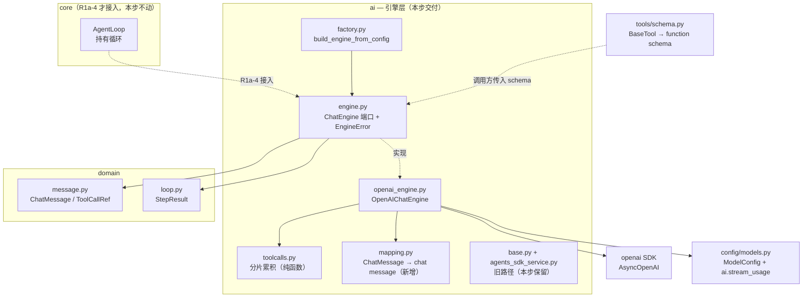
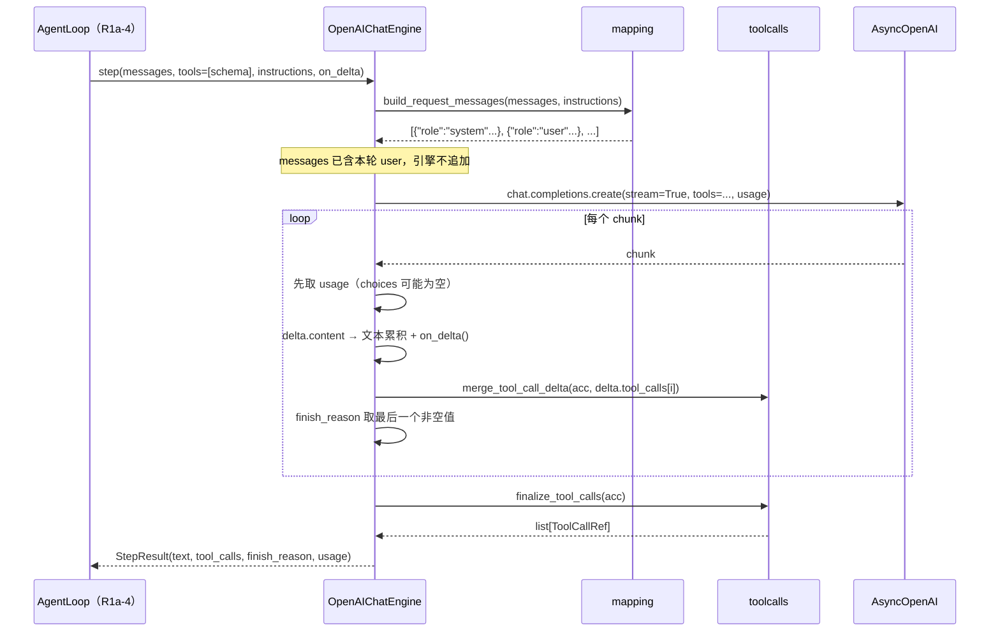
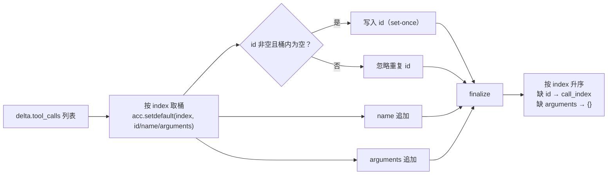

# AI-Coding — R1a-2 分析方案（引擎端口：自持循环的单步执行器）

> 定位：R1 编排层重构的第二步。R1a-1 已交付契约层（`TaskState` / `StepResult` /
> 结构化 `ToolResult` / `ToolContext`），本步在 `ai` 层建立**「一次只跑一步」**的引擎端口，
> 并用直连 `chat.completions` 的实现替换 `Runner.run_streamed` 那种「一次跑完整个回合」的语义。
> 依据：`docs/r1-analysis.md`（总方案，方案 A 已拍板）、R1a-1 实际代码、`docs/m1-analysis.md`（原 AI 层设计）。
> 前提：本步**纯增量**——旧的 `AIService` 路径继续存在且可用，保证每个提交自身可运行、可回滚。

---

## 0. 前置状态（已核验）

| 项 | 状态 |
|---|---|
| R1a-1 契约层 | 已交付（提交 `7ad4f2e`），59 个测试 |
| 环境 | 已重建 venv；`mypy ai_coding` 63 文件全过；ruff 干净（提交 `a23f5cc`） |
| 旧路径 | `ai/base.py`（`AIService`）+ `ai/agents_sdk_service.py`（SDK 适配）**仍在服役**，本步不动 |
| 现有 AI 层文件 | `ai/base.py`、`ai/agents_sdk_service.py`、`ai/mapping.py`、`ai/factory.py`、`ai/prompt.py`、`ai/llm_helpers.py` |

**已知环境限制（与本步无关但会影响验证）**：本沙箱不支持异步子进程派生
（`asyncio.create_subprocess_exec` 在纯 python 脚本里都会超时），因此
`tests/test_worktree.py` 会挂起、`tests/test_tool_bash.py` 会抖。这两个文件与 AI 层无关，
本步的验证口径是「全量测试排除这两个文件」。

---

## 1. 现在要实现的内容

| # | 件 | 文件 | 性质 |
|---|---|---|---|
| 1 | 引擎端口 + 引擎异常 | `ai/engine.py` | 新增 |
| 2 | 流式 tool_call 分片累积（纯函数） | `ai/toolcalls.py` | 新增 |
| 3 | 直连 chat.completions 的引擎实现 | `ai/openai_engine.py` | 新增 |
| 4 | 领域消息 → OpenAI chat message 映射 | `ai/mapping.py` | **新增函数**（旧函数保留，见 §9 核验①） |
| 5 | 引擎工厂 | `ai/factory.py` | 新增函数 |
| 6 | `stream_usage` 配置项 | `config/models.py` | 新增字段 |
| 7 | TDD 用例（3 个文件） | `tests/test_ai_toolcalls.py`、`tests/test_ai_mapping_v2.py`、`tests/test_openai_engine.py` | 新增 |

---

## 2. 影响分析（对代码的影响 / 执行范围）

### 2.1 影响判定

**新增为主，零破坏**。判据：

- 不修改任何既有文件的**既有函数**；`ai/mapping.py` 与 `ai/factory.py` 是**追加**函数。
- 不修改 `AIService`、不修改 `AgentsSDKChatService`、不修改 `AgentLoop`、不修改 `cli.py`。
  因此 `cli.py` / `ui/repl.py` / 现有 314 个测试**全部不受影响**。
- 唯一「行为性」的新增是 `config/models.py` 多一个带默认值的字段，不影响既有 YAML 加载。

### 2.2 执行范围

**新增 3 个模块**（`ai/engine.py`、`ai/toolcalls.py`、`ai/openai_engine.py`）、
**追加 2 组函数**（`ai/mapping.py`、`ai/factory.py`）、**新增 1 个配置字段**、**新增 3 个测试文件**。

**明确不动**：`ai/base.py`、`ai/agents_sdk_service.py`、`ai/llm_helpers.py`、`core/*`、
`tools/*`、`cli.py`、`ui/*`、`domain/*`。

### 2.3 与既有承诺的关系

| 承诺 | 出处 | R1a-2 后 |
|---|---|---|
| 「SDK 只出现在 `agents_sdk_service.py` 与 `sdk_adapter.py`」 | architecture.md | **仍然成立**（旧路径没动，新路径不 import `agents`） |
| 「只有 2 个文件 import `agents`」 | m1/m2 analysis | 暂不变；R1a-6 变成 0 个 |
| 「增强组件静默降级」 | m3 §5-11 | 本步不适用（引擎失败必须显式抛出，见 D6） |
| 「数据契约与 Java 兼容」 | m0/m1 | 已退役（C3），本步不涉及 |

### 2.4 本步明确不做（YAGNI，防止范围蔓延）

| 不做 | 理由 |
|---|---|
| 重试 / 退避 / 限流 | 现有 `max_retries=0` 是刻意的：失败要立刻暴露，而不是静默重试拖长回合。重试策略属于后续 tracing/可靠性议题 |
| 删除 `AIService` / `agents_sdk_service` | 删了 `cli.py` 就没引擎可用，违反「每个提交可运行」。删除动作在 R1a-6 |
| 删除 `openai-agents` 依赖 | 同上，R1a-6 |
| 处理 `reasoning_content`（DeepSeek reasoner 等推理字段） | 需要先确定「推理内容是否入历史」，属于独立设计。本步只**登记为已知不做**（见 §9 核验⑥） |
| 多模态 content（图片/音频） | `ChatMessage.content` 是 `str | None`，本步不扩展契约 |
| prompt caching 标记 / 请求头 | 属于 tracing 与成本议题 |
| 流式增量回调的背压与节流 | `on_delta` 就是同步回调，沿用现有语义 |

---

## 3. 目前设计（现状基线）

### 3.1 现有 AI 端口的语义问题

```python
class AIService(ABC):
    async def execute_turn(
        self, history, user_input, token_sink=None, *, instructions=None
    ) -> TurnResult: ...
```

`execute_turn` 的名字与语义是「**跑完一个回合**」——内部的 `Runner.run_streamed` 会自己循环
「模型 → 工具 → 回喂 → 再模型」，直到模型不再调工具才返回。我方的 `AgentLoop` 只负责收集事件。

自持循环需要的是「**跑一步**」：调一次模型，拿到文本 + 工具调用，然后由**我们**决定下一步。
这两个语义无法共存于同一个方法，所以必须新开端口。

### 3.2 现在的数据流（要替换的那半条）

```
AgentLoop.process_input
  ├─ session.add_message(user, ts)                       # agent_loop.py:60
  └─ ai.execute_turn(session.messages, user_input)       # ← user_input 传了第二遍
       └─ AgentsSDKChatService.execute_turn              # agents_sdk_service.py
            ├─ history_to_inputs(history)                # 老 mapping（function_call 形态）
            ├─ inputs.append({"role":"user","content":user_input})   # ← 双份 user 的来源
            └─ Runner.run_streamed(...) → 收集事件 → TurnResult
```

两个必须在新路径里消失的东西：

1. **user 消息发两遍**（`session.messages` 里已有一条，引擎又 append 一条）。
2. **`history_to_inputs` 的 `function_call` 变体**——那是为了绕开 SDK 的 Responses 形态而做的修补；
   原生 `tool_calls` 才是 Chat Completions 的标准形态。

### 3.3 旧 `mapping.py` 的形状（要保留、不删）

`chat_message_to_inputs(msg) -> list[dict]`：把 assistant 的工具调用拆成
`{"type":"function_call", ...}` 条目，tool 消息变成 `{"type":"function_call_output", ...}`。
这是 SDK Responses 形态。**它仍被 `agents_sdk_service.py` 使用**，所以本步不能删（见 §9 核验①）。

---

## 4. 目标设计

### 4.1 分层与依赖方向（架构图 1）



**依赖方向的硬约束**：`ai/engine.py` 的 `step` 接收的是**已经构建好的 `list[dict]` schema**，
**`ai` 层不 import `tools` 层**。理由：schema 由 `tools/schema.py`（R1a-1 已交付）生成，
若 `ai` 反向依赖 `tools`，`tools`（它 import `security`）就会和 `ai` 形成环。
这条在核验章节有对应检查项。

### 4.2 一次 step 的时序（架构图 2）



### 4.3 流式 tool_call 分片累积（架构图 3）

OpenAI 兼容端点的 `tool_calls` 是**按 index 分片**送达的：首个分片带 `id` 与 `function.name`，
后续分片只带 `function.arguments` 的片段。不同 index 的调用可能交错到达。



### 4.4 关键设计决策

**D1 — 端口签名：`step(messages, *, tools, instructions, on_delta)`。**

```python
class ChatEngine(ABC):
    @abstractmethod
    async def step(
        self,
        messages: list[ChatMessage],
        *,
        tools: list[dict[str, Any]],
        instructions: str | None = None,
        on_delta: DeltaSink | None = None,
    ) -> StepResult: ...

    async def aclose(self) -> None:
        return None
```

`messages` **已包含本轮 user 消息**，引擎不得再追加任何东西。这一条由
`test_step_does_not_append_extra_user_message` 锁死——它正是今天那个双份 user bug 的回归测试。

**D2 — `instructions` 单独传，不要求调用方塞进 `messages`。**
理由：调用方（循环）要持有「纯对话历史」这一份数据，系统提示是**每次请求的派生物**；
混进 messages 会让持久化历史被污染。引擎负责把它放在请求最前面。

**D3 — 分片累积三条不同规则。**

| 字段 | 规则 | 理由 |
|---|---|---|
| `id` | 首个非空值胜出（set-once） | 重复 id 会破坏配对；而被拆分的 id 实际不存在 |
| `name` | 追加 | 实践中整段到达，「追加」与「赋值」等价；真被拆分也不丢 |
| `arguments` | 追加 | 这是分片的主要场景，必须按序拼接 |

**D4 — `arguments` 必须是合法 JSON 字符串，空值补 `"{}"`。**
`ToolCallRef.arguments` 的领域契约就是 JSON 字符串。空串会被部分端点拒绝，因此在
finalize 与映射两处都补 `"{}"`。

**D5 — `usage` 通过 `stream_options={"include_usage": True}` 获取，并用配置开关兜底。**
代价与取舍：拿 usage 是后续成本统计/tracing 的基础（现在完全没有）；但**部分 OpenAI 兼容端点不认这个参数会直接报错**。
因此加 `ai.stream_usage: bool = True`（默认开，DeepSeek 支持），需要时可关。

**D6 — 引擎异常统一包装为 `EngineError`，不吞。**
SDK 异常、HTTP 错误、流解析错误全部包成 `EngineError` 向上抛。理由：引擎是「主链路的一次调用」，
失败必须让循环明确知道（循环据此返回 `TurnStatus.ERROR` 并保留已完成轨迹）。
这与 M3 的「增强组件静默降级」不矛盾——记忆/摘要失败可以降级，模型调用失败不能假装成功。

**D7 — client 可注入，所有权明确。**
`client: AsyncOpenAI | None`；**自建则 `aclose()` 负责关闭；注入的则不关**（调用方拥有）。
这是可测性的关键：测试注入假 client，既不触网也不需要 monkeypatch。

**D8 — 本步不删旧路径。**
迁移顺序：R1a-2 新增 → R1a-3 分发器 → R1a-4 循环切换 + 接入 → R1a-6 删除旧路径。
每一个中间提交都能跑 `ai-coding ask`。

---

## 5. 逐文件「新增功能 + 实现步骤」

### 5.1 `ai_coding/ai/engine.py`（新增）

```python
DeltaSink = Callable[[str], None]

class EngineError(RuntimeError):
    """A model-call failure the loop must see (never swallowed)."""

class ChatEngine(ABC):
    @abstractmethod
    async def step(self, messages, *, tools, instructions=None, on_delta=None) -> StepResult: ...
    async def aclose(self) -> None: ...
```

实现步骤：
1. 模块 docstring 写明唯一职责：**一次模型调用**；并显式声明「绝不自行循环」。
2. 定义 `EngineError`（继承 `RuntimeError`，便于调用方区分「引擎失败」与「程序 bug」）。
3. `ChatEngine` 是 ABC；`step` 抽象，`aclose` 给默认空实现（不是所有实现都需要清理）。
4. 从 `domain.loop` 取 `StepResult`、从 `domain.message` 取 `ChatMessage` —— 只依赖 `domain`。

### 5.2 `ai_coding/ai/toolcalls.py`（新增，纯函数）

```python
def merge_tool_call_delta(acc: dict[int, dict[str, str]], delta: Any) -> None: ...
def finalize_tool_calls(acc: dict[int, dict[str, str]]) -> list[ToolCallRef]: ...
```

实现步骤：
1. 内部 `_read(obj, *path, default=None)`：同时支持 **dict** 与**对象属性**两种形态
   （真实 `openai` 库返回 pydantic 对象，测试常传 `SimpleNamespace` 或 dict），
   并支持嵌套路径（`_read(delta, "function", "arguments")`）。
2. `merge_tool_call_delta`：
   - `index = _read(delta, "index")`，`None` 时按 0 处理（部分端点省略 index）。
   - `bucket = acc.setdefault(index, {"id": "", "name": "", "arguments": ""})`。
   - `id`：`_read(delta,"id")` 非空且 `bucket["id"]` 为空才写入（D3 的 set-once）。
   - `name` / `arguments`：非空就**追加**。
3. `finalize_tool_calls`：
   - 按 `sorted(acc)` 升序产出；
   - `id or f"call_{index}"`；`arguments or "{}"`；
   - `name` 缺省用 `""`（由调用方/工具层判定未知工具）。
4. 纯函数、零 IO、零网络 —— 整个模块可以被彻底单测。

### 5.3 `ai_coding/ai/mapping.py`（**追加**函数，不删旧函数）

```python
def tool_call_to_dict(ref: ToolCallRef) -> dict[str, Any]: ...
def to_chat_message(msg: ChatMessage) -> dict[str, Any]: ...
def history_to_chat_messages(history: list[ChatMessage]) -> list[dict[str, Any]]: ...
```

实现步骤：
1. `tool_call_to_dict`：`{"id": ref.id, "type": "function",
   "function": {"name": ref.name, "arguments": ref.arguments or "{}"}}`。
2. `to_chat_message` 分四种角色：
   - `system` → `{"role":"system","content": msg.content or ""}`
   - `user` → `{"role":"user","content": msg.content or ""}`
   - `tool` → `{"role":"tool","tool_call_id": msg.tool_call_id or "", "content": msg.content or ""}`
   - `assistant`：
     - 有 `tool_calls` → `{"role":"assistant","content": msg.content, "tool_calls":[...]}`
       （**content 可以是 None**，这是 OpenAI 允许且推荐的形态：工具调用回合的 assistant 没有正文）
     - 无 `tool_calls` → `{"role":"assistant","content": msg.content or ""}`
3. `history_to_chat_messages`：保序 map。
4. **不删** `chat_message_to_input` / `chat_message_to_inputs` / `history_to_inputs`
   （仍被 `agents_sdk_service.py` 使用），在它们上面加一行 deprecated 注释，指向新函数。

### 5.4 `ai_coding/ai/openai_engine.py`（新增）

```python
class OpenAIChatEngine(ChatEngine):
    def __init__(self, model_config: ModelConfig, *, client: AsyncOpenAI | None = None,
                 stream_usage: bool = True) -> None: ...
    @staticmethod
    def build_request_messages(messages, instructions) -> list[dict[str, Any]]: ...
    async def step(self, messages, *, tools, instructions=None, on_delta=None) -> StepResult: ...
    async def aclose(self) -> None: ...
```

实现步骤：
1. **构造**：校验 `model_config` 是 `ModelConfig`（与旧服务同样抛 `TypeError`，保持一致性）；
   记录 `_owns_client = client is None`；自建时
   `AsyncOpenAI(base_url=..., api_key=..., timeout=..., max_retries=0)`（与 `llm_helpers` 一致）。
2. **`build_request_messages`**：`instructions` 非空 → 头部插入
   `{"role":"system","content":instructions}`；其后 `history_to_chat_messages(messages)`。
   **不追加任何 user 消息**（D1）。
3. **`step`**：
   1. `request = self.build_request_messages(messages, instructions)`。
   2. 组装 kwargs：`model`、`messages`、`stream=True`、`temperature`、`max_tokens`、`top_p`；
      `tools` 非空才加 `tools=`（空列表会让部分端点报错）；
      `stream_usage` 为真才加 `stream_options={"include_usage": True}`。
   3. `try:` 调用 `await self._client.chat.completions.create(**kwargs)` 得到异步流。
   4. `async for chunk in stream:`：
      - `chunk.usage` 非空 → 记录 `{"prompt_tokens","completion_tokens","total_tokens"}`
        （**注意**：`include_usage` 的最后一帧 `choices` 为空，必须先处理 usage 再 `continue`）。
      - `chunk.choices` 为空 → `continue`。
      - `choice.finish_reason` 非空 → 覆盖记录（取最后一个）。
      - `choice.delta` 为 None → `continue`。
      - `delta.content` 非空 → 文本累积 + `on_delta(text)`。
      - `delta.tool_calls` → 逐个 `merge_tool_call_delta`。
   5. `except EngineError: raise`；`except Exception as exc: raise EngineError(str(exc)) from exc`。
   6. 返回 `StepResult(text="".join(parts) or None, tool_calls=finalize_tool_calls(acc),
      finish_reason=reason, usage=usage)`。
4. **`aclose`**：`self._owns_client` 为真才 `await self._client.close()`（D7）。

### 5.5 `ai_coding/ai/factory.py`（新增函数）

```python
def build_engine_from_config(app_config: AppConfig) -> ChatEngine: ...
```

实现步骤：
1. 与 `build_service_from_config` 相同的解析：`default_model` 为空 →
   `ValueError("no default model configured")`；名字不在 `models` →
   `ValueError(f"default model '{name}' not found in models")`。
   （**复用同一条文案**，这样 CLI 的错误输出与既有测试的期望保持一致。）
2. `stream_usage` 从 `app_config.ai.stream_usage` 读取。
3. 返回 `OpenAIChatEngine(model, stream_usage=...)`。
4. **不删** `build_service_from_config`（cli 还在用）。

### 5.6 `ai_coding/config/models.py`（新增字段）

```python
class AIConfig(BaseModel):
    ...
    stream_usage: bool = True   # 请求 stream_options.include_usage
```

并在 `config.example.yaml` 的 `ai:` 段补一行注释说明（保持示例与模型同步）。

---

## 6. 数据流影响

### 6.1 before → after

```
BEFORE（旧路径，本步保留）
  session.messages ──history_to_inputs──> [function_call 形态]
  + user_input（第二次）──────────────────> Runner.run_streamed
                                              └─ SDK 内部循环 N 轮 → TurnResult

AFTER（新路径，本步交付）
  session.messages（已含本轮 user）──history_to_chat_messages──> [原生 tool_calls 形态]
  instructions ──────────────────────────────────────────────> 头部 system 消息
      └─ chat.completions.create(stream=True) ──> chunk 流
            ├─ delta.content ──> 文本累积 + on_delta
            └─ delta.tool_calls ──> 分片累积 ──> finalize ──> list[ToolCallRef]
      └─ StepResult(text, tool_calls, finish_reason, usage)   ← 只跑一步就返回
```

### 6.2 契约影响清单

| 契约 | 变化 | 影响面 |
|---|---|---|
| `ChatMessage` / `ToolCallRef` | **不变** | 无 |
| `StepResult` | **不变**（R1a-1 已定义） | 无 |
| `AIService` | **不变**（本步不动） | 无 |
| `ModelConfig` | **不变** | 无 |
| `AIConfig` | 新增 `stream_usage: bool = True` | 配置加载（有默认值，YAML 可省） |
| `ai/mapping.py` 导出面 | **扩大**（新增 3 个函数，旧的保留） | 无破坏 |
| `ai/factory.py` 导出面 | **扩大**（新增 1 个函数） | 无破坏 |

### 6.3 数据流层面的风险点

1. **`include_usage` 的最后一帧 `choices` 为空**：若先判断 `choices` 就 `continue`，会永远拿不到 usage。
   实现顺序必须是「先 usage，再 choices」。这条有对应测试（`test_step_captures_usage_when_present`）。
2. **`arguments` 分片与文本 `content` 交错到达**：同一个 chunk 可能同时有 `content` 与 `tool_calls`，
   两条路径必须都处理，不能 `elif`。对应测试 `test_step_assembles_tool_calls_from_stream`。
3. **`tool_calls` 为空的 `tools` 参数**：传 `tools=[]` 会被部分端点拒绝，必须省略参数。
   对应测试 `test_step_omits_tools_when_empty`。
4. **assistant 的 `content: None`**：工具调用回合的 assistant 没有正文，映射时必须允许 `None` 而不是 `""`，
   否则会塞一个空字符串正文进历史，影响后续压缩与配对判断。对应测试
   `test_assistant_calls_without_text_sets_content_none`。

---

## 7. TDD 用例（验收锚点，先写后实现）

规则沿用 M0：**先写→跑红→实现→跑绿**；除用例本身写错外不得改断言。

### 7.1 `tests/test_ai_toolcalls.py`（11）

| 用例 | 断言要点 |
|---|---|
| `test_single_fragment_full_call` | 一片带 id/name/arguments → 一个 `ToolCallRef`，三字段正确 |
| `test_arguments_split_across_three_fragments` | `{` + `"path"` + `:"a"}` → `{"path":"a"}` |
| `test_two_parallel_calls_interleaved` | index 0/1 交错到达 → 两条，各自参数完整 |
| `test_missing_id_synthesizes_call_index` | 缺 id → `call_0` |
| `test_missing_arguments_defaults_to_empty_object` | 缺 arguments → `"{}"` |
| `test_finalize_sorts_by_index` | 到达顺序 2,0,1 → 输出顺序 0,1,2 |
| `test_unicode_arguments_preserved` | 中文参数不被转义/丢失 |
| `test_empty_acc_returns_empty_list` | 空累加器 → `[]` |
| `test_name_fragments_concatenate` | name 分两片 → 拼接为完整名 |
| `test_delta_accepts_dict_and_object` | dict 与对象两种形态都被 `_read` 支持 |
| `test_id_set_once_on_repeat` | 同一 index 的 id 重复到达 → 不追加、不污染 |

### 7.2 `tests/test_ai_mapping_v2.py`（9）

| 用例 | 断言要点 |
|---|---|
| `test_user_message_maps_to_role_content` | `{"role":"user","content":...}` |
| `test_assistant_text_only` | 无工具调用 → 只有 role/content |
| `test_assistant_with_tool_calls_emits_native_tool_calls` | 出现 `tool_calls` 键 |
| `test_assistant_tool_calls_shape_is_openai_standard` | `id` / `type=="function"` / `function.name` / `function.arguments` |
| `test_assistant_calls_without_text_sets_content_none` | content 为 `None`（不是 `""`） |
| `test_tool_message_uses_tool_call_id` | `role=="tool"` 且带 `tool_call_id` |
| `test_system_message_maps` | `role=="system"` |
| `test_history_order_preserved` | 保序 |
| `test_empty_arguments_become_empty_json_object` | `arguments=""` → `"{}"` |

### 7.3 `tests/test_openai_engine.py`（14）

测试用一个**假 client**（`chat.completions.create` 返回可异步迭代的假流），完全不触网：

```python
class _FakeCompletions:
    async def create(self, **kwargs): self.kwargs = kwargs; return _FakeStream(self._chunks)
class _FakeClient:
    def __init__(self, chunks): self.chat = SimpleNamespace(completions=_FakeCompletions(chunks))
    async def close(self): self.closed = True
```

| 用例 | 断言要点 |
|---|---|
| `test_build_request_messages_prepends_system_when_instructions` | 首条是 system，内容为 instructions |
| `test_build_request_messages_omits_system_when_no_instructions` | 无 instructions → 不插入 system |
| `test_step_streams_text_deltas_to_sink` | `on_delta` 收到按序增量，且与 `text` 一致 |
| `test_step_assembles_tool_calls_from_stream` | 分片流 → `step.tool_calls` 正确 |
| `test_step_returns_finish_reason` | 取最后一个非空 `finish_reason` |
| `test_step_captures_usage_when_present` | `choices` 为空的 usage 帧也能被拿到 |
| `test_step_tolerates_missing_usage` | 无 usage → `usage is None`，不报错 |
| `test_step_returns_none_text_when_only_tool_calls` | 只有工具调用 → `text is None` |
| `test_step_raises_engine_error_on_client_failure` | client 抛异常 → `EngineError` |
| `test_aclose_closes_owned_client` | 自建 client → `close()` 被调用 |
| `test_aclose_does_not_close_injected_client` | 注入 client → 不关（D7） |
| `test_step_does_not_append_extra_user_message` | 请求里 user 消息只有一条（**双份 bug 回归**） |
| `test_step_omits_tools_when_empty` | `tools=[]` → kwargs 里没有 `tools` |
| `test_step_forwards_model_settings` | temperature / max_tokens / top_p / model 被正确传递 |

**合计 34 例**。加上 R1a-1 的 59 例与既有测试，R1a-2 结束时的测试口径为：
「全量减去沙箱不支持的两个文件」全绿。

---

## 8. 成功之后是什么样

1. `AgentLoop` 具备换引擎的全部前置条件：一次调用 = 一步，`StepResult` 直接可消费。
2. 双份 user 消息的 bug 在**新路径**里有回归测试兜住。
3. `history_to_inputs` 那套 `function_call` 补丁在新路径上不再需要——原生 `tool_calls` 是标准形态。
4. `usage` 从「完全没有」变成可拿到，为后续成本统计/tracing 打底。
5. 旧路径完全不受影响，`ai-coding ask` 在 R1a-2 提交后仍然正常。

```bash
pytest --ignore=tests/test_worktree.py --ignore=tests/test_tool_bash.py   # 全绿
ruff check .        # 0
mypy ai_coding      # 63+ 文件 0 问题
```

---

## 9. 自我核验（对方案本身做压力测试）

### 核验①（**发现并修正了一处方案缺陷**）

`docs/r1-analysis.md` §4.8 写的是「`ai/mapping.py` **重写**，
`chat_message_to_input` / `chat_message_to_inputs` / `history_to_inputs` **退役**」。
**在 R1a-2 这么做是错的**：这三个函数此刻仍被 `ai/agents_sdk_service.py` 调用
（`history_to_inputs` 是 SDK 适配的入口），一删 `cli.py` 立刻不可用，
违反「每个提交自身可运行」。

修正：R1a-2 改为**追加**新函数、旧函数保留并标 deprecated；删除动作推迟到 R1a-6
（那时 `agents_sdk_service.py` 一起删）。总方案的最终状态不变，只是把删除挪到正确的时点。

### 核验②（依赖方向无环）

`ai/engine.py` 只 import `domain`；`ai/openai_engine.py` import `domain` + `ai` + `openai`；
`ai` 不 import `tools`。schema 以 `list[dict]` 形式由调用方传入。
若误写成 `ai` 依赖 `tools`，会因 `tools → security` 与 `core → ai` 的既有关系形成环。
**实现时的检查项：`rg "from ai_coding.tools" ai_coding/ai/` 必须为空。**

### 核验③（离线可测）

三个测试文件全部不触网：`toolcalls` / `mapping` 是纯函数；
`openai_engine` 用注入的假 client 驱动。`AsyncOpenAI` 的构造在 `__init__` 里发生，
但测试一律注入 client，因此**连构造都不需要真 key**。
（既有 `test_ai_service.py` 用 `base_url="https://example.test/v1"` 就是这个路子。）

### 核验④（与 R1a-1 契约一致）

`StepResult` 的字段（`text` / `tool_calls` / `finish_reason` / `usage`）就是本步要填满的东西，
没有新增契约需求；`ToolCallRef.arguments` 仍是 JSON 字符串，`finalize` 与 `mapping` 都遵守。
**未发现 R1a-1 需要回改的地方。**

### 核验⑤（错误语义不劣化）

`EngineError` 是新增类型，不改既有异常语义。`build_engine_from_config` 复用
`build_service_from_config` 的错误文案，保证 CLI 行为与既有测试期望一致。

### 核验⑥（已知不做项，登记而非遗忘）

- **`reasoning_content`**：DeepSeek reasoner 等模型会在 delta 里带推理内容。本步只累积
  `content`，推理内容会被忽略。若将来要展示或入库，需要单独的契约决策（是否入历史、是否注入下一轮）。
- **多模态 content**：`delta.content` 假定为字符串；若端点返回 parts 列表，本步会忽略非字符串。
  当前配置的端点（DeepSeek / OpenAI 兼容）返回字符串，风险可接受。
- **`finish_reason` 的语义差异**：`tool_calls` / `stop` / `length` 各端点一致，
  但 `length`（截断）本步不特殊处理——截断的回合由循环的迭代上限兜底。

### 核验⑦（性能与成本）

本步不移除任何现有开销，只新增一条未被调用的路径，因此**对现有运行零成本影响**。
新增开销只在 R1a-4 切换后出现：`stream_options` 会让服务端多返回一个 usage 帧（可忽略）。

### 核验⑧（测试规模的诚实评估）

34 例中有 20 例是纯函数边界（分片、缺字段、dict/对象双形态），这类用例最不容易写成「假绿」——
它们直接喂数据断结果。剩下的引擎用例依赖假 client，属于「协议形态的锁定」，
真实链路仍需 `scripts/integration_smoke.py` 做一次手动冒烟（列入 R1a-4 完成后的动作）。

---

## 10. 待你确认

| # | 事项 | 我的建议 |
|---|---|---|
| 1 | `stream_usage` 默认开（发送 `stream_options.include_usage`） | 开。目标是 DeepSeek，支持该参数；不支持的端点可关 |
| 2 | `arguments` 为空时补 `"{}"` | 补。空串会被部分端点拒绝 |
| 3 | `assistant` 的 `content` 在只有工具调用时置 `None` 而非 `""` | 置 `None`。这是 OpenAI 标准形态，也避免空正文污染历史 |
| 4 | 本步不删旧路径（`AIService` / `agents_sdk_service` 保留到 R1a-6） | 保留。保证每个提交可运行 |

---

*Acknowledge：本方案基于 R1a-1 的实际代码、`docs/r1-analysis.md` 的既定决策与
`docs/m1-analysis.md` 的原始 AI 层设计，并逐条核对了 `openai` 3.16 的
`chat.completions.create(stream=True)` 调用形态与流式分片语义。
§9 核验① 是对总方案的一处真实修正（mapping 必须增量而非重写），
其余核验项均未发现方案缺陷。若你认可 §10 的四条，我即按 §7 的用例清单 TDD 实现。*
