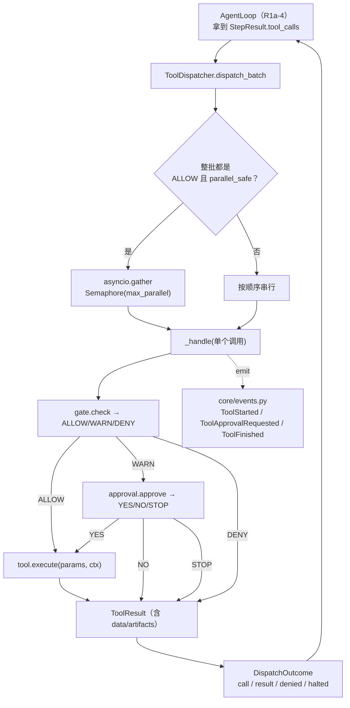
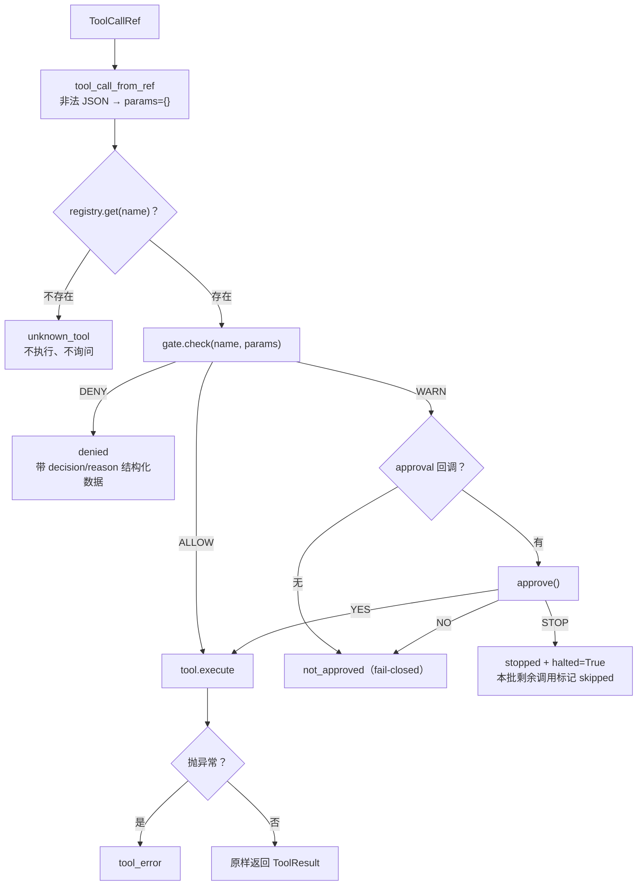

# AI-Coding — R1a-3 分析方案（工具分发器：唯一放行通道）

> 定位：R1 编排层重构第三步。R1a-1 交付契约（`ToolContext` / 结构化 `ToolResult`）、
> R1a-2 交付引擎端口，本步交付**工具执行的中枢**：把「权限门 + 审批 + 并发批执行 + 结构化拒绝」
> 收进一个可测的 `ToolDispatcher`，成为工具执行的**唯一放行通道**。
> 依据：`docs/r1-analysis.md` §3.4（分发流程图）、§4.9（接口草案）、§6.3（用例清单）。
> 前提：纯增量，不动 `AgentLoop` / `cli.py` / 旧 SDK 路径。

---

## 0. 前置状态（已核验）

| 项 | 状态 |
|---|---|
| R1a-1 契约层 | 已交付（`7ad4f2e`），`ToolContext` / `ToolResult.data` / `parallel_safe` 可用 |
| R1a-2 引擎端口 | 已交付（`5afa338`），39 个测试 |
| 环境 | venv 已重建；`mypy` 66 文件全过；ruff 干净（`a23f5cc`） |
| 可复用的既有资产 | `security/permission_gate.py`、`security/approval.py`（**两者本步零改动**） |

**本步与总方案的两处排期/设计调整**（理由见 §9 核验①②）：

1. `core/events.py` 从 R1a-4 **提前到本步**——分发器要发 `ToolStarted` / `ToolFinished`，
   没有事件定义就无法写它的事件用例。
2. 并发判定规则从「全部 `parallel_safe`」**收紧为「全部 ALLOW 且全部 `parallel_safe`」**——
   否则同批的两个 WARN 工具会**并发地向用户弹确认框**，交互是坏的。

---

## 1. 现在要实现的内容

| # | 件 | 文件 | 性质 |
|---|---|---|---|
| 1 | 循环事件契约 + observer | `core/events.py` | 新增 |
| 2 | 工具分发器 | `core/dispatch.py` | 新增 |
| 3 | 事件契约用例 | `tests/test_loop_events.py` | 新增 |
| 4 | 分发器用例 | `tests/test_tool_dispatch.py` | 新增 |

---

## 2. 影响分析（对代码的影响 / 执行范围）

### 2.1 影响判定

**纯新增，零破坏**。判据：

- 不改任何既有文件。`security/permission_gate.py` 与 `security/approval.py` **一行都不改**
  （它们是 R1a-1 核验时确认「已经是对的」的资产）。
- 不动 `tools/sdk_adapter.py`（旧路径继续用 SDK 的 `needs_approval` 通道），
  因此 `cli.py` / `ui/repl.py` / 现有测试全部不受影响。
- 新模块不被任何现有代码 import，所以**现有运行行为零变化**。

### 2.2 执行范围

新增 2 个模块 + 2 个测试文件。**明确不动**：`AgentLoop`、`cli.py`、`tools/*`、`ai/*`、
`security/*`、`domain/*`。

### 2.3 当前权限链路（要接管的那个）

```
今天（SDK 路径）
  SDK FunctionTool.needs_approval(ctx, params, call_id)
    └─ tools/sdk_adapter.py::_needs_approval          # 在 SDK 内部被调用
         ├─ gate.check(tool.name, params) -> Decision
         └─ approve_from_gate_decision(...) -> bool    # 顺带把 STOP 语义吃掉
              └─ approval.approve(...) -> YES/NO/STOP
```

问题有三个，都是自持循环必须先解决的：

1. **控制权在 SDK 手里**：`needs_approval` 返回 bool，我们看不到「被拒绝」之后模型收到了什么，
   也无法把拒绝理由结构化地回喂。
2. **`STOP` 语义被压扁**：`approve_from_gate_decision` 把 `YES/NO/STOP` 压成 bool，
   「用户要求中止整个回合」这一信息在适配层丢失。
3. **没有并发概念**：SDK 按自己的节奏调用工具，`parallel_safe` 无从谈起。

### 2.4 本步明确不做（YAGNI）

| 不做 | 理由 |
|---|---|
| 工具执行超时 | `bash` 自带 `timeout_seconds`，其余工具是本地快速操作；统一超时属于后续可靠性议题 |
| 重试 | 与 R1a-2 同理：失败要显式回喂模型，而不是静默重试 |
| 权限策略文件化 / 按 server 声明策略 | 属于 R1b（MCP）与后续议题 |
| 把 `ToolContext.emit` 接到 observer | `emit` 是给工具用的通道，本步没有工具用它；接线放在 R1a-4 更自然 |
| 事件落地为 tracing / 日志 | R1a-4 + 后续；本步只定义事件与 observer |

---

## 3. 目标设计

### 3.1 分发在整体中的位置（架构图 1）



### 3.2 单个调用的决策流（架构图 2）



### 3.3 关键设计决策

**D1 — 并发判定收紧为「全部 ALLOW 且全部 `parallel_safe`」。**

总方案 §4.9 写的是「查 `registry.get(name).parallel_safe`；全为真 → 并发」。
这条**不够**：`bash` / `write` / `edit` 是 WARN 级，若一批里有两个需要审批的工具
（未来的 MCP 工具可能标 `parallel_safe`），两个 `approval.approve()` 会并发执行 →
**两个确认框交错打印在同一行终端上**，用户根本没法回答。

收紧后的规则只有一条：**整批都是「ALLOW 且 parallel_safe」才并发，否则全批串行**。
代价：一批「3 个 read + 1 个 write」会整体串行（read 本可并行）。
收益：确认框永远一次一个、DENY/STOP 能干净地中止剩余调用、执行顺序与模型声明顺序一致。
这个取舍是刻意的。

**D2 — 未知工具「不执行也不询问」。**
`PermissionGate` 对未知工具返回 WARN（fail-closed）。但在分发器这一层，未知工具意味着
**模型幻觉出了一个不存在的工具名**（工具清单是我们自己生成的），此时向用户弹「是否允许
未知工具 foo」是荒谬的。因此顺序是：**先查注册表，不存在直接产出 `unknown_tool` 结果**，
不再走权限门。

**D3 — 拒绝必须结构化回喂，而不是一句文本。**
各拒绝路径有自己的 `error` 码与 `data`，模型据此能做出不同反应
（换工具 / 换路径 / 停下来问用户）：

| 情形 | `error` | `data` |
|---|---|---|
| 权限门硬拒 | `denied` | `{"decision":"deny","reason":...}` |
| 用户不同意 | `not_approved` | `{"decision":"warn","approved":false}` |
| 无审批回调（fail-closed） | `not_approved` | `{"decision":"warn","approved":false,"reason":"no approval callback"}` |
| 用户要求中止 | `stopped` | `{"decision":"warn","stopped":true}` |
| STOP 后被跳过的调用 | `skipped` | `{"skipped":true}` |
| 工具名不存在 | `unknown_tool` | `{"tool":name}` |
| 工具抛异常 | `tool_error` | `{"tool":name}` |

**D4 — STOP 之后，剩余调用产出 `skipped` 结果而不是留空。**
assistant 消息声明了 N 个 `tool_call`，Chat Completions 要求每个都有对应的
`role="tool"` 消息，否则下一次请求会 400。若 STOP 之后直接不产出，
就只剩 `SessionData.ensure_tool_pairing` 兜底——而它对**有正文**的 assistant 消息
不清理孤立调用（只在无正文的载体消息上清理），会留下一个坏历史。
产出 `skipped` 结果让会话始终可回放。这是一处具体的正确性修复。

**D5 — `denied` 与 `halted` 是两个独立维度。**
`denied=True` 表示「这次调用没执行」（DENY / 用户拒绝）；
`halted=True` 表示「用户要求中止整个回合」。一个被拒的调用不一定是中止，
一个中止必然是拒绝。分开表达，循环才能分别处理（前者继续迭代，后者结束回合）。

**D6 — 工具异常绝不掀翻回合。**
`tool.execute` 抛出的任何异常都被捕获为 `success=False, error="tool_error"`。
理由：工具是外部世界的边界（文件系统、子进程），它的失败是**回合内的一次观察**，
应该回喂给模型让它自己决定重试或改道，而不是让整个回合崩掉。

**D7 — 审批回调自身抛异常时 fail-closed。**
审批是安全边界，回调坏掉时必须当作「不同意」，绝不能当作「同意」。

---

## 4. 逐文件「新增功能 + 实现步骤」

### 4.1 `ai_coding/core/events.py`（新增）

```python
@dataclass(frozen=True)
class IterationStarted:   index: int; max_iterations: int
@dataclass(frozen=True)
class AssistantTextDelta: text: str
@dataclass(frozen=True)
class AssistantMessage:   text: str | None; tool_calls: tuple[ToolCallRef, ...]
@dataclass(frozen=True)
class ToolApprovalRequested: tool_name: str; params: dict[str, Any]; reason: str
@dataclass(frozen=True)
class ToolStarted:        call_id: str; tool_name: str; params: dict[str, Any]
@dataclass(frozen=True)
class ToolFinished:       call_id: str; tool_name: str; success: bool
                          output_preview: str; duration_ms: int
@dataclass(frozen=True)
class TaskUpdated:        task: TaskState
@dataclass(frozen=True)
class TurnFinished:       outcome: TurnOutcome

LoopEvent = Union[IterationStarted, AssistantTextDelta, AssistantMessage,
                  ToolApprovalRequested, ToolStarted, ToolFinished,
                  TaskUpdated, TurnFinished]

class LoopObserver(Protocol):
    def on_event(self, event: LoopEvent) -> None: ...

class NullObserver:      # 全空实现
class RecordingObserver: # 测试用，把事件收进 list，另有 of_type(cls)

OUTPUT_PREVIEW_CHARS = 500
def preview(text: str, limit: int = OUTPUT_PREVIEW_CHARS) -> str: ...
```

实现步骤：
1. 事件全部 `frozen=True`：它们是「已经发生过的事」，不允许被中途改写。
2. `LoopObserver` 用 `Protocol`（结构化类型），这样 UI、日志、tracing 都能实现它，
   不需要继承任何基类。
3. `preview()` 超长时截断并追加 `…`，保证事件层**永远不会把巨型工具输出带上 UI 与日志**
   （一次 `read` 可能是 10MB）。
4. `RecordingObserver.of_type(cls)` 让测试按类型过滤，避免断言里写下标。

### 4.2 `ai_coding/core/dispatch.py`（新增）

```python
@dataclass(frozen=True)
class DispatchOutcome:
    call: ToolCall
    result: ToolResult
    denied: bool = False
    halted: bool = False

class ToolDispatcher:
    def __init__(self, registry: ToolRegistry, gate: PermissionGate,
                 approval: ApprovalCallback | None = None, *,
                 max_parallel: int = 4, observer: LoopObserver | None = None) -> None: ...
    async def dispatch_batch(self, calls: list[ToolCallRef],
                             ctx: ToolContext) -> list[DispatchOutcome]: ...
```

实现步骤：
1. **解析**：`tool_call_from_ref(ref)` 提供「非法 JSON 退化为 `{}`、不抛」的既有语义。
2. **空批**直接返回 `[]`。
3. **模式判定**（D1）：每个调用解析出 `tool = registry.get(name)`；
   只有「工具存在 且 `tool.parallel_safe` 为真 且 `gate.check(...)` 为 ALLOW」全部成立时
   才走并发；判定阶段调用的 `gate.check` 结果顺带复用，避免重复判定。
4. **并发路径**：`asyncio.Semaphore(max(1, max_parallel))` 限制同时在跑的工具数，
   `asyncio.gather` 保序返回。并发路径下不会出现 STOP（因为全是 ALLOW）。
5. **串行路径**：按声明顺序逐个 `_handle`；一旦某个 `halted`，
   把**剩余调用**逐个标记为 `skipped`（D4），不再执行。
6. **`_handle(tc, ctx)`**（单个调用的完整决策，见 §3.2）：
   1. `emit(ToolStarted(...))`、记录 `time.monotonic()`。
   2. 未知工具 → `unknown_tool` 结果（D2）。
   3. `gate.check(name, params)` → 归一化为 `PermissionDecision`，同时取 `reason`。
   4. ALLOW → `_execute`；DENY → `denied` 结果；WARN → `_ask`。
   5. `_ask`：`emit(ToolApprovalRequested(...))`；无回调或回调抛异常 → 拒绝（D7）；
      `YES` → 批准；`STOP` → 拒绝且 `halted=True`。
   6. `_execute`：捕获所有异常为 `tool_error`（D6）。
   7. `emit(ToolFinished(..., output_preview=preview(result.output), duration_ms=...))`。
7. **返回值顺序**与入参 `calls` 严格一致（并发靠 `gather` 保序，串行天然有序）。

### 4.3 测试文件

`tests/test_loop_events.py`（6 例）与 `tests/test_tool_dispatch.py`（26 例），见 §6。

---

## 5. 数据流影响

### 5.1 一次工具批次的完整穿越

```
AgentLoop（R1a-4）
  └─ StepResult.tool_calls: list[ToolCallRef]
       └─ dispatcher.dispatch_batch(calls, ctx)
            ├─ 解析 params（非法 JSON → {}）
            ├─ 模式判定（全 ALLOW + parallel_safe → 并发）
            ├─ 每个调用：gate → (approval) → execute → ToolResult
            ├─ emit ToolStarted / ToolApprovalRequested / ToolFinished
            └─ list[DispatchOutcome]（保序）
                 └─ 循环把 result 包成 <tool_output> 信封写进 session
```

### 5.2 契约影响清单

| 契约 | 变化 | 影响面 |
|---|---|---|
| `ToolContext` | **不变**（本步只消费） | 无 |
| `ToolResult` / `ToolArtifact` | **不变**（本步产出） | 无 |
| `PermissionGate` / `ApprovalCallback` | **不变**（本步调用） | 无 |
| `ToolRegistry` / `BaseTool.parallel_safe` | **不变** | 无 |
| `core/events.py` | **新增**（总方案里排 R1a-4，提前到本步，见 §8 核验①） | 新增文件 |
| `core/dispatch.py` | **新增** | 新增文件 |

**没有任何既有契约被修改**——这是本步能保持零破坏的根本原因。

### 5.3 数据流层面的风险点

1. **并发下的顺序**：`asyncio.gather` 保序，但**结果顺序 ≠ 完成顺序**。
   若将来 UI 想按完成顺序渲染，需要靠 `ToolFinished` 事件（它有真实时间序），
   不能靠返回值顺序。已用 `test_outcomes_match_input_order` 锁住返回值语义。
2. **`ctx` 在并发下被共享**：多个工具同时拿到同一个 `ToolContext` 实例。
   当前 `read` / `glob` 只读它，`write` / `edit` 不是 ALLOW（不会并发），
   所以没有竞态。但这是 R1a-4 之后必须继续遵守的约束，已记录。
3. **`output_preview` 的内存**：`preview()` 只做切片，不复制全量，
   避免「为了打日志把 10MB 输出再复制一份」。

---

## 6. TDD 用例（验收锚点，先写后实现）

规则沿用 M0：**先写→跑红→实现→跑绿**；除用例本身写错外不得改断言。

### 6.1 `tests/test_loop_events.py`（实际 6 例）

| 用例 | 断言要点 |
|---|---|
| `test_events_are_frozen` | `ToolStarted` / `ToolFinished` 赋值抛 `FrozenInstanceError` |
| `test_event_fields_carry_through` | `ToolFinished` 五个字段原样保留 |
| `test_null_observer_never_raises` | 全部 8 种事件都不抛 |
| `test_recording_observer_collects_and_filters` | 全量收集；`of_type` 只返回该类型且保序 |
| `test_preview_truncates_long_text` | 短文本原样、空串为空、超长截断且长度 ≤ limit+1 |
| `test_preview_honours_custom_limit` | 自定义 limit 生效（含边界相等时**不**截断） |

### 6.2 `tests/test_tool_dispatch.py`（实际 26 例）

工具名刻意选用**真实权限门会命中不同档位**的名字：
`read` / `glob` → ALLOW，`write` → WARN，`bash` + 硬拒模式 → DENY。

| 分组 | 用例 | 断言要点 |
|---|---|---|
| 权限档位 | `test_allow_tool_executes_directly` | ALLOW 直接执行，`denied=False` |
| | `test_warn_tool_approval_yes_executes` | WARN + YES → 执行；回调收到工具名 |
| | `test_warn_tool_approval_no_returns_not_approved` | NO → `not_approved`、未执行、`denied=True` |
| | `test_warn_tool_without_callback_is_denied` | 无回调 fail-closed，`data["reason"]=="no approval callback"` |
| | `test_deny_tool_never_executes` | `rm -rf /` → `denied`、未执行 |
| | `test_deny_result_carries_reason` | `data["decision"]=="deny"` 且 `reason` 非空 |
| | `test_deny_does_not_ask_approval` | DENY 不弹确认框 |
| | `test_approval_callback_exception_is_fail_closed` | 回调抛异常 → 当作拒绝 |
| 未知工具 | `test_unknown_tool_returns_error_result` | `unknown_tool`，输出含工具名 |
| | `test_unknown_tool_does_not_ask_approval` | 未知工具不询问 |
| 参数与失败 | `test_malformed_arguments_degrade_to_empty_params` | `{not json` → `{}` |
| | `test_tool_exception_becomes_failed_result` | `tool_error`，异常信息进输出 |
| | `test_tool_receives_the_given_context` | 工具的 `ctx` 就是传入的那个对象 |
| STOP | `test_approval_stop_halts_batch` | `halted=True`，后续调用未执行 |
| | `test_stopped_batch_marks_remaining_calls_skipped` | 剩余调用产出 `skipped`（配对不破） |
| 顺序与批 | `test_empty_batch_returns_empty` | `[]` |
| | `test_outcomes_match_input_order` | 返回顺序 == 入参顺序 |
| | `test_parallel_safe_batch_runs_concurrently` | 峰值并发 == 2 |
| | `test_batch_with_one_unsafe_tool_goes_serial` | 峰值并发 == 1（D1 的 half） |
| | `test_batch_containing_warn_tool_runs_serial` | 峰值并发 == 1（D1 的 WARN half） |
| | `test_parallelism_bounded_by_max_parallel` | `max_parallel=1` → 峰值 == 1 |
| 事件 | `test_dispatch_emits_tool_started_and_finished` | 各 1 条、call_id 正确 |
| | `test_approval_request_event_emitted` | WARN 且有回调时发 `ToolApprovalRequested` |
| | `test_denied_call_still_reports_finished_event` | 被拒调用也有 `ToolFinished(success=False)` |
| | `test_output_preview_truncated_in_event` | 5000 字输出 → 事件里 ≤ 501 且以 `…` 结尾 |
| | `test_dispatch_outcome_defaults` | `denied` / `halted` 默认 `False` |

**合计 32 例**。全量口径：**423 例**（排除沙箱不支持的两个文件）。

---

## 7. 成功之后是什么样

1. 工具执行有了**唯一入口**：任何调用都必须经过 `ToolDispatcher`，
   权限、审批、并发、结构化拒绝在同一处收口，R1a-4 的循环只消费 `DispatchOutcome`。
2. `STOP` 语义不再被压扁：`halted` 独立于 `denied`，循环能区分
   「这次调用被拒，继续迭代」与「用户要中止，结束回合」。
3. 拒绝变成**机器可判断**的结构：模型拿到 `error` 码与 `data`，而不是一句「不行」。
4. 确认框不会并发弹：WARN 批次强制串行（D1）。
5. 会话在 STOP 后仍然可回放：剩余调用有 `skipped` 结果，配对完整（D4）。
6. 工具异常不再能掀翻回合（D6）。

```bash
pytest --ignore=tests/test_worktree.py --ignore=tests/test_tool_bash.py   # 423 全绿
ruff check .       # 0
mypy ai_coding     # 68 文件 0 问题
```

---

## 8. 自我核验（对方案本身做压力测试）

### 核验①（排期调整：events 必须提前）

总方案把 `core/events.py` 排在 R1a-4。但 R1a-3 的分发器要发
`ToolStarted` / `ToolFinished`，用例清单里也有 `test_dispatch_emits_tool_started_and_finished`。
不提前就没有事件类型可发。**调整：events 随 R1a-3 交付**；R1a-4 只负责发出
`IterationStarted` / `AssistantTextDelta` / `TurnFinished` 等循环级事件。
总方案的最终状态不变。

### 核验②（设计收紧：并发规则）

见 D1。总方案的「全部 `parallel_safe` 即并发」会在同批出现两个 WARN 工具时
并发弹出确认框。收紧为「全部 ALLOW 且全部 `parallel_safe`」，并用
`test_batch_containing_warn_tool_runs_serial` 把这条锁死。

### 核验③（D4 的正确性依据）

「STOP 后必须给剩余调用补结果」不是洁癖，有具体依据：
`SessionData.ensure_tool_pairing(strict=True)` 只清理**无正文**的 assistant 载体消息上的孤立调用；
若 assistant 消息带正文且声明了 3 个调用、只回填 1 个结果，历史里会留下 2 个孤立调用，
下一次请求会 400。补 `skipped` 结果是从源头避免这个问题。

### 核验④（零破坏）

本步新增的两个模块**没有被任何现有代码 import**（`rg` 可验证），
`security/*` 与 `tools/*` 一行未改。因此 423 例中除新增 32 例外，
其余 391 例全部保持原状通过——这是「纯增量」的实证。

### 核验⑤（测试写错一处，已修正）

`test_recording_observer_collects_and_filters` 初稿断言
`observer.of_type(ToolStarted) == []`，但同一个用例的 `_all_events()` fixture
里本来就包含一个 `ToolStarted`，断言自相矛盾。
这是**用例自身写错**（不是实现问题），按事先约定修正为断言该类型恰好 1 条。
修正后 red→green 判据不变：实现前是 `ModuleNotFoundError`，实现后通过。

### 核验⑥（诚实标注的取舍与未覆盖项）

- **并发只覆盖 ALLOW 批**：一批「3 read + 1 write」会整体串行，read 本可并行。
  这是 D1 刻意付的代价，换来确认框不交错。
- **没有工具级超时**：`bash` 靠自身 `timeout_seconds`；若某个工具永远不返回，
  批次会挂住。属已知缺口，留给后续可靠性议题。
- **并发路径不会出现 STOP**：因为并发前提是全 ALLOW。
  因此「并发中途收到 STOP」这条路径在结构上不可达，不需要特殊处理（也没有对应测试）。
- **`ToolContext.emit` 仍未接线**：本步没有工具使用它；R1a-4 构造 ctx 时再接。

---

## 9. 待你确认

| # | 事项 | 我的建议 |
|---|---|---|
| 1 | `core/events.py` 提前到 R1a-3 | 提前。分发器的事件用例依赖它 |
| 2 | 并发规则收紧为「全 ALLOW 且全 `parallel_safe`」 | 收紧。代价是混合批次串行，换来交互正确 |
| 3 | 未知工具不询问、直接返回 `unknown_tool` | 直接返回。工具清单由我方生成，未知即幻觉 |
| 4 | STOP 后剩余调用补 `skipped` 结果 | 补。否则会话历史不可回放（§8 核验③） |

---

*Acknowledge：本方案基于 `docs/r1-analysis.md` 的既定设计（方案 A、D9/D10）、
R1a-1/R1a-2 的实际代码与 `security/permission_gate.py`、`security/approval.py` 的真实语义
（ALLOW/WARN/DENY 三分与 YES/NO/STOP 三态）。§8 记录了两处对总方案的调整
（events 提前、并发规则收紧）、一处用例自错修正，以及四条诚实标注的取舍。*
