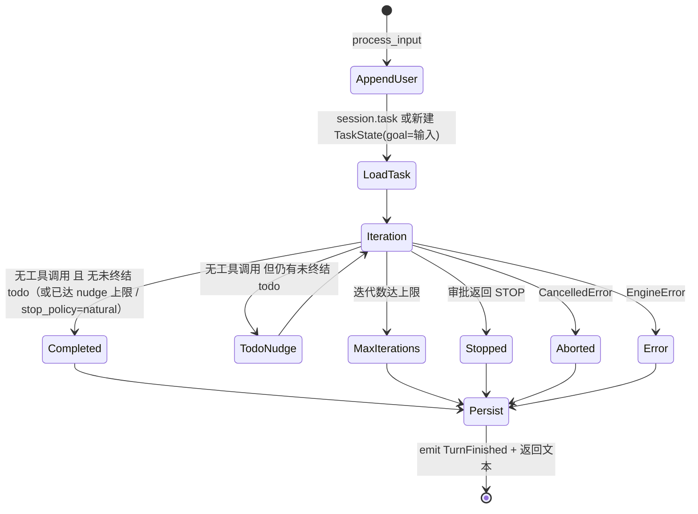
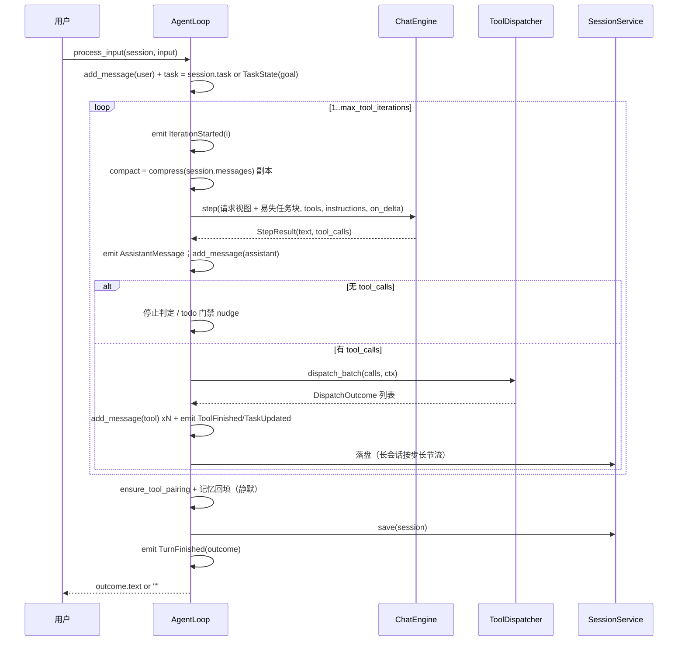

# AI-Coding — R1a-4 分析方案（循环本体：自持 ReAct + Todo 门禁）

> 定位：R1 编排层重构的**重心**。R1a-1 交付契约、R1a-2 交付引擎端口、R1a-3 交付分发器，
> 本步把三者接成真正的循环：迭代控制归我们、todo 成为一等公民、停止条件显式化、
> 每轮可落盘、回合可中断。
> 依据：`docs/r1-analysis.md` §3.2（状态机）、§3.3（时序）、§3.5（D1–D8）、§4.11（逐步骤）、§6.4（用例）。
> 前提：本步**会改既有文件**（`agent_loop.py` / `builder.py` / `cli.py` 与三个循环测试文件），
> 这是 R1a 里唯一一次破坏性变更，范围与理由见 §2。

---

## 0. 前置状态（已核验）

| 项 | 状态 |
|---|---|
| R1a-1 契约 | `7ad4f2e`（`TaskState` / `StepResult` / `ToolContext` / 结构化 `ToolResult`） |
| R1a-2 引擎 | `5afa338`（`ChatEngine` / `OpenAIChatEngine` / 原生 tool_calls 映射） |
| R1a-3 分发 | `3400fae`（`core/events.py` + `core/dispatch.py`） |
| 质量门禁 | ruff 0、mypy 68 文件 0、pytest 423 例（排除沙箱不支持的两个文件） |

**本步对总方案 §10 的必要修正**（理由见 §8 核验①）：
总方案把「CLI 接线」排在 R1a-6，但 `AgentLoop.__init__` 的入参要从 `AIService` 换成
`ChatEngine` + `ToolRegistry`，而 `cli._build_loop` 正是按旧签名构造它的。
**换循环引擎与换装配方式必须同时发生**，否则 R1a-4 这个提交一跑 `ai-coding ask` 就崩。
因此本步把 `builder.py` / `cli.py` 的接线一并纳入；R1a-6 只剩「删除 SDK 路径 + MCP + 文档」。

---

## 1. 现在要实现的内容

| # | 件 | 文件 | 性质 |
|---|---|---|---|
| 1 | 自持循环 | `core/agent_loop.py` | **重写** |
| 2 | `assistant_message` 接受 `StepResult` | `domain/run.py` | 微改（仅类型标注） |
| 3 | 工具栈返回注册表 | `tools/builder.py` | 改（`build_tool_stack` → `build_tool_registry`） |
| 4 | 控制台 observer（工具活动可见） | `ui/console.py` | 新增类 |
| 5 | CLI 接线切到新引擎 | `cli.py` | 改（`_build_loop` / `ask` / `repl`） |
| 6 | 循环测试 | `tests/test_agent_loop_react.py` | 新增（替换 3 个旧文件） |
| 7 | 可选组件集成测试 | `tests/test_agent_loop_optional_components.py` | 新增（迁移自 `test_agent_loop_m3.py`） |
| 8 | 注册表与 CLI 测试 | `tests/test_builder.py`、`tests/test_cli.py` | 改写（规格变了） |

---

## 2. 影响分析（对代码的影响 / 执行范围）

### 2.1 影响判定

**这是 R1a 里唯一一次破坏性变更**，破坏面被精确限定在四处：

| 被破坏的东西 | 原因 | 处置 |
|---|---|---|
| `tests/test_agent_loop.py`（4 例） | `FakeAIService` 实现的是已被 R1a-2 取代的 `AIService` 端口 | 重写为 `test_agent_loop_react.py` |
| `tests/test_agent_loop_tools.py`（8 例） | 同上，且断言的是「引擎返回 tool_outputs」的旧模型 | 同上 |
| `tests/test_agent_loop_m3.py`（11 例） | 同上的假对象 | 重写为 `test_agent_loop_optional_components.py`（3 例，其余被新用例覆盖） |
| `tests/test_builder.py`（4 例） | `build_tool_stack` 返回 SDK `FunctionTool`，现在返回 `ToolRegistry` | 改写断言 |

**这不是「为了过测试而改测试」**：这四处的规格本身变了——循环不再把工具执行委托给 SDK，
所以「引擎替我执行工具」的假对象和断言都不再是正确规格。改写时逐条说明。

### 2.2 执行范围

改 5 个文件（`agent_loop.py` / `domain/run.py` / `builder.py` / `ui/console.py` / `cli.py`），
新增 2 个测试文件，改写 2 个测试文件，删除 3 个旧测试文件。

**明确不动**：`ai/*`、`core/dispatch.py`、`core/events.py`、`core/context_compression.py`、
`core/subagent.py`、`core/mcp.py`、`security/*`、`memory/*`、`skills/*`、`tools/` 下的工具实现。

### 2.3 与既有承诺的关系

| 承诺 | 出处 | R1a-4 后 |
|---|---|---|
| 「压缩只改副本」 | m3 §5-2 | **保持**：`compress` 的返回值只用于本次请求，不回写 `session.messages` |
| 「增强组件静默降级」 | m3 §5-11 | **保持**：记忆/指令装配失败不影响回合；但引擎失败**不**降级（显式 ERROR） |
| 「每回合必落盘」 | m1 | **加强**：变成「每次迭代落盘 + 回合末落盘」（长会话按步长节流） |
| 「压缩结果不落盘」 | m3 现状 | **不变**（压缩的持久化与重做属于 R2） |
| 「SDK 是唯一放行通道」 | m2 §8 | **已由 R1a-3 取代**；本步把它接进循环 |

### 2.4 本步明确不做（YAGNI）

| 不做 | 理由 |
|---|---|
| 重做 `ContextManager`（压缩算法本身） | 属于 R2。本步只把它接进循环，**不修它每回合重算、L3 空转、无单条兜底等缺陷** |
| 重做记忆（`MemoryService`） | 属于 R3。本步只沿用现有 `recall` / `remember` 接口 |
| 子智能体共享上下文（D10） | 属于 R1a-5。本步的 `ToolContext` 已带上 `messages`/`instructions`，但 `SubAgentTool` 尚未消费 |
| MCP | 属于 R1a-6/R1b。本步若发现 `mcp.enabled=true` 会**打印明确告警**，而不是静默丢掉 |
| tracing / guardrails | 后续；本步只把 `LoopObserver` 接到 CLI |
| 删除 SDK 路径 | R1a-6 |

---

## 3. 目标设计

### 3.1 循环状态机（架构图 1）



### 3.2 一次回合的时序（架构图 2）



### 3.3 关键设计决策

**D1 — 任务块走「易失消息」，门禁提醒走「持久消息」——两者刻意不对称。**

| 东西 | 是否入 `session.messages` | 理由 |
|---|---|---|
| 任务状态块（`<task-state>`） | **否**（每次请求现拼，永远在末尾） | 它是「当前状态的一个视图」，每轮重新生成；若持久化，历史里会堆积一堆过期的任务快照 |
| todo 门禁提醒（`[task-gate] 你还有…`） | **是** | 它是**真实改变过模型行为的一条指令**，不落盘会导致「assistant 引用了一条不存在于历史的消息」，回放时语义断裂 |

`task_injection == "system"` 时任务块改为追加到 `instructions` 末尾——代价是 system prompt 变化会让
整段历史的前缀缓存失效，收益是任务块能存活于压缩。默认仍是 `"message"`。

**D2 — 停止条件显式化，且 todo 门禁有上限。**

五个出口：`COMPLETED` / `MAX_ITERATIONS` / `STOPPED` / `ABORTED` / `ERROR`。
`stop_policy="todo_aware"`（默认）时，模型给出终答但仍有未终结 todo → 注入一次提醒并继续，
**最多 `max_todo_nudges`（默认 2）次**。上限是必须的：没有它，一个模型坚持认为「做完了」
而 todo 未清零的场景会变成死循环。达到上限后按 `COMPLETED` 结束并保留 todo 现状。

**D3 — `max_tool_iterations` 真正生效。**
这个配置从 M0 起就存在、被文档描述为「单回合工具循环上限」，但**从未被任何代码读取**。
本步把它接成 `range(1, max_tool_iterations + 1)`，耗尽即 `MAX_ITERATIONS`，并**保留部分成果**
（已完成的 assistant/tool 消息已经在会话里）。

**D4 — 每轮落盘 + 长会话节流。**
自持循环换来的真实能力是「崩了能从最后一次完整迭代继续」。但一次 10 轮的回合写 10 次全量 JSON
在长会话上是可感知的 IO 放大。规则：会话消息数 ≤ `persist_checkpoint_messages`（默认 200）时每轮落盘；
超过后只在 `index % LONG_SESSION_STRIDE（3）== 0` 落盘，回合结束必定落盘一次。

**D5 — `CancelledError` 记账后「继续抛出」，不吞。**
吞掉取消是 asyncio 的经典反模式。本步的做法是：捕获 → `ensure_tool_pairing()` → 落盘 →
记录 `TurnOutcome(ABORTED)` → 发 `TurnFinished` → **重新抛出**。REPL 侧捕获并提示 `[aborted]`。

**D6 — 引擎失败与工具失败的处理层级不同。**
`EngineError`（模型调用失败）→ 回合以 `ERROR` 结束，但**保留已完成的轨迹**并落盘；
工具失败由 R1a-3 的分发器转成 `ToolResult(success=False)` **回喂模型**，不终止回合。
理由：模型调用失败是主链路断裂，工具失败是回合内的一次观察。

**D7 — `dispatch` 与 `engine` 在构造期注入，装配留在 CLI。**
`AgentLoop` 是纯编排，不自己 new 引擎、不自己拼工具栈。这条保证它可被测试完全驱动
（`ScriptedEngine` + 假注册表），也保证 R1a-6 换实现时不碰编排。

**D8 — 记忆回填放在回合末尾且永不抛。**
沿用 M3 语义：`remember` 是 best-effort，失败静默。本步不改记忆算法。

---

## 4. 逐文件「新增功能 + 实现步骤」

### 4.1 `ai_coding/core/agent_loop.py`（重写）

```python
TASK_MESSAGE_LEAD = "以下是你自己的任务清单状态（系统注入，不是用户发言）："
TASK_GATE_LEAD = "[task-gate] 你还有未完成的任务项："
LONG_SESSION_STRIDE = 3

class AgentLoop:
    def __init__(self, engine, sessions, tools, *, gate=None, approval=None,
                 prompt=None, context=None, memory=None, skills=None, project=None,
                 settings=None, observer=None, workspace=".") -> None: ...
    async def process_input(self, session, user_input, on_delta=None,
                            observer=None) -> str: ...
    async def aclose(self) -> None: ...
    last_outcome: TurnOutcome | None
```

步骤（`process_input`）：
1. `add_message(user_message(user_input, now_utc()))`。
2. `session.task` 为空则新建 `TaskState(goal=user_input)` 并挂回 `session.task`。
3. 取设置（`settings or AIConfig()`）、求 `max_iterations = settings.max_tool_iterations`。
4. `for index in range(1, max_iterations + 1)`：
   1. `emit(IterationStarted(index, max_iterations))`。
   2. `compact = await context.compress(session.messages)`（无 context 则直接用 `session.messages`）。
   3. `instructions = await self._build_instructions(compact, task)`（无 prompt 则 `None`）。
   4. `messages, instructions = self._inject_task(compact, instructions, task)`（D1）。
   5. `step = await engine.step(messages, tools=self._tool_schemas, instructions=..., on_delta=...)`。
   6. `emit(AssistantMessage(...))`；`add_message(assistant_message(step, now))`。
   7. **无工具调用** → 停止判定（D2）；未达上限则 `add_message(user_message(nudge))` 后 `continue`。
   8. **有工具调用** → 构造 `ToolContext(task, workspace, session_id, messages=tuple(compact),
      instructions=instructions)`；`await dispatcher.dispatch_batch(step.tool_calls, ctx)`；
      逐条把 `DispatchOutcome` 包成 `ToolOutput`（带 `success` / `data` / `artifacts`）并
      `add_message(tool_message(...))`；若本批包含 `todo_write` 则 `emit(TaskUpdated(task))`；
      `_checkpoint(session, index)`；若有 `halted` → `STOPPED` 并结束。
5. 循环走完 → `MAX_ITERATIONS`（D3）。
6. `except asyncio.CancelledError` → `_finish_aborted(session)` → **重新抛出**（D5）。
7. `except EngineError` → 记账 `ERROR`、落盘、保留轨迹。
8. `finally`：`emit(TurnFinished(outcome))`、`self.last_outcome = outcome`、静默 `remember`、
   返回 `outcome.text or ""`。

### 4.2 `ai_coding/domain/run.py`（微改）

`assistant_message(turn: TurnResult | StepResult, timestamp)` —— 只放宽类型标注，
函数体（`turn.text` / `turn.tool_calls`）本来就对两者通用。

### 4.3 `ai_coding/tools/builder.py`（改）

`build_tool_stack(...) -> list[FunctionTool]` → `build_tool_registry(...) -> ToolRegistry`：
装配逻辑（sandbox / FileStateTracker / gate / 各工具开关 / `include_subagent` 递归保护）**一字不改**，
只把末端的 `registry_to_sdk_tools(registry, gate, approval)` 换成 `return registry`。

> 注意：`ToolRegistry` 只保存工具本身，**不带权限门与审批回调**——这两者属于分发器，
> 在 `AgentLoop` 构造时注入。这是 R1a-3 定下的分层。

### 4.4 `ai_coding/ui/console.py`（新增类）

```python
class ConsoleObserver:            # 实现 LoopObserver
    def __init__(self, console: DialogueConsole) -> None: ...
    def on_event(self, event) -> None: ...
```

渲染规则：`IterationStarted` → `[turn 2/10]`；`ToolStarted` → `[tool: read] {...}`；
`ToolFinished` → 成功/失败与 `output_preview`；`TaskUpdated` → 任务清单；
`AssistantTextDelta` **不渲染**（`on_delta` 已在流式打印，避免双份）。

### 4.5 `ai_coding/cli.py`（改）

- `_build_loop(...)` → 组装 `ContextManager` / `MemoryService` / `PromptAssembler` /
  `SkillRegistry` / `ProjectInstructionsLoader` 并构造 `AgentLoop`。
- `ask`：`build_engine_from_config` + `build_tool_registry`（approval 默认自动批准）+ `ConsoleObserver`。
- `repl`：同上，但 `approval=CLIApprovalCallback()`，并捕获 `KeyboardInterrupt` → `[aborted]`。
- 两处结尾都 `await loop.aclose()` 关掉引擎持有的 HTTP 客户端。
- `app_cfg.mcp.enabled` 为真时打印告警（MCP 在本版本不可用，见 §2.4）。

---

## 5. 数据流影响

### 5.1 before → after

```
BEFORE（M1–M6）
  process_input = 五步直线：加 user → 压缩 → 拼 prompt → AIService（SDK 内部循环 N 轮）→ 回写 + save 一次

AFTER
  process_input = 显式循环：
    每轮：压缩(副本) → 拼 instructions → 注入任务块(易失) → engine.step(一步)
          → assistant 回写 →（有工具）dispatch 执行 → tool 回写 → 落盘(节流)
    停止：无工具调用 (+todo 门禁) / 迭代上限 / STOP / 取消 / 引擎错误
```

### 5.2 契约影响清单

| 契约 | 变化 | 影响面 |
|---|---|---|
| `ChatMessage` / `ToolResult` / `StepResult` / `TaskState` | **不变** | 无 |
| `ToolContext` | **本步首次被真正填充**（`messages` / `instructions` 来自当次请求视图） | 子智能体在 R1a-5 消费 |
| `SessionData.task` | **本步新增该字段并首次写入**（R1a-1 只交付了 `TaskState` 契约，**没有**把它落到 `SessionData`——写方案时的笔误，见 §8 核验⑦） | 会话 JSON；有 todo 项才写 |
| `assistant_message` | 类型标注放宽为 `TurnResult \| StepResult` | `domain/run.py` |
| `AgentLoop.__init__` | **破坏性**：`(ai: AIService)` → `(engine: ChatEngine, sessions, tools: ToolRegistry, ...)` | `cli.py` + 4 个测试文件 |
| `build_tool_stack` | **改名**为 `build_tool_registry`，返回 `ToolRegistry` | `cli.py` + `test_builder.py` |

### 5.3 数据流层面的风险点

1. **易失消息绝不能进 `session.messages`**：一旦进去，会被下次 `to_dict` 持久化、
   被压缩当成真实历史、被配对逻辑误判。实现上用局部变量拼接，并有专门测试。
2. **`ensure_tool_pairing` 的时机**：每次落盘前调用。它只清理无正文载体消息上的孤立调用，
   所以更要保证每轮 dispatch 的结果被完整回写（R1a-3 的 `skipped` 结果就是为此）。
3. **取消时不能丢已完成的轨迹**：`_finish_aborted` 必须先 `ensure_tool_pairing` 再 save。
4. **`emit` 不能把 observer 的异常带进回合**：observers 属于 UI 层，
   实现上用 `_emit()` 包一层 `try/except`（§8 核验⑤ 记录了这条取舍）。

---

## 6. TDD 用例（验收锚点，先写后实现）

`tests/test_agent_loop_react.py` 用 `ScriptedEngine`（把 `StepResult` 排成队列，
并记录每次收到的 `messages` / `tools` / `instructions`）驱动，全程离线。

### 6.1 基础（4）

| 用例 | 断言要点 |
|---|---|
| `test_single_step_no_tools_persists_user_and_assistant` | roles == `["user","assistant"]`，内容正确，落盘可见 |
| `test_returns_final_text` | 返回 `outcome.text` |
| `test_delta_callback_forwarded` | `on_delta` 收到引擎推送的增量 |
| `test_engine_receives_history_including_user_once` | 引擎收到的请求里 user 消息**只有一条** |

### 6.2 多轮工具（7）

| 用例 | 断言要点 |
|---|---|
| `test_three_iterations_persist_all_assistant_and_tool_messages` | 3 轮后 roles 序列完整 |
| `test_tool_messages_pair_with_call_ids` | 每个 assistant 的 call 都有对应 tool 消息 |
| `test_loop_stops_when_model_returns_no_tool_calls` | 引擎只被调 1 次 |
| `test_tool_result_is_fed_back_to_next_step` | 第二轮请求里含 `<tool_output` |
| `test_multiple_calls_in_one_message_all_executed` | 一条消息里 2 个调用都执行并各有 tool 消息 |
| `test_loop_persists_after_each_iteration` | 每轮结束后磁盘上都能看到进度 |
| `test_checkpoint_throttling_on_long_sessions` | 长会话只在步长处落盘；短会话每轮落盘 |

### 6.3 停止条件（8）

| 用例 | 断言要点 |
|---|---|
| `test_max_iterations_enforced` | 引擎恰好被调 `max_tool_iterations` 次 |
| `test_max_iterations_keeps_partial_transcript` | 状态 `MAX_ITERATIONS`，已完成轨迹保留 |
| `test_stop_policy_natural_ignores_open_todos` | `natural` 下不因 todo 未完成而继续 |
| `test_todo_aware_nudges_when_open_items_remain` | 注入 `[task-gate]` 消息并继续 |
| `test_todo_aware_gives_up_after_max_nudges` | 达到 `max_todo_nudges` 后以 `COMPLETED` 结束 |
| `test_todo_aware_does_not_nudge_when_all_terminal` | todo 全终结时不注入 |
| `test_approval_stop_sets_stopped_status` | 状态 `STOPPED` 且不再请求模型 |
| `test_turn_outcome_records_iterations_and_reason` | `iterations` 与 `reason` 可读 |

### 6.4 任务注入与 todo（5）

| 用例 | 断言要点 |
|---|---|
| `test_task_injection_message_is_not_persisted` | 请求末尾有任务块，但 `session.messages` 里没有 |
| `test_task_injection_message_appears_last` | 任务块是请求的最后一条 |
| `test_task_injection_system_mode_puts_render_in_instructions` | `system` 模式下进 instructions，不进 messages |
| `test_todo_write_updates_session_task` | `todo_write` 调用后 `session.task` 被更新且落盘 |
| `test_task_updated_event_emitted` | 观测到 `TaskUpdated` |

### 6.5 健壮性与事件（6）

| 用例 | 断言要点 |
|---|---|
| `test_engine_error_yields_error_status_and_persists` | `ERROR` + 轨迹落盘 + 返回空串 |
| `test_cancellation_yields_aborted_and_cleans_pairing` | 抛 `CancelledError`，`last_outcome` 为 `ABORTED`，配对干净 |
| `test_turn_finished_event_emitted_last` | 最后一个事件是 `TurnFinished` |
| `test_observer_exception_does_not_break_turn` | observer 抛异常时回合照常完成 |
| `test_tool_lifecycle_events_emitted` | 工具开始/结束事件成对出现 |
| `test_open_todos_persist_across_turns` | 第二个回合仍能看到上一回合的 todo |

### 6.6 `tests/test_agent_loop_optional_components.py`（4）

| 用例 | 断言要点 |
|---|---|
| `test_compression_applied_when_context_injected` | 引擎收到的是压缩后的历史 |
| `test_instructions_assembled_when_prompt_injected` | instructions 含 base 与技能目录 |
| `test_components_absent_behaves_like_bare_loop` | 不注入任何可选组件时能正常跑完 |
| `test_memory_recall_injected_and_remember_called` | recall 进 instructions、remember 在回合末被调用 |

**合计 35 例**（`test_agent_loop_react.py` 31 例 + 可选组件 4 例）。

---

## 7. 成功之后是什么样

1. **循环归我们**：`AgentLoop` 里有 `for index in range(1, max_iterations + 1)`，
   每轮都有可观测事件与落盘点，SDK 不再是隐式循环体。
2. **`max_tool_iterations` 复活**：从死配置变成真正的迭代上限（D3）。
3. **todo 驱动编排**：任务清单每轮注入、跨回合持久化，未完成时门禁会提醒（D2）。
4. **工具活动在 CLI 可见**：`ask` / `repl` 会打印 `[turn 2/10]`、`[tool: read] {...}`、结果预览。
5. **回合可中断**：REPL 里 Ctrl+C 会保留已完成的工具轨迹（D5）。
6. **崩溃可续**：每轮落盘（长会话按步长节流，D4）。

```bash
pytest --ignore=tests/test_worktree.py --ignore=tests/test_tool_bash.py   # 全绿
ruff check .       # 0
mypy ai_coding     # 0
```

---

## 8. 自我核验（对方案本身做压力测试）

### 核验①（排期修正：接线必须随循环一起换）

见开头。总方案把 CLI 接线排到 R1a-6，但 `AgentLoop` 的构造签名在本步改变，
`cli._build_loop` 若不同步改，本步的提交一跑就 `TypeError`。
**修正：接线随 R1a-4 交付**；R1a-6 缩减为「删除 SDK 路径 + MCP 直连 + 文档同步」。

### 核验②（破坏面被穷举，且都有理由）

§2.1 列出的 4 个测试文件是**全部**破坏面。逐条检查过：
它们依赖的 `AIService` 端口在 R1a-2 已被 `ChatEngine` 取代，
`build_tool_stack` 的返回类型在本步改变——**规格变了，不是为了让测试变绿而改断言**。
改写时会保留原用例的意图（消息顺序、持久化、delta 回调、指令透传），只换驱动方式。

### 核验③（易失 vs 持久的不对称是有依据的）

D1 的两条规则容易写反。判据是：**这条内容是否改变了模型的行为、且是否会被后续消息引用**。
任务块是「视图」（每轮重建，引用它会过期）；门禁提醒是「指令」（模型据此改变了做法，
后续 assistant 消息可能引用它）。因此前者易失、后者持久。有两条测试分别钉住。

### 核验④（与 R1a-3 的边界不清之处已确认）

`ToolDispatcher` 需要 `ToolContext.messages` 与 `instructions` 来做
「子智能体共享父上下文」（D10）。本步把它们填成**当次请求视图**（压缩后的 `compact`），
而不是原始 `session.messages`——这与 D10 的「精确可复现」一致。
但 `SubAgentTool` 本步还不消费它们，所以这条链路要等 R1a-5 才闭环；
本步只保证「填的是正确的东西」，并用 `test_tool_context_carries_request_view` 钉住。

### 核验⑤（observer 异常处理是刻意选择）

方案要求 `_emit` 吞掉 observer 的异常。这是一个**有意的降级**：
UI 渲染失败不应该让用户的回合崩掉。代价是「observer 坏了没人知道」——
缓解方式是 `_emit` 在吞掉异常时写一条日志（`logging` 已在 `infra/logger_setup.py` 配好）。
有专门测试 `test_observer_exception_does_not_break_turn`。

### 核验⑦（发现方案自身的一处笔误）

本方案初稿在 §1 与 §5.2 写「`SessionData.task` 在 R1a-1 已加字段，本步首次写入」。
实现前核对代码发现：**R1a-1 只新增了 `domain/task.py` 的 `TaskState` 契约，
并没有修改 `domain/session.py`**，`SessionData` 至今没有 `task` 字段。
因此本步必须一并新增字段与 `to_dict`/`from_dict` 支持。
写入规则取「**有 todo 项才写**」：只有 goal 没有条目时不写，
因为 goal 本身已经能从会话首条 user 消息还原，写进去只是噪声。

### 核验⑥（诚实标注的未覆盖项与风险）

- **`ContextManager` 的老缺陷被带到新循环里**：每轮重算、L3 可能空转、无单条消息兜底。
  本步**只换调用位置，不修算法**（R2 的事）。这是刻意的，避免一次改两层。
- **`task_injection="message"` 的语义风险**：模型可能把任务块当成用户发言。
  缓解是在块前加明确的中文说明；但**只能靠真实联调验证**，已列入 R1a-6 的冒烟清单。
- **长会话节流的阈值 200 是经验值**，不是推导值。
- **并发路径下 `ToolContext` 共享**（R1a-3 遗留约束）在本步依然成立，
  因为 `write`/`edit` 不是 ALLOW 级、不会并发。
- **`EngineError` 之外的异常**（例如 `dispatcher` 内部 bug）会让回合带着异常逃逸。
  这是刻意的：程序 bug 应该响，不应该被伪装成「回合失败」。

---

## 9. 待你确认

| # | 事项 | 我的建议 |
|---|---|---|
| 1 | CLI 接线随 R1a-4 交付（修正 §10 排期） | 必须。否则本步提交不可运行 |
| 2 | 任务块易失、门禁提醒持久 | 是。依据见 D1 与核验③ |
| 3 | `CancelledError` 记账后继续抛出 | 是。吞掉取消是 asyncio 反模式 |
| 4 | `build_tool_stack` 改名 `build_tool_registry`、返回注册表 | 是。分发器需要注册表，且 gate/approval 属于分发器 |
| 5 | MCP 在本版本不可用时打印告警而非静默 | 是。静默丢功能是更坏的体验 |

---

*Acknowledge：本方案基于 `docs/r1-analysis.md` 的既定设计（方案 A、D1–D10）、
R1a-1/R1a-2/R1a-3 的实际代码与 `core/dispatch.py` / `core/events.py` 的真实接口。
§8 记录了一处必要的排期修正（接线随循环交付）、一处刻意的不对称设计（易失 vs 持久）、
一条刻意吞异常的处理（observer），以及五条诚实标注的未覆盖项与风险。*
