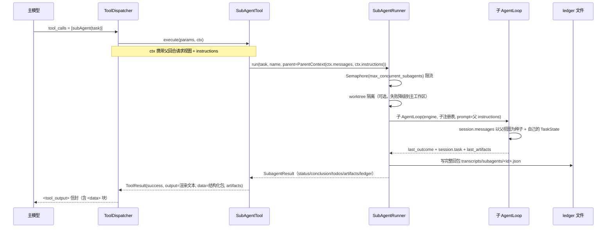

# AI-Coding — R1a-5 分析方案（子智能体：共享上下文 + 结构化回包 + 回写）

> 定位：R1 编排层重构第五步。R1a-1…R1a-4 已交付契约 / 引擎 / 分发器 / 自持循环，
> 本步让子智能体跑**同一套循环**、拿到**父回合的相同上下文**、只回**结构化信息包**，并把成果回写。
> 依据：`docs/r1-analysis.md` §3.5 D10（C2 约束）、§4.13（逐文件）、§6.7（用例）。
> 前提：纯增量改造，但会重写 `core/subagent.py`、`tools/subagent_tool.py`、
> `domain/subagent.py` 与两个对应测试文件（规格变了，见 §2）。

---

## 1. 现在要实现的内容

| # | 件 | 文件 | 性质 |
|---|---|---|---|
| 1 | 结构化回包 + 父上下文契约 | `domain/subagent.py` | 重写 |
| 2 | 子智能体运行器 | `core/subagent.py` | 重写 |
| 3 | `subAgent` 工具 | `tools/subagent_tool.py` | 重写 |
| 4 | 装配：子栈改返回注册表 | `tools/builder.py` | 改 |
| 5 | 循环暴露本回合产物 | `core/agent_loop.py` | 微改 |
| 6 | 端到端冒烟加一步子智能体 | `scripts/integration_smoke.py` | 改（顺带修复 R1a-4 遗留） |

---

## 2. 影响分析

### 2.1 现状的三个硬伤（核验过）

| 硬伤 | 证据 | 后果 |
|---|---|---|
| 子智能体从**空历史**起跑 | `core/subagent.py::_run_in` 调 `service.execute_turn([], prompt)` | 它对当前任务、项目指令、技能、记忆一无所知，只能靠 `task` 字符串自述 |
| 只回**一段裸文本** | `SubagentResult(text=turn.text)` | 父智能体拿不到「做到哪一步、有什么未完成、改动了哪些文件」 |
| 成果**没有回写** | 无 ledger、无 artifacts | 子智能体内部做了什么，会话里查不到 |

另外 `build_tool_stack()`（SDK 形态）在本步之后**再无生产调用者**——它是 R1a-6 要删的东西之一。

### 2.2 破坏面（穷举）

| 被破坏 | 原因 | 处置 |
|---|---|---|
| `tests/test_subagent_runner.py`（4 例） | 假对象实现的是 `execute_turn`（SDK 引擎） | 重写为驱动 `ChatEngine` |
| `tests/test_tool_subagent.py`（5 例） | `SubagentResult(text=...)` 的构造形态变了 | 重写 |
| `SubagentResult.text` 构造参数 | 变成结构化包 | 保留 `text` 作为**只读属性别名**，构造改用 `conclusion` |

### 2.3 本步明确不做（YAGNI）

| 不做 | 理由 |
|---|---|
| 子智能体的 todo 自动并入父清单 | D10 已定：并行子任务各有计划，自动合并会搅乱父清单。父模型需显式 `todo_write` 采纳 |
| 子智能体的思考过程回传 | C2 明确「思考不用管」 |
| 子智能体复用父的记忆/压缩组件 | 保持隔离：只共享「当次请求视图 + 系统提示」这一份上下文 |
| `subagent.context_mode` 开关（full / task_only） | 见 §8 核验④；本步只实现 full（符合需求），开关留位 |
| 后台/异步子智能体 | 并发已由「一条 assistant 消息里的多个调用 + 分发器并发 + 信号量」实现 |

---

## 3. 目标设计

### 3.1 数据流（架构图）



### 3.2 关键设计决策

**D1 — 「相同上下文」的精确含义：父回合的当次请求视图 + 组装好的系统提示。**
不是原始 `session.messages`（可能很长且未压缩），而是 `ToolContext.messages`
（= 父回合这一轮实际发给模型的视图）与 `ToolContext.instructions`。
这样「子智能体看到的东西」与「父智能体这一轮看到的东西」**逐字一致**，可复现、可解释。

**D2 — 子智能体跑同一套 `AgentLoop`，而不是另起一套简化流程。**
收益：子智能体自动获得迭代上限、todo 能力、工具分发、落盘与停止策略——
这正是 R1a-4 把循环做成可注入的价值兑现。
做法：`prompt=PromptAssembler(parent.instructions)`（`PromptAssembler.build()`
在没有 project/skills/memory 段时返回 base 本身），从而**无需给 `AgentLoop` 新增参数**。

**D3 — 子智能体不写会话文件。**
它不该在 `sessions/` 里留下用户没要求的文件。用只实现 `save()` 的空会话服务
（`AgentLoop` 只依赖 `sessions.save`），子会话在内存里跑完即弃。

**D4 — 超时用 `asyncio.wait_for`，超时返回 `status="timeout"` 而不是抛。**
超时是子智能体的一种**正常结局**，必须能回喂给父模型（让它决定重试或换路子），
所以它是一条数据，不是异常。

**D5 — ledger 用工具内生成的 id，不用模型的 call_id。**
`dispatch` 目前的 `ToolContext` 不带 `call_id`，为了拿它去改 R1a-1 的契约、并让分发器
按调用复制 ctx（会破坏 R1a-3 既有的「ctx 就是传入对象」用例）——代价大于收益。
ledger 文件名用 `uuid4().hex[:12]`，并在工具输出里给出路径，可追溯性不受影响。

**D6 — `success` 的判定：`error` / `timeout` 为失败，`completed` / `max_iterations` 为成功。**
`max_iterations` 的子智能体仍然产出了部分成果，把它的结论丢掉更糟。

**D7 — 结论超长截断，全文只进 ledger。**
`ai.max_subagent_conclusion_chars`（默认 4000）截断并附 ledger 路径，
避免一个话多的子智能体把父回合的上下文吃光。

---

## 4. 逐文件「新增功能 + 实现步骤」

### 4.1 `ai_coding/domain/subagent.py`（重写）

```python
@dataclass(frozen=True)
class ParentContext:
    messages: tuple[ChatMessage, ...] = ()
    instructions: str | None = None

@dataclass(frozen=True)
class SubagentResult:
    status: str = "completed"           # completed | max_iterations | timeout | error
    conclusion: str | None = None
    todos: tuple[dict[str, Any], ...] = ()
    artifacts: tuple[ToolArtifact, ...] = ()
    iterations: int = 0
    workdir: str | None = None
    ledger_path: str | None = None
    error: str | None = None

    @property
    def text(self) -> str | None: ...    # 向后兼容别名
    def to_dict(self) -> dict[str, Any]: ...
```

`SubagentTurn` 保留（`ai/llm_helpers` 与旧文档仍引用它）。

### 4.2 `ai_coding/core/subagent.py`（重写）

```python
class _NullSessions:                      # AgentLoop 只调用 save()
    def save(self, session) -> None: ...

class SubAgentRunner:
    def __init__(self, app_config, engine_factory, build_tools, *,
                 ledger_root: str | Path | None = None, max_concurrent: int = 3,
                 timeout_seconds: int = 600) -> None: ...
    async def run(self, task, name="sub-agent", *, worktree_manager=None,
                  isolate=True, parent: ParentContext | None = None) -> SubagentResult: ...
```

`run` 步骤：
1. `async with self._semaphore:`（`Semaphore(max_concurrent)`，实例级）。
2. `worktree_manager` 可用且 `isolate` → `temporary(name)`；失败降级到主工作区。
3. `registry = self._build_tools(workdir)`（子栈，`include_subagent=False`）。
4. `engine = self._engine_factory()`。
5. `session = SessionData(..., messages=list(parent.messages) if parent else [])`。
6. `loop = AgentLoop(engine, _NullSessions(), registry,
      prompt=PromptAssembler(parent.instructions) if parent and parent.instructions else None,
      settings=self._settings, workspace=workdir or main_ws)`。
7. `await asyncio.wait_for(loop.process_input(session, task), timeout)`；
   `TimeoutError` → `status="timeout"`；`finally: await loop.aclose()`。
8. 由 `loop.last_outcome` / `session.task` / `loop.last_artifacts` 组装 `SubagentResult`，
   截断 conclusion，写 ledger（失败静默，`ledger_path=None`）。

### 4.3 `ai_coding/tools/subagent_tool.py`（重写）

- `execute(params, ctx)`：从 `resolve_ctx(ctx)` 取 `messages` / `instructions` 造 `ParentContext`；
  调 `runner.run(...)`；把回包拆成
  `data`（去 conclusion，加 `conclusion_chars`）、`output`（渲染文本）、`artifacts`。
- 渲染文本包含：状态、迭代数、结论、未完成项、产物、ledger 路径。
- 异常 → `ToolResult(success=False, error="subagent_error")`。

### 4.4 `ai_coding/tools/builder.py`（改）

`build_subagent_runner` 改为注入 `engine_factory=build_engine_from_config(app_cfg)` 与
`build_tools=lambda workdir: build_tool_registry(..., include_subagent=False)`，
并传 `ledger_root=workspace`、`max_concurrent`、`timeout_seconds`、`settings`。

### 4.5 `ai_coding/core/agent_loop.py`（微改）

新增只读属性 `last_artifacts: list[ToolArtifact]`：`process_input` 开始时清空，
`_write_tool_messages` 时累加各 `DispatchOutcome.result.artifacts`。
理由：子智能体要把它写进回包；父循环将来也可用于「本次改动了哪些文件」。

---

## 5. TDD 用例

`tests/test_subagent_runner.py`（重写，12）：

| 用例 | 断言要点 |
|---|---|
| `test_subagent_receives_parent_messages` | 子循环第一次请求含父视图的消息 |
| `test_subagent_receives_parent_instructions` | 子循环的 instructions 等于父的 |
| `test_subagent_records_parent_todos_separately` | 父 todo 不进入子 todo，子 todo 独立 |
| `test_subagent_returns_structured_packet` | status/conclusion/iterations 正确 |
| `test_subagent_collects_artifacts` | 子工具产出的 artifact 出现在回包 |
| `test_subagent_ledger_written` | ledger 文件存在且含 status/conclusion |
| `test_subagent_ledger_failure_degrades` | ledger 写失败 → `ledger_path is None`，不抛 |
| `test_subagent_timeout_returns_timeout_status` | 超时 → `status == "timeout"` |
| `test_subagent_engine_error_returns_error_status` | 引擎异常 → `status == "error"` |
| `test_subagent_respects_worktree_isolation` | 隔离时工具栈绑定 worktree 路径 |
| `test_subagent_worktree_failure_degrades` | worktree 抛错 → 降级到主工作区 |
| `test_subagent_semaphore_bounds_concurrency` | 并发上限生效（峰值 == 上限） |
| `test_subagent_without_parent_uses_empty_history` | 无父上下文 → 空历史（兼容） |

`tests/test_tool_subagent.py`（重写，7）：

| 用例 | 断言要点 |
|---|---|
| `test_subagent_tool_passes_parent_context` | 工具把 `ctx.messages/instructions` 传给 runner |
| `test_subagent_tool_returns_structured_data` | `data` 含 status/todos/ledger，不含 conclusion 全文 |
| `test_subagent_tool_renders_conclusion` | 输出含结论与未完成项 |
| `test_subagent_tool_passes_artifacts` | `ToolResult.artifacts` 透传 |
| `test_subagent_missing_task_fails` | 空 task → 失败且不调用 runner |
| `test_subagent_timeout_is_failure` | `status="timeout"` → `success is False` |
| `test_subagent_runner_error_is_tool_failure` | runner 抛异常 → 失败结果 |

---

## 6. 成功之后是什么样

1. 子智能体与父智能体**看到同一份上下文**（请求视图 + 系统提示逐字一致）。
2. 子智能体跑**同一套循环**：有迭代上限、有自己的 todo、走同一个分发器（含权限门）。
3. 它只回一份**结构化信息包**，父模型拿到可判断的 `status` / `todos` / `artifacts` / `ledger`。
4. 回包落 `transcripts/subagents/<id>.json`，成果**可追溯**。
5. 并发受 `ai.max_concurrent_subagents` 约束——又一个死配置复活。

---

## 7. 自我核验

### 核验①（`process_input` 的种子历史）

子循环以 `SessionData(messages=parent.messages)` 起步，然后 `process_input` 追加 task 与任务块。
父视图与新 task 的顺序因此是「父历史 → 子任务 → 任务块」，语义正确。
**但要注意**：父视图里最后一条通常是易失任务块吗？不是——`ToolContext.messages` 取自
`_inject_task` **之前**的 `history`（R1a-4 的实现），所以父视图是干净的压缩历史，不含任务块。
这条有专门用例（`test_subagent_receives_parent_messages` 断言不含 `<task-state>`）。

### 核验②（子循环的停止策略继承父设置）

子循环复用父的 `AIConfig`，因此 `stop_policy="todo_aware"` 也作用于子智能体：
子 todo 未完成时它会被门禁提醒。这是想要的（子智能体也该把活干完），但会多花调用——
已在 §8 记录为成本项。

### 核验③（并发与 worktree 的相互作用）

信号量在 worktree 创建**之前**获取，因此并发上限同时约束了 worktree 数量，
不会出现「3 个并发上限但建了 5 个 worktree」。这是刻意的顺序。

### 核验④（诚实标注的取舍与未覆盖项）

- **共享完整上下文有成本**：父视图可能几万 token，子智能体每次调用都带上它；
  多个子智能体并发时是倍数放大。需求明确要这个行为，但成本要让你知道。
  `subagent.context_mode`（full / task_only）留作后续开关位，本步不实现。
- **子智能体不共享记忆/压缩**：只共享「请求视图 + 系统提示」。它自己的长对话不做压缩，
  因此一个超长的子任务仍可能顶到上下文上限——由子循环的 `max_tool_iterations` 与
  引擎报错兜底，不做特殊处理。
- **ledger 文件名用生成的 id**（D5），与模型的 call_id 不同名。
- **`build_tool_stack`（SDK 形态）在本步后无生产调用者**，留到 R1a-6 与
  `sdk_adapter.py` / `agents_sdk_service.py` 一起删。

---

## 8. 真实联网验证（已完成）

用 DashScope 兼容端点（`qwen3.8-max`）跑通了 `scripts/integration_smoke.py` 全流程（exit 0）：

| 步骤 | 结果 |
|---|---|
| 工具回合 | `roles=[user, assistant, tool, assistant]`，工具调用与结果正确落库 |
| 多轮回放 | 无 400，模型能复述上一轮读到的文件内容 |
| **子智能体** | `subAgent` 工具消息落库；**ledger 已写**（`transcripts/subagents/<id>.json`）；回包 `status=completed, iterations=4`；父智能体正确复述了回包 |
| L4 摘要 + 记忆抽取 | `summary=OK len=57`，`notes=[...]` |

两点额外收获：

1. **R1a-4 遗留的未验证风险被消解**：易失的 `<task-state>` 块没有让模型误以为
   那是用户发言——它在多轮里表现正常（这是强证据，不是形式化证明）。
2. **worktree 降级路径在真实环境被验证**：冒烟工作区不是 git 仓库，
   `can_isolate()` 返回 False，回包里的 `workdir` 为 `null`——正是设计中的「降级到主工作区」。
   模型还主动报告了「子智能体没有 subAgent 工具」，说明**递归保护是可观测的**。

顺带修掉一个 R1a-4 的遗留破损：`scripts/integration_smoke.py` 仍在 import
`_build_tool_stack`（R1a-4 已改名），脚本在此之前是直接 ImportError 的。

---

*Acknowledge：本方案基于 `docs/r1-analysis.md` §3.5 D10 与 §4.13 的既定设计、
R1a-1…R1a-4 的实际接口（`ToolContext.messages/instructions`、`AgentLoop` 构造签名、
`DispatchOutcome.result.artifacts`），以及 `core/subagent.py` / `tools/subagent_tool.py`
的现状缺陷（空历史、裸文本、无回写）。*
