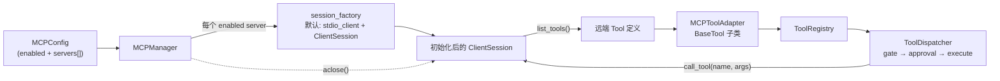

# AI-Coding — R1a-6 分析方案（收尾：MCP 直连 + 删除 SDK 路径）

> 定位：R1 编排层重构的**最后一步**，同时吸收原计划的 R1b。
> R1a-1…R1a-5 已把契约 / 引擎 / 分发器 / 循环 / 子智能体建好且跑通真实联网冒烟；
> 本步把 OpenAI Agents SDK 从项目里**彻底移除**，并用 `mcp` 包直连把 MCP 接回来。
> 依据：`docs/r1-analysis.md` §0（方案 A 的不可逆后果）、§2.4（MCP 归 R1b）、§10。

---

## 0. 本步范围

R1a-4 已把 CLI 接线切到新引擎，因此 R1a-6 只剩三件事：

| # | 件 | 说明 |
|---|---|---|
| 1 | **MCP 直连** | `core/mcp.py` 用 `mcp` 包（stdio）重写，远端工具变成 `BaseTool` 注册进同一注册表 |
| 2 | **删除 SDK 路径** | 6 个文件/符号整体删除（清单见 §2.1） |
| 3 | **依赖与文档同步** | `pyproject.toml` 移除 `openai-agents`；5 份文档改写 |

外加一个必须在本步修的**回归**（§0.1）。

### 0.1 顺带修复：R1a-4 引入的 WARN 级回归

R1a-4 把 `AgentLoop` 的构造签名换掉后，CLI 不再提供任何审批回调，
而分发器对 WARN 级是 **fail-closed**。后果：非交互的 `ai-coding ask`
**会拒绝 `write` / `edit` / `bash`**（旧代码经 `build_tool_stack` 自动批准）。

这不是理论风险，是一条断掉的能力。已在 `tests/test_cli.py` 加回归用例
（`test_build_loop_defaults_to_non_interactive_auto_approval`），并修在**组合根**：
`_build_loop` 的 `approval=None` 解释为「非交互 → 自动批准 WARN」，
`repl` 仍显式传 `CLIApprovalCallback`。DENY 级任何模式都照旧拦截。

---

## 1. 现在要实现的内容

| # | 件 | 文件 | 性质 |
|---|---|---|---|
| 1 | MCP 直连 + 工具适配 | `core/mcp.py` | 重写 |
| 2 | CLI 的 MCP 生命周期与注册 | `cli.py` | 改 |
| 3 | 组合根审批策略默认值 | `cli.py` | 改（§0.1） |
| 4 | 删除 SDK 路径 | 见 §2.1 | 删除 |
| 5 | 依赖替换 | `pyproject.toml` | 改 |
| 6 | MCP 用例 | `tests/test_mcp.py` | 重写 |
| 7 | 死符号用例清理 | 4 个测试文件 | 改/删 |
| 8 | 文档同步 | `README.md` + `docs/` 4 份 | 改 |

---

## 2. 影响分析

### 2.1 删除清单（穷举，核验过引用）

| 文件 / 符号 | 为什么可以删 |
|---|---|
| `ai/base.py`（`AIService`） | R1a-2 起端口就是 `ChatEngine`；仅剩 `ai/__init__.py` 与两个测试引用 |
| `ai/agents_sdk_service.py` | 自持循环不再用它；SDK 适配的唯一入口 |
| `tools/sdk_adapter.py` | `FunctionTool` 包装；新分发器不需要 |
| `builder.build_tool_stack()` | R1a-5 后无生产调用者（子智能体也用注册表了） |
| `mapping.py` 的 `chat_message_to_input(s)` / `history_to_inputs` | 旧 SDK 输入项映射；仅 `agents_sdk_service` 用 |
| `domain/run.py` 的 `TurnResult` | `StepResult` 已取代；M1 遗留 |
| `ai/__init__.py` 的旧导出 | 指向已删符号 |
| `ai/factory.build_service_from_config()` | 与 `agents_sdk_service` 一起走 |

**保留**：`domain/run.py` 的 `wrap_tool_output` / `tool_message` / `user_message`（信封不变量），
`ai/mapping.py` 的新版三个函数。

### 2.2 依赖替换

```
删除: openai-agents>=0.22      # 传递带来 numpy（曾让 mypy 直接跑不起来）
保留: openai>=1.0              # llm_helpers + 新引擎直接用，之前是传递依赖，应显式声明
新增: mcp>=1.19,<3             # MCP 直连（之前由 openai-agents 传递带入）
```

**顺带收益**：`numpy` 随之消失，`[tool.mypy] python_version` 可以回到项目声明的下限。

### 2.3 测试影响

| 测试文件 | 处置 |
|---|---|
| `test_mcp.py`（10 例） | **重写**：驱动 adapter/manager（假 session，不 spawn 子进程） |
| `test_ai_service.py` | **删除**（断言 `AgentsSDKChatService` 构造） |
| `test_sdk_adapter.py` | **删除** |
| `test_agents_sdk_stream_helpers.py` | **删除**（断言的 SDK 事件解析已不存在） |
| `test_ai_factory.py` | **改**：去掉 `build_service_from_config` 三例，保留/补充 `build_engine_from_config` |
| `test_ai_mapping_v2.py` | **改**：删掉「legacy 仍可用」那例 |
| `test_builder.py` | **改**：删掉 4 个 `build_tool_stack` 用例及其辅助函数 |
| `test_m6_contract_coverage.py` | **改**：删掉 3 个 SDK 适配用例 + 1 个 `AIService` 用例 |

---

## 3. 目标设计

### 3.1 MCP 直连（架构图）



### 3.2 关键设计决策

**D1 — 用 `AsyncExitStack` 持有连接，而不是让 manager 变成 async 上下文管理器。**
CLI 是同步函数，内部只有一次 `asyncio.run`；`open_all()` / `aclose()` 这对显式方法
更容易在 `try/finally` 里正确闭合，也让「没开过就关」是安全的。

**D2 — 传输层抽成可注入的 `session_factory`。**
默认实现走真实的 `stdio_client` + `ClientSession`；测试注入假 session。
这不只是为了好测：**本沙箱无法可靠 spawn 子进程**（`asyncio.create_subprocess_exec` 必挂），
真起 MCP server 的测试在这里根本跑不了。

**D3 — 工具名加 `{server}__{tool}` 前缀。**
两个 MCP server 可能有同名工具；前缀是唯一能保证不撞名的做法。
代价：模型看到的工具名变长——可接受。

**D4 — MCP 工具 `parallel_safe = False`。**
远端副作用未知，保守串行。这条与 R1a-3 的批处理规则一致。

**D5 — 权限：MCP 工具落到权限门的「未知工具」分支 → WARN。**
与既有语义一致：非交互入口自动批准（§0.1 的默认值），交互入口弹确认，
需要更细策略时再引入「按 server 声明 allowed」——本步不做（YAGNI）。

**D6 — 单个 MCP server 连接失败静默跳过，不影响其它 server 与主链路。**
远端进程可能不存在、可能不支持协议版本。增强组件不该掀翻回合。

**D7 — `structured_content` 进 `ToolResult.data`。**
MCP 的 `CallToolResult` 同时有 `content`（文本块）与 `structured_content`；
按 C1 的精神，文本进 `output`、结构化进 `data`。

---

## 4. 逐文件实现步骤

### 4.1 `ai_coding/core/mcp.py`（重写）

```python
class MCPToolAdapter(BaseTool):
    parallel_safe = False
    def __init__(self, *, server: str, tool: Any, session: Any) -> None
    @property name -> f"{server}__{tool.name}"
    @property description -> tool.description or ""
    @property params_json_schema -> dict(tool.input_schema or {"type": "object","properties": {}})
    async def execute(self, params, ctx=None) -> ToolResult

class MCPManager:
    def __init__(self, config=None, *, session_factory=None) -> None
    async def open_all(self) -> list[BaseTool]
    async def aclose(self) -> None
```

> ⚠️ **已被 M3 取代**：M3 起 `open_all()` 改为非阻塞（只起 supervisor 即返回），
> 签名是 `async def open_all(self) -> None`，**不返回工具列表**。本节是旧设计分析，
> 保留作为历史记录。工具表面请读 `MCPManager.available()`。

`execute` 步骤：`await session.call_tool(tool.name, params)` →
拼接 `content` 里各 `TextContent.text` 作为 `output`；
`success = not result.is_error`；`data = {"server","tool","is_error","structured"}`；
失败给 `error="mcp_error"`；`call_tool` 抛异常 → `error="mcp_error"` 且 `success=False`。

`open_all` 步骤：`enabled` 为假直接返回 `[]`；逐 server 过滤 `enabled/name/command`；
`enter_async_context(session_factory(server))` → `list_tools()` → 每个 tool 造一个 adapter；
任何异常 → 跳过该 server。

> ⚠️ **已被 M3 取代**：M3 起 `open_all()` 改为非阻塞（只起 supervisor 即返回），
> 签名是 `async def open_all(self) -> None`，**不返回工具列表**。本节是旧设计分析，
> 保留作为历史记录。工具表面请读 `MCPManager.available()`。

### 4.2 `ai_coding/cli.py`（改）

`ask` / `repl` 的协程包一层 MCP 生命周期：

```python
async def _run_ask(...):
    manager = MCPManager(app_cfg.mcp)
    try:
        for tool in await manager.open_all():
            registry.register(tool)
        loop = _build_loop(...)
        try:
            return await loop.process_input(...)
        finally:
            await loop.aclose()
    finally:
        await manager.aclose()
```

> ⚠️ **已被 M3 取代**：M3 起 `open_all()` 改为非阻塞（只起 supervisor 即返回），
> 签名是 `async def open_all(self) -> None`，**不返回工具列表**。本节是旧设计分析，
> 保留作为历史记录。工具表面请读 `MCPManager.available()`。

`_warn_if_mcp_enabled` 删除（不再需要——MCP 现在真的可用）。

### 4.3 文档同步

`README.md`（技术栈与里程碑不再说 SDK）、`docs/architecture.md`（分层、SDK 边界改成
「引擎端口」、组合根装配图）、`docs/features.md`（MCP、子智能体、工具活动可见、
停止策略、todo 门禁）、`docs/data-contracts.md`（`SessionData.task`、`ToolResult.data`、
`SubagentResult`、`StepResult`/`TurnOutcome`、AIConfig 新增项）、`docs/README.md`（导航加 R1 系列）。

---

## 5. TDD 用例

`tests/test_mcp.py`（重写，12）：

| 用例 | 断言要点 |
|---|---|
| `test_disabled_config_yields_no_tools` | `enabled=false` → `[]`，不连接 |
| `test_disabled_server_skipped` | 单个 server `enabled=false` → 不连接 |
| `test_server_without_name_or_command_skipped` | 缺 name/command → 不连接 |
| `test_tools_become_base_tools` | `list_tools` 的每个工具变成 `BaseTool` |
| `test_tool_name_prefixed_with_server` | 名称是 `server__tool` |
| `test_schema_passed_through` | `input_schema` 原样成为 `params_json_schema` |
| `test_adapter_is_not_parallel_safe` | `parallel_safe is False` |
| `test_execute_joins_text_content` | 多个文本块拼接进 `output` |
| `test_execute_reports_structured_content` | `data["structured"]` 透传 |
| `test_execute_marks_is_error` | `is_error=True` → `success=False, error="mcp_error"` |
| `test_execute_call_failure_is_tool_result` | `call_tool` 抛异常 → 失败结果而非异常 |
| `test_connect_failure_degrades_silently` | 连接抛异常 → 跳过该 server，不抛 |
| `test_aclose_closes_sessions` | 关闭被调用；未开启时也安全 |

---

## 6. 成功之后是什么样

1. `rg "import agents" ai_coding/` **为空**——「SDK 只是可替换引擎」从承诺变成事实（0 个引用）。
2. `openai-agents` 离开依赖，`numpy` 随之消失，mypy 可以回到 3.10 下限。
3. MCP 恢复可用：`mcp.enabled=true` 时远端工具出现在同一注册表，走同一权限门。
4. `ask` 的 WARN 级能力（write/edit/bash）恢复并有用例守护。
5. 文档与代码一致（架构、功能、契约、导航）。

---

## 7. 自我核验

### 核验①（删除顺序：先删引用者，再删被引用者）

`ai/__init__.py` 导出 `AIService` 与 `build_service_from_config`，
`ai/factory.py` 导入 `agents_sdk_service`，`builder.py` 导入 `sdk_adapter`。
删除顺序必须是「先改引用者 → 再删被引用者」，否则中途导入即崩。
实现时按「pyproject 之外的文件全部改完 → 最后删文件」的顺序做，每步跑一次 import 检查。

### 核验②（`mcp` API 已实读，非凭记忆）

已核验（`mcp 2.2.0`）：
`stdio_client(StdioServerParameters(command,args,env,cwd,encoding,encoding_error_handler))`
是异步生成器产出 `(read, write)`；`ClientSession(read, write)` 是异步上下文管理器；
`list_tools()` 返回带 `.tools` 的结果；`call_tool(name, arguments)` 返回
`CallToolResult{content, structured_content, is_error}`；`Tool` 的参数字段名是
**`input_schema`**（不是 `inputSchema`）。

### 核验③（无 MCP server 时不引入任何风险）

`mcp.enabled` 默认 `false` → `open_all()` 立即返回 `[]`，不连接、不 spawn。
默认路径与删除 SDK 之前的行为一致；`aclose()` 对未开启的 manager 也安全。

> ⚠️ **已被 M3 取代**：M3 起 `open_all()` 改为非阻塞（只起 supervisor 即返回），
> 签名是 `async def open_all(self) -> None`，**不返回工具列表**。本节是旧设计分析，
> 保留作为历史记录。工具表面请读 `MCPManager.available()`。

### 核验④（诚实标注）

- **MCP 的真实链路未做端到端验证**：本沙箱不能可靠 spawn 子进程，
  真起一个 MCP server 跑不通。因此 MCP 只有单元级验证（假 session 驱动），
  真实 stdio 往返需要你在正常环境用真实 server 验证一次。
- **单个 server 失败只静默跳过**，没有暴露「哪个 server 挂了」——
  与既有「增强组件静默降级」一致，但可观测性不足，后续可加事件。
- **`structured_content` 未做体积上限**（不像 `ToolResult.data` 有 `max_result_data_bytes`）。
  若某个 server 返回巨大结构化结果，信封会变大。属已知缺口。

---

*Acknowledge：本方案基于 R1a-1…R1a-5 的实际代码与引用清点（`rg` 核验），
`mcp 2.2.0` 的真实 API 签名，以及 `openai-agents 0.22.3` 的移除影响分析
（含 `numpy` 传递依赖消失对 mypy 的收益）。*
