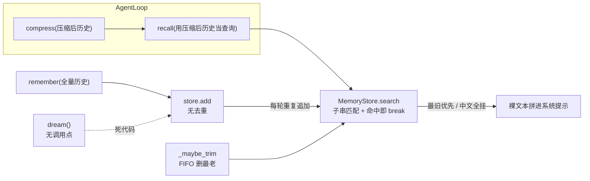
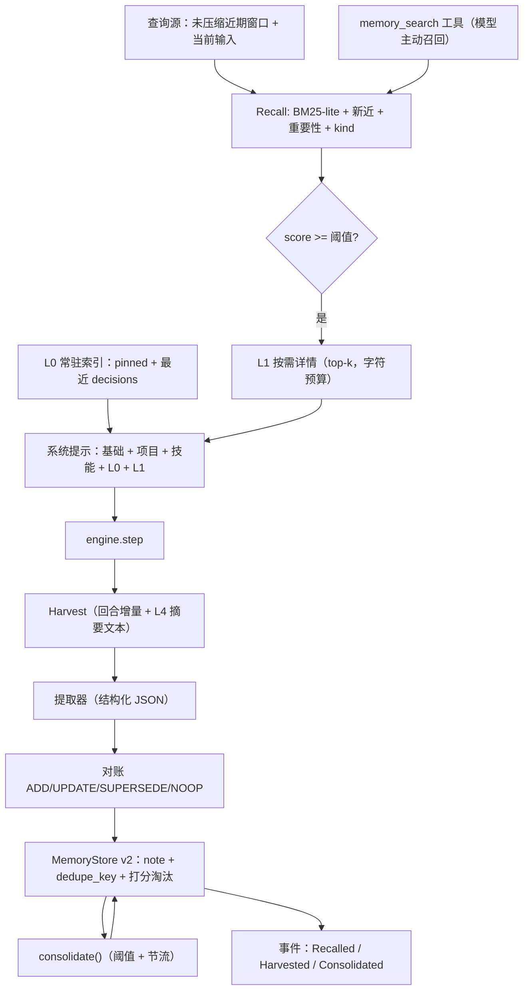
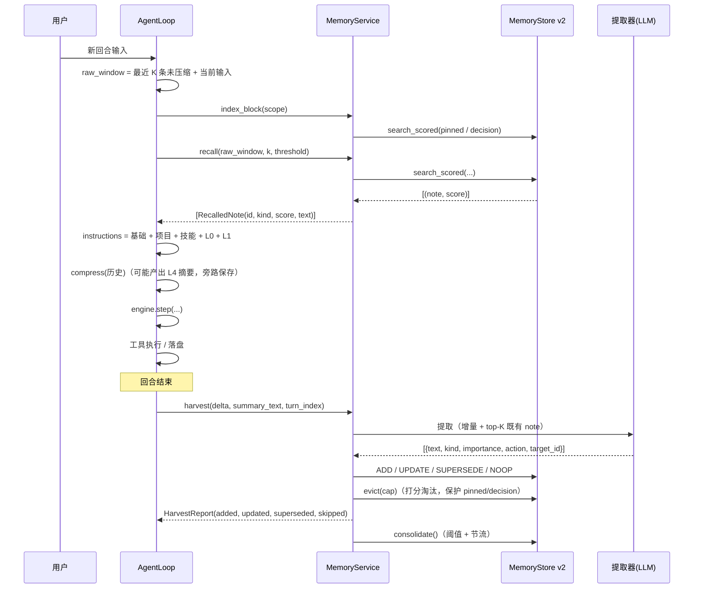

# R3 分析：记忆层与上下文编排（案例驱动）

> 本文回答三件事：
> 1. **现在到底坏在哪**——10 条可复现的具体案例，附真实输出（第 1 节）。
> 2. **该加什么**——按案例痛点反推出来的「基础但重要」的能力，而不是凭感觉堆功能（第 2–5 节）。
> 3. **怎么落地**——逐文件、TDD、可验收的计划，含架构图与数据流（第 6–11 节）。
>
> 前置文档：`docs/r1-analysis.md`（编排层）、`docs/r2-analysis.md`（可靠性收口）、
> `docs/m3-analysis.md`（记忆层原设计，本文是它的修订）。

---

## 0. 结论摘要

现有记忆层（M3 时代）只有三个动作：`remember` / `recall` / `dream`。用 10 条案例实测后，
**它当前对真实使用几乎没有正贡献，部分场景反而有害**：中文完全召不回、重复写入把索引灌成垃圾、
早期决策在压缩后彻底丢失、最重要的记忆被 FIFO 先淘汰、`enabled=false` 也照样注入。

| 结论 | 证据 |
|---|---|
| 中文召回**等于没有** | 案例 1：`recall` 返回 `[]` |
| 召回**不是按相关性排序**，而是「插入顺序最旧优先」 | 案例 2、9 |
| 写入**没有去重/对账**，同一事实存 5 份、注入 5 份 | 案例 3 |
| 矛盾记忆**同时存在**，没有取代关系 | 案例 4 |
| 淘汰是 **FIFO**，最重要（最老）的先死 | 案例 5 |
| `memory.enabled=false` **只挡住写入**，召回照样注入 | 案例 6 |
| 每轮**重抽全量历史**（O(n²) 成本），结论重复入库 | 案例 7 |
| **早期决策在压缩后丢失，召回也救不回来**（13 轮 → 100 条垃圾记忆 + 决策消失） | 案例 8 |
| 常见词即可**无关注入**（无阈值、无打分） | 案例 10 |
| `dream` 是**死代码**：没有任何调用点，实现只是「再抽一遍并追加」 | 代码核对（1.11） |

改造主线（细节见第 2 节）：

1. **写入改为对账式收割**：只吃「本回合增量」，输出 `ADD/UPDATE/SUPERSEDE/NOOP`，空结果不写；
2. **召回改为打分 + 阈值 + top-k**：相关性（BM25-lite，含 CJK bigram）+ 新近性 + 重要性 + 类型加权；
3. **注入改为两层**：极小常驻索引（决策/钉住项，压缩后也不丢）+ 按需召回的详情；
4. **`dream` 改成真 `consolidate`**：合并/提升/淘汰，替换 FIFO，保护 `pinned` 与决策；
5. **补 `memory_search` 工具**：让模型能主动「按需召回」，走既有权限门与 R2 预算通道；
6. **可观测**：召回/收割/整理三个事件（带 id、分数、字符数），让行为可验证、可追踪。

---

## 1. 现状实测：10 条案例（全部可复现）

全部用**当前代码**在本机离线跑（不需要网络），脚本形态见 8.7。

### 案例 1：中文按需召回 = 空

场景：用户早先说过「这个项目用 uv 管理依赖，不要用 pip」，之后问「帮我给这个项目加一个依赖」。

```text
切词: ['帮我给这个项目加一个依赖']        ← 整句一个 token（\w 含 CJK，切不开）
recall -> []
```

**为什么**：`_keywords_from` 用 `[^\w\u4e00-\u9fff]+` 切词，而 Python 的 `\w` 对 str 已包含 CJK，
中文句子退化成「整句一个关键词」；`MemoryStore.search` 又是子串匹配，等于要求整句出现。
**结论**：对中文用户（本项目的默认用户）记忆层是失效的。

### 案例 2：召回顺序 = 插入顺序，最旧优先

```text
存入 5 条（其中 3 条含 dependency），查询 "how do I add a dependency"，k=3
recall -> ['alpha uses dependency X', 'gamma uses dependency Y', 'epsilon uses dependency Z']
```

**为什么**：`search()` 遍历到 `len(hits) >= limit` 就 `break`，完全没有打分。

### 案例 3：同一事实写 5 次 → 索引 5 份、注入 5 份

```text
store.count = 5
注入条目 = ['记住：项目用 uv 管理依赖', '记住：项目用 uv 管理依赖',
            '记住：项目用 uv 管理依赖', '记住：项目用 uv 管理依赖',
            '记住：项目用 uv 管理依赖']
```

**为什么**：`MemoryStore.add` 不做去重；`remember` 每回合把**全量历史**交给提取器，
同一结论每轮都被再抽一次。

### 案例 4：矛盾记忆共存，没有取代关系

```text
先写「项目用 uv 管理依赖」，后写「项目改用 poetry 管理依赖」
→ 两条同时留在 store 里（没有 supersedes 概念）
```

一旦能召回，模型会同时拿到两条互相冲突的指令——**给错指令比没记忆更糟**。

### 案例 5：FIFO 淘汰，先杀最重要的

场景：`max_index_entries=4`，先写一条安全红线（最重要），再写 5 条琐碎事实。

```text
剩余条目 = ['琐碎事实 1: 今天第 1 次构建通过', '琐碎事实 2…', '琐碎事实 3…', 'x']
          ← 「安全红线：任何情况下不得把密钥写进代码」被删掉了
```

**为什么**：`_maybe_trim` 从头部（最老）开始删；没有重要性、命中次数、保护位。

### 案例 6：`enabled=false` 仍然注入

```text
config.enabled = False
recall -> ['项目用 uv 管理依赖']      ← 用户明确关掉记忆，却还在注入
```

**为什么**：`remember` 检查 `enabled`，`recall` 没检查。

### 案例 7：每轮重抽全量历史（O(n²)）

用一个计数提取器观察它每轮收到的消息条数：

```text
每轮 extractor 收到: [2, 4, 6, 8, 10]     ← 第 n 轮收到 2n 条
```

长期会话里成本与重复都线性增长；真实 LLM 提取还要为此付费。

### 案例 8（核心）：早期决策在压缩后丢失，召回也救不回来

场景：13 轮对话（第 2 轮下达一条硬性决策），`max_messages=8` 触发 L1 裁剪，接真实 `AgentLoop`：

```text
记忆条目数=100（13 轮闲聊）
最终请求：消息数=6，系统提示=94 字符
决策在历史里? False    决策在系统提示(记忆注入)里? False
→ 模型还能看到这个决策吗? 不能（决策丢了）
系统提示内容片段: <memory>Relevant prior notes:
先说一句预热的话 | 好的 | 先说一句预热的话 | 好的 | 好的</memory>
```

一次暴露三件事：

1. **决策被 L1 裁掉**，而召回的查询取的是**压缩后**历史的最后 8 行，根本看不到它；
2. **100 条记忆全是废话**（每轮重复抽「先说一句预热的话 / 好的」），真正该留的决策没被留下；
3. **注入无结构**：`<memory>` 里是裸文本，没有 id/分数/类型，出问题无法追溯。

这条案例决定了 R3 的架构重点：**记忆与压缩必须协同**，不能两个模块各自为政。

### 案例 9：k=1 时，弱相关但更旧的记忆挤掉强相关但更新的

```text
存入: ①build 相关：构建脚本用 make
      ②测试相关：pytest 跑全量用例
      ③构建流程：make build 会先跑 lint 再编译，产物在 dist/，失败看 build.log
查询: make build 失败了，日志在哪      k=1
注入 -> ['build 相关：构建脚本用 make']
```

真正有用的是第 ③ 条（它回答了「日志在哪」）。**命中即 break** 让最没用的胜出。

### 案例 10：常见词造成无关注入（无阈值）

```text
存入: ①payment service timeout is configured in config/pay.yaml
      ②the auth service signs tokens with RS256
查询: please look at the file in the user module
注入 -> [①, ②]      ← 只因共享 "the"/"file"
```

**为什么**：英文切词保留 `the` 这类停用词；任何命中都注入，没有分数阈值。

### 1.11 代码核对：`dream` 是死代码

```bash
grep -rn "\.dream(" ai_coding/     # 只有定义，没有任何调用点
```

它名为「做梦/整理」，实现却是「把传入 context 再抽一遍并 append」——既没人调用，
也不会合并重复、不会提升、不会淘汰。**R3 把它改成真正的 `consolidate()`。**

### 1.12 原型验证：拟议设计对同一批案例是否真的有用（实测）

设计不能只靠推理，所以先写了一个**最小原型**（分词 + BM25-lite + 综合打分 + 去重/取代/淘汰），
用同一批案例跑一遍。**v1 原型暴露了我自己方案的两个漏洞**：

| 漏洞 | 现象 | 修正 |
|---|---|---|
| **G1 阈值不够** | 案例 10 的两条**无关**记忆 `rel = 0`，但 `recency(1.0)×0.2 + importance(0.5)×0.15 = 0.275` ≥ 0.25，照样被注入 | 加**相关性硬门槛**：`rel < 0.05` 直接淘汰（分数高只说明「新且重要」，不代表「相关」） |
| **G2 精确去重不够** | 案例 3/4：`记住：项目用 uv 管理依赖` 与 `项目用 uv 管理依赖` 归一化后仍不相等，取代之后旧条目还活着 | 归一化先**剥离常见导语**（`记住/注意/note/todo/- *`），并改用**相似度合并**（Jaccard ≥ 0.80）而不是精确键 |

修正后（v2 原型）同一批案例的结果：

```text
案例1 中文      -> [(0.333, rel=0.106, '这个项目用 uv 管理依赖，不要用 pip')]      ✅ 命中
案例2 顺序      -> ['epsilon uses dependency Z', 'gamma …Y', 'alpha …X']          ✅ 最新优先
案例9 k=1       -> ['构建流程：make build 会先跑 lint 再编译…']                    ✅ 选中最相关的那条
案例10 无关     -> []                                                             ✅ 无关注入被挡住
案例3 同义合并  -> 输入 6 条 → 1 条（hits=5）                                      ✅ 不再重复
案例4 取代      -> 召回 ['项目改用 poetry 管理依赖']                                ✅ 旧条不再出现
案例5 cap=3     -> ['安全红线：不得把密钥写进代码', '琐碎事实 0…', '琐碎事实 1…']      ✅ 红线保留
```

**这个原型同时是 R3a 的验收基准**：这些数字（分数、顺序、条数）会变成 `tests/` 与
`scripts/memory_cases.py` 里的硬断言，而不是只写在文档里。

> 还要补一句：`rel` 的取值在案例 1 里只有 0.106（中文 bigram 与英文混排的天然稀疏），
> 所以阈值/权重必须按真实数据校准一次（R3a 用真实提取器输出做一轮校准），
> 测试锁的是**相对顺序**，不是绝对分数。

---

## 2. 现在要实现的内容（按案例反推）

### R3a 记忆引擎内核（离线可测；解决案例 1/2/3/4/5/6/7/10）

| # | 能力 | 直接解决 |
|---|---|---|
| A1 | **分词修正**：CJK 走字符 bigram（短片段整体保留）；英文走词 + 停用词；`a/b.py`、`fn()`、`RS256` 这类标识符原样保留；归一化剥离导语（原型 G2） | 案例 1、10 |
| A2 | **相关性打分**：BM25-lite（TF/IDF + 长度归一），返回分数而非布尔 | 案例 2、9、10 |
| A3 | **综合打分 + 双层门槛 + top-k**：`score = w_rel·rel + w_rec·recency + w_imp·importance + kind_boost`，且**必须 `rel ≥ rel_min`**（原型 G1） | 案例 2、9、10 |
| A4 | **对账式写入**：`ADD / UPDATE / SUPERSEDE / NOOP`；同义**相似度合并**（导语剥离后 Jaccard ≥ 0.80） | 案例 3、4 |
| A5 | **增量收割**：只吃「上次收割之后的新消息」，最多 N 条（默认 12） | 案例 3、7 |
| A6 | **结构化契约 `MemoryNote`**：`kind / scope / importance / 来源 / supersedes / hits / pinned` | 案例 4、5、8 |
| A7 | **打分淘汰**取代 FIFO，`pinned` 与 `decision` 受保护 | 案例 5 |
| A8 | **`enabled` 语义统一**：关闭即全链路不读不写 | 案例 6 |
| A9 | **存储 schema v2 + 旧文件只读迁移** | 兼容已有 `.memory` |

### R3b 上下文编排（解决案例 8、9 的注入侧）

| # | 能力 | 说明 |
|---|---|---|
| B1 | **两层注入** | L0 常驻索引（`pinned` + 最近 `decision`，硬字符预算默认 600）＋ L1 按需详情（top-k，预算默认 1200） |
| B2 | **查询源修正** | 查询用**未压缩**的近期窗口（最近 K=6 条 user/assistant）+ 当前用户输入，而不是压缩后的历史 |
| B3 | **摘要产物进收割** | L4 生成的摘要文本也作为收割输入（它是「被丢掉的历史」的浓缩，决策常在里面） |
| B4 | **`memory_search` 工具** | 模型可主动按需召回（结构化 ToolResult：id/kind/score/text），走既有权限门与 R2 预算 |
| B5 | **注入格式化** | 每条带 `[kind#id score]`，可追溯；事件上报注入条数与字符数 |

### R3c 收割与整理（把 `dream` 变成真东西）

| # | 能力 | 说明 |
|---|---|---|
| C1 | **`consolidate()`** | 合并近似重复（同 kind，相似度 ≥ 0.85）、按命中提升 `importance`、淘汰过期/低价值、生成索引摘要 |
| C2 | **触发时机** | 回合结束后 best-effort，`count > consolidate_threshold` 且距上次整理 ≥ N 轮；受 R2a 预算约束，绝不在热路径 |
| C3 | **CLI / 斜杠命令** | `ai-coding memory list`、`search`、`forget`、`pin`；REPL `/memory` |
| C4 | **可观测事件** | `MemoryRecalled` / `MemoryHarvested` / `MemoryConsolidated` |

---

## 3. 影响分析

### 3.1 对代码的影响

| 文件 | 影响 | 说明 |
|---|---|---|
| `memory/note.py` | **新增** | `MemoryNote` 契约 + 序列化 + 归一化键 |
| `memory/tokenize.py` | **新增** | CJK bigram / 英文词 / 标识符保留 + 停用词 |
| `memory/relevance.py` | **新增** | BM25-lite + 综合打分 + 阈值（可替换的 `RecallScorer`） |
| `memory/schema.py` | **新增** | 提取器结构化输出契约 + 容错解析 |
| `memory/store.py` | 重写读写 | schema v2、`dedupe_key` 幂等、`search_scored()`、v1 迁移、`update/supersede/pin/evict` |
| `memory/service.py` | 重写三个动作 | `recall`（打分+阈值+k）、`harvest`（增量+对账，替代 `remember`）、`consolidate`（替代 `dream`） |
| `core/agent_loop.py` | 小改 | 注入点改两层；收割传增量；摘要入收割；发记忆事件 |
| `core/context_compression.py` | 小改 | 把本次 L4 摘要文本旁路暴露给调用方；不改压缩语义 |
| `tools/memory_search_tool.py` | **新增** | `memory_search` 工具（只读、ALLOW、`parallel_safe=True`） |
| `tools/builder.py` | 接线 | 有记忆实例时才注册该工具 |
| `ai/llm_helpers.py` | 改提取器 | 输出结构化 JSON（kind/importance/action/target_id），解析失败回退空 |
| `config/models.py` | 加字段 | 见 3.3 |
| `cli.py` / `ui/slash.py` | 加命令 | `memory` 子命令与 `/memory` |
| `scripts/memory_cases.py` | **新增** | 10 条案例的真跑脚本（离线，PASS/FAIL） |
| `tests/test_memory_*.py` | 新增/改造 | 见第 8 节 |

### 3.2 对数据流的影响

**写入侧（回合结束后）**：

```text
process_input 结束
  └─ harvest(本回合增量消息 + L4 摘要文本)
        ├─ 提取器（LLM 或离线回退）→ 候选（text/kind/importance/action/target_id）
        ├─ 对账：ADD | UPDATE | SUPERSEDE | NOOP（同 dedupe_key 或高相似）
        ├─ 空结果 → 不写（延续 R1 的 Q1 决定）
        └─ 触发 consolidate（阈值 + 节流）
```

**读取侧（每次模型请求前）**：

```text
raw_window = 最近 K 条未压缩消息 + 当前用户输入        ← 修正案例 8 的查询源
index      = pinned + 最近 decisions（≤ index_max_chars）
details    = scored_search(raw_window, k) 且 score ≥ 阈值
request    = 压缩管线后的历史 + instructions(基础+项目+技能 + index + details) + task-state
```

**契约变化与兼容性**：

| 位置 | 变化 | 兼容性 |
|---|---|---|
| `.memory` 文件 | v1 `{entries:[{id,text,created_time}]}` → v2 `{version:2, notes:[...]}` | **读时迁移**：v1 补默认值（kind=fact、importance=3、scope=workspace），首次保存写 v2 |
| 会话 JSON | 不变 | 记忆不进会话文件（单一真相源） |
| 事件 | 新增三个记忆事件（冻结 dataclass） | 追加式，`LoopObserver` 协议不变 |
| 工具表 | 新增 `memory_search` | 未接记忆时不注册（旧行为不变） |

### 3.3 配置项（`MemoryConfig`）

| 参数 | 默认 | 作用 |
|---|---|---|
| `enabled` | `true` | **语义变更**：false 时既不写也不注入（案例 6） |
| `auto_extract` | `true` | 是否每回合自动收割；false 时只保留工具按需召回 |
| `consolidate_threshold` | `10` | 超过才整理 |
| `consolidate_every_turns` | `5` | 整理节流（避免每回合都整理） |
| `max_index_entries` | `200` | 硬上限（此时才允许淘汰受保护项） |
| `max_per_turn_injections` | `5` → 建议 `3` | 详情条数 k |
| `recall_threshold` | `0.25` | 综合分低于此值不注入 |
| `recall_min_relevance` | `0.05` | **相关性硬门槛**：`rel` 低于此值直接淘汰（原型 G1，案例 10 靠它挡住） |
| `recency_half_life_days` | `14` | 新近性衰减半衰期 |
| `index_max_chars` | `600` | L0 常驻索引预算 |
| `detail_max_chars` | `1200` | L1 详情预算 |
| `harvest_max_messages` | `12` | 每回合最多吃多少条增量 |
| `dedupe_similarity` | `0.80` | 归一化相似度阈值（去重/合并）；原型实测 0.85 会漏掉「记住：」这类导语差异 |
| `pinned_kinds` | `\["decision"\]` | 常驻索引包含哪些类型 |

---

## 4. 执行范围

**做**：第 2 节的 R3a/R3b/R3c 全部内容 + 案例脚本 + 文档同步
（`features.md` / `data-contracts.md` / `architecture.md` / `README.md` / `docs/README.md`）。

**不做（明确划界，等你拍板再动）**：

- **向量检索 / embedding**：不引入。理由：本项目现在只有 chat completions，没有嵌入端点；
  引入意味新增依赖 + 网络成本 + 离线不可测，而 10 条案例里没有一条是词法解决不了的。
  留 `RecallScorer` 接缝，将来可插。
- **把记忆写进会话文件 / 与 task-state 合并**：不做，保持单一真相源与独立预算。
- **自动写入「所有对话」**：不做（只写提取出的、可复用的 note；空结果不写）。
- **跨机器/多用户记忆同步**：不做（本轮是本地工作区记忆）。
- **Tracing / guardrail / hook 框架**：仍归你；R3 只补记忆事件。

---

## 5. 目前设计 vs 目标设计

### 5.1 现状



### 5.2 目标



### 5.3 关键设计要点（为什么是这样）

1. **两条注入通道**（L0 常驻 + L1 按需）而不是一条：案例 8 证明「纯按需召回」在压缩之后没有机会——
   查询根本看不到被裁掉的内容。常驻索引是**决策的保险**，按需详情是**细节的节约**。
2. **收割只吃增量**：案例 7 的 O(n²) 与案例 3 的重复都来自「每轮重喂全量」。
3. **对账而不是 append**：记忆库是**当前状态的投影**，不是日志。重复要被吸收（案例 3），
   矛盾要被取代（案例 4）。
4. **打分 + 阈值 + top-k**：没有阈值就会无关注入（案例 10），没有打分就会「最旧优先」（案例 2、9）。
5. **淘汰按价值而不是年龄**：案例 5 里被删的恰恰是最该留的。
6. **可追溯**：注入带 `kind#id score` + 事件，否则任何调优都是猜。
7. **一切 best-effort，且受 R2a 预算约束**：记忆永不抛错、永不阻塞回合（沿用 M3 不变量）。

---

## 6. 逐文件实现步骤

> 顺序即提交顺序（R3a/R3b/R3c 各一个文档+代码提交，沿用本项目节奏）。
> 每一步都先写测试看到红，再实现；已有测试除非规格变更否则不改。

### R3a 记忆引擎内核

**1. `memory/tokenize.py`（新）**

```python
STOPWORDS = frozenset({...})      # 英文停用词（the/a/of/to/is/at/...）
def tokenize(text: str) -> list[str]:
    """CJK → 字符 bigram（短片段整体保留）+ 英文/数字词（去停用词）+ 标识符原样保留。"""
def normalize(text: str) -> str:  # 去空白/标点/大小写，用于 dedupe_key 与相似度
def similarity(a: str, b: str) -> float   # token Jaccard（归一化后）
```

**2. `memory/note.py`（新）**

```python
class NoteKind(str, Enum): FACT / DECISION / PREFERENCE / OPEN_THREAD
@dataclass(frozen=True)
class MemoryNote:
    id: str; text: str; kind: NoteKind; scope: str
    importance: int = 3
    keywords: tuple[str, ...] = ()
    created_time: str = ""; updated_time: str = ""
    source_session: str = ""; source_turn: int = 0
    supersedes: str | None = None; superseded_by: str | None = None
    hits: int = 0; last_used: str = ""; pinned: bool = False
    @property
    def dedupe_key(self) -> str        # sha1(normalize(text))[:16]
    def to_dict() / from_dict()        # v2 序列化，对 v1 字段宽容
```

**3. `memory/relevance.py`（新）**

```python
def bm25_lite(query_tokens, doc_tokens, stats) -> float      # 归一到 [0,1]
def recency(created_time, *, half_life_days, now) -> float   # 0.5 ** (age/hl)
def score_note(note, query_tokens, stats, *, config, now) -> float
class RecallScorer(Protocol)    # 将来换 embedding 的接缝
```

**4. `memory/store.py`（重写）**

- schema v2：`{"version": 2, "notes": [MemoryNote...]}`；读到 v1（只有 `entries`）时**只读迁移**；
- 新 API：`add_note`、`get`、`update`、`supersede`、`pin`、`find_by_dedupe`、
  `search_scored(query_tokens, *, k, threshold)`、`evict(cap)`（按 `evict_score`，保护 `pinned`/`decision`）；
- 保留原子写（tmp + `os.replace`）与「IO 失败不抛」不变量；旧 `search()` 保留为兼容包装并标注 deprecated。

**5. `memory/schema.py`（新）**

```python
@dataclass(frozen=True)
class HarvestCandidate:
    text: str; kind: NoteKind; importance: int
    action: Literal["add","update","supersede","noop"] = "add"
    target_id: str | None = None
def parse_candidates(raw: str) -> list[HarvestCandidate]   # JSON 容错（代码块/多余文本/坏字段）
```

**6. `memory/service.py`（重写）**

```python
async def recall(history, *, k=None, now=None) -> list[RecalledNote]     # 打分+阈值+k
async def harvest(new_messages, *, turn_index, session_id, summary=None) -> HarvestReport
async def consolidate(*, now=None) -> ConsolidateReport
```

- `harvest`：`enabled` 检查 → 取增量（≤ `harvest_max_messages`）→ 提取器（新契约；无提取器时走
  「精确去重 + 高相似合并」离线回退）→ 对账 → `evict` → 事件；
- `consolidate`：合并同 kind 近似项、按 hits 提升 importance、过期淘汰、清理 superseded、生成索引摘要；
- `dream` 保留为**弃用别名**（转调 `consolidate`，一个发布周期后删除）。

**7. `ai/llm_helpers.py`**

- 提取器改为结构化输出：把 top-K 既有 note（id + 文本）一起给模型，要求输出
  `[{"text","kind","importance","action","target_id"}]`；
- 新增 `build_harvest_extractor(model_config)`；解析失败 → `[]`（best-effort 不变量不变）。

### R3b 上下文编排

**8. `core/agent_loop.py`**

- `_build_instructions(history, deadline, *, raw_window)`：
  `index` = `memory.index_block(...)`（L0，字符预算）；`details` = `memory.recall(raw_window, ...)`（L1）；
  拼接顺序固定：基础指令 → 项目说明 → 技能目录 → L0 → L1（顺序固定便于断言与缓存）；
- `_harvest(session, summary_text, deadline, turn_index)`：传**增量**而不是全量；
- `self._harvested_upto`（每个 session 的收割游标，随会话保存）避免重复吃同一批消息；
- 发 `MemoryRecalled` / `MemoryHarvested` 事件；
- 主流程顺序不变：`compress` → `instructions`（含记忆）→ `inject_task` → `step`。

**9. `core/context_compression.py`**

- `compress()` 增加可选旁路回调 `on_summary: Callable[[str], None] | None`，
  把本次 L4 摘要文本交给调用方供收割使用；**不改变任何裁剪语义与返回类型**。

**10. `tools/memory_search_tool.py`（新）+ `tools/builder.py`**

```python
class MemorySearchTool(BaseTool):
    parallel_safe = True            # 只读
    name = "memory_search"
    # params: {"query": str, "k": int = 3, "kind": str | None}
    # ToolResult.data = {"notes": [{"id","kind","score","text","updated_time"}]}
```

- 未接入记忆时**不注册**该工具（避免空工具污染提示）；
- 走既有权限门（只读 → ALLOW）与 R2 的单调用预算。

### R3c 收割与整理

**11.** `memory/service.py::consolidate` 完整实现 + 三个事件
**12.** `cli.py` 与 `ui/slash.py`：`memory list/search/forget/pin/consolidate`
**13.** `scripts/memory_cases.py`：把第 1 节的 10 条案例变成可重复运行的真跑脚本

---

## 7. 数据流（改后）



---

## 8. TDD 用例（红 → 绿，逐条对应案例）

### 8.1 `tests/test_memory_tokenize.py`（新，R3a）

| 用例 | 断言 |
|---|---|
| `test_chinese_splits_into_bigrams` | `tokenize("项目用uv管理依赖")` 含 `项目`/`依赖` 等 bigram，不再是整句 |
| `test_english_drops_stopwords` | `tokenize("look at the file")` 不含 `the`/`at` |
| `test_identifiers_survive` | `config/pay.yaml`、`todo_write()`、`RS256` 原样保留 |
| `test_normalize_is_stable` | 大小写/空白/标点差异归一后相同 |
| `test_normalize_strips_lead_ins` | `记住：项目用 uv` 与 `项目用 uv` 归一化后**相同**（原型 G2） |

### 8.2 `tests/test_memory_relevance.py`（新，R3a）

| 用例 | 断言 |
|---|---|
| `test_bm25_prefers_the_document_sharing_rare_terms` | 共享罕见词（`build.log`）的 doc 分数显著高于只共享 `the` 的 doc |
| `test_recency_halves_every_half_life` | 14 天前的 note 新近性 ≈ 0.5 |
| `test_kind_boost_ranks_decisions_higher` | 同等相关性下 `decision` > `fact` |
| `test_threshold_excludes_weak_matches` | 案例 10 的两条无关记忆分数 < 0.25 → 不召回 |
| `test_relevance_gate_blocks_high_score_but_irrelevant_notes` | **原型 G1 回归**：`rel=0` 但新近/重要性很高的条目**不得**被召回 |

### 8.3 `tests/test_memory_store_v2.py`（改造，R3a）

| 用例 | 断言 |
|---|---|
| `test_v1_file_is_migrated_on_load` | 旧 `{"entries":[...]}` 读出 `MemoryNote(kind=fact, importance=3)`，并能再次保存为 v2 |
| `test_add_note_is_idempotent_by_dedupe_key` | 同文本两次 → 只有一条，第二次返回已有 id（案例 3） |
| `test_search_scored_returns_scores_descending` | 按分数降序返回且带 score（案例 2、9） |
| `test_supersede_marks_the_old_note` | 旧条 `superseded_by` 非空且不再被召回（案例 4） |
| `test_evict_protects_pinned_and_decisions` | 超上限时先淘汰低价值 `fact`；`pinned`/`decision` 留存（案例 5） |
| `test_add_merges_synonym_with_lead_in` | `记住：项目用 uv 管理依赖` 与 `项目用 uv 管理依赖` 合并为一条（原型 G2） |

### 8.4 `tests/test_memory_service_v2.py`（新，R3a）

| 用例 | 断言 |
|---|---|
| `test_recall_matches_chinese_query` | 案例 1：中文查询召回「项目用 uv 管理依赖」 |
| `test_recall_prefers_relevant_and_recent` | 案例 9：k=1 时返回第 ③ 条（含 `build.log`）而不是最老的 ① |
| `test_harvest_only_consumes_the_delta` | 案例 7：三轮收割，提取器分别收到 2/2/2 条，不是 2/4/6 |
| `test_harvest_writes_only_non_empty_results` | 提取器返回 `[]` → store 不增长（R1-Q1 决定） |
| `test_harvest_applies_supersede_from_the_extractor` | 提取器给 `action=supersede,target_id=<uv 条>` → 旧条被取代，召回只出 poetry（案例 4） |
| `test_recall_is_empty_when_disabled` | 案例 6：`enabled=false` → 既不召回也不写 |
| `test_consolidate_merges_near_duplicates` | 5 条近似重复 → 1 条（hits 累加） |
| `test_consolidate_promotes_frequently_used_notes` | hits ≥ 3 且 importance=3 → 提升 |
| `test_dream_is_a_deprecated_alias` | `dream()` 转调 `consolidate()`，不再重复 append |

### 8.5 `tests/test_agent_loop_memory.py`（新，R3b）

| 用例 | 断言 |
|---|---|
| `test_index_block_always_injected` | `pinned`/`decision` 出现在**每次**请求的系统提示里（与查询无关） |
| `test_details_respect_budget_and_threshold` | 注入字符 ≤ `detail_max_chars`；低分条目不出现 |
| `test_recall_query_uses_uncompressed_window` | 案例 8：`max_messages=8` + 13 轮 → 决策仍出现在系统提示（L0），历史里已无该条 |
| `test_injection_is_traceable` | 注入文本含 `[kind#id score]`，且发出 `MemoryRecalled(ids, scores, chars)` |
| `test_harvest_gets_the_delta_not_the_whole_session` | 第三轮收割的输入只含第三轮新增消息 |
| `test_l4_summary_feeds_the_harvest` | 桩摘要器返回固定文本 → 提取器收到了它 |
| `test_memory_failure_never_breaks_the_turn` | 记忆服务抛异常 → 回合仍 `COMPLETED`（不变量） |

### 8.6 `tests/test_tool_memory_search.py`（新，R3b）

| 用例 | 断言 |
|---|---|
| `test_tool_is_registered_only_with_memory` | 有记忆才注册；无记忆时工具表与旧行为一致 |
| `test_search_returns_structured_notes` | `ToolResult.data["notes"]` 含 id/kind/score/text |
| `test_search_tool_is_read_only_and_parallel_safe` | `parallel_safe is True`，gate 判 ALLOW |
| `test_empty_query_is_a_structured_error` | 空 query → `success=False, error="empty_query"` |

### 8.7 `scripts/memory_cases.py`（离线真跑脚本）

第 1 节的 10 条案例各一条硬断言，输出 `PASS/FAIL` 汇总；退出码 0 仅当全过。
**这是「有没有用」的可执行答案**，在沙箱内就能跑。

### 8.8 真实 LLM 案例（沙箱外 / CI，验收「有用」）

`scripts/memory_cases.py --real`（gate：`AI_CODING_MEMORY_IT=1`）：

1. **会话 A**：告诉模型「这个项目用 uv 管理依赖，不要用 pip」，正常结束（触发收割）；
2. **会话 B（新会话、同工作区）**：问「帮我给这个项目加一个依赖，给命令」；
3. **断言**：B 的回答出现 `uv` 且**不出现** `pip install`；
4. **A/B 对照**：把 `memory.enabled` 设为 false 再问一次 → 允许出现 `pip install`，
   证明差异确实来自记忆（而不是模型碰巧）。

---

## 9. 成功后的效果（可度量）

| 指标 | 现在 | 目标 |
|---|---|---|
| 中文召回命中率（案例 1 类） | 0% | 命中，且分数可解释 |
| 同一事实写 5 次的索引条数 | 5 | 1 |
| 13 轮闲聊后的记忆条数（案例 8） | 100 条垃圾 | 有效条数（个位数）+ 索引摘要 |
| 早期决策在 13 轮后是否可见 | 不可见 | 可见（L0 索引常驻） |
| 每回合提取输入条数（案例 7） | 2n（O(n²)） | ≤ 增量（≤ `harvest_max_messages`） |
| 注入字符数 | 无上限（可达数千） | ≤ `index_max_chars + detail_max_chars`（默认 1800） |
| 淘汰后最重要的记忆是否还在 | 否（FIFO） | 是（受保护） |
| 可追溯性 | 无 | 每条带 `kind#id score`，三个事件可观测 |

验收命令（全部真实执行，结果写回本文与 `docs/integration_testing.md`）：

```bash
.venv/bin/python scripts/memory_cases.py                              # 沙箱内即可
AI_CODING_MEMORY_IT=1 .venv/bin/python scripts/memory_cases.py --real # 沙箱外 / CI
pytest -q && ruff check . && mypy ai_coding
```

---

## 10. 自我核验（挑自己的刺）

| # | 质疑 | 核验结论 |
|---|---|---|
| ① | 是不是「为了功能而功能」？ | 每条能力都能指到案例：A1→案例1、A2/A3→案例2/9/10、A4→案例3/4、A5→案例7、A7→案例5、A8→案例6、B1/B2→案例8。没有案例支撑的（向量检索、跨机同步、日志式存储）明确不做 |
| ② | 打分公式是不是拍脑袋？ | 权重与阈值是**可调初值**，测试锁的是**相对顺序**（8.2）而不是绝对分数；`RecallScorer` 是接缝，将来可换 embedding 而不动调用方 |
| ③ | 常驻索引会不会又变成上下文膨胀源？ | 有硬字符预算（600）与条数上限，且只在有 pinned/decision 时非空；目标是「几条关键决策常驻」，不是全部记忆常驻 |
| ④ | 让 LLM 决定 `action/target_id` 会不会误删好记忆？ | 只在**同 kind 且相似度 ≥ 0.85** 时才允许 `update/supersede`；旧条不删除只标 `superseded_by`（可回滚），并有 `pin`/`forget` 兜底 |
| ⑤ | 只看增量会不会漏掉「跨轮才成立」的事实？ | 不会：跨轮事实在第 2 轮就是该轮增量；真正需要全局视角的合并交给 `consolidate()` |
| ⑥ | 记忆写入会不会拖慢回合？ | 收割在 `_finalize` 之后、受 R2a 回合预算约束（超时即放弃）、失败静默，不在热路径 |
| ⑦ | 现有 `.memory` 会不会被写坏？ | v1 只读迁移 + 原子写（tmp + `os.replace`）+ 迁移前留 `.bak`；解析失败按空索引处理（沿用现有不变量） |
| ⑧ | 会不会和 R2 的预算/超时打架？ | 记忆的每个外部调用（提取/召回/整理）都走 `run_with_deadline`；到期降级（无记忆 / 不写），不终止回合 |
| ⑨ | 有没有更简单就够用的做法？ | 考虑过「只修切词 + 只加去重」两条。它能解决案例 1、3，但**解决不了案例 8（决策丢失）**——那需要常驻索引与压缩协同；也解决不了案例 5（淘汰保护）。所以分三阶段交付，而不是一次全上 |
| ⑩ | 10 条案例里有没有「我自己造的伪需求」？ | 案例 8 是真实使用里最常见的形态（长会话 + 早期约束）；案例 1/3/5/6/7 是代码事实而非推测；案例 2/9/10 是排序与阈值问题的标准反例。每条都写成了可执行断言（8.7），不是我口头断言 |
| ⑪ | 方案本身验证过吗？ | 验证过：写了个最小原型跑同一批案例，**第一版就暴露了我自己方案的两个漏洞**（G1 阈值被新近/重要性顶穿、G2 精确去重漏掉导语差异），修正后 8/8 通过（1.12）。这两条已写进默认值与测试清单，不是「以后注意」 |
| ⑫ | 阈值/权重/相似度这些数字凭什么？ | 都是**可调初值 + 测试锁相对行为**；并且 R3a 里有一道「用真实提取器输出做一次校准」的步骤（案例 1 的 `rel=0.106` 已说明中文场景天然偏低）。谁改这些数字，8.2/8.4/8.7 会立刻报警 |

---

## 11. 需要你拍板的决策点

| # | 决策 | 我的建议 | 备选 |
|---|---|---|---|
| D1 | 召回形态 | **自动注入（L0 索引 + 少量 L1 详情）+ `memory_search` 工具按需深挖** | 只自动注入；只给工具 |
| D2 | 冲突处理 | **提取器输出 `action/target_id`，同 kind + 相似度 ≥0.85 才允许取代**，旧条只标记不删除 | 纯启发式（无法处理「换工具」这类语义矛盾） |
| D3 | 是否引入 embedding/向量检索 | **本轮不引入**，留 `RecallScorer` 接缝 | 现在引入（新增依赖 + 端点 + 成本 + 离线不可测） |
| D4 | 记忆 scope 默认 | **workspace**（同工作区跨会话共享），session 级可选 | 全局共享（易污染）；纯 session（跨会话即失忆） |
| D5 | 淘汰保护 | **`pinned` 与 `decision` 永不淘汰**（除非超硬上限） | 一律按分淘汰 |
| D6 | 是否归档工具大输出 | **不归档**（已有 L3 `transcripts/persisted/`） | 归档摘要 |
| D7 | 记忆是否进会话文件 | **不进**（单一真相源在 `.memory`） | 进（会话自包含） |
| D8 | CLI 命令面 | **`memory list/search/forget/pin`** + REPL `/memory` | 只做 `list` |

未收到反对即按「建议」列实施；顺序 R3a → R3b → R3c，每步一个文档/代码提交，全部 TDD，
并在沙箱内跑 `scripts/memory_cases.py`、在真实环境跑真实 LLM 案例留证。
