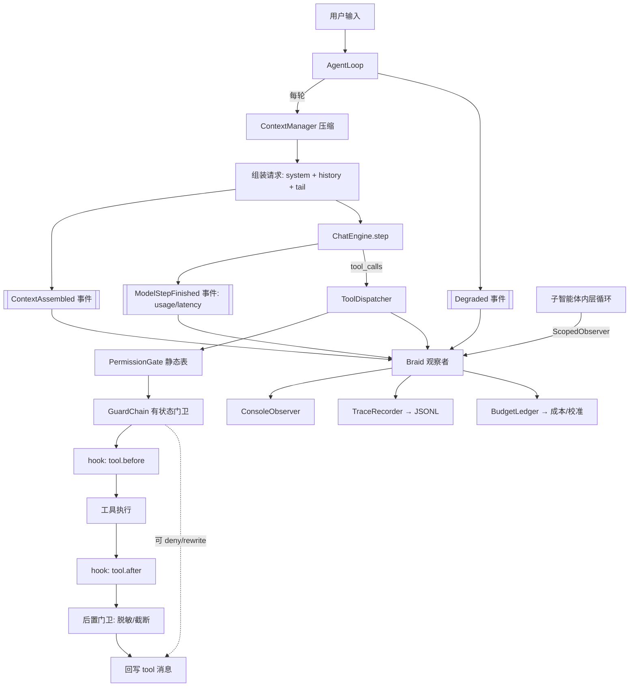

# AI-Coding — R4 阶段分析方案（可观测 / 门卫 / 钩子三件套）

> 定位：M0–M6 + R1 + R2 + R3 之后，编排层已经「跑得对、收得回、记得住」，
> 但它是**黑盒**：一轮用了多少 token、开销花在哪、哪一步悄悄降级了、模型是不是在原地打转，
> 外部一概看不到，也无法在不改 Python 的前提下扩展它。
>
> 本阶段补三件套：**tracing（可观测）→ 门卫（内置运行时守卫）→ hook（用户可扩展的生命周期钩子）**。
> 依据：已核验的 `docs/architecture.md`、`docs/data-contracts.md`、`core/{events,agent_loop,dispatch,turn_policy}.py`、
> `infra/deadline.py`、`ai/openai_engine.py`、`docs/r2-analysis.md`（`on_abandon` 接线点）、`docs/r3-analysis.md`（缓存前缀纪律）。
> 前置：R1 已把 `LoopObserver` 作为唯一外发通道预留（`docs/r1-analysis.md` §0「tracing / guardrails / hooks 归零，只预留扩展点」）。

---

## 0. 先回答你的三个问题

### 0.1 tracing 除了「审视 token budget + 记录」，还有什么用

不是我想出来的，是**读代码读出来的空洞**。下面每条都在现状里有确切的落空点：

| # | 用途 | 现状证据（我实跑核验过） | 能回答的问题 |
|---|---|---|---|
| 1 | **token 预算审计**（你说的） | `StepResult.usage` 由 `openai_engine` 填好，`grep '\.usage' ai_coding/core ai_coding/cli.py ai_coding/ui` **零命中**——取到了就丢 | 这一回合花了多少 prompt/completion？哪一轮最贵？ |
| 2 | **预算归因** | 请求由 4 段拼成（system prompt / 历史 / 记忆块 / 任务块），没有任何地方记各段长度 | 这 7k token 里，历史占多少、记忆块占多少？ |
| 3 | **提示词缓存命中率实时化** | R3 手工测出「尾部注入 94% vs 系统提示 7% vs 每轮压缩 26%」（`docs/r3-analysis.md` §1.13），但**只是一次性实验**，运行时没有这个指标 | 这次改动有没有把缓存打穿？ |
| 4 | **静默降级可见化** | 架构明确「记忆/L4/MCP/worktree 静默降级」，代码里 `except: pass` / `_log.debug` 有 8 处（见 §1.1） | 这回合是不是其实没记忆、没压缩、没隔离？ |
| 5 | **延迟与性能分解** | 事件联合体里**只有** `ToolFinished.duration_ms` 一个时间字段；模型步耗时、审批等待、压缩耗时全无 | 这 40 秒花在模型上还是工具上？ |
| 6 | **失败取证** | `run_with_deadline` 的 `on_abandon` 回调**零生产调用点**（R2 留下的接线点没人接）；被放弃的任务只 `_log.debug` | 超时那次，到底丢下了什么还在跑？ |
| 7 | **成本** | 没有任何价格字段，`ModelConfig` 里没有 price | 这个项目今天烧了多少钱？ |
| 8 | **回放 / 评测夹具** | `scripts/sample_tasks.py` 只能断言最终文本；没有「同样的输入 → 同样的调用序列」的可回放素材 | 改完编排，行为到底变没变？ |
| 9 | **给门卫提供判定输入**（见 §0.2） | 重复调用检测、预算上限都需要「本轮至今的计数」——这些数只能来自 tracing | —— |

第 9 条是关键：**tracing 不是被动的日志，它是门卫判定所需的账本**。这就是三件套的先后顺序（§12）必须先 trace 的原因。

### 0.2 「门卫」是什么，和已有的 `PermissionGate` 差在哪

已有的 `PermissionGate.check(tool_name, params)` 是**静态表**：只按工具名和参数文本做 ALLOW/WARN/DENY，看不到任何运行时状态。
「门卫」补的是**带状态的运行时守卫**：

| 维度 | `PermissionGate`（已有） | 门卫 Guard（本阶段） |
|---|---|---|
| 输入 | `(tool_name, params)` | `(call, ToolContext, TurnView)`——含本轮至今的调用历史、token 账本、任务状态 |
| 性质 | 静态、无记忆 | 有状态、可随时间收紧 |
| 例子 | 「`bash` 一律 WARN」 | 「同一 `(工具,参数)` 第 3 次调用直接拒，并把上次结果的 id 告诉模型」 |
| 能否改写 | 不能 | 能（`REWRITE`：改参数后继续执行） |
| 失败语义 | 未知即 WARN（失败关闭） | 守卫自身抛异常 = 拒绝（失败关闭，沿用 R1 纪律） |

**边界**：权限门是「这个动作危不危险」，门卫是「这个动作在此刻还得当吗」。两者串联，不改权限门语义（R1/R2 的 633 例测试不受影响）。

### 0.3 hook 能做什么

hook = **用户自定义**在固定生命周期点位插入的回调，可观察 / 拦截 / 注入 / 改写。与门卫的分工：门卫是**我们的内置策略**（代码里写死、永远生效），hook 是**用户的策略**（配置驱动、默认关闭）。

| 点位 | 能力 | 真实用例 |
|---|---|---|
| `turn.start` | observe / inject | 把「今天的需求单号」注入成本回合的易失上下文 |
| `step.before` | observe / inject | 每轮模型调用前追加一条动态提醒 |
| `tool.before` | observe / block / rewrite | 拦掉 `git push`；把 `pytest` 自动改写成 `pytest -q` |
| `tool.after` | observe / inject | 写文件后自动 `ruff format`；把 lint 结果喂回模型 |
| `compact.before/after` | observe | 审计压缩时机（R3 的软水位是否合理） |
| `memory.harvest` | observe | 把本次新增记忆同步到外部 Obsidian |
| `subagent.start/end` | observe / inject | 给子智能体附加额外约束 |
| `turn.end` | observe | 桌面通知、企业微信/飞书播报、成本入账 |
| `stop.blocked` | observe / block | 审计 todo 门禁是否被滥用 |

**能力矩阵是要害**：能改**持久历史**的 hook 会打穿提示词缓存（R3 的核心教训），所以
`inject` 默认只进**易失尾部块**（不进系统提示、不进历史）；要持久化必须显式 `persist: true` 并留下事件记录。

### 0.4 外部对标：GenericAgent（已调研，见 [r4a-genericagent-research.md](r4a-genericagent-research.md)）

对 `lsdefine/GenericAgent`（14.2k star，MIT，arXiv 2604.17091）做了**源码级**调研。它和我们在同一问题上走了不同路线，四条结论直接影响本方案：

| 修订 | 原方案 | 修订后 | 为什么 |
|---|---|---|---|
| **R-1** | `ModelStepFinished.usage` 只有 prompt/completion/total | **加 cache 明细**：`cached_tokens` / `cache_read_input_tokens` / `cache_creation_input_tokens`；`prefix_shared_ratio` **降级为兜底** | GA 把 provider 报的 cache token 当一等字段；我们的前缀共享率只是估算 |
| **R-2** | hook 只有 `kind: command`（子进程） | **加 `kind: python`**：进程内、`plugins/*.py` 自动发现、返回值可替换 ctx | GA 的 `register`/`trigger` 形态更轻、能改写上下文 |
| **R-3** | 能力矩阵已定义 | 明确 **观察/注入类 fail-open，阻断/改写类 fail-closed**，**不采用 GA 的「永远 fail-open」** | GA 的 hook 拦不住任何东西 |
| **R-4** | 索引块 ≤600 字符 | 升格为**设计不变量**：「索引只放指针不放内容；总量有界；L2/L3 增长不推高索引」+ 测试锁死 | GA 明写 "L1 remains bounded even as L2 and L3 expand" |

GA 的验证性发现（说明我们方向没错）：它独立收敛到「别动前缀否则缓存崩」（论文：约 80% 回合缓存命中）；它的 `_sanitize_leading_user_msg` 与我们的 `ensure_tool_pairing` 是同一种配对修复；它的 `file_patch` 唯一匹配、`code_run` 每回合一次，与我们的 `edit` 唯一匹配、`bash` 串行**效果等价**。

两条**记为 R5 候选**（不进 R4 范围）：GA 的 Stage-4 工作记忆锚（每轮附带「最近 N 轮一句话摘要 + key_info」）、note 的 `verified` 标记（"No Execution, No Memory"）。

---

## 1. 现状核验（先摆事实，不拍脑袋）

### 1.1 五个已确认的空洞（逐条有代码证据）

1. **用量取到即丢**：`ai/openai_engine.py:99-108` 解析 `include_usage` 帧填进 `StepResult.usage`；
   `ai_coding/core/`、`cli.py`、`ui/` 中 `grep '\.usage'` **零命中**。
2. **时间只有一半**：`core/events.py` 全文件中唯一的时间字段是 `ToolFinished.duration_ms`；模型步、审批等待、压缩耗时均无。
3. **静默降级不可见**（8 处，全部只有 `_log.debug` 或裸 `pass`）：
   `agent_loop._compress`（压缩超时→原始历史）、`_memory_block`（记忆读失败→空）、
   `_harvest`（收割失败→跳过）、`compact_session`（`/compact` 失败→原样返回）、
   `_save`（落盘 `OSError`→吞掉）、`subagent`（`WorktreeError`→退回主工作区）、
   `mcp.open_all`（单 server 失败→跳过）、`_SafeObserver`（UI 渲染失败→吞掉）。
4. **子智能体是黑盒**：`core/subagent.py` 构造内层 `AgentLoop` 时**没传 `observer`** →
   子循环全部事件进 `NullObserver`。父回合只拿到最终 packet（`_packet`），子智能体调了几次工具、花了多少 token、卡了多久，全丢。
5. **放弃式取消没有证人**：`infra/deadline.py` 的 `on_abandon` 回调**零生产调用点**。
   被放弃的任务（可能还在跑、还占着进程组）只在 `_drain` 里 `_log.debug`。

### 1.2 三条已经现成的接线点（不用新造轮子）

1. `core/events.py` 的 `LoopObserver.on_event(event)` + `_SafeObserver` 兜底 —— **trace 记录器就是一个 observer**；
2. `infra/subprocess_runner` + `infra/deadline.run_with_deadline` —— hook 要跑子进程，纪律已有；
3. `ToolContext.emit`（`tools/base.py`）已接进循环的 `_emit` —— 工具侧事件有通路，子智能体扇出可用同一机制。

---

## 2. 执行范围

**做**：

- R4a 可观测：新事件（用量/归因/降级）、JSONL 轨迹落地、token 账本与成本、缓存前缀共享率、CLI/REPL 查看面、子智能体事件扇出。
- R4b 门卫：`Guard` 契约 + 守卫链 + 4 个内置守卫（重复调用、bash 策略、密钥脱敏、路径逃逸）；回合级 token 上限接进 `turn_policy`（沿用 R2c 的纯单元纪律）。
- R4c hook：点位枚举 + 配置 schema + 命令式 hook 执行器（stdin/stdout JSON、超时、环境隔离、失败语义）+ 循环/分发器接线。

**不做**（明确划出去，避免范围蔓延）：

- 不接 OpenTelemetry / 分布式追踪后端（本阶段只做本地 JSONL；导出留接口）。
- 不做 Web UI / GUI 轨迹查看器（只做 CLI + REPL 文本渲染）。
- 不改模型-可见的对话内容形态（除了密钥脱敏这一条窄口子，见 D-R4-8）。
- 不动 `PermissionGate` 的静态表语义，不删任何既有拒绝码。
- 不把轨迹写进 `sessions/*.json`（沿用 R3「记忆不进会话文件」的同一条理由：会话文件是纯对话，是缓存与兼容性的基线）。

---

## 3. 目标架构

### 3.1 分层与依赖方向（守 `docs/architecture.md` 的单向依赖）

```
domain/            新增：TurnStatus.BUDGET、ModelConfig 价格字段（纯数据）
core/events.py     新增事件值（依赖 domain）
core/observers.py  新增：Braid（多观察者扇出）、ScopedObserver（子智能体父子关系）
core/trace.py      新增：TraceRecorder(LoopObserver) + TraceStore + Redactor + 前缀共享度量
core/budget.py     新增：BudgetLedger + Pricing（用量/成本/校准比）
core/guard.py      新增：Guard / GuardChain / TurnView + 4 个内置守卫
core/hooks.py      新增：HookPoint / HookSpec / CommandHookRunner（走 subprocess_runner）
core/dispatch.py   修改：接守卫链 + hook(tool.before/after)
core/agent_loop.py 修改：发新事件、建账本、接 hook、发降级事件、把 usage 写进 TurnOutcome
core/turn_policy.py修改：TurnSnapshot.tokens_spent + max_turn_tokens
core/subagent.py   修改：接受 observer，给内层循环套 ScopedObserver
config/models.py   修改：TracingConfig / GuardConfig / HookConfig / AIConfig.turn_token_budget
cli.py + ui/       修改：组合观察者、`ai-coding trace` 子命令、`/trace` `/budget`
```

依赖方向：`domain ← core/trace, core/budget, core/guard, core/hooks`；这四个新模块**不反向依赖** `core/agent_loop`；
`cli.py` 仍是唯一组合根。**没有新依赖**（JSONL 用 `infra/json_utils`，子进程用 `infra/subprocess_runner`）。

### 3.2 三个接缝点

```
                      ┌─────────── 观察者扇出（Braid）───────────┐
                      │  ConsoleObserver  →  TraceRecorder → …   │
                      └──────────────────────────────────────────┘
回合  ┌──────────────────────────────────────────────────────────────┐
      │ turn.start                                                   │
      │  ┌── 迭代 ────────────────────────────────────────────────┐  │
      │  │ 压缩 → 组装 → [ContextAssembled]                       │  │  ← 归因 + 前缀共享率
      │  │ step_before → 模型调用 → [ModelStepFinished: usage]    │  │  ← 真实用量 + 延迟
      │  │ 权限门 → 门卫链 → hook(tool.before) → 执行             │  │  ← 三个闸门，顺序固定
      │  │              → hook(tool.after) → 门卫(后置) → 回写    │  │
      │  │ 降级点 → [Degraded]                                    │  │  ← 静默降级可见化
      │  └────────────────────────────────────────────────────────┘  │
      │ turn.end                                                     │
      └──────────────────────────────────────────────────────────────┘
```

### 3.3 架构图



---

## 4. R4a — 可观测（tracing）

### 4.1 新增事件（`core/events.py`，3 个 + 2 处字段补强）

```python
@dataclass(frozen=True)
class ModelStepFinished:
    """一次模型步的收尾事实：真实用量 + 延迟 + 结束原因。"""
    index: int
    finish_reason: str | None = None
    text_chars: int = 0
    tool_call_count: int = 0
    usage: dict[str, int] | None = None   # prompt/completion/total
    # R-1（GA 对标）：provider 报的 cache 明细要单独留字段，别只算前缀相似度。
    # OpenAI 侧 prompt_tokens_details.cached_tokens → cached_tokens；
    # Anthropic 侧 cache_read_input_tokens / cache_creation_input_tokens 原样保留。
    cached_tokens: int | None = None
    cache_write_tokens: int | None = None
    latency_ms: int = 0

@dataclass(frozen=True)
class ContextAssembled:
    """这次请求由什么拼成的（只有计数与摘要，绝不带内容）。"""
    iteration: int
    system_chars: int
    history_messages: int
    history_chars: int
    tail_blocks: tuple[tuple[str, int], ...] = ()   # (("memory", 540), ("task", 880))
    estimated_tokens: int = 0
    # R-1（GA 对标）：前缀共享率是**兜底指标**——provider 报 cache token 时以真值为准，
    # 只有端点不报 cache 明细时才用这一对数字说明「前缀有没有被动过」。
    prefix_shared_chars: int = 0     # 与上一次请求的最长公共前缀（字符）
    prefix_shared_ratio: float = 0.0 # 除以本次请求长度
    digest: str = ""                 # sha1(前 4KB)，只用于判断「前缀变了没」

@dataclass(frozen=True)
class Degraded:
    """一个增强组件静默降级了（R4a 让 8 处 `except: pass` 变得可见）。"""
    component: str      # "context_compress" | "memory_block" | "memory_harvest" | ...
    reason: str
    fallback: str = ""

@dataclass(frozen=True)
class ScopedEvent:
    """子智能体（或任何嵌套执行）的事件，带父子归属地扇出到同一个观察者。"""
    scope: str          # 例如 "subagent:<call_id>"
    parent: str
    event: "LoopEvent"
```

同时给 `ToolStarted` / `ToolFinished` **追加**末尾字段 `iteration: int = 0`
（冻结 dataclass 追加带默认值的字段是兼容的），解决「同批并发调用无法从事件流重建」的问题。

### 4.2 JSONL 记录契约

一行一事件，是**缓存/审计友好的追加写**（与 R3 的 append-only 纪律一致）：

```json
{"v":1,"ts":"2026-09-23T10:00:00.123Z","trace":"sess-6c53/turn-3","span":"i2","parent":"turn","iter":2,"evt":"ModelStepFinished","data":{"index":2,"prompt_tokens":6900,"completion_tokens":140,"latency_ms":1840}}
```

不变式：

- `data` 永远是事件的字段字典的 JSON 化（无内容大对象；预览沿用 `events.preview`，上限 500 字符）；
- 写盘失败**静默降级**（记一条 `Degraded`，不抛——观察者永远不能打断回合，沿用 `_SafeObserver` 纪律）；
- 落盘路径 `<workspace>/.ai-coding/traces/<session_id>/turn-<n>.jsonl`（与 `.memory` 同源，不进 `sessions/`）；
- 单回合超 `max_turn_bytes` 截断并写一条 `truncated` 标记；按 `retention_days` 清理。

### 4.3 `BudgetLedger` 契约（`core/budget.py`）

```python
@dataclass
class UsageTotals:
    prompt_tokens: int = 0
    completion_tokens: int = 0
    steps: int = 0
    @property
    def total_tokens(self) -> int: ...

class BudgetLedger:
    """一个回合的账本。纯同步、无 IO；喂给门卫与 turn_policy。"""
    def record_step(self, usage: dict[str, int] | None, latency_ms: int) -> None: ...
    def record_assembly(self, estimated_tokens: int, prefix_ratio: float) -> None: ...
    @property
    def totals(self) -> UsageTotals: ...
    @property
    def calibration(self) -> float | None:
        """真实 prompt_tokens / 自研估算，衡量 estimate_tokens 的偏差。"""
    def cost(self, pricing: Pricing | None) -> float | None: ...
```

`Pricing(input_per_1k, output_per_1k)` 来自 `ModelConfig` 新增的可选字段；缺省 0 表示**未知价格 → 成本报 `None`**（不假装是 0）。

### 4.4 逐文件实现步骤（R4a）

| 步骤 | 文件 | 动作 |
|---|---|---|
| a1 | `core/events.py` | 加 3 个事件 + `ScopedEvent`；`ToolStarted/ToolFinished` 追加 `iteration`；扩 `LoopEvent` 联合与 `__all__` |
| a2 | `core/observers.py`（新） | `Braid(*observers)`（逐个转发、逐个吞异常）；`ScopedObserver(scope, parent, inner)`（把事件包成 `ScopedEvent`） |
| a3 | `core/trace.py`（新） | `canonical_request()`、`prefix_shared()`、`Redactor`、`TraceStore`（路径/轮转/清理）、`TraceRecorder(LoopObserver)` |
| a4 | `core/budget.py`（新） | `UsageTotals`、`Pricing`、`BudgetLedger` |
| a5 | `domain/model_config.py` + `config/models.py` | `ModelConfig.price_input_per_1k/price_output_per_1k`；`TracingConfig(enabled, dir, capture, max_turn_bytes, retention_days, redact)` |
| a5b | `ai/openai_engine.py` | **R-1**：`_usage_to_dict` 增加 cache 明细（`prompt_tokens_details.cached_tokens` → `cached_tokens`；Anthropic 的 `cache_read_input_tokens`/`cache_creation_input_tokens` 原样带出），否则 provider 报了我们也不认识 |
| a6 | `core/agent_loop.py` | 每回合建 `ledger`；每轮 `ContextAssembled`；模型步后 `ModelStepFinished`；8 处降级点发 `Degraded`；`TurnOutcome` 带 `usage` |
| a7 | `core/subagent.py` | `SubAgentRunner` 接受 `observer`；内层循环套 `ScopedObserver(f"subagent:{call_id}")` |
| a8 | `tools/subagent_tool.py` | 把 `call_id` 传给 runner（父子归属） |
| a9 | `cli.py` + `ui/slash.py` + `ui/repl.py` + `ui/trace_render.py`（新） | 组合 `Braid(ConsoleObserver, TraceRecorder, ...)`；`ai-coding trace list\|show\|budget`；`/trace` `/budget` |

### 4.5 数据流影响

- **不新增请求内容**：`ContextAssembled` 只带计数与摘要，绝不进对话、绝不进 `sessions/*.json`。
- **系统提示仍然逐字节静态**：R3 锁死的那条测试（`test_agent_loop_memory.py`）必须继续绿；R4a 不改任何提示词文本。
- **前缀共享率的度量口径**：对 `instructions + 映射后的消息数组` 做规范 JSON 化，与**上一次**请求求最长公共前缀。
  *已知近似*：引擎的 `history_to_chat_messages` 会丢字段，我用同一张 `ChatMessage` 字段表算，属同构近似，作为比率足够。
- **上下文字节流**：`prefix_shared()` 需要保留上一次的规范串（内存里一份，长度与上下文同阶），回合结束即释放。

---

## 5. R4b — 门卫（Guard）

### 5.1 契约（`core/guard.py`）

```python
class GuardVerdict(enum.Enum):
    ALLOW = "allow"
    DENY = "deny"
    REWRITE = "rewrite"

@dataclass(frozen=True)
class GuardDecision:
    verdict: GuardVerdict
    reason: str = ""
    params: dict[str, Any] | None = None   # REWRITE 时的新参数
    guard: str = ""

@dataclass(frozen=True)
class TurnView:
    """门卫能看到的只读回合视图（来自账本与循环，不是全局状态）。"""
    iteration: int
    tokens_spent: int
    prior_calls: tuple[tuple[str, str], ...]   # (tool_name, 参数指纹)
    task_open: int

class Guard(Protocol):
    name: str
    def check(self, call: ToolCall, ctx: ToolContext, view: TurnView) -> GuardDecision: ...

class GuardChain:
    def __init__(self, guards: Sequence[Guard]) -> None: ...
    def check(self, call, ctx, view) -> GuardDecision: ...
    def after(self, call, result, ctx, view) -> ToolResult: ...   # 后置：脱敏/截断
```

顺序与失败语义（与权限门同一条纪律）：

1. 权限门（静态，逻辑不变）→ 2. 守卫链（有状态）→ 3. hook（用户策略）；
2. 链内**按注册顺序取第一个非 ALLOW 的判决**，确定性优先于聪明；
3. **守卫抛异常 = 拒绝**（`error="guard_error"`），不静默放行。

### 5.2 四个内置门卫

| 守卫 | 规则 | 默认 | 为什么需要（真实失效模式） |
|---|---|---|---|
| `DuplicateCallGuard` | 同一 `(tool, 规范化参数)` 第 N 次调用起拒绝，并把**上一次结果的 call_id** 写进结构化结果 | **开**，阈值 2 | ReAct 循环的经典病：模型原地重复 `read`/`bash`。既省 token 又破死循环 |
| `BashPolicyGuard` | 在权限门硬拒表之外，允许**配置追加**拒绝模式与「需确认」模式 | 开（空表） | 权限门的硬拒表是写死的，用户没法加自己的红线 |
| `SecretGuard` | 正则族（`sk-…`/`AKIA…`/PEM 私钥/`api_key=` 等）在两处生效：**trace 落盘前强制**、进入历史时**仅高置信模式** | trace 强制；history 默认关 | `config.local.yaml` 里就是真实 key；轨迹一旦落盘就是泄漏面 |
| `PathEscapeGuard` | `bash` 参数里出现工作区外的绝对路径 / `cd /` 时：默认**只观察**，`guard.strict_paths: true` 才拒绝 | 观察 | `Sandbox` 只管文件工具；bash 能绕过 `ctx.workspace` |

### 5.3 回合级 token 上限不放进守卫链，放进 `turn_policy`

理由：R2c 已经把「要不要再来一轮」抽成纯单元（19 条决策表测试）。
「token 花超了」是**同一类问题**，应该在同一位。

改动（全是追加）：

```python
# TurnPolicyConfig
max_turn_tokens: int = 0        # 0 = 关闭
# TurnSnapshot
tokens_spent: int = 0
# decide_next_iteration
if self.config.max_turn_tokens and snapshot.tokens_spent >= self.config.max_turn_tokens:
    return TurnDecision(TurnAction.FINISH, "turn token budget exhausted")
```

新增 `TurnStatus.BUDGET`（见 D-R4-5），让「钱花完了」和「时间到了」「轮次用完了」在终态上能区分。

### 5.4 逐文件实现步骤（R4b）

| 步骤 | 文件 | 动作 |
|---|---|---|
| b1 | `core/guard.py`（新） | 契约 + `GuardChain` + 4 个内置守卫（纯同步、无 IO、可单测） |
| b2 | `config/models.py` | `GuardConfig(duplicate_threshold=2, bash_deny=[], bash_confirm=[], strict_paths=False, redact_history=False, redact_patterns=[])` |
| b3 | `core/dispatch.py` | 接 `guard_chain`：`_decide` 前跑前置守卫；`REWRITE` 改 `item.call.params` 后执行；`_handle` 结果过后置处理；新 `error="guard_denied"/"guard_error"` 结构化结果 |
| b4 | `core/agent_loop.py` | 每轮构造 `TurnView`（从 ledger + 调用历史 + task）传给分发器；`tokens_spent` 回喂 `TurnSnapshot` |
| b5 | `core/turn_policy.py` + `domain/loop.py` | `max_turn_tokens` + `TurnStatus.BUDGET`；决策表加行 |
| b6 | `cli.py` | 从配置装配 `GuardChain`；`ai-coding config-check` 打印生效守卫 |

---

## 6. R4c — hook

### 6.1 点位 × 能力矩阵（默认取最窄）

| 点位 | observe | inject | block | rewrite | 备注 |
|---|---|---|---|---|---|
| `session.start` | ✅ | — | — | — | 只观察 |
| `turn.start` | ✅ | ✅ | — | — | inject 进易失尾部 |
| `step.before` | ✅ | ✅ | — | — | **不允许 block**（模型步没有「拒绝」语义） |
| `tool.before` | ✅ | — | ✅ | ✅ | 唯一允许改写参数的点 |
| `tool.after` | ✅ | ✅ | — | — | 注入 lint/测试反馈 |
| `compact.before/after` | ✅ | — | — | — | 审计压缩时机 |
| `memory.harvest` | ✅ | — | — | — | 外部同步 |
| `subagent.start/end` | ✅ | ✅ | — | — | 子智能体约束 |
| `turn.end` | ✅ | — | — | — | 通知/入账 |
| `stop.blocked` | ✅ | — | ✅ | — | 可推翻 todo 门禁的阻断 |

### 6.2 执行契约

```jsonc
// stdin：一个 JSON 事件
{"hook":"tool.before","point":"tool.before","session":"...","turn":3,"iteration":2,
 "tool":{"name":"bash","params":{"command":"ls"}},"workspace":"/path/to/ws"}

// stdout：一个 JSON 决定（缺省 = 放行）
{"decision":"allow"}
{"decision":"block","reason":"git push 未经评审"}
{"decision":"rewrite","params":{"command":"ls -la"}}
{"decision":"inject","context":"<文本>"}
```

约束（每条都对应一个既有纪律）：

- 超时 `hooks.timeout_seconds`，走 `run_with_deadline`（**放弃式取消**，R2a）；
- 子进程走 `infra/subprocess_runner`（**进程组 kill**，R2b），永不 `create_subprocess_*`；
- **环境隔离**：hook 的环境变量**不含**模型 API key（显式白名单，不是黑名单删除）；`cwd` = 工作区；
- **失败语义按能力分**：`observe`/`inject` 类失败 = 记 `Degraded` 后放行（fail-open）；`block`/`rewrite` 类失败 = 拒绝（fail-closed）；
- **注入位置**：`inject` 的文本进**易失尾部块** `<hook-context>`，默认不进历史、不进系统提示；
  要持久化必须 `persist: true`，且落盘为一条普通 user 消息 + 事件记录（这样缓存代价与影响是可见、可审计的）。

### 6.3 配置 schema

```yaml
hooks:
  enabled: false
  timeout_seconds: 10
  plugin_dir: ""          # 默认 <workspace>/.ai-coding/hooks；kind=python 时自动发现 *.py
  events:
    - point: tool.before
      match: { tool: "bash" }
      kind: command                   # 子进程：JSON in/out，跨语言、可隔离
      command: ["./scripts/deny-push.sh"]
      capability: block
    - point: tool.after
      match: { tool: "write" }
      kind: command
      command: ["ruff", "format"]
      capability: observe
    - point: tool.before              # R-2（GA 对标）：进程内回调，可改写 ctx
      kind: python
      module: hooks.my_org_rules     # <plugin_dir>/my_org_rules.py
      entrypoint: check
      capability: rewrite
    - point: turn.end
      kind: command
      command: ["./scripts/notify.sh"]
      capability: observe
```

### 6.4 逐文件实现步骤（R4c）

| 步骤 | 文件 | 动作 |
|---|---|---|
| c1 | `core/hooks.py`（新） | `HookPoint` 枚举、`HookSpec`、`HookResult`、`HookRunner` 协议、`CommandHookRunner`（JSON in/out + deadline + subprocess_runner + 环境白名单） |
| c1b | `core/hooks.py`（新，**R-2**） | `PythonHookRunner`：`plugin_dir` 下自动发现 `*.py`、按 `entrypoint` 取函数、**返回值可替换上下文**（GA 的 `register`/`trigger` 形态）；异常按能力矩阵走 fail-open/closed |
| c2 | `config/models.py` | `HooksConfig`（`enabled/timeout_seconds/plugin_dir/events`）+ `HookEventConfig(point, match, kind, command, module, entrypoint, capability, persist)` |
| c3 | `core/dispatch.py` | `tool.before` / `tool.after` 两点接线（与门卫链同一处，顺序固定） |
| c4 | `core/agent_loop.py` | `turn.start/end`、`step.before`、`compact.*`、`memory.harvest`、`stop.blocked` 接线；`inject` 汇聚成尾部块 |
| c5 | `core/subagent.py` | `subagent.start/end` |
| c6 | `cli.py` | 装配 `CommandHookRunner`；`config-check` 打印生效 hook |

---

## 7. TDD 用例（先红后绿，逐文件）

> 纪律：先写测试看到失败，再写实现；除非测试自身写错，不改已有测试的断言。

| 测试文件 | 用例（关键几条） |
|---|---|
| `tests/test_trace_recorder.py`（新） | ① 事件 → JSONL 一行一事件，span/parent/iter 正确；② 目录不存在时自动创建；③ **写盘失败静默降级**且回合不受影响；④ 超过 `max_turn_bytes` 截断并留标记；⑤ 密钥被脱敏，轨迹里**逐字节搜不到**原 key |
| `tests/test_observers.py`（新） | ① `Braid` 按序转发给全部观察者；② 某个观察者抛异常不影响其余；③ `ScopedObserver` 把子事件包成 `ScopedEvent` 且 `parent` 正确 |
| `tests/test_budget_ledger.py`（新） | ① 多步用量累加；② `usage=None` 不炸且不计；③ 成本按价格计算；④ **价格未知 → `cost()` 返回 `None`**（不假装 0）；⑤ 校准比 = 真实/估算；⑥ **R-1：cache 命中率 = cached_tokens / prompt_tokens**，provider 不报时为 `None` |
| `tests/test_context_assembled.py`（新） | ① 各段字符数与实际拼装一致；② 纯追加回合 `prefix_shared_ratio` 高（≥0.9）；③ 改系统提示后比率骤降；④ **系统提示逐字节静态**这条既有断言不破 |
| `tests/test_model_step_finished.py`（新） | ① 引擎带 usage → 事件带真实数字；② 引擎无 usage → 事件仍发出、字段为空；③ `TurnOutcome.usage` 等于本回合累加；④ **R-1：`prompt_tokens_details.cached_tokens` 透传成 `cached_tokens`**，Anthropic 的 `cache_read_input_tokens`/`cache_creation_input_tokens` 也认 |
| `tests/test_degraded_events.py`（新） | 逐个把 8 个降级点打成故障（注入会抛的假组件），断言各发一条 `Degraded` 且回合仍正常收尾 |
| `tests/test_guard_chain.py`（新） | ① 顺序确定；② 首个非 ALLOW 短路；③ `REWRITE` 改参数后才执行（执行器看到新参数）；④ 守卫抛异常 = 拒绝且 `error="guard_error"`；⑤ 拒绝仍写回 `role=tool` 消息（**配对不破**） |
| `tests/test_guard_duplicate.py`（新） | ① 第 1、2 次放行；② 第 3 次拒绝且结果里含上次 result 的 call_id；③ 参数不同不误伤；④ 阈值可配 |
| `tests/test_guard_secret.py`（新） | ① 高置信 key 被脱敏且幂等；② 良性文本不动；③ 关闭 `redact_history` 时历史不被改写 |
| `tests/test_guard_path_escape.py`（新） | ① 默认只观察（放行 + 事件）；② `strict_paths=true` 时拒绝 |
| `tests/test_turn_policy.py`（改，**仅追加参数行**） | 新增行：`tokens_spent >= max_turn_tokens` → FINISH，`reason="turn token budget exhausted"`；`max_turn_tokens=0` 时永不触发 |
| `tests/test_hooks_runner.py`（新） | ① JSON 进出；② 非零退出 → block + reason；③ 超时 → 按能力走 fail-open/closed；④ **hook 环境里没有 API key**；⑤ 坏 JSON 按失败语义处理；⑥ 命令不存在不炸回合；⑦ **R-2：`kind: python` 能从 `plugin_dir` 自动发现、返回值可改写上下文、抛异常时按能力矩阵处理** |
| `tests/test_hooks_loop.py`（新） | ① `tool.before` 的 `rewrite` 真实改变执行参数且被记录；② `inject` 进易失尾部块、**系统提示仍逐字节静态**；③ `persist: true` 才进历史 |
| `tests/test_cli_trace.py`（新） | ① `ai-coding trace show <turn>` 渲染出用量/工具/耗时；② `trace budget` 汇总；③ 轨迹不存在时不报错、给友好提示 |
| `tests/test_slash.py`（改，追加） | `/trace`、`/budget` 被识别为直命令 |

既有 633 例必须全绿；`ruff` / `mypy --strict` 零问题。

---

## 8. 真实验收脚本（`scripts/trace_cases.py`，仿 `memory_cases.py`）

不写"看着对"，写**可断言的案例**；带 `--only`、`--real`（真 LLM）、`--config`：

| 案例 | 断言 |
|---|---|
| C1 三工具回合 | 轨迹里每个工具一个 span，时间有序，`duration_ms > 0` |
| C2 用量归因 | `ModelStepFinished.usage.prompt_tokens` 与 `ContextAssembled.estimated_tokens` 比值落在合理区间（校准比可打印） |
| C3 缓存前缀 | 同会话第 2 回（纯追加）`prefix_shared_ratio ≥ 0.9`；人为改系统提示的对照回合显著下降 |
| C4 子智能体树 | 父子 span 正确：子事件 `parent` == 那次 `subAgent` 调用的 call_id |
| C5 密钥不落盘 | 让 bash `echo` 一个 key，全轨迹目录**逐字节 grep 不到**该 key |
| C6 重复调用门卫 | 模型被诱导重复同一调用 → 第 3 次被拒，回合仍正常收尾（`TurnStatus.COMPLETED` 或 `MAX_ITERATIONS`，不是 `ERROR`） |
| C7 hook 拦截 | `tool.before` 拦截脚本拒掉一次 `bash` → 模型看到结构化拒绝并换策略，轨迹里有该 hook 的决定 |
| C8 预算闸门 | 把 `max_turn_tokens` 调到极小 → 回合以 `TurnStatus.BUDGET` 收尾，且轨迹里能读出超限发生在第几轮 |

C1/C3/C4 走 `--real`（真实 LLM，`max_tool_iterations` 压到 3 以内控制耗时）；C2/C5/C6/C7/C8 可离线跑（假引擎 + 真 IO）。

---

## 9. 成功之后是什么样

```bash
$ ai-coding repl --path config.local.yaml
you> 把 README 里的里程碑表补上 R3
[turn 1/5] [tool: read] {"path":"README.md"}
  -> ok: ...
[turn 2/5] [tool: edit] {...}
  -> ok: ...
[turn] completed in 6.2s · 18,420 tok (16,900 in / 1,520 out) · ¥0.041 · cache 91% (cached 15,380)

you> /budget
[budget] turn 18,420 tok · session 142,910 tok · est. ¥0.318
         calibration: real/estimate = 1.12 (estimate_tokens 略低估)
         cache: 91% provider-reported (prefix-shared 93% as fallback)

you> /trace
[trace] .ai-coding/traces/6c53.../turn-3.jsonl
  8 spans · 2 model steps · 3 tool calls · 0 degraded · 1 guard decision (duplicate denied)
```

系统级变化：

- 每回合**默认**落一份可回放的轨迹（只有元数据 + 预览，密钥脱敏）；
- **缓存命中用 provider 真值**（`cached_tokens`），不再只靠前缀相似度猜；估算器偏差同时被记录（`real/estimate`）；
- 静默降级不再静默：`/trace` 一眼看到「本回合没记忆/没压缩/没隔离」；
- 重复调用与越界 bash 有内置门卫兜底，且**拒绝也是结构化结果**，模型能改策略；
- 不改 Python 也能挂 hook（写文件后自动格式化、拦 `git push`、播报成本）；需要跨语言/隔离时用子进程形态；
- 子智能体不再是黑盒：父子 span 可重建。

---

## 10. 自我核验（我可能错在哪）

| # | 风险 | 我的处置 |
|---|---|---|
| 1 | **轨迹泄漏密钥** | `config.local.yaml` 里就是真实 key。已把 `Redactor` 设计成 trace **强制**路径，且 C5 用逐字节 grep 验收；D-R4-8 单独拍板 history 是否也脱敏 |
| 2 | **观察者拖慢回合** | 与 `_SafeObserver` 同纪律：静默降级 + 超时不阻塞；轨迹写盘是同步小 IO（追加一行），必要时可切后台（D-R4-4 留口） |
| 3 | **前缀共享率测不准** | 引擎的字段映射与我算的规范串有近似。已在 §4.5 写明口径与近似；只作比率用，不作正确性断言 |
| 4 | **门卫误伤正常回环** | `DuplicateCallGuard` 阈值默认 2（允许一次有意的重试），且参数按规范化指纹比较，参数一变就放行 |
| 5 | **hook 破坏缓存纪律** | `inject` 只进易失尾部；`persist: true` 才进历史且留痕；`step.before` 不允许 block |
| 6 | **契约破坏面** | 新增 `TurnStatus.BUDGET` 与 `TurnOutcome.usage` 属**合同变更**，D-R4-5/6 单独拍板；`ToolStarted/ToolFinished` 只追加带默认值字段，向后兼容 |
| 7 | **range 过大** | 已切三段（R4a→R4b→R4c），每段可独立提交、独立验收；不做 OTel、不做 GUI |
| 8 | **`turn_policy` 是纯单元** | 新增判断保持无 IO、无事件；只加快照字段与决策表行 |
| 9 | **外部对标可能被宣传误导** | GA 论文称循环 92 行、README 称 ~100 行，**实测 `agent_runner_loop` 66 行、文件 132 行**。调研报告一律引实测值，并标注差异；GA 的结论只作**参考**，不代替我们自己的案例实测 |
| 10 | **hook 双形态带来的复杂度** | `kind: python` 省事但会共享进程（hook 崩了会波及回合）——所以 python hook 也走 `try/except` 兜底 + 失败语义按能力分；`kind: command` 保持隔离但慢。两者共用同一 `HookPoint`/判决结构，不分叉 |

---

## 11. 待拍板决策点

| # | 决策 | 我的建议 |
|---|---|---|
| **D-R4-1** | 三件套的实现顺序 | **R4a tracing → R4b 门卫 → R4c hook**。门卫必须读账本，hook 复用 trace 的注入接缝 |
| **D-R4-2** | trace 默认是否开启 | **默认开**，但只记元数据 + 预览（你要的 token 审计正是它）；可用 `tracing.enabled=false` 关 |
| **D-R4-3** | 轨迹落地位置 | `<workspace>/.ai-coding/traces/<session>/turn-<n>.jsonl`；**不写进 `sessions/*.json`** |
| **D-R4-4** | 采集粒度与保留 | `capture: previews`（≤500 字符）+ 单回合 ≤2MB + 保留 14 天；全量 `full` 需显式打开 |
| **D-R4-5** | 是否新增 `TurnStatus.BUDGET` | **新增**。时间/轮次/token 三种耗尽应可区分（合同变更，需你确认） |
| **D-R4-6** | `TurnOutcome` 是否带 `usage` | **带**（`usage: dict \| None`）。回合终态自带账，调用方不必翻轨迹 |
| **D-R4-7** | 估算器校准 | **只观测不改行为**：记录 `真实/估算`，先用数据说话，暂不用它驱动压缩 |
| **D-R4-8** | 脱敏范围 | trace 强制；**history 默认不脱敏**（改模型可见内容风险更大），需要时用 `guard.redact_history: true` |
| **D-R4-9** | `DuplicateCallGuard` 默认 | **开**，阈值 2 |
| **D-R4-10** | hook 注入位置 | **易失尾部块** `<hook-context>` 默认；`persist: true` 才进历史 |
| **D-R4-11** | hook 失败语义与环境 | 按能力分（observe/inject fail-open，block/rewrite fail-closed）；**hook 环境不含模型 key** |
| **D-R4-12** | 子智能体事件扇出 | **扇出**（`ScopedObserver` + 父子 span）；子智能体的推理仍不回传父上下文（沿用 R1a-5） |
| **D-R4-13** | hook 的形态（GA 对标 R-2） | **两种都要**：`kind: python`（进程内、`plugins/*.py` 自动发现、可改写 ctx）作为首选；`kind: command`（子进程 JSON 协议）保留给跨语言/隔离场景 |
| **D-R4-14** | cache 度量口径（GA 对标 R-1） | **provider 报的 cache token 为准**（新增 `cached_tokens`/`cache_write_tokens` 字段）；`prefix_shared_ratio` 仅在端点不报 cache 时作为兜底 |
| **D-R4-15** | 记忆索引是否升格为不变量（GA 对标 R-4） | **升格**：「索引只放指针、不放内容；总量有界；L2/L3 增长不推高索引」写成不变量 + 测试锁死（改动很小，收益是防退化） |

---

## 12. 实施顺序与提交切分

| 段 | 内容 | 提交 |
|---|---|---|
| **R4a** | 事件 + 观察者扇出 + trace 记录 + 账本 + CLI 查看面 + 子智能体扇出 | `docs(R4)` → `R4a-1 事件与观察者` → `R4a-2 trace 记录` → `R4a-3 账本与缓存度量` → `R4a-4 CLI/REPL` → `R4a-5 子智能体扇出` |
| **R4b** | 守卫契约 + 4 守卫 + 分发器接线 + `turn_policy` 的 token 闸门 | `docs` 已在本文 → `R4b-1 守卫链` → `R4b-2 内置守卫` → `R4b-3 token 闸门与 BUDGET` |
| **R4c** | hook 点位 + 执行器 + 接线 + 配置 | `R4c-1 执行器` → `R4c-2 循环/分发接线` → `R4c-3 配置与文档` |

每段收尾都是同一套：`pytest`（既有 + 新增）全绿 → `ruff` 0 → `mypy` 0 → 真实案例脚本 → 提交。

**等你拍板**：确认 §11 的 12 个决策点（尤其 D-R4-5 的合同变更、D-R4-2 的默认开启、D-R4-8 的脱敏范围），我再按 TDD 逐段实现。
