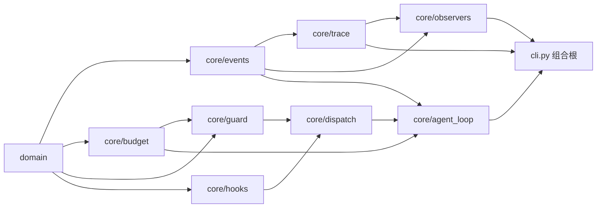
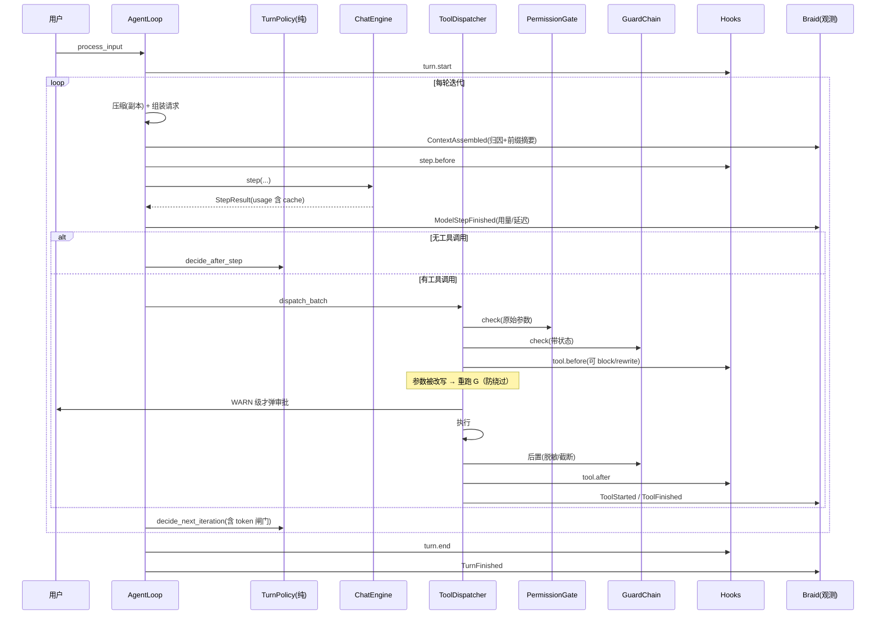

# AI-Coding — R4 设计文档（可观测层 / 门卫 / 钩子）

> **本文是什么**：R4 的完整设计文档。它取代此前那份 R4 草稿，把「要做什么、为什么、怎么落地、怎么验证、风险在哪、要你拍板什么」一次讲清。
>
> **依据**：已核验的既有代码（`core/{events,agent_loop,dispatch,turn_policy}.py`、`infra/{deadline,subprocess_runner}.py`、`ai/openai_engine.py`、`tools/base.py`、`domain/*`、`service/session_service.py`），
> 既有文档（`docs/architecture.md`、`data-contracts.md`、`features.md`、`r1-analysis.md`、`r2-analysis.md`、`r3-analysis.md`），
> 以及外部对标（[r4a-genericagent-research.md](r4a-genericagent-research.md)）。
>
> **前置**：R1 把 `LoopObserver` 作为唯一外发通道预留（`docs/r1-analysis.md` §0：「runtime 的 tracing / guardrails / hooks 后续自建」）。R4 就是那个「后续」。
>
> **状态**：设计评审中。§13 的 15 个决策点拍板后，按 §14 的 R4a → R4b → R4c 顺序 TDD 实现。

---

## 0. 先把话说清楚：这三层分别是什么、为什么是现在

### 0.1 先定义「harness 层」

外部对标（GenericAgent）给了一个很好用的定义：**harness = 围绕模型的脚手架**——工具接口、上下文纪律、记忆、停止判定。
它的原话是「这套工具集本身就是 harness」。按这个定义回看本项目：

| 层 | 内容 | 状态 |
|---|---|---|
| **harness（脚手架）** | `ToolRegistry` 的工具接口、`ContextManager` 的压缩纪律、`TaskState` 清单、`TurnPolicy` 停止判定、`MemoryService` 记忆 | **R1–R3 已建** |
| **观测层**（本文的 R4a） | 记录发生了什么、花了多少 token、哪一步降级了 | 缺（R1 只留了 `LoopObserver` 接缝） |
| **门卫**（本文的 R4b） | 运行时**带状态**的判定与拦截 | 缺（只有无状态的 `PermissionGate`） |
| **钩子**（本文的 R4c） | 用户自定义的生命周期扩展点 | 缺 |

也就是说：**harness 已经建好了，R4 补的是 harness 的「眼睛（观测）」「刹车（门卫）」「插槽（钩子）」。**

### 0.2 三者分工（一条判据，避免边界糊掉）

| | 观测层 | 门卫 | 钩子 |
|---|---|---|---|
| 谁写的 | 我们 | 我们 | **用户** |
| 干什么 | **记录**（只读） | **判定**（可拦、可改写） | **扩展**（可观察、可拦、可注入、可改写） |
| 输入 | 事件流 | `(call, ctx, TurnView)` | 点位上下文 |
| 能否改变回合走向 | **不能**（严禁） | 能（拒绝 / 改写参数） | 能（按能力矩阵，默认最窄） |
| 默认开关 | 开（只记元数据） | 开（仅重复调用守卫） | **关** |
| 失败时 | 静默降级，绝不打断 | **fail-closed**（拒绝） | 观察/注入类 fail-open，阻断/改写类 fail-closed |

一句话：**观测层永远不能影响回合；门卫永远不能静默放行；钩子永远不能让回合崩掉。**

### 0.3 为什么是现在（而不是更早/更晚）

- R1 之后循环归我们，事件流已经存在——**记录的成本已经付过了**，现在不接就是浪费。
- R2 之后「任何等待都有上限」——观测层写盘、钩子跑子进程都能复用 `run_with_deadline` + `subprocess_runner`，**纪律已经现成**。
- R3 之后记忆与压缩有了缓存纪律（系统提示逐字节静态、只 append）——**现在才有资格谈「缓存命中率」这类指标**，早于 R3 谈没意义。
- 再往后（多智能体编排、自主调度）都需要「谁花了多少、谁卡住了」，**观测是后续所有能力的地基**。

### 0.4 现状核验：五个空洞 + 三条现成接缝（都有代码证据）

**空洞（每条我都实跑核验过）**

| # | 空洞 | 证据 |
|---|---|---|
| 1 | **用量取到即丢** | `ai/openai_engine.py` 解析 `include_usage` 帧填进 `StepResult.usage`；`grep '\.usage' ai_coding/core ai_coding/cli.py ai_coding/ui` → **零命中** |
| 2 | **时间只有一半** | `core/events.py` 全文件唯一的时间字段是 `ToolFinished.duration_ms`；模型步、审批等待、压缩耗时全无 |
| 3 | **静默降级不可见** | 8 处只有 `_log.debug` 或裸 `pass`：`agent_loop._compress`（压缩超时）、`_memory_block`、`_harvest`、`compact_session`、`_save`（`OSError`）、`subagent`（`WorktreeError`）、`mcp.open_all`、`_SafeObserver` |
| 4 | **子智能体是黑盒** | `core/subagent.py` 构造内层 `AgentLoop` 时**没传 `observer`** → 子循环全部事件进 `NullObserver`；父侧只拿到最终 packet |
| 5 | **放弃式取消没有证人** | `infra/deadline.py` 的 `on_abandon` 回调**零生产调用点**；被放弃的任务只在 `_drain` 里 `_log.debug` |

**现成接缝（不用新造轮子）**

1. `core/events.py` 的 `LoopObserver.on_event(event)` + `_SafeObserver` 兜底 —— **trace 记录器就是一个 observer**；
2. `infra/subprocess_runner.run_process` / `run_process_async`（线程 + `killpg`）与 `infra/deadline.run_with_deadline`（心跳 tick + 放弃式取消）—— **钩子跑子进程的纪律已有**；
3. `ToolContext.emit` 已接进循环的 `_emit` —— 工具侧事件有通路。

### 0.5 外部对标结论（GenericAgent，详见独立报告）

对 `lsdefine/GenericAgent`（14.2k star，MIT，arXiv 2604.17091）做了源码级调研。四条结论直接改写了本方案：

| 修订 | 改了什么 | 依据 |
|---|---|---|
| **R-1** | 用量里**必须带 cache 明细**（provider 真值优先），前缀相似度只是兜底 | GA 抓 `cached_tokens` / `cache_read_input_tokens` / `cache_creation_input_tokens` |
| **R-2** | 钩子要有**进程内 python 形态**（GA 的 `register`/`trigger`），不只子进程命令 | GA 的 hook 是进程内回调且可改写 ctx |
| **R-3** | **不采用** GA 的「钩子永远 fail-open」；阻断/改写类必须 fail-closed | GA 的钩子拦不住任何东西 |
| **R-4** | 记忆索引从「600 字符上限」升格为**设计不变量**并测试锁死 | GA 明写 "L1 remains bounded even as L2 and L3 expand" |

**验证性发现**（说明我们方向没错）：GA 独立收敛到「别动前缀否则缓存崩」（论文称约 80% 回合命中）；它的 `_sanitize_leading_user_msg` ≡ 我们的 `ensure_tool_pairing`；它的 `file_patch` 唯一匹配 ≡ 我们 `edit`；它的 `code_run` 每回合一次 ≡ 我们 `bash` 串行。

**不照搬的**：工具 schema 省略（原生 function calling 不适用）、永远 fail-open、按 pid 的裸文本日志、monkey-patch 取用量、只靠提示词纪律保证记忆质量、全局可变 `STATS`、把自进化日志注入系统提示。理由逐条见 `r4a-genericagent-research.md` §9。

**记为 R5 候选**（不进 R4）：Stage-4 工作记忆锚（每轮附带「最近 N 轮一句话摘要 + key_info」）、记忆条目的 `verified` 标记（"No Execution, No Memory"）。

---

## 1. R4 必须守住的既有不变量

R4 是**加层**，不是改造。加层最容易犯的错是顺手把老纪律碰坏。下面 12 条是 R1–R3 已经建立、R4 必须继续满足的约束，实现时逐条对照：

| # | 不变量 | 出处 | R4 如何守住 |
|---|---|---|---|
| I1 | **系统提示逐字节静态**（会话内不变，记忆不进系统提示） | R3 §1.13，测试锁死 | 钩子的 `inject` 只进**易失尾部块**；R4 不改任何提示词文本 |
| I2 | **历史只追加**（不重写中段） | R3 §1.13 | trace 不碰会话；压缩仍只在副本上 |
| I3 | **记忆/增强组件永不抛错、永不阻塞回合** | R1/R3 | trace 写盘失败 → 记 `Degraded` 后继续。> **R10 更正**：记忆这一侧「永不阻塞回合」已不成立（召回命中要同步写 `hits`/`last_used`）；「永不抛错」仍然成立，trace 侧不变 |
| I4 | **任何等待都有上限**（放弃式取消） | R2 §7 | 钩子子进程与 trace 写盘都走上限纪律 |
| I5 | **进程执行只有一个出口** | R2 §7.3 | 钩子只能用 `infra/subprocess_runner`，禁止 `create_subprocess_*` |
| I6 | **工具结果结构化、拒绝也结构化、tool 配对永不破** | R1/R2 | 门卫拒绝 = 结构化 `ToolResult`，仍写回 `role=tool` 消息 |
| I7 | **观察者不得打断回合** | R1a-4 | 所有新 observer 都包 `_SafeObserver`；`Braid` 逐个吞异常 |
| I8 | **会话文件是纯对话**（camelCase，Java 兼容；增强不进会话文件） | M0/R3 | trace、账本、钩子上下文一律**不进** `sessions/*.json` |
| I9 | **静默降级是既定策略**（不因增强组件失败而中止会话） | `architecture.md` | R4 保留降级，只是**让它可见**（`Degraded` 事件） |
| I10 | **依赖单向**（`domain` 最底，`core` 编排，`cli` 组合根） | `architecture.md` | 四个新模块只依赖 `domain`/`infra`，不反向依赖 `agent_loop` |
| I11 | **`turn_policy` 是纯单元**（无 IO、无事件、可枚举决策表） | R2 §6.7 | token 闸门也做成纯判断，只加字段与表行 |
| I12 | 质量门禁 | 现状 | 既有 **633 例**测试全绿、`ruff` 0、`mypy --strict` 0 |

---

## 2. R4 新增的设计原则与不变量

| # | 原则 | 具体含义 | 违反会怎样 |
|---|---|---|---|
| P1 | **观测只读** | trace/账本**绝不**修改消息、任务、记忆、参数 | 一旦能改，缓存假设与可复现性全崩 |
| P2 | **门卫 fail-closed** | 守卫抛异常 = 拒绝（`error="guard_error"`），不静默放行 | 静默放行等于没有守卫 |
| P3 | **失败语义按能力分** | 钩子：观察/注入类 fail-open；阻断/改写类 fail-closed | 通知脚本写错不该毁掉回合；拦截脚本写错必须拦住 |
| P4 | **落地即脱敏** | 任何字符串**写进 trace 之前**过 `Redactor` | 轨迹就是泄漏面（`config.local.yaml` 里有真实 key） |
| P5 | **默认不记全文** | 默认只记元数据 + ≤500 字符预览；`capture: full` 额外写一份取自**会话**的回合快照（同样脱敏/有上限） | 轨迹体积失控、泄漏面扩大 |
| P6 | **事件是不可变值** | 新事件一律 `@dataclass(frozen=True)` | 观察者之间互相污染 |
| P7 | **只追加带默认值的字段** | 改动既有 frozen dataclass 时新字段必须有默认值 | 破坏既有调用点与落盘兼容 |
| P8 | **新能力默认最窄** | 钩子默认关；门卫只开重复调用守卫；trace 默认只记元数据 | 默认值就是事实标准 |
| P9 | **span 必有父子** | 每个事件要么是根（回合），要么带 `span`/`parent` | 并发下无法重建执行树 |
| P10 | **预算是事后闸门** | token 上限在**迭代边界**判定，单步可能超限一次 | 假装能提前知道成本是撒谎 |
| P11 | **trace 独立于会话** | trace 是执行记录，会话是对话记录，两者不互相引用为真源 | 两个真源必然打架 |
| P12 | **新单元可离线测** | trace/账本/守卫/钩子判决全是纯同步函数（钩子执行器除外） | 观测层不该需要网络才能测 |

---

## 3. 目标架构

### 3.1 分层与依赖方向

```
domain/                  TurnStatus.BUDGET、ModelConfig 价格字段、ToolContext.call_id（纯数据）
core/events.py           [改] 新增事件值 + 字段补强（依赖 domain）
core/observers.py        [新] Braid（多观察者扇出）、ScopedObserver（父子归属）
core/trace.py            [新] TraceRecorder(LoopObserver) / TraceStore / Redactor / 前缀共享度量
core/budget.py           [新] UsageTotals / Pricing / BudgetLedger / 缓存口径归一
core/guard.py            [新] Guard / GuardChain / TurnView / 4 个内置守卫
core/hooks.py            [新] HookPoint / HookSpec / HookResult / PythonHookRunner / CommandHookRunner
core/dispatch.py         [改] 接门卫链 + 两个钩子点位 + 改写后重跑闸门
core/agent_loop.py       [改] 发新事件、建账本、接钩子、发降级事件、TurnOutcome 带 usage
core/turn_policy.py      [改] TurnSnapshot.tokens_spent + max_turn_tokens（纯单元）
core/subagent.py         [改] 接受 observer，内层循环套 ScopedObserver
tools/base.py            [改] ToolContext.call_id
ai/openai_engine.py      [改] usage 归一增加 cache 明细
infra/subprocess_runner.py [改] run_process 支持 stdin_data（钩子要能读 stdin）
config/models.py         [改] TracingConfig / GuardConfig / HooksConfig / AIConfig.turn_token_budget
cli.py + ui/             [改] 组合观察者、trace/budget 子命令与 slash
```

依赖方向图：



**没有新依赖**：JSONL 用 `infra/json_utils`，子进程用 `infra/subprocess_runner`，上限用 `infra/deadline`。R4 不引入任何第三方包。

### 3.2 一次回合的完整时序（含三个闸门）



**工具调用的判定管线（精确顺序，实现时照抄）**：

```
A 判定阶段（不触达用户）
  A1  未知工具            → 拒绝 unknown_tool            （既有）
  A2  权限门(原始参数)     → DENY → 拒绝 denied           （既有语义）
  A3  门卫链               → DENY → 拒绝 guard_denied     （R4b 新增）
                          → REWRITE → 换参数
  A4  hook: tool.before    → BLOCK → 拒绝 hook_blocked    （R4c 新增，fail-closed）
                          → REWRITE → 换参数
  A5  ★参数若被改写 → 重跑权限门（新参数）→ DENY → 拒绝     ← 关键安全规则
B 人阶段
  B1  权限门判定为 WARN 且未被 A5 拒绝 → 审批回调          （既有）
C 执行阶段
  C1  执行（有界预算）
  C2  后置门卫（脱敏/截断）
  C3  hook: tool.after（观察/注入，fail-open）
  C4  发 ToolFinished → 回写 role=tool 消息
```

> **A5 为什么必须存在**：钩子能改写参数，就等价于给了钩子一条"绕过权限门"的路径。比如把 `bash` 的
> `ls` 改写成 `rm -rf /`——如果改写后不再过门，硬拒表形同虚设。**任何改写都必须重新过闸。**

### 3.3 span 模型

对齐 GA 的 span 类型，但用我们自己的事件流表达：

| span 类型 | 对应 | parent |
|---|---|---|
| `turn` | 一次 `process_input` | 无（根） |
| `iteration` | 一轮循环 | turn |
| `step` | 一次模型调用 | iteration |
| `tool` | 一次工具调用 | iteration |
| `subagent` | 一次子智能体运行 | 该次 `subAgent` 调用的 tool span |

实现方式：`ScopedEvent(scope, parent, event)` 把子智能体的事件包一层扇出到父观察者；
`ToolStarted/ToolFinished` 增加 `iteration` 字段；`ToolContext.call_id` 让工具（尤其 `subAgent`）知道自己属于哪次调用。

### 3.4 存储布局

```
<workspace>/
├─ sessions/<session_id>.json          # 会话（既有，纯对话，Java 兼容）—— R4 不碰
├─ .memory                             # 记忆索引（既有 R3）      —— R4 不碰
└─ .ai-coding/
   ├─ traces/<session_id>/turn-<n>.jsonl   # 每回合一份事件流（R4a）
   ├─ traces/<session_id>/summary.json     # 该会话的账本汇总（R4a，回合末原子写）
   └─ hooks/*.py                           # 进程内钩子自动发现目录（R4c）
```

轮转与清理：单回合超过 `max_turn_bytes` 截断并留 `truncated` 标记；启动时清理超过 `retention_days` 的会话目录。
**轨迹永不写进 `sessions/`**（I8）。

### 3.5 组件职责一览

| 组件 | 一句话职责 | 不负责 |
|---|---|---|
| `Braid` | 把事件分发给多个观察者，互不干扰 | 不做任何过滤/变换 |
| `ScopedObserver` | 给子循环事件打上父子归属 | 不聚合、不采样 |
| `TraceRecorder` | 把事件脱敏后追加成 JSONL | 不判断对错、不改回合 |
| `TraceStore` | 路径、轮转、清理、原子写 | 不解析内容 |
| `Redactor` | 高置信密钥模式替换 | 不做语义判断 |
| `BudgetLedger` | 累计用量、算成本、算缓存率、算校准比 | 不做决策（决策在门卫/策略） |
| `GuardChain` | 顺序判定，首个非 ALLOW 生效 | 不执行工具、不审批 |
| `HookRunner` | 按点位执行用户钩子，返回判决 | 不决定点位顺序（点位由循环定） |

---

## 4. R4a — 可观测层

### 4.1 事件契约（`core/events.py`）

新增 4 个事件：

```python
@dataclass(frozen=True)
class ModelStepFinished:
    """一次模型步的收尾事实：真实用量 + 延迟 + 结束原因。"""
    index: int
    finish_reason: str | None = None
    text_chars: int = 0
    tool_call_count: int = 0
    usage: dict[str, int] | None = None      # prompt/completion/total（原样保留）
    cached_tokens: int | None = None         # R-1：provider 报的缓存命中 token
    cache_write_tokens: int | None = None    # R-1：Anthropic 的 cache_creation
    latency_ms: int = 0

@dataclass(frozen=True)
class ContextAssembled:
    """这次请求由什么拼成的。只有计数与摘要，绝不带内容。"""
    iteration: int
    system_chars: int
    tools_chars: int = 0                      # 工具 schema 也占 prompt token，必须计入
    history_messages: int = 0
    history_chars: int = 0
    tail_blocks: tuple[tuple[str, int], ...] = ()   # (("memory", 540), ("task", 880))
    estimated_tokens: int = 0
    prefix_shared_chars: int = 0              # 与上一次请求的最长公共前缀（字符）
    prefix_shared_ratio: float = 0.0          # 兜底指标，见 4.4
    digest: str = ""                          # sha1(前 4KB)，只用于判断「前缀变了没」

@dataclass(frozen=True)
class Degraded:
    """一个增强组件静默降级了——让 8 处 except: pass 变得可见。"""
    component: str   # context_compress | memory_block | memory_harvest | persist |
                     # trace_write | worktree_isolate | mcp_server | observer ...
    reason: str
    fallback: str = ""

@dataclass(frozen=True)
class ScopedEvent:
    """嵌套执行（子智能体）的事件，带父子归属地扇出到同一个观察者。"""
    scope: str          # 例如 "subagent:call_abc"
    parent: str         # 父 span id（通常是那次 subAgent 调用的 call_id）
    event: "LoopEvent"  # 递归引用；实现时用 TypeAlias + 字符串标注
```

字段扩展（只追加带默认值，满足 P7）：

| 既有类型 | 新增字段 | 为什么 |
|---|---|---|
| `ToolStarted` | `iteration: int = 0` | 同批并发工具无法从事件流重建，必须带轮次 |
| `ToolFinished` | `iteration: int = 0` | 同上 |

`LoopEvent` 联合与 `__all__` 同步扩充。`ScopedEvent` 是递归类型，实现时用显式 `TypeAlias` 并让字段用字符串标注。

### 4.2 trace 的 JSONL 契约

一行一事件，**追加写**（与 R3 的 append-only 纪律一致）：

```json
{"v":1,"ts":"2026-09-23T10:00:00.123Z","session":"6c53b9","turn":3,"span":"i2","parent":"turn","iter":2,"evt":"ModelStepFinished","data":{"index":2,"prompt_tokens":6900,"completion_tokens":140,"cached_tokens":6100,"latency_ms":1840}}
```

不变式：

1. `data` 是事件字段的 JSON 化结果；**字符串一律先过 `Redactor`**（P4）；
2. **不写内容大对象**：预览沿用 `events.preview`（500 字符上限）——事件是**显示通道**，R1a-3 就规定 10MB 的工具输出绝不能搭事件的车；`capture: full` 时另外写一份 `turn-<n>.full.json`，内容取自**会话**（全量文本的唯一真源），同样脱敏、同样有上限。**要全量就去拿真源，不要指望从事件里抠**；
3. 写盘失败 → 发一条 `Degraded(component="trace_write")` 并继续（I3），同一回合内不重复刷屏；
4. 单回合超 `max_turn_bytes` → 截断 + 写一条 `{"evt":"truncated",...}` 标记；
5. 原子性：单行 append（`O_APPEND`）不会写坏已有一行；`summary.json` 用临时文件 + `os.replace`（沿用 `SessionService` 的手法）。

### 4.3 `BudgetLedger` 契约（`core/budget.py`）

```python
@dataclass(frozen=True)
class Pricing:
    input_per_1k: float = 0.0
    output_per_1k: float = 0.0

@dataclass
class UsageTotals:
    prompt_tokens: int = 0
    completion_tokens: int = 0
    cached_tokens: int = 0
    steps: int = 0
    @property
    def total_tokens(self) -> int: ...

class BudgetLedger:
    """一个回合的账本。纯同步、无 IO（P12）；喂给门卫与 turn_policy。"""
    def record_step(self, usage: dict[str, int] | None, *, cached: int | None,
                    cache_write: int | None, latency_ms: int) -> None: ...
    def record_assembly(self, estimated_tokens: int, prefix_ratio: float) -> None: ...
    @property
    def totals(self) -> UsageTotals: ...
    @property
    def calibration(self) -> float | None:
        """真实 prompt_tokens / 自研估算；衡量 estimate_tokens 的系统性偏差。"""
    @property
    def cache_hit_ratio(self) -> float | None:
        """provider 报的 cached_tokens / prompt_tokens；不报则为 None（不猜）。"""
    def cost(self, pricing: Pricing | None) -> float | None: ...
```

**口径（必须写进文档，否则数字会被误读）**：

| 指标 | 精确定义 | 注意 |
|---|---|---|
| `total_tokens` | 本回合**所有模型步**的 prompt+completion 累加 | 上下文每轮重发，所以「5 轮 × 20k prompt ≈ 100k」；**这就是真实成本** |
| `calibration` | `Σprompt_tokens / Σestimated_tokens` | `estimated_tokens` **必须含工具 schema**，否则系统性偏低（新增 `tools_chars` 就是为它） |
| `cache_hit_ratio` | `cached_tokens / prompt_tokens` | provider 不报 → `None`；首次请求必然 0（缓存有最低门槛与 TTL），所以看**第 2 回合起**的趋势 |
| `cost` | `prompt/1000×price_in + completion/1000×price_out` | 价格未知（默认 0）→ 返回 `None`，**不假装是 0** |

### 4.4 缓存度量：真值优先，估算兜底（R-1）

**已知的 provider 形状**（不认识的一律 `None`，绝不猜）：

| 提供商 | 字段 |
|---|---|
| OpenAI | `usage.prompt_tokens_details.cached_tokens` |
| Anthropic | `usage.cache_read_input_tokens`、`usage.cache_creation_input_tokens` |
| DeepSeek | `usage.prompt_cache_hit_tokens`、`usage.prompt_cache_miss_tokens` |
| 其它/未知 | `None` |

> **诚实声明**：`config.local.yaml` 用的是 DashScope（qwen3.8-max），**它是否上报 cache 明细目前未知**。
> 所以验收脚本 C2 的第一件事就是**把真实响应里的 usage 键原样打印出来**，据实适配归一表；
> 在适配之前 `cache_hit_ratio` 会是 `None`，此时才回退到 `prefix_shared_ratio`（我们自己的最长公共前缀度量）。

这是刻意的降级顺序：**provider 真值 > 我们的估算**。GA 只做了前半，我们两样都要，但必须标清楚谁是真值。

### 4.5 脱敏（`Redactor`）

高置信模式（宁可漏脱，也不误伤大段正常文本）：

| 模式 | 例子 |
|---|---|
| `sk-[A-Za-z0-9]{16,}` | OpenAI / DashScope key |
| `gh[pousr]_[A-Za-z0-9]{36}` | GitHub token |
| `AKIA[0-9A-Z]{16}` | AWS access key |
| `-----BEGIN ... PRIVATE KEY-----` 到 `-----END` | PEM 私钥（整块） |
| `(?i)(api[_-]?key\|token\|password\|secret)\s*[:=]\s*\S{8,}` | 键值对形态 |

行为：命中 → 替换为 `«redacted:前4位…»`；**幂等**（对已脱敏文本再跑不变）；纯函数、可离线测。

**应用面（必须在写盘前）**：

1. trace JSONL 的每个字符串值 —— **强制**；
2. `summary.json` —— 只有数字，天然安全；
3. **钩子的 stdin** —— 默认**也脱敏**，需要原值必须显式 `raw: true`（见 §6.3）；
4. 控制台渲染 —— 复用同一个 `Redactor`（`ConsoleObserver` 的 params 预览）。

### 4.6 子智能体扇出（父子 span）

```python
# core/subagent.py：内层循环挂一个带归属的观察者
loop = AgentLoop(..., observer=ScopedObserver(
    scope=f"subagent:{token}", parent=parent_span, inner=self._observer))
```

配套两处小改动：

1. `ToolContext` 增加 `call_id: str = ""`；`ToolDispatcher._handle` 用 `dataclasses.replace(ctx, call_id=call.id)` 给**每次调用**一份独立 ctx（一批调用共用一个 ctx，但每次调用要能自证身份）；
2. `SubAgentTool.execute` 把 `ctx.call_id` 作为 `parent_span` 传给 runner。

结果：父回合轨迹里，`subAgent` 调用是一个 `tool` span，其下挂整棵 `subagent` 子树（子循环的每一轮、每次工具调用）。**子智能体的推理仍不回传父上下文（沿用 R1a-5），但它的执行事实留在轨迹里。**

### 4.7 逐文件实现步骤（R4a）

| 步骤 | 文件 | 动作 | 可单测 |
|---|---|---|---|
| a1 | `core/events.py` | 加 4 个事件 + `ToolStarted/ToolFinished.iteration`；扩 `LoopEvent` 与 `__all__` | ✅ |
| a2 | `core/observers.py`（新） | `Braid`（顺序转发、逐个吞异常）；`ScopedObserver`（包 `ScopedEvent`） | ✅ |
| a3 | `core/trace.py`（新） | `Redactor`、`canonical_request()`、`prefix_shared()` | ✅ |
| a3b | `core/trace.py` | `TraceStore`（路径/截断/清理/原子）+ `TraceRecorder(LoopObserver)` | ✅ |
| a4 | `core/budget.py`（新） | `Pricing`、`UsageTotals`、`BudgetLedger`、缓存归一 `normalize_cache()` | ✅ |
| a5 | `domain/model_config.py`、`config/models.py` | `ModelConfig.price_input_per_1k/price_output_per_1k`；`TracingConfig` | ✅ |
| a5b | `ai/openai_engine.py` | `_usage_to_dict` 增加 cache 明细归一 | ✅ |
| a5c | `tools/base.py` | `ToolContext.call_id` | ✅ |
| a6 | `core/agent_loop.py` | 建账本；每轮 `ContextAssembled`；模型步后 `ModelStepFinished`；8 处降级点发 `Degraded`；`TurnOutcome.usage` | 集成 |
| a7 | `core/subagent.py` + `tools/subagent_tool.py` | observer 注入 + `call_id` 传递 | ✅ |
| a8 | `core/dispatch.py` | 每次调用 `replace(ctx, call_id=...)`；事件带 `iteration` | ✅ |
| a9 | `ui/trace_render.py`（新）、`cli.py`、`ui/{slash,repl}.py` | 渲染器 + `ai-coding trace list/show/budget` + `/trace` `/budget` | ✅ |

### 4.8 数据流影响与性能预算

- **不新增请求内容**：`ContextAssembled` 只带计数与摘要，不进对话、不进 `sessions/*.json`（I8）；
- **不改模型可见内容**：R4 不改任何提示词文本（I1），R3 那条「系统提示逐字节静态」的测试必须继续绿；
- **内存**：`prefix_shared()` 需要保留上一次的规范串（与上下文同阶），**回合结束即释放**；
- **磁盘**：一次「5 轮 × 3 工具」的回合约 26 行事件、每行 ≤1KB → **约 26KB/回合**；`capture: full` 按上下文大小线性增长，故默认关闭；
- **耗时目标**：每回合 trace 写入 **< 5ms**（一次 open + append）；超标则退化为「回合末批量落盘」，实测写进验收记录。

---

## 5. R4b — 门卫（Guard）

### 5.1 契约（`core/guard.py`）

```python
class GuardVerdict(enum.Enum):
    ALLOW = "allow"
    DENY = "deny"
    REWRITE = "rewrite"

@dataclass(frozen=True)
class GuardDecision:
    verdict: GuardVerdict
    reason: str = ""
    params: dict[str, Any] | None = None   # 仅 REWRITE 时非空
    guard: str = ""                        # 哪个守卫做的决定（进轨迹）

@dataclass(frozen=True)
class TurnView:
    """门卫能看到的只读回合视图（来自账本与循环，不是全局状态）。"""
    iteration: int = 0
    tokens_spent: int = 0
    prior_calls: tuple[tuple[str, str], ...] = ()   # (工具名, 参数指纹)
    task_open: int = 0

class Guard(Protocol):
    name: str
    def check(self, call: ToolCall, ctx: ToolContext, view: TurnView) -> GuardDecision: ...

class GuardChain:
    def __init__(self, guards: Sequence[Guard]) -> None: ...
    def check(self, call: ToolCall, ctx: ToolContext, view: TurnView) -> GuardDecision: ...
    def after(self, call: ToolCall, result: ToolResult, ctx, view) -> ToolResult: ...
```

纪律（与权限门同源）：

1. 链内**按注册顺序取第一个非 ALLOW**；确定性优先于聪明。
2. **守卫抛异常 = 拒绝**（`error="guard_error"`），不静默放行（P2）。
3. 守卫**纯同步、无 IO**、不看网络（P12）；需要状态就从 `TurnView` 拿。
4. 守卫**不改上下文/记忆**，只能拒绝或改这次调用的参数。

### 5.2 四个内置守卫

| 守卫 | 生效条件 | 规则 | 默认 | 依据的真实失效模式 |
|---|---|---|---|---|
| `DuplicateCallGuard` | `duplicate_threshold > 0` | 同一 `(工具名, 参数指纹)` 第 N 次调用起拒绝；拒绝结果里**带上一次结果的 call_id**，让模型直接复用 | **开（阈值 2）** | ReAct 循环经典病：模型原地重复 `read`/`bash`。既省 token 又破死循环 |
| `BashPolicyGuard` | 配置了 `bash_deny` / `bash_confirm` | 在权限门硬拒表**之外**，允许配置追加拒绝模式（命中即 DENY）与「必须确认」模式 | 开（空表 = 不生效） | 权限门的硬拒表写死了，用户加不了自己的红线 |
| `SecretGuard`（后置） | 总是 | 高置信密钥模式在**写盘前**强制脱敏；是否同时改历史由 `redact_history` 控制 | trace 强制；history 默认关 | `config.local.yaml` 里就是真实 key，轨迹落盘即泄漏面 |
| `PathEscapeGuard` | `strict_paths` | `bash` 参数里出现工作区外的绝对路径 / `cd /`：默认**只观察**（放行 + 轨迹标记），`strict_paths: true` 才拒绝 | 观察 | `Sandbox` 只管文件工具；`bash` 能绕过 `ctx.workspace` |

参数指纹：`sha1(工具名 + json.dumps(params, sort_keys=True))` 截断 12 位。**参数一变指纹就变**，所以「读同一文件的不同区间」不会被误判成重复。

### 5.3 REWRITE 的转写保真（一个必须想清楚的细节）

钩子/门卫改写参数后，**落盘的 assistant 消息里仍然是模型原始请求的 `toolCalls`**（那确实是模型说的），而 `role=tool` 消息是执行**新参数**的结果。不做标记，会话文件里就会出现「模型请求 X，结果却是 Y」的不可解释落差。

处置：

1. 被改写时，`ToolResult.data` 里加 `{"rewritten_from": {...原始参数...}, "rewritten_by": "guard:<name>|hook:<name>"}`；
2. 轨迹里 `ToolStarted.params` 记**改写后**的参数，`data.rewritten_from` 记原始参数；
3. `output` 文本给模型一句明确提示：`note: parameters were adjusted before execution`——**模型必须知道自己要的和执行的不是一回事**，否则它会对结果做错误推断。

这是**安全相关的可解释性**要求，不是日志洁癖。

### 5.4 回合级 token 闸门：放进 `turn_policy`，不进门卫链

理由：R2c 已经把「要不要再来一轮」抽成纯单元（19 条决策表测试）。「token 花超了」是**同一类问题**，该呆在同一位；放进守卫链反而会让守卫越权决定回合生死。

改动（全是追加）：

```python
# TurnPolicyConfig
max_turn_tokens: int = 0        # 0 = 关闭
# TurnSnapshot
tokens_spent: int = 0
# decide_next_iteration（在既有两条判断之后追加）
if self.config.max_turn_tokens and snapshot.tokens_spent >= self.config.max_turn_tokens:
    return TurnDecision(TurnAction.FINISH, "turn token budget exhausted")
```

新增 `TurnStatus.BUDGET`，让三种「耗尽」在终态上可区分：`TIMEOUT`（时间）/ `MAX_ITERATIONS`（轮次）/ `BUDGET`（钱）。

**语义必须写清（P10）**：闸门在**迭代边界**判定，所以一次模型步可能把预算超掉；`max_turn_tokens` 比的是**本回合累计** token（含每轮重发的上下文），不是单轮。

**连带影响（必须一起改，否则状态会静默错位）**：

| 位置 | 改动 |
|---|---|
| `domain/loop.py::TurnStatus` | 新增 `BUDGET = "budget"` |
| `core/subagent.py::_STATUS_MAP` | 加 `"budget": "max_iterations"`（子智能体预算耗尽 = 干到一半，语义等同轮次耗尽；不加会落到 `.get(..., "error")` 变成假错误） |
| `ui/console.py` | 可选：`TurnFinished` 时提示预算耗尽 |
| `docs/data-contracts.md` | 同步 `TurnStatus` 取值表 |

### 5.5 逐文件实现步骤（R4b）

| 步骤 | 文件 | 动作 | 可单测 |
|---|---|---|---|
| b1 | `core/guard.py`（新） | 契约 + `GuardChain` + 参数指纹 | ✅ |
| b2 | `core/guard.py` | `DuplicateCallGuard` | ✅ |
| b3 | `core/guard.py` | `BashPolicyGuard` + `PathEscapeGuard` | ✅ |
| b4 | `core/guard.py` | `SecretGuard`（复用 `Redactor`；`after()` 阶段） | ✅ |
| b5 | `config/models.py` | `GuardConfig` | ✅ |
| b6 | `core/dispatch.py` | 接 `guard_chain`：A3 前置、A5 改写后重跑权限门、C2 后置；新 `error` 码 `guard_denied` / `guard_error`；`rewritten_from` 转写 | ✅ |
| b7 | `core/agent_loop.py` | 每轮构造 `TurnView`；`tokens_spent` 回喂 `TurnSnapshot` | 集成 |
| b8 | `core/turn_policy.py` + `domain/loop.py` | `max_turn_tokens` + `TurnStatus.BUDGET` + 决策表加行 | ✅ |
| b9 | `core/subagent.py` | `_STATUS_MAP` 加 `budget` | ✅ |
| b10 | `cli.py` | 装配 `GuardChain`；`config-check` 打印生效守卫 | ✅ |

---

## 6. R4c — 钩子（Hooks）

### 6.1 点位 × 能力矩阵（默认取最窄）

| 点位 | 触发时机 | observe | inject | block | rewrite | 备注 |
|---|---|:---:|:---:|:---:|:---:|---|
| `session.start` | 新会话 | ✅ | — | — | — | 只观察 |
| `turn.start` | 回合开始（注入前） | ✅ | ✅ | — | — | `inject` 进易失尾部 |
| `step.before` | 每次模型调用前 | ✅ | ✅ | — | — | **不允许 block**（模型步没有「拒绝」语义） |
| `tool.before` | 判定阶段 A4 | ✅ | — | ✅ | ✅ | **唯一允许改参数**的点；改写后重跑权限门 |
| `tool.after` | 执行后 C3 | ✅ | ✅ | — | — | 注入 lint/测试反馈 |
| `compact.before` / `compact.after` | 上下文压缩前后 | ✅ | — | — | — | 审计压缩时机 |
| `memory.harvest` | 回合末收割 | ✅ | — | — | — | 外部同步 |
| `subagent.start` / `subagent.end` | 子智能体起止 | ✅ | ✅ | — | — | 给子智能体附加约束 |
| `turn.end` | 回合结束 | ✅ | — | — | — | 通知 / 入账 |
| `stop.blocked` | todo 门禁挡住停止时 | ✅ | — | ✅ | — | 可推翻门禁的阻断 |

### 6.2 两种形态（R-2）

| | `kind: python`（首选） | `kind: command` |
|---|---|---|
| 运行位置 | 同进程 | 子进程 |
| 发现方式 | `plugin_dir` 下自动发现 `*.py`（GA 的 `discover_and_load` 形态） | 配置里给 `command` |
| 传参 | 直接拿到 ctx 字典 | stdin 一行 JSON |
| 返回 | 返回值可替换 ctx（`{"decision": ...}`） | stdout 一行 JSON |
| 速度 | 快（无进程开销） | 慢（进程启动） |
| 隔离 | 无（共享解释器，崩了会波及） | 有（独立进程 + 进程组 kill） |
| 适用 | 本仓库内的策略、格式化、审计 | 跨语言、需隔离、第三方工具 |

两者**判决结构、能力矩阵、失败语义完全一致**；`python` 形态也用 `try/except` 兜底（I3/P3），所以它崩了不会带走回合。

### 6.3 执行契约

```jsonc
// stdin（command 形态；python 形态直接给 ctx dict）
{"hook":"tool.before","point":"tool.before","session":"6c53b9","turn":3,"iteration":2,
 "tool":{"name":"bash","params":{"command":"git push"}},"workspace":"/path/to/ws"}

// stdout（缺省 = 放行）
{"decision":"allow"}
{"decision":"block","reason":"git push 未经评审"}
{"decision":"rewrite","params":{"command":"git ls-files"}}
{"decision":"inject","context":"<文本>"}
```

约束（每条对应一条既有纪律或本文原则）：

| 约束 | 取值 | 纪律来源 |
|---|---|---|
| 超时 | `hooks.timeout_seconds`（默认 10） | `run_with_deadline`（R2a，放弃式取消） |
| 子进程 | 必须走 `infra/subprocess_runner` | R2b（唯一出口，`killpg`） |
| **stdin 支持** | `run_process` 目前是 `stdin=DEVNULL`，**需新增 `stdin_data: bytes \| None = None`** | 本阶段顺带扩 |
| 环境 | **白名单**构造，**不含**模型 API key | 安全底线（`config.local.yaml` 里有真 key） |
| cwd | 工作区 | 与工具一致 |
| 顺序 | 同一批钩子**串行**执行，配置顺序即执行顺序 | 确定性 |
| 失败语义 | observe/inject → fail-open（记 `Degraded`）；block/rewrite → fail-closed | P3 |
| stdin 脱敏 | 默认**脱敏**；`raw: true` 才给原值 | P4 |
| 注入位置 | 进**易失尾部块** `<hook-context>`，不进历史、不进系统提示；`persist: true` 才落盘成 user 消息并留事件 | I1/I2（缓存纪律） |

### 6.4 为什么 `inject` 不进历史（缓存算术）

R3 实测：记忆进系统提示时前缀命中 **7%**，进尾部块 **94%**；每轮压缩历史中段只有 **26%**（改成分页后 **92%**）。钩子注入如果直接改历史，等价于每轮重写中段——**缓存立刻崩**。所以默认进尾部易失块：它每轮变化，但变化只在**尾部一个小区域**，前面的前缀（系统提示 + 历史）保持不变。

### 6.5 配置 schema

```yaml
hooks:
  enabled: false
  timeout_seconds: 10
  plugin_dir: ""            # 默认 <workspace>/.ai-coding/hooks；kind=python 时自动发现 *.py
  events:
    - point: tool.before
      match: { tool: "bash" }
      kind: command                 # 子进程：JSON in/out，跨语言、可隔离
      command: ["./scripts/deny-push.sh"]
      capability: block
    - point: tool.after
      match: { tool: "write" }
      kind: command
      command: ["ruff", "format"]
      capability: observe
    - point: tool.before
      kind: python                  # 进程内回调，可改写参数
      module: my_org_rules          # <plugin_dir>/my_org_rules.py
      entrypoint: check
      capability: rewrite
    - point: turn.end
      kind: command
      command: ["./scripts/notify.sh"]
      capability: observe
```

### 6.6 逐文件实现步骤（R4c）

| 步骤 | 文件 | 动作 | 可单测 |
|---|---|---|---|
| c1 | `infra/subprocess_runner.py` | `run_process` / `run_process_async` 增加 `stdin_data` | ✅ |
| c2 | `core/hooks.py`（新） | `HookPoint`、`HookSpec`、`HookResult`、`HookRunner` 协议、能力矩阵校验（声明了 `block` 但点位不支持 → 配置期报错） | ✅ |
| c3 | `core/hooks.py` | `CommandHookRunner`（JSON in/out、超时、环境白名单、失败语义） | ✅ |
| c4 | `core/hooks.py` | `PythonHookRunner`（自动发现、`entrypoint` 解析、返回值替换 ctx、异常按能力处理） | ✅ |
| c5 | `config/models.py` | `HooksConfig` + `HookEventConfig(point, match, kind, command, module, entrypoint, capability, persist, raw)` | ✅ |
| c6 | `core/dispatch.py` | 接 `tool.before`（A4）与 `tool.after`（C3） | ✅ |
| c7 | `core/agent_loop.py` | `turn.start/end`、`step.before`、`compact.*`、`memory.harvest`、`stop.blocked` 接线；`inject` 汇聚成尾部块 | 集成 |
| c8 | `core/subagent.py` | `subagent.start/end` | ✅ |
| c9 | `cli.py` | 装配两种 runner；`config-check` 打印生效钩子 | ✅ |

---

## 7. 数据契约汇总

### 7.1 新增

| 类型 | 位置 | 字段 |
|---|---|---|
| `ModelStepFinished` | `core/events.py` | `index, finish_reason, text_chars, tool_call_count, usage, cached_tokens, cache_write_tokens, latency_ms` |
| `ContextAssembled` | `core/events.py` | `iteration, system_chars, tools_chars, history_messages, history_chars, tail_blocks, estimated_tokens, prefix_shared_chars, prefix_shared_ratio, digest` |
| `Degraded` | `core/events.py` | `component, reason, fallback` |
| `ScopedEvent` | `core/events.py` | `scope, parent, event` |
| `Braid` / `ScopedObserver` | `core/observers.py` | 构造参数 + 单方法 `on_event` |
| `Redactor` / `TraceStore` / `TraceRecorder` / `canonical_request` / `prefix_shared` | `core/trace.py` | 见 §4.3–4.5 |
| `Pricing` / `UsageTotals` / `BudgetLedger` / `normalize_cache` | `core/budget.py` | 见 §4.3 |
| `GuardVerdict` / `GuardDecision` / `TurnView` / `Guard` / `GuardChain` | `core/guard.py` | 见 §5.1 |
| `HookPoint` / `HookSpec` / `HookResult` / `HookRunner` / `CommandHookRunner` / `PythonHookRunner` | `core/hooks.py` | 见 §6 |
| `TracingConfig` / `GuardConfig` / `HooksConfig` / `HookEventConfig` | `config/models.py` | 见 §8 |

### 7.2 扩展（只追加默认值）

| 类型 | 新字段 | 默认 |
|---|---|---|
| `ToolStarted` / `ToolFinished` | `iteration` | `0` |
| `ToolContext` | `call_id` | `""` |
| `ToolResult.data`（约定） | `rewritten_from` / `rewritten_by` | 仅改写时出现 |
| `ModelConfig` | `price_input_per_1k` / `price_output_per_1k` | `0.0` |
| `TurnPolicyConfig` | `max_turn_tokens` | `0`（关） |
| `TurnSnapshot` | `tokens_spent` | `0` |
| `AIConfig` | `turn_token_budget` | `0`（关） |
| `run_process` / `run_process_async` | `stdin_data` | `None` |

### 7.3 合同变更（需要你明确点头的）

| 变更 | 影响面 | 为什么必须 |
|---|---|---|
| `TurnStatus` 新增 `BUDGET` | `domain/loop.py`、`core/subagent.py::_STATUS_MAP`、`ui/console.py`、`docs/data-contracts.md` | 三种耗尽（时间/轮次/钱）必须可区分 |
| `TurnOutcome` 新增 `usage` | `domain/loop.py`、任何断言 `TurnOutcome` 等值的测试 | 回合终态自带账本，调用方不必翻轨迹 |

> 这两条是本方案里**唯一**动到既有对外契约的地方；其余全部是「新增」或「追加默认值」。

---

## 8. 配置汇总与兼容性

```yaml
ai:
  turn_token_budget: 0          # 回合累计 token 上限；0 = 关闭（R4b）

tracing:                        # 新增顶层块（R4a）
  enabled: true                 # 默认开；只记元数据+预览
  dir: ""                       # 默认 <workspace>/.ai-coding/traces
  capture: previews             # previews | full
  max_turn_bytes: 2000000       # 单回合轨迹上限
  retention_days: 14            # 启动时清理
  redact: true                  # 写盘前脱敏（建议保持 true）

guard:                          # 新增顶层块（R4b）
  duplicate_threshold: 2        # 0 = 关闭该守卫
  bash_deny: []                 # 追加的硬拒模式
  bash_confirm: []              # 追加的「必须确认」模式
  strict_paths: false           # true = 拒绝工作区外路径
  redact_history: false         # true = 连进入历史的工具输出也脱敏

hooks:                          # 新增顶层块（R4c）
  enabled: false
  timeout_seconds: 10
  plugin_dir: ""
  events: []
```

**兼容性**：

1. 三个新块全部有默认值 → 现有 `config.local.yaml` **不改也能跑**，行为是「tracing 开、守卫只开重复调用、钩子关」；
2. `ConfigLoader` 的 camel→snake 归一化对三个新块同样生效；
3. `AppConfig` 用 `extra="ignore"`，所以**旧版本读新配置不会炸**（只是忽略）；
4. `<workspace>/.ai-coding/` 是新增目录，要加进 `.gitignore`（与 `.memory`、`sessions/` 同级）。

---

## 9. TDD 用例（逐文件、逐条）

> 纪律：**先写测试、先看红**；除非测试自身写错，不改既有测试的断言。既有 **633 例**必须全绿。

| 测试文件 | 用例 |
|---|---|
| `tests/test_loop_events.py`（扩） | ① 4 个新事件是 frozen 且在 `LoopEvent` 联合内；② `ToolStarted/ToolFinished.iteration` 默认 0；③ `ScopedEvent` 可嵌套 `LoopEvent` |
| `tests/test_observers.py`（新） | ① `Braid` 按序转发给所有观察者；② 一个抛异常不影响其余；③ `ScopedObserver` 包出 `ScopedEvent` 且 `parent` 正确；④ 空 `Braid` 不炸 |
| `tests/test_redactor.py`（新） | ① 五类模式各命中一次；② 良性文本零改动；③ **幂等**；④ 私钥整块脱敏；⑤ 用假 key 验证形状匹配 |
| `tests/test_trace_store.py`（新） | ① 目录自动创建；② 超 `max_turn_bytes` 截断并留标记；③ `retention_days` 清理旧目录；④ `summary.json` 原子写（临时文件 + replace） |
| `tests/test_trace_recorder.py`（新） | ① 事件 → 一行 JSONL，`span/parent/iter` 正确；② **写盘失败 → 发 `Degraded` 且不抛**；③ 敏感字符串**逐字节搜不到**；④ `capture: full` 从**会话**快照本回合消息（含脱敏、含上限），默认关闭 |
| `tests/test_budget_ledger.py`（新） | ① 多步累加；② `usage=None` 不炸且不计；③ 成本计算；④ **价格未知 → `None`**；⑤ 校准比；⑥ **cache 率 = cached/prompt**；⑦ provider 不报 → `None` |
| `tests/test_cache_normalization.py`（新） | ① OpenAI 形状；② Anthropic 形状（read+creation）；③ DeepSeek 形状；④ 未知形状 → `None`；⑤ `null` 值不炸（R2 踩过这个坑） |
| `tests/test_context_assembled.py`（新） | ① 各段字符数与实际拼装一致；② `tools_chars` 计入 `estimated_tokens`；③ 纯追加回合 `prefix_shared_ratio ≥ 0.9`；④ 改系统提示后骤降；⑤ **系统提示逐字节静态**的既有断言不破 |
| `tests/test_model_step_finished.py`（新） | ① 有 usage → 事件带真值；② 无 usage → 事件照发、字段空；③ `TurnOutcome.usage` == 本回合累加；④ cache 明细透传 |
| `tests/test_degraded_events.py`（新） | 逐个把 **8 个降级点**打成故障（注入会抛的假组件），断言各发一条 `Degraded` 且回合仍正常收尾 |
| `tests/test_tool_context_call_id.py`（新） | ① 一批两个调用拿到**不同** `call_id`；② 传给工具的 ctx 不被其他调用污染 |
| `tests/test_subagent_scoped_events.py`（新） | ① 子智能体内部工具事件以 `ScopedEvent` 出现在父观察者；② `parent` == `subAgent` 的 call_id；③ 子智能体失败不影响父回合 |
| `tests/test_guard_chain.py`（新） | ① 顺序确定；② 首个非 ALLOW 短路；③ 抛异常 → 拒绝且 `error="guard_error"`；④ 拒绝仍写回 `role=tool`（**配对不破**） |
| `tests/test_guard_duplicate.py`（新） | ① 第 1、2 次放行；② 第 3 次拒绝且带上次 `call_id`；③ 参数不同不误伤；④ 阈值可配；⑤ 阈值 0 = 关 |
| `tests/test_guard_bash_policy.py`（新） | ① 追加 deny 生效；② 追加 confirm 生效；③ 空表不改变既有行为（与权限门逐条对比） |
| `tests/test_guard_secret.py`（新） | ① trace 强制脱敏；② `redact_history=false` 时历史原文保留；③ 打开后历史也脱敏 |
| `tests/test_guard_path_escape.py`（新） | ① 默认只观察（放行 + 标记）；② `strict_paths=true` 拒绝 |
| `tests/test_dispatch_rewrite_regate.py`（新，**安全关键**） | ① 守卫把参数改写成命中硬拒表的命令 → **仍被拒绝**；② 钩子改写同理；③ 未改写时不重复调门（计数假门验证） |
| `tests/test_turn_policy.py`（扩，**仅追加参数行**） | ① `tokens_spent ≥ max_turn_tokens` → FINISH + reason；② `max_turn_tokens=0` 永不触发；③ 同时超时优先级：时间 > 轮次 > token |
| `tests/test_subagent_status_map.py`（新） | `budget` → `max_iterations`；既有五条映射不变 |
| `tests/test_subprocess_runner_stdin.py`（新） | ① `stdin_data` 送达子进程；② 缺省仍为 DEVNULL；③ 超时仍能 killpg |
| `tests/test_hooks_runner_command.py`（新） | ① JSON 进出；② 非零退出 → block + reason；③ 超时 → 按能力 fail-open/closed；④ **环境里没有 API key**；⑤ 坏 JSON 按失败语义；⑥ 命令不存在不炸回合；⑦ stdin 默认脱敏 / `raw: true` 给原值 |
| `tests/test_hooks_runner_python.py`（新） | ① `plugin_dir` 自动发现；② `entrypoint` 解析；③ 返回值可改 ctx；④ 抛异常按能力处理；⑤ 模块缺失 → 明确报错 |
| `tests/test_hooks_loop.py`（新） | ① `tool.before` 的 rewrite 真实改参数且进轨迹；② `inject` 进易失尾部、**系统提示仍逐字节静态**；③ `persist: true` 才进历史；④ `stop.blocked` 可推翻门禁 |
| `tests/test_config_tracing_guard_hooks.py`（新） | ① 三块默认值；② 旧配置无这三块也能加载；③ camelCase 归一；④ 能力矩阵非法组合（`step.before` + `block`）报错 |
| `tests/test_cli_trace.py`（新） | ① `trace show <turn>` 渲染用量/工具/耗时；② `trace budget` 汇总；③ 轨迹不存在 → 友好提示不报错 |
| `tests/test_slash.py`（扩） | `/trace`、`/budget` 被识别为直命令 |
| `tests/test_agent_loop_r4_wiring.py`（新） | 端到端（假引擎）：一次带工具回合后轨迹文件存在、行数符合预期、`TurnOutcome.usage` 有值 |

---

## 10. 真实验收脚本（`scripts/trace_cases.py`，仿 `scripts/memory_cases.py`）

不写「看着对」，写**可断言的案例**。接口与 `memory_cases.py` 一致：`--only`、`--real`（真 LLM）、`--config`。

| 案例 | 前置 | 断言 | 需要真 LLM |
|---|---|---|---|
| **C1 三工具回合** | 假引擎 + 真 IO | 轨迹里每个工具一个 span、时间有序、`duration_ms > 0` | 否 |
| **C2 用量与归因** | 真 LLM | ① **把真实响应的 usage 键原样打印**（用来定 cache 归一表）；② `prompt_tokens` 与 `estimated_tokens` 的比值被记录；③ `ContextAssembled` 各段之和 == 实际请求字符数 | **是** |
| **C3 缓存前缀** | 真 LLM，同会话两回 | 第 2 回（纯追加）`prefix_shared_ratio ≥ 0.9`；对照回合（人为改系统提示）显著下降；若 provider 报 cache 则打印 `cached_tokens` | **是** |
| **C4 子智能体树** | 真 LLM | 子事件 `parent` == 那次 `subAgent` 调用的 call_id；父子关系可重建 | **是** |
| **C5 密钥不落盘** | 假引擎 | 让 bash `echo` 一个假 key，**整个轨迹目录逐字节 grep 不到** | 否 |
| **C6 重复调用守卫** | 假引擎（脚本化重复调用） | 第 3 次被拒、拒绝结果带上次 call_id、回合正常收尾（不是 `ERROR`） | 否 |
| **C7 钩子拦截** | 真 LLM | `tool.before` 脚本拒一次 `bash` → 模型看到结构化拒绝并换策略；轨迹里有该 hook 的决定 | **是** |
| **C8 预算闸门** | 假引擎 | `max_turn_tokens` 调到极小 → `TurnStatus.BUDGET`，轨迹能读出超限发生在第几轮 | 否 |
| **C9 降级可见** | 假组件 | 让记忆/压缩抛错 → 轨迹里有 `Degraded`，回合仍 `COMPLETED` | 否 |

**跑法**：

```bash
.venv/bin/python scripts/trace_cases.py                                    # 离线案例
.venv/bin/python scripts/trace_cases.py --real --config config.local.yaml  # 追加真 LLM 案例
```

真实案例要压时间：`max_tool_iterations: 3`、`turn_timeout_seconds: 120`。

---

## 11. 成功之后是什么样

```bash
$ ai-coding repl --path config.local.yaml
you> 把 README 的里程碑表补上 R4
[turn 1/5] [tool: read] {"path":"README.md"}
  -> ok: ...
[turn 2/5] [tool: edit] {...}
  -> ok: ...
[turn] completed in 6.2s · 18,420 tok (16,900 in / 1,520 out) · 0.041 CNY · cache 91% (cached 15,380)

you> /budget
[budget] turn 18,420 tok · session 142,910 tok
         calibration: real/estimate = 1.12 (estimate_tokens 略低估)
         cache: 91% provider-reported  (fallback prefix-shared 93%)

you> /trace
[trace] .ai-coding/traces/6c53b9/turn-3.jsonl
  8 spans · 2 model steps · 3 tool calls · 0 degraded · 1 guard decision (duplicate denied)
  top: model 4.1s (66%) · tools 1.8s (29%) · other 0.3s

you> /trace --degraded
[trace] 1 degraded: context_compress timed out at iter 3 → used raw history
```

系统级变化：

- 每回合**默认**落一份可回放轨迹（元数据 + 预览，密钥脱敏）；「为什么这回合这么贵」有据可查；
- **缓存用 provider 真值**（`cached_tokens`），不再靠猜；估算器偏差（`real/estimate`）同时被记录；
- **静默降级不再静默**：`/trace --degraded` 一眼看到「本回合没记忆 / 没压缩 / 没隔离」；
- 重复调用与越界 bash 有内置门卫兜底，**拒绝也是结构化结果**，模型能改策略；改写参数会**重过权限门**且对模型可见；
- 不改 Python 也能挂钩子（写文件后自动格式化、拦 `git push`、播报成本）；需要跨语言/隔离时用子进程形态；
- 子智能体不再是黑盒：父子 span 可重建（推理仍不回传）；
- 回合终态自带账本（`TurnOutcome.usage`），「钱花完了」有专属状态 `BUDGET`。

---

## 12. 自我核验（我可能错在哪）

| # | 风险 | 我的处置 | 残留风险 |
|---|---|---|---|
| 1 | **轨迹泄漏密钥** | `Redactor` 在写盘前强制（P4）；C5 用逐字节 grep 验收；钩子 stdin 默认也脱敏 | 未知形状的密钥可能漏网 → 模式表可配置扩展 |
| 2 | **观测拖慢回合** | 与 `_SafeObserver` 同纪律；目标 <5ms/回合，超标退化为回合末批量落盘 | `capture: full` 会显著变大 → 默认关 |
| 3 | **前缀共享率测不准** | 与引擎字段映射是近似，口径已写进 §4.2 | 仅作兜底，不当真值（真值用 provider cache） |
| 4 | **provider 不报 cache** | DashScope 是否上报**未知**；C2 先打印真实 usage 键再适配；不报就 `None` + 兜底 | 若完全不报，「缓存是否被打穿」只能靠我们的估算 |
| 5 | **门卫误伤正常回环** | 重复阈值默认 2（允许一次有意重试）；指纹含参数，参数一变即放行 | 模型「合理重读同一文件」会被拦 → 拒绝结果里给了上次 call_id，可引导复用 |
| 6 | **改写绕过权限门** | A5 强制重跑门 + 专门的 `test_dispatch_rewrite_regate.py` | —— |
| 7 | **钩子破坏缓存纪律** | `inject` 只进易失尾部；`persist` 才进历史且留痕；`step.before` 不允许 block | 用户显式 `persist: true` 时缓存代价由用户承担（有事件留痕） |
| 8 | **合同破坏面** | 只有 `TurnStatus.BUDGET` 与 `TurnOutcome.usage` 两处，已单列（§7.3）并作为决策点 | 需要你点头 |
| 9 | **range 过大** | 切三段（R4a→R4b→R4c），每段可独立提交、独立验收 | —— |
| 10 | **`turn_policy` 纯度** | token 闸门无 IO、无事件，只加快照字段与表行 | —— |
| 11 | **递归类型过不了 mypy** | `ScopedEvent.event: "LoopEvent"` + 显式 `TypeAlias`；a1 步骤里就验 mypy | 若 mypy 仍不接受，退化为 `event: Any` + 运行时断言 |
| 12 | **子智能体扇出量大** | 子循环事件全量进父轨迹，可能放大体积 | `max_turn_bytes` 兜底；必要时给子 span 加采样开关（后续） |

---

## 13. 待拍板决策点

| # | 决策 | 我的建议 |
|---|---|---|
| **D-R4-1** | 实现顺序 | **R4a tracing → R4b 门卫 → R4c 钩子**（门卫要读账本；钩子复用 trace 的注入接缝） |
| **D-R4-2** | trace 默认是否开 | **默认开**，只记元数据 + 预览（你要的 token 审计正是它）；`tracing.enabled=false` 可关 |
| **D-R4-3** | 轨迹落地位置 | `<workspace>/.ai-coding/traces/<session>/turn-<n>.jsonl`；**不写进 `sessions/*.json`** |
| **D-R4-4** | 采集粒度与保留 | 默认 `previews`（≤500 字符）+ 单回合 ≤2MB + 保留 14 天；`full` 需显式打开 |
| **D-R4-5** | 是否新增 `TurnStatus.BUDGET` | **新增**（合同变更）；三种耗尽必须可区分 |
| **D-R4-6** | `TurnOutcome` 是否带 `usage` | **带**（合同变更）；回合终态自带账本 |
| **D-R4-7** | 估算器校准是否影响行为 | **只观测不改行为**：先记录 `真实/估算`，用数据说话再决定要不要拿它驱动压缩 |
| **D-R4-8** | 脱敏范围 | trace 强制；**history 默认不脱敏**（改模型可见内容风险更大），需要时开 `guard.redact_history` |
| **D-R4-9** | `DuplicateCallGuard` 默认 | **开**，阈值 2 |
| **D-R4-10** | 钩子注入位置 | **易失尾部块** `<hook-context>`；`persist: true` 才进历史 |
| **D-R4-11** | 钩子失败语义与环境 | 按能力分（observe/inject fail-open；block/rewrite fail-closed）；**钩子环境不含模型 key** |
| **D-R4-12** | 子智能体事件扇出 | **扇出**（`ScopedObserver` + 父子 span）；推理仍不回传父上下文 |
| **D-R4-13** | 钩子形态（GA 对标 R-2） | **两种都要**：`kind: python` 首选，`kind: command` 保留给跨语言/隔离 |
| **D-R4-14** | cache 度量口径（GA 对标 R-1） | **provider 真值优先**；前缀共享率仅作兜底 |
| **D-R4-15** | 记忆索引是否升格为不变量（GA 对标 R-4） | **升格**：「索引只放指针、不放内容、总量有界」写成不变量 + 测试锁死（改动很小，防退化） |

---

## 14. 实施顺序、提交切分与验收门槛

| 段 | 内容 | 提交切分 |
|---|---|---|
| 前置 | 本文档定稿 | `docs(R4): rewrite the R4 design` |
| **R4a** | 事件 + 观察者 + trace + 账本 + 缓存口径 + 脱敏 + 子智能体扇出 + CLI | `R4a-1 事件与观察者` → `R4a-2 脱敏与 trace 落地` → `R4a-3 账本与缓存口径` → `R4a-4 循环接线与降级可见化` → `R4a-5 子智能体扇出` → `R4a-6 CLI/REPL` |
| **R4b** | 门卫契约 + 4 守卫 + 分发器接线（含 A5 重过闸）+ token 闸门 | `R4b-1 守卫链` → `R4b-2 内置守卫` → `R4b-3 分发器接线与改写转写` → `R4b-4 token 闸门与 BUDGET` |
| **R4c** | 钩子契约 + 两种 runner + 接线 + 配置 | `R4c-1 stdin 支持与钩子契约` → `R4c-2 两种 runner` → `R4c-3 循环/分发接线` → `R4c-4 配置与文档` |

**每段收尾的验收门槛（缺一不可）**：

1. 该段新增测试**先红后绿**；
2. 既有 **633 例全绿**（`pytest tests/ -q`）；
3. `ruff check .` 0 问题；
4. `mypy ai_coding`（strict，按 3.10 下限）0 问题；
5. 该段相关的真实案例通过（C1–C9 中对应项）；
6. 文档同步（见 §15）后再提交。

---

## 15. 文档同步清单（每段收尾一并更新）

| 文档 | 要补什么 |
|---|---|
| `docs/data-contracts.md` | 4 个新事件、`TurnStatus.BUDGET`、`TurnOutcome.usage`、`ToolContext.call_id`、守卫判决与 `error` 码表 |
| `docs/architecture.md` | 分层图加三层（观测/门卫/钩子）、管线顺序（A1–C4）、存储布局、扩展点表加「挂钩子」与「加守卫」 |
| `docs/features.md` | 新增功能章节：轨迹与账本、`/trace` `/budget`、门卫、钩子；命令表补 `ai-coding trace` |
| `docs/how-to-run.md` | 新增配置项说明与 `trace` 命令用法 |
| `docs/integration_testing.md` | `scripts/trace_cases.py` 的跑法与期望输出 |
| `docs/README.md` | 当前状态补 R4 |
| `.gitignore` | 加 `<workspace>/.ai-coding/` |

---

## 16. 明确不做 / R5 边界

**R4 不做**：

| 不做 | 理由 |
|---|---|
| OpenTelemetry / 外部 APM 导出 | 本阶段只做本地 JSONL；导出留钩子（O6） |
| Web/GUI 轨迹查看器 | 只做 CLI + REPL 文本渲染 |
| 轨迹的跨会话聚合分析 | `summary.json` 只到会话粒度 |
| 工具 schema 省略（GA 的省 token 技巧） | 原生 function calling 每次必须发完整 schema |
| 修改模型可见的对话内容（除密钥脱敏） | 风险大于收益 |
| 自主调度 / Reflect 模式 | 属 R5+ |

**R5 候选（本文档已论证、但不在 R4 范围）**：

1. **Stage-4 工作记忆锚**：每轮附带「最近 N 轮一句话摘要 + key_info」（GA 的 Stage 4）；我们已有 `<task-state>` + 记忆块，缺「回合摘要环」。
2. **记忆条目的 `verified` 标记**：只有本回合出现过成功工具调用才标记 verified，收割优先/只收 verified（GA 的 "No Execution, No Memory" 纪律化）。
3. **`ask_user` 工具**：模型主动提问（与被动审批互补）。
4. **失败升级三档**：局部修 → 换策略 → 问人（R4b 的重复调用守卫只覆盖第一档）。
5. **索引不变量的强化**：若 D-R4-15 通过，进一步把「L2/L3 增长不推高索引」做成长跑回归。

---

## 附：本设计与既有文档的关系

| 文档 | 关系 |
|---|---|
| `r1-analysis.md` | 预留了 `LoopObserver` 扩展点，本文是它的落地 |
| `r2-analysis.md` | 提供了「任何等待都有上限」与 `subprocess_runner`，本文的钩子与写盘直接复用 |
| `r3-analysis.md` | 提供了缓存前缀纪律与注入位置结论，本文的 `inject` 与 `prefix_shared` 建立在它之上 |
| `r4a-genericagent-research.md` | 外部对标；R-1..R-4 四条修订来自它 |

---
