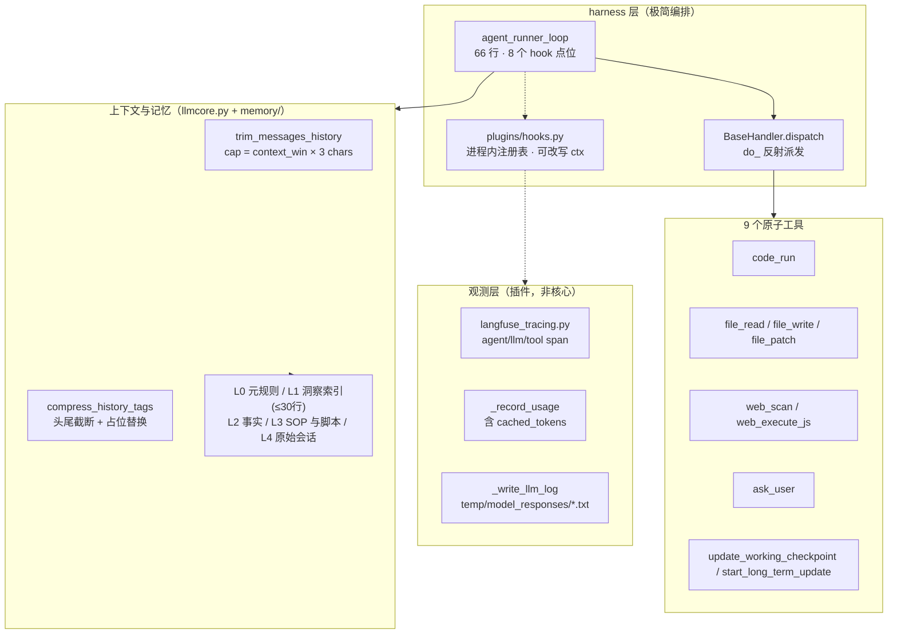

# GenericAgent 调研报告 —— 对我们 harness 层与观测层的启发

> 用途：R4 的外部对标。回答两个问题：**(1) GenericAgent 里有什么、怎么设计的；(2) 我们的 harness 层与观测层该怎么设计。**
> 方法：源码级调研，不是读宣传稿。读了它的论文与仓库真实代码（读了哪些文件见 §10）。
> 结论对 R4 的修订在 §8，`docs/r4-analysis.md` 的决策点同步更新。

---

## 0. 结论速览

1. **GA 的论点是「上下文信息密度最大化」**，不是「上下文更长」。它全部设计都在服务这一条。
2. GA 的 **harness 不是权限门，而是「刻意收窄的工具接口 + 语境压缩纪律 + 记忆分层」**。它的原话：工具集 "acts as a harness, keeping the agent focused"。
3. GA 的 **观测层不是自建模块，而是一个插件**（`plugins/langfuse_tracing.py`），靠 hooks 挂载；**用量靠 monkey-patch SSE 解析器抓**——因为它没有我们这样的引擎层（我们已有 `StepResult.usage`，起点比它好）。
4. 三个**该立刻吸收**的点：
   - **cache token 是一等字段**：GA 显式抓 `cached_tokens` / `cache_read_input_tokens` / `cache_creation_input_tokens`。R4 原方案的「前缀共享率」是估算，**provider 报的 cache token 才是真值**。
   - **hook 应有进程内形态**：GA 的 hook 是 `register`/`trigger` 式进程内回调，**返回值可替换整个 ctx**。R4 原方案只有子进程命令式 hook，太单一。
   - **L1 索引硬上限、只放指针不放内容**：GA 把 `global_mem_insight.txt` 卡死在 **≤30 行 / <1k token**，且「L1 有界、L2/L3 可膨胀」是明写的**设计不变量**。比我们「索引 ≤600 字符」更锋利。
5. 两个**不要照搬**的点：GA 的 hook 永远 fail-open（拦不住东西）、GA 的记忆写入只凭模型自觉（无对账）。这两处我们现有设计更强，别退化。

---

## 1. 调研来源与方法

| 项 | 值 |
|---|---|
| 仓库 | `github.com/lsdefine/GenericAgent`（MIT，Python） |
| 热度 | **14,236 star / 1,661 fork**（2026-09-23 取数） |
| 活跃度 | 创建 2026-01-16，最后推送 2026-09-22（昨天） |
| 论文 | arXiv **2604.17091v1**《GenericAgent: A Token-Efficient Self-Evolving LLM Agent via Contextual Information Density Maximization (V1.0)》(2026-04-18) |
| 代码规模 | 仓库 366 个文件 / 33.5MB（含 GIF、PDF 资产）；`agent_loop.py` **132 行**、`llmcore.py` 72KB、`agentmain.py` 20KB、`ga.py` 37KB |
| 我实际读了 | `agent_loop.py`、`llmcore.py`（定位后精读关键函数）、`plugins/hooks.py`、`plugins/langfuse_tracing.py`、`memory/memory_management_sop.md`、`reflect/scheduler.py`、`reflect/autonomous.py`、`README.md`、论文全文（§2.1–2.3、§4.3 记忆消融、§5 讨论） |

> 论文称「核心循环 92 行」、README 称「~100 行」；**实测 `agent_runner_loop` 本体 66 行**，`agent_loop.py` 全文件 132 行（含展示辅助）。本文一律引实测值。

---

## 2. GA 是什么

一个**自进化**的通用桌面/浏览器智能体：3K 行级种子代码，靠 9 个原子工具直接控制系统（含真实浏览器注入、桌面控制），并在干活过程中把经验**结晶成可复用的 SOP 与可执行脚本**（skill tree）。卖点是**用 <30K 上下文窗口**完成别人 200K–1M 窗口的活。

核心命题（论文原话）：*长程能力不取决于上下文长度，而取决于在有限预算里维持了多少「决策相关信息」。*

---

## 3. 架构总览



---

## 4. 设计要点逐条拆解

### 4.1 「工具即 harness」的极简循环

`agent_loop.py::agent_runner_loop`（实测 66 行）做四件事：调模型 → 解析 tool_calls → 逐个派发 → 把结果塞进**一条新的 user 消息**。

```python
messages = [{"role": "user", "content": next_prompt, "tool_results": tool_results}]
# just new message, history is kept in *Session
```

关键设计：**循环只管新消息，历史归 Session 管**。循环不持有上下文，压缩由 `Session.ask()` 里的 `trim_messages_history` 负责。

停止权不在循环里，而在 **handler**：工具返回 `StepOutcome(data, next_prompt, should_exit)`，`next_prompt` 为空 → `CURRENT_TASK_DONE`，`should_exit` → `EXITED`，都没有就继续。
**这正是我们 `TurnPolicy` 想做的事，只是形状不同：GA 把它塞进了工具返回值，我们把它抽成了纯单元。**

每次迭代固定带 8 个 hook 调用：`agent_before/after`、`turn_before/after`、`llm_before/after`、`tool_before/after`；其中 `tool_before` / `tool_after` 分别包在工具执行两侧（`BaseHandler.dispatch`）。

### 4.2 9 个原子工具（能力收窄 = 安全模型）

五类：文件（`file_read`/`file_write`/`file_patch`）、执行（`code_run`）、Web（`web_scan`/`web_execute_js`）、记忆（`update_working_checkpoint`/`start_long_term_update`）、人在环（`ask_user`）。

论文口径很明确：**这套工具集本身就是 harness**——"this carefully designed toolset acts as a harness, keeping the agent focused on efficient problem-solving."

两个**工具级纪律**，值得对照：

- `file_patch` **要求 old_content 唯一匹配，0 个或多个匹配就快速失败**——我们的 `edit` 已有等价物（`old_string` 须唯一或显式 `replace_all`）。**已收敛。**
- `code_run` **每回合只允许调用一次**，"确保每个结果被观察到之后再规划下一个动作"。我们的 `bash` 是 WARN 级 + `parallel_safe=False`，一批里有它就整批串行——**效果等价，已收敛。**

### 4.3 L0–L4 分层记忆

README 与 `memory/memory_management_sop.md` 给出的层级：

| 层 | 名字 | 内容 | 注入策略 |
|---|---|---|---|
| L0 | Meta Rules | 核心行为规则与系统约束 | 常驻 |
| **L1** | **Insight Index** | **极简索引：场景关键词 → 定位** | **常驻，硬上限 ≤30 行 / <1k token** |
| L2 | Global Facts | 稳定环境事实（路径、非标配置、常量） | 按需读 |
| L3 | Task Skills / SOPs | 可复用流程（`memory/*_sop.md`）与脚本（`*.py`） | 按需读 |
| L4 | Session Archive | 原始会话归档（`memory/L4_raw_sessions/`） | 不注入，供回溯 |

三条**硬规则**（`memory_management_sop.md` 原文）：

1. **行动验证原则：No Execution, No Memory.** 任何写入 L1/L2/L3 的信息必须源自**成功的工具调用结果**；严禁把模型的固有知识、推理猜测、未执行计划写成事实。
2. **禁止存储易变状态**：时间戳、临时 Session ID、正在运行的 PID、具体绝对路径。
3. **最小充分指针**：上层只留能定位下层的最短标识，"多一词即冗余"。

以及一条**设计不变量**（论文 §2.3.2 明写）：

> *A critical design invariant is that L1 remains bounded even as L2 and L3 expand. Each L1 entry records only the existence of a knowledge category rather than its substantive content.*

**对照我们**：R3 的注入块上限 600 字符、`pinned`/`decision` 常驻——思路一致；但我们**没有把「索引有界」写成不变量并用测试锁死**，也没有「只写指针不写内容」的硬约束。

### 4.4 语境压缩：四段流水线 + 工具 schema 省略

**预算公式**（论文式 (1)，与代码 `trim_messages_history` 完全一致）：

```python
cap = sess.context_win * 3          # α ≈ 3 chars/token（字符域估算，因为拿不到精确 token 数）
target = int(cap * trim_keep_rate)  # 默认 0.6；大窗口模型用 0.3
```

四段（论文 §2.3.4，代码一一对应）：

| 阶段 | 代码 | 动作 |
|---|---|---|
| Stage 1 工具输出截断 | 各工具 handler 内 | 超阈值只留**头 L/2 + 尾 L/2**，中间换省略号（`code_run` 10k、`web_scan` text 10k / HTML 35k、`file_read` 20k） |
| Stage 2 标签级压缩 | `compress_history_tags(keep_recent=10, max_len=800, interval=5)` | `<thinking>/<tool_use>/<tool_result>` 内容截成 **800 字符头尾窗口**；`<history>/<key_info>` 这类**重复块换成 `[...]` 占位**（只有最新一份带负载）；**最近 10 条豁免** |
| Stage 3 消息逐出 | `trim_messages_history` | 超 cap → 先按 Stage 2 严格档（只豁免 4 条）重压；仍超 → **FIFO 逐出到 target**；逐出后用 `_sanitize_leading_user_msg` 把暴露出的孤立 tool_result 块**改写成纯文本**，保证 API 配对合法 |
| Stage 4 工作记忆锚 | 每轮 user 消息附带 | **最近 20 条一句话回合摘要（各≈100 字符）+ 当前轮号 + 常驻 `key_info` 块**（由 `update_working_checkpoint` 维护） |
| 辅助 工具 schema 省略 | `ToolClient._prepare_tool_instruction` | schema 与上轮相同 → 不再重发，只留一句「工具库持续有效」；累计 `total_cd_tokens > 9000` 或每 10 轮重置时重发全文 |

两个细节值得注意：

- Stage 2 的「最近 10 条豁免 + 定期压一次」**是为提示词缓存服务的**：论文原话 "the unchanged older messages result in prompt-cache hits in roughly 80% of turns"。**与我们 R3 的结论一致**（我们测出尾部注入 94% vs 每轮压缩 11%）——两边独立收敛到「别动前缀」。
- `_sanitize_leading_user_msg` 与我们的 `SessionData.ensure_tool_pairing` / `sanitize_pairs` **是同一种防御**（裁剪/逐出后修复 tool 配对）。**已收敛。**

### 4.5 hooks：8 点位、进程内、fail-open、可改写 ctx

`plugins/hooks.py` 全文 45 行，核心三个 API：

```python
@register('tool_before')          # 装饰器注册：event -> [callback]
def my_hook(ctx): ...
    return new_ctx                # 返回 dict 就替换 ctx（可改写！）

trigger(event, ctx)               # 顺序调用；异常 catch 掉写到 stderr，继续跑
discover_and_load()               # 自动加载 plugins/*.py
```

四个设计选择，每个都值得对齐或反着来：

1. **进程内回调，不是子进程命令** —— 快、可直接改 ctx、可用闭包持有状态（Langfuse 插件用 `threading.local` 存 span 栈）。
2. **返回 dict 即替换 ctx** —— hook 能改写上下文/参数，不只是观察。
3. **`discover_and_load()` 自动发现 `plugins/*.py`** —— 零配置扩展。
4. **永远 fail-open** —— `trigger` 里 `except Exception: sys.stderr.write(...)` 然后继续。

> **第 4 条不要照搬。** GA 的 hook 只能「观察 + 建议」，拦不住任何东西；我们要的「门卫」必须有 fail-closed 的拦截能力。**第 1、2、3 条应该吸收。**

### 4.6 观测层：插件化 + 用量抓取 + cache 字段

**观测不是核心，是插件**——`plugins/langfuse_tracing.py` 自述 "Replaces old monkey-patch approach with hooks"。它的映射：

| hook 点位 | 产出 |
|---|---|
| `agent_before/after` | agent 级 trace（输入 user_input，输出 exit_reason） |
| `llm_before/after` | generation span，带 `usage_details` |
| `tool_before/after` | tool span（`_tls.tstack` 栈支持嵌套），输出 data/next_prompt/should_exit |

**用量怎么来的？monkey-patch SSE 解析器**（文件末尾）：

```python
llmcore._parse_claude_sse = _wrap_parser(llmcore._parse_claude_sse)
llmcore._parse_openai_sse = _wrap_parser(llmcore._parse_openai_sse)
```

tee 住流式行，自己解析事件取用量。它抓的字段（`_extract_usage`）：

- `input_tokens` / `output_tokens`
- **`cache_read_input_tokens`**、**`cache_creation_input_tokens`**
- OpenAI 侧 `prompt_tokens_details.cached_tokens`

而 `llmcore._record_usage` 是**另一条独立路径**：只 `print` 到 stdout（`[Cache] input=... cached=...`），再把值塞进全局 `STATS` dict：

```python
STATS.update(inp=inp, cached=cached, out=out)
```

**记录**方面，`_write_llm_log(label, content, log_path)` 把 prompt/response 追加写到 `temp/model_responses/model_responses_<pid>.txt`——**按 pid 分文件、裸追加、无结构、无轮转**。

> 这就是 GA 观测层的真实水平：**能力有，工程化没有**。用量散在 stdout + 全局 dict + monkey-patch 里；轨迹是一坨纯文本。R4 要做的正是把它结构化：**用量进账本、事件进 JSONL、span 有父子关系**。

### 4.7 自进化与自主调度

- **结晶路径**：新任务 → 自主探索（装依赖、写脚本、调试、验证）→ 写成带机器可读元数据的报告 → 原子化「归档报告 + 更新 skill tree + 使用计数 +1」。
- **SOP → 代码的升级**：反复用到的小流程从纯文本 SOP 编译成可执行脚本。
- **反思式权重调整**（论文 §4.4）：预测分高但实际没人用（`S>8, u<3`）→ 主导维度权重降 10%；预测低但用得多 → 提 10%，再归一化。
- **自主调度**：`reflect/scheduler.py` 是 120 秒轮询的调度器（`daily/weekly/every_2h` 等 repeat、冷却时间、`scheduler.log`、**端口锁防重入**），`reflect/autonomous.py` 则是「用户离开 >30 分钟就自动干活」的触发器。**这是 harness 之外的一层「自主性壳」，靠 cron + 端口锁实现。**

### 4.8 安全边界：能力收窄，没有权限门

论文与 SOP 明写：所有生成文件限制在临时目录；**访问系统密钥或核心源码被无条件禁止**。
但它**没有我们这样的 `PermissionGate`**（ALLOW/WARN/DENY + 人工审批 + 硬拒表）。它的安全模型是**「只给你这几个工具，于是你干不了别的」**——靠接口收窄，而不是运行时把关。

> 我们的模型更严（门 + 沙箱 + 过期读保护）。**保持。** 但要吸收它的洞见：**工具接口本身就是第一道 harness。**

---

## 5. 我们 vs GA 逐项对照

| 维度 | GenericAgent | 我们（R1–R3 现状） | 结论 |
|---|---|---|---|
| 循环 | 66 行，历史归 Session | `AgentLoop` 551 行，自持历史 | 我们更重但更可控；**不动** |
| 停止判定 | 藏在工具返回值里 | 抽成纯单元 `TurnPolicy`（19 条表测） | **我们更好** |
| 工具数 | 9 个原子工具 | 8 个内置 + MCP 远端 | 相当 |
| 工具 schema 省 token | 文本协议下可省略重发 | 原生 function calling，必须每次发 | **不适用**（见 §9） |
| 上下文预算 | 字符域 `cap = win×3`，压到 60% | 字符域 `estimate_tokens`，0.8 软水位压到 0.5 | 相当，我们更保守 |
| 压缩 | 4 段 + 约 80% 缓存命中 | 4 层（L3 持久化 / L1 裁剪 / L2 占位 / L4 摘要） | 相当 |
| 记忆分层 | L0–L4，L1 ≤30 行硬约束 | 索引块 ≤600 字符 + note(kind/scope/取代链) | 相当，**但缺「索引有界」不变量** |
| 记忆写入 | 只凭模型自觉（No Execution No Memory 是提示词纪律） | 对账式 ADD/UPDATE/SUPERSEDE + 相似度合并 | **我们更好** |
| 权限 | 无（靠工具收窄） | 门 + 审批 + 沙箱 + 过期读保护 | **我们更好** |
| hooks | 8 点位、进程内、可改写、fail-open、自动发现 | **无** | **要补（R4c）** |
| 观测 | Langfuse 插件 + monkey-patch 抓用量 + 全局 STATS + 裸文本日志 | **无**（`StepResult.usage` 取到即丢） | **要补（R4a）** |
| cache 度量 | **抓 provider 报的 cache token** | 无 | **要补** |
| 子智能体 | `memory/subagent.md` SOP | `SubAgentRunner`（共享上下文 + 结构化回包 + worktree） | 我们更工程化 |
| 自主调度 | `reflect/scheduler.py` 轮询 | 无 | 暂不做，记为方向 |

---

## 6. 对我们 **harness 层** 的设计启发

GA 的 harness 观是：**harness = 接口收窄 + 语境纪律 + 记忆分层**，而不是「守卫越多越好」。据此，harness 层该补/明确这几件事：

| # | 启发 | 落到我们哪 | 建议 |
|---|---|---|---|
| H1 | **工具接口是第一道 harness** | `tools/builder.py`、`PermissionGate` | 保持原子性；新增工具先问「能不能用已有原子组合出来」（GA 的 9 工具原则） |
| H2 | **hook 要有进程内形态 + 自动发现** | R4c `core/hooks.py` | **修订**：支持 `kind: python`（进程内、`plugins/*.py` 自动发现、可改写 ctx）与 `kind: command`（子进程）两种 |
| H3 | **工作记忆锚（Stage 4）** | `core/agent_loop.py` 的 `tail` | 候选：把「最近 N 轮一句话摘要 + key_info」做成易失尾部块。我们已有 `<task-state>` + 记忆块，**缺「回合摘要环」** |
| H4 | **索引有界是设计不变量** | `memory/service.py` 索引渲染 | 把「索引只放指针、不放内容；总量有界」写成**不变量 + 测试锁死**（我们已有 600 字符上限，补「只放指针」与测试） |
| H5 | **No Execution, No Memory** | `memory/service.py` harvest | 候选：给 note 打 `verified` 标记（本回合有成功工具调用才算 verified），收割时优先/只收 verified |
| H6 | **失败升级三档**（局部修 → 换策略 → 问人） | `turn_policy` + 门卫 | 候选：R4b 的 `DuplicateCallGuard` 覆盖第一档；「换策略/问人」是提示词级，记为 R5 方向 |
| H7 | **人在环是一等工具**（`ask_user`） | 我们只有审批回调 | 候选：R5 加 `ask_user` 工具（模型主动提问，与被动审批互补） |

## 7. 对我们 **观测层** 的设计启发

| # | 启发 | 落到我们哪 | 建议 |
|---|---|---|---|
| O1 | **观测可以只是插件** | R4a `core/trace.py` | `TraceRecorder` 本身就是个 observer（等价于 GA 的插件）；保持「零外部依赖内置 + 可选外部导出」 |
| O2 | **cache token 是硬指标，不是估算** | R4a `ModelStepFinished.usage` | **修订**：`_usage_to_dict` 增加 `cached_tokens` / `cache_read_input_tokens` / `cache_creation_input_tokens`；**优先用 provider 真值**，「前缀共享率」降级为 provider 不报时的兜底 |
| O3 | **span 树要显式**（agent/llm/tool 三层） | R4a `ScopedEvent` | 对齐 GA 的 span 类型：`agent`（回合）/ `generation`（模型步）/ `tool`（工具调用）/ `subagent`（子智能体） |
| O4 | **用量必须结构化成账本** | R4a `core/budget.py` | GA 用全局 `STATS` + print；我们做 per-turn ledger + 落盘索引，避免它的散乱 |
| O5 | **轨迹要有轮转与上限** | R4a `TraceStore` | GA 按 pid 裸追加、永不清理；我们保留 `max_turn_bytes` + `retention_days` |
| O6 | **hook 是观测的天然挂点** | R4a + R4c 交叉 | 观测既可用内置 observer，也可用 hook（给第三方 APM 留门） |

---

## 8. 据此修订 R4 方案的地方

四条实质修订（已同步进 `docs/r4-analysis.md`）：

| 编号 | 原方案 | 修订后 | 依据 |
|---|---|---|---|
| **R-1** | `ModelStepFinished.usage` 只有 prompt/completion/total | **增加 cache 明细**：`cached_tokens`、`cache_read_input_tokens`、`cache_creation_input_tokens`；`ContextAssembled.prefix_shared_ratio` **降级为兜底** | GA §4.6 显式抓 cache 字段 |
| **R-2** | hook 只有 `kind: command`（子进程） | **新增 `kind: python`**：进程内、`plugins/*.py` 自动发现、返回值可替换 ctx（GA 的 `register`/`trigger` 形态）；两种形态共用同一 `HookPoint` 与能力矩阵 | GA §4.5 |
| **R-3** | 门卫与 hook 的能力矩阵已定义 | 明确 **hook fail-open（观察/注入类）/ fail-closed（阻断/改写类）**，**不采用 GA 的「永远 fail-open」** | GA §4.5 反例 |
| **R-4** | 记忆索引只有 600 字符上限 | 补成**设计不变量**：「索引只放指针、不放内容；总量有界；L2/L3 增长不推高索引」+ 测试锁死 | GA §4.3 明写的不变量 |

另两条记为 **R5 候选**（不进 R4 范围）：**Stage-4 工作记忆锚（H3）**、**note 的 `verified` 标记（H5）**。

---

## 9. 不建议照搬的（含理由）

1. **工具 schema 省略**：GA 只在**文本协议**路径省 schema；原生 function calling（我们用的）每次都必须发完整定义。论文自己注明 "not used in the native API path"。**不做。**
2. **hook 永远 fail-open**：拦不住任何东西。我们要的「门卫」必须能阻断。**反着做。**
3. **按 pid 分文件的裸文本日志**：无结构、无轮转、无脱敏。**反着做。**
4. **monkey-patch 解析器取用量**：脆（上游一改就废）。我们引擎层已直接产出 `StepResult.usage`。**不做。**
5. **只靠提示词纪律保证记忆质量**：GA 的 "No Execution, No Memory" 写在 SOP 里靠自觉。我们已有对账式写入。**不退化。**
6. **全局可变 `STATS` 字典**：多线程下不可靠。我们用 per-turn ledger。**不做。**
7. **把自进化日志注入系统提示**：GA 把「错误与纠正 / 用户偏好 / 成功模式」直接注入 system prompt——在我们 R3 的缓存纪律下**会打穿前缀**。若做，进**易失尾部块**。**改形态再做。**

---

## 10. 附录：读过的文件与关键数字

| 文件 | 关键内容 |
|---|---|
| `agent_loop.py`（132 行） | `agent_runner_loop` 66 行 / `BaseHandler.dispatch` 15 行 / 8 个 hook 点位 / `StepOutcome(data, next_prompt, should_exit)` |
| `llmcore.py`（72KB） | `trim_messages_history`（`cap=win×3`、`target=cap×0.6`、FIFO 逐出、`_sanitize_leading_user_msg`）/ `compress_history_tags(keep_recent=10, max_len=800, interval=5)` / `_record_usage`（`STATS.update`）/ `_write_llm_log` / `_prepare_tool_instruction`（`total_cd_tokens > 9000` 重发 schema） |
| `plugins/hooks.py`（45 行） | `register` / `trigger`（可改写 ctx、fail-open）/ `unregister` / `clear` / `has` / `discover_and_load` |
| `plugins/langfuse_tracing.py`（5.7KB） | agent/llm/tool span；`_extract_usage` 抓 `cache_read_input_tokens`、`cache_creation_input_tokens`；`_wrap_parser` monkey-patch SSE |
| `memory/memory_management_sop.md`（6.3KB） | L1 `global_mem_insight.txt` ≤30 行硬约束；三条核心公理；L1↔L2/L3 同步规则；信息分类决策树 |
| `reflect/scheduler.py`（5.1KB） | 120s 轮询、`repeat` 冷却解析、端口锁防重入、`scheduler.log` |
| `reflect/autonomous.py`（195B） | 用户离开 >30 分钟触发自主任务 |
| `README.md` | 5 大特性；L0–L4 层级表；9 工具表 |
| arXiv 2604.17091v1 | §2.1 设计原则 / §2.3 组件 / §2.3.4 四段压缩 / §4.3 记忆消融 / §5 讨论与局限（自改进日志仍需人工策展） |

> 记忆消融那组数字很说明问题：**记忆不是越全越好**——「精简记忆 165 token 的效果（66.48% TSR）反而高于全量记忆 575 token（52.44%）」。这与我方 R3 的结论同向：**注入的是决策相关信息，不是全部信息。**
