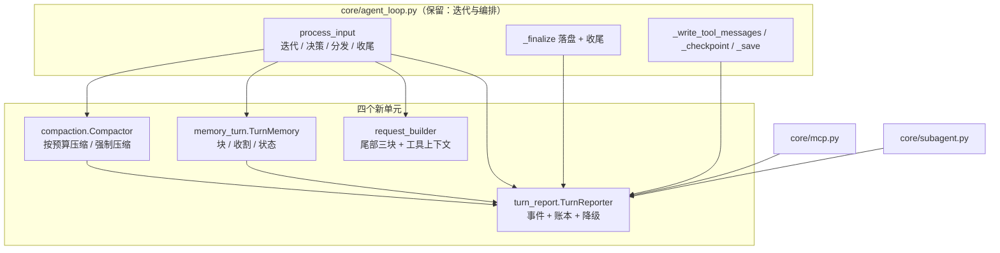

# AI-Coding — R5 分析方案（循环内核拆分）

> 定位：R1–R4 之后，`core/agent_loop.py` 从 551 行涨到 **788 行**，`process_input` 单方法 **229 行**。
> 这是一次**纯结构重构**：不改行为、不改契约、不改测试断言，只把「一个方法里混着的五件事」拆成可单独阅读与测试的单元。
>
> 依据：`core/agent_loop.py` 全文通读（现状核验见 §1）、R2c 的先例（`core/turn_policy.py` 的抽出，
> 当时理由同样是「fan-out 21，是唯一需要读懂全局的文件」）、`docs/r3-analysis.md`（缓存纪律）、`docs/r4-analysis.md`（三层接线）。
>
> **命名说明**：此前文档里的「R5 候选功能」（工作记忆锚 / `verified` 标记 / `ask_user` / 失败升级三档）**顺延为 R6**；
> 本文的 R5 专指这次拆分。

---

## 1. 现状核验（实测，不是印象）

### 1.1 规模与方法清单

`ai_coding/core/agent_loop.py` = **788 行**。方法规模：

| 行数 | 方法 | 备注 |
|---:|---|---|
| **229** | `process_input` | 一个方法里混了 5 个阶段（§1.2） |
| **72** | `_harvest` | 记忆收割 + 整理 + 两套降级上报 |
| **60** | `__init__` | 17 个协作者 + 派生物（`_tool_schemas` / `_tools_text` / `dispatcher` / `policy`） |
| 36 | `compact_session` | 与 `_compress` 共享「把压缩包进 deadline」同一套写法 |
| 36 | `_compress` | 同上 |
| 30 | `_hook_context` | 钩子 |
| 29 | `_emit_context_assembled` | 纯计算 + 一次发射，却挂在 `self` 上 |
| 26 | `_emit_step_finished` | 同上 |
| 21 | `_finalize` | 落盘 + 观测 + 记录终态（三件事） |
| 20 | `_memory_block` | 记忆侧 |
| 19 | `_write_tool_messages` | 持久化 |
| 18 | `_tool_context` | 请求组装 |
| 16 | `_save` | 持久化 |
| 15 | `_build_instructions` | 请求组装 |
| 11 | `_fire_hooks` | 钩子 |
| 9 | `memory_status` | UI 面 |
| 6 | `_checkpoint` / `_emit` / `_remaining` | 小工具 |
| 4 | `aclose` | —— |

### 1.2 `process_input` 里混了几件事

按行号读下来，这 229 行是**五段**顺序粘在一起的：

1. **回合准备**：覆盖 observer、绑定 trace、追加用户消息、建/取任务、守卫复位、`turn.start` 钩子
2. **迭代决策**：`decide_next_iteration` + 把 decision 翻译成 `TurnOutcome`
3. **请求组装**：压缩 → 指令 → 任务注入 → 记忆块 → 钩子块 → 拼 `request` → 观测归因
4. **模型步**：`run_with_deadline` + 计时 + 观测 + 追加 assistant
5. **动作与收尾**：停止策略/nudge；分发 → 回写 → 检查点 → halted；异常 → 四种终态；finalize + harvest + `turn.end`

### 1.3 三处真正的重复（跨模块）

| 重复的东西 | 位置 | 后果 |
|---|---|---|
| **「上报一次降级」** | `agent_loop` 内联 6 处 + `subagent._degrade` + `mcp._degrade` = **3 份实现** | 加一个新降级点要抄第三遍；字段口径已经开始分叉 |
| **「把压缩包进 deadline 并降级」** | `_compress` 与 `compact_session` | 两段几乎同构的 `run_with_deadline(...) + except DeadlineExpired` |
| **「deadline 剩余秒数」** | `_remaining`（`agent_loop`） | 与 `Deadline.remaining()` 的取零逻辑各写一遍 |

### 1.4 对外部可见的面（**拆分不得动**）

实测依赖（全仓 grep）：

| 名字 | 谁在用 |
|---|---|
| `process_input(session, input, on_delta=, observer=)` | CLI（`ask`/`repl`）、`subagent`、全部循环测试 |
| `last_outcome` | `subagent._packet`、大量测试 |
| `last_artifacts` | `subagent._packet` |
| `dispatcher` | 测试断言 `dispatcher.approval`；R4 的守卫复位在 loop 内调用 |
| `memory_status()` / `compact_session()` | `ui/repl.py`（`/memory`、`/compact`） |
| `trace` | `cli._make_recorder` 组装；`ui/repl._trace_report` 读 `loop.trace` |
| `aclose()` | CLI |

**结论**：这些名字与签名在重构后必须逐字不变；`process_input(observer=...)` 的**每次调用覆盖观察者**这条语义尤其不能丢（REPL 用它换 UI）。

### 1.5 陈旧的地方

模块 docstring 仍在描述 R1 的回合形状，完全没提门卫、钩子、观测与易失尾部块；`Turn shape` 示例也已与代码不符。
**这属于本次范围**——重构顺手把说明改对，否则下一个读它的人会被误导。

---

## 2. 拆什么、不拆什么

### 2.1 拆（按「一个单元回答一个问题」划边界）

| 新单元 | 回答的问题 | 从 loop 搬走的成员 |
|---|---|---|
| `core/turn_report.py` → `TurnReporter` + `report_degraded()` | **这一回合，对世界说什么？**（事件、用量、降级） | `_emit_context_assembled`、`_emit_step_finished`、6 处内联 `Degraded`、账本持有、`_observer_failure_count` |
| `core/memory_turn.py` → `TurnMemory` | **这一回合，记忆要读什么、写什么？** | `_memory_block`、`_harvest`、`memory_status` |
| `core/compaction.py` → `Compactor` | **这一回合，历史要不要压、压到多少？** | `_compress`、`compact_session` 的主体 |
| `core/request_builder.py` | **这一次请求，由哪几块拼成？**（易失尾部的唯一住所） | 尾部三块组装（现内联 30 行）、`_tool_context` |

### 2.2 不拆（这些**就是**循环本身，搬走等于把循环藏起来）

| 留在 `agent_loop.py` | 为什么 |
|---|---|
| 迭代本身（`while` + `decide_next_iteration` 的调用） | R1 的全部意义是「循环归我们、肉眼可见」；拆成 phase 注册表就是反过来做 |
| `engine.step` 的调用与计时 | 一步一调是 R1a-2 的核心契约，藏在别处就读不出「一次模型调用」 |
| 工具分发调用 + `TaskUpdated` + `halted` 处理 | 编排的决策点 |
| 持久化（`_write_tool_messages` / `_checkpoint` / `_save`） | 薄（约 40 行）且强依赖 `last_artifacts`；独立成模块收益 < 成本 |
| `_finalize` | 回合的收尾动作（落盘 → 观测 → 记录终态），6 行读得懂 |
| `__init__` 的参数表 | 动它等于改公开构造 API（决策点 D-R5-3） |

**YAGNI 声明**：不引入 phase 枚举、不做新的事件抽象、不做依赖注入容器、不改 `AgentLoop` 的名字。

---

## 3. 目标结构



依赖方向：四个新单元只依赖 `domain` / `core.events` / `infra.deadline` / `core.trace`，
**不反向依赖 `agent_loop`**（避免环）；`cli.py` 仍是唯一组合根。

### 3.1 `core/turn_report.py`

```python
# 模块级：给任何持有 observer 的地方用（mcp / subagent 也用它，替掉各自的 _degrade）
def report_degraded(observer: LoopObserver, component: str, reason: str,
                    fallback: str = "") -> None: ...

# 一回合的对外陈述：事件、账本、降级。只读，绝不改回合行为。
class TurnReporter:
    def __init__(self, *, tools_text: str,
                 emit: Callable[[LoopEvent], None]) -> None: ...
    @property
    def tools_chars(self) -> int: ...
    @property
    def ledger(self) -> BudgetLedger: ...
    def tokens_spent(self) -> int: ...
    # 记录观察者失败计数基线（R4a 的「观测者坏了要说一次」）
    def begin_turn(self, observer: LoopObserver) -> None: ...
    # 发 ContextAssembled 并喂账本；返回本次请求的规范串（供下次比前缀）
    def report_context(self, *, iteration: int, instructions: str | None,
                       history: Sequence[ChatMessage],
                       request: Sequence[ChatMessage],
                       tail_blocks: tuple[tuple[str, int], ...],
                       previous: str | None) -> str: ...
    def report_step(self, *, index: int, step: StepResult,
                    latency_ms: int) -> None: ...
    def report_degraded(self, component: str, reason: str,
                        fallback: str = "") -> None: ...
    # 必要时补 Degraded(observer) → 挂 usage → 发 TurnFinished → 返回 outcome
    def finish_turn(self, outcome: TurnOutcome,
                    observer: LoopObserver) -> TurnOutcome: ...
```

**不变量**（写进测试）：

- 事件顺序与今天**一致**：`ContextAssembled` 在模型步之前；`Degraded(observer)` 在 `TurnFinished` 之前；
- `finish_turn` 返回的 outcome 的 `usage` 与账本一致；
- `report_degraded` 在观察者抛异常时**不抛**（沿用 `_SafeObserver` 的纪律）。

### 3.2 `core/memory_turn.py`

```python
# 一回合里所有与记忆有关的事；全部 best-effort，永不抛错。
class TurnMemory:
    def __init__(self, memory: MemoryService | None, *,
                 emit: Callable[[LoopEvent], None],
                 save: Callable[[SessionData], None]) -> None: ...
    # 易失约束块（正文, note ids）；失败 → ("", ()) 并上报降级
    def block(self) -> tuple[str, tuple[str, ...]]: ...
    # 只吃本回合增量（游标在会话里），随后按条件整理索引
    async def harvest(self, session: SessionData, *,
                      deadline: Deadline | None,
                      summaries: Sequence[str],
                      outcome: TurnOutcome) -> None: ...
    # 给 /memory 与 /status 的计数；永不抛错
    def status(self) -> dict[str, Any]: ...
```

### 3.3 `core/compaction.py`

```python
# 把「压缩历史」这件事包上 deadline 纪律与降级语义。
class Compactor:
    def __init__(self, context: ContextManager | None, *,
                 emit: Callable[[LoopEvent], None]) -> None: ...
    # 按预算压缩；超时 → 原样返回 + 降级事件（duck-typed: compress_if_needed 优先）
    async def compress(self, history: list[ChatMessage], *,
                       deadline: Deadline | None,
                       on_summary: Callable[[str], None] | None = None
                       ) -> list[ChatMessage]: ...
    # 用户显式 /compact：强制压一页并「替换」会话历史；返回 {messages, after, removed}
    async def compact_now(self, session: SessionData, *,
                          timeout: float) -> dict[str, int]: ...
```

### 3.4 `core/request_builder.py`

```python
@dataclass(frozen=True)
class TailBlock:
    name: str            # "memory" | "task" | "hook"
    message: ChatMessage
    @property
    def chars(self) -> int: ...

# 把易失尾部块拼成 (消息, 尺寸表)；顺序即声明顺序，空块自动跳过。
# 这是缓存纪律的唯一落点：尾部是「唯一」每轮变化的地方（docs/r3-analysis.md 1.13）。
def build_tail(blocks: Sequence[TailBlock | None]
               ) -> tuple[list[ChatMessage], tuple[tuple[str, int], ...]]: ...

def tool_context(*, task: TaskState, workspace: str, session: SessionData,
                 history: Sequence[ChatMessage], instructions: str | None,
                 emit: Callable[[Any], None]) -> ToolContext: ...
```

---

## 4. 数据流与行为不变性

### 4.1 数据流：不变

拆分**不改变**任何一条数据通路，只改变「由谁负责」：

```
process_input
 ├ reporter.begin_turn(self.observer)
 ├ trace 绑定（仍在 loop：它是组合根的注入物）
 ├ turn_memory.block() ────────► TurnMemory ──► reporter.report_degraded
 ├ 钩子上下文 ─────────────────► request_builder.build_tail
 ├ compactor.compress(history) ─► Compactor ──► reporter.report_degraded
 ├ reporter.report_context(...) ─► ContextAssembled + 账本
 ├ engine.step(...)（仍在 loop）─► reporter.report_step(...)
 ├ dispatcher.dispatch_batch(...)（仍在 loop）
 ├ turn_memory.harvest(...) ────► TurnMemory ──► MemoryHarvested / Degraded
 └ _finalize → reporter.finish_turn(outcome, observer) → TurnFinished
```

### 4.2 `process_input` 前后对照

**今天**（229 行，结构节选）：

```
async def process_input(...):
    # 30 行：observer 覆盖 / trace 绑定 / 追加消息 / 任务 / 守卫复位 / 钩子上下文
    try:
        while True:
            # 20 行：决策 + 终态翻译
            # 45 行：压缩 / 指令 / 任务注入 / 记忆块 / 钩子块 / request / 归因
            # 20 行：模型步 + 计时 + 观测 + 追加 assistant
            # 40 行：停止策略 / nudge / 分发 / 回写 / 检查点 / halted
    except ...:   # 25 行：四种异常 → 终态
    # 5 行：finalize + harvest + turn.end
```

**拆分后**（目标 ≤130 行）：

```
async def process_input(self, session, user_input, on_delta=None, observer=None):
    if observer is not None:            # 每次调用覆盖观察者（REPL 靠它换 UI）
        self.observer = _SafeObserver(observer)
        self.dispatcher.observer = self.observer
    self._bind_trace(session)                       # 3 行
    self.reporter.begin_turn(self.observer)         # 1 行
    session.add_message(user_message(user_input, now_utc()))
    self.last_artifacts = []
    if session.task is None:
        session.task = TaskState(goal=user_input)
    task = session.task
    self.dispatcher.guards.reset()                  # R4b：守卫状态按回合清空
    hook_text = await self._hook_context(session)   # 钩子仍是 loop 的扩展点
    try:
        while True:
            decision = self._start_iteration(...)   # 决策 + 终态翻译（~10 行）
            history = await self.compactor.compress(session.messages, deadline=deadline,
                                                    on_summary=summaries.append)
            instructions = await self._build_instructions()
            injection = policy.inject_task(task, instructions)
            memory_block, memory_ids = self.turn_memory.block()
            tail, tail_blocks = build_tail([...])   # 声明式三块（~10 行）
            request = [*history, *tail]
            previous = self.reporter.report_context(...)      # 1 行
            step = await self._model_step(request, instructions, deadline, on_delta)
            if not step.tool_calls: ...             # 停止策略 / nudge
            outcomes = await self.dispatcher.dispatch_batch(...)
            self._write_tool_messages(session, outcomes)
            self._checkpoint(session, index)
    except ...:                                     # 四种异常 → 终态
    self._finalize(session, outcome, ledger, observer_failures)
    await self.turn_memory.harvest(session, deadline=deadline, summaries=summaries,
                                   outcome=outcome)
    await self._fire_hooks(HookPoint.TURN_END, session)
    return outcome.text or ""
```

### 4.3 行为不变性怎么证明

1. **既有 766 例测试是主证据**：它们覆盖终态、事件顺序、缓存前缀、记忆收割、子智能体、门卫、钩子。
   **任何一条既有断言需要改动 = 拆分改变了行为** → 停下来查，不允许「顺手改测试」。
2. 四个新单元各自带**契约测试**（§6）：新单元先红后绿，旧行为靠既有测试守。
3. 收尾用**真实运行**对照（同一 prompt 跑一次，比对轨迹里的事件序列与用量量级）。

---

## 5. 逐文件实施步骤

### 提交 1：`turn_report`（最低风险，先做）

| 步 | 文件 | 动作 |
|---|---|---|
| 1.1 | `tests/test_turn_reporter.py`（新） | 契约测试（§6），先红 |
| 1.2 | `core/turn_report.py`（新） | `report_degraded()` + `TurnReporter` |
| 1.3 | `core/agent_loop.py` | 用 `TurnReporter` 替掉 `_emit_context_assembled` / `_emit_step_finished` / `_observer_failure_count` / 6 处内联 `Degraded`；`_finalize` 改调 `finish_turn` |
| 1.4 | `core/mcp.py` + `core/subagent.py` | 删掉各自的 `_degrade`，改调 `report_degraded`（决策点 D-R5-2） |
| 1.5 | — | 门禁：766 例 + ruff + mypy + `scripts/trace_cases.py` 6/6 |

### 提交 2：`memory_turn`

| 步 | 文件 | 动作 |
|---|---|---|
| 2.1 | `tests/test_memory_turn.py`（新） | 契约测试（块 / 收割 / 状态 / 降级） |
| 2.2 | `core/memory_turn.py`（新） | `TurnMemory` |
| 2.3 | `core/agent_loop.py` | 组装 `TurnMemory(memory, emit=self._emit, save=self._save)`；删 `_memory_block` / `_harvest`；`memory_status` 变 1 行委托 |
| 2.4 | — | 同一套门禁 |

### 提交 3：`compaction` + `request_builder` + 文档

| 步 | 文件 | 动作 |
|---|---|---|
| 3.1 | `tests/test_compaction.py`、`tests/test_request_builder.py`（新） | 契约测试 |
| 3.2 | `core/compaction.py`（新） | `Compactor`（`compress` + `compact_now`） |
| 3.3 | `core/request_builder.py`（新） | `TailBlock` / `build_tail` / `tool_context` |
| 3.4 | `core/agent_loop.py` | 接两个新单元；`compact_session` 变薄委托；尾部组装改成 `build_tail([...])` |
| 3.5 | `infra/deadline.py` | 加 `remaining_of(deadline)`，两处共用（去掉重复的取零逻辑） |
| 3.6 | `core/agent_loop.py` 头部 | **重写模块 docstring**（反映 R3/R4 后的真实形状） |
| 3.7 | `docs/architecture.md` | 模块职责表补四个新单元 |
| 3.8 | — | 最终门禁 + 真实 LLM 运行对照 |

---

## 6. TDD 用例（新单元的契约测试）

| 测试文件 | 用例 |
|---|---|
| `tests/test_turn_reporter.py` | ① `report_context` 发出的 `ContextAssembled` 字段与手算一致（含 `tools_chars`）；② 返回的规范串与 `canonical_request` 一致、下次比前缀能算出共享比；③ `report_step` 发 `ModelStepFinished` 且账本累计正确；④ `report_degraded` 发 `Degraded`，观察者抛异常时不抛；⑤ `finish_turn` 先补 `Degraded(observer)`、再发 `TurnFinished`、outcome 带上 usage；⑥ 没有观察者失败时不发多余事件；⑦ 模块级 `report_degraded(observer, ...)` 可直接给 mcp/subagent 用 |
| `tests/test_memory_turn.py` | ① `block()` 正常返回正文与 id 列表；② 记忆服务抛异常 → `("", ())` + `Degraded(memory_block)`；③ 无记忆服务 → 静默返回空；④ `harvest` 只吃游标之后的增量、成功后推进游标并落盘；⑤ 收割抛异常 → `Degraded(memory_harvest)` 且**游标不动**；⑥ `outcome.text is None` 时不触发整理；⑦ 整理失败 → `Degraded(memory_consolidate)`；⑧ `status()` 永不抛错 |
| `tests/test_compaction.py` | ① `compress_if_needed` 优先（duck-typing）；② 只有 `compress` 的旧对象仍可用；③ `DeadlineExpired` → 返回原历史 + `Degraded(context_compress)`；④ 无 `context` → 原样返回；⑤ `compact_now` 替换会话历史并返回 `{messages, after, removed}`；⑥ `compact_now` 失败 → 原样返回、不改写会话；⑦ 空会话直接返回 |
| `tests/test_request_builder.py` | ① `build_tail` 顺序 = 声明顺序；② 空块/None 自动跳过；③ 尺寸表与实际字符数一致；④ `tool_context` 带齐 task/workspace/session_id/messages/instructions/emit；⑤ `TailBlock.chars` 对 `content=None` 不炸 |

**既有测试一行不改。** 若某条既有断言因拆分而失败，说明行为变了，必须回去改实现。

---

## 7. 成功之后是什么样

实际数字（AST 精确统计，见 §11 收尾核验）：

| 指标 | 拆分前 | 目标 | **实际** |
|---|---:|---:|---:|
| `agent_loop.py` 行数 | 788 | ≤ 360 | **641** |
| `process_input` 行数 | 229 | ≤ 130 | **153** |
| 「上报降级」实现份数 | 3 | 1 | **1**（只有 `turn_report` 构造 `Degraded`） |
| 「压缩包 deadline」实现份数 | 2 | 1 | **1**（`Compactor`） |
| 「易失尾部块」组装位置 | 内联 30 行 | `build_tail` | **`build_tail`，有测试** |
| 模块 docstring | 过期 | 与实现一致 | **已重写** |
| 可单独测试的新单元 | —— | 4 个文件 | **4 个文件 / 40 条契约测试** |

**两个目标没达到，原因如实说明**：文件仍有 641 行、`process_input` 仍有 153 行。
`process_input` 剩下的部分是**迭代本身、模型步调用、工具分发、持久化、异常映射与收尾**——
按 §2.2 的边界这些**必须留在循环里**（把它们搬走就是把循环藏起来）。
`≤360 / ≤130` 是拆分前拍脑袋估的，没有实测支撑；按同样的边界继续压缩只能靠隐藏代码，
所以不追这个数字。真正改善的是：**每一段都有名字**（`_iteration_decision` / `_model_step` /
`_run_tools` / `_bind_trace` …），且四块独立逻辑各自有了单元与测试。

---

## 8. 自我核验（我可能错在哪）

| # | 风险 | 处置 |
|---|---|---|
| 1 | **拆出行为差异**（事件顺序、终态、缓存前缀） | 既有 766 例是主证据；事件顺序有专门的轨迹断言 |
| 2 | **`process_input(observer=...)` 覆盖语义被破坏** | `TurnReporter` 只持 `emit` 回调，不持观察者对象；`begin_turn` / `finish_turn` 接收当前观察者 |
| 3 | **为了瘦身把循环藏起来** | §2.2 明列「不拆」清单；迭代、模型步、分发、持久化都留在 loop |
| 4 | **新单元互相调用形成环** | 依赖图（§3）单向：新单元 → `events` / `domain`；`agent_loop` → 新单元 |
| 5 | **过度设计**（phase 枚举 / DI 容器） | §2.2 明确不做；四个单元全是「一个类 + 少量纯函数」 |
| 6 | **跨模块删 `_degrade` 引入回归** | 独立成步（1.4），单独跑 mcp/subagent 测试与 `trace_cases` 的降级用例 |
| 7 | **动 `__init__` 造成 API 破坏** | 本方案**不动构造签名**（D-R5-3） |
| 8 | **`_finalize` 的落盘顺序变化** | 保留「先落盘、再报观测者降级、再发 TurnFinished」的既有顺序，用测试锁死 |

---

## 9. 待拍板决策点

| # | 决策 | 我的建议 |
|---|---|---|
| **D-R5-1** | 拆几个单元 | **四个**：`turn_report` / `memory_turn` / `compaction` / `request_builder`（`request_builder` 独立的价值在于它是缓存纪律的唯一落点） |
| **D-R5-2** | 是否顺手统一 `mcp._degrade` 与 `subagent._degrade` | **统一**：3 份实现 → 1 份。跨模块改动，但收益直接（新增降级点不用再抄） |
| **D-R5-3** | 是否瘦身 `__init__`（引入 `LoopDeps` 参数对象） | **不做**：会改公开构造 API（`_build_loop`、测试都在用），收益低风险高 |
| **D-R5-4** | 命名 | `turn_report` / `memory_turn` / `compaction` / `request_builder`（若有偏好请指定） |
| **D-R5-5** | 是否本次一并重写过期 docstring | **是**：属于同一处代码的可读性，留着会误导下一个读者 |
| **D-R5-6** | 提交粒度 | **3 个提交**（report → memory → compaction+request_builder+docs），每个都全绿、可独立回滚 |

---

## 10. 附：与既有文档的关系

| 文档 | 关系 |
|---|---|
| `r2-analysis.md` §6.7 | R2c 抽出 `turn_policy` 的先例（同一个文件、同一类理由） |
| `r4-analysis.md` | R4 往这个文件里加了观测/门卫/钩子接线，是本次膨胀的直接原因；本次把「接线」收回到专门的单元 |
| `architecture.md` | 拆完后模块职责表要补四个新单元 |
| `r4-plan.md` | 同一种「文件结构先行、按提交切分、每步可验收」的写法 |

---

## 11. 收尾核验（实际执行的结果）

### 11.1 数字（AST 精确统计 `ai_coding/core/agent_loop.py`）

| 指标 | 拆分前 | 拆分后 |
|---|---:|---:|
| 文件行数 | 788 | **641** |
| `AgentLoop` 类行数 | 约 700 | **463** |
| `process_input` | 229 | **153** |
| `__init__` | 60 | 64（多了两个单元的组装） |
| 方法数 | 22 | 24（多了 `_bind_observer` / `_bind_trace` / `_iteration_decision` / `_model_step` / `_run_tools`） |

新单元：`turn_report.py`（`TurnReporter` + `report_degraded`）、`memory_turn.py`（`TurnMemory`）、
`compaction.py`（`Compactor`）、`request_builder.py`（`TailBlock` / `build_tail` / `tool_context`）。

### 11.2 行为不变性证据

| 证据 | 结果 |
|---|---|
| 既有 766 例 | **全绿，且没有改动任何既有断言** |
| 新增契约测试 | 40 条（`test_turn_reporter` 15 / `test_memory_turn` 13 / `test_compaction` 8 / `test_request_builder` 6）→ 合计 **808 passed / 1 skipped** |
| `ruff` / `mypy strict` | 0 / 0（84 文件） |
| `scripts/trace_cases.py` | 6/6 |
| **真实 LLM 对照** | 同一 prompt（读取 `sample.txt`）的事件序列**逐项一致**：`IterationStarted, ContextAssembled, ModelStepFinished, AssistantMessage, ToolStarted, ToolFinished, IterationStarted, ContextAssembled, ModelStepFinished, AssistantMessage, TurnFinished, MemoryHarvested` |
| 真实用量对照 | 拆分前 `tools_chars=4995 / est=1326→1369 / prefix=0.951 / prompt=3375`；拆分后**完全相同**（completion 104 vs 100，属模型自身抖动） |

### 11.3 已知未达成项（如实记录）

1. `≤360 行` / `≤130 行` 两个目标是**拍脑袋估的**，实际是 641 / 153。剩余部分按 §2.2 的边界必须留在循环里。
2. `__init__` 从 60 涨到 64（多了两个单元的组装）——D-R5-3 决定不瘦身构造 API，这个数字是它的代价。
3. 四个新单元的 docstring 与注释占了它们约一半的行数；如果只看代码行，新增逻辑其实很少（这是一次搬运）。
