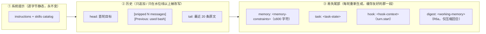

# AI-Coding — R6 分析方案（回合记忆、失败升级、人在环、记忆证据）

> 定位：R1–R5 之后，编排层的形状已经稳定（`AgentLoop` 654 行，四步循环 + 四个被命名
> 的单元），记忆层也有了可解释的召回与对账式收割。R6 处理的是**四个此前记为候选、
> 但一直没有论证过的问题**：
>
> | 编号 | 候选 | 一句话 |
> |---|---|---|
> | R6a | 工作记忆锚（GA 的 Stage 4） | 压缩把中段挖空之后，模型靠什么记得自己做过什么 |
> | R6b | 失败升级三档 | 连续失败 / 预算耗尽时，回合怎么体面地收场 |
> | R6c | `ask_user` 工具 | 模型主动提问，与现有被动审批互补 |
> | R6d | 记忆证据标记（GA 的 "No Execution, No Memory"） | 一条记忆凭什么算数 |
> | R6e | 索引不变量回归 | 把 R4 立下的「索引有界且只放指针」锁进测试 |
>
> 本文档的每一条设计都先有**实测**（§1），再有设计（§2）。四个候选里 **R6a/R6b 被实测
> 证实为真缺口**，**R6d 被实测**削去了大部分理由**（§1.4：提取器并没有在编事实），
> 因此 R6d 从「规则」降级为「元数据」。这是本次调研最重要的结论，写在最前面。
>
> 依据：`docs/r4a-genericagent-research.md`（H3/H5/H6/H7 四条候选）、`docs/r4-analysis.md`
> §16、`docs/r5-analysis.md` 的命名顺延、`docs/r3-analysis.md`（缓存纪律与记忆分层）、
> 以及本文 §1 的四个实测。

---

## 0. 结论先行

1. **R6a（工作记忆锚）成立，但形态要改**：GA 每轮附带 20 条摘要，是因为它每轮都在压历史；
   我们只在越过水位线时压（实测：60 轮工具密集历史 60,967 → 4,056 est tokens，**中段的
   工具正文被换成 `[Previous: used bash]`**）。所以锚应当是**压缩触发**的，而不是每轮常驻；
   而且它要顺带解决一个更严重的实测问题：**预算耗尽时 `TurnOutcome.text` 是 `None`，
   用户拿到的是空字符串**（§1.3）。
2. **R6b（失败升级）成立，但真实病症不是「重复调用」**：实测那一回合是**预算耗尽 + 无话可说**
   （5 轮、`text=null`、用户看到空白），不是「同一个工具调 10 次」（那种情况
   `DuplicateCallGuard` 已经拦住了）。所以第一档是「换策略提示」，真正缺的是**收尾交接**。
3. **R6c（`ask_user`）成立且独立**，成本极低（schema 286 字符 ≈ 72 est tokens），
   但必须解决两件事：没有人时如何降级；等待必须能被回合上限打断（现有 `_ask` 审批路径
   **没有**这个保护，见 §1.5）。
4. **R6d（`verified` 标记）证据不足**：两次真实「不让用工具就断言」的实验，提取器都只写了
   `open_thread`（"不能凭记忆提供"），没有编造 `fact`。GA 的硬规则对我们更不合适——
   我们质量最高的记忆来自**用户声明**，而用户声明不需要任何工具调用。故降级为
   **`evidence` 元数据（tool / model）+ 只观测不过滤**。
5. **顺序**：R6a → R6b → R6c → R6d → R6e。R6b 依赖 R6a 的交接文本；R6c 独立但最小；
   R6d/R6e 是收尾的硬化，谁都不会被它们挡住。
6. **R6 是五个可独立上线的增量**（每个有自己的测试与提交），不是一次大改：任何一个
   （尤其是 R6d/R6e）都可以单独砍掉，剩下的仍然完整可用。本文 §11 给了提交切分。

---

## 1. 现状核验（实测，不是印象）

### 1.0 基线

| 项 | 实测值 |
|---|---|
| `pytest tests/` | **808 passed, 1 skipped**（12.5s） |
| `ai_coding/core/agent_loop.py` | 654 行；`process_input` 153 行 |
| 工具 schema 体积（`tools_chars`） | **4,995** 字符（每次请求都要发） |
| 上下文预算 | `max_context_tokens=48000`，软水位 0.8 → **38,400**，目标 0.5 → 24,000 |
| `config.local.yaml`（本地实测用） | `max_tool_iterations: 5`、`stop_policy: natural` |

### 1.1 实验一：压缩到底丢了什么（离线，合成历史）

构造「用户请求 → assistant 工具调用 → 4,000 字符工具结果 → assistant 结论」的四元组，
跑**生产默认配置**（`AIConfig()`）的 `ContextManager.compress_if_needed`，
在被压缩的历史里放三个探针：`GOAL1`（首轮目标，在头部）、`KEYINFO3`（第 3 轮做出的决策，
在中段）、`REQ-n`（最近的请求，在尾部）。

| 轮数 | 压缩前 | 压缩后 | L1 触发 | 探针存活 |
|---:|---|---|---|---|
| 30 | 120 msg / 30,482 est | **原样返回**（未过水位） | 否 | 全在 |
| 60 | 240 msg / 60,967 est | 240 msg / **4,056 est** | 否 | `GOAL1 ✅` / **`KEYINFO3 ❌`** / `REQ-60 ✅` |
| 120 | 480 msg / 121,965 est | **24 msg** / 3,113 est | 是（`[snipped 457 messages]`） | `GOAL1 ✅` / **`KEYINFO3 ❌`** / `REQ-120 ✅` |

三个结论，都不是我事先猜的：

1. **L2 是真正动手的那一层**：60 轮时消息**一条没少**，但 57 个工具结果的正文被换成
   `[Previous: used bash]`——「只有调用，没有输出」。120 轮时才轮到 L1 砍掉整段。
2. **中段信息确实会死**，而头部目标与尾部 20 条活着。也就是说：**「当前要做什么」还在，
   「我怎么走到这里的」没了**。
3. **L4 摘要几乎没有机会跑**：`_l4_should_run` 在 L3/L1/L2 之后才评估，此时早就在窗口内了。
   所以「我们有一个摘要兜底」在实测里是个**未被触发的兜底**，不能拿它当理由。

> 这条也修正了 R4 调研里对 GA Stage-3「FIFO 逐出」的映射：我们的 m=400 的 `max_messages`
> 让 L1 很少触发，**真正造成中段失忆的是 L2 的占位，不是 L1 的裁剪**。
>
> **配置差异要说明**：本表用的是 `AIConfig()` 的生产默认（`max_messages=400`）。
> 本地 `config.local.yaml` 把它设成 **50**，于是 L1 会更早介入——§1.2 的真实运行里
> 中段就是 `[snipped 277 messages]`（291 条会话 → 24 条），即**本地配置下 L1+L2 同时发生**。
> 也就是说：真实使用比本表更早失忆，R6a 的理由只会更强。

### 1.2 实验二：压缩后失忆对照（真实 LLM，两次运行）

把 1.1 的结论做成一个**可判定的问题**：历史里有一处只有中段才知道的事——
「t3 决定放弃 poetry 改用 uv，因为 poetry 在 Python 3.13 上解析超时」。
合成一份 **291 条消息（54,422 est tokens，已过 38,400 水位）** 的会话，
两个工作区只有一处差别：B 多了一条 `<working-memory>` 环（5 行摘要）。
同一个问题、同一个模型（DashScope qwen3.8-max）。

| | A：无锚 | B：有锚 |
|---|---|---|
| 首步 `prompt_tokens` | 3,363 | 3,414（锚 ≈ **+51**） |
| `estimated_tokens`（iter1） | 3,828 | 3,872 |
| 模型怎么做 | 发现中段是 `[snipped 277 messages]`，**于是用 bash 打开 `sessions/probe1.json`（该文件 ~270 KB）翻找** | 直接从锚里回答 |
| 各步 `prompt_tokens` | 3,363 / 2,824 / 2,594 / **4,865** / **6,363**（5 步，越读越大） | 3,414 / 3,174 / 2,661 / 4,808（4 步） |
| 回答 | 找到了，但把「整读会话文件」当成了常规手段 | 「答案是 uv…**但这是照抄摘要，不是我知道的事**」 |

两个额外发现（都不在我预期内）：

- **落盘的会话文件是「无损档案」**：压缩只改**请求里的副本**，`sessions/<id>.json` 仍是全量。
  模型自己发现并利用了这个后门。它救了这次询问，但代价是 3 个额外迭代与一路膨胀的 prompt。
- **模型会抱怨 L2 的占位**：B 的回答里有一句「轮 4–73 我每轮只调用了 `pytest -q`，
  而且**这些命令的输出从来没有真正返回给我**」。这正是 `[Previous: used bash]` 的副作用。

> 也就是说：**失忆不是致命的，而是昂贵的**（多轮迭代 + prompt 膨胀 + 模型被迫做考古）。
> 这决定了 R6a 的定位是「便宜的路标」，不是「救命稻草」，也决定了它必须**只在压缩触发时**出现。
>
> **实施后的边界修正（实测，2026-09-24）**：本节那条 5 行摘要是我**手写**的，里面直接写了
> 「t3 决策 uv」。默认环长 12 行**够不到第 3 轮**——真实回归里（`scripts/r6_cases.py --real` R2）
> 环带住了第 66 轮、首步 prompt 4,043、模型一次直接据环作答且**没有**翻会话文件；另一次它仍去翻了
> `sessions/*.json` 并耗尽 5 轮预算。所以准确的说法是：**环覆盖「最近 `working_memory_keep` 轮」，
> 保证被压缩掉的中段有路可查；更早的决策是记忆层（pinned decision → `<memory-constraints>`）的职责。**

### 1.3 实验三：一个真实回合失败成什么样（真实 LLM + 真实 trace）

工作区 `src/calc.py` 有个 bug、`test_calc.py` 是验收测试、**没有 Makefile**；
提示词：「让这个仓库的验收命令 `make test` 通过，必须真实执行该命令看到成功输出」。

trace 实录（`/tmp/r6probe/failws/.ai-coding/traces/<sid>/turn-1.jsonl`）：

```
i1  2 工具调用   bash(false, nonzero_exit) + memory_search(true)
i2  1 工具调用   bash(true)                      # 找文件
i3  2 工具调用   bash(false, nonzero_exit)        # 环境探测
i4  3 工具调用   todo_write ×3 (true)
i5  2 工具调用   write(Makefile, true) + read(src/calc.py, true)
TurnFinished  status=MAX_ITERATIONS  reason="iteration budget exhausted"  text=null
MemoryHarvested  added=6 条
```

**用户看到的是空字符串**（`ask` 打印 `outcome.text or ""`）。模型其实干了不少活
（建了 Makefile、修好了 todo、读到了 bug），但没有一句话说给用户听，也没有留下
「下一步是什么」。**这就是 R6b 要修的东西**，而它跟「重复调用」无关。

同一回合还暴露一个小缺陷：`MemoryHarvested` 的 6 条 note 都带着 `source_turn=16`——
那是**消息条数**（`turn_index=len(session.messages)`），不是回合号。R6d 顺手修正。

### 1.4 实验四：模型会不会把「没验证过的话」写进记忆（真实 LLM，两次）

这是 R6d 的判据，所以必须实测，而不是推断 GA 的纪律。两次运行，提示词明确要求
**不调用任何工具**、直接断言工作区事实：

| 实验 | 提示 | 提取器写了什么 |
|---|---|---|
| 4a | 「这个项目是用 poetry 还是 uv 管理依赖？」 | 1 条 `open_thread`：「项目依赖管理工具尚未确认…需要通过 pyproject.toml、锁文件或 CI 进一步验证」 |
| 4b | 「`src/calc.py` 的 `add` 是怎么实现的？」 | 1 条 `open_thread`：「`add` 的真实实现尚未获得，不能凭记忆提供」 |

两次都没有写出 `fact`。模型（qwen3.8-max）+ 我们 R3 的抽取提示词（`kind ∈ fact|decision|
preference|open_thread` 且「没有可写入的新事实时输出 `[]`」）在这个样本上是**诚实**的。

再用实验三的 note 反查证据链，6 条里有 5 条能对上本回合的一次成功工具调用
（读到 `a - b`、探到 make/pytest 版本、写出 Makefile），第 6 条来自**用户提示词本身**。

> 结论：**「No Execution, No Memory」作为硬规则，会被实测打脸**——
> 我们最值钱的记忆恰恰来自用户声明（「验收标准是必须真实执行 make test」），
> 而用户声明不需要任何工具调用。R6d 因此改判为**元数据**（§2.4）。

### 1.5 代码侧核验（改动落点）

| 事实 | 位置 | 对 R6 的意义 |
|---|---|---|
| 回合终态由 `TurnOutcome` 承载（`status/text/iterations/reason/usage`） | `domain/loop.py` | R6a 要加 `handoff`，**不能**改 `text` 语义 |
| `process_input` 返回 `outcome.text or ""` | `core/agent_loop.py` 末尾 | 空回合 → 空回答；R6a 改成 `text or handoff` |
| `harvest` 用 `outcome.text is None` 判断「这回合有没有结论」，据此决定要不要唤醒整理 | `core/memory_turn.py` | **这是不能把 `text` 改写成交接文本的硬理由**（会误触发整理） |
| 子智能体用 `outcome.text` 当 `conclusion` | `core/subagent.py:225` | 预算耗尽的子智能体目前回包没有结论；`text or handoff` 直接受益 |
| `Compactor.compress` 未压缩时**原样返回入参对象**，压缩时返回新列表 | `core/compaction.py` | R6a 用这个可判定信号决定是否注入锚（加一个具名判定函数，不改契约） |
| 尾部三块由 `build_tail([memory, task, hook])` 组装 | `core/agent_loop.py` / `core/request_builder.py` | R6a 加入第四块 `digest`，**顺序由调用方声明**，不需要改 `build_tail` |
| `TurnSnapshot` 只有 `iteration/nudges/open_items/final_text/tokens_spent` | `core/turn_policy.py` | R6b 要加失败连胜等字段（全部带默认值，向后兼容） |
| `ToolDispatcher._ask` 里 `await self.approval.approve(...)` **没有包 deadline** | `core/dispatch.py:342` | R2 的「任何等待都有上限」在人工等待上有个洞；R6c 用 `asyncio.to_thread` 让工具等待可被取消 |
| `CLIApprovalCallback` 直接调阻塞 `input()` | `security/approval.py` | 既有先例，说明 REPL 里「回合中读一行」是可行的（`run_repl` 的 prompt 在回合前已返回） |
| 工具栈由 `build_tool_registry(..., include_subagent=)` 装配，子智能体走 `include_subagent=False` | `tools/builder.py` | R6c 在这里做「有没有人」的分流 |
| 压缩层单元测试断言了占位文本 `[Previous: used bash]` | `tests/test_context_compression.py:94` | 改 L2 语义 = 改既有契约，需要拍板（D-R6-13） |

### 1.6 成本实测（新增东西要花的钱）

| 新增 | 体积实测 | 折算（`estimate_tokens`） |
|---|---|---|
| 工作记忆环 6 行 | 371 字符 | **113 est tokens** |
| 工作记忆环 1 行（中文，~51 字符） | 51 字符 | ~15 est tokens |
| 工作记忆环 12 行（R6a 默认值） | ~750 字符 | **~230 est tokens（占 48k 的 0.5%）** |
| `ask_user` 的 JSON schema | 286 字符 | ~72 est tokens（+1.4% 工具 schema） |
| `TurnHandoff` 文本 | ~200–400 字符 | 只在收尾时进**用户界面**，不进模型上下文 |

---

## 2. 四个候选逐个设计

### 2.1 R6a —— 回合摘要环（工作记忆锚）+ 收尾交接

**问题（实测）**：压缩把中段的工具正文换成 `[Previous: used bash]`（§1.1），于是模型
要么考古（§1.2 A 组：dump 257KB 会话文件），要么抱怨「输出从来没有返回给我」（§1.2 B 组）；
而预算耗尽时用户拿到空回答（§1.3）。

**设计**：新增一个纯单元 `domain/turn_digest.py`，回答一个问题：
**「这一回合，留给之后的一句话是什么？」**
（放 `domain/` 而不是 `core/`：它既是**持久值对象**，又自带渲染，与同样自带
`render()` 的 `domain/task.py` 同类；这样 `core/` 单向依赖 `domain/`，不会成环。
执行计划里按这个位置落地，见 `docs/r6-plan.md` Task 1。）

```python
@dataclass(frozen=True)
class TurnDigest:
    turn: int                    # 会话级回合号（新字段 SessionData.turn_count）
    request: str                 # 用户请求，压缩成一行（默认 ≤60 字符）
    outcome: str                 # 这回合干了什么 / 怎么结束的（默认 ≤90 字符）
    status: str                  # TurnStatus.value，便于以后统计
    files: tuple[str, ...] = ()  # 本回合的产物路径（来自 ToolArtifact）
    open_items: int = 0          # 结束时还开着几项

def build_digest(*, turn, user_input, outcome, artifacts, task, request_chars=60,
                 outcome_chars=90) -> TurnDigest: ...
def append_digest(session, digest, *, keep: int) -> None: ...        # 有界环，旧的自头部淘汰
def render_working_memory(digests, *, current_turn, max_chars, compacted: bool) -> str: ...
def render_handoff(*, task, outcome, failures, artifacts, digests, workspace) -> str: ...
```

**注入位置**：易失尾部新增第四块 `digest`，顺序 `[memory, task, hook, digest]`
（`build_tail` 本身不改——它按调用方声明的顺序拼，这是 R5 已经立好的性质）。
「要不要有这一块」的判定放在 `render_working_memory` 内部（收 `compacted` 参数），
这样这条规则是**离线可表测的纯函数**，而不是埋在循环里的 if。

**触发条件**：`compacted is True` 才注入，其中

```python
# core/compaction.py（新增，纯函数，2 行）
@staticmethod
def did_compact(source: Sequence[ChatMessage], result: Sequence[ChatMessage]) -> bool:
    """compress() 未压缩时原样返回入参，压缩时返回新列表——这就是可判定信号。"""
    return result is not source
```

理由（§1.1 + §1.2）：普通回合里最近的对话**原封不动就在历史里**，加一份摘要纯属重复付费；
中段被挖空时它才是稀缺信息。代价：压缩回合多 ~230 est tokens，普通回合 0。

**环长**：`ai.working_memory_keep = 12` 条、`ai.working_memory_chars = 1200` 字符（渲染期
按字符预算从**最旧**开始丢）。12 条 ≈ 230 est tokens = 预算的 0.5%，且落在本来每轮都会变的
尾部区域，**不额外打穿前缀缓存**。

**收尾交接**（`render_handoff`）：当回合因为 `MAX_ITERATIONS` / `BUDGET` / `TIMEOUT` / `ERROR`
结束、而 `outcome.text` 为空时，填 `outcome.handoff`：

```
[回合未完成 · 迭代预算用尽（5/5）]
目标: 让这个仓库的验收命令 `make test` 通过
已完成: 1. 创建 Makefile
未完成: 2. 修复 src/calc.py 的 bug；3. 真实执行 make test 并确认成功输出
最近一次失败: bash → nonzero_exit（make: *** No rule to make target 'test'.）
产物: Makefile, src/calc.py
轨迹: .ai-coding/traces/<sid>/turn-1.jsonl
```

**为什么新增字段而不是覆盖 `text`**（三条硬理由，都来自代码）：

1. `memory_turn.harvest` 用 `outcome.text is None` 判断「这回合有没有结论」，覆盖会误唤醒整理；
2. `text` 的语义是「模型最后说了什么」，交接文本是**harness 写的**，两者混在一起会让
   轨迹与账本失去「模型到底有没有交付」这个事实；
3. 子智能体要的是 `text or handoff`——保留两个字段，是**加法**而不是语义重定义。

对外可见的变化只有一处：`process_input` 的返回值从 `outcome.text or ""` 变成
`outcome.text or outcome.handoff`（`last_outcome` 本身不变，既有测试断言仍然成立）。

**不做**：不新增摘要工具（GA 的 `update_working_checkpoint`）——它要求模型额外一次调用
与一段提示词，而我们**已经有**这份数据（用户请求、终态、产物、todo 增量），
派生是免费的；模型自己写的摘要更漂亮，但那是 R7 的优化项（D-R6-1）。

### 2.2 R6b —— 失败升级三档（局部修 → 换策略 → 问人）

**问题（实测）**：见 §1.3——真实失败回合是「预算耗尽 + 一言不发」，不是重复调用。

**设计**：把「升级」拆成**三个可测量的动作**，全部落在已有的两个单元里：

| 档 | 触发（测得到） | 动作 | 落在哪 |
|---|---|---|---|
| 1 局部修 | 同一个 `(tool, params)` 重复（已有） | `DuplicateCallGuard` 拒绝并给出前一次调用 | R4b 已完成 |
| 2 换策略 | **连续 N 轮工具结果全军覆没**（`failed_streak ≥ 2`） | 注入一次 `[strategy-gate]` 提示（**每回合至多一次**） | `TurnPolicy` + 循环计数 |
| 3 问人 / 收尾 | 跑到 `stall_iterations=3`、本回合**尝试过调用**（`attempted_calls > 0`）却**零次成功** → 立即结束并交接；需要人时用 `ask_user`（R6c） | `FINISH` + `handoff`（§2.1） | `TurnPolicy` + R6a 的交接 |

`TurnSnapshot` 增三个带默认值的字段（向后兼容，既有 19 条表测不动）：

```python
failed_streak: int = 0       # 连续「全部工具结果失败」的迭代数
attempted_calls: int = 0     # 本回合发起过的工具调用数（成功与否都算）
successful_calls: int = 0    # 本回合成功的工具调用总数
strategy_nudges: int = 0     # 本回合已经换过几次策略
```

> `attempted_calls` 不是装饰：第一版实现只用 `successful_calls == 0` 判 stall，
> **被既有测试 `test_strict_policy_ignores_the_nudge_cap` 当场抓住**——`strict` 策略下模型
> 只说话不调工具时「零成功」会被误判成「零进展」，把「一直提醒」的语义打死。
> 「尝试过但都没成功」才是有病的形状；只说话不干活的回合归停止策略管。

`TurnPolicyConfig` 增（`from_ai_config` 同步）：

```python
failed_streak_threshold: int = 2   # 0 = 关闭换策略档
max_strategy_nudges: int = 1
stall_iterations: int = 3          # 0 = 关闭提前收尾
```

`decide_next_iteration` 的**判定优先级**（顺序本身是设计）：

1. `budget_expired` → `FINISH`（现状）
2. 轮次 / token 预算 → `FINISH`（现状）
3. **stall**：`iteration > stall_iterations and attempted_calls > 0 and successful_calls == 0` → `FINISH`
   （reason `"no progress: no tool call has succeeded in 3 iterations"`）
4. **换策略**：`failed_streak >= threshold and strategy_nudges < max` → `NUDGE` +
   `strategy_message()`
5. 否则 `ITERATE`

`strategy_message()`（纯函数，可表测）：

```
[strategy-gate] 最近 2 轮的工具调用全部失败（最近: bash → nonzero_exit）。
不要重复同样的做法：
1) 先读错误输出，说清直接原因，不要猜；
2) 换手段或把目标切小（换工具、换路径、先写最小复现）；
3) 若确实缺信息或需要人拍板，用 ask_user 提问；没有人回答时就给出结论与假设后收尾。
```

**为什么是「连续失败」而不是「没有进展」**：进展需要定义（新产物？todo 变化？新文件？），
任何定义都会在真实回合里误判；而「这一轮所有工具结果 `success=False`」是**分发器已经给出
的事实**，零歧义、可离线表测。§1.3 那一回合恰好说明：模型在失败中仍然**在推进**
（建 Makefile），所以不该被 stall 掐死——stall 只在**一次成功都没有**时触发。

**status 用什么**：**不新增 `TurnStatus`**。stall 提前收尾用 `MAX_ITERATIONS` + 明确的
`reason`。理由：`TurnStatus` 是外部契约（`subagent._STATUS_MAP`、UI、`/status`），
新成员要为每处消费方各定一次映射（R4b 加 `BUDGET` 时已付过一次这种代价），而这里
`reason` 已经足够区分（D-R6-5）。

### 2.3 R6c —— `ask_user`（人在环是一等工具）

**问题**：模型只能在门槛触发时**被动**被问（`PermissionGate` → `ApprovalCallback`），
不能主动问「你要我改 A 还是 B」。GA 把 `ask_user` 当一等工具——这条要吸收。

**设计**：仿照审批回调，新增一条**主动提问**的通道，不改循环。

```python
# ai_coding/security/user_prompt.py（新，~70 行，与 approval.py 平级）
@dataclass(frozen=True)
class UserAnswer:
    answered: bool
    text: str = ""
    reason: str = ""          # "" | "no_user" | "timeout" | "eof"

class UserPromptCallback(Protocol):
    async def ask(self, question: str, options: Sequence[str] = ()) -> UserAnswer: ...

class CLIUserPromptCallback:     # input_fn 可注入（与 CLIApprovalCallback 同款）
    async def ask(...) -> UserAnswer:
        ... await asyncio.to_thread(self._input, prompt) ...   # ← 关键：等待可被取消
class UnavailableUserPromptCallback:   # 无人值守：立刻返回 answered=False, reason="no_user"
```

```python
# ai_coding/tools/ask_user_tool.py（新，~90 行）
class AskUserTool(BaseTool):
    name = "ask_user"
    parallel_safe = False                       # 等人不能和别的工具并发
    max_duration_seconds = timeout + 15         # 与 bash/subAgent 同款「自报上限」
    # 有答案:  success=True,  output="用户回答：…", data={"answered": True, "answer": ...}
    # 没有人:  success=False, error="no_user",
    #          output="当前没有人工可回答。请自行选择并明确写出你的假设，然后收尾。"
    # 超时:    success=False, error="user_timeout"
```

**三处接线**（都是加法）：

1. `tools/builder.py`：`ask_user` 只在 **`include_subagent=True` 且有真人回调**时注册
   ——子智能体在隔离工作区里没有可问的人，工具列表本身就该诚实（GA 的「工具接口是
   第一道 harness」）。同时 `build_subagent_runner` 一路传 `user_prompt=None`。
2. `cli.py`：`repl` 传 `CLIUserPromptCallback()`；`ask`（一次性、非交互）保持
   `UnavailableUserPromptCallback()`——模型会得到一句「自行判断并说明假设」，
   而不是挂住。
3. 配置：`ToolsConfig.ask_user: ToolConfig = Field(default_factory=ToolConfig)`，
   `timeout_seconds`（默认 30 → 建议 300）就是等待上限。

**为什么是阻塞式回调，而不是「结束回合等人回答」**：后者要在会话里留下
「有 `tool_call` 没有 `tool` 结果」的断口，而 `ensure_tool_pairing(strict=True)` 会在落盘时
把无文本载体消息里的这类调用**丢掉**，下一轮请求就是非法配对（实测约束见
`domain/session.py`）。阻塞式把答案直接变成 `ToolResult` → 天然合规、可回放（D-R6-7）。

**等待的上限**：`ask` 自己 `await asyncio.to_thread(input)`，所以事件循环不被占死，
分发器现有的 `run_with_deadline(tool.execute(...))` 能真的打断它（R2 的规矩）。
顺带说明：**现有的 `CLIApprovalCallback` 没有这层保护**（`dispatch._ask` 里裸 `await`），
一个卡住的审批会挂死整回合。R6c 先把新工具做对，是否顺手修审批记为 D-R6-9。

### 2.4 R6d —— 记忆证据（把 GA 的纪律改成我们的事实）

**问题（实测的反面）**：§1.4 说明提取器没有编造；但**系统里确实没有任何字段**能回答
「这条记忆是本回合哪来的证据」。`/memory` 只能报总数，轨迹只能说「写了 6 条」，
整理（consolidate）也只能按 `importance/hits` 排。

**设计（元数据，不过滤）**：

```python
# memory/note.py
evidence: str = ""     # "tool" | "model" | ""（旧数据）

# memory/service.py
async def harvest(..., evidence: str = "", ...)   # 由调用方给（回合级事实）
def status(self) -> dict:  # 增 "by_evidence": {"tool": n, "model": m, "": k}

# core/events.py
class MemoryHarvested:  ... + evidence: str = ""
```

回合级事实由循环提供：`evidence = "tool" if 本回合至少一次工具调用成功 else "model"`
（分发器已经给出 `DispatchOutcome.result.success`，不需要新判断）。

**为什么不做 GA 的硬规则**：GA 的 "No Execution, No Memory" 写在 SOP 里，靠模型自觉；
就算我们把它硬化成「没有工具调用就不许写 fact」，也会**误杀用户声明**
（§1.4 的 6 条 note 里最重要的一条正来自用户提示词）。所以：
`evidence` 只用于**观测与排序倾向**（`/memory` 展示、`MemoryHarvested` 事件、
未来召回的同分择优），**不做过滤、不做降级**（D-R6-10）。

**顺手修正**：`source_turn` 现在填的是 `len(session.messages)`（实测 16），
改为真正的回合号。为此 `SessionData` 新增 `turn_count`（JSON `turnCount`），
在回合开始时 `+1`；旧会话从 0 开始重新计数（不回溯，D-R6-11）。

### 2.5 R6e —— 索引不变量（R4 的 D-R4-15 收尾）

**设计**：只加测试（若测试发现缺陷才改代码），把三条写成断言：

1. 索引块每行都只是**指针**（`- [kind#id8] 一句话`），不含正文段落；
2. `index_max_chars` 是硬上限：塞 200 条 note，渲染结果长度仍 ≤ 预算；
3. **L2/L3 增长不推高索引**：连续写入 100 条 note，索引长度不变（或不超上限）。

---

## 3. 编排层注入位置与缓存纪律（一张图说清）



三条纪律在 R6 之后仍然成立，且新增的两块**没有**破坏它们：

1. **记忆永不进系统提示**（R3）——`digest` 也遵守；
2. **历史只在预算触发时改写**（R3b）——`digest` 只在改写发生后出现，正好是「改写需要解释」
   的时刻；
3. **观测只写不改**（R4）——`handoff` 与 `digest` 都是**回合产物**，不参与任何请求的组装
   （`handoff` 只进用户界面，`digest` 只在**下一回合**被读）。

---

## 4. 逐文件实现步骤（每步一个可独立审阅的增量）

> 全程 TDD：先红后绿；新增测试文件优先，**不改既有断言**（唯一例外是 D-R6-13，需拍板）。

### 4.1 R6a —— 回合摘要环与交接

| 文件 | 动作 | 内容 |
|---|---|---|
| `ai_coding/domain/turn_digest.py` | **新建** | `TurnDigest`（camelCase `to_dict/from_dict`，坏行忽略）、`build_digest`、`append_digest`（有界环）、`render_working_memory`、`render_handoff`。纯函数、无 IO、无 asyncio；`append_digest` 收 `session: Any`，避免 `domain` 内成环 |
| `ai_coding/domain/session.py` | 改 | 字段 `turn_count: int = 0`、`turn_digests: list[TurnDigest] = field(default_factory=list)`；`to_dict` 写 `turnCount`/`turnDigests`（空则不写，沿用 task 的「不写噪声」惯例）；`from_dict` 容错 |
| `ai_coding/domain/loop.py` | 改 | `TurnOutcome.handoff: str = ""`（追加默认值，**不改 `text`**） |
| `ai_coding/core/compaction.py` | 改 | 新增静态判定 `did_compact(source, result)`（`result is not source`），2 行 + docstring |
| `ai_coding/core/agent_loop.py` | 改 | ① 回合开始 `session.turn_count += 1`；② 每轮记录 `failed_streak / successful_calls / last_failure`；③ 压缩后 `compacted = Compactor.did_compact(...)`；④ 尾部加 `_volatile("digest", render_working_memory(...))`；⑤ 收尾前 `build_digest` + `append_digest` + 需要时 `replace(outcome, handoff=render_handoff(...))`；⑥ 返回 `outcome.text or outcome.handoff` |
| `ai_coding/core/subagent.py` | 改 | `conclusion = _truncate(outcome.text or outcome.handoff, limit)` |
| `ai_coding/config/models.py` | 改 | `ai.working_memory_keep=12`、`ai.working_memory_chars=1200` |
| `tests/test_turn_digest.py` | **新建** | 见 §7.1（10 条） |
| `tests/test_loop_digest.py` | **新建** | 见 §7.2（6 条，假引擎离线） |

### 4.2 R6b —— 失败升级

| 文件 | 动作 | 内容 |
|---|---|---|
| `ai_coding/core/turn_policy.py` | 改 | `TurnSnapshot` +3 字段（默认值）；`TurnPolicyConfig` +3 字段与 `from_ai_config`；新 `strategy_message()`；`decide_next_iteration` 插入 stall 与换策略两档（优先级见 §2.2） |
| `ai_coding/core/agent_loop.py` | 改 | 每轮把失败连胜/成功数/换策略次数带进 `TurnSnapshot`；`NUDGE` 时把 `strategy_message()` 作为**持久化**用户消息追加（与 `[task-gate]` 同款，理由见 R5 文档 D1）；stall 结束走 `handoff` |
| `ai_coding/config/models.py` | 改 | `ai.failed_streak_threshold=2`、`ai.max_strategy_nudges=1`、`ai.stall_iterations=3` |
| `tests/test_turn_policy_escalation.py` | **新建** | 见 §7.3（6 条，纯表测） |
| `tests/test_loop_escalation.py` | **新建** | 见 §7.3（4 条，假引擎 + 假工具） |

### 4.3 R6c —— `ask_user`

| 文件 | 动作 | 内容 |
|---|---|---|
| `ai_coding/security/user_prompt.py` | **新建** | `UserAnswer`、`UserPromptCallback`、`CLIUserPromptCallback`（`asyncio.to_thread`）、`UnavailableUserPromptCallback` |
| `ai_coding/tools/ask_user_tool.py` | **新建** | `AskUserTool`（`parallel_safe=False`、`max_duration_seconds`、三种结果码） |
| `ai_coding/tools/builder.py` | 改 | `build_tool_registry(..., include_subagent=True, user_prompt=None)`；仅在 `include_subagent and tools.ask_user.enabled and user_prompt is not None` 时注册；`build_subagent_runner` 不传 |
| `ai_coding/config/models.py` | 改 | `ToolsConfig.ask_user: ToolConfig = Field(default_factory=ToolConfig)`（`timeout_seconds` 默认 30，`how-to-run.md` 建议 300） |
| `ai_coding/cli.py` | 改 | `repl` 构造 `CLIUserPromptCallback()` 并一路传到 `build_tool_registry`；`ask` 保持无人回调 |
| `tests/test_user_prompt.py` / `tests/test_tool_ask_user.py` / `tests/test_builder_ask_user.py` | **新建** | 见 §7.4（10 条） |

### 4.4 R6d —— 证据元数据

| 文件 | 动作 | 内容 |
|---|---|---|
| `ai_coding/memory/note.py` | 改 | `evidence: str = ""`，`to_dict` 有值才写，`from_dict` 缺省 `""` |
| `ai_coding/memory/service.py` | 改 | `harvest(..., evidence="")` → `_reconcile(..., evidence=...)` → `new_note(..., evidence=...)`；`status()` 增 `by_evidence` |
| `ai_coding/core/memory_turn.py` | 改 | `harvest(..., evidence: str = "")` 透传 |
| `ai_coding/core/agent_loop.py` | 改 | 用「本回合有无成功工具调用」计算 `evidence` 并传给 `TurnMemory.harvest` |
| `ai_coding/core/events.py` | 改 | `MemoryHarvested.evidence: str = ""`（追加默认值，轨迹自动带上） |
| `ai_coding/ui/repl.py` | 改 | `/memory` 展示 `by_evidence`（缺字段时不崩） |
| `tests/test_memory_evidence.py` / `tests/test_memory_turn_evidence.py` | **新建** | 见 §7.5（6 条） |

### 4.5 R6e —— 索引不变量

| 文件 | 动作 | 内容 |
|---|---|---|
| `tests/test_memory_index_invariants.py` | **新建** | 见 §7.6（3 条）。若断言失败，最小改动修 `MemoryService.index_notes`（只允许更严格） |

### 4.6 验收脚本与文档

| 文件 | 动作 | 内容 |
|---|---|---|
| `scripts/r6_cases.py` | **新建** | 8 条离线案例（`_Extractor`/假引擎/假回调，无网络）+ `--real` 3 条真实案例（见 §8） |
| `docs/data-contracts.md` / `architecture.md` / `features.md` / `how-to-run.md` / `integration_testing.md` / `README.md` | 改 | 见 §13 |

---

## 5. 数据契约变更汇总

| 契约 | 变更 | 兼容性 |
|---|---|---|
| `TurnOutcome` | **+`handoff: str = ""`** | 追加默认值；`text` 语义不变；子智能体与 CLI 用 `text or handoff` |
| `SessionData` | **+`turn_count: int = 0`**（JSON `turnCount`）、**+`turn_digests: list[TurnDigest]`**（JSON `turnDigests`，空不写） | 旧会话文件缺字段 → 默认 0/空；坏行忽略 |
| `MemoryNote` | **+`evidence: str = ""`** | 旧 `.memory` 行缺字段 → `""`（=未知），不迁移 |
| `MemoryHarvested` 事件 | **+`evidence: str = ""`** | 追加默认值，轨迹读取方不受影响 |
| `TurnPolicyConfig` / `TurnSnapshot` | **+3 字段**（全部有默认值） | 既有 19 条表测与调用点不改 |
| `AIConfig` | +`working_memory_keep`、`working_memory_chars`、`failed_streak_threshold`、`max_strategy_nudges`、`stall_iterations` | 全部有默认值 |
| `ToolsConfig` | +`ask_user: ToolConfig` | 默认启用，但没有回调时**不注册** |
| `ToolResult.error` | +`no_user`、`user_timeout` | 与既有码表同风格 |
| `Compactor` | +静态方法 `did_compact` | 不改 `compress` 签名 |
| `process_input` 返回值 | `text or handoff`（原来是 `text or ""`） | 空回合从「空字符串」变成「一段交接报告」——这是本次**唯一**的对外行为改变 |

**没有变的**（刻意）：`TurnStatus` 成员数、工具输出的 `<tool_output>` 信封、
历史压缩的四段顺序、系统提示的逐字节静态性、记忆注入位置。

---

## 6. 数据流

### 6.1 一个回合的扇入扇出（R6 之后）

```mermaid
sequenceDiagram
    participant U as 用户/CLI
    participant L as AgentLoop
    participant D as TurnDigest
    participant P as TurnPolicy
    participant M as TurnMemory
    participant S as SessionData

    U->>L: process_input(session, input)
    L->>S: turn_count += 1
    loop 每次迭代
        L->>P: decide_next_iteration(失败连胜, 成功数, 花费)
        P-->>L: ITERATE / NUDGE(strategy) / FINISH
        L->>S: 读取 messages，压缩（可能改写）
        L->>D: render_working_memory(digests, compacted?)
        D-->>L: &lt;working-memory&gt;（仅压缩回合非空）
        L->>L: 组装 request = history + [memory, task, hook, digest]
        L->>L: 模型步 → 工具分发（记录 success/failure）
    end
    L->>D: build_digest(请求, 终态, 产物, todo)
    D-->>L: TurnDigest
    L->>S: append_digest(ring, keep=12)
    L->>D: render_handoff（仅当 text 为空且非正常结束）
    L->>M: harvest(delta, evidence="tool"|"model")
    M-->>L: MemoryHarvested(added/updated/…, evidence)
    L->>S: 落盘（含 turnDigests/turnCount）
    L-->>U: text or handoff
```

### 6.2 与既有扇入扇出的关系（不许新增环）

| 单元 | 依赖方向 | R6 之后 |
|---|---|---|
| `turn_digest` | `domain`（`TurnOutcome`/`TaskState`/`ToolArtifact`） | **被 loop 调用**，自己不依赖 loop（避免 R5 警告过的环路） |
| `turn_policy` | `domain` | 仍然纯函数；失败计数**由 loop 喂进来**，policy 不自己数 |
| `memory/service` | `memory/*` | 多一个字符串参数，仍然不知道循环的存在 |
| `tools/ask_user_tool` | `tools/base` + `security/user_prompt` | 通过 `ToolContext` 与回调，**不接触 loop** |

---

## 7. TDD 用例清单（先红后绿，逐条）

### 7.1 `tests/test_turn_digest.py`（10）

| # | 用例 | 断言要点 |
|---:|---|---|
| 1 | `test_digest_request_is_one_short_line` | 4,000 字符输入 → `request` 单行且 ≤ `request_chars`，末尾有省略号 |
| 2 | `test_digest_records_status_and_files` | `status == "max_iterations"`；`files == ("Makefile",)`（去重、按出现顺序） |
| 3 | `test_append_digest_keeps_a_bounded_ring` | 追加 30 条、`keep=12` → 长度 12，保留最后 12 条，`turn` 递增 |
| 4 | `test_digest_survives_a_session_round_trip` | `SessionData.to_dict → from_dict` 后 `turn_count`/`turn_digests` 一致，JSON 键是 `turnCount`/`turnDigests` |
| 5 | `test_broken_digest_rows_are_ignored` | 会话里塞 `{"turn": "x"}`、`{}`、非 dict → 忽略，不抛 |
| 6 | `test_working_memory_is_empty_when_not_compacted` | `compacted=False` → `render_working_memory` 返回 `""`（尾部拿不到块） |
| 7 | `test_working_memory_keeps_the_newest_when_over_budget` | 20 条、`max_chars=600` → 只留最新几条，总长 ≤ 600，第一条是较新的 `t` |
| 8 | `test_working_memory_names_the_current_turn` | 文本含「第 N 轮」且 `N == current_turn` |
| 9 | `test_handoff_names_goal_open_items_and_failure` | 含目标、未完成项、`bash → nonzero_exit` 摘要 |
| 10 | `test_handoff_is_empty_for_a_finished_turn` | `COMPLETED` 且有 `text` → `""`（不覆盖模型的话） |

### 7.2 `tests/test_loop_digest.py`（6，假引擎）

| # | 用例 | 断言要点 |
|---:|---|---|
| 11 | `test_each_turn_appends_one_digest` | 连跑两回合 → `len(session.turn_digests) == 2`，`turn` 为 1、2 |
| 12 | `test_digests_are_persisted_with_the_session` | 假 `SessionService.save` 收到的会话含 `turnDigests` |
| 13 | `test_budget_exhaustion_returns_the_handoff_not_an_empty_string` | `max_iterations=2` 且每轮都调工具 → 返回值非空，`last_outcome.text is None`，`last_outcome.handoff` 含「未完成」 |
| 14 | `test_working_memory_is_injected_only_when_history_was_compacted` | 假 `ContextManager` 一版返回新列表（→ 尾部出现 `("digest", n)`，`n>0`）、一版返回原对象（→ 不出现） |
| 15 | `test_working_memory_is_a_tail_block_never_system_prompt` | `instructions` 不含 `<working-memory>`；`request[-1]` 含 |
| 16 | `test_a_completed_turn_keeps_text_and_leaves_handoff_empty` | 既有行为不回退 |

### 7.3 R6b（10）

`tests/test_turn_policy_escalation.py`（纯表测，6）

| # | 用例 | 断言要点 |
|---:|---|---|
| 17 | `test_repeated_failures_ask_for_a_strategy_change` | `failed_streak=2, threshold=2` → `NUDGE`，`inject` 含 `[strategy-gate]` |
| 18 | `test_the_strategy_nudge_is_given_once_per_turn` | `strategy_nudges=1, max=1` → `ITERATE` |
| 19 | `test_a_turn_with_no_success_stops_before_the_iteration_budget` | `iteration=4, successful_calls=0, stall=3` → `FINISH`，`reason` 含 `no progress` |
| 20 | `test_a_successful_call_disarms_the_stall_stop` | 同上前提但 `successful_calls=1` → `ITERATE`（§1.3 的模型不该被掐死） |
| 21 | `test_budget_still_wins_over_escalation` | `budget_expired=True` → `FINISH("turn deadline exceeded")` |
| 22 | `test_escalation_is_off_when_the_threshold_is_zero` | `threshold=0, stall=0` → 完全等同 R6 之前 |

`tests/test_loop_escalation.py`（4）

| # | 用例 | 断言要点 |
|---:|---|---|
| 23 | `test_failed_iterations_produce_one_strategy_nudge_in_the_session` | 假工具恒失败 → 会话里只多一条 `[strategy-gate]` 用户消息 |
| 24 | `test_a_stalled_turn_finishes_with_a_handoff` | 3 轮全失败 → `handoff` 非空、`iterations < max_iterations` |
| 25 | `test_successful_tool_calls_count_towards_progress` | 一成功 + 两失败 → 不 stall |
| 26 | `test_escalation_never_fires_without_tool_calls` | 模型自然结束 → 无 nudge、无 handoff |

### 7.4 R6c（10）

| # | 用例（文件） | 断言要点 |
|---:|---|---|
| 27 | `test_answered_question_is_structured_data`（`test_tool_ask_user.py`） | `success=True`，`data["answer"] == "改 A"`，output 里含用户原文 |
| 28 | `test_no_human_tells_the_model_to_decide` | `UnavailableUserPromptCallback` → `success=False`，`error="no_user"`，output 教它「写清假设后收尾」 |
| 29 | `test_callback_failure_is_a_tool_failure` | 回调抛异常 → `tool_error` 风格结果，**回合不崩** |
| 30 | `test_missing_question_is_rejected` | `missing_question` |
| 31 | `test_options_are_rendered_in_the_prompt` | 假回调捕获到 `options=["A","B"]` |
| 32 | `test_the_tool_is_not_parallel_safe` | `parallel_safe is False` |
| 33 | `test_the_tool_declares_its_wait_bound` | `max_duration_seconds == timeout + 15` |
| 34 | `test_cli_callback_returns_the_typed_answer`（`test_user_prompt.py`） | 注入 `input_fn` → `UserAnswer(answered=True, text=...)` |
| 35 | `test_eof_is_unavailable_not_a_crash` | `EOFError` → `answered=False, reason="eof"` |
| 36 | `test_registration_needs_a_human`（`test_builder_ask_user.py`） | 有回调 → 注册；无回调 → 不注册；`include_subagent=False` → **永不**注册 |

### 7.5 R6d（6）

| # | 用例 | 断言要点 |
|---:|---|---|
| 37 | `test_notes_from_a_tool_backed_turn_are_marked_tool` | harness 传入 `evidence="tool"` → note.evidence |
| 38 | `test_notes_from_a_turn_without_tools_are_marked_model` | `evidence="model"` |
| 39 | `test_evidence_survives_the_store_round_trip` | 写盘 → 读回一致；旧行读回 `""` |
| 40 | `test_status_counts_by_evidence` | `by_evidence` 计数正确，缺字段不崩 |
| 41 | `test_harvest_event_carries_the_evidence` | `MemoryHarvested.evidence == "tool"` |
| 42 | `test_source_turn_is_the_turn_number_not_the_message_count` | 第 3 回合写的 note `source_turn == 3`（现在是消息条数） |

### 7.6 R6e（3）

| # | 用例 | 断言要点 |
|---:|---|---|
| 43 | `test_index_lines_are_pointers_only` | 每行匹配 `^- \[(fact|decision|preference|open_thread)#[0-9a-f]{8}\] ` |
| 44 | `test_index_never_exceeds_its_budget` | 200 条 note、`index_max_chars=600` → 渲染长度 ≤ 600 |
| 45 | `test_index_does_not_grow_when_the_store_grows` | 写 100 条新 note 后索引长度不变（≤ 上限） |

---

## 8. 验收脚本 `scripts/r6_cases.py`

沿用 `scripts/memory_cases.py` / `trace_cases.py` 的形态：**离线全绿才退出 0**，
`--real` 追加真实 LLM 案例（需要 `config.local.yaml`）。

**离线 8 条**（无网络、可进 CI）：

1. 摘要环有界：30 回合 → 12 条，最旧的被淘汰；
2. 未压缩回合不注入：`tail_blocks` 没有 `digest`；
3. 压缩回合注入：`tail_blocks` 有 `("digest", n)` 且 `n ≤ 1200`；
4. 预算耗尽 → `handoff` 非空且含「未完成」；`process_input` 返回值非空；
5. 连续失败 → 会话只多一条 `[strategy-gate]`，且回合提前收尾；
6. 无人时 `ask_user` → `error="no_user"`，提示模型自行决定；
7. 有假人时 `ask_user` → 答案进 `ToolResult.data`，且进会话的 `role=tool` 消息；
8. 证据元数据：无工具回合的 note 标 `model`、有工具回合标 `tool`，索引块三条不变量成立。

**真实 3 条**（`--real`，与 §1 的实验一一对应，用于回归「这次改造有没有真的起作用」）：

| # | 复现 | 通过标准 |
|---:|---|---|
| R1 | §1.3 的 `make test` 回合（`max_tool_iterations=2`） | 用户**拿到非空交接**，含目标、未完成项与最近失败；`outcome.text is None` |
| R2 | §1.2 的压缩失忆询问（同一份 291 条合成会话） | 回答里出现 `uv`，且 **trace 中没有「整读 `sessions/*.json`」的 bash 调用**（`prompt_tokens` 峰值 < 5,000） |
| R3 | 有人的 `ask_user`（脚本化 `input_fn`） | 模型的问题出现在回调里，答案被用作后续动作；工具结果 `data["answered"] is True` |

> 真实案例失败只报告、不阻断（与 `trace_cases.py --real` 同款），因为 LLM 输出有随机性；
> 但 R1/R2 的判据是**结构化事实**（返回值是否为空、trace 里有没有那次 bash），不是文风。

---

## 9. 成功效果（改完之后，能指着说什么变了）

| 维度 | 今天（实测） | R6 之后 |
|---|---|---|
| 预算耗尽的回合 | 用户看到**空字符串**（§1.3） | 一段交接：目标 / 已完成 / 未完成 / 最近失败 / 产物 / 轨迹路径 |
| 压缩后的中段 | `[Previous: used bash]`，模型抱怨「输出没返回给我」 | 尾部多 12 行摘要（≈230 est tokens），说明「我做过什么、结论是什么」 |
| 压缩后的行为 | 模型 dump 257KB 会话文件考古，prompt 一路涨到 6,363 | 压缩回合直接给出摘要；考古不再是常规手段 |
| 连续失败 | 无人管，烧完预算 | 一次 `[strategy-gate]`；零成功 3 轮则提前收尾 |
| 需要人拍板时 | 模型只能猜 | `ask_user`（REPL 可答；无人时明确降级） |
| `/memory` | 只有 total/active/by_kind | 多一列 `by_evidence`（tool / model） |
| 记忆溯源 | `source_turn` 是消息条数（实测 16） | 真正的回合号 |
| 索引 | 有 600 字符上限，但无回归 | 三条不变量被测试锁死 |
| 质量门禁 | 808 passed / 1 skipped | 808 + ~45 新增，全部绿；`ruff`/`mypy` 0 |

---

## 10. 自我核验（我这份方案哪里可能是错的）

1. **摘要环的价值量级可能被高估**：§1.2 的 A 组虽然狼狈，但它**真的把答案找回来了**
   （会话文件无损）。也就是说 R6a 的收益主要是「省下 2–3 个迭代与几千 prompt tokens」，
   不是「避免答错」。因此我把默认环压到 12 行、且**只在压缩回合注入**——
   如果它证明没用，删除成本只有一个模块。
2. **§1.2 的对照不是严格实验**：A/B 的历史在 B 组多一条消息，"是否去找文件"也受采样随机性
   影响。我把结论限定在「结构化事实」（`prompt_tokens` 轨迹、是否出现 dump 会话文件的
   bash 调用），不引用模型的措辞当证据，并在 §8 把它做成可重跑的真实案例。
3. **`[Previous: used bash]` 才是更直接的病根**（竞争方案）：GA 的做法是留 800 字符头尾窗口，
   我们直接把正文扔了。若拍板做这个（D-R6-13），摘要环的价值会下降——所以两者**不要同时上**，
   顺序是：先做环（便宜、不动既有契约），再实测是否还需要窗口。
4. **stall 判定可能误杀**（这条在实现期真的发生了）：第一版只看 `successful_calls == 0`，
   于是「只说话不调工具」的回合被判成 stall——既有测试 `test_strict_policy_ignores_the_nudge_cap`
   当场失败。修法是加 `attempted_calls > 0`：**尝试过但一次都没成功**才是有病的形状。
   剩余风险是**工具被 guard 拒绝**（拒绝也是 `success=False`、也算 attempted），
   所以 stall 只在 `iteration > 3` 生效，且阈值可配（`stall_iterations=0` 关闭）。
5. **`handoff` 会不会污染子智能体回包**：会改变 `SubagentResult.conclusion` 的内容
   （从 `None` 变成一段报告）。这是**改进**（父智能体终于知道子智能体卡在哪），但
   如果哪个调用方依赖 `conclusion is None`，需要检查——已 grep：只有
   `core/subagent.py` 与渲染函数使用，无「空结论」断言。
6. **R6d 可能一文不值**：实测两次都没有假 fact。它的价值在「未来能审计」，不在「现在就治病」。
   如果拍板砍掉 R6d，R6 依然是完整的——这是我给它排最后的原因。
7. **`turn_count` 对旧会话不回溯**：老会话从 1 重新开始，历史 note 的 `source_turn` 仍是旧值。
   想彻底一致就得写迁移脚本（移动数据），我判断不值得（D-R6-11）。
8. **`ask_user` 在 REPL 里的终端行为未实测**：`CLIApprovalCallback` 是同一模式且长期在用，
   但我没有在真 REPL 里手打验证（§8 的 R3 用脚本化 `input_fn`）。这是本次方案里**唯一**
   我承认「证据弱」的地方，实现阶段必须补一次真 REPL 手工验收。
9. **工具 schema 增长**：`ask_user` +286 字符（+72 est tokens/请求）。若在意，可在
   `ToolsConfig.ask_user.enabled=false` 时彻底不注册（默认 true，可关）。
10. **执行期新增的两条自我修正**（都是被测试/实测逼出来的，已写进代码与文档）：
    (a) stall 的判据必须是「**尝试过**调用但零成功」（`attempted_calls > 0`），只看
    `successful_calls == 0` 会被既有测试 `test_strict_policy_ignores_the_nudge_cap` 抓住——
    只说话不调工具的回合归停止策略管；
    (b) `scripts/memory_cases.py` 的 case 8 断言的是「决策在 `messages[-2:]`」这个**位置**，
    而 R6a 把尾部改成四块之后位置变了（决策仍被注入），已改为断言**不变量**。

---

## 11. 执行顺序与提交切分（建议）

| 提交 | 内容 | 为什么这个顺序 |
|---|---|---|
| R6a-1 | `domain/turn_digest.py` + 测试（纯单元，不接线） | 先有可测的数据形状，再接循环 |
| R6a-2 | `SessionData` 两个字段 + 往返测试 | 持久化形状先定，之后不用返工 |
| R6a-3 | 循环接线：`turn_count` / digest 环 / 尾部 `digest` 块 / `handoff` / 返回值 | 一次接线只做一件事：让「空回合」不再空 |
| R6a-4 | `subagent` 用 `text or handoff` + 真实案例 R1 | 消费者侧收口 |
| R6b-1 | `TurnPolicy` 三档（纯表测） | 决策先纯函数化，再进循环 |
| R6b-2 | 循环接线 + 真实案例 R2 | —— |
| R6c-1 | `security/user_prompt.py` + 测试 | 回调形状独立可测 |
| R6c-2 | `AskUserTool` + builder 分流 + CLI 接线 + 真实 R3 | —— |
| R6d | 证据元数据 + `source_turn` 修正 | 小、独立 |
| R6e | 索引不变量测试 | 收尾 |
| 文档 | `data-contracts`/`architecture`/`features`/`how-to-run`/`integration_testing`/`README` | 与代码同批 |

---

## 12. 待拍板决策点

> **状态（2026-09-24）**：用户答复「其他就按照你推荐的来」，下表 14 条**全部按建议值采纳**
> 并已实现；执行期只有两处按实测调整，都记在 §10 与 `docs/r6-plan.md` 的状态说明里。

| # | 决策 | 我的建议 | 备选与代价 |
|---:|---|---|---|
| D-R6-1 | 摘要从哪来 | **harness 派生**（用户请求 + 终态 + 产物 + todo 增量，免费） | GA 的 `update_working_checkpoint` 工具：质量更好，但每回合多一次模型调用与一段提示词 |
| D-R6-2 | 注入时机 | **仅压缩回合**（`Compactor.did_compact`） | 每轮常驻：+230 est tokens × 每次请求（0.5% 预算），普通回合是纯重复 |
| D-R6-3 | 环长与预算 | `working_memory_keep=12`、`working_memory_chars=1200` | 20 条（GA 值）：+~150 tokens，收益边际 |
| D-R6-4 | 交接文本落哪 | **新增 `TurnOutcome.handoff`** | 覆盖 `text`：会误触发整理、抹掉「模型有没有交付」的事实 |
| D-R6-5 | 早停状态 | **复用 `MAX_ITERATIONS` + 明确 `reason`** | 新增 `TurnStatus.STALLED`：要动 `_STATUS_MAP`、UI、契约测试 |
| D-R6-6 | 升级阈值 | `failed_streak≥2`、换策略 1 次、`stall_iterations=3` | 更激进（1/1/2）：更快、也更容易打断正在收敛的回合 |
| D-R6-7 | `ask_user` 形态 | **阻塞式回调**（答案是 `ToolResult`） | 结束回合等人回：会留下断口，被 `ensure_tool_pairing` 清理 → 非法配对 |
| D-R6-8 | 子智能体能否问人 | **不注册**（无人可问，工具列表要诚实） | 注册 + 永远返回 `no_user`：浪费 schema 与一次调用 |
| D-R6-9 | 顺手修 `_ask` 的 deadline 洞 | **本次不动**，只保证 `ask_user` 正确 | 修：把 `approve` 包进 `run_with_deadline` + `to_thread`，属于 R4b 面 |
| D-R6-10 | `verified` 的形态 | **`evidence` 元数据 + 只观测不过滤** | GA 硬规则：会误杀用户声明（§1.4 反证） |
| D-R6-11 | 旧会话的 `turn_count` | **不回溯**（从 1 重新计数） | 写迁移脚本：动历史数据，收益低 |
| D-R6-12 | 是否把会话文件路径告诉模型 | **只给 `memory_search` 指引**（不主动递 `sessions/*.json`） | 递路径：模型会整读 257KB（§1.2 A 组实测） |
| D-R6-13 | 是否改进 L2 占位 | **本次不做**，先做环再看实测 | 改 `[Previous: used X]` 为「头尾窗口」：会改 `docs/features.md` 的 L2 定义与 `tests/test_context_compression.py:94` 的断言（既有契约） |
| D-R6-14 | `ask_user` 默认等待上限 | `tools.ask_user.timeout_seconds=300` | 30：对「想清楚再答」的人太短 |

---

## 13. 文档同步清单

| 文档 | 要补什么 |
|---|---|
| `docs/data-contracts.md` | `TurnOutcome.handoff`、`SessionData.turnCount/turnDigests`、`MemoryNote.evidence`、`MemoryHarvested.evidence`、新错误码 `no_user`/`user_timeout`、`AIConfig` 5 个新键、`ToolsConfig.ask_user` |
| `docs/architecture.md` | 易失尾部第四块 `digest`；`turn_digest` 单元的分层位置；`ask_user` 的人在环通道（与审批并列） |
| `docs/features.md` | 新章节「回合摘要环与收尾交接」「失败升级三档」「`ask_user`」；L2 一行注明「正文不可恢复，摘要环是补充」 |
| `docs/how-to-run.md` | 新配置项；REPL 里 `ask_user` 长什么样；`scripts/r6_cases.py` 用法 |
| `docs/integration_testing.md` | `scripts/r6_cases.py`（离线 8 / 真实 3）的跑法与期望 |
| `docs/README.md` | 当前状态补 R6 |

---

## 14. 明确不做

| 不做 | 理由 |
|---|---|
| GA 的「工具 schema 省略重发」 | 原生 function calling 每次必须发完整定义（R4 已判定） |
| 把记忆/摘要注入系统提示 | 打穿前缀缓存（R3 的铁律） |
| 每轮都跑 L4 摘要 | 实测 L4 几乎不触发，且它改写前缀中段（缓存反例） |
| 自进化 / 自主调度（GA 的 `reflect/scheduler.py`） | 另一层「自主性壳」，与 R6 的四件事无关 |
| 新增 `TurnStatus` 成员 | 契约外扩，收益不抵三处映射成本（D-R6-5） |
| 把 `text` 改写成交接文本 | 会误触发整理、毁掉「模型有没有交付」的事实（D-R6-4） |
| 主动把 `sessions/*.json` 交给模型 | 实测会引发 257KB 整读（D-R6-12） |

---

## 附：本文与既有文档的关系

| 文档 | 关系 |
|---|---|
| `r4a-genericagent-research.md` | H3（工作记忆锚）/ H5（verified）/ H6（失败升级）/ H7（ask_user）四条候选的来源；本文对 H5 与 H6 做了**修正**（H5 降级为元数据、H6 的主症改为「预算耗尽无话可说」） |
| `r4-analysis.md` §16 | R6 候选清单；D-R4-15（索引不变量）由 R6e 收尾 |
| `r5-analysis.md` | 命名顺延；本文沿用它的单元边界（`Compactor`/`TurnMemory`/`TurnReporter`/`request_builder`），只做加法 |
| `r3-analysis.md` | 缓存纪律与注入位置：本文的 `digest` 块复用它对「易失尾部」的定义 |
| `r2-analysis.md` | 「任何等待都有上限」：本文用它诊断 `ask_user` 与 `_ask` 的差异 |
