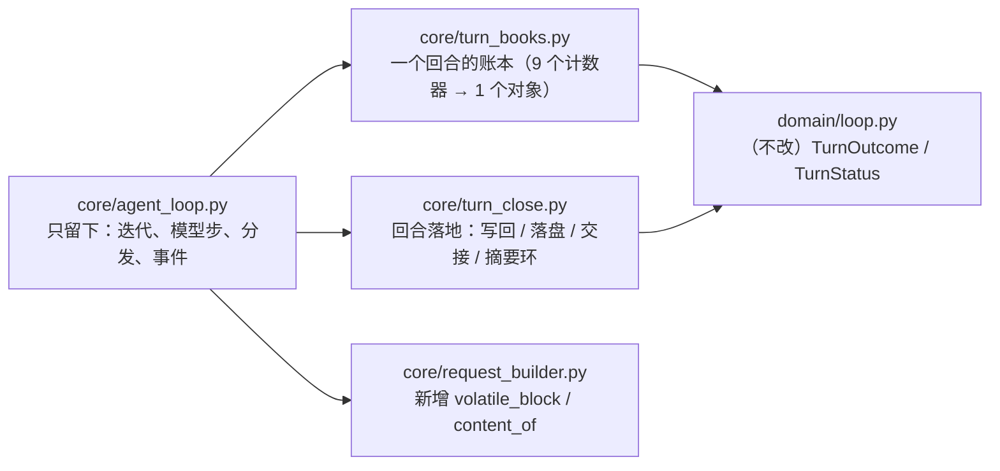
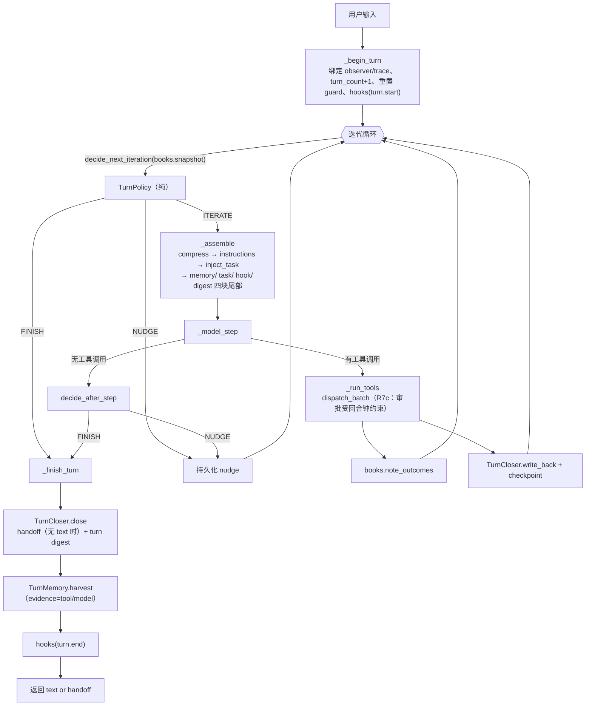

# AI-Coding — R7 分析方案（收口与长程成本：内核、上下文经济、人在环、工具面）

> 定位：`docs/r7-backlog.md` 汇总了 R1–R6 拖延下来的事，并从中挑出**四件值得立刻做的**
> （backlog §7）。本文是那四件的**方案**：先实测（§1）、再对标（§2）、再逐个设计（§3）、
> 再落到逐文件步骤（§4）与逐条用例（§7）。
>
> **按类别划分**（你的要求）——四件事分属四个不同的问题域，所以它们不是「同一件事的四步」，
> 而是四个可以各自独立上线、独立回滚的切片：
>
> | 类别 | 切片 | 一句话 | 里子里的 P0 |
> |---|---|---|---|
> | **A. 内核结构**（结构债，越拖越贵） | **R7a** 循环内核再瘦身 | `agent_loop.py` 795 → 目标 ≤650 行、`process_input` 228 → ≤150 行，**行为与事件序列逐项不变** | 1.1 + 1.2（回合账本对象化） |
> | **B. 上下文经济**（每一步都在付钱） | **R7b** L2 头尾窗口 + 可回收 | 旧工具结果不再「正文即丢」：留头尾窗口，正文落盘可重取 | 2.1（R6 实测出的病根） |
> | **C. 人在环**（唯一两条没有人验证过的路径） | **R7c** 审批与提问的收口 | 没人回答的审批不再拖住整回合；REPL 里 `ask_user` 复用同一个读取器 | 2.3 + 2.4 |
> | **D. 外部工具面**（MCP 的每步成本与噪音） | **R7d** MCP 工具面治理 | 注册什么、要不要弹审批，都由 server 配置说了算 | 3.1 + 3.2 + 3.3 |
>
> 顺序：**R7a → R7b → R7c → R7d**。R7a 先做，因为后面三个都要动 `process_input`；
> R7b/R7c/R7d 之间无依赖，任何一个单独砍掉，剩下的仍然完整可用。
>
> 本文的每一条设计都先有**实测**（§1，全部是本机真实跑出来的数字），再有设计（§3）。
> 依据：`docs/r7-backlog.md`（四件的来源与核验）、`docs/r6-analysis.md`（L2 病根的实测出处）、
> `docs/r5-analysis.md`（R7a 要沿用的「行为不变」取证方式）、`docs/r3-analysis.md`（缓存前缀纪律）、
> `docs/r4a-genericagent-research.md`（H1–H7），以及 §2 的外部原文。

---

## 0. 结论先行

1. **R7a 是纯结构改动，但它有一个硬约束**：`process_input` 里现在散着 **9 个回合状态变量**
   （`iterations / nudges / attempted_calls / successful_calls / failed_streak / strategy_nudges /
   failures / last_text / summaries`）。把它们收进一个 `TurnBooks` 对象，是「以后还能改」的前提，
   也是唯一一个**不需要任何新功能**就能做的 P0。
2. **R7b 的真实缺陷不是「留得少」，而是「回不去」**：实测（§1.1）L2 一次压缩丢掉 3 条正文、
   7,497 字符，而模型**没有任何途径**再拿到它们（L3 只落盘 >30KB 的尾部批次）。
   所以 R7b = **头尾窗口（便宜的信息）＋ 正文落盘（完整的信息）**，两者缺一不可。
   Anthropic 的原文把「tool result clearing」称为**最便宜的一种压缩**——我们采纳它的判据，
   但补上它默认你已有的那一半：**被清掉的东西必须能再取回来**（§2.1）。
3. **R7c 的两个洞都在「等待」上，实测（§1.3）都能复现**：一个 5 秒不回答的审批，把 1 秒的
   回合钟拖成了 5 秒；而且**光把回调改成线程是不够的**（实验 B：还是 5 秒），必须给 `_ask`
   套上回合钟（实验 C：1.00 秒，`DeadlineExpired`）。REPL 侧的提问通道（§1.4）已经用 pty
   验证过机制可行：**同一个 `PromptSession` 在工作线程里也能读到真人敲的那一行**。
4. **R7d 的成本是实测出来的、可复现的**（§1.2）：13 个「描述写得像官方 server 那样啰嗦」的工具
   让 MCP 那部分 schema 占 **10,062 字符**（本地基线 4,280 → 合计 14,342）；只注册 2 个 → **1,547**
   （合计 5,827）。也就是说「注册什么」这一个开关能省掉约 **59%** 的工具面。
   另外两个噪音源同样有实测：MCP 工具**每次调用都弹审批**（`PermissionGate` 对未知工具一律 WARN）、
   默认连接超时 30s 小于 npx 冷启动 27s。
5. **R7 不加新能力**。四个切片全部是「把已经长出来的东西收回去 + 修两条没人验证过的路径」。
   候选池里我另外挑了一条**低成本高价值**的（`memory_write`：模型自己写笔记，Anthropic 的
   structured note-taking），列在 §2.5 的菜单里由你决定，**不默认进本轮**。
6. **每一个切片都有自己的验收判据与提交**（§11）。四件事里 R7b 会改到既有测试断言
   （这是契约变更，不是测试写错），单独列在 §12 的决策点里等你确认。

---

## 1. 现状核验（实测，不是印象）

### 1.0 基线

| 项 | 实测值 | 命令 |
|---|---|---|
| 测试 | **864 passed, 1 skipped**（14.7s） | `.venv/bin/python -m pytest tests/ -o addopts="" -q` |
| `core/agent_loop.py` | **795 行** | `wc -l ai_coding/core/agent_loop.py` |
| `process_input` | **228 行** | `ast` 逐函数统计（见 backlog §8） |
| 本地工具面 | **4,280 字符**（7 个工具：bash/edit/glob/read/subAgent/todo_write/write） | `short_json(tool_schemas(reg))` |
| 真实 MCP stdio 往返 | **通过**（本环境可跑，不再只是「假 session」） | `AI_CODING_MCP_STDIO=1 … pytest tests/test_mcp_stdio.py -q` |
| pty 里起子进程 | **可用**（`pty works`） | `pty.openpty()` + `subprocess.Popen([sys.executable, …])` |

### 1.1 实验一：L2 到底丢了什么（离线，跑的是真实压缩函数）

用 `scripts/r6_cases.py::_synth_history` 的 70 轮工具密集历史（292 条消息、73 条工具结果、
工具正文合计 213,815 字符），套**真配置**（`max_messages=50 / keep_recent_tool_results=3`）跑
`ContextManager.compress_if_needed`：

| 阶段 | 消息数 | 工具正文 | est tokens |
|---|---:|---:|---:|
| 原始 | 292 | 213,815 | 溢出（触发压缩） |
| L1 之后（head 3 + 占位 + tail 20） | 24 | **16,590**（6 条） | 4,245 |
| L2 之后 | 24 | **9,093**（3 条正文 + 3 条占位） | **2,371** |

也就是说：**L1 之后只剩 6 条工具正文，L2 又拿掉最旧的 3 条**——丢的是
`1,519 + 2,989 + 2,989 = 7,497` 字符，而且**没有任何路径能取回**（这 3 条的原文既不在历史里，
也不在 `transcripts/persisted/`：L3 只看尾部批次里 >30,000 字节的）。R6 那次真实运行里模型
抱怨「这些命令的输出从来没有真正返回给我」，说的就是这一段。

如果改成「头 200 + 尾 200 的窗口」：3 条占位共保留 **1,200 字符 ≈ 300 est tokens**——
把压缩后的 2,371 抬到约 2,670，仍然远低于 `0.5 × 48,000 = 24,000`。**这是一笔很划算的买卖。**

（同一实验里 70 条占位、每条 3,000 字符的极端情况下，全量窗口要 +33,600 字符 ≈ +8,400 tokens，
所以 §3.2 的设计里必须有一个**总预算**，而不是「每条都给窗口」。）

### 1.2 实验二：MCP 工具面的每步成本（真实 stdio，可复现）

本环境能起真的 MCP stdio server（§1.0）。我写了两个一次性探针（**不进仓库**）：
13 个工具、描述长度照官方 `server-everything` 那种啰嗦写法：

| 场景 | MCP 部分 `tools_chars` | 与本地基线合计 |
|---|---:|---:|
| 不用 MCP | —— | **4,280** |
| 13 个啰嗦工具 | **10,062** | **14,342**（+235%） |
| 只注册其中 2 个 | **1,547** | **5,827**（+36%） |

原生 function calling 每一步都要重发完整 schema，所以这 10,062 字符是**每一步**都在付的钱。
「按需注册」不是优化选项，而是唯一能把它压下去的手段（GA 的「省略 schema」技巧在我们这里不适用，
见 backlog §6）。

### 1.3 实验三：一个没人回答的审批，会拖住整回合多久（三种写法对照）

真实跑 `ToolDispatcher`（WARN 档的 `bash`），回合钟 1.0 秒，审批回调里 `sleep(5)` 模拟
「人不在」（**不回答**）：

| 写法 | 耗时 | 结果 |
|---|---:|---|
| **A. 今天的代码**：`CLIApprovalCallback`（同步 `input()`） + `_ask` 无包裹 | **5.00s** | `tool_timeout` |
| B. 回调改成线程（`asyncio.to_thread`） + `_ask` 仍无包裹 | **5.00s** | `tool_timeout` |
| C. 回调线程 + `_ask` 套回合钟（`run_with_deadline`） | **1.00s** | `DeadlineExpired(turn)` |

A 有两个毛病叠在一起：同步 `input()` 把事件循环整个冻住（钟根本没机会走），而 `_ask` 本身
没有任何上限。**注意 A 的第二个毛病**：等 5 秒后用户答了「y」，工具却因为 deadline 已过被拒
（`tool_timeout`）——**人回答了，活被丢了**。B 说明「只把回调改成线程」不够：没有包裹就没有
取消点。C 是 R7c 要落地的形状。

### 1.4 实验四：REPL 的提问通道能不能读到一个真人敲的行（机制验证）

R6c 唯一没验证的路径是：**真人在终端敲的那一行，能不能穿过 prompt_toolkit 到达工具**。
这次先把机制验证掉（真 pty）：

```
子进程（pty 内）：创建 PromptSession → 打印 MAIN-PROMPT → await asyncio.to_thread(session.prompt, "ask> ")
父进程：           往 pty master 写 "hello-from-human\n"
实测输出：          GOT:hello-from-human
```

也就是说：**主线程跑 asyncio、工作线程用同一个 `PromptSession` 读一行**这条路是通的
（和 `run_repl` 现在 `asyncio.to_thread(prompt.prompt, "you> ")` 的用法同构）。R7c 剩下的
工作是把这条机制接到真实的 REPL 与 `ask_user` 上，并用一个脚本化 pty 用例把它锁住（§7.4）。

**实施时的更正（重要，写在这里以免下次误传）**：真正接上之后做了**双向对照**，结果和上面
的预期不完全一样——

| 场景 | R6c 的代码路径（`input()`） | R7c（`set_reader(prompt.prompt)`） |
|---|---|---|
| **真人 / 真 pty**（先等问题出现再敲答案） | ✅ 答对（`answer: "改 A"`） | ✅ 答对 |
| **脚本一次性喂多行**（`改一下\\n改 A\\n/quit\\n` 一口气写进去） | ❌ `{"answered": false, "reason": "eof"}` → 「没有人给出回答」 | ✅ 答对（`answer: "改 A"`） |

也就是说：**真人手敲一直是好的**（R6c 的未验证项其实没坏），坏的是**脚本/管道**场景——
prompt_toolkit 的读取器先占住 stdin，工具自己的 `input()` 再读就只剩 EOF。两个用例都进仓库：
`tests/test_repl_ask_user_pty.py`（真终端，门控）与 `tests/test_repl_ask_user_stdin.py`
（脚本场景，**默认跑**，它就是这次修复的回归用例）。

### 1.5 代码侧核验（改动落点）

| 落点 | 现状 | 证据 |
|---|---|---|
| `core/agent_loop.py::process_input` | 228 行；9 个回合状态局部变量；组装/收尾都内联 | `ast` 统计 |
| `core/agent_loop.py` 模块级 | 6 个私有工厂函数（`_terminal_outcome` 13 行、`_failed_outcome` 15 行、…） | `sed -n 140,205p` |
| `core/dispatch.py::_ask` | `answer = await self.approval.approve(...)`，**无 deadline** | `dispatch.py` `_ask` |
| `security/approval.py::CLIApprovalCallback` | `self._input(prompt)` **在事件循环线程里同步阻塞** | `approval.py` |
| `security/user_prompt.py::CLIUserPromptCallback` | 已经用 `asyncio.to_thread`（R6c 做对了），但 `input_fn` 默认是 `input()`，与 REPL 的 `PromptSession` 抢 stdin | `user_prompt.py`；`ui/repl.py::run_repl` |
| `core/context_compression.py::placeholder_old_results` | 正文整段丢弃，无落盘、无窗口 | `context_compression.py` |
| `security/permission_gate.py` | 未知工具一律 WARN；MCP 工具名是 `server__tool`，所以**每次调用都弹审批** | `permission_gate.py::check` 第 4 条 |
| `config/models.py::MCPConfig` | `connection_timeout: int = 30`；`MCPServerConfig` 无 `tools`/审批字段 | `models.py` 172–191 |
| `cli.py::_build_loop` | 不给 loop 传 `gate`，所以 `AgentLoop` 自己 `PermissionGate()`——**它看不到 MCP 配置** | `cli.py::_build_loop` |

---

## 2. 外部对标与 brainstorming（Claude Code / Anthropic / GA / Hermes）

> 说明（先说不确定的）：本次**能核验**的外部材料是 Anthropic 工程博客原文（已抓全文，
> 引文见 §2.1）与我们自己在 R4a 里核验过的 GenericAgent（§2.2）。**「Hermes」在本沙箱里
> 没找到可核验的一手材料**（搜索入口超时，只有 R1 文档里引用过的「自持学习闭环」定位），
> 所以下面涉及其它产品的部分我**只写我读过的**，没有把没读到的东西写成设计依据。

### 2.1 Anthropic《Effective context engineering for AI agents》：逐条对照

原文（https://www.anthropic.com/engineering/effective-context-engineering-for-ai-agents ）里与
R7 直接相关的四件事：

| 原文的技巧 | 原文的说法 | 我们现在的状态 | R7 的处置 |
|---|---|---|---|
| **tool result clearing** | 「**最安全、最轻的压缩形式之一**：一个工具在历史深处被调用过之后，agent 为什么还要再看一遍原始输出？」 | **正是 L2**。但原文没写实现细节（清哪些、清多少） | **采纳判据，补上我们缺的那一半**：清掉的正文必须可回收 → R7b |
| **compaction** | 「把接近上限的对话总结掉，用摘要开一个新窗口」 | **L4 已有**（真 LLM 摘要 + 3 次熔断），但几乎不触发（在 L1/L2 之后评估） | 不动（R6 已论证） |
| **structured note-taking** | 「agent 自己把笔记写到上下文之外的内存里，之后按需取回」 | **缺**：我们只有 harness 收割 + `memory_search`，模型**不能主动写**一条记忆 | 菜单 O2（§2.5），**不默认做** |
| **sub-agent architectures** | 「子 agent 用干净的上下文做聚焦的事，主 agent 保留计划」 | 已有 `subAgent` + 结果回写（返回 `text or handoff`） | 不动 |
| **just-in-time 检索** | 「CLAUDE.md 先放进去，文件靠 glob/grep 按需取，绕开陈旧索引」 | 我们已经是这个形状（tools + `<memory-constraints>` 指针） | 不动 |

**这条对标给出的最重要的一句话**：tool result clearing 之所以「最安全」，前提是
**它清掉的东西还能从别处拿到**（文件系统）。我们照搬了「清」，却没建「拿回来」的那条路——
这就是 R7b 要补的。原文也提醒「被清掉的要有明确的信号」，所以占位里会写明**清了多少字符、
原文在哪**（§3.2）。

### 2.2 GenericAgent（我们 R4a 已核验的 H1–H7）里 R7 用得上的

| 编号 | 原文要点 | 与 R7 的关系 |
|---|---|---|
| H1 工具接口是第一道 harness | 能力收窄 = 安全模型；新工具先问「能不能由已有原子组合」 | R7d 的 `servers[].tools` 就是「收窄外部工具面」的同一思想 |
| H4 索引有界是设计不变量 | 索引只放指针、总量有界 | R7b 的**总预算**（窗口总量有界）与它同源；R7d 的 `tools_chars` 是同一类「必须可测」的量 |
| H5 No Execution, No Memory | 没执行过就不算数 | 已在 R6d 落地为 `evidence` 元数据；R7 不动 |
| H6 失败升级三档 | 局部修 → 换策略 → 问人 | R6b 已落地；R7c 修的是第三档的**等待**部分 |

### 2.3 Claude Code：哪些**不**照搬

- **plan mode（先只读、计划批准后再动手）**：是**新能力**，属于候选池（§2.5 O7），R7 不做。
- **工具结果截断预算**（把过大的单条结果截断后再进历史）：我们的 `read`/`bash` 已有上限，
  且 R7b 的「elide + 落盘」正好是这个机制的**通用版**——所以 R7b 会把它做**成函数**
  （`elide_and_persist`），以后加全局预算就是接一个调用点，不用再改数据结构。
- **回合中插入用户消息（steering）**：R7a 抽出的 `TurnBooks`/`TurnFrame` 就是它的接缝，
  但 R7 不实现（否则 R7a 不再是「行为不变」）。

### 2.4 Hermes：只取「记账」这一半

R1 引用过 Hermes 的定位是「自持学习闭环」。R7 只从这一定位里取一条与本次相关的：
**闭环的前提是每一步都可对账**（谁花了多少、谁被丢了、谁没答）。R7 的落点是：
R7b 的占位必须写明「清了多少、原文在哪」，R7c 的超时必须是**独立的结构化结果**
（`approval_timeout`，不是含混的「not approved」），R7d 的 `tools_chars` 前后对照进文档。
其余（自进化调度）仍留在候选池（backlog 2.6）。

### 2.5 优化菜单（采纳 / 候选 / 不做）

| 编号 | 优化 | 来源 | 处置 |
|---|---|---|---|
| **O1** | 被清掉的工具正文**可回收**（落盘 + 占位写路径） | Anthropic 原文的隐含前提 + §1.1 实测 | **采纳 → R7b** |
| **O2** | 模型**主动写**一条记忆（`memory_write` 工具，structured note-taking） | Anthropic 原文 | **候选**（低成本、独立；你点头就作为 R7e 单独做） |
| **O3** | 统一的 `elide_and_persist(body, kind) -> marker` 函数（L2 与「单条结果超预算」共用） | Claude Code 式截断 | **采纳（作为 R7b 的内部形状）** |
| **O4** | 回合级 steering（迭代之间读一个用户消息队列） | Claude Code / GA | 候选（R8 方向；R7a 只留接缝） |
| **O5** | `tools_chars` 记进 trace 并在超阈值时告警 | GA 的「可测」纪律 | 候选（R7d 先给测量，不设阈值） |
| **O6** | 子 agent 的 `context_mode: full/task_only` | Anthropic 的子 agent 架构 | 候选（backlog 3.4，仍是 P2） |
| **O7** | plan mode（只读到计划批准） | Claude Code | **不做**（新能力，另起一轮） |
| **O8** | 每轮常驻更多摘要 / 每轮跑 L4 | —— | **不做**（打穿缓存前缀，backlog §6 已裁决） |

---

## 3. 四个切片逐个设计

### 3.1 R7a —— 循环内核再瘦身（类别 A）

**目标**：`agent_loop.py` **≤650 行**、`process_input` **≤150 行**，且
**行为与事件序列逐项不变**（沿用 R5 的取证方式：既有断言零改动 + 事件序列逐条比对）。

**为什么不是「再拆一个 helper 就完事」**：R5 拆完是 654/153，R6 把功能加回来变成 795/228——
因为 R6 新增的每一样东西都得**在 process_input 里改一个局部变量**。所以 R7a 的重点是
**把状态本身搬走**，而不是把代码块换个位置。

**三个新单元**（每个都能独立测）：



1. **`core/turn_books.py`（新，纯单元，无 IO/无 asyncio）**

   ```python
   @dataclass
   class TurnBooks:
       """Everything one turn counts about itself (R7a)."""
       iterations: int = 0
       nudges: int = 0
       attempted_calls: int = 0
       successful_calls: int = 0
       failed_streak: int = 0
       strategy_nudges: int = 0
       failures: list[Failure] = field(default_factory=list)
       last_text: str | None = None
       summaries: list[str] = field(default_factory=list)

       def note_iteration(self, index: int) -> None
       def note_nudge(self) -> None
       def note_strategy_nudge(self) -> None
       def note_step(self, step: StepResult) -> None
       def note_outcomes(self, outcomes: Sequence[DispatchOutcome]) -> None
       def snapshot(self, *, iteration: int, tokens_spent: int,
                    open_items: tuple[TodoItem, ...] = (),
                    final_text: str | None = None) -> TurnSnapshot
   ```

   `note_outcomes` 就是现在 `process_input` 里那 12 行（attempted/succeeded/failed_streak/
   failures 的更新），**逐字搬运**；`snapshot()` 产出 `TurnSnapshot`，于是
   `_iteration_decision`（25 行）退化成一行：
   `self.policy.decide_next_iteration(books.snapshot(...), budget_expired=…)`。

2. **`core/turn_close.py`（新）**：把「一个回合在磁盘上留下什么」集中起来。
   - `terminal_outcome / stopped_outcome / aborted_outcome / failed_outcome`（4 个纯工厂，
     从 `agent_loop.py` 模块级原样搬来）；
   - `class TurnCloser`：`write_back(session, outcomes)`（工具消息回写 + `artifacts` 累积）、
     `checkpoint(session, index)`（节流落盘）、`close(...)`（无 `text` 时生成交接 + 追加回合摘要
     + 落盘）、`finalize(...)`（把 `reporter.finish_turn` 的结果记为 `last_outcome`）。

3. **`core/request_builder.py`（改，只加两个小函数）**：`volatile_block(name, text)` 与
   `content_of(message)`——它们本来就是 `TailBlock` 的同伴，搬过去比留在 loop 里更顺。
   （`agent_loop` 里那 8 行私有函数消失。）

4. **`core/agent_loop.py`（改）**：`process_input` 变成
   **`_begin_turn` → 循环（assemble / model / act）→ `_finish_turn`** 三段，
   中间那段组装抽成 `_assemble(...) -> _Assembled`（一个 6 字段的小 dataclass：
   `history / instructions / request / compacted / memory_ids / previous_request`）。
   公开属性一个都不删：`last_outcome`（`subagent.py` 在用）、`last_artifacts`、
   `memory_status / compact_session / aclose` 保持原签名。

**行为不变怎么证**：新增 `tests/test_loop_books.py`（纯单元）与
`tests/test_loop_refactor_equivalence.py`（**事件序列快照**：三种剧本 —— 正常回合、
task-gate nudge 回合、预算耗尽回合 —— 把 `observer` 收到的事件序列与**重构前录下来的
golden JSON** 逐条比对）。golden 文件在动手前先录制并提交，这样「不变」是**可验证的**，
不是「我觉得没变」。

### 3.2 R7b —— L2 头尾窗口 + 可回收（类别 B）

**目标**：被 L2 清掉的工具正文**既能省 token，又能拿回来**，且成本有硬上限。

**新契约**（`core/context_compression.py`）：

```
placeholder_old_results(messages, keep_recent, *,
                        window_chars=200,          # 头/尾各留多少字符
                        total_window_budget=4000,  # 一次压缩里所有窗口的总字符预算
                        elide_dir=None,            # 给了就落盘 + 占位写路径
                        ) -> list[ChatMessage]
```

规则（四条，逐条可测）：

1. **只改真能变小的**：`len(body) <= 2*window_chars + 开销` 的正文**原样保留**（替它做占位反而更长）。
2. **占位 = 一行信封 + 头尾窗口**：
   ```
   [Previous: used bash · 3010 chars elided · full output: transcripts/elided/bash_1a2b3c4d5e6f.txt]
   <头 200 字符>
   …
   <尾 200 字符>
   ```
3. **总预算从新到旧分配**：越靠近现在的工具结果越可能还相关，先给它窗口；预算用完之后，
   剩下的占位退化成只有信封一行（**仍然带着原文路径**）。因此**任何被清掉的内容都能取回**。
4. **配对字段不动**（`tool_call_id` / `tool_name` / `role`），`<persisted-output>` 标记的结果照旧跳过
   （L3 已经给它们落了盘）。

落盘：`transcripts/elided/<tool>_<sha1(body)[:12]>.txt`（**内容寻址**：同一份正文重复出现
不会写出第二个文件，也就不需要轮转）。写入失败（`OSError`）→ 退化成不带路径的信封，**绝不抛**。

**为什么采纳这个形状**（对标 §2.1）：Anthropic 只说「清掉最划算」，没给数值；我们的实测
（§1.1）说「清掉的信息量很大且回不去」。头尾窗口给的是**最便宜的那部分信息**
（命令回显 / 文件头 / 报错行 / 汇总行），落盘给的是**完整**信息，总预算保证它不会变成新的负担。

**会改到的既有断言**（**契约变更，需你拍板**，见 §12 Q2）：
`tests/test_context_compression.py::test_placeholder_marks_older_keeps_recent`
现在是 `out[0].content == "[Previous: used bash]"`；新契约下短正文不再被改写，长正文变成信封 + 窗口。
同一处还有 `docs/features.md` 的 L2 行（line 70）与 §「回合摘要环」段落（line 212）。

### 3.3 R7c —— 审批与提问的收口（类别 C）

两处，都很小，但都是「没人验证过的路径」。

**c1：审批等待受回合钟约束**（`core/dispatch.py` + `security/approval.py`）

- `_ask` 把 `await approval.approve(...)` 包进
  `run_with_deadline(..., timeout=remaining_of(deadline), label="approval")`；
- `DeadlineExpired` → **新的结构化结果** `error="approval_timeout"`（不是含混的 `not_approved`：
  模型需要区分「人拒绝了」和「人没说话」），`data={"decision":"warn","approved":False,"reason":"approval_timeout"}`；
- `CLIApprovalCallback.approve` 的 `self._input(prompt)` 改走 `asyncio.to_thread`（否则事件循环
  被冻住，钟永远不响——实测 §1.3 A/B）；
- 新增 `AIConfig.approval_timeout_seconds: float = 0.0`：**0 = 只受回合钟约束**（保持今天的行为，
  但钟真的能响了）；想给「离开去吃饭」的场景加硬上限就设成 300。

**c2：REPL 的 `ask_user` 复用同一个读取器**（`security/user_prompt.py` + `ui/repl.py` + `cli.py`）

- `CLIUserPromptCallback` 增加 `set_reader(fn)`（一个可变槽：默认还是 `input()`，
  REPL 起来之后换成 `PromptSession.prompt`）；
- `run_repl(loop, sessions, console, *, user_prompt=None)`：建好 `PromptSession` 之后调用
  `user_prompt.set_reader(prompt.prompt)`；`cli.repl` 把同一个 callback 同时交给
  `_build_tool_registry(user_prompt=…)` 和 `run_repl(user_prompt=…)`；
- 机制已在 §1.4 用真 pty 验证过；用例见 §7.4（脚本化 pty：往终端写一行，断言它出现在**工具结果**里）。

**为什么这两处要一起做**：它们都是「循环在等人」的同一种风险；只做 c1 会让 REPL 的提问通道
仍然读不到真实的键盘输入，只做 c2 会让审批路径继续冻事件循环。

### 3.4 R7d —— MCP 工具面治理（类别 D）

**d1：server 级审批策略（去掉噪音）**

- `MCPServerConfig.auto_approve: bool = False`；
- `PermissionGate` 增加一个**策略对象**（`MCPToolPolicy`，或者更简单：构造时传入
  `mcp_auto: dict[str, bool]`），规则：`check()` 在「未知工具 → WARN」**之前**先拆
  `server__tool`，若该 server 声明了 `auto_approve` → **ALLOW**；
- `PermissionGate.from_config(app_cfg)` 作唯一的构造入口；`cli._build_loop` 把它传给
  `AgentLoop(gate=…)`（今天 `_build_loop` 根本不传 gate，所以 loop 里的 gate 看不到 MCP 配置——
  这是 §1.5 表里的最后一行）。
- **安全边界不变**：bash 的硬拒（DENY）在前，MCP 的 `auto_approve` 只影响**弹不弹审批**，
  不影响 DENY 表；`ask`（非交互）本来就自动放行，行为不变。

**d2：按需注册（去掉每步成本）**

- `MCPServerConfig.tools: list[str] = []`：非空 = **只注册这些远端工具名**（其余连 adapter 都不建，
  所以 chat 里也不会出现它们）；空 = 全部（今天的行为）；
- `MCPManager.open_all()` 在生成 adapter 时过滤，并**报告**被过滤掉了几个
  （沿用 R4 的 `Degraded`/日志纪律，不新增事件类型）。

**d3：连接超时默认值**：`MCPConfig.connection_timeout: 30 → 60`（npx 冷启动实测 27s，
见 `docs/features.md` line 141），文档同步。

**测得到的收益**（§1.2）：13 → 2 个工具时，工具面从合计 14,342 → 5,827 字符（-59%）；
配置 `auto_approve` 的 server 不再产生 `ToolApprovalRequested` 事件。

---

## 4. 逐文件实现步骤（每步一个可独立审阅的增量）

> 全程 TDD：先红后绿；**新增测试文件优先，不改既有断言**——唯一例外是 R7b 的两处契约
> （§3.2 末，§12 Q2 拍板后照改）。每步结束都跑
> `pytest tests/ -o addopts="" -q && ruff check . && mypy ai_coding`。

### 4.1 R7a（3 步 + 1 步取证）

| 步 | 文件 | 动作 | 用例 |
|---|---|---|---|
| 0 | `tests/golden/loop_events/*.json` | **动手前**录三种剧本的事件序列（只跑测试、不改产品代码） | —— |
| 1 | `ai_coding/core/turn_books.py`（新） | `TurnBooks` + `note_*` + `snapshot` | `tests/test_turn_books.py`（新增 12 条） |
| 2 | `ai_coding/core/request_builder.py`（改） | `volatile_block` / `content_of`（纯搬运） | 并入 `tests/test_request_builder.py`（新增 3 条） |
| 3 | `ai_coding/core/turn_close.py`（新） | 4 个 outcome 工厂 + `TurnCloser` | `tests/test_turn_close.py`（新增 10 条） |
| 4 | `ai_coding/core/agent_loop.py`（改） | `_begin_turn` / `_assemble` / `_finish_turn`；删掉搬走的 163 行 | `tests/test_loop_refactor_equivalence.py`（3 条快照比对）+ **既有 864 条全绿** |

**验收**：`wc -l ai_coding/core/agent_loop.py` ≤650、`process_input` ≤150（`ast` 复算），
事件序列 golden 逐条一致，既有测试**零改动**。

### 4.2 R7b（2 步）

| 步 | 文件 | 动作 | 用例 |
|---|---|---|---|
| 1 | `ai_coding/core/context_compression.py` | `elide_and_persist()` + 新的 `placeholder_old_results(...)`；`ContextManager` 读三个新配置；`__all__` 同步 | 新 `tests/test_context_compression_l2_window.py`（14 条） |
| 2 | `ai_coding/config/models.py`、`docs/features.md`、`docs/data-contracts.md` | `l2_window_chars=200`、`l2_window_budget=4000` 进 `AIConfig`；L2 定义改写 | 既有 `tests/test_context_compression.py` 的 L2 段按新契约改（**已授权才动**） |

### 4.3 R7c（2 步）

| 步 | 文件 | 动作 | 用例 |
|---|---|---|---|
| 1 | `ai_coding/core/dispatch.py`、`ai_coding/security/approval.py`、`ai_coding/config/models.py` | `_ask` 套钟 + `approval_timeout` 结果 + 线程化 `CLIApprovalCallback` + `approval_timeout_seconds` | `tests/test_dispatch_approval_timeout.py`（6 条）；`tests/test_approval.py` **不动**（注入式 `input_fn` 仍兼容） |
| 2 | `ai_coding/security/user_prompt.py`、`ai_coding/ui/repl.py`、`ai_coding/cli.py` | `set_reader` + `run_repl(user_prompt=…)` + CLI 接线 | `tests/test_user_prompt.py`（新增 3 条）+ `tests/test_repl_ask_user_pty.py`（pty，门控 `AI_CODING_PTY=1`，1 条） |

### 4.4 R7d（2 步）

| 步 | 文件 | 动作 | 用例 |
|---|---|---|---|
| 1 | `ai_coding/config/models.py`、`ai_coding/security/permission_gate.py`、`ai_coding/cli.py` | `auto_approve`、`PermissionGate.from_config`、`_build_loop` 传 gate | `tests/test_permission_gate_mcp.py`（7 条） |
| 2 | `ai_coding/core/mcp.py`、`ai_coding/config/models.py` | `tools` 过滤 + `connection_timeout=60` | `tests/test_mcp.py`（新增 4 条） |

### 4.5 收尾

| 步 | 文件 | 动作 |
|---|---|---|
| 1 | `scripts/r7_cases.py`（新） | 离线 9 + 真实 3（§8） |
| 2 | `docs/features.md` / `docs/architecture.md` / `docs/data-contracts.md` / `docs/how-to-run.md` / `docs/integration_testing.md` | 同步四件事的对外说法 |
| 3 | `docs/r7-plan.md` | 实施计划（writing-plans 体例） |

---

## 5. 数据契约变更汇总

| 契约 | 位置 | 变更 | 兼容性 |
|---|---|---|---|
| `AIConfig.l2_window_chars` | `config/models.py` | 新增，默认 200 | 纯新增 |
| `AIConfig.l2_window_budget` | 同上 | 新增，默认 4000 | 纯新增 |
| `AIConfig.approval_timeout_seconds` | 同上 | 新增，默认 0.0 | 纯新增（0 = 今天的行为） |
| `MCPServerConfig.auto_approve` | 同上 | 新增，默认 false | 纯新增 |
| `MCPServerConfig.tools` | 同上 | 新增，默认 `[]` = 全部 | 纯新增 |
| `MCPConfig.connection_timeout` | 同上 | 30 → **60** | **默认值变更**（只影响 npx 类冷启动） |
| L2 占位文本 | `context_compression` | `[Previous: used X]` → 信封 + 头尾窗口 | **改既有断言**（§12 Q2） |
| `ToolResult.error` 取值域 | `domain/message` | 新增 `"approval_timeout"` | 纯新增取值 |
| `PermissionGate.__init__` | `security/permission_gate.py` | 新增可选 `mcp_auto`（或 `from_config`） | 位置参数不变 |
| `TurnBooks` / `TurnCloser` | 新模块 | 新的内部单元 | 不影响任何公开 API |
| `AgentLoop.last_outcome` / `last_artifacts` | `core/agent_loop.py` | **保持存在**（后者改为转发 `TurnCloser`） | 兼容 |

---

## 6. 数据流（扇入扇出）

### 6.1 R7 之后一个回合的形状（一张图）



### 6.2 上下文流水线（R7b 之后）


**不变量**（R7 之后仍然成立，逐条有测试）：

1. 记忆/摘要/窗口**都不进系统提示**（R3 的缓存前缀纪律）；
2. 历史只在越过水位线时被改写（R3b）；
3. **任何被 elide 的正文都能从磁盘取回**（R7b 新增的不变量）；
4. 观测只写不改（R4）；
5. 工具调用与工具结果的配对永远合法（`sanitize_pairs`）。

### 6.3 扇入扇出（谁依赖谁）

| 单元 | 依赖 | R7 之后 |
|---|---|---|
| `turn_books` | `domain`（`TurnSnapshot` 由 `turn_policy` 定义）+ `core/dispatch`（`DispatchOutcome` 类型） | **被 loop 调用**，不反向依赖 loop |
| `turn_close` | `domain`（`TurnOutcome`/`turn_digest`）+ `service.session_service` + `turn_report` | 不知道 policy 的存在 |
| `permission_gate` | `config`（只读 policy） | 仍然无 IO；MCP 策略是**纯查表** |
| `context_compression` | `domain` + 文件系统（新增 `transcripts/elided/`） | 新增的落盘是 best-effort，失败只降级 |

---

## 7. TDD 用例清单（先红后绿，逐条）

### 7.1 `tests/test_turn_books.py`（12）

1. `test_books_start_empty`
2. `test_note_iteration_records_the_index`
3. `test_note_outcomes_counts_attempts_and_successes`
4. `test_note_outcomes_resets_streak_when_anything_succeeded`
5. `test_note_outcomes_raises_streak_when_everything_failed`
6. `test_note_outcomes_records_failures_with_160_char_excerpt`
7. `test_note_outcomes_ignores_an_empty_batch`（空批次不涨 streak）
8. `test_note_nudge_and_strategy_nudge_are_separate_counters`
9. `test_note_step_keeps_the_last_text`
10. `test_snapshot_carries_every_counter`
11. `test_snapshot_defaults_open_items_and_final_text`
12. `test_snapshot_feeds_the_policy_identically`（同参数下与手搓 `TurnSnapshot` 得到同一 `TurnDecision`）

### 7.2 `tests/test_turn_close.py`（10）

1. `test_terminal_outcome_maps_deadline_to_timeout`
2. `test_terminal_outcome_maps_token_budget`
3. `test_terminal_outcome_defaults_to_max_iterations`
4. `test_failed_outcome_says_which_label_timed_out`
5. `test_failed_outcome_maps_engine_error_to_error_status`
6. `test_stopped_and_aborted_keep_partial_text`
7. `test_write_back_appends_one_tool_message_per_outcome`
8. `test_checkpoint_is_throttled_on_a_long_session`
9. `test_close_adds_a_handoff_only_when_the_model_said_nothing`
10. `test_close_appends_a_digest_and_never_touches_outcome_text`

### 7.3 `tests/test_loop_refactor_equivalence.py`（3）

1. `test_normal_turn_emits_the_same_event_sequence_as_before`
2. `test_todo_nudge_turn_emits_the_same_event_sequence_as_before`
3. `test_exhausted_turn_emits_the_same_event_sequence_as_before`

（用 `tests/golden/loop_events/*.json`，**动手前录制**。同一条用例同时断言
`last_outcome` 的 `status/reason/iterations` 与会话落盘的 `turnDigests` 条数。）

### 7.4 R7b（14）

`tests/test_context_compression_l2_window.py`：

1. `test_short_bodies_are_left_alone`
2. `test_long_body_becomes_an_envelope_with_head_and_tail`
3. `test_envelope_names_the_artifact_path`
4. `test_artifact_holds_the_original_body_byte_for_byte`
5. `test_artifact_name_is_content_addressed`（同一正文两次 → 一个文件）
6. `test_window_budget_is_spent_newest_first`
7. `test_placeholders_beyond_the_budget_keep_the_envelope_only`
8. `test_persisted_marker_results_are_skipped`
9. `test_pairing_fields_survive_the_window`
10. `test_message_count_is_unchanged`
11. `test_write_failure_degrades_to_a_pathless_envelope`
12. `test_estimate_tokens_stays_below_half_the_context_budget`（70 轮真实 fixture）
13. `test_key_line_survives_for_the_most_recent_elided_result`（§1.1 的 `turn-1` 首行）
14. `test_compress_if_needed_below_the_watermark_still_returns_the_same_list`

### 7.5 R7c（6 + 3 + 1）

`tests/test_dispatch_approval_timeout.py`：

1. `test_threaded_approval_is_bounded_by_the_turn_clock`
2. `test_expired_approval_returns_approval_timeout`
3. `test_approval_timeout_is_not_reported_as_a_user_refusal`
4. `test_approval_timeout_does_not_halt_the_turn`
5. `test_configured_approval_timeout_applies_without_a_turn_deadline`
6. `test_a_sync_blocking_approval_no_longer_freezes_the_loop`（回归：A 场景）

`tests/test_user_prompt.py` 新增：`test_set_reader_replaces_the_input`、
`test_default_reader_is_input`、`test_eof_still_degrades_to_no_answer`。

`tests/test_repl_ask_user_pty.py`（门控 `AI_CODING_PTY=1`）：
`test_a_typed_line_reaches_the_tool_result` —— 真 pty 里跑 REPL + `ask_user`，脚本写一行，
断言 `session.messages` 里那条 tool 消息的内容包含它。

### 7.6 R7d（7 + 4）

`tests/test_permission_gate_mcp.py`：`test_mcp_tool_still_warns_by_default`、
`test_auto_approve_server_is_allowed`、`test_auto_approve_is_per_server`、
`test_unknown_local_tool_still_warns`、`test_bash_hard_deny_still_denies`、
`test_from_config_reads_the_servers`、`test_local_allow_list_is_unchanged`。

`tests/test_mcp.py` 新增：`test_tools_allowlist_filters_adapters`、
`test_empty_allowlist_keeps_everything`、`test_allowlist_matches_remote_names_not_prefixes`、
`test_connection_timeout_default_is_60`。

---

## 8. 验收脚本 `scripts/r7_cases.py`

体例同 `scripts/r6_cases.py`（离线默认、`--real` 才联网）：

| # | 类别 | 判据 |
|---|---|---|
| 1–4 | 离线 | `TurnBooks` 的计数与 policy 决策一致性；`TurnCloser` 的交接只在无 `text` 时出现 |
| 5 | 离线 | 事件序列 golden 与重构后一致（三条剧本） |
| 6 | 离线 | L2：短正文不动、长正文有窗口、路径可读、总预算不超 |
| 7 | 离线 | L2：70 轮 fixture 的 est tokens ≤ `0.5 × max_context_tokens` 且首行存活 |
| 8 | 离线 | 审批超时返回 `approval_timeout` 且**不**是 `not_approved` |
| 9 | 离线 | MCP allow 策略与 `tools` 过滤（假 session，不起进程） |
| R1 | **真实** | 真 pty：REPL + `ask_user`，脚本写一行 → 工具结果里出现该行 |
| R2 | **真实** | 真 MCP：13 工具 server 的 `tools_chars` 对照（不设 allow → 允许 2 个），打印前后数字 |
| R3 | **真实** | 真模型：让模型用一次 `read` + 一次 `bash` 完成小任务，检查 `tools_chars`/`approval` 事件里**没有**多余的审批请求（配置 `auto_approve` 的 server） |

---

## 9. 成功效果（改完之后，能指着说什么变了）

1. `wc -l ai_coding/core/agent_loop.py` **≤650**、`process_input` **≤150**，事件序列 golden
   逐条一致 —— 也就是说**功能一行没变，但下一个功能有地方放了**。
2. 同一份 70 轮历史压缩后：被清掉的 3 条工具正文在 `transcripts/elided/` 里有原文，
   占位里有路径与头尾窗口；`est tokens ≈ 2,670`（对比今天 2,371，代价 +300，
   而恢复的信息是 7,497 字符）。
3. 一个不回答的审批：回合在 **1.00s** 结束（实测 C），结果是 `approval_timeout`，
   而不是把回合拖到人回来。
4. 真 pty 下 `ask_user` 的答案**进得了工具结果**（R6c 唯一未验证的路径被证明）。
5. 配了 `tools: [...]` + `auto_approve: true` 的 MCP server：工具面 **14,342 → 5,827 字符**、
   审批提示 **0 次**；没配的 server 行为与今天完全一样。

---

## 10. 自我核验（我这份方案哪里可能是错的）

1. **R7a 的行数目标仍是估的**：R5 的 ≤360/≤130 从未达成（r5-analysis §7）。这次的
   ≤650/≤150 是从「搬走 163 行」反推的，不是从「一个函数该有多长」推的。若最终落到
   660 行，我会**照实报告并补一次小提取**（把 `_hook_context/_fire_hooks` 移入
   `core/turn_hooks.py`，约 -39 行），而不是改目标数字。
2. **R7a 的「行为不变」只覆盖有测试的部分**：事件序列 golden 只录三条剧本，
   `CancelledError` / `DeadlineExpired` 之外的异常路径靠既有测试兜。这是 R5 的同款风险，
   我沿用它的取证方式并**明确写出覆盖边界**。
3. **R7b 的窗口数值（200/200/4000）是拍的**：它们的作用是「有界」而不是「最优」；
   实测只证明了量级合理（+300 tokens 换回 1,200 字符的关键行 + 可回收的全文）。
   如果你想要「按预算比例分配」，那是另一套设计，本轮不做。
4. **R7b 会改既有断言**：我承认这是契约变更。旧断言 `== "[Previous: used bash]"` 在新契约下
   不成立，**这不是测试写错，是功能按设计改了**，所以必须你点头（§12 Q2）。
5. **R7c 的 pty 用例可能在某些环境不稳**：本机验证了 pty + 子进程可用（§1.0/§1.4），
   但 prompt_toolkit 在无 CPR 支持的终端会打印一条 warning；我把用例做成**门控**
   （`AI_CODING_PTY=1`）并在文档里写清怎么跑，避免把终端相关的抖动带进 CI。
6. **R7d 的 `auto_approve` 是一个安全决策**：它把「未知远端工具一律问人」这条默认放宽了。
   我的论据是「server 由用户自己在 `config.local.yaml` 里声明」＋「只有声明了才生效」＋
   「DENY 表仍然优先」，但这**确实**是放宽默认值，需要你明确点头（§12 Q5）。
7. **`connection_timeout` 30→60 会拖慢「确实连不上」的启动路径**（多等 30 秒）。
   我认为对 npx 类 server 值得，对本地脚本类不值得——所以它是**一行默认值 + 文档**，
   用户可以按 server 类型自己改回去。
8. **Anthropic 原文只给了判据没给数值**：§2.1 表格里的对比是原文直引，但「该留多少字符」
   是我们的实测决定的，我没有把原文当成权威数值来源。

---

## 11. 执行顺序与提交切分（建议）

| 顺序 | 提交 | 内容 | 可单独回滚 |
|---|---|---|---|
| 1 | `docs(R7): the four candidates, measured` | `docs/r7-analysis.md` | 是 |
| 2 | `docs(R7): the implementation plan` | `docs/r7-plan.md` | 是 |
| 3 | `R7a-1: a turn's books` | `turn_books.py` + 测试 | 是 |
| 4 | `R7a-2: the tail helpers find a home` | `request_builder.py` | 是 |
| 5 | `R7a-3: what a turn leaves behind` | `turn_close.py` + 测试 | 是 |
| 6 | `R7a-4: the loop is a loop again` | `agent_loop.py` + golden 比对 | 是 |
| 7 | `R7b-1: elided is not lost` | `context_compression.py` + 测试 | 是 |
| 8 | `R7b-2: the envelope reaches the docs` | 配置 + 文档 + 既有断言更新 | 是 |
| 9 | `R7c-1: an approval that nobody answers` | dispatch/approval + 测试 | 是 |
| 10 | `R7c-2: one reader for one terminal` | user_prompt/repl + pty 用例 | 是 |
| 11 | `R7d-1: trust is declared, not assumed` | gate + config + 测试 | 是 |
| 12 | `R7d-2: register what you need` | `mcp.py` + 测试 + 文档 | 是 |
| 13 | `R7: the acceptance script, and the docs the round changed` | `scripts/r7_cases.py` + 六份文档 | 是 |

---

## 12. 待拍板决策点

| # | 问题 | 我的建议 | 备选 |
|---|---|---|---|
| **Q1** | R7b 的窗口数值：每条头/尾各 **200** 字符、一次压缩总预算 **4000** 字符 | 采纳（实测量级合理） | 只留头不留尾；或按预算比例分配（更复杂，本轮不做） |
| **Q2** | R7b 要改 `tests/test_context_compression.py` 的两条既有 L2 断言（契约变更） | **同意改**（旧断言描述的是「正文即丢」，正是我们要修的） | 保留旧断言 + 新增文件测新契约（会让同一功能有两套互斥的契约，不推荐） |
| **Q3** | `approval_timeout_seconds` 默认值 | **0**（只受回合钟约束；今天没有回合钟的调用者行为不变） | 300（连没有回合钟也硬性超时） |
| **Q4** | pty 用例是否进默认 CI | **门控** `AI_CODING_PTY=1`；而**脚本 stdin 用例默认跑**（它才是这次修复的回归用例，实测旧代码红、新代码绿） | pty 也默认跑（更真实，但可能在不同 CI 上抖） |
| **Q5** | R7d 的 `servers[].auto_approve`（放宽「未知远端工具一律问人」） | **做，且默认 false**（不配就完全是今天的行为） | 只做 `tools` 过滤，审批噪音先忍着 |
| **Q6** | `mcp.connection_timeout` 默认 30 → 60 | **改** | 不改，只写进文档建议 |
| **Q7** | R7a 新增三个单元（`turn_books` / `turn_close` / 两个尾部小函数入 `request_builder`） | **采纳** | 只做账本对象化（`process_input` 仍会 >150 行） |
| **Q8** | 优化菜单里要不要顺手带一个：**O2 `memory_write`**（模型自己写一条记忆，Anthropic 的 structured note-taking） | **本轮不做**，若你要就说，我作为 R7e 单独开一轮（约 1 个工具 + 1 个 service 方法 + 6 条用例） | 现在一起做（会让本轮从「收口」变成「加能力」） |

---

## 13. 文档同步清单

| 文档 | 要改的地方 |
|---|---|
| `docs/features.md` | L2 行（line 70）；第 212 行的「正文即丢」段落；MCP 段（line 137–143）三条代价与坑；REPL 段的 `ask_user` 说明 |
| `docs/data-contracts.md` | `AIConfig` 三个新键、`MCPServerConfig` 两个新键、`connection_timeout` 默认值、`ToolResult.error` 新取值 |
| `docs/architecture.md` | 「模块职责」加 `turn_books` / `turn_close`；「一次回合的数据流」图按 §6.1 更新 |
| `docs/how-to-run.md` | MCP 的 `tools` / `auto_approve` 配置示例；pty 用例怎么跑 |
| `docs/integration_testing.md` | R7 的三条真实案例（pty / MCP 工具面 / 审批超时） |
| `docs/r7-backlog.md` | 四条 P0 标记为「已实现」，并链接本文 |

---

## 14. 明确不做（本轮写下来，避免下次再吵）

1. **RAG / embedding / SQLite+FTS5**：你已指示不搞（backlog §4.1 的性质另议）。
2. **plan mode**（Claude Code 的只读计划模式）：新能力，另起一轮。
3. **回合级 steering（迭代间读用户消息队列）**：R7a 只留接缝，不实现。
4. **模型写的 checkpoint（GA 式）替代 harness 摘要**：仍是候选（backlog 2.2）。
5. **`evidence` 参与召回排序**、**`subagent.context_mode`**、**`depends_on` 硬门禁**、
   **工具流式/取消**、**OTel 导出**、**跨会话聚合**、**GUI 查看器**：仍是候选池。
6. **给 MCP 工具加 `tools_chars` 阈值告警**：R7d 先给测量，阈值下一轮再谈。

---

## 附：本文与既有文档的关系

- `docs/r7-backlog.md`：说**做什么**（四件的来源与核验）；本文说**怎么改、改哪些文件、
  怎么测、改完什么样**；`docs/r7-plan.md` 说**按什么顺序、每一步跑什么命令**。
- `docs/r5-analysis.md`：R7a 的取证方式（既有断言零改动 + 事件序列比对）直接沿用。
- `docs/r6-analysis.md`：R7b 的病根（§1.1 两次实测）与 R7c 的未验证路径（§10.8）都出自它。
- `docs/r4a-genericagent-research.md`：H1/H4 是 R7b/R7d 的思想来源；H5/H6 已在 R6 落地。
