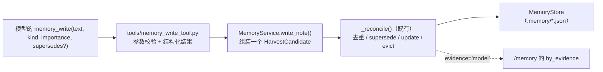
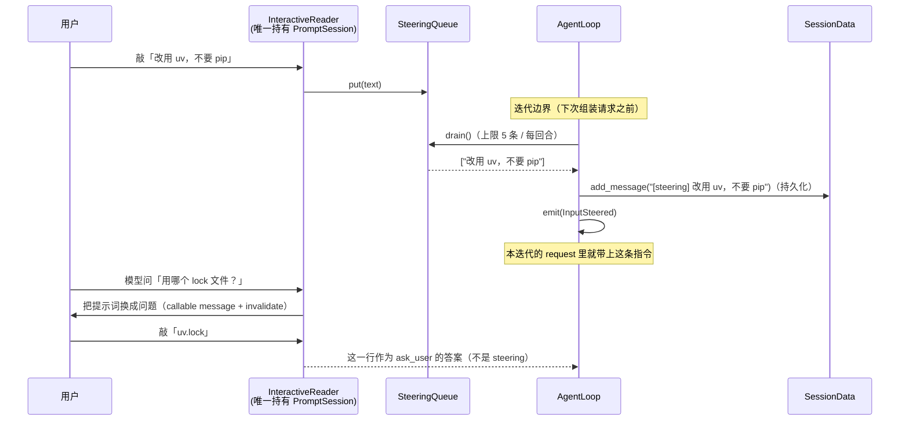
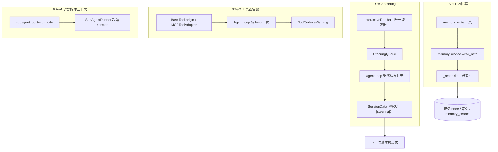
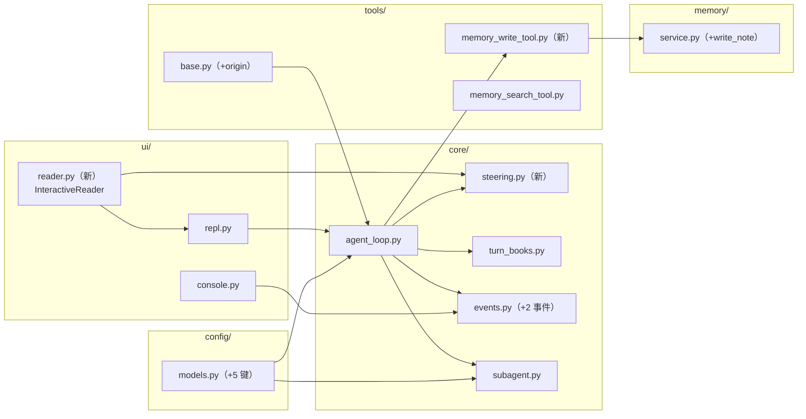

# AI-Coding — R7e 分析方案（模型写记忆 / 回合中转向 / 工具面告警 / 子智能体上下文模式）

> 定位：R7 把四个 P0 收口完了（`docs/r7-analysis.md`、`docs/r7-plan.md` 的执行状态）。
> R7e 是**候选池里挑出来的四件事**（优化菜单 O2/O4/O5/O6，见 `docs/r7-analysis.md` §2.5；
> 其中 `subagent.context_mode` 另有 `docs/r7-backlog.md` §3.4 的原始记录），
> 与 R7 的区别是：**这一轮开始加能力**，所以每一件都要先回答「值不值、加在哪、怎么不破坏既有纪律」。
>
> **先分类**（你要的「按类别划分」）：
>
> | 类别 | 切片 | 一句话 | 新增能力的本质 |
> |---|---|---|---|
> | **A. 记忆的方向**（从「收割」到「主动写」） | **R7e-1** `memory_write` | 模型自己写一条耐久记忆（Anthropic 的 structured note-taking、GA 的 `start_long_term_update`） | 新工具 + 一个写入口，**不加新存储** |
> | **B. 交互的方向**（从「等人审批」到「人随时插话」） | **R7e-2** steering | 回合进行中，用户敲的那一行在下一次迭代变成一条**持久化的用户指令** | 新事件 + 读入仲裁器；**最难、也最容易做坏** |
> | **C. 成本可见性**（从「能查」到「会喊」） | **R7e-3** `tools_chars` 阈值告警 | 工具面超过阈值时，**每个 session 喊一次**，并指出是哪个 server 贵 | 一个观测事件 + 每个工具的来源标记 |
> | **D. 子智能体的上下文预算** | **R7e-4** `subagent.context_mode` | `full`（今天）/ `task_only`（干净窗口）可切换 | 一个配置开关 + 包里的一个字段 |
>
> **建议顺序：R7e-4 → R7e-3 → R7e-1 → R7e-2**（先做小、默认不变、可单独回滚的；把唯一需要动终端的放最后，
> 而且它前面有一个 **Phase 0 spike**）。四件之间**没有依赖**，你想换顺序也可以。
>
> 依据：`docs/r7-backlog.md`（四条候选的出处）、`docs/r1a-5-analysis.md` §8 核验④（`context_mode` 的原始留位与成本警告）、
> `docs/r4a-genericagent-research.md` §4.2（GA 的 9 个原子工具里有 `update_working_checkpoint` /
> `start_long_term_update`）、`docs/r3-analysis.md`（记忆的写什么/何时写/交到哪里）、
> `docs/r7-analysis.md`（R7c 的「一个终端一个读取器」纪律），以及 §1/§2 的实测与外部原文。

---

## 0. 结论先行

1. **R7e-1 的绝大部分已经存在**：`MemoryService._reconcile` 早就是唯一的写入口（去重、supersede、
   update、淘汰、`evidence` 全在里面），`memory_search` 也证明了「记忆工具」的形态。
   所以 `memory_write` ≈ **一个 `write_note()` 包装 + 一个工具 + 门卫表一行**，不需要新存储、不需要新索引。
2. **R7e-2 是四件里唯一有真实风险的**，风险不在循环里，而在**终端**：steering 需要「回合进行中还能读到一行」，
   而这正是 R7c 刚踩过的地方（一个终端只能有一个读取器）。我在本轮做了机制探针（§1.1），结论是：
   **异步读取器可行（回合中途送达成功，30/30 块输出无丢失），线程读取器不可行（送达了，但进程停不下来）**。
   因此 R7e-2 必须重构成「**一个读取器 + 一个队列 + 一个仲裁**」，并且先跑 Phase 0 spike 再动产品代码。
3. **R7e-3 的成本几乎为零，收益是「不用翻轨迹就知道自己在为工具 schema 付多少钱」**：工具面是**静态**的
   （loop 构造时就知道），所以告警只在**第一个回合开头**发一次，不进请求、不影响缓存、不花 token。
4. **R7e-4 的默认值必须是 `full`**：现有测试与文档都写着「子智能体看到父回合的请求视图」，R1a-5 当初也明确
   默认 `full`（需求如此）。所以这是一个**纯开关**：不配 = 今天的行为；配成 `task_only` = 干净窗口 + 任务。
5. **四件都不新增 `TurnStatus` 成员**（R6 的纪律），新状态一律用事件 / `ToolResult.error` / 包里的字段表达。
6. **本轮的 TDD 总计 48 条新用例**（§8：11 + 8 + 14 + 15），其中 2 条是**门控的真实终端用例**（pty / 脚本 stdin），
   其余全部离线可跑。

### 0.1 执行范围（这一轮到底动多大）

| 维度 | 范围 |
|---|---|
| 新增文件 | `core/steering.py`、`ui/reader.py`、`tools/memory_write_tool.py`、`tests/*` 4 个、`scripts/r7e_cases.py`、`docs/r7e-plan.md` |
| 修改文件 | `config/models.py`、`core/events.py`、`core/agent_loop.py`、`core/turn_books.py`、`core/subagent.py`、`core/mcp.py`、`domain/subagent.py`、`tools/base.py`、`tools/builder.py`、`tools/subagent_tool.py`、`tools/...`、`memory/service.py`、`security/permission_gate.py`、`security/user_prompt.py`、`ui/repl.py`、`ui/console.py`、`cli.py`（约 17 个） |
| **不动** | 压缩管线（R7b 的 L2/L3/L4）、门卫的 DENY 表、审批路径（R7c）、MCP 连接与白名单（R7d）、会话落盘格式（除 `SubagentResult` 加一个字段）、`TurnStatus` 集合 |
| 规模 | 生产代码约 **+600 行**（其中 R7e-2 占一半），测试约 **+900 行**，文档 2 份 + 6 份同步 |
| 既有断言 | **一条都不改**（本轮没有需要重定义的契约；R7e-4 的空串→`None` 就是为了保住既有断言） |
| 新配置键 | 5 个（§5），默认值全部等于今天的行为 |
| 风险集中处 | **只有 R7e-2 的终端侧**；它前面有 Phase 0 spike，且写了「不通过就只交付循环侧」的退路 |

---

## 1. 现状核验（实测与前一轮的实测）

### 1.0 基线（今天）

| 项 | 实测值 |
|---|---|
| 质量门禁 | **942 passed, 2 skipped**；`ruff` 0；`mypy` 0（91 文件） |
| 验收脚本 | `r7_cases.py` 11/11 离线、14/14 真实；`r6_cases.py` 9/9 离线；`memory_cases.py` 11/11；`trace_cases.py` 6/6 |
| 工具面（`config.local.yaml`，无 MCP） | **4,280 字符**；13 个啰嗦工具 → **13,301**；白名单 2 个 → **5,666** |
| 记忆层 | `_reconcile` 是唯一写入口；`memory_search` 只读、门卫 ALLOW；`evidence` 已区分 tool/model |
| 子智能体 | 起始 session = `parent.messages`，system prompt = `parent.instructions`（R1a-5 的 `full`） |

### 1.1 实验一：回合进行中，能不能读到用户敲的那一行（steering 的前提）

探针（一次性，**不进仓库**）：子进程在真 pty 里跑一个假回合（30 块输出、共 3 秒），
后台起一个读取器把键入的行放进队列，回合在每个「迭代边界」抽干队列。

| 读取器写法 | 回合中途送达 | 输出是否被吃掉 | 进程能否收尾 |
|---|---|---|---|
| `asyncio.create_task(session.prompt_async("steer> "))` | ✅ `STEERING '改 A 而不是 B'` | ✅ 30/30 块都渲染了 | ✅ 正常退出 |
| `asyncio.to_thread(session.prompt, "steer> ")` | ✅ 同样送达 | ✅ | ❌ **20 秒内退不出来**（线程卡在 stdin 上，`asyncio.run` 要等它） |

**结论（决定了设计）**：读取器必须是**异步任务**（`prompt_async`），不能用线程包一层——
这一点和 R7c 的 `ask_user` 恰好相反（那里是「一次性、必须能被回合钟打断」，所以用线程；
这里是「长期存在、必须能被取消」，所以用异步任务）。**同一个终端上两种读法不能共存**，
这就是 §3.2 要做「一个读取器 + 仲裁」的原因。

### 1.2 实验二：记忆工具要复用哪些既有不变量（代码核验）

| 落点 | 现状 | 证据 |
|---|---|---|
| 写入口 | `MemoryService._reconcile(candidates, turn_index, session_id, evidence)`：去重（`find_by_dedupe` / `find_similar`）、`supersede`、`update`、淘汰（`evict`）全在这里 | `memory/service.py` 314–386 |
| 候选类型 | `HarvestCandidate(text, kind, importance, action, target_id)` 就是「一条待写记忆」的完整描述 | `memory/schema.py` |
| 证据字段 | R6d 起 note 带 `evidence`（tool / model），`/memory` 会按证据分组显示 | `memory/note.py`、`ui/repl.py::_memory_report` |
| 只读工具的形态 | `MemorySearchTool`：`params_json_schema` + 结构化 `data` + 人读文本 | `tools/memory_search_tool.py` |
| 谁注册它 | 只在组合根（`cli._build_loop`）注册，**子智能体的工具栈里没有记忆工具** | `cli.py`、`tools/builder.py` |

### 1.3 实验三：工具面告警需要的数字，现在拿不拿得到（代码核验）

- `AgentLoop.__init__` 里已经有 `self._tools_text` / `self._tools_chars`（R4a 加的），**工具面是静态的**；
- `ContextAssembled.tools_chars` 每个迭代都报一次（可以算出「工具面占每步 prompt 的比例」）；
- **缺的是来源**：`MCPToolAdapter` 知道自己是哪个 server，但 `BaseTool` 没有这个字段，
  所以现在只能说「总共 13,301 字符」，说不出「其中 `everything` 占了 9,000」。

### 1.4 实验四：`task_only` 到底省了什么（离线估算，用 R6 fixture 的形状）

父回合的请求视图在压缩后通常 20–30 条消息（实测 L1 之后 24 条、est tokens ≈ 2,743）。
子智能体今天会**整体**继承它（R1a-5 的原话：「几万 token 会整体成为子智能体的起始输入，并发时倍数放大」）。
`task_only` 把这一项降到 **0**（只剩任务文本 + 系统提示），代价是子智能体必须自己重新探索——
所以「父回合知道的东西」只能靠 `task` 传过去。**这不是免费优化，是一个取舍**，默认必须保持 `full`。

---

## 2. 外部对标（只写我读到过的）

> 说明：能核验的一手材料是 Anthropic 的 context-engineering 原文（R7 已抓全文，本节沿用同一来源）、
> 我们自己 R4a 核验过的 GenericAgent，以及本仓库 R1a-5 的原始设计记录。**「Hermes」本轮没有新增可核验材料**，
> 所以下文不拿它当依据。

### 2.1 Anthropic《Effective context engineering for AI agents》里的两条

| 原文技巧 | 原文说法（要点） | 与 R7e 的关系 |
|---|---|---|
| **structured note-taking** | 「agent 把笔记写到上下文之外的记忆里，之后按需取回」——这是与 compaction 并列的长程手段 | **R7e-1 的直接依据**：我们缺的正是「模型主动写」这一半（收割是 harness 替它写） |
| **sub-agent architectures** | 「子 agent 用**干净的上下文窗口**做聚焦的任务，主 agent 保留计划；子 agent 应该有明确的目标、输出格式、工具与边界」 | **R7e-4 的直接依据**：`task_only` 就是不变量版本；但原文也强调「任务描述要自足」，所以开关要配一句提示词改造 |

（R7b 已经把同一篇文章里的 tool-result clearing 那一半补上了：清掉的东西必须可回收。）

### 2.1b Claude Code 的「排队消息」是有官方文档的一手语义（本轮新核验）

来源：https://docs.claude.com/en/docs/claude-code/interactive-mode （本轮抓取全文，下面三条是原文）：

| 原文 | 对我们的意义 |
|---|---|
| 「Type a message and press Enter while Claude is working. Claude Code **queues the message instead of interrupting the turn**」 | steering 的正确形态是**排队**，不是打断——我们不做 Ctrl-C 之外的打断（§14.4） |
| 「if you queue a message while Claude is running tool calls, Claude Code passes it to Claude **as soon as those tool calls finish, within the same turn**」 | **投递时机 = 工具批跑完、下一次组装请求之前**（本节设计里抽干队列的位置就是照这个来的） |
| 「When the turn ends with messages still queued, they go out **without another key press, in the order you typed them**」+「Esc … Claude keeps the work done so far」 | 回合结束时残留的排队输入**顺势成为下一条输入**；打断也不丢已完成的工作（我们已经如此：`TurnStatus.ABORTED` 保留 `text`） |
| 「**Commands and shell commands**: Claude Code holds them until the turn ends, then runs them one at a time」 | 一条**以 `/` 开头**的行在回合进行中**不当作 steering**，要留到回合结束再按命令处理（已写进本节设计） |

### 2.2 GenericAgent：记忆是**模型调用的工具**，不是后台任务

`docs/r4a-genericagent-research.md` §4.2 记录得很清楚：GA 的 9 个原子工具里有
**`update_working_checkpoint`（工作记忆）与 `start_long_term_update`（长期记忆）**，论文口径是
「这套工具集本身就是 harness」。我们已经把 `ask_user`（GA 的人在环工具）补齐了，
**记忆工具是同一类里唯一还没补的**：今天只有 `memory_search`（读），没有写。

注意 GA 的纪律里有一条我们**不照搬**：H5「No Execution, No Memory」——R6d 的实测已经证明
「用户声明」这类高价值记忆不需要任何工具执行，所以我们的 `evidence` 是**元数据**而不是准入规则。
`memory_write` 沿用这个结论：写进去的 note 带 `evidence="model"`，**可见、可筛、但不做硬门禁**。

### 2.3 我们自己的原始记录：`context_mode` 是怎么留位的

`docs/r1a-5-analysis.md` §8 核验④ 与 §266 原文：

| 原话 | R7e 的处置 |
|---|---|
| 「`subagent.context_mode = "full" \| "task_only"`，默认 `full`（符合需求）」 | 完全照做：默认 `full`，开关实现 |
| 「父回合的请求视图会整体成为起始输入，并发时倍数放大……必须让你知道账单变化」 | 这就是本轮的**取舍说明**：`task_only` 省的是子智能体的每一步，不是一次性 |
| 「留作后续开关位，本步不实现」 | 本轮实现 |

---

## 3. 四个切片逐个设计

### 3.1 R7e-1 —— `memory_write`（类别 A）

**要解决的问题**：harvest 是**事后**的（回合结束、12 条消息、一个提取器），
模型自己「我现在知道了一件下个会话必须记得的事」没有任何表达渠道——它只能写进回答里，
靠提取器**碰巧**抓到。GA 和 Anthropic 都把这个能力做成工具。

**契约**（三步，全部复用既有不变量）：



1. `MemoryService.write_note(...) -> HarvestReport`（新方法，约 30 行）：
   ```python
   def write_note(
       self, text: str, *, kind: str = "fact", importance: int = 3,
       supersedes: str = "", turn: int = 0, session_id: str = "",
   ) -> HarvestReport
   ```
   内部就是「一个 `HarvestCandidate` → `_reconcile(..., evidence="model")`」，因此
   **去重、相似合并、supersede 保护、索引淘汰**全部沿用，不新增任何写路径。
   `enabled=False` 时返回一个空的 `HarvestReport`（工具据此回错误，见下）。
2. `tools/memory_write_tool.py`（新，约 120 行，形态照 `memory_search_tool.py`）：
   - `name = "memory_write"`，`parallel_safe = True`；
   - 参数：`text`（必填）、`kind`（`fact|decision|preference|open_thread`）、
     `importance`（1–5）、`supersedes`（可选 note id，用来显式改掉一条旧记忆）；
   - 参数校验**在工具里**（未知 kind / 空文本 / 超长 → `ToolResult(success=False, error=...)`），
     因为模型会犯错，而错误必须是它读得懂的结构化结果；
   - 文本上限 `_MAX_TEXT = 500` 字符（超了截断并在 output 里说明），
     理由：一条记忆必须是「一句话」，长文属于文件而不是记忆（R3 的分工）；
   - 结果：`data={"note_id": ..., "action": "added|skipped|superseded|updated|evicted", "kind": ...}`
     + 一行人读文本；**重复写同一句话**不算错误（返回 `skipped` 与既有 id，这正是去重在工作）。
3. 门卫：`security/permission_gate.py` 的 allow 表加 `"memory_write"`（见 §12 Q1 的两种选法）。
4. 注册：`cli._build_loop` 里，与 `memory_search` 并排注册（只在组合根、只在 memory 存在时；
   **子智能体不注册**——它连写入口都没有，见 §12 Q3）。

**描述怎么写**（这是这一件里最容易做坏的地方）：必须写清「什么时候写」——
「下一个会话还会用到、且不在代码里的事实/决定/偏好」；并明确「不要写你这一轮做了什么」
（那是 `turn_digest` 环的活）。工具描述是与模型的第一份契约，测试里会断言它包含这两句。

**数据流影响**：新增一条 **tool → memory store** 的写边（以前只有 harvest → memory）。
它**不碰请求组装**：写进去的 note 仍然只通过既有的两条路影响模型（索引块 / `memory_search`），
所以**缓存前缀纪律不变**（R3 §1.13 的三条纪律一条都没破）。

### 3.2 R7e-2 —— steering（类别 B）

**要解决的问题**：用户看到 agent 走错方向时，今天只有两个动作——Ctrl-C（丢工作）或者等它跑完。
steering 想要的是：**在回合进行中补一句话，下一个迭代就按新指令走**。

**为什么它必须在读取器上动刀**：§1.1 的探针证明「回合中途读一行」可行，但要求**异步**读取器；
而 R7c 刚定下「一个终端一个读取器」。两条合起来只有一个解：**把终端读入收敛成一个仲裁器**。



**循环侧（可以完全离线测试的部分）**：

- 新 `core/steering.py`：`SteeringQueue`（`put` 线程/异步安全、`drain() -> list[str]`、
  `pending` 计数）——刻意做成**不依赖 asyncio 队列**的小对象，这样 hook / 将来的非交互来源也能塞。
- `AgentLoop(..., steering=None)`：不传 = 今天的行为（**零成本**）。
- 编排位置：**每轮迭代、拿到 `books.note_iteration(index)` 之后、`_assemble` 之前**抽干一次。
  这样这一条会进**本次**请求的历史（它是普通 user 消息），而不是下一轮。
- 每条变成 `user_message("[steering] " + text)` 并 `checkpoint`（**持久化**：它真的改变了模型的行为，
  和 `[task-gate]` 同一个理由，docs/r1a-4-analysis.md D1）。
- 抽干后 `books.note_steering(n)`：计数 + **重置失败连胜**（新指令 = 重新开始），
  但**不动** `attempted_calls` / `successful_calls`（工具没跑就是没跑，R6b 的阶梯语义不变）。
- 上限：每条截到 `ai.steering_max_chars`（默认 2000，截断处加标记），每回合最多
  `ai.steering_max_messages`（默认 5）；**多出来的留在队列里**（下一个迭代 / 下一个回合再处理），
  「悄悄丢掉用户的输入」是这一件里最不能犯的错。
- **以 `/` 开头的行不是 steering**：它是命令（`parse_slash` 认识的那些），
  回合进行中**留在队列里**，等回合结束由 REPL 按命令执行——Claude Code 也是这个语义
  （§2.1b 第四条）。否则一句 `/status` 会被当成指令喂给模型。
- 新事件 `InputSteered(text_chars, iteration, total)`；控制台渲染一行。

**终端侧（需要真终端验证的部分）**：

- 新 `ui/reader.py`：`InteractiveReader`
  - 一个**异步任务**循环 `await session.prompt_async(message_callable)`，
    message 是**可调用对象**（prompt_toolkit 每次重绘都会重新求值）+ `app.invalidate()`，
    所以「转向提示」和「模型的问题」可以共用同一个提示行；
  - 每读到一行，按「当前有没有待答问题」分派：有 → 解决那个 question future；没有 → 塞进 `SteeringQueue`；
  - 用 `patch_stdout()` 包住，避免流式输出把提示行糊掉（Phase 0 要验证的第一件事）；
  - `EOF` → 结束读取器（REPL 正常退出，与今天一致）。
- `ui/repl.py`：`run_repl(loop, sessions, console, *, reader=None)`。
  有 reader 时，主循环从「自己 `prompt()`」变成「从 reader 取下一行」，
  **回合进行中拿到的行不会再被当成下一条输入**（今天会发生这种事：Ctrl 之外的行被 prompt_toolkit 吃掉）。
- `security/user_prompt.py`：`CLIUserPromptCallback` 增加「由 reader 代答」的模式
  （`ask()` → `reader.ask(question, options)`），R7c 的 `set_reader(sync_fn)` 保留为兼容路径。
- 新 `ui.steering` 配置（默认 `true`）：关掉就是今天的安静 UX。

**Phase 0 spike（动手前，30 分钟，允许乱写）**：

1. 可调用 message + `invalidate()` 在 pty 下能不能把 `steer>` 换成问题文本；
2. `patch_stdout()` 下流式输出与提示行是否不打架；
3. reader 任务被 `cancel()` 时终端是否恢复（§1.1 说线程不行，异步要确认）；
4. 一行在「问题待答」时是不是真的进了 `ask_user`（而不是被当成 steering）。

**失败退路**（写下来，免得做到一半没主意）：若 1/2 不成立，**只交付循环侧**，
把来源限定为「非交互」（`ai.steering_from_stdin` 的管道场景 + hook 注入），
并在文档里写清「交互式 steering 需要终端层重构，另开一轮」。循环侧本身是完整可用的能力。

### 3.3 R7e-3 —— `tools_chars` 阈值告警（类别 C）

**要解决的问题**：R7d 让工具面**可以被压**，但你得先知道**该压**。
今天只有 `/trace` 和轨迹里能看到 `tools_chars`，没人会在被多收钱之前主动去看。

**设计（刻意做成「零成本、只观测」）**：

1. `tools/base.py`：`BaseTool.origin` 属性，默认 `"local"`；`MCPToolAdapter` 覆写为 server 名。
2. `AgentLoop.__init__`：把 `self._tools_text` 按 origin 拆开算一遍
   （`{"local": 4280, "everything": 10062}`），存在 `self._tools_by_origin`。
   ——这是**构造时一次**的工作，不进请求、不进缓存前缀、不花 token。
3. `ai.tools_chars_warn: int = 12_000`（0 = 关闭）。
4. `_begin_turn` 里，第一个回合且超阈值时发一次
   `ToolSurfaceWarning(tools_chars, threshold, origins=((name, chars), ...), hint="…")`，
   然后 `self._tools_warned = True`（**每个 loop 一次**；CLI 的 `ask` 一次一 loop，`repl` 是一整个会话一次）。
5. 控制台：一行 `[tools] 13,301 字符（阈值 12,000）· everything=10,062 · local=4,280 · 建议 mcp.servers[].tools 只注册需要的`。
6. 轨迹：`TraceRecorder._describe` 的默认分支用 `dataclasses.asdict` 处理未知事件，
   **不需要改 trace.py**；`ui/trace_render.py` 可选加一条汇总（本切片不做）。

**为什么用新事件而不是 `Degraded`**：`Degraded` 的语义是「某个增强降级了」，而这里没有任何东西降级——
它是一条**成本提示**。混用会让 `/trace --degraded` 变成噪音（R4 已经因为「观测要能一眼看懂」改过一次形状）。

### 3.4 R7e-4 —— `subagent.context_mode`（类别 D）

**契约**：

| 模式 | 子智能体的起始 session | system prompt | 用在哪 |
|---|---|---|---|
| `full`（默认，今天） | `parent.messages`（父回合的请求视图） | `parent.instructions` | 需要「接着我看到的往下做」 |
| `task_only` | 空（只有工具结果与任务） | 组合根的基础提示词（`base_instructions`） | 目标自足的专项活（Anthropic 的建议形态） |

**逐文件**：

1. `config/models.py`：`subagent_context_mode: Literal["full", "task_only"] = "full"`
   （用 Literal，非法值在配置加载时就报错，和 `stop_policy` 一致）。
2. `core/subagent.py`：
   - `SubAgentRunner(..., base_instructions: str = "")`；
   - `_run_in` 按模式分叉：`full` 照旧；`task_only` 用**空 messages**，
     且 `prompt = PromptAssembler(base_instructions) if base_instructions else None`
     ——**空串必须落到 `None`**，否则既有用例
     `test_subagent_without_parent_uses_empty_history`（断言 `instructions is None`）会被打破；
   - `_packet` 里带上 `context_mode`。
3. `domain/subagent.py`：`SubagentResult.context_mode: str = "full"`（+ `to_dict`），
   这样父回合的 tool 结果、轨迹、`/trace` 都能看出这次跑的是哪种。
4. `tools/subagent_tool.py`：描述按模式措辞——`task_only` 时明确告诉模型
   「子智能体看不到你的对话历史，请把必要背景写进 task」（这是 `task_only` 唯一的真实风险）。
5. `tools/builder.py` + `cli.py`：把组合根的 `base_instructions` 传进 runner。

**数据流影响**：只改**子智能体的起始状态**，父回合的请求、工具面、记忆都不变。
并发时的账单变化是**乘法**的（这正是 R1a-5 提醒过的），所以默认保持 `full`。

---

## 4. 逐文件实现步骤（每步一个可独立审阅的增量）

> 全程 TDD：先红后绿；**不改既有断言**（本轮四件都是「加开关加能力」，没有需要重定义的契约）。
> 每步结束跑 `pytest tests/ -o addopts="" -q && ruff check . && mypy ai_coding`。

| 步 | 切片 | 文件 | 动作 | 用例 |
|---|---|---|---|---|
| 1 | R7e-4 | `config/models.py` | 加 `subagent_context_mode`（Literal） | 1 |
| 2 | R7e-4 | `domain/subagent.py`、`core/subagent.py` | 模式分叉 + `base_instructions` + 包字段 | 8 |
| 3 | R7e-4 | `tools/subagent_tool.py`、`tools/builder.py`、`cli.py` | 描述措辞 + 传参 | 2 |
| 4 | R7e-3 | `tools/base.py`、`core/mcp.py` | `origin` 属性 | 2 |
| 5 | R7e-3 | `core/events.py`、`core/agent_loop.py`、`config/models.py` | 拆分母 + 告警一次 + 阈值 | 5 |
| 6 | R7e-3 | `ui/console.py` | 渲染一行 | 1 |
| 7 | R7e-1 | `memory/service.py` | `write_note()` | 6 |
| 8 | R7e-1 | `tools/memory_write_tool.py` | 新工具 | 6 |
| 9 | R7e-1 | `security/permission_gate.py`、`cli.py` | 门卫 + 注册 | 2 |
| 10 | R7e-2 | **Phase 0 spike**（一次性，不进仓库） | 4 条验证（§3.2） | —— |
| 11 | R7e-2 | `core/steering.py`、`core/turn_books.py` | 队列 + 计数 | 3 |
| 12 | R7e-2 | `core/events.py`、`core/agent_loop.py` | 抽干 + 持久化 + `/` 行剔除 + 事件 | 7 |
| 13 | R7e-2 | `ui/reader.py`、`ui/repl.py`、`ui.steering` 配置 | 仲裁器 + REPL 接线（+2 门控真实） | 3 |
| 14 | R7e-2 | `security/user_prompt.py` | reader 代答路径 | 2 |
| 15 | 收尾 | `scripts/r7e_cases.py` + 六份文档 | 验收脚本与文档同步 | 见 §8 |

---

## 5. 数据契约变更汇总

| 契约 | 位置 | 变更 | 兼容性 |
|---|---|---|---|
| `AIConfig.subagent_context_mode` | `config/models.py` | 新增，`Literal["full","task_only"]`，默认 `full` | 纯新增（默认 = 今天） |
| `AIConfig.tools_chars_warn` | 同上 | 新增，默认 12000，0 = 关 | 纯新增 |
| `AIConfig.steering_max_messages` / `steering_max_chars` | 同上 | 新增，5 / 2000 | 纯新增 |
| `AppConfig.ui`（`UIConfig.steering`） | 同上 | 新增小配置块，默认 `true` | 纯新增 |
| `SubagentResult.context_mode` | `domain/subagent.py` | 新增字段 + `to_dict` | 纯新增（老读者忽略） |
| `BaseTool.origin` | `tools/base.py` | 新增属性，默认 `"local"` | 纯新增 |
| 事件 `InputSteered` / `ToolSurfaceWarning` | `core/events.py` | 新增两种，加入 `LoopEvent` 联合 | 纯新增（未知事件在 trace 里走默认分支） |
| `MemoryService.write_note` | `memory/service.py` | 新公开方法 | 纯新增 |
| 工具 `memory_write` | `tools/memory_write_tool.py` | 新工具（`/tools` 列表 +1，约 340 字符） | 纯新增 |
| 门卫 allow 表 | `security/permission_gate.py` | 加 `memory_write` | 纯新增（见 Q1） |
| 子智能体起始状态 | `core/subagent.py` | **只有配成 `task_only` 时变** | 默认不变 |

---

## 6. 数据流（扇入扇出）

### 6.1 四个切片各自新增的边（一张图）



### 6.2 不变量（逐条，R7e 之后仍然成立）

1. **记忆永不进系统提示**；只有索引块（≤600 字符）与工具结果两条路（R3）。
2. **历史只在越过水位线时被改写**；steering 是**追加**，不是改写（R3b）。
3. **观测只写不改**：`ToolSurfaceWarning` / `InputSteered` 都不参与请求组装
   （用例：开不开告警，请求逐字节相同）。
4. **一个终端一个读取器**（R7c）：reader 之外的地方不再直接读 stdin；`ask_user` 走 reader 仲裁。
5. **任何被 elide 的正文可回收**（R7b）：steering 与 `memory_write` 都不碰压缩管线。
6. **每次写记忆都经过 `_reconcile`**：没有第二条写路径，去重/淘汰不可能被绕过。

---

## 7. 架构设计图（模块与依赖方向）



依赖方向不变：`core` 仍是唯一编排层；`ui` 依赖 `core`（不是反过来）；
`memory` 不知道循环的存在；`tools` 通过 `ToolContext` 与注入的服务接触外部世界。

---

## 8. TDD 用例清单（先红后绿，48 条）

### 8.1 R7e-4 子智能体上下文模式（11）

`tests/test_subagent_context_mode.py`（新 8 条）+ 既有文件新增 2 条：

1. `test_default_mode_is_full`（今天的断言：父消息与父 instructions 都在）
1b. `test_task_only_with_no_base_instructions_has_no_system_prompt`（空串 → `None`，兼容既有断言）
2. `test_task_only_child_starts_with_an_empty_history`
3. `test_task_only_child_gets_the_base_instructions`
4. `test_task_only_child_still_gets_the_task_text`
5. `test_the_packet_reports_the_mode`
6. `test_an_unknown_mode_fails_at_config_load`（Literal 校验）
7. `test_the_runner_reads_the_mode_from_config`（组合根 → runner）
8. `test_task_only_does_not_change_the_parent_turn`
9. `test_the_tool_description_tells_the_model_what_the_child_can_see`（两种模式各一条）
10. `test_full_mode_is_byte_identical_to_today`（同参数下请求逐字节相同）

### 8.2 R7e-3 工具面告警（8）

`tests/test_tool_surface_warning.py`：

1. `test_no_warning_below_the_threshold`
2. `test_one_warning_above_the_threshold`
3. `test_the_warning_is_emitted_once_per_loop`（两个回合 → 一次）
4. `test_zero_disables_the_warning`
5. `test_the_origins_sum_to_the_total`
6. `test_the_hint_names_the_most_expensive_origin`
7. `test_the_warning_never_changes_the_request`（逐字节）
8. `test_mcp_adapters_carry_their_server_as_origin`

### 8.3 R7e-1 `memory_write`（14）

`tests/test_memory_write.py`（service 6 + 工具 6）+ 门卫/注册 2：

1. `test_write_note_adds_a_note`
2. `test_write_note_dedupes_the_same_text`（返回既有 id，不新增）
3. `test_write_note_supersedes_an_explicit_id`
4. `test_write_note_records_evidence_model`
5. `test_write_note_evicts_above_the_cap`
6. `test_write_note_is_a_noop_when_memory_is_disabled`
7. `test_the_tool_requires_text`
8. `test_the_tool_rejects_an_unknown_kind`
9. `test_the_tool_truncates_a_long_note_and_says_so`
10. `test_the_tool_returns_the_note_id_and_action`
11. `test_a_duplicate_write_is_not_an_error`
12. `test_the_tool_survives_a_service_exception`（工具边界）
13. `test_the_gate_allows_memory_write`
14. `test_the_tool_is_registered_for_the_parent_but_not_a_subagent`

### 8.4 R7e-2 steering（15：13 离线 + 2 门控真实）

`tests/test_steering_queue.py`（3）+ `tests/test_loop_steering.py`（7）+ UI 3：

1. `test_put_then_drain_returns_the_lines_in_order`
2. `test_drain_is_idempotent`
3. `test_pending_counts_without_draining`
4. `test_a_slash_line_is_held_for_the_repl_instead_of_steering`（`/status` 不进历史，留在队列）
5. `test_a_steering_line_becomes_a_persisted_user_message`
6. `test_the_model_sees_the_steering_line_in_the_same_iteration`
7. `test_steering_resets_the_failure_streak_but_not_the_call_counts`
8. `test_steering_lines_are_capped_per_turn_and_the_rest_stay_queued`
9. `test_a_long_steering_line_is_truncated_with_a_marker`
10. `test_no_source_means_no_behaviour_change`（不传 = 今天逐字节相同）
11. `test_the_reader_dispatches_a_line_to_a_pending_question`（假 reader）
12. `test_the_reader_sends_an_unclaimed_line_to_steering`
13. **门控**：`tests/test_repl_steering_stdin.py`（脚本 stdin：回合进行中的一行进了历史）
14. **门控**：`tests/test_repl_steering_pty.py`（真 pty：`AI_CODING_PTY=1`）
15. 控制台渲染一行 `InputSteered` 不炸（并入既有 console 用例文件）

---

## 9. 成功效果（改完之后，能指着说什么变了）

1. **模型能主动记事了**：一次 `memory_write` 之后，`/memory` 里多一条
   `evidence=model` 的 note，下一个会话 `memory_search` 就能查到它——**不依赖提取器碰巧抓到**。
2. **用户能在回合中途改方向**：敲一行 → 下一个迭代的请求里就有它（持久化、可回放），
   而不是等回合结束或者 Ctrl-C 丢掉已有工作。
3. **工具面超支会主动说**：`[tools] 13,301 字符（阈值 12,000）· everything=10,062`，
   并直接指出该改哪个键（`mcp.servers[].tools`）。
4. **子智能体的账单可控**：`task_only` 时它不再继承父回合的请求视图（省下每一步的上下文），
   代价（自己重新探索）写在工具描述里，由模型自己把背景写进 `task`。
5. 四个开关**默认值全部等于今天的行为**（除了 steering 的 UI 默认开，见 Q6），
   任何一个单独关掉都不影响其它三个。

---

## 10. 自我核验（我这份方案哪里可能是错的）

1. **steering 的终端部分是唯一「我还没验证」的地方**：§1.1 只证明了「异步读取器 + 队列」可行，
   **没证明**可调用 message + `invalidate()` 能在回合中途换提示词、`patch_stdout()` 不打架、
   取消后终端能恢复。这三条都放在 Phase 0 spike 里，而且写了失败退路（只交付循环侧）。
   ——如果你不想承担这部分风险，**直接砍掉 R7e-2 的终端侧**，循环侧仍然是可用的能力（管道/hook 场景）。
2. **`memory_write` 的「写什么」靠提示词纪律，不靠机制**：模型可能写入废话或错误偏好。
   缓解是 `evidence=model` 可见 + `/memory` 可删可 pin + 文本上限 500 字符；
   **没有**做「写入前问人」（Q1 的备选）。R6d 的实测是「提取器没编造」，但那是提取器不是工具，别外推。
3. **`tools_chars` 阈值 12000 是拍的**：依据是实测的 13,301（13 工具）与 4,280（无 MCP），
   中间留了一档；它不是从「多少 token 值得心疼」推出来的。0 可以关。
4. **`task_only` 会让子智能体更容易跑偏**：原文也强调「任务要自足」，而我们今天没有
   「任务模板 / 输出格式」的强制。所以它是**开关**而不是新默认；Q8 里我把默认固定成 `full`。
5. **四个切片的用例数（36）是估的**，实施时只多不少；若某一件的用例写不满，
   说明它的「成功标准」没定义清楚，我会回来改设计而不是凑数。
6. **`write_note` 复用 `_reconcile` 是有代价的**：`_reconcile` 是为「一批候选」写的，
   单条调用会走一遍相同的相似度扫描（O(n)）。记忆量级（≤200 条）下可以忽略，
   但如果将来记忆上万条，这里要先加索引（RAG/SQLite 那条线）。
7. **新事件加入 `LoopEvent` 联合会影响 `mypy` 的穷尽性检查**（如果有 `match` 的地方）。
   我核过：`ui/console.py` 与 `core/trace.py` 都是 `isinstance` 链 + 默认分支，**不会因为新事件而失败**。

---

## 11. 执行顺序与提交切分（建议）

| 顺序 | 提交 | 内容 | 可单独回滚 |
|---:|---|---|---|
| 1 | `docs(R7e): the four candidates, measured` | 本文档 | 是 |
| 2 | `docs(R7e): the implementation plan` | `docs/r7e-plan.md` | 是 |
| 3 | `R7e-4: a sub-agent can be given a clean window` | 配置 + runner + 包字段 + 测试 | 是 |
| 4 | `R7e-3: the tool surface says when it is expensive` | origin + 事件 + 阈值 + 测试 | 是 |
| 5 | `R7e-1: the agent can write its own note` | service + 工具 + 门卫 + 测试 | 是 |
| 6 | `R7e-2a: a line typed mid-turn becomes an instruction` | 队列 + 循环抽干 + 事件 + 测试 | 是 |
| 7 | `R7e-2b: one reader arbitrates the terminal` | reader + REPL + 真终端用例（门控） | 是 |
| 8 | `R7e: the acceptance script, and the docs the round changed` | `scripts/r7e_cases.py` + 文档 | 是 |

---

## 12. 待拍板决策点

| # | 问题 | 我的建议 | 备选 |
|---|---|---|---|
| **Q1** | `memory_write` 的门卫档位 | **ALLOW**（与 harvest 一致：后台本来就会自动写记忆，只限制工具反而不一致；靠 `evidence=model` + `/memory` 可见性治理） | 按 kind 分档（`preference`/`decision` → WARN，其余 ALLOW）；或一律 WARN |
| **Q2** | 备注参数 | 收 `text / kind / importance / supersedes` 四个；**文本上限 500 字符**，超长截断并说明 | 不提供 `supersedes`（只能新增与去重） |
| **Q3** | 子智能体要不要也能写记忆 | **不给**（它连 `memory_search` 都没有；共享数据库的并发写要另做锁的设计） | 给（需要额外定义并发与作用域） |
| **Q4** | steering 要不要**持久化**那条消息 | **要**（它改变了模型行为，回放时不带上就失真——同 `[task-gate]` 的理由） | 只做易失尾部块（省 token，但回放不忠实） |
| **Q5** | steering 是否重置失败连胜 | **重置连胜，不动调用计数**（新指令 = 重新开始；工具确实没成功过） | 完全不碰计数（阶梯语义最纯，但可能刚被转向就停） |
| **Q6** | steering 的上限与 UI 默认 | 每回合 5 条、每条 2000 字符；多出来的留在队列；以 `/` 开头的行留到回合结束当命令；`ui.steering` 默认 **true** | 默认 false（先做成 opt-in）；或超限时直接丢弃（**不推荐**） |
| **Q7** | `tools_chars_warn` 默认值 | **12000**（实测 13 工具 = 13,301 会触发；无 MCP = 4,280 不会） | 0（默认关，等你想调再开）；或 8000（更激进） |
| **Q8** | `subagent_context_mode` 默认与 `task_only` 的系统提示 | 默认 **`full`**（今天的行为）；`task_only` 用组合根的 `base_instructions` | 默认 `task_only`（省账单但改变行为，会让现有测试与文档失真） |
| **Q9** | R7e-2 终端侧是否本轮就做 | **做，但先跑 Phase 0 spike**；不通过就只交付循环侧并如实说明 | 本轮只交付循环侧（管道/hook 来源），终端另开一轮 |

---

## 13. 文档同步清单

| 文档 | 要改的地方 |
|---|---|
| `docs/features.md` | 工具清单加 `memory_write`；「记忆」一节补「模型主动写」；「子智能体」一节补两种模式；MCP 那三条代价补工具面告警 |
| `docs/data-contracts.md` | 五个新配置键、`SubagentResult.context_mode`、`BaseTool.origin`、两个新事件 |
| `docs/architecture.md` | 包结构补 `core/steering.py`、`ui/reader.py`；数据流图补 steering 与工具面告警 |
| `docs/how-to-run.md` | 配置示例（steering 开关、`task_only`、阈值）；steering 的使用说明（回合中直接打字） |
| `docs/integration_testing.md` | R7e 验收脚本与两条门控终端用例怎么跑 |
| `docs/r7-backlog.md` | 候选池里划掉这四条并指向本文：`memory_write` = `r7-analysis` §2.5 **O2**（§14.3 曾记为「不做」，本轮改判）、steering = **O4**（§14.3「明确不做」，本轮改判）、工具面告警 = **O5** + backlog §3.2、`context_mode` = **O6** + backlog §3.4 |

---

## 14. 明确不做（本轮写下来，免得下次再吵）

1. **不做 SQLite/FTS5 迁移**：`write_note` 复用 JSON 存储；索引化留给 RAG 那条线。
2. **不做「模型写的 checkpoint」**（GA 的 `update_working_checkpoint`，backlog 2.2）：
   它是 R6a 摘要环的替代品，需要单独论证，本轮只做工具形态的记忆写。
3. **不做 steering 的删除/撤销**（用户改主意想撤回刚插的话）：不变量太复杂，且历史是只追加的。
4. **不做 steering 的「停止」语义**，也不做 Claude Code 的 `Ctrl+Enter / Ctrl+X Ctrl+S`（sendNow：
   打断当前回合并立刻发出排队消息）：停止今天已有 Ctrl-C，混进来会让「一行文字」有两种完全不同的结果。
   （Claude Code 文档里这两条是绑定的，我们取「排队」那一半。）
5. **不做工具面的自动压缩**（按预算自动砍 schema）：R7d 只给了开关，自动策略需要先有真实使用数据。
6. **不做子智能体之间的记忆共享 / 自动合并 todo**（R1a-5 已裁决，本轮不变）。
