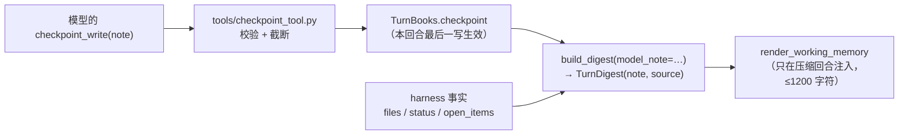
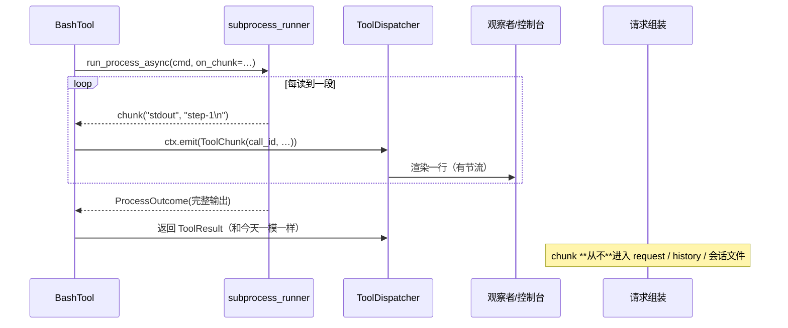
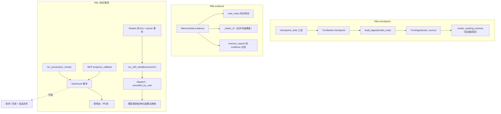

# AI-Coding — R8 分析方案（模型写的 checkpoint / evidence 参与排序 / 工具流式与取消）

> 定位：R7e 把优化菜单的 O2/O4/O5/O6 做完了。R8 处理 `docs/r7-backlog.md` 候选池里剩下的三条：
> **2.2 GA 式「模型写的 checkpoint」**、**2.5 `evidence` 参与召回排序**、**3.6 工具层流式输出 / 取消语义**。
> 与前几轮一样：先实测与代码核验（§1）、再对标（§2）、再逐个设计（§3），最后是逐文件步骤（§4）、
> 数据契约（§5）、数据流与图（§6）、TDD 用例（§7）、成功效果（§8）、自我核验（§9）、
> 待拍板决策点（§11）。
>
> **三个切片各自独立**（没有依赖，任意顺序都能单独上线）：
>
> | 编号 | 切片 | 一句话 | 风险 |
> |---|---|---|---|
> | **R8a** | 模型写的 checkpoint | 让模型自己写「这一轮该被记住的一行」，替掉 harness 拼出来的那句（GA 的 `update_working_checkpoint`） | 中：会改提示词内容（但只在压缩回合出现） |
> | **R8b** | `evidence` 参与排序 | 同分时偏向「有工具证据」的那条；顺带给 `memory_search` 加一个 `evidence` 过滤 | 低：只在**完全同分**时改变顺序 |
> | **R8c** | 工具流式 / 取消 | 长命令不再是一段黑屏；卡住的单次调用可以只取消它、不杀整个回合 | 高：要动 R2b 的子进程 runner 与终端按键 |
>
> **建议顺序：R8b → R8a → R8c**（最便宜的、最不可能翻车的先做）。R8c 内部再分三步交付：
> **S1 流式**（只做观感）、**S2 单次取消**（要动 dispatcher 与终端）、**S3 MCP 进度**（免费搭车）。
>
> 依据：`docs/r7-backlog.md` §2.2 / §2.5 / §3.6；`docs/r6-analysis.md` §1.4 的结论段（R6d 已经把
> 「`evidence` 只观测、未来做召回同分择优」写进结论）；`docs/r4a-genericagent-research.md` §4.2
> （GA 的记忆二件套：`update_working_checkpoint` / `start_long_term_update`）；`docs/r2-analysis.md`
> §1.3/1.4（为什么子进程 runner 现在长这样）；以及 §1 的本轮实测。

---

## 0. 结论先行

1. **R8a 的落点已经存在，缺的只是「谁写」**：`domain/turn_digest.py` 的 `TurnDigest` +
   `render_working_memory` 已经是「每轮一行、有界环、只在压缩回合注入」的形状；R6 的实测里唯一
   不满意的地方是那句话由 harness 拼（`build_digest`），模型读完说「这是照抄摘要」。
   所以 R8a = **给 `TurnDigest` 加 `note`/`source` 两个字段 + 一个 `checkpoint_write` 工具**，
   环、预算、注入时机**一个都不改**。模型写的备注只替换「结果那句话」，harness 的事实（改了哪些文件、
   状态、未完成项）照旧由 harness 填——那是模型的弱项、harness 的强项。
2. **R8b 比 backlog 里写的还要小**：召回排序的键是 `(-score, -relevance, note.id)`，
   把 `evidence` 插在 `id` 前面就是全部改动。**实测**（§1.3）说明它的另一面：真正「完全同分」的情况很少，
   所以它的用户可见价值主要来自**`memory_search` 的 `evidence` 过滤**，而 tie-break 是「几乎免费、
   偶尔救命」。**不做加分（boost）**——我们的 `evidence` 是**回合级**事实（那一轮有过成功工具调用），
   不是逐条验证，拿它加权会系统性偏向「用过工具的那一轮」写下的所有东西，包括用户说的话。
3. **R8c 的问题是真的、也是本轮唯一有拆装风险的**：实测（§1.4）一条 2.43 秒的命令，
   控制台在 0.05s 只看到 `ToolStarted`、**中间 2.38 秒全黑**、2.43s 才 `ToolFinished`。
   修它要动 `infra/subprocess_runner.py`——R2b 花了很大力气才让它「线程一定会返回、
   杀进程组、超时后仍保留部分输出」，所以这一步必须**保住那三条不变量**，并用现有用例当回归网。
4. **取消要分两种，不能混**：今天有「回合钟到了 → 放弃这次调用」和「Ctrl-C → 整个回合中止」。
   R8c-S2 新增的是第三种：**只取消当前这一批工具调用**，回合继续，模型看到结构化的
   `error="cancelled_by_user"` 再决定下一步（Claude Code 的 Esc 就是这个语义，§2.2 有一手引文）。
5. **三件都不改缓存前缀纪律**：checkpoint 只进易失尾块（且只在压缩回合）、`evidence` 只影响排序、
   **流式 chunk 绝不进请求与历史**（这条会用「开/关 chunk 请求逐字节相同」的用例钉死）。
6. **预计 33 条新用例**（12 + 8 + 13），其中 2 条是门控真终端/真 stdio 用例（Esc 取消、MCP 进度）。

### 0.1 执行范围（这一轮动多大）

| 维度 | 范围 |
|---|---|
| 新增文件 | `tools/checkpoint_tool.py`、`scripts/mcp_progress_server.py`、`scripts/r8_cases.py`、`docs/r8-plan.md`、测试 4~5 个 |
| 修改文件 | `domain/turn_digest.py`、`core/turn_books.py`、`core/turn_close.py`、`core/agent_loop.py`、`core/request_builder.py`、`tools/base.py`、`core/events.py`、`infra/deadline.py`、`infra/subprocess_runner.py`、`core/dispatch.py`、`core/mcp.py`、`tools/bash_tool.py`、`memory/relevance.py`、`memory/service.py`、`tools/memory_search_tool.py`、`ui/console.py`、`ui/reader.py`、`cli.py`、`config/models.py`（约 19 个） |
| **不动** | 压缩管线（R7b）、催收/收割语义（R6d）、steering 的队列与投递点（R7e）、审批路径（R7c）、会话文件格式（除 `turnDigests` 的两个可选字段） |
| 规模 | 生产代码约 **+450 行**（R8a ≈120、R8b ≈40、R8c ≈290），测试约 **+900 行** |
| 既有断言 | **一条都不打算改**；R8c-S1 改的是 `run_process` 内部实现，输出对象 `ProcessOutcome` 的字段与语义不变 |
| 新配置键 | 3 个（`working_memory_note_chars`、`ui.tool_chunks`、`ui.cancel_key`），默认值等于今天的行为 |
| 风险集中处 | **R8c-S1 的子进程 runner 改造**（有 R2 的回归用例兜底）与 **R8c-S2 的终端按键**（先跑 spike） |

---

## 1. 现状核验（本轮实测 + 代码出处）

### 1.1 checkpoint 的现状（代码核验）

| 事实 | 出处 |
|---|---|
| 每轮一行的结构 `TurnDigest(turn, request, outcome, status, files, open_items)` | `domain/turn_digest.py` |
| 「结果那句话」优先用模型说的，没有才用状态标签（`_STATUS_LABEL`） | `build_digest`（第 164–187 行） |
| 有界环、只保留 `working_memory_keep=12` 条、随会话落盘（`turnDigests`） | `append_digest`、`SessionData.turn_digests` |
| 只有**本轮历史真被压缩**时才注入 `<working-memory>`，且总量 ≤ `working_memory_chars=1200` | `render_working_memory`、`Compactor.did_compact`（R6a D-R6-2） |
| 环里**没有**任何「谁写的」标记 | `TurnDigest.to_dict/from_dict` |
+| 两个硬上限：请求 60 字符、结果句 90 字符；实测一条 harness 行 **77 字符**，12 行渲染用 **1030/1200** | `DEFAULT_REQUEST_CHARS` / `DEFAULT_OUTCOME_CHARS` / 本轮实测 |

**R6 的实测结论（引文）**：arm B 里模型自己说「这是照抄摘要，不是我知道的事」——这正是 R8a 的动机。

### 1.2 一个必须先讲清的取舍：两个写工具会打架吗

R7e 刚加了 `memory_write`（跨会话的耐久记忆）。再加 `checkpoint_write`（本会话的回合状态），
模型面对两个「写一句话」的工具，很容易用错。三条缓解写进设计：

1. **描述里写清作用域**：checkpoint = 「这个会话/下一步要用」；memory_write = 「下个会话还要用」；
2. **不需要时不出现**：checkpoint 的产出只在压缩回合注入，所以它写的东西「不花平时的钱」；
3. **写入路径不同**：checkpoint 进 `turnDigests`（有界环、会自然淘汰），memory_write 进 `.memory`（耐久、要人去删）。

### 1.3 evidence 的现状与实测

| 事实 | 出处 |
|---|---|
| `MemoryNote.evidence`（`"tool"` / `"model"` / `""`）由**回合级**事实决定：本回合至少一次工具调用成功 → `tool` | `core/memory_turn.py::harvest(..., evidence=...)`；R6d 的 D-R6-10 |
| 召回排序键：`(-score, -relevance, note.id)` | `memory/relevance.py::rank_notes` 末段 |
| `MemoryHarvested.evidence`、`/memory` 的 `by_evidence` 已经在观测里了 | `core/events.py`、`ui/repl.py::_memory_report` |
| R6 文档已经把「未来召回的同分择优」写进结论（**这不是新想法**） | `docs/r6-analysis.md`：「`evidence` 只用于观测与**排序倾向**……未来召回的同分择优」 |

**本轮实测（10 秒就能看见它有多小）**：用 R3 风格的 5 条 fixture 跑 `rank_notes`：

```
构建用什么工具 →
  构建用 uv                       score=1.0750  relevance=1.0000   (evidence=model)
  构建改用 uv，不要 poetry         score=0.7379  relevance=0.3871   (evidence=tool)
```

两条**分数与相关性都不同**——也就是说「同分」在实践中不常见（coverage 打分对长度敏感）。
诚实的结论：**tie-break 几乎不花钱，但它也很少开火**；`evidence` 对用户的价值更多在
「我能筛出『确实做过』的那些」——所以 R8b 的重点是**过滤**，tie-break 是顺手的纪律。

（另一个事实：仓库根的 `.memory/` 是空的——记忆按 workspace 存，本轮跑出来的库都在临时目录里，
所以我没法给出「真实库里 evidence 的分布」；这一点在执行 §7 的真实用例时会补一次实测。）

### 1.4 工具流式 / 取消的现状与实测

| 事实 | 出处 |
|---|---|
| 工具执行只有一个 await，没有中间反馈 | `BaseTool.execute`、`dispatch._execute` |
| 超时语义已经很完整：`min(工具上限, 回合剩余)`，超时**放弃任务**并回结构化 `tool_timeout` | `core/dispatch.py::_call_budget/_execute`、`infra/deadline.run_with_deadline` |
| bash 走 `run_process`：`communicate()` **一次性拿全部输出**，超时才 `killpg`，部分输出保留 | `infra/subprocess_runner.py`（R2b） |
| 没有「只取消一次调用」的通道；Ctrl-C 是整回合 `ABORTED` | `core/agent_loop.py` |
| 工具已经有 `emit` 事件通道（`ToolContext.emit`），但没人用它推流 | `tools/base.py`、`core/request_builder.tool_context` |

**实测（改造前，本机）**：`bash` 跑 `for i in 1 2 3; do echo step-$i; sleep 0.8; done`：

```
total elapsed: 2.43 s  (命令本身约 2.4s)
when each event arrived (s): {'ToolStarted': 0.05, 'ToolApprovalRequested': 0.05, 'ToolFinished': 2.43}
output: 'step-1\nstep-2\nstep-3'
```

**0.05s 开始、2.43s 结束，中间 2.38 秒控制台什么都没显示**——这就是 R8c-S1 要治的病。

### 1.5 MCP 侧能不能顺手搭上（本轮核验）

| 事实 | 证据 |
|---|---|
| 客户端 `ClientSession.call_tool(..., progress_callback=...)` 存在 | 本机 `mcp` **2.2.0**：`inspect.signature` 里有 `progress_callback: ProgressFnT | None` |
| 服务端 `Context.report_progress(progress, total=None, message=None)` 存在 | `mcp.server.mcpserver.Context` 的公开方法里有它 |

也就是说 **S3（MCP 进度）不需要改架构**：适配器把 `progress_callback` 接上，转成同一种 chunk 事件；
而且我们**能自己写一个会报进度的 server**，让这条有可复现的真实用例（不是「只报告」）。

---

## 2. 外部对标（只写读到的一手材料）

### 2.1 GA：checkpoint 是**模型调用的工具**，不是 harness 的自动摘要

`docs/r4a-genericagent-research.md` §4.2 记录的 GA 工具集里，记忆类有两个：
**`update_working_checkpoint`（工作记忆）** 与 `start_long_term_update`（长期记忆），
论文口径是「这套工具集本身就是 harness」。我们 R7e 已经补了长期记忆那一半（`memory_write`），
**工作记忆这一半正是 R8a**。

我们**不照搬**的两点：GA 的 checkpoint 每轮都注入（我们没有那个预算，且 R6 的实测说明
「只在压缩回合注入」已经够用）；GA 靠 SOP 要求模型自觉写（我们在工具描述里写清「什么时候写」，
并把「不写」当作合法选择——现有的 harness 摘要仍然兜底）。

### 2.2 Claude Code：Esc = 打断这一次，而不是丢掉整个回合

本轮重新核验了官方 `interactive-mode` 文档（R7e 已抓过全文，这里取另一条）：

| 原文 | 对我们的意义 |
|---|---|
| 「**Esc** — Interrupt Claude … Stop the current response **or tool call** mid-turn so you can redirect. Claude **keeps the work done so far**」 | 取消的粒度是**当前这一步/这一次工具调用**，而不是整回合；已完成的工作必须保留 |
| 「Ctrl+C — Interrupt, or clear input. Interrupts a running operation」 | 整回合中止（我们已有：`TurnStatus.ABORTED` + 保留 `text`） |
| 「If you have messages queued, Claude Code sends them next」 | 取消之后紧接着的排队消息会被发出（我们 R7e 的 steering 已经保证：队列里的东西不会丢） |

所以 R8c-S2 的形状是：**Esc → 取消当前这一批工具调用 → 模型拿到 `cancelled_by_user` 的结果继续**，
而 Ctrl-C 保持今天的「整回合中止」不变。

---

## 3. 三个切片逐个设计

### 3.1 R8a —— 模型写的 checkpoint（GA 的 `update_working_checkpoint`）

**要解决的问题**：压缩之后模型看到的 `<working-memory>` 每行都是 harness 拼的
（`请求 → 结果（改了 X；状态）`）。harness 擅长「发生了什么」，不擅长「下一步我需要知道什么」——
R6 的实测里模型自己指出了这一点。

**契约**（只加两个字段 + 一个工具）：



1. `domain/turn_digest.py`：
   - `TurnDigest` 增 `note: str = ""` 与 `source: str = ""`（`"model"` / `"harness"`），
     `to_dict`/`from_dict` 各加两行（JSON 键 `note` / `source`，空值不写，老会话文件照常解析）；
   - `build_digest(..., model_note: str = "")`：`note` 非空时把它作为**结果那句话**（`outcome` 字段
     仍保留 harness 的原始说法，供回放/排查），`source="model"`；否则 `source="harness"`；
   - `render()`：`- t{turn} {request} → {note or outcome}（{status}；改了 {files}；open={n}）`
     ——**模型写的是「含义」，harness 补的是「事实」**；`source` **不**渲染进提示词（省 8 字符/行）。
2. `core/turn_books.py`：`checkpoint: str | None = None` + `note_checkpoint(text)`
   （非空、`one_line` 规范化、截到 `working_memory_note_chars`、**后写覆盖前写**）。
3. `tools/base.py` + `core/request_builder.py` + `core/agent_loop.py`：
   `ToolContext.note_checkpoint: Callable[[str], None] | None`，由 `_run_tools` 接到
   `books.note_checkpoint`（和 R7e 的 `turn` 同一条路：工具只能通过上下文影响回合状态）。
4. `core/turn_close.py`：`close(..., model_note=books.checkpoint)` → `build_digest`。
5. `tools/checkpoint_tool.py`（新）：`name="checkpoint_write"`，参数 `note`（必填，≤上限），
   描述写清「什么时候写」与「和 memory_write 的分工」，结果回显被存下的那句话（模型能自查）；
   ALLOW 档；**只在组合根注册**（子智能体的会话是临时的，写没有意义）。
6. 配置：`ai.working_memory_note_chars: int = 120`（见上面的实测取舍）。

**成本与取舍（必须说清）**：备注比 harness 那行通常长（实测口径：harness 一行约 90–140 字符，
备注上限 240），所以 1200 字符的环里能放的**行数会变少**（大约 5–6 行而不是 8–12 行）。
但环本来就是「从新到旧、装不下就停」，被牺牲的是最旧的那几行——正是最不需要的那几行。
决策点 D-1 给你两个备选（120 字符 / 追加而不是替换）。

### 3.2 R8b —— `evidence` 参与召回排序（同分择优 + 过滤）

**设计**：

1. `memory/relevance.py`：排序键从 `(-score, -relevance, note.id)` 变成
   `(-score, -relevance, _evidence_rank(note), note.id)`，其中
   `_evidence_rank = {"tool": 0, "model": 1, "": 1}`。**它只能在两个 note 的分数与相关性完全相等时
   改变顺序**——这是「同分择优」的字面含义，也是唯一不会扭曲召回的做法。
2. `memory/service.py::_better_of`（合并近重复时决定留哪条）：`rank` 从
   `(importance, recency, id)` 变成 `(importance, evidence_rank, recency, id)`——
   同样的判断（「两条几乎一样，留哪条」），同样的保守程度（只在 importance 相等时分出胜负）。
3. `tools/memory_search_tool.py`：新增 `evidence` 参数（`tool` / `model` / 空=不限），过滤命中；
   这是本轮**唯一用户可见**的 evidence 功能，描述里说明它回答的是「哪些是确实动过手的回合记下的」。
4. **不做**：`evidence` 加权重（§0 第 2 条的理由）、用 `evidence` 过滤收割（R6d 已裁决 D-R6-10）。

### 3.3 R8c —— 工具流式与取消

拆成三步，任何一步都可以单独停：

#### S1 流式：**只做观感**，绝不进上下文



1. `core/events.py`：`ToolChunk(call_id, tool_name, stream, text, seq)`。
2. `infra/subprocess_runner.py`：`run_process(..., on_chunk: Callable[[str, str], None] | None = None)`。
   **实现要点（保住 R2b 的三条不变量）**：
   - 收输出改成「两个 daemon 读线程 → `queue.Queue`」，主线程照旧 `proc.wait(timeout)`；
     超时仍走 `killpg` + `kill_grace`，仍返回**部分输出**；
   - 读线程是 daemon：即使有孙进程逃出进程组、还攥着管道，**返回的那个线程是 `wait` 的那个**，
     `kill_grace` 到点就 `_close_pipes` 返回——今天的保证一条不少；
   - `on_chunk` 只从读线程调用，异常一律吞掉（观测不能弄坏执行）；
   - `run_process_async` 把 chunk 交回事件循环用 `loop.call_soon_threadsafe`（R2b 已经在用这条路径）。
3. `tools/bash_tool.py`：`on_chunk=lambda stream, text: ctx.emit(ToolChunk(...))`（`ctx.emit` 已存在）。
4. `ui/console.py`：渲染 `ToolChunk` 为一行，**按调用节流**（默认 0.15s 内最多一行，且单行截断）；
   `ToolFinished` 照旧打完整预览。
5. 配置：`ui.tool_chunks: bool = true`（关掉＝回到今天的一次性输出）。
6. **不变量用例**：开/关 chunk，请求与历史**逐字节相同**。

#### S2 取消：只取消当前这一批调用

1. `infra/deadline.py`：`run_with_deadline(..., cancel: asyncio.Event | None = None)`，
   内部 `asyncio.wait({task, cancel_waiter}, return_when=FIRST_COMPLETED, timeout=…)`；
   取消时执行与超时**同一套**「cancel + drain + 抛异常」逻辑，但抛的是新异常 `RunCancelled(label)`。
   ——这样「怎么放弃一个卡住的 await」只有一处实现（R2a 的既有纪律）。
2. `core/dispatch.py`：`ToolDispatcher(..., cancel: asyncio.Event | None = None)`；`_execute` 把
   `cancel` 交给 `run_with_deadline`；`RunCancelled` → 新增结构化结果
   `error="cancelled_by_user"`，输出告诉模型「用户中止了这次调用，请换做法或收尾」。
3. `core/agent_loop.py`：`AgentLoop(..., cancel=...)`；**每批工具开始前 `cancel.clear()`**
   （一次 Esc 只影响一批，不会把整个回合变成毒药）。
4. `ui/reader.py`：`InteractiveReader(..., cancel_key="escape")` 注册按键绑定（`prompt_toolkit`
   的 `KeyBindings`），把 `cancel_requested: asyncio.Event` 点着；`for_terminal` 负责装配。
5. `cli.py`：把同一个事件交给 `AgentLoop` 与 reader。
6. **Phase 0 spike（动手前，30 分钟）**：验证三件事——① 后台 reader 在 `prompt_async` 里，
   Esc 键绑定会不会触发；② 触发后提示行不被打断（`patch_stdout` 下继续可用）；
   ③ 事件置位后 `run_with_deadline` 的取消路径真的把卡住的 bash 放掉（用一条 `sleep 30` 的假工具）。
   任一项不过 → 只交付「程序化取消」（API/测试可用），终端的 Esc 记回 backlog。

#### S3 MCP 进度：免费搭车

1. `core/mcp.py`：`MCPToolAdapter.execute` 调 `session.call_tool(name, params, progress_callback=…)`，
   把 `ProgressNotificationParams(progress, total, message)` 转成 `ToolChunk(stream="progress")`。
2. `scripts/mcp_progress_server.py`（新）：一个真 server，一个工具分 3 步调 `ctx.report_progress`，
   让 S3 有**可复现的真实用例**（不是「只报告」）。

---

## 4. 逐文件实现步骤（每步一个可独立审阅的增量）

> 全程 TDD：先红后绿；**不改既有断言**。每步结束跑
> `pytest tests/ -o addopts="" -q && ruff check . && mypy ai_coding`。

### 4.1 R8b（3 步，先做）

| 步 | 文件 | 动作 | 用例 |
|---|---|---|---|
| 1 | `memory/relevance.py` | `_evidence_rank` + 排序键 | `tests/test_memory_relevance.py`（+3） |
| 2 | `memory/service.py` | `_better_of` 的 rank 插 evidence | `tests/test_memory_service_v2.py`（+2） |
| 3 | `tools/memory_search_tool.py` | `evidence` 过滤参数 | `tests/test_tool_memory_search.py`（+3） |

**回归红线**：`tests/test_memory_relevance.py` 既有用例（R3 的 case 2/9/10）必须**零改动**通过——
它们在分数/相关性不同的场景下，顺序不该被 tie-break 影响。

### 4.2 R8a（4 步）

| 步 | 文件 | 动作 | 用例 |
|---|---|---|---|
| 1 | `domain/turn_digest.py` | `note`/`source` 字段 + `render` + `build_digest(model_note=…)` | `tests/test_turn_digest.py`（+5） |
| 2 | `core/turn_books.py` | `checkpoint` + `note_checkpoint` | `tests/test_turn_books.py`（+3） |
| 3 | `tools/base.py`、`core/request_builder.py`、`core/agent_loop.py`、`core/turn_close.py` | 把 `note_checkpoint` 从工具接到 `build_digest` | `tests/test_loop_digest.py`（+2） |
| 4 | `tools/checkpoint_tool.py`、`security/permission_gate.py`、`cli.py`、`config/models.py` | 工具 + ALLOW + 注册 + 配置 | `tests/test_tool_checkpoint.py`（+4） |

### 4.3 R8c（5 步）

| 步 | 文件 | 动作 | 用例 |
|---|---|---|---|
| 0 | —— | **Phase 0 spike**（Esc 键绑定 / 取消路径） | 结论写进 `docs/r8-plan.md` |
| 1 | `core/events.py`、`infra/subprocess_runner.py` | `ToolChunk` + `on_chunk`（读线程 + 队列） | `tests/test_subprocess_runner.py`（+5） |
| 2 | `tools/bash_tool.py`、`ui/console.py`、`core/mcp.py` | bash 推流 + 控制台节流 + MCP 进度 | `tests/test_tool_bash.py`（+3）、`tests/test_mcp.py`（+2） |
| 3 | `infra/deadline.py`、`core/dispatch.py`、`core/agent_loop.py` | `cancel=` 一路贯通 + `cancelled_by_user` | `tests/test_deadline.py`（+3）、`tests/test_tool_dispatch.py`（+3） |
| 4 | `ui/reader.py`、`cli.py` | Esc 绑定与装配 + 门控真终端用例 | `tests/test_ui_reader.py`（+2）、`tests/test_repl_cancel_pty.py`（门控 1） |
| 5 | `scripts/mcp_progress_server.py` + 验收 | 真 stdio 进度用例 | `tests/test_mcp_progress.py`（门控 1） |

### 4.4 收尾

`scripts/r8_cases.py`（离线 10 + 真实 3）+ 六份文档 + `docs/r8-plan.md` 的执行状态。

---

## 5. 数据契约变更汇总

| 契约 | 位置 | 变更 | 兼容性 |
|---|---|---|---|
| `TurnDigest.note` / `.source` | `domain/turn_digest.py` | 新增，默认 `""` | 纯新增（`from_dict` 缺失即空） |
| `build_digest(..., model_note="")` | 同上 | 新增关键字参数 | 纯新增 |
| `ToolContext.note_checkpoint` | `tools/base.py` | 新增可选回调，默认 `None` | 纯新增 |
| `AIConfig.working_memory_note_chars` | `config/models.py` | 新增，默认 120 | 纯新增 |
| `ToolChunk` 事件 | `core/events.py` | 新增（加入 `LoopEvent` 联合） | 纯新增 |
| `run_process(..., on_chunk=None)` / `run_process_async(..., on_chunk=None)` | `infra/subprocess_runner.py` | 新增关键字参数；**`ProcessOutcome` 不变** | 纯新增 |
| `run_with_deadline(..., cancel=None)` + `RunCancelled` | `infra/deadline.py` | 新增参数与异常 | 纯新增 |
| `ToolResult.error="cancelled_by_user"` | `domain/message.py`（取值域） | 新增取值 | 纯新增 |
| `ToolDispatcher(..., cancel=None)` / `AgentLoop(..., cancel=None)` | `core/dispatch.py` / `core/agent_loop.py` | 新增关键字参数 | 纯新增 |
| `InteractiveReader(..., cancel_key="escape")` + `cancel_requested` | `ui/reader.py` | 新增 | 纯新增 |
| `memory_search.evidence` 参数 | `tools/memory_search_tool.py` | 新增可选过滤 | 纯新增 |
| `UIConfig.tool_chunks` / `cancel_key` | `config/models.py` | 新增，默认 `true` / `"escape"` | 纯新增（默认 = 新行为，见 D-8） |
| 新工具 `checkpoint_write` | `tools/checkpoint_tool.py` | `/tools` 列表 +1（约 330 字符） | 纯新增（工具面阈值 12000，实测还远） |

---

## 6. 数据流与架构图

### 6.1 三个切片各自新增/改变的边



### 6.2 不变量（逐条，R8 之后仍然成立）

1. **观测只写不改**：`ToolChunk`、`ToolSurfaceWarning`、`InputSteered` 都不进请求；
   R8c 会用「开/关 chunk 请求逐字节相同」的用例钉死。
2. **缓存前缀纪律**：checkpoint 只进易失尾块，且仍只在压缩回合出现（R6a D-R6-2 不变）。
3. **子进程 runner 的三条保证**：线程一定返回、超时 `killpg` 到孙进程、超时后保留部分输出。
4. **一次 Esc 只影响一批**：`cancel` 在每批工具开始前清空。
5. **`evidence` 不改分数**：只在完全同分时决定顺序，绝不越过分数更高的一条。
6. **取消不丢工作**：整回合 Ctrl-C 仍然保留已完成的 `text`（R2/R6a 的既有行为）。

---

## 7. TDD 用例清单（33 条）

### 7.1 R8b（8）

| # | 用例 | 文件 |
|---|---|---|
| 1 | 分数与相关性完全相同时，`evidence="tool"` 排在前面 | `test_memory_relevance.py` |
| 2 | 分数更高的一条**永远**不会被 tie-break 挤下去 | 同上 |
| 3 | `evidence=""`（R6d 之前的老数据）与 `"model"` 同档，不受惩罚 | 同上 |
| 4 | 合并近重复时，同样 importance 下保留有工具证据的那条 | `test_memory_service_v2.py` |
| 5 | importance 不同时，evidence **不**参与（重要性优先） | 同上 |
| 6 | `memory_search(evidence="tool")` 只返回工具证据的命中 | `test_tool_memory_search.py` |
| 7 | `memory_search(evidence="")` 与今天完全一致 | 同上 |
| 8 | 未知 evidence 值 → 参数校验错误（不是静默放行） | 同上 |

### 7.2 R8a（14）

| # | 用例 | 文件 |
|---|---|---|
| 1 | `TurnDigest(note=...)` 渲染时用备注替代结果那句话 | `test_turn_digest.py` |
| 2 | harness 的事实（files / status / open_items）仍然出现 | 同上 |
| 3 | `source` 记录 `model` / `harness`，且**不进**渲染文本 | 同上 |
| 4 | `to_dict`/`from_dict` 往返（含老会话缺字段） | 同上 |
| 5 | 空备注 → 与今天逐字节相同 | 同上 |
| 6 | `note_checkpoint` 截断到 `working_memory_note_chars` | `test_turn_books.py` |
| 7 | 后写覆盖前写 | 同上 |
| 8 | 空白备注不生效 | 同上 |
| 9 | 工具写下的备注出现在 `session.turn_digests[-1].note` | `test_loop_digest.py` |
| 10 | 备注**不进**系统提示、不进历史（请求逐字节对比） | 同上 |
| 11 | 工具缺 `note` → `missing_note`；超长 → 截断并说明 | `test_tool_checkpoint.py` |
| 12 | 工具回显被存下的那句话 | 同上 |
| 13 | 门卫 ALLOW；子智能体栈里没有它 | 同上 |
| 14 | 备注只在压缩回合被渲染（非压缩回合与今天一致） | `test_loop_digest.py` |

### 7.3 R8c（11 + 3 门控）

| # | 用例 | 文件 |
|---|---|---|
| 1 | `run_process(on_chunk=…)` 按顺序吐出 stdout/stderr 片段 | `test_subprocess_runner.py` |
| 2 | 有 chunk 时 `ProcessOutcome` 的字段与原来**完全一致** | 同上 |
| 3 | 超时仍然 `killpg`、仍然返回部分输出（含已经吐出的 chunk） | 同上 |
| 4 | `on_chunk` 抛异常不影响进程执行与结果 | 同上 |
| 5 | 没有 `on_chunk` 时行为与今天逐字节一致 | 同上 |
| 6 | bash 工具把 chunk 转成 `ToolChunk` 事件 | `test_tool_bash.py` |
| 7 | 控制台对 chunk 节流（同一次调用 0.15s 内最多一行） | `test_console_events.py` |
| 8 | MCP 适配器把进度通知转成 `ToolChunk(stream="progress")` | `test_mcp.py` |
| 9 | 开/关 chunk，请求与历史逐字节相同 | `test_loop_events.py` |
| 10 | `run_with_deadline(cancel=…)`：事件置位 → 抛 `RunCancelled`，任务被取消并 drain | `test_deadline.py` |
| 11 | dispatcher：被取消的调用回 `cancelled_by_user`，**不**中断同批其它调用（完成后） | `test_tool_dispatch.py` |
| 12 | 取消事件在每批开始前被清空（一次 Esc 只影响一批） | `test_tool_dispatch.py` |
| 13 | 回合继续、模型看得到 `cancelled_by_user` 的结果 | `test_agent_loop_react.py` |
| **门控** | 真 pty：Esc → 卡住的工具被放掉、回合继续（`AI_CODING_PTY=1`） | `test_repl_cancel_pty.py` |
| **门控** | 真 stdio：`scripts/mcp_progress_server.py` 的 3 次进度以 `ToolChunk` 到达 | `test_mcp_progress.py` |

---

## 8. 成功效果（改完之后，能指着说什么变了）

1. **压缩之后模型记得的东西更像「它自己知道的事」**：`<working-memory>` 里那一行来自模型，
   harness 只补「改了哪些文件 / 什么状态 / 还差几项」——回放时 `source` 能告诉你是谁的版本。
2. **`evidence` 从「只能看」变成「能用」**：同分时偏向确实动过手的那条；
   `memory_search(evidence="tool")` 能直接问「哪些是做过之后记下的」。
3. **长命令不再是黑屏**：实测的 2.38 秒静默变成逐行输出（默认开启，可关）。
4. **卡住的调用可以只取消它**：Esc → 那次调用回 `cancelled_by_user`，回合继续、已完成的工作保留；
   Ctrl-C 仍然是「整回合中止」。
5. **MCP 的进度通知不再是死的**：适配器接上 `progress_callback`，自建 server 能证明它真的到了控制台。

---

## 9. 自我核验（这份方案哪里可能是错的）

1. **R8c-S1 是本轮唯一「改既有实现」的地方**，而 `run_process` 是 R2b 花了两轮才做稳的。
   我的理由是「读线程 + `wait` 线程」能保住那三条不变量（§3.3 写了具体机制），
   但**我没有先写出来跑过**。缓解：Task 1 的第一步就是把这些不变量写成**红测试**
   （超时杀孙进程、部分输出、线程一定返回），再动实现；任何一条红不过就回滚这一步。
2. **Esc 键绑定没验证**：`prompt_async` 在后台任务里、输出正被 `patch_stdout` 重绘时按键能不能到，
   我不确定——这正是 R8c 的 Phase 0 spike。不通过就只交付程序化取消（API + 测试），
   终端按键记回 backlog，不会硬塞。
3. **checkpoint 的 240 字符是我拍的**：依据是「harness 那行 90–140 字符」与「环 1200 字符」，
   不是从「一行该多长」推出来的。D-1 里给了 120 的备选。
4. **`evidence` 的 boost 我明确不做**，但理由不是「boost 没用」，而是「我们的 evidence 是回合级的，
   把它当逐条验证会误伤用户声明」——R6d 的实测支持这一点（最重要的一条记忆来自用户提示词）。
   如果你要 boost，需要一个**逐条**的证据来源，那是另一个设计。
5. **同分很少**（§1.3 实测）：所以 R8b 的 tie-break 可能长期不开火。我把过滤当成主要交付，
   把 tie-break 当纪律。如果你觉得「不开火的功能不值得写」，砍掉 tie-break、只留过滤也成立。
6. **MCP 进度只有支持它的 server 才会发**：`server-everything` 未必发，所以我们自己写一个会发的
   （`scripts/mcp_progress_server.py`）。这只证明**我们的适配器**通了，不证明所有 server 都会报进度。
7. **流式的节流阈值 0.15s/行是拍的**，目的是「有反馈但不刷屏」；`ui.tool_chunks=false` 可关。
8. **三个切片的用例数（33）是估的**；实施时只多不少，少了说明成功标准没定义清楚。

---

## 10. 执行顺序与提交切分（建议）

| 顺序 | 提交 | 内容 | 可单独回滚 |
|---:|---|---|---|
| 1 | `docs(R8): the three candidates, measured` | 本文档 | 是 |
| 2 | `docs(R8): the implementation plan` | `docs/r8-plan.md` | 是 |
| 3 | `R8b-1: evidence only breaks a tie` | 排序 + 合并 + 过滤 + 测试 | 是 |
| 4 | `R8a-1: a turn's line can come from the model` | digest 字段与渲染 | 是 |
| 5 | `R8a-2: the loop carries the note` | books + 上下文 + close 接线 | 是 |
| 6 | `R8a-3: checkpoint_write` | 工具 + 门卫 + 注册 + 配置 | 是 |
| 7 | `R8c-0: the cancel spike` | spike 结论（文档） | 是 |
| 8 | `R8c-1: the process runner can speak while it works` | on_chunk + ToolChunk + 回归 | 是 |
| 9 | `R8c-2: the console and MCP show progress` | bash 推流 + 节流 + MCP 进度 | 是 |
| 10 | `R8c-3: cancel one batch, not the turn` | deadline/dispatch/loop 贯通 | 是 |
| 11 | `R8c-4: Esc asks for it` | reader 键绑定 + 门控 pty | 是 |
| 12 | `R8: the acceptance script, and the docs the round changed` | `scripts/r8_cases.py` + 六份文档 | 是 |

---

## 11. 待拍板决策点

| # | 问题 | 我的建议 | 备选 |
|---|---|---|---|
| **D-1** | checkpoint 备注的形态与上限 | **替换「结果那句话」+ 上限 120 字符**（harness 事实照旧追加；实测：环深 12 → 6–7 行） | 90（环深 ~8，但模型能写的更少）；240（模型更自由，环深 ~4）；或「追加」而不是替换（一行变两行，环放得更少） |
| **D-2** | checkpoint 要不要同时写入 `.memory` | **不写**（回合状态 vs 耐久记忆是两件事；要耐久就用 `memory_write`） | 自动双写（会让环与记忆库出现同一条内容） |
| **D-3** | `evidence` 参与的范围 | 召回 tie-break **+** 合并时的留谁（两处都是「同分取舍」） | 只改召回（合并逻辑保持原样） |
| **D-4** | `memory_search` 加 `evidence` 过滤 | **加**（这是本轮唯一用户可见的 evidence 能力） | 不加（只留 `/memory` 的展示） |
| **D-5** | 流式怎么实现 | **改 `run_process` 让它边跑边说**（bash 才是用户等最久的那个） | 只接 MCP 进度（零风险，但 bash 仍然黑屏） |
| **D-6** | 取消的触发方式 | **Esc 键**（Claude Code 的语义）+ 程序化 API；不占用 `/` 命令（R7e 已定 `/` 行留到回合结束） | 只做 API，终端按键另开一轮 |
| **D-7** | 取消之后回合的状态 | **回合继续**（模型看到 `cancelled_by_user` 再决定）；Ctrl-C 仍整回合中止 | 取消即结束回合（会丢掉「换做法继续」的机会） |
| **D-8** | 流式与控制台默认 | `ui.tool_chunks` 默认 **true**（有节流，可关） | 默认 false（先做成 opt-in） |
| **D-9** | 节流阈值 | **0.15s/行**（够看清又不刷屏） | 0.05s（更实时）/ 0.5s（更安静） |

---

## 12. 文档同步清单

| 文档 | 要改的地方 |
|---|---|
| `docs/features.md` | 「回合摘要环」一节补 checkpoint；「记忆」一节补 evidence 过滤；工具一节补流式与取消；工具清单加 `checkpoint_write` |
| `docs/data-contracts.md` | `TurnDigest.note/source`、`ToolChunk`、`RunCancelled`/`cancelled_by_user`、`ToolContext.note_checkpoint`、3 个新配置键 |
| `docs/architecture.md` | 包结构补 `tools/checkpoint_tool.py`；数据流补 chunk 与 cancel 两条边 |
| `docs/how-to-run.md` | 新增「R8 新增配置与行为」：Esc 取消、流式开关、checkpoint 与 memory_write 的分工 |
| `docs/integration_testing.md` | `scripts/r8_cases.py` 怎么跑；两条门控用例（Esc、MCP 进度） |
| `docs/r7-backlog.md` | 2.2 / 2.5 / 3.6 三条划掉并指向本文 |

---

## 13. 明确不做（本轮写下来，免得下次再吵）

1. **不给 `evidence` 加分**（回合级证据不等于逐条验证；理由见 §0 第 2 条与 §9.4）。
2. **不用 `evidence` 过滤收割**（R6d 的 D-R6-10 已裁决）。
3. **不做工具输出的「半成品进上下文」**：chunk 永不进历史——模型只看最终 `ToolResult`
   （半成品进上下文会破坏配对、缓存与 L2/L3 的假设）。
4. **不做 Claude Code 式 `Ctrl+Enter`（sendNow）**：R7e 已明确只取「排队」那一半。
5. **不做后台工具执行**（tool 变成 job、回合结束再收）——那是另一个形态，本轮不碰。
6. **不做 SQLite/FTS5 与 RAG**：`evidence` 的排序接缝留在 `relevance.py`，向量化另开一轮。
7. **不加新的 `TurnStatus`**：取消是**调用级**结果（`ToolResult.error`），不是回合状态。
