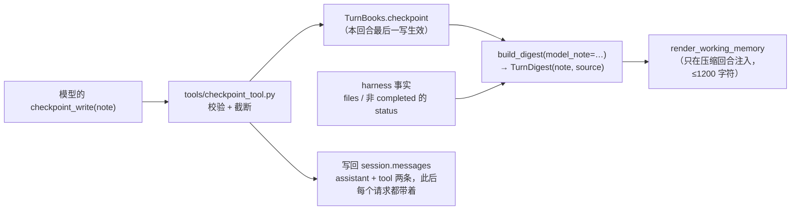
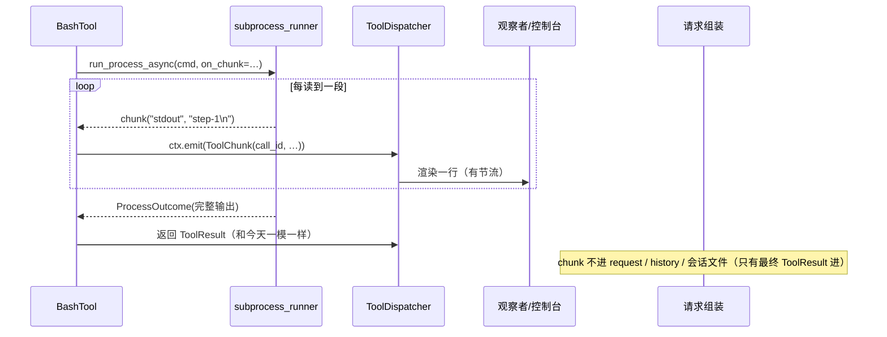
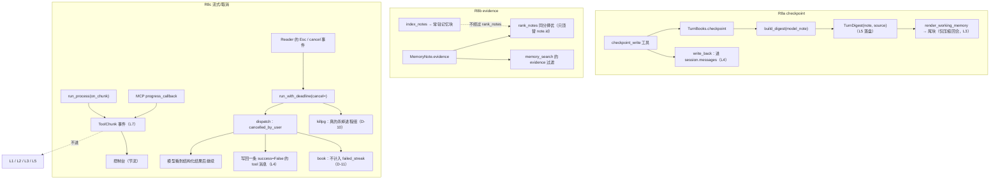

# AI-Coding — R8 分析方案（模型写的 checkpoint / evidence 参与排序 / 工具流式与取消）

> 定位：R7e 把优化菜单的 O2/O4/O5/O6 做完了。R8 处理 `docs/r7-backlog.md` 候选池里剩下的三条：
> **2.2 GA 式「模型写的 checkpoint」**、**2.5 `evidence` 参与召回排序**、**3.6 工具层流式输出 / 取消语义**。
> 与前几轮一样：先实测与代码核验（§1）、再对标（§2）、再逐个设计（§3），最后是逐文件步骤（§4）、
> 数据契约（§5）、数据流与图（§6）、TDD 用例（§7）、成功效果（§8）、自我核验（§9）、
> 待拍板决策点（§11）。
>
> **三个切片各自独立**（没有依赖，任意顺序都能单独上线）：
>
> | 编号 | 切片 | 一句话 | 风险 |
> |---|---|---|---|
> | **R8a** | 模型写的 checkpoint | 让模型自己写「这一轮该被记住的一行」，替掉 digest 行里的「结果那句话」（GA 的 `update_working_checkpoint`） | 中：会改易失尾块内容（仅压缩回合），且新增一次会写回历史的工具调用 |
> | **R8b** | `evidence` 参与排序 | 同分时偏向「有工具证据」的那条；顺带给 `memory_search` 加一个 `evidence` 过滤 | 低：只在**完全同分**时改变顺序 |
> | **R8c** | 工具流式 / 取消 | 长命令不再是一段黑屏；卡住的单次调用可以只取消它、不杀整个回合 | 高：要动 R2b 的子进程 runner 与终端按键 |
>
> **建议顺序：R8b → R8a → R8c**（最便宜的、最不可能翻车的先做）。R8c 内部再分三步交付：
> **S1 流式**（只做观感）、**S2 单次取消**（要动 dispatcher 与终端，并且必须处理 §3.3-S2.1/S2.2 的
> 两个副作用：真的杀进程、取消不计失败）、**S3 MCP 进度**（免费搭车）。
>
> 依据：`docs/r7-backlog.md` §2.2 / §2.5 / §3.6；`docs/r6-analysis.md` §1.4 的结论段（R6d 已经把
> 「`evidence` 只观测、未来做召回同分择优」写进结论）；`docs/r4a-genericagent-research.md` §4.2
> （GA 的记忆二件套：`update_working_checkpoint` / `start_long_term_update`）；`docs/r2-analysis.md`
> §1.3/1.4（为什么子进程 runner 现在长这样）；以及 §1 的本轮实测。
>
> **版本**：本文档是「先定影响范围、再动手」的那一版。首版（提交 `31233aa`）对渲染格式、
> `_better_of` 的排序键、取消的副作用有三处描述与代码不符，**已在 2026-09-28 逐条订正**；
> 订正清单与代码出处见 §9.1，决策点新增 D-10…D-14。

---

## 0. 结论先行

1. **R8a 的落点已经存在，缺的只是「谁写」**：`domain/turn_digest.py` 的 `TurnDigest` +
   `render_working_memory` 已经是「每轮一行、有界环、只在压缩回合注入」的形状。**订正**：今天那一行的
   「结果句」来自 `build_digest` 的 `one_line(outcome.text, 90)`（第 175 行）——也就是**模型这一轮
   最后那句话的截断**（模型一个字都没说时才退回 `_STATUS_LABEL` 状态标签）。R6 的不满意点是**重复**
   （模型最后那段话被截一遍又塞回环里），不是「harness 编了一句」。所以 R8a = **给 `TurnDigest` 加
   `note`/`source` 两个字段 + 一个 `checkpoint_write` 工具**；环、预算、注入时机，以及行内其它部分
   （`改了 …`、非 `completed` 时才出现的 status）**一个都不改**。**`open_items` 今天不渲染
   （第 105–117 行的 `render()` 里没有它），R8a 也不渲染它**——首版把 `open={n}` 写进了「现状格式」，
   是错的。
   还有两处首版漏写的影响面，见 §1.1 与 §3.1.1：这次工具调用会**写回 `session.messages`**
   （此后每个请求的 history 里都有它），并且会让该轮收割的 `evidence` 从 `model` 翻成 `tool`。
2. **R8b 比 backlog 里写的还要小**：按需召回的排序键是 `(-score, -relevance, note.id)`
   （`memory/relevance.py` 第 223 行），把 `evidence` 插在 `id` 前面就是全部改动——它顶掉的是一个
   **任意 tiebreaker**，所以是纯收益。**订正**：常驻尾块里的记忆块走
   `MemoryService.index_notes` / `render_index_block`（pinned 优先），**根本不经过 `rank_notes`**；
   所以 R8b 影响的是「按需召回」，不是「每轮都投喂的那块」。**实测**（§1.3）说明它的另一面：
   真正「完全同分」的情况很少，所以它的用户可见价值主要来自 **`memory_search` 的 `evidence` 过滤**，
   而 tie-break 是「几乎免费、偶尔救命」。**不做加分（boost）**——我们的 `evidence` 是**回合级**事实
   （那一轮有过成功工具调用），不是逐条验证，拿它加权会系统性偏向「用过工具的那一轮」写下的所有东西，
   包括用户说的话。
3. **R8c 的问题是真的、也是本轮唯一有拆装风险的**：实测（§1.4）一条 2.4 秒的命令，
   控制台只在开头看到 `ToolStarted`、**中间约 2.4 秒全黑**、结束时才 `ToolFinished`。
   修它要动 `infra/subprocess_runner.py`——R2b 花了很大力气才让它「线程一定会返回、
   杀进程组、超时后仍保留部分输出」，所以这一步必须**保住那三条不变量**，并用现有用例当回归网。
4. **取消要分两种，不能混**：今天有「回合钟到了 → 放弃这次调用」和「Ctrl-C → 整个回合中止」。
   R8c-S2 新增的是第三种：**只取消当前这一批工具调用**，回合继续，模型看到结构化的
   `error="cancelled_by_user"` 再决定下一步（Claude Code 的 Esc 就是这个语义，§2.2 有一手引文）。
   **订正**：首版只写了「放弃等待」，没有处理两个副作用——① 被放弃的**子进程还在跑**
   （`run_process_async` 是 daemon 线程 + 普通 future，取消 await 不会杀进程组，§3.3-S2.1）；
   ② 被取消的调用 `success=False`，会被记成失败，连着两次就够触发 `[strategy-gate]`（这是会写进
   历史的持久 nudge），三轮无成功还会以「no progress」提前收尾（§3.3-S2.2）。两条都必须有明确规则。
5. **缓存前缀纪律三条都不破**：checkpoint 的**渲染**只进易失尾块、只在压缩回合（它的**调用**会作为
   一次普通工具调用写回历史，那是新增内容，不是缓存问题）、`evidence` 只影响按需召回的排序、
   **流式 chunk 绝不进请求与历史**（这条会用「开/关 chunk 请求逐字节相同」的用例钉死）。
6. **预计 47 条新用例**（R8a 17 + R8b 9 + R8c 21），其中 2 条是门控真终端/真 stdio 用例
   （Esc 取消、MCP 进度）。比首版的 33 条多 14 条，多出来的全部是「订正带出来的」：
   写回历史、`evidence` 的连带变化、取消杀进程与不计失败、读线程排空、`stdin_data` 路径、
   reader 的单元级绑定。

### 0.1 执行范围（这一轮动多大）

| 维度 | 范围 |
|---|---|
| 新增文件 | `tools/checkpoint_tool.py`、`scripts/mcp_progress_server.py`、`scripts/r8_cases.py`、`docs/r8-plan.md`、3 个新测试文件（`test_tool_checkpoint.py`、`test_repl_cancel_pty.py`、`test_mcp_progress.py`） |
| 修改文件 | `domain/turn_digest.py`、`core/turn_books.py`、`core/turn_close.py`、`core/agent_loop.py`、`core/request_builder.py`、`tools/base.py`、`tools/builder.py`、`core/events.py`、`infra/deadline.py`、`infra/subprocess_runner.py`、`core/dispatch.py`、`core/mcp.py`、`tools/bash_tool.py`、`memory/relevance.py`、`memory/service.py`、`tools/memory_search_tool.py`、`ui/console.py`、`ui/reader.py`、`cli.py`、`config/models.py`（约 20 个） |
| **不动** | 压缩管线（R7b）、催收/收割的提取语义（R6d）、steering 的队列与投递点（R7e）、审批路径（R7c）、会话文件格式（除 `turnDigests` 的两个可选字段）、digest 行的渲染形状（除「结果句」那一段） |
| **被本次订正新点到的地方** | `core/agent_loop.py::_run_tools`（要收下 callable，今天它拿不到 `books`）、`_finish_turn` 里算 `evidence` 的那一处（新工具会污染它）、`core/turn_books.py::note_outcomes`（取消不算失败）、`memory/service.py::_better_of`（合并时留谁） |
| 规模 | 生产代码约 **+490 行**（R8a ≈130、R8b ≈40、R8c ≈320），测试约 **+1000 行** |
| 既有断言 | **一条都不打算改**。R8c-S1 改的是 `run_process` 内部实现，输出对象 `ProcessOutcome` 的字段与语义不变；新增的两条语义变更（取消不计失败、`evidence` 排除 checkpoint）只在今天不存在的两种情形上生效 |
| 新配置键 | 3 个：`working_memory_note_chars=120`（只在压缩回合生效）、`ui.tool_chunks=true`（新行为，可关）、`ui.cancel_key="escape"`（新行为），后两个见 D-8 / D-6 |
| 风险集中处 | **R8c-S1 的子进程 runner 改造**（有 R2 的回归用例兜底）与 **R8c-S2 的终端按键**（先跑 spike） |

---

## 1. 现状核验（本轮实测 + 代码出处）

### 1.1 checkpoint 的现状（代码核验）

| 事实 | 出处 |
|---|---|
| 每轮一行的结构 `TurnDigest(turn, request, outcome, status, files, open_items)` | `domain/turn_digest.py` 第 95 行起（`render` 在 105，`to_dict`/`from_dict` 在 119/133） |
| 「结果句」= `one_line(outcome.text, 90)`，即**模型这一轮最后那句话的截断**；模型一个字都没说时才退回 `_STATUS_LABEL` + `reason` | `build_digest` 第 164–186 行（`spoken = one_line(...)` 在第 175 行） |
| `render()` 只输出 `- t{n} {request} → {outcome}`，**可选**追加 `（改了 …）`，**仅在 status ≠ completed 时**追加 status；`open_items` 存着但**不进渲染** | `TurnDigest.render` 第 105–117 行（实测见下） |
| 有界环、只保留 `working_memory_keep=12` 条、随会话落盘（`turnDigests`） | `append_digest`、`SessionData.turn_digests` |
| 只有**本轮历史真被压缩**时才注入 `<working-memory>`，且总量 ≤ `working_memory_chars=1200` | `request_assembly.py` 第 94/109 行、`Compactor.did_compact`（R6a D-R6-2） |
| 每个**迭代**都重新渲染一次尾块，但 `compacted=False` 时渲染成空串；空块不进请求 | `volatile_block`（「空块 = 不进请求」，R7a） |
| 环里**没有**任何「谁写的」标记 | `TurnDigest.to_dict/from_dict` |
| 两个硬上限：请求 `DEFAULT_REQUEST_CHARS=60`、结果句 `DEFAULT_OUTCOME_CHARS=90` | 同文件第 53–54 行 |

**本轮实测（可复现）**：`request=28 字符 / outcome=16 字符` 时一行 **57** 字符；再挂两个真实文件路径
（`ai_coding/memory/relevance.py`、`tests/test_memory_relevance.py`）就变成 **123** 字符。环的**固定开销**
（`<working-memory>` 标签 + 「当前: 第 N 轮…」头部 31 字符 + `memory_search` 提示 36 字符）实测 **104**
字符，所以每行可用预算 `1200 - 104 = 1096`：57 字符的行能放 18 行（但**环上限是 12 条**），123 字符的
行只放得下 **8** 行。**一行有多长完全由内容与文件路径决定**。首版的「一条 harness 行 77 字符」与
§3.1 的「一行约 90–140 字符」是同一个量的两种说法、彼此矛盾，已删除；D-1 的取舍按下面的可算式重写。

**R6 的实测结论（引文）**：arm B 里模型自己说「这是照抄摘要，不是我知道的事」——这正是 R8a 的动机。

### 1.2 一个必须先讲清的取舍：两个写工具会打架吗

R7e 刚加了 `memory_write`（跨会话的耐久记忆）。再加 `checkpoint_write`（本会话的回合状态），
模型面对两个「写一句话」的工具，很容易用错。三条缓解写进设计：

1. **描述里写清作用域**：checkpoint = 「这个会话/下一步要用」；memory_write = 「下个会话还要用」；
2. **钱的算法不同**：checkpoint 的产出只在压缩回合注入，但它**本身是一批工具调用**——调用与结果会
   写回历史（§3.1.1），所以在被压缩之前它每轮都占一点 token；memory_write 也一样。区别在**终局**：
   环会自然淘汰，`.memory` 要人去删；
3. **写入路径不同**：checkpoint 进 `turnDigests`（有界环、会自然淘汰），memory_write 进 `.memory`（耐久、要人去删）。

### 1.3 evidence 的现状与实测

| 事实 | 出处 |
|---|---|
| `MemoryNote.evidence`（`"tool"` / `"model"` / `""`）由**回合级**事实决定：本回合至少一次工具调用成功 → `tool` | `core/memory_turn.py::harvest(..., evidence=...)`；R6d 的 D-R6-10 |
| 召回排序键：`(-score, -relevance, note.id)` | `memory/relevance.py::rank_notes` 末段 |
| `rank_notes` 只服务**按需召回**（`MemoryStore.search` → `memory_search` 工具 / `/memory search`）；每轮投喂的尾块走 `MemoryService.index_notes`（pinned 优先 + 600 字符预算），**不经过** `rank_notes` | `memory/store.py` 第 229 行、`memory/service.py` 第 196–242 行 |
| 合并近重复时的取舍键是 `(importance, hits, created_time)`——**不是**首版写的 `(importance, recency, id)`；`hits` 是一个真实参与判定的「被召回次数」信号 | `memory/service.py::_better_of` 第 574–580 行 |
| `evidence="tool"` 的判据是 `books.successful_calls`，**任何**工具成功都算 | `core/agent_loop.py` 第 475 行、`core/turn_books.py` 第 115–127 行 |
| `MemoryHarvested.evidence`、`/memory` 的 `by_evidence` 已经在观测里了 | `core/events.py`、`ui/repl.py::_memory_report` |
| R6 文档已经把「未来召回的同分择优」写进结论（**这不是新想法**） | `docs/r6-analysis.md`：「`evidence` 只用于观测与**排序倾向**……未来召回的同分择优」 |

**本轮实测（可复现）**：5 条 fixture（两条命中 + 三条噪声）跑 `rank_notes("构建用什么工具")`：

```
构建用 uv                 score=1.0653  relevance=1.0000   (evidence=model)
构建改用 uv，不要 poetry   score=0.7657  relevance=0.3871   (evidence=tool)
```

内容不同的两条**分数与相关性都不同**（coverage 打分对长度敏感）。但**近重复**就不一样：把同一条
复制一份、只把 `evidence` 换成 `tool`（文本、kind、importance、时间全同），两条都是
`score=0.8153 / relevance=1.0000`——**这时才轮到 tie-break 决定顺序**，而那正是「两条几乎一样」
这一档，也正是这个功能真正要管的情形。

诚实的结论：**tie-break 几乎不花钱，但只在近重复上开火**；`evidence` 对用户的价值更多在
「我能筛出『确实做过』的那些」——所以 R8b 的重点是**过滤**，tie-break 是顺手的纪律。
（首版写的 1.0750 / 0.7379 来自另一组更旧的时间戳 fixture，分数随 recency 变化；本版用上面这组
可复现的数字。）

（另一个事实：仓库根的 `.memory/` 是空的——记忆按 workspace 存，本轮跑出来的库都在临时目录里，
所以我没法给出「真实库里 evidence 的分布」；这一点在执行 §7 的真实用例时会补一次实测。）

### 1.4 工具流式 / 取消的现状与实测

| 事实 | 出处 |
|---|---|
| 工具执行只有一个 await，没有中间反馈 | `BaseTool.execute`、`dispatch._execute` |
| 超时语义已经很完整：`min(工具上限, 回合剩余)`，超时**放弃任务**并回结构化 `tool_timeout` | `core/dispatch.py::_call_budget/_execute`、`infra/deadline.run_with_deadline` |
| bash 走 `run_process`：`communicate()` **一次性拿全部输出**，超时才 `killpg`，部分输出保留 | `infra/subprocess_runner.py`（R2b） |
| 没有「只取消一次调用」的通道；Ctrl-C 是整回合 `ABORTED` | `core/agent_loop.py` |
| 工具已经有 `emit` 事件通道（`ToolContext.emit`），但没人用它推流 | `tools/base.py`、`core/request_builder.tool_context` |

**实测（改造前，本机；本次复核又跑过一遍）**：
`bash` 跑 `for i in 1 2 3; do echo step-$i; sleep 0.8; done`：

```
本次复核 : elapsed 2.41 s  | ToolStarted 0.00s, ToolApprovalRequested 0.00s, ToolFinished 2.41s
首版     : elapsed 2.43 s  | ToolStarted 0.05s, ToolApprovalRequested 0.05s, ToolFinished 2.43s
output   : 'step-1\nstep-2\nstep-3\n'
```

两次的形状完全一样：**开始即静默、结束才出声**——约 2.4 秒里控制台什么都没显示。这就是 R8c-S1 要治的病。

### 1.5 MCP 侧能不能顺手搭上（本轮核验）

| 事实 | 证据 |
|---|---|
| 客户端 `ClientSession.call_tool(..., progress_callback=...)` 存在 | 本机 `mcp` **2.2.0**：`inspect.signature` 里有 `progress_callback: ProgressFnT | None` |
| 服务端 `Context.report_progress(progress, total=None, message=None)` 存在 | `mcp.server.mcpserver.Context` 的公开方法里有它 |

也就是说 **S3（MCP 进度）不需要改架构**：适配器把 `progress_callback` 接上，转成同一种 chunk 事件；
而且我们**能自己写一个会报进度的 server**，让这条有可复现的真实用例（不是「只报告」）。

---

## 2. 外部对标（只写读到的一手材料）

### 2.1 GA：checkpoint 是**模型调用的工具**，不是 harness 的自动摘要

`docs/r4a-genericagent-research.md` §4.2 记录的 GA 工具集里，记忆类有两个：
**`update_working_checkpoint`（工作记忆）** 与 `start_long_term_update`（长期记忆），
论文口径是「这套工具集本身就是 harness」。我们 R7e 已经补了长期记忆那一半（`memory_write`），
**工作记忆这一半正是 R8a**。

我们**不照搬**的两点：GA 的 checkpoint 每轮都注入（我们没有那个预算，且 R6 的实测说明
「只在压缩回合注入」已经够用）；GA 靠 SOP 要求模型自觉写（我们在工具描述里写清「什么时候写」，
并把「不写」当作合法选择——现有的 harness 摘要仍然兜底）。

### 2.2 Claude Code：Esc = 打断这一次，而不是丢掉整个回合

本轮重新核验了官方 `interactive-mode` 文档（R7e 已抓过全文，这里取另一条）：

| 原文 | 对我们的意义 |
|---|---|
| 「**Esc** — Interrupt Claude … Stop the current response **or tool call** mid-turn so you can redirect. Claude **keeps the work done so far**」 | 取消的粒度是**当前这一步/这一次工具调用**，而不是整回合；已完成的工作必须保留 |
| 「Ctrl+C — Interrupt, or clear input. Interrupts a running operation」 | 整回合中止（我们已有：`TurnStatus.ABORTED` + 保留 `text`） |
| 「If you have messages queued, Claude Code sends them next」 | 取消之后紧接着的排队消息会被发出（我们 R7e 的 steering 已经保证：队列里的东西不会丢） |

所以 R8c-S2 的形状是：**Esc → 取消当前这一批工具调用 → 模型拿到 `cancelled_by_user` 的结果继续**，
而 Ctrl-C 保持今天的「整回合中止」不变。

---

## 3. 三个切片逐个设计

### 3.1 R8a —— 模型写的 checkpoint（GA 的 `update_working_checkpoint`）

**要解决的问题**：压缩之后模型看到的 `<working-memory>` 里，每一轮的「结果句」是**模型自己最后那句话的
90 字符截断**（`build_digest` 第 175 行）——它是写给用户看的总结，不是写给未来自己看的状态。harness 擅长
「发生了什么」（改了哪些文件、什么状态），不擅长「下一步我需要知道什么」；R6 的实测里模型自己指出了
这一点（「这是照抄摘要，不是我知道的事」）。

**契约**（只加两个字段 + 一个工具）：



1. `domain/turn_digest.py`：
   - `TurnDigest` 增 `note: str = ""` 与 `source: str = ""`（`"model"` / `"harness"`），
     `to_dict`/`from_dict` 各加两行（JSON 键 `note` / `source`，空值不写，老会话文件照常解析）；
   - `build_digest(..., model_note: str = "")`：`note` 非空时把它作为**结果那句话**，`source="model"`；
     否则照旧 `source="harness"`。**`outcome` 字段保留原值**——今天它装的是「模型最后那句话的截断」
     （模型沉默时是「状态标签 + 原因」），留给回放与排查，不参与渲染选择；
   - `render()`：**形状一个字符都不改**，只把结果那一格换成 `note or outcome`：
     `- t{turn} {request} → {note or outcome}`，可选 `（改了 {files}）`，仅当 status ≠ completed 时
     才有 status。**`open_items` 今天不渲染，这次也不渲染**（首版在「改前格式」里写了 `open={n}`，
     是错的，见 §9.1）；`source` 同样**不**渲染（省 8 字符/行）。
2. `core/turn_books.py`：`checkpoint: str | None = None` + `note_checkpoint(text)`
   （非空、`one_line` 规范化、截到 `working_memory_note_chars`、**后写覆盖前写**；同一批里多次调用时
   按它们在这条 assistant 消息里的顺序取最后一条，理由是**同一批里含不可并行工具就整批转串行**
   ——见 §5 的 `parallel_safe` 约定与 D-12）。
3. `tools/base.py` + `core/request_builder.py` + `core/agent_loop.py`：
   `ToolContext.note_checkpoint: Callable[[str], None] | None`，由 `_run_tools` 接到
   `books.note_checkpoint`（和 R7e 的 `turn` 同一条路：工具只能通过上下文影响回合状态）。
   **注意**：`_run_tools` 今天**拿不到 `books`**——它的调用点只传 step/session/task/history/
   instructions/deadline/index/turn（`core/agent_loop.py` 第 330–339 行与第 521 行的签名），
   所以要给它加一个参数。首版把这一步写成「照旧接线」，是漏项。
4. `core/turn_close.py`：`close(..., model_note=books.checkpoint)` → `build_digest`。
5. `tools/checkpoint_tool.py`（新）：`name="checkpoint_write"`，参数 `note`（必填，≤上限），
   描述写清「什么时候写」与「和 memory_write 的分工」，结果回显被存下的那句话（模型能自查）；
   ALLOW 档、`parallel_safe = True`；**只在组合根注册**。既有两种做法：`ask_user` 走
   `tools/builder.py` 第 139–150 行的 `include_subagent` 门；`memory_search` / `memory_write`
   在组合根 `cli.py` 第 447–456 行按需注册，那里的注释写明「a sub-agent stack never gets memory
   tools at all」。`checkpoint_write` 跟后者同一个位置（子智能体的会话是临时的，写没有意义）。
6. 配置：`ai.working_memory_note_chars: int = 120`。

**成本与取舍（可算，不再拍脑袋）**：环的固定开销实测 **104 字符**（标签 + 31 字符头部 + 36 字符提示），
每行可用 **1096** 字符。上限从 90 提到 120 只是把**每行上限**抬 30 字符——12 行最多多 360 字符
（约少装 2–3 行）；实际行数仍由内容决定：57 字符的行、12 条占 802 字符；123 字符的行、12 条占 1098
字符（只放得下 8 行）。环是「从新到旧、装不下就停」，被牺牲的是最旧的那几行。D-1 在 90 / 120 / 240
与「追加而不是替换」之间选。

#### 3.1.1 R8a 真正碰到的东西（订正：不止易失尾块）

| 内容层（§6.2 的编号） | 变化 | 什么时候可见 |
|---|---|---|
| L1 系统提示词 | 不碰 | — |
| **L2 持久历史** | 多一对 `assistant(tool_calls=[checkpoint_write])` + `tool` 消息（走 `TurnCloser.write_back` 的既有路径） | 从这一轮的**下一批**工具开始，直到被压缩 |
| L3 易失尾块（digest 行） | 「结果句」换成 note | **只在下一轮**、且那一轮的历史真被压缩时 |
| L5 会话文件 | `turnDigests` 多两个可选字段；`messages` 多两条 | 立刻落盘 |
| L6 记忆库 | **间接**：这一轮若只有 `checkpoint_write` 成功，`evidence` 会从 `model` 翻成 `tool`（D-14 决定是否排除） | 收割时 |
| L7 观测 | 多一组 `ToolStarted`/`ToolFinished`；`/tools` 列表 +1（约 330 字符，远低于 12000 阈值） | 立刻 |

两条时间上的事实（首版没写）：**① 第 N 轮写的 note，最早只能在第 N+1 轮的请求里出现**——digest 是在
`close()` 时追加的，它对写下它的那一轮零影响；**② 「易失」只对注入成立**——环在
`SessionData.turn_digests` 里落盘（`keep=12`），重启会话后仍在，只是不压缩就不注入。

### 3.2 R8b —— `evidence` 参与召回排序（同分择优 + 过滤）

**设计**：

1. `memory/relevance.py`：排序键从 `(-score, -relevance, note.id)` 变成
   `(-score, -relevance, _evidence_rank(note), note.id)`，其中
   `_evidence_rank = {"tool": 0, "model": 1, "": 1}`。它顶掉的是一个**任意 tiebreaker**
   （`note.id`）：只有分数与相关性完全相等时才改变顺序，所以是纯收益，不会扭曲召回。
   **范围**：只作用于 `MemoryStore.search` → `memory_search` / `/memory search`（按需召回）；
   每轮注入的尾块走 `index_notes`，**不经过**这里，所以「常驻上下文」的字节数不会因此变化。
2. `memory/service.py::_better_of`（合并近重复时决定留哪条）——**订正**：它今天的键是
   `(importance, hits, created_time)`（第 574–580 行）。`hits`（这条被召回过的次数）是真实参与判定的
   价值信号，`created_time` 也不是「任意 tiebreaker」，所以把 evidence 插进去**一定会改变某些今天不是
   平局的判断**：插在 `hits` 前，「importance 相同、hits 不同」的两条会改由 evidence 决定；插在
   `hits` 后，`created_time` 不同时结果仍会变。**建议：这次不动 `_better_of`**，只做第 1 条
   （那里有一个真正的任意 tiebreaker 可换）。若确实要动，必须显式声明被改变的那一档——见 D-13。
3. `tools/memory_search_tool.py`：新增 `evidence` 参数（`tool` / `model` / 空=不限），过滤命中；
   这是本轮**唯一用户可见**的 evidence 功能，描述里说明它回答的是「哪些是确实动过手的回合记下的」。
4. **不做**：`evidence` 加权重（§0 第 2 条的理由）、用 `evidence` 过滤收割（R6d 已裁决 D-R6-10）。

### 3.3 R8c —— 工具流式与取消

拆成三步，任何一步都可以单独停：

#### S1 流式：**只做观感**，绝不进上下文



1. `core/events.py`：`ToolChunk(call_id, tool_name, stream, text, seq)`。
2. `infra/subprocess_runner.py`：`run_process(..., on_chunk: Callable[[str, str], None] | None = None)`。
   **实现要点（保住 R2b 的三条不变量）**：
   - 收输出改成「两个 daemon 读线程 → `queue.Queue`」，主线程 `proc.wait(timeout)`；
     超时仍走 `killpg` + `kill_grace`，仍返回**部分输出**；
   - **`stdin_data` 必须自己走**：今天它是 `proc.communicate(input=payload)` 喂的（第 138 行），
     改成读线程后要显式 `proc.stdin.write(payload)` + `close()`，且只做一次。命令钩子走的就是这条路
     （`run_process(stdin_data=…)`），改错会静默弄坏它——首版完全没提这一条；
   - **`proc.wait()` 提前返回是一条新竞态**：今天只有在两个管道都 EOF 之后才返回，而子进程退出时
     孙进程可能还攥着管道。所以 `wait()` 之后要**有界地等读线程排空**（例如 `join(kill_grace)` 或等
     队列静默），再 `_close_pipes()`，最后用已收到的增量拼 `stdout/stderr`——否则会出现「进程退出了
     但输出被截断」这种今天不存在的行为，那是**新增破坏**，不是保持不变量；
   - 读线程是 daemon：即使有孙进程逃出进程组、还攥着管道，**返回的那个线程仍是 `wait` 的那个**，
     `kill_grace` 到点就 `_close_pipes` 返回；
   - `max_output_chars` 的语义要保住：今天是在**收集完之后**截断、并带 `total N chars` 尾巴
     （第 56–59 / 158–159 行）；改成增量累计后，返回时仍要按同一口径截断；
   - `on_chunk` 只从读线程调用，异常一律吞掉（观测不能弄坏执行）；
   - `run_process_async` 把 chunk 交回事件循环用 `loop.call_soon_threadsafe`（R2b 已经在用这条路径）。
3. `tools/bash_tool.py`：`on_chunk=lambda stream, text: ctx.emit(ToolChunk(...))`（`ctx.emit` 已存在）。
4. `ui/console.py`：渲染 `ToolChunk` 为一行，**按调用节流**（默认 0.15s 内最多一行，且单行截断）；
   `ToolFinished` 照旧打完整预览。
5. 配置：`ui.tool_chunks: bool = true`（关掉＝回到今天的一次性输出）。
6. **不变量用例**：开/关 chunk，请求与历史**逐字节相同**。

#### S2 取消：只取消当前这一批调用

1. `infra/deadline.py`：`run_with_deadline(..., cancel: asyncio.Event | None = None)`，
   内部 `asyncio.wait({task, cancel_waiter}, return_when=FIRST_COMPLETED, timeout=…)`；
   取消时执行与超时**同一套**「cancel + drain + 抛异常」逻辑，但抛的是新异常 `RunCancelled(label)`。
   ——这样「怎么放弃一个卡住的 await」只有一处实现（R2a 的既有纪律）。
2. `core/dispatch.py`：`ToolDispatcher(..., cancel: asyncio.Event | None = None)`；`_execute` 把
   `cancel` 交给 `run_with_deadline`；`RunCancelled` → 新增结构化结果
   `error="cancelled_by_user"`，输出告诉模型「用户中止了这次调用，请换做法或收尾」。
3. `core/agent_loop.py`：`AgentLoop(..., cancel=...)`；**每批工具开始前 `cancel.clear()`**
   （一次 Esc 只影响一批，不会把整个回合变成毒药）。
4. `ui/reader.py`：`InteractiveReader(..., cancel_key="escape")` 注册按键绑定（`prompt_toolkit`
   的 `KeyBindings`），把 `cancel_requested: asyncio.Event` 点着；`for_terminal` 负责装配。
5. `cli.py`：把同一个事件交给 `AgentLoop` 与 reader。
6. **Phase 0 spike（动手前，30 分钟）**：验证三件事——① 后台 reader 在 `prompt_async` 里，
   Esc 键绑定会不会触发；② 触发后提示行不被打断（`patch_stdout` 下继续可用）；
   ③ 事件置位后 `run_with_deadline` 的取消路径真的把卡住的 bash 放掉（用一条 `sleep 30` 的假工具）；
   ④ 同一条路径按 S2.1 真的把**进程组**杀掉了（`killpg(pid, 0)` 抛 `ProcessLookupError`）。
   任一项不过 → 只交付「程序化取消」（API/测试可用），终端的 Esc 记回 backlog。

##### S2.1 副作用一：取消必须真的杀掉子进程（D-10）

`run_process_async` 是把 `run_process` 丢进 daemon 线程、然后等一个**普通 future**（第 216–240 行）。
取消等待方只会**放弃等待**：线程继续跑、子进程组继续活到它自己的超时。所以照首版那样实现，Esc 的语义
是「不再等」，不是「停掉命令」——一条 `npm run dev` 会在后台一直跑，用户以为按了 Esc 就停了。
R2b 存在的全部理由就是「进程组可杀」，所以取消路径必须显式杀：

- 取消要能到达进程：`run_process(..., cancel: threading.Event | None = None)`（线程安全的
  `threading.Event`；`asyncio.Event` 只是它在事件循环这一侧的桥，不是同一个东西），
  `run_process` 在既有的超时分支之外再加一条「取消到点 → `_kill_group(proc)` + `_close_pipes()`」；
- 判据用例：取消之后 `os.killpg(pid, 0)` 抛 `ProcessLookupError`；返回的 `ProcessOutcome` 带的是
  取消语义（不是 `timed_out=True`）。

##### S2.2 副作用二：被取消的调用不能算「失败」（D-11）

被取消的调用 `success=False`，会被 `TurnBooks.note_outcomes` 记成失败：`failed_streak += 1` 并进
`failures`（`core/turn_books.py` 第 115–134 行）。而 `failed_streak_threshold=2` 会注入一条
`[strategy-gate]`——**这是会写进历史的持久 nudge**；`stall_iterations=3` 还会以「no progress」
提前结束回合（`core/turn_policy.py` 第 150–180 行）。那正好和「回合继续、已完成的工作保留」相反。
规则：

- `note_outcomes` 把 `error == "cancelled_by_user"` 的调用**排除在失败计数之外**——和「空批不是
  失败」同一条纪律：它既不是成功，也不是证据；
- 判据用例：连续两次取消后 `failed_streak` 仍是 0、没有 `[strategy-gate]`，回合也不是
  「no progress」收尾。

#### S3 MCP 进度：免费搭车

1. `core/mcp.py`：`MCPToolAdapter.execute` 调 `session.call_tool(name, params, progress_callback=…)`，
   把 `ProgressNotificationParams(progress, total, message)` 转成 `ToolChunk(stream="progress")`。
2. `scripts/mcp_progress_server.py`（新）：一个真 server，一个工具分 3 步调 `ctx.report_progress`，
   让 S3 有**可复现的真实用例**（不是「只报告」）。

---

## 4. 逐文件实现步骤（每步一个可独立审阅的增量）

> 全程 TDD：先红后绿；**不改既有断言**。每步结束跑
> `pytest tests/ -o addopts="" -q && ruff check . && mypy ai_coding`。

### 4.1 R8b（3 步，先做）

| 步 | 文件 | 动作 | 用例 |
|---|---|---|---|
| 1 | `memory/relevance.py` | `_evidence_rank` + 排序键（只顶替 `note.id`） | `tests/test_memory_relevance.py`（+4） |
| 2 | `memory/service.py` | **不改实现**：加一条回归用例钉住 `(importance, hits, created_time)`（D-13 的先决条件） | `tests/test_memory_service_v2.py`（+1） |
| 3 | `tools/memory_search_tool.py` | `evidence` 过滤参数（`tool` / `model` / 空=不限） | `tests/test_tool_memory_search.py`（+4） |

**回归红线**：`tests/test_memory_relevance.py` 既有用例（R3 的 case 2/9/10）必须**零改动**通过——
它们在分数/相关性不同的场景下，顺序不该被 tie-break 影响。

### 4.2 R8a（4 步）

| 步 | 文件 | 动作 | 用例 |
|---|---|---|---|
| 1 | `domain/turn_digest.py` | `note`/`source` 字段 + `render` + `build_digest(model_note=…)` | `tests/test_turn_digest.py`（+5） |
| 2 | `core/turn_books.py` | `checkpoint` + `note_checkpoint` | `tests/test_turn_books.py`（+3） |
| 3 | `tools/base.py`、`core/request_builder.py`、`core/agent_loop.py`、`core/turn_close.py` | 把 `note_checkpoint` 从工具接到 `build_digest`；`_run_tools` 加参数 | `tests/test_loop_digest.py`（+3） |
| 4 | `tools/checkpoint_tool.py`、`security/permission_gate.py`、`tools/builder.py`、`config/models.py` | 工具 + ALLOW + `parallel_safe` + 只在组合根注册 + 配置 | `tests/test_tool_checkpoint.py`（+5）、`tests/test_memory_turn_evidence.py`（+1） |

### 4.3 R8c（5 步）

| 步 | 文件 | 动作 | 用例 |
|---|---|---|---|
| 0 | —— | **Phase 0 spike**（Esc 键绑定 / 取消路径 / 进程组真的被杀） | 结论写进 `docs/r8-plan.md` |
| 1 | `core/events.py`、`infra/subprocess_runner.py` | `ToolChunk` + `on_chunk`（读线程 + 队列 + stdin 自写 + 有界排空） | `tests/test_subprocess_runner.py`（+7） |
| 2 | `tools/bash_tool.py`、`ui/console.py`、`core/mcp.py` | bash 推流 + 控制台节流 + MCP 进度 | `tests/test_tool_bash.py`（+1）、`tests/test_console_events.py`（+1）、`tests/test_mcp.py`（+1） |
| 3 | `infra/deadline.py`、`core/dispatch.py`、`core/agent_loop.py` | `cancel=` 一路贯通 + `cancelled_by_user` + 逐字节不变量 | `tests/test_deadline.py`（+1）、`tests/test_tool_dispatch.py`（+2）、`tests/test_loop_events.py`（+1）、`tests/test_agent_loop_react.py`（+1） |
| 4 | `infra/subprocess_runner.py`、`core/turn_books.py` | **取消杀进程组（D-10）+ 取消不计失败（D-11）** | `tests/test_subprocess_runner.py`（+1）、`tests/test_turn_books.py`（+1） |
| 5 | `ui/reader.py`、`cli.py` | Esc 绑定与装配 + 门控真终端用例 | `tests/test_ui_reader.py`（+2）、`tests/test_repl_cancel_pty.py`（门控 1） |
| 6 | `scripts/mcp_progress_server.py` + 验收 | 真 stdio 进度用例 | `tests/test_mcp_progress.py`（门控 1） |

### 4.4 收尾

`scripts/r8_cases.py`（离线 12 + 真实 3）+ 六份文档 + `docs/r8-plan.md` 的执行状态。

---

## 5. 数据契约变更汇总

| 契约 | 位置 | 变更 | 兼容性 |
|---|---|---|---|
| `TurnDigest.note` / `.source` | `domain/turn_digest.py` | 新增，默认 `""` | 纯新增（`from_dict` 缺失即空）；**存储持久（进会话文件），注入易失（仅压缩回合）** |
| `build_digest(..., model_note="")` | 同上 | 新增关键字参数 | 纯新增 |
| digest 行的**渲染形状** | `TurnDigest.render` | **不变**（只把结果那一格换成 `note or outcome`；`open_items` 仍不渲染） | 无变更；用例 #2 是钉子 |
| `ToolContext.note_checkpoint` | `tools/base.py` | 新增可选回调，默认 `None` | 纯新增 |
| `AgentLoop._run_tools(..., note_checkpoint=…)` | `core/agent_loop.py` | 私有签名新增参数（今天它拿不到 `books`） | 内部改动，无外部影响 |
| `AIConfig.working_memory_note_chars` | `config/models.py` | 新增，默认 120 | 纯新增 |
| `ToolChunk` 事件 | `core/events.py` | 新增（加入 `LoopEvent` 联合） | 纯新增 |
| `run_process(..., on_chunk=None)` / `run_process_async(..., on_chunk=None)` | `infra/subprocess_runner.py` | 新增关键字参数；**`ProcessOutcome` 不变** | 纯新增 |
| `run_process(..., cancel: threading.Event)` | 同上 | 取消**真的杀掉进程组**（S2.1 / D-10） | 纯新增；它是「Esc 之后命令不会留在后台」的判据 |
| `run_with_deadline(..., cancel=None)` + `RunCancelled` | `infra/deadline.py` | 新增参数与异常 | 纯新增 |
| `ToolResult.error="cancelled_by_user"` | `domain/message.py`（取值域） | 新增取值 | 纯新增 |
| `ToolDispatcher(..., cancel=None)` / `AgentLoop(..., cancel=None)` | `core/dispatch.py` / `core/agent_loop.py` | 新增关键字参数 | 纯新增 |
| `TurnBooks.note_outcomes` 的失败计数 | `core/turn_books.py` | `error == "cancelled_by_user"` 的调用**不计入 `failed_streak`、不进 `failures`**（S2.2 / D-11） | **语义变更**：只在用户按过 Esc 的回合上与今天不同 |
| `evidence` 的判据 | `core/agent_loop.py`（第 475 行） | `checkpoint_write` 不计入 `successful_calls` 的证据含义（D-14） | **语义变更**：只在「这一轮唯一的成功调用是 `checkpoint_write`」时不同 |
| `InteractiveReader(..., cancel_key="escape")` + `cancel_requested` | `ui/reader.py` | 新增 | 纯新增 |
| `memory_search.evidence` 参数 | `tools/memory_search_tool.py` | 新增可选过滤 | 纯新增 |
| `UIConfig.tool_chunks` / `cancel_key` | `config/models.py` | 新增，默认 `true` / `"escape"` | 纯新增（默认 = 新行为，见 D-8） |
| 新工具 `checkpoint_write` | `tools/checkpoint_tool.py` | `/tools` 列表 +1（约 330 字符）；`parallel_safe=True`、ALLOW、只注册在组合根 | 纯新增（工具面阈值 12000，实测还远） |

两条**不是新契约、但有行为后果**的既有路径（首版漏写，实施时最容易踩）：

1. `checkpoint_write` 的调用与结果会写回 `session.messages`（`TurnCloser.write_back`，第 134–150 行），
   所以它会作为一对 assistant/tool 消息进入此后每个请求的 history，直到被压缩——「只进易失尾块」
   说的是**渲染**，不是这次调用；
2. 被取消的调用同样会写回一条 `success=False` 的 tool 消息（同一条路径），所以「取消」也是会被记进
   历史的动作。**唯一不进请求/历史/会话文件的是 `ToolChunk`**——这正是用例 #12 要钉死的。

---

## 6. 数据流与架构图

### 6.1 内容层（本文件后面统一用这套编号）

| 层 | 是什么 | 出处 |
|---|---|---|
| **L1** | 系统提示词 `instructions`（静态，每次迭代重建，永不含记忆 / digest） | `core/agent_loop.py::_build_instructions` |
| **L2** | 持久历史 = `session.messages` 经 `Compactor.compress` 之后的 `history` | `core/request_assembly.py` 第 88 行 |
| **L3** | 易失尾块（每次迭代重渲染，作为 **user 消息**追加在 history 之后：memory → task → hook → digest） | `core/request_assembly.py` 第 105–122 行（tail 在 115 行组好） |
| **L4** | 写回的工具消息（L2 的子集：`assistant(tool_calls)` 的配对结果） | `core/turn_close.py::TurnCloser.write_back` |
| **L5** | 会话文件（`messages` / `task` / `turn_digests` / `turn_count` / 收割游标） | `SessionData` + `TurnCloser.save` |
| **L6** | 记忆库 `.memory`（note、evidence、索引） | `memory/service.py` |
| **L7** | 观测（`ToolStarted/Finished`、`ToolChunk`、budget ledger、trace）与控制台 | `core/events.py`、`ui/console.py` |
| **L8** | 在跑的子进程（不是「内容」，但 R8c 的成败在这里） | `infra/subprocess_runner.py` |

### 6.2 三个切片各自动到了哪一层（这张表就是「影响范围」）

| 切片 | L1 | L2 / L4 历史 | L3 易失尾块 | L5 会话文件 | L6 记忆库 | L7 观测 | L8 进程 |
|---|---|---|---|---|---|---|---|
| R8a checkpoint | — | **+1 对 assistant/tool 消息**（写回） | digest 行内容变，**仅压缩回合** | `turnDigests` +2 个可选字段 | 间接：`evidence` 可能从 `model` 翻成 `tool` | +ToolStarted/Finished | — |
| R8b evidence | — | — | **不碰**（尾块走 `index_notes`，不经过 `rank_notes`） | — | 按需召回的排序 + `memory_search` 过滤 | — | — |
| R8c 流式/取消 | — | 被取消的调用写回一条 `success=False` 的 tool 消息 | 间接：若不按 D-11 排除，会多出**持久**的 `[strategy-gate]` | 同 L2 | — | **+ToolChunk**（唯一不进 L1–L5 的东西） | **取消要真的杀掉进程组**（D-10） |

### 6.3 三个切片各自新增/改变的边



### 6.4 不变量（逐条，R8 之后仍然成立）

1. **观测只写不改**：`ToolChunk`、`ToolSurfaceWarning`、`InputSteered` 都不进请求；
   R8c 会用「开/关 chunk 请求逐字节相同」的用例钉死。
2. **缓存前缀纪律**：checkpoint 的**渲染**只进易失尾块，且仍只在压缩回合出现（R6a D-R6-2 不变）。
3. **子进程 runner 的保证**：今天的三条（线程一定返回、超时 `killpg` 到孙进程、超时后保留部分输出）
   一条不少，另加 R8c 的两条——**退出后先排空管道再返回**、**取消时同样 `killpg`**。
4. **一次 Esc 只影响一批**：`cancel` 在每批工具开始前清空，且取消不计入失败计数。
5. **`evidence` 不改分数**：只在完全同分时决定顺序，绝不越过分数更高的一条；合并
   （`_better_of`）这次**不动**。
6. **取消不丢工作**：整回合 Ctrl-C 仍然保留已完成的 `text`（R2/R6a 的既有行为）。

---

## 7. TDD 用例清单（47 条，含 2 条门控）

> 首版是 33 条。多出来的 14 条全部是「订正带出来的」：写回历史、`evidence` 的连带变化、
> 取消杀进程与不计失败、读线程排空、`stdin_data` 路径、reader 的单元级绑定。

### 7.1 R8b（9）

| # | 用例 | 文件 |
|---|---|---|
| 1 | 分数与相关性完全相同时，`evidence="tool"` 排在 `evidence="model"` 前面 | `test_memory_relevance.py` |
| 2 | 分数更高的一条**永远**不会被 tie-break 挤下去 | 同上 |
| 3 | 分数或相关性只要差一点点（不同分），evidence **不**参与 | 同上 |
| 4 | `evidence=""`（R6d 之前的老数据）与 `"model"` 同档，不受惩罚 | 同上 |
| 5 | `_better_of` 的既有判定 `(importance, hits, created_time)` **零改动**（回归钉子，D-13 的先决条件） | `test_memory_service_v2.py` |
| 6 | `memory_search(evidence="tool")` 只返回工具证据的命中 | `test_tool_memory_search.py` |
| 7 | `memory_search(evidence="model")` = 「非 tool」（含老数据的 `""`） | 同上 |
| 8 | `memory_search(evidence="")` 与今天完全一致 | 同上 |
| 9 | 未知 evidence 值 → 参数校验错误（不是静默放行） | 同上 |

### 7.2 R8a（17）

| # | 用例 | 文件 |
|---|---|---|
| 1 | `TurnDigest(note=...)` 渲染时用备注替代结果那句话 | `test_turn_digest.py` |
| 2 | harness 的事实（`改了 …`、非 completed 的 status）仍然出现；**`open_items` 仍然不出现**（订正首版的断言） | 同上 |
| 3 | `source` 记录 `model` / `harness`，且**不进**渲染文本 | 同上 |
| 4 | `to_dict`/`from_dict` 往返（含老会话缺字段） | 同上 |
| 5 | 空备注 → 与今天逐字节相同 | 同上 |
| 6 | `note_checkpoint` 截断到 `working_memory_note_chars` | `test_turn_books.py` |
| 7 | 后写覆盖前写（同一批按调用顺序取最后一条） | 同上 |
| 8 | 空白备注不生效 | 同上 |
| 9 | 工具写下的备注出现在 `session.turn_digests[-1].note` | `test_loop_digest.py` |
| 10 | 备注**不进**系统提示（`engine.instructions` 里没有它） | 同上 |
| 11 | **`checkpoint_write` 的调用与结果成对写回 `session.messages`**（订正新增） | 同上 |
| 12 | 工具缺 `note` → `missing_note`；超长 → 截断并说明 | `test_tool_checkpoint.py` |
| 13 | 工具回显被存下的那句话 | 同上 |
| 14 | 门卫 ALLOW；子智能体的栈里没有它（`include_subagent=False`） | 同上 |
| 15 | 同一批里两次 `checkpoint_write` → 取最后一条（与 `parallel_safe` 约定一致） | 同上 |
| 16 | 只有 `checkpoint_write` 成功的那个回合，收割的 `evidence` 仍是 `"model"`（D-14） | `test_memory_turn_evidence.py` |
| 17 | 非压缩回合的请求与今天逐字节相同（备注只在压缩回合渲染） | `test_loop_digest.py` |

### 7.3 R8c（21 = 19 + 2 门控）

| # | 用例 | 文件 |
|---|---|---|
| 1 | `run_process(on_chunk=…)` 按顺序吐出 stdout/stderr 片段 | `test_subprocess_runner.py` |
| 2 | 有 chunk 时 `ProcessOutcome` 的字段与原来**完全一致** | 同上 |
| 3 | 超时仍然 `killpg`、仍然返回部分输出（含已经吐出的 chunk） | 同上 |
| 4 | `on_chunk` 抛异常不影响进程执行与结果 | 同上 |
| 5 | 没有 `on_chunk` 时行为与今天逐字节一致 | 同上 |
| 6 | **有 `stdin_data` 时行为不变**（命令钩子那条路，订正新增） | 同上 |
| 7 | **子进程退出、孙进程仍攥着管道时，先有界排空再返回**（输出不被截断） | 同上 |
| 8 | **取消时子进程组真的被杀**（`os.killpg(pid, 0)` 抛 `ProcessLookupError`）（D-10） | 同上 |
| 9 | bash 工具把 chunk 转成 `ToolChunk` 事件 | `test_tool_bash.py` |
| 10 | 控制台对 chunk 节流（同一次调用 0.15s 内最多一行） | `test_console_events.py` |
| 11 | MCP 适配器把进度通知转成 `ToolChunk(stream="progress")` | `test_mcp.py` |
| 12 | 开/关 chunk，请求与历史逐字节相同 | `test_loop_events.py` |
| 13 | `run_with_deadline(cancel=…)`：事件置位 → 抛 `RunCancelled`，任务被取消并 drain | `test_deadline.py` |
| 14 | dispatcher：被取消的调用回 `cancelled_by_user`，**不**中断同批其它调用 | `test_tool_dispatch.py` |
| 15 | 取消事件在每批开始前被清空（一次 Esc 只影响一批） | 同上 |
| 16 | **被取消的调用不计入 `failed_streak`，也不进 `failures`**（D-11） | `test_turn_books.py` |
| 17 | 取消之后回合继续，模型看得到 `cancelled_by_user` 的结果 | `test_agent_loop_react.py` |
| 18 | reader 的 Esc 绑定点亮 `cancel_requested`（单元级，不依赖终端） | `test_ui_reader.py` |
| 19 | `for_terminal` 把**同一个**事件装配给 loop 与 reader | 同上 |
| **门控** | 真 pty：Esc → 卡住的工具被放掉、**进程组被杀**、回合继续（`AI_CODING_PTY=1`） | `test_repl_cancel_pty.py` |
| **门控** | 真 stdio：`scripts/mcp_progress_server.py` 的 3 次进度以 `ToolChunk` 到达 | `test_mcp_progress.py` |

---

## 8. 成功效果（改完之后，能指着说什么变了）

1. **压缩之后模型记得的东西更像「它自己知道的事」**：`<working-memory>` 里那一行来自模型，
   harness 只补「改了哪些文件 / 什么状态」（未完成项仍在会话文件里，只是**不进渲染**）——
   回放时 `source` 能告诉你是谁的版本。
2. **`evidence` 从「只能看」变成「能用」**：同分时偏向确实动过手的那条；
   `memory_search(evidence="tool")` 能直接问「哪些是做过之后记下的」。
3. **长命令不再是黑屏**：实测那约 2.4 秒的静默变成逐行输出（默认开启，可关）。
4. **卡住的调用可以只取消它，而且真的停得下来**：Esc → 那次调用回 `cancelled_by_user`（子进程组
   被 `killpg` 杀掉，不会留在后台），回合继续、已完成的工作保留，也不会被记成「工具失败」；
   Ctrl-C 仍然是「整回合中止」。
5. **MCP 的进度通知不再是死的**：适配器接上 `progress_callback`，自建 server 能证明它真的到了控制台。

---

## 9. 自我核验（这份方案哪里可能是错的）

1. **R8c-S1 是本轮唯一「改既有实现」的地方**，而 `run_process` 是 R2b 花了两轮才做稳的。
   我的理由是「读线程 + `wait` 线程」能保住那三条不变量（§3.3 写了具体机制），
   但**我没有先写出来跑过**。缓解：Task 1 的第一步就是把这些不变量写成**红测试**
   （超时杀孙进程、部分输出、线程一定返回、`stdin_data` 路径、退出后排空），再动实现；
   任何一条红不过就回滚这一步。
2. **Esc 键绑定没验证**：`prompt_async` 在后台任务里、输出正被 `patch_stdout` 重绘时按键能不能到，
   我不确定——这正是 R8c 的 Phase 0 spike。不通过就只交付程序化取消（API + 测试），
   终端按键记回 backlog，不会硬塞。
3. **备注上限 120 是拍的**（首版写 240 也是拍的）：这次至少给了一个可算的依据——环的固定开销实测
   104 字符、每行可用 1096；上限从 90 提到 120 只是每行多 30 字符，12 行最多多 360 字符。
   但「一行该多长」仍是经验值，D-1 给了 90 / 120 / 240 与「追加」四个选项。
4. **`evidence` 的 boost 我明确不做**，但理由不是「boost 没用」，而是「我们的 evidence 是回合级的，
   把它当逐条验证会误伤用户声明」——R6d 的实测支持这一点（最重要的一条记忆来自用户提示词）。
   如果你要 boost，需要一个**逐条**的证据来源，那是另一个设计。
5. **同分只在「近重复」上出现**（§1.3 实测：内容不同的两条分数差得很远；同文本、同元数据的两条
   分数完全相同）。所以 tie-break 会在它该开火的那一档开火，但整体上仍不常开火。我把过滤当成主要
   交付，把 tie-break 当纪律。如果你觉得「不常开火的功能不值得写」，砍掉 tie-break、只留过滤也成立。
6. **MCP 进度只有支持它的 server 才会发**：`server-everything` 未必发，所以我们自己写一个会发的
   （`scripts/mcp_progress_server.py`）。这只证明**我们的适配器**通了，不证明所有 server 都会报进度。
7. **流式的节流阈值 0.15s/行是拍的**，目的是「有反馈但不刷屏」；`ui.tool_chunks=false` 可关。
8. **用例数（47）是估的**；实施时只多不少，少了说明成功标准没定义清楚。
9. **我对 `_better_of` 的建议改过一次，理由写在这里**：首版说「把 evidence 插在 importance 之后」，
   核验后发现它的键是 `(importance, hits, created_time)`——`hits`（这条被召回过的次数）是真实参与
   判定的信号，插在它前面会让「importance 相同、hits 不同」的两条改由 evidence 决定，那就不再是
   「只在同分时」。所以订正后的建议是**这次不动 `_better_of`**；仍想动就看 D-13。

### 9.1 订正清单（相对首版 `31233aa`）

每条都对着代码核过，给出出处与判据；这一轮**只改文档，没有动任何代码**。

| # | 首版写的 | 代码事实 | 现在的写法 |
|---|---|---|---|
| 1 | digest 行格式 `… （{status}；改了 {files}；open={n}）` | `render()` 只在 status ≠ completed 时输出 status，**从不**输出 `open_items` | §0.1 / §1.1 / §3.1 / §7.2#2 全部订正，并把「仍不渲染」写成钉子 |
| 2 | 「结果那句话由 harness 拼」 | `build_digest` 的 `spoken = one_line(outcome.text, 90)` = **模型最后那句话的截断** | §0.1 / §1.1 / §3.1 改措辞，并说明 `outcome` 字段到底装什么 |
| 3 | 实测「一行 77 字符」与「一行 90–140 字符」并存 | 行长度由内容与文件路径决定（实测 57 / 123） | §1.1 换成可复现的三组数字 + 固定开销 104 |
| 4 | `_better_of` 的键是 `(importance, recency, id)` | 实际是 `(importance, hits, created_time)`，`hits` 真实参与 | §1.3 / §3.2 / §7.1#5 / D-13 订正；建议改为「不动」 |
| 5 | 「checkpoint 只进易失尾块」 | 工具调用还会写回 `session.messages`，此后每个请求都带着 | §3.1.1 新增影响面表；§7.2#11 新增用例 |
| 6 | 未提 checkpoint 与 `evidence` 的关系 | `successful_calls > 0 → evidence="tool"`，新工具会污染它 | §3.1.1 / D-14 / §7.2#16 |
| 7 | 「易失」没区分存储与注入 | 环落盘在 `turn_digests`（keep=12），重启会话后仍在 | §3.1.1 的「两条时间上的事实」 |
| 8 | §3.1 第 3 步写「`_run_tools` 照旧接线」 | `_run_tools` 今天拿不到 `books`（调用点第 330–339 行） | §3.1 第 3 步 + §5 的私有签名 +1 参数 |
| 9 | S1 只写「主线程照旧 `proc.wait`」 | 今天靠 `communicate()` 等两个管道 EOF；`wait()` 会引入截断竞态 | §3.3-S1 新增「有界排空」与 `max_output_chars` 口径 |
| 10 | S1 未提 `stdin_data` | 它是 `communicate(input=…)` 喂的，改造后要自己写并 close | §3.3-S1 新增该条 + §7.3#6 |
| 11 | S2 的「取消」= 放弃等待 | daemon 线程 + 普通 future：进程继续跑 | §3.3-S2.1 + D-10 + §7.3#8 |
| 12 | S2 未提失败计数 | 取消的调用被记成失败，两次就够触发持久的 `[strategy-gate]` | §3.3-S2.2 + D-11 + §7.3#16 |
| 13 | 用例数 33 | 订正带出 14 条新用例 | §7 = 47 条（17 + 9 + 21） |
| 14 | 决策点只有 D-1…D-9 | 缺取消杀进程、失败计数、`parallel_safe`、`_better_of`、evidence 污染 | §11 新增 D-10…D-14 |

### 9.2 核验实跑记录（本轮的证据）

行号 = 本次核验时的工作区状态（`31233aa` 之后，**没有改任何代码**，只改了本文档）。

| 断言 | 出处 | 观察到的事实 |
|---|---|---|
| digest 行格式 | `TurnDigest.render` 第 105–117 行 | `- t{turn} {request} → {outcome}`；`（改了 …）` 可选；status 仅非 completed 时出现；**无 `open_items`** |
| 「结果句」来自模型 | `build_digest` 第 175 行 | `spoken = one_line(outcome.text or "", outcome_chars)` |
| 环的固定开销与行预算 | `render_working_memory` 第 201–241 行 + 解释器实测 | 开销 **104** 字符；每行可用 **1096**；57 / 123 字符的行分别见下 |
| `_better_of` 的键 | `memory/service.py` 第 577–578 行 | `(importance, hits, created_time)` |
| 按需召回的排序键 | `memory/relevance.py` 第 223 行 | `(-score, -relevance, note.id)` |
| 常驻记忆块不走 `rank_notes` | `service.index_notes`（第 196 行）/ `store.search`（第 229 行） | 尾块走 `index_notes`；`rank_notes` 只被 `store.search` 调用 → 即 `memory_search` |
| `_run_tools` 拿不到 `books` | `agent_loop.py` 第 330–339 行（调用）与第 521 行（签名） | 参数表里没有 `books` |
| 取消 ≠ 杀进程 | `subprocess_runner.py` 第 216–240 行 | daemon 线程 + 普通 future；取消 await 只放弃等待 |
| 取消会被记成失败 | `turn_books.py` 第 115–134 行 + `turn_policy.py` 第 150–180 行 | `failed_streak += 1` → 2 次触发 `[strategy-gate]`；3 轮无成功 → no progress 收尾 |
| `evidence` 的判据 | `agent_loop.py` 第 475 行 | `evidence="tool" if books.successful_calls else "model"` |

```bash
.venv/bin/python - <<'PY'
from ai_coding.domain.turn_digest import (
    TurnDigest, build_digest, render_working_memory, WORKING_MEMORY_NOTE,
)
from ai_coding.domain.loop import TurnOutcome, TurnStatus
from ai_coding.domain.message import ToolArtifact

req, text = "把 evidence 接进召回排序，顺便补 csv 用例", "完成了记忆层的 evidence 排序接缝"
done = TurnOutcome(status=TurnStatus.COMPLETED, text=text)

print(len(build_digest(turn=7, user_input=req, outcome=done).render()))          # 57
print(len(build_digest(                                                         # 123
    turn=7, user_input=req, outcome=done,
    artifacts=[ToolArtifact(path=p) for p in
               ("ai_coding/memory/relevance.py", "tests/test_memory_relevance.py")],
).render()))
print(TurnDigest(turn=4, request="r", outcome="o", status="completed",     # - t4 r → o
                 open_items=3).render())                                  # 没有 open=

header = "当前: 第 13 轮（更早的消息已被压缩，以下是每轮一行摘要）"
overhead = (len("<working-memory>\n\n</working-memory>") + len(header) + 1
            + len(WORKING_MEMORY_NOTE) + 1)
print(overhead, 1200 - overhead)                                                # 104 1096
PY
```

本次实跑输出：`57` / `123` / `- t4 r → o`（没有 `open=`）/ `104 1096`。

---

## 10. 执行顺序与提交切分（建议）

| 顺序 | 提交 | 内容 | 可单独回滚 |
|---:|---|---|---|
| 1 | `docs(R8): the three candidates, measured` | 本文档的首版（`31233aa`） | 是 |
| 2 | `docs(R8): the impact is pinned to the layers` | 本次订正（§3.1.1 / §6.2 / §9.1 / D-10…D-14） | 是 |
| 3 | `docs(R8): the implementation plan` | `docs/r8-plan.md` | 是 |
| 4 | `R8b-1: evidence only breaks a tie` | 排序 + 过滤 + 合并的**回归钉子** + 测试 | 是 |
| 5 | `R8a-1: a turn's line can come from the model` | digest 字段与渲染 | 是 |
| 6 | `R8a-2: the loop carries the note` | books + 上下文 + `_run_tools` 参数 + close 接线 | 是 |
| 7 | `R8a-3: checkpoint_write` | 工具 + 门卫 + `parallel_safe` + 注册 + 配置 + evidence 排除 | 是 |
| 8 | `R8c-0: the cancel spike` | spike 结论（文档） | 是 |
| 9 | `R8c-1: the process runner can speak while it works` | on_chunk + ToolChunk + stdin / 排空回归 | 是 |
| 10 | `R8c-2: the console and MCP show progress` | bash 推流 + 节流 + MCP 进度 | 是 |
| 11 | `R8c-3: cancel one batch, not the turn` | deadline / dispatch / loop 贯通 + 逐字节不变量 | 是 |
| 12 | `R8c-4: Esc stops the process, not just the wait` | `killpg`（D-10）+ 取消不计失败（D-11） | 是 |
| 13 | `R8c-5: Esc asks for it` | reader 键绑定 + 门控 pty | 是 |
| 14 | `R8: the acceptance script, and the docs the round changed` | `scripts/r8_cases.py` + 六份文档 | 是 |

---

## 11. 待拍板决策点

| # | 问题 | 我的建议 | 备选 |
|---|---|---|---|
| **D-1** | checkpoint 备注的形态与上限 | **替换「结果那句话」+ 上限 120 字符**（harness 事实照旧追加；实测：环固定开销 104、每行可用 1096，上限抬 30 → 12 行最多多 360 字符） | 90（每行更短，模型能写的更少）；240（模型更自由，12 行最多多 1800 字符）；或「追加」而不是替换（一行变两行，环放得更少） |
| **D-2** | checkpoint 要不要同时写入 `.memory` | **不写**（回合状态 vs 耐久记忆是两件事；要耐久就用 `memory_write`） | 自动双写（会让环与记忆库出现同一条内容） |
| **D-3** | `evidence` 参与的范围 | **只改按需召回**（`rank_notes` 里顶替 `note.id`）；`_better_of` 这次**不动**（订正：它的键里没有任意 tiebreaker，见 §9.1#4） | 合并也加（必须声明会改变「importance 相同、hits 不同」的判定，见 D-13） |
| **D-4** | `memory_search` 加 `evidence` 过滤 | **加**（这是本轮唯一用户可见的 evidence 能力） | 不加（只留 `/memory` 的展示） |
| **D-5** | 流式怎么实现 | **改 `run_process` 让它边跑边说**（bash 才是用户等最久的那个） | 只接 MCP 进度（零风险，但 bash 仍然黑屏） |
| **D-6** | 取消的触发方式 | **Esc 键**（Claude Code 的语义）+ 程序化 API；不占用 `/` 命令（R7e 已定 `/` 行留到回合结束） | 只做 API，终端按键另开一轮 |
| **D-7** | 取消之后回合的状态 | **回合继续**（模型看到 `cancelled_by_user` 再决定）；Ctrl-C 仍整回合中止 | 取消即结束回合（会丢掉「换做法继续」的机会） |
| **D-8** | 流式与控制台默认 | `ui.tool_chunks` 默认 **true**（有节流，可关） | 默认 false（先做成 opt-in） |
| **D-9** | 节流阈值 | **0.15s/行**（够看清又不刷屏） | 0.05s（更实时）/ 0.5s（更安静） |
| **D-10** | 取消时要不要真的杀掉子进程组 | **要**：`run_process(cancel=threading.Event)` → `killpg` + 关管道；判据是 `killpg(pid, 0)` 抛 `ProcessLookupError`。否则 Esc 只是「不再等」，`npm run dev` 会留在后台 | 只停止等待（省一次线程安全改造，代价是进程泄漏，且与 R2b 的宗旨相反） |
| **D-11** | 被取消的调用算不算「工具失败」 | **不算**：`cancelled_by_user` 不进 `failed_streak`、不进 `failures`（与「空批不是失败」同一条纪律） | 算失败（两次 Esc 就会注入持久的 `[strategy-gate]`，`stall_iterations` 到点还会以 no progress 收尾，与「回合继续」矛盾） |
| **D-12** | `checkpoint_write` 的 `parallel_safe` 与同批多次调用 | **`parallel_safe = True` + 同批按调用顺序取最后一条**（与 `todo_write` / `memory_write` 同档） | `False`：含它的一批工具会整批转串行（最便宜的写操作拖慢整批） |
| **D-13** | `evidence` 要不要参与合并（`_better_of`） | **这次不动**（见 §3.2 第 2 条与 §9 第 9 条） | 插入 `(importance, evidence_rank, hits, created_time)`——须接受「importance 相同、hits 不同」的结果会变 |
| **D-14** | `checkpoint_write` 算不算「工具证据」 | **不算**：`evidence` 的判据排除它（它只写回合状态，不产生任何外部事实） | 算（沿用「任何工具成功即 tool」，代价是纯对话轮 + checkpoint 会被记成 tool 证据，而 D-3 的同分择优正好偏爱它） |

---

## 12. 文档同步清单

| 文档 | 要改的地方 |
|---|---|
| `docs/features.md` | 「回合摘要环」一节补 checkpoint；「记忆」一节补 evidence 过滤；工具一节补流式与取消；工具清单加 `checkpoint_write` |
| `docs/data-contracts.md` | `TurnDigest.note/source`、`ToolChunk`、`RunCancelled`/`cancelled_by_user`、`ToolContext.note_checkpoint`、`run_process(cancel=)`、`TurnBooks.note_outcomes` 的取消规则、3 个新配置键 |
| `docs/architecture.md` | 包结构补 `tools/checkpoint_tool.py`；数据流补 chunk / cancel / killpg 三条边；内容层编号（L1–L8）可以照抄 §6.1 |
| `docs/how-to-run.md` | 新增「R8 新增配置与行为」：Esc 取消（**会真的杀掉那条命令**）、流式开关、checkpoint 与 memory_write 的分工 |
| `docs/integration_testing.md` | `scripts/r8_cases.py` 怎么跑；两条门控用例（Esc、MCP 进度） |
| `docs/r7-backlog.md` | 2.2 / 2.5 / 3.6 三条划掉并指向本文 |

---

## 13. 明确不做（本轮写下来，免得下次再吵）

1. **不给 `evidence` 加分**（回合级证据不等于逐条验证；理由见 §0 第 2 条与 §9.4）。
2. **不用 `evidence` 过滤收割**（R6d 的 D-R6-10 已裁决）。
3. **不做工具输出的「半成品进上下文」**：chunk 永不进历史——模型只看最终 `ToolResult`
   （半成品进上下文会破坏配对、缓存与 L2/L3 的假设）。
4. **不做 Claude Code 式 `Ctrl+Enter`（sendNow）**：R7e 已明确只取「排队」那一半。
5. **不做后台工具执行**（tool 变成 job、回合结束再收）——那是另一个形态，本轮不碰。
6. **不做 SQLite/FTS5 与 RAG**：`evidence` 的排序接缝留在 `relevance.py`，向量化另开一轮。
7. **不加新的 `TurnStatus`**：取消是**调用级**结果（`ToolResult.error`），不是回合状态。
8. **不动 `_better_of`**（除非 D-13 被采纳）：它的键里没有任意 tiebreaker，加 evidence 一定会改变
   某些今天由 `hits` / `created_time` 决定的判定。
9. **不改 digest 行的渲染形状**：`open_items` 这次**不进**提示词。要进就单独开一轮，把「为什么值得
   每轮多花这些字符」说清楚，别顺手塞进去。
