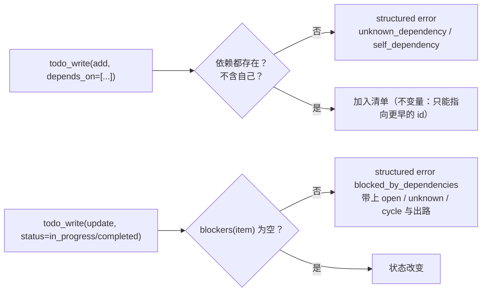
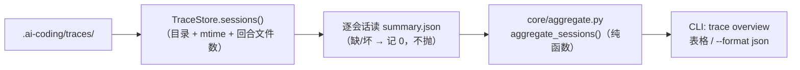
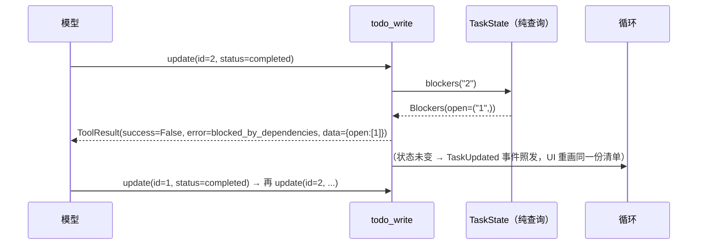
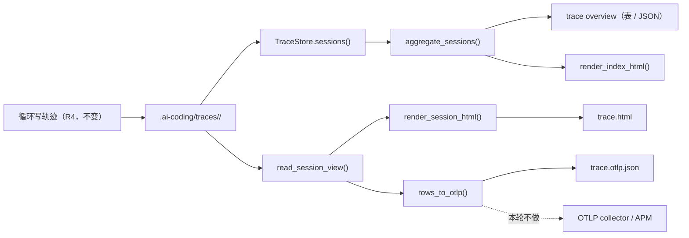

# AI-Coding — R9 分析方案（`depends_on` 硬门禁 / 观测三件）

> 定位：R8 收尾后，`docs/r7-backlog.md` 里还剩两条成规模的候选：**3.5 `depends_on` 硬门禁**
> 与 **5.1/5.2/5.3 观测三件**（OTLP 导出、跨会话聚合、轨迹查看器）。本文先核验现状（§1）、
> 对标（§2）、逐个设计（§3）、逐文件步骤（§4）、数据契约（§5）、数据流与图（§6）、
> TDD 用例（§7）、成功效果（§8）、自我核验（§9）、待拍板决策点（§11）。
>
> **两个切片互不依赖**，可分别上线：
>
> | 编号 | 切片 | 一句话 | 风险 |
> |---|---|---|---|
> | **R9a** | `depends_on` 硬门禁 | 有未完成依赖的条目不能被「开始」或「完成」；顺手堵住今天能造出来的**幽灵依赖 / 自依赖 / 环** | 中：会改变 `todo_write` 的返回（模型可见），但**不改**领域对象的语义 |
> | **R9b** | 观测：跨会话聚合 | `ai-coding trace overview`——把所有会话的 turns/steps/tokens/缓存命中合成一张表 + 总计 | 低：纯读，不改任何运行期行为 |
> | **R9c** | 观测：静态轨迹导出（5.3） | `ai-coding trace export --format html` 生成**单文件、离线可看**的轨迹页（含 span 树与预算） | 低-中：要处理 HTML 转义与体积 |
> | **R9d** | 观测：OTLP/JSON 导出（5.1） | `ai-coding trace export --format otlp-json`——把已有 span 树映射成 OTLP/JSON，**不装新依赖** | 中：字段映射要对得上 spec，且必须先做 D-R9-5 的选择 |
>
> **建议顺序：R9a → R9b → R9c → R9d**（先做最小、最独立、判据最硬的；导出层最后做，因为它依赖前两者
> 已经验证过的读取/聚合路径）。

---

## 0. 结论先行

1. **`depends_on` 今天有三个洞，而且它们必须一起堵**（实测，§1.1）：`todo_write` 的 `add` **不校验**
   依赖 id 是否存在，于是①可以写**正向引用**（`depends_on=["2"]` 而 2 还不存在），②可以造出
   **互指环**（先 `1 → 2`，再 `2 → 1`）与**自依赖**（`1 → 1`），③**完成一个被阻塞的条目今天是被允许的**。
   如果只做「硬门禁」而不做①②，模型会被**永久卡住**：环里的条目谁也完不成，谁也拿不到豁免。
   所以 R9a = **输入校验（add 时） + 状态门禁（update 时） + 明确的出路（错误信息里说清怎么办）**。
2. **不需要环检测算法**：只要 `add` 拒绝未知/自依赖，并且 `depends_on` **在创建后不可变**
   （今天 `TaskState.update` 与 `todo_write(update)` 都没有改依赖的入口），新数据就永远是一张
   「只能指向更早的 id」的 DAG——R1 当年把环检测列为不做硬门禁的理由（`docs/r1-analysis.md` §4.1），
   在加了输入校验之后**自然消失**。遗留/手改出来的环，出路是 `update(status="dropped")` 其中一个成员，
   这句话必须出现在错误信息里。
3. **门禁放在工具层，不放在领域对象里**：`TaskState.update()` 保持「数据结构什么都允许」，
   新增的是一个**纯查询** `blocking_dependencies(item_id)`；由 `todo_write` 把它翻译成结构化拒绝。
   这样 `tests/test_domain_task.py` 里那条「`depends_on=["9"]`（幽灵）也能 completed」的既有用例
   **一个字都不用改**（它是领域语义的钉子，不是策略）。
4. **观测三件里，真正缺的只有两样东西**：`TraceStore` 只有「按会话」的 API，没有「读全部会话」；
   以及没有任何导出器。轨迹本身**已经是 span 树**（`turn → i{n} → step{n} | {call_id}`，
   见 §1.2 实测），`summary.json` 也已经是每会话的累加器——**数据不用重做，缺的是视图**。
5. **5.3 推荐「静态单文件 HTML」而不是「本地 Web 服务」**：这个项目的依赖表只有
   `openai/mcp/pydantic/PyYAML/typer/rich/prompt-toolkit`（`pyproject.toml`），没有 web 栈；
   静态导出**零新依赖、可离线、可当附件发给别人**，而 server 能做的（点开看细节）用一页
   `<details>` + 内联 CSS 就能覆盖。真要 server，也可以在同一个渲染函数上再包一层。
6. **5.1 推荐「OTLP/JSON 文件导出」而不是「装 OTel SDK」**：先不加依赖，
   把 span 树映射成 OTLP/JSON（`resourceSpans → scopeSpans → spans`），用户自己喂给 collector/APM；
   真正的 OHTTP 发送留成后续（`--endpoint` 用 stdlib `urllib`），而 mapping 函数是两者共用的。
   **这条要你拍板**（D-R9-5），因为它的替代方案是「加两个依赖」。
7. **HTML 导出必须先转义**：轨迹里存着工具输出原文（已脱敏，但没转义），一条
   `echo '<script>…</script>'` 完全可能出现在里面。导出器把内容当**文本**写进 HTML，
   这是 R9c 第一条测试（§7.3）。
8. **预计 41 条新用例**（R9a 15 + R9b 9 + R9c 10 + R9d 7），另有 `scripts/r9_cases.py` 的离线验收。

### 0.1 执行范围（这一轮动多大）

| 维度 | 范围 |
|---|---|
| 新增文件 | `ai_coding/core/aggregate.py`（跨会话聚合，纯函数）、`ai_coding/core/export_html.py`、`ai_coding/core/export_otlp.py`、`scripts/r9_cases.py`、`docs/r9-plan.md`、3 个新测试文件 |
| 修改文件 | `ai_coding/domain/task.py`、`ai_coding/tools/todo_write_tool.py`、`ai_coding/tools/builder.py`、`ai_coding/config/models.py`、`ai_coding/core/trace.py`、`ai_coding/ui/trace_render.py`、`ai_coding/cli.py` |
| **不动** | 循环/策略/记忆/压缩/审批/steering；轨迹的**写入格式**（`v/ts/session/turn/span/parent/iter/evt/data` 一个字段都不改）；`<task-state>` 的渲染形状；`SessionData` 格式 |
| 规模 | 生产代码约 **+420 行**（R9a ≈80、R9b ≈70、R9c ≈150、R9d ≈120），测试约 **+800 行** |
| 既有断言 | **一条都不打算改**（`test_domain_task.py` 的幽灵依赖用例、`test_trace_*` 全部保持原样；R9a 的门禁在工具层，R9b–d 只新增读路径） |
| 新配置键 | 1 个：`ai.enforce_dependencies: bool = true`（可关，给遗留清单留退路） |
| 风险集中处 | R9c 的 HTML 转义与体积；R9d 的 OTLP 字段映射（要靠带期望字段的用例钉住） |

---

## 1. 现状核验（本轮实测 + 代码出处）

### 1.1 `depends_on` 今天的真实行为

| 事实 | 出处 / 判据 |
|---|---|
| `depends_on` 只是**渲染提示 + `focus()` 选择**，YAGNI 明确写着「不做硬门禁」 | `docs/r1-analysis.md` §4.1；`ai_coding/domain/task.py` 模块 docstring |
| `add` **不校验**依赖 id：未知 id 照收 | `tools/todo_write_tool.py::_add`（`deps` 直接进 `task.add`） |
| `unmet_dependencies` 把**不存在的 id 也算未满足**（幽灵依赖永远阻塞） | `domain/task.py::unmet_dependencies`（`target is None → 未满足`） |
| 被阻塞的条目**可以**被置为 `completed`（没有门禁） | 实测：`todo_write(update, id=2, status=completed)` 返回 `success=True` |
| `focus()` 在「全部被阻塞」时回退到第一个 open 项 | `domain/task.py::focus`；既有用例 `test_focus_falls_back_to_first_open` |
| 依赖**创建后不可变**：没有任何入口能改 `depends_on` | `TaskState.update` 的参数表（status/content/evidence/ts）；`todo_write` 的 schema 只在 `add` 上有 `depends_on` |

**本轮实测（可复现）**：

```
# ① 正向引用 + 互指环，今天都能造出来
todo_write(add, content="a", depends_on=["2"])   → success=True   # 2 还不存在
todo_write(add, content="b", depends_on=["1"])   → success=True   # 环：1→2→1
render:
  [ ] 1. a (blocked by 2)
  [ ] 2. b (blocked by 1)
  下一步: 1. a                      # focus 只能回退
# ② 完成被阻塞的条目，今天不拦
todo_write(update, id=1, status=completed)        → success=True
todo_write(update, id=2, status=completed)        → success=True
task.is_complete()                                → True
# ③ 自依赖，今天也能造
todo_write(add, content="self", depends_on=["1"]) → success=True   # 一个空清单里，新 id 就是 1
unmet_dependencies(item1)                         → ['1']
```

**结论**：R9a 不是「加一条 if」，而是「把依赖从一个装饰性字段变成一个有不变量的字段」——
输入校验（不变量：只能指向已经存在的、更早的 id）、状态门禁（不变量：未满足的依赖挡住开始/完成）、
以及出路（错误信息必须能指导模型走出去）。

### 1.2 轨迹的真实形状（观测三件的地基）

| 事实 | 出处 / 判据 |
|---|---|
| 存储布局：`<workspace>/.ai-coding/traces/<session_id>/`，内含 `summary.json` + 每回合一个 `turn-N.jsonl`（`--capture full` 时另有 `turn-N.full.json`） | `core/trace.py::TraceStore`；实测见下 |
| 一行 = 一个 span 标记：`{v, ts, session, turn, span, parent, iter, evt, data}` | 实测（脚本化回合） |
| span 树已经成型：`turn` → `i{n}`（迭代）→ `step{n}`（模型步）/ `{call_id}`（工具调用）；子智能体事件经 `ScopedEvent` 把 parent 指向子智能体那次调用 | `core/trace.py::_describe` |
| 时长不是每条都有：`ModelStepFinished.data.latency_ms`、`ToolFinished.data.duration_ms` 有；其余靠 `ts` 差值 | `core/trace.py::_describe` + 实测 |
| `summary.json` 是每会话的累加器：`{turns, steps, prompt_tokens, completion_tokens, cached_tokens}`，由 `_finish_turn` 增量合并 | `core/trace.py::_finish_turn`（第 502–522 行） |
| 读路径只有「按会话」：`session_dir / next_turn_number / summary_path / read_summary / update_summary / prune` | `core/trace.py`（没有任何跨会话 API） |
| CLI 只有 `trace list | show | budget`（都按会话），没有 overview / export | `cli.py::trace_command` |
| 剪枝用的是**会话目录的 mtime**（写新文件会更新目录 mtime） | `TraceStore.prune`（`entry.stat().st_mtime`） |

**本轮实测（一个脚本化 2 步回合，真实落盘）**：

```
session dir: 7bb5a3e66f734b31aedf6afe2361eafc     # 目录名 = 会话 id（不是用户给的标签）
  summary.json   79 B   {"turns": 1, "steps": 2, "prompt_tokens": 0, "completion_tokens": 0, "cached_tokens": 0}
  turn-1.jsonl 3091 B
span 0: {'v':1,'ts':...,'session':...,'turn':1,'span':'i1','parent':'turn','iter':1,'evt':'IterationStarted','data':{...}}
span 2: {'span':'step1','parent':'i1','evt':'ModelStepFinished','data':{'latency_ms':0, 'cached_tokens':None, ...}}
多回合：3 个回合的会话 → summary.turns=3 且目录里正好 3 个 turn-*.jsonl（不变量，见 §7.2 用例 5）
两次会话合计 5 个回合：8,925 B（含两个 summary.json）
```

也就是说：**5.2 缺的只是「读所有会话目录」这一步**，**5.3/5.1 缺的只是「把 JSONL 渲染成另一种视图」**。

### 1.3 现有读路径能复用什么

| 能力 | 位置 | R9 怎么用 |
|---|---|---|
| 单回合折叠成数字（span 数、工具、时长、tokens、缓存） | `ui/trace_render.py::summarize_turn` | HTML 的「回合摘要卡」直接复用；不再造第二个折叠器 |
| 文本渲染（`render_turn` / `render_budget`） | 同上 | CLI 的 `show/budget` 不变；`overview` 复用 `render_budget` 的措辞风格 |
| 会话目录枚举与 mtime | `core/trace.py::prune` 的写法 | 抽成 `TraceStore.sessions()`，`prune` 与 `overview` 共用「目录 mtime = 最后活动时间」的口径 |
| 脱敏 | 写入时已做（`Redactor`） | 导出**不重新脱敏**，只保证「不新增泄漏面」（HTML 转义、不引入外链、`--full` 默认关） |

---

## 2. 外部对标（只写读到的一手材料）

### 2.1 观测侧：GA 的四件事我们已经有四件，缺的是「出口」

`docs/r4a-genericagent-research.md` 把 GA 的观测拆成 O1–O6，我们逐条对过（§13 之外那张表）：
**O1 观测即插件**（我们就是 `LoopObserver`）、**O2 cache token 是硬指标**（我们记真值）、
**O3 span 树要显式**（`turn/i/step/tool/subagent`）、**O4 用量结构化**（per-turn ledger）、
**O5 轮转与上限**（`max_turn_bytes` + `retention_days` + `prune`）、**O6 hook 是第三方 APM 的挂点**。

**R4 当时明确不做**的三件正是今天的 5.1/5.2/5.3（`docs/r4-analysis.md` §16）。也就是说：
R9b–d 不是「补一个功能」，而是**把已经攒好的数据接上三个出口**——这也是为什么它们的风险都不高。

### 2.2 OTLP 的形状（5.1 的映射目标）

OTLP 的 JSON 编码是一棵三层信封：`resourceSpans[] → scopeSpans[] → spans[]`；每条 span 的字段是
`traceId` / `spanId` / `parentSpanId` / `name` / `kind` / `startTimeUnixNano` / `endTimeUnixNano` /
`attributes[{key, value:{stringValue|intValue|boolValue|doubleValue}}]` / `status{code}`。
我们的 `turn/span/parent/ts/evt/data` 正好能一一落上（`parent` → `parentSpanId`，
`evt` → `name`，`data` 的扁平值 → `attributes`）。

**两个必须说清的限制**：

* 我们没有真 span 的「结束时间」，只有 `latency_ms`（模型步）与 `duration_ms`（工具）；
  其余事件是**瞬时标记**，导出时按 `start = ts`、`end = ts`（+1ns）处理，并在属性里写明
  `ai-coding.instant = true`，免得读者把它当成一段耗时；
* `traceId`/`spanId` 在导出时**确定性地生成**（对 `session+turn+span` 做 sha256 截断），
  这样同一份轨迹导出两次是**逐字节相同**的（可测试、可 diff）；真正的 OTel SDK 是随机 id，
  这点差异要写在文档里，不能让人误以为和 SDK 的 id 语义一样。

### 2.3 查看器：为什么是静态 HTML

GA 走的是 Langfuse 那类**外部服务**（O1 的插件），我们不走：那需要网络、账号与一台服务器。
本项目的形态是 CLI，依赖表里一个 web 框架都没有。静态单文件 HTML 能满足 90% 的真实诉求
（「打开看看这一轮到底发生了什么」「把这条轨迹发给别人」「对比两轮的 token」），
而且**零依赖、离线、可进 git（可选）、可当附件**。要「活着刷新」的界面，就在同一个渲染函数上
包一层 `http.server`——那是后续，不是现在。

---

## 3. 逐个设计

### 3.1 R9a：`depends_on` 硬门禁

**要解决的问题**：依赖字段今天既能被写坏（幽灵/自依赖/环），又拦不住「跳过依赖直接完成」。



**契约**（全部在 `domain/task.py`，纯函数、无 IO）：

```python
@dataclass(frozen=True)
class Blockers:
    """Why an item cannot start/finish yet (R9a).  Empty = ready."""
    open: tuple[str, ...] = ()      # deps that exist and are not terminal yet
    unknown: tuple[str, ...] = ()   # deps whose target is gone (legacy / hand-edited)
    cycle: tuple[str, ...] = ()     # a blocking chain that comes back to this item

    @property
    def any(self) -> bool: ...

class TaskState:
    def blockers(self, item_id: str) -> Blockers: ...
    def dependency_invariant(self) -> tuple[str, ...]:
        """Ids that violate "a dep must be an earlier, existing id" (R9a 的验收口径)."""
```

**工具层的三条规则**（`tools/todo_write_tool.py`）：

1. `add`：`depends_on` 里每项必须①非空、②不是自己（新 id 尚未生成，所以只可能是调用方显式指定的
   id，我们仍校验）、③在当前清单里存在、④去重。违反 → `success=False`，`error="unknown_dependency"`
   或 `self_dependency`，`data={"depends_on": [...]}`；**清单不变**。
2. `update`：`status` 变成 `in_progress` 或 `completed` 时，先问 `task.blockers(id)`；
   非空 → `success=False`，`error="blocked_by_dependencies"`，
   `data={"id":…, "open":[…], "unknown":[…], "cycle":[…])`，**状态不变**。
   `pending/blocked/dropped` 一律不受门禁（取消与放弃永远允许）。
3. 开关：`ai.enforce_dependencies: bool = true`（构造 `TodoWriteTool(enforce_dependencies=…)`，
   由 `tools/builder.py` 从 `app_cfg.ai` 传；关掉 = 今天的行为）。

**错误信息要能指导模型走出去**（这是「硬门禁」和「死锁」的分界线）：

```
error: todo #2 还有未完成的依赖：1（进行中）
           若依赖已作废，先 update(id=1, status=dropped)；若链条成环（1 → 2 → 1），
           把其中一项 dropped 即可解锁。
```

**与既有行为的关系**：`<task-state>` 渲染不变（仍然显示 `(blocked by …)`），`focus()` 不变
（仍然优先无阻塞项），`TaskState.update()` **仍然宽松**（领域对象不做策略），
`tests/test_domain_task.py` 一条都不用改。

**为什么不需要环检测算法**：`add` 只能引用**已存在**的 id，而 `depends_on` 创建后不可变
（`TaskState.update` 与 `todo_write` 都没有改依赖的入口），所以新数据必然满足
「依赖 id < 自身 id」，是天然 DAG。`blockers()` 里那段 DFS **只**为遗留数据进行说明性诊断
（清单规模 ≤ 几十条，DFS 是 O(n·m) 的玩具复杂度），**不是**为了在正常路径上防环。

### 3.2 R9b：跨会话聚合（backlog 5.2）

**要解决的问题**：`summary.json` 只到会话粒度；「这个月一共烧了多少 token、缓存命中率如何、
哪个会话最贵」今天要人肉 `trace list` + 逐个 `trace budget`。



**契约**：

```python
@dataclass(frozen=True)
class SessionRow:
    session: str
    turns: int          # 来自 summary
    files: int          # 磁盘上的 turn-*.jsonl 数量（对账用）
    steps: int
    prompt_tokens: int
    completion_tokens: int
    cached_tokens: int
    age_days: float
    mismatch: bool      # turns != files：summary 与磁盘不一致（半写、手删、崩溃）

@dataclass(frozen=True)
class AggregateReport:
    rows: tuple[SessionRow, ...]
    totals: SessionRow  # session="(all)"，turns/steps/tokens 求和，age_days 忽略
    cache_ratio: float  # cached / prompt（prompt=0 → 0.0）
```

* `TraceStore.sessions()`：返回 `(session_id, mtime, turn_files)`；`prune()` 改用它，
  **口径统一为「目录 mtime」**（今天 prune 就是这么算的）。
* `aggregate_sessions(...)` **纯函数**：入参是已经读出来的行，不含 IO，所以表格/JSON/HTML
  三种输出共用一份数字，测试不需要磁盘。
* `--since DAYS`：按目录 mtime 过滤，与 `prune` 同口径（避免「prune 会删、overview 还显示」的错觉）。
* **对账不变量**：`turns == files`，不一致时 `mismatch=True` 并在表里打标——
  这条比多算 3 个 token 重要得多（它意味着那次运行崩在写摘要之前）。

### 3.3 R9c：静态轨迹导出（backlog 5.3）

**形态**：`ai-coding trace export --format html [--session ID | --all] [--out FILE]`
→ 一个自包含 HTML 文件（内联 CSS、无外部资源、无 JS 依赖），默认打到 stdout。

页面结构（`core/export_html.py`，两个纯函数）：

```python
def render_session_html(view: SessionView) -> str: ...   # 单会话：摘要卡 + 每回合 <details>
def render_index_html(report: AggregateReport, views: Sequence[SessionView]) -> str: ...  # 总览 + 各会话

@dataclass(frozen=True)
class SpanRow:            # 由 JSONL 直接映射，不做语义解释
    ts: str; span: str; parent: str; iter: int; evt: str; data: dict[str, Any]
```

* **复用 `summarize_turn`**：回合卡的数字（span 数 / 工具 / 时长 / tokens / 缓存）不再造第二份逻辑。
* **转义是第一条测试**：`html.escape` 覆盖每个动态字符串（会话 id、工具名、参数、输出预览）。
  轨迹里存着工具输出原文，`<script>` 完全可能出现。
* **默认不含 `turn-N.full.json`**（消息全文）：`--full` 显式打开，且页面上会标注「本页含消息全文」。
* **体积**：内联 CSS ≈ 2KB；每回合 ≈ JSONL 的 1.5–2×（实测 JSONL 1.4–3.1KB/回合）。
  验收判据：50 回合的合成会话 < 1MB（§7.3）。
* 无 JS：折叠用 `<details>/<summary>`，排序在导出时定死（`ts` 顺序）。

### 3.4 R9d：OTLP/JSON 导出（backlog 5.1）

**形态**：`ai-coding trace export --format otlp-json [--session ID | --all] [--out FILE]`
→ OTLP/JSON（`resourceSpans → scopeSpans → spans`），可直接喂 collector / Langfuse / Jaeger 的
OTLP-JSON 摄入口。**本轮不发 HTTP**（D-R9-5 拍板后可能加 `--endpoint`，用 stdlib `urllib`）。

映射规则（`core/export_otlp.py`，纯函数 `rows_to_otlp(...) -> dict`）：

| 轨迹字段 | OTLP 字段 | 说明 |
|---|---|---|
| `session` | `resource.attributes["ai-coding.session"]` | 一个会话一个 `resourceSpans`，`service.name="ai-coding"` |
| `turn` | `spans[].attributes["ai-coding.turn"]` | 也用于 `traceId` 的确定性生成 |
| `span` / `parent` | `spanId` / `parentSpanId` | 由 `sha256(session|turn|span)` 截断而成；`turn` 作为根 span 没有 parent |
| `evt` | `name` | 事件名就是 span 名：按 `span` 分组后取该 span **ts 最早**的事件名（tie 按写入顺序；`IterationStarted` / `ModelStepFinished` / `ToolStarted` / `TurnFinished`）；整串事件在 `ai-coding.events` 属性（A-13 之前误把整串拼进了 `name`） |
| `ts` | `startTimeUnixNano` | ISO-8601 → 纳秒 |
| `data.latency_ms` / `data.duration_ms` | `endTimeUnixNano = start + 时长` | 没有时长的事件标 `ai-coding.instant=true`，`end = start + 1ns` |
| `data.*`（扁平） | `attributes` | `stringValue` / `intValue` / `boolValue` / `doubleValue`；嵌套值降级为 JSON 字符串 |
| `data.error`（工具失败） | `status.code = 2`（ERROR） | 其余 `code = 0`（UNSET） |

**确定性**：同一份输入导出两次**逐字节相同**（id 是算出来的，不是随机的）——这既是测试判据，
也让人可以 `diff` 两次导出。

---

## 4. 逐文件实现步骤（每步 TDD：先红 → 最小实现 → 跑绿）

> 详细到「一行改什么」的版本会在你拍板后写进 `docs/r9-plan.md`；这里给的是**每个文件的改动清单
> 与顺序**，以及每一步的判据。

### 4.1 R9a（4 步）

| 步 | 文件 | 改什么 | 判据 |
|---|---|---|---|
| 1 | `domain/task.py` | 新增 `Blockers` 冻结数据类 + `TaskState.blockers(item_id)`：`open`＝存在但非终态的依赖；`unknown`＝目标缺失的依赖；`cycle`＝从该条目出发、沿「非终态依赖」走能回到自己的链（DFS，只在拒绝时用）。新增 `dependency_invariant()` 报告「依赖不是更早存在的 id」的条目。**`update()` 与 `unmet_dependencies()` 一个字不改。** | `tests/test_domain_task.py` 新增 6 条全绿，**既有 18 条零改动** |
| 2 | `tools/todo_write_tool.py` | 构造器加 `enforce_dependencies: bool = True`；`_add` 校验依赖（存在 / 非空 / 不重复；自依赖在 `add` 里报 `self_dependency`）；`_update` 在 `status ∈ {in_progress, completed}` 且开关打开时先查 `blockers()`，非空即拒绝（`blocked_by_dependencies`，`data` 带 `open/unknown/cycle`，输出里写清三条出路）。`pending/blocked/dropped/clear` 不受影响。 | `tests/test_tool_todo_write.py` 新增 9 条；既有用例零改动 |
| 3 | `tools/builder.py`、`config/models.py` | `ai.enforce_dependencies: bool = True`；`builder` 构造 `TodoWriteTool(enforce_dependencies=…)`（`getattr` 取，配置缺失时默认开） | `tests/test_builder.py` +1：默认开、显式关 |
| 4 | 验收 | `scripts/r9_cases.py` 加 4 条离线 case（挡住开始 / 挡住完成 / 解锁 / 幽灵与自依赖被拒） | 脚本离线全绿 |

**数据流影响（R9a）**：`todo_write` 的结果对象多出 `blocked_by_dependencies` 等错误码 →
它作为一条 tool 消息进历史（模型看到后改计划）→ `<task-state>` 与 `[task-gate]` 的既有节奏不变。
**会话文件格式不变**（没有新字段）；**没有任何新事件**。

### 4.2 R9b（3 步）

| 步 | 文件 | 改什么 | 判据 |
|---|---|---|---|
| 1 | `core/trace.py` | 新增 `SessionRef`（`session`/`path`/`mtime`/`turn_files`）与 `TraceStore.sessions()`；`prune()` 改用它（**口径：目录 mtime**，与今天一致） | `tests/test_trace_store.py` +4：枚举、忽略非目录、mtime 语义、prune 行为不变 |
| 2 | `core/aggregate.py`（新） | `SessionRow` / `AggregateReport` / `aggregate_sessions(rows, *, now=None) -> AggregateReport`；纯函数：求和、`cache_ratio`、`mismatch = turns != files`；缺/坏 summary 记 0 | `tests/test_trace_aggregate.py` +5（纯函数，不碰磁盘） |
| 3 | `cli.py`、`ui/trace_render.py` | `trace overview [--since DAYS] [--format table|json]`；表格渲染放 `ui/trace_render.py::render_overview`，沿用 `render_budget` 的风格 | `tests/test_cli_trace.py` +4（表格、JSON、--since、空目录不报错） |

**数据流影响（R9b）**：纯读。`overview` 不写任何文件（除 stdout），**不碰**循环、会话、请求。

### 4.3 R9c（3 步）

| 步 | 文件 | 改什么 | 判据 |
|---|---|---|---|
| 1 | `core/export_html.py`（新） | `SpanRow` / `SessionView` + `read_session_view(store, session, *, full=False)`（读 JSONL → 视图）+ `render_session_html(view)`：内联 CSS、`<details>` 折叠、复用 `summarize_turn` 的数字、**每个动态字符串 `html.escape`** | `tests/test_trace_export_html.py` +6（转义、结构、无外链、默认不含全文、数字一致、确定性） |
| 2 | `core/export_html.py` | `render_index_html(report, views)`：total 卡 + 每会话行（复用 §4.2 的 `AggregateReport`） | 同上 +2 |
| 3 | `cli.py` | `trace export --format html [--session ID | --all] [--out FILE] [--full]`；`--out` 缺省时写 stdout | `tests/test_cli_trace.py` +2（写文件、未知会话报错而不是 traceback） |

**数据流影响（R9c）**：纯读 + 纯渲染；唯一的风险面是**转义**与**体积**，两条都有用例钉住。

### 4.4 R9d（2 步）

| 步 | 文件 | 改什么 | 判据 |
|---|---|---|---|
| 1 | `core/export_otlp.py`（新） | `rows_to_otlp(sessions: Sequence[SessionView], *, service_name="ai-coding") -> dict`：三层信封、确定性 id、时间映射（`latency_ms`/`duration_ms` → end，其余 `instant=true`）、attributes 类型映射、失败 → `status.code=2` | `tests/test_trace_export_otlp.py` +6 |
| 2 | `cli.py` | `trace export --format otlp-json`（复用第 2 步的 `--session/--all/--out`） | `tests/test_cli_trace.py` +1（确定性：跑两次输出相同） |

**数据流影响（R9d）**：同 R9c（纯读）。**不做**网络发送（D-R9-5）。

---

## 5. 数据契约变更汇总

| 契约 | 位置 | 变更 | 兼容性 |
|---|---|---|---|
| `Blockers`（冻结数据类） | `domain/task.py` | 新增 | 纯新增 |
| `TaskState.blockers(item_id) -> Blockers` | 同上 | 新增纯查询 | 纯新增（`update()` 语义不变） |
| `TaskState.dependency_invariant() -> tuple[str, ...]` | 同上 | 新增诊断 | 纯新增 |
| `TodoWriteTool(enforce_dependencies=True)` | `tools/todo_write_tool.py` | 新构造参数 | 默认值 = 新行为，可用 `ai.enforce_dependencies` 关掉 |
| 错误码 `unknown_dependency` / `self_dependency` / `blocked_by_dependencies` | 同上 | 新增取值 | 纯新增（`ToolResult.error` 一直是个开放字符串域） |
| `AIConfig.enforce_dependencies: bool = true` | `config/models.py` | 新增 | 纯新增 |
| `SessionRef` / `TraceStore.sessions()` | `core/trace.py` | 新增 | 纯新增；`prune()` 行为不变（同口径重构） |
| `SessionRow` / `AggregateReport` / `aggregate_sessions()` | `core/aggregate.py`（新） | 新增 | 纯新增 |
| `SpanRow` / `SessionView` / `read_session_view()` / `render_session_html()` / `render_index_html()` | `core/export_html.py`（新） | 新增 | 纯新增 |
| `rows_to_otlp()` | `core/export_otlp.py`（新） | 新增 | 纯新增 |
| CLI `trace overview` / `trace export` | `cli.py` | 新增子动作 | 纯新增（`list/show/budget` 不变） |
| **轨迹写入格式** | `core/trace.py` | **不变** | 老轨迹文件照常可读 |

---

## 6. 数据流与架构图

### 6.1 R9a：一条拒绝怎么走完整条链



### 6.2 R9b–d：一个数据源，三个出口（全部只读）



**不变量**（R9 之后仍然成立）：

1. **观测只读**：`overview`/`export` 不写轨迹、不写会话、不改任何请求（与 R4 的 P1 同一条纪律）。
2. **轨迹格式冻结**：`v/ts/session/turn/span/parent/iter/evt/data` 一个字段不加不改。
3. **脱敏不重来、不新增泄漏面**：导出直接渲染磁盘上的内容（写入时已脱敏）；HTML 必须转义；
   默认不含消息全文。
4. **对账优先于求和**：`summary.turns` 与磁盘回合数不一致时必须显式标出（`mismatch`），不能静默相信。
5. **依赖不变量**：新数据里 `depends_on` 只能指向更早存在的 id（`add` 校验保证）；门禁只读这个不变量。

---

## 7. TDD 用例清单（41 条）

### 7.1 R9a（15）

| # | 用例 | 文件 |
|---|---|---|
| 1 | `blockers(id)` 对无依赖 / 依赖已终态的条目返回空 | `test_domain_task.py` |
| 2 | `blockers(id)` 列出现存但未完成的依赖 | 同上 |
| 3 | `blockers(id)` 把「目标已不存在」的依赖列进 `unknown` | 同上 |
| 4 | `blockers(id)` 能识别「沿依赖链回到自己」的遗留环 | 同上 |
| 5 | `dependency_invariant()` 报出未知 id / 自依赖 / 非更早 id | 同上 |
| 6 | 回归钉子：`render()` 的 `(blocked by …)` 与 `focus()` 的优先无阻塞不变 | 同上 |
| 7 | `add` 带未知依赖 → `unknown_dependency`，清单不变 | `test_tool_todo_write.py` |
| 8 | `add` 自依赖 → `self_dependency` | 同上 |
| 9 | `add` 的依赖去重（同一 id 写两次只留一个） | 同上 |
| 10 | `update→completed` 被未完成依赖挡住（状态不变、error 带 open ids） | 同上 |
| 11 | `update→in_progress` 同样被挡住 | 同上 |
| 12 | 依赖完成之后可以 `completed`（happy path） | 同上 |
| 13 | 把依赖 `dropped` 之后解锁 | 同上 |
| 14 | `pending/blocked/dropped` 一律不受门禁 | 同上 |
| 15 | `enforce_dependencies=False` 时退回今天的行为 | 同上 |

### 7.2 R9b（9）

| # | 用例 | 文件 |
|---|---|---|
| 1 | `TraceStore.sessions()` 列出会话目录、mtime 与回合文件数（忽略非目录） | `test_trace_store.py` |
| 2 | 新写一个回合文件会刷新目录 mtime（`--since`/`prune` 同口径的依据） | 同上 |
| 3 | `prune()` 的行为与重构前一致（既有用例继续绿） | 同上 |
| 4 | `aggregate_sessions` 求和会话数 / turns / steps / 三种 tokens | `test_trace_aggregate.py` |
| 5 | `cache_ratio` = cached/prompt；prompt=0 时为 0.0 | 同上 |
| 6 | 缺 `summary.json` → 该行计 0、`files` 仍计数、`mismatch=True` | 同上 |
| 7 | 损坏的 `summary.json`（非 JSON / 非对象）不抛，按上一条处理 | 同上 |
| 8 | `--since` 过滤按目录 mtime；rows 排序确定（mtime 倒序 → session id） | 同上 |
| 9 | `overview --format json` 的键与类型稳定（可被脚本消费） | `test_cli_trace.py` |

### 7.3 R9c（10）

| # | 用例 | 文件 |
|---|---|---|
| 1 | 工具输出里的 `<script>` 被转义成文本，不产生标签 | `test_trace_export_html.py` |
| 2 | 会话 id / 工具名 / 参数同样被转义 | 同上 |
| 3 | 默认不含 `full payload`；`full=True` 时才含消息全文 | 同上 |
| 4 | 页面里没有任何外部资源（`http(s)://`、`<script src`、`<link href`） | 同上 |
| 5 | 每回合一个 `<details>`，其数字与 `summarize_turn` 一致 | 同上 |
| 6 | 同一输入两次渲染逐字节相同 | 同上 |
| 7 | index 页含总计与每会话一行（复用 `AggregateReport`） | 同上 |
| 8 | 50 回合的合成会话渲染 < 1MB | 同上 |
| 9 | CLI `export --format html --out F` 写文件；无 `--out` 走 stdout | `test_cli_trace.py` |
| 10 | 未知会话 → 结构化错误信息（不是 traceback） | 同上 |

### 7.4 R9d（7）

| # | 用例 | 文件 |
|---|---|---|
| 1 | 三层信封（resourceSpans/scopeSpans/spans）与 `service.name` | `test_trace_export_otlp.py` |
| 2 | `spanId`/`parentSpanId` 关系正确（`turn` 无 parent，`i1` 的 parent 是 `turn`） | 同上 |
| 3 | `ts` → `startTimeUnixNano`；`latency_ms` → `endTimeUnixNano` | 同上 |
| 4 | 无时长的事件 `instant=true` 且 `end = start + 1ns` | 同上 |
| 5 | attributes 类型映射：str/int/bool/double；嵌套 → JSON 字符串 | 同上 |
| 6 | 工具失败 → `status.code = 2` | 同上 |
| 7 | 同一输入两次导出逐字节相同；CLI `--format otlp-json` 可用 | 同上 + `test_cli_trace.py` |

---

## 8. 成功效果（改完之后，能指着说什么变了）

1. **依赖字段从「装饰」变成「不变量」**：`todo_write` 再也写不出幽灵/自依赖/环；
   有未完成依赖的条目既不能开始也不能完成，错误信息直接告诉模型三条出路。
2. **「跳过依赖直接收工」不再可能**：`todo_aware` 的收工判据本来就盯着 open items，
   现在连「把阻塞项标记完成」这条捷径也堵住了——实测今天这条路是通的（§1.1）。
3. **一条命令看清全部开销**：`ai-coding trace overview` 给出会话数、回合数、步数、
   prompt/completion/cached 与缓存命中率，并且**标明 summary 与磁盘对不上的会话**。
4. **轨迹变成能带走的东西**：`trace export --format html` 一个文件，离线可看、可发人、
   无外部依赖；`--format otlp-json` 一个文件，可喂任何 OTLP 入口。
5. **零新增依赖**（除非 D-R9-5 选另一条路）：三个出口都建在已有的 JSONL 之上。

---

## 9. 自我核验（这份方案哪里可能是错的）

1. **R9a 会改变模型可见的行为**，这是本轮唯一的「破坏性」改动：一个今天能通过的
   `todo_write(update, completed)` 之后会被拒绝。缓解：`ai.enforce_dependencies=false` 一键回到今天，
   且**只在依赖真的未满足时**才拒绝（happy path 一字不差）。
2. **`blockers()` 里的环 DFS 是防御性代码**：正常路径上不可能有环（`add` 校验 + 依赖不可变）。
   如果 D-R9-2 选择「宽容放行未知依赖」，那 DFS 就变成**必需**而不是防御——两条决策是绑定的，
   我在 §11 里把它们列在一起。
3. **OTLP 映射的「正确性」只有 spec 与判据撑着**：我没有真实 collector 可打（本轮不发网络请求），
   所以 7 条用例钉的是「字段名/关系/类型」而不是「Jaeger 真的显示出来了」。
   如果 D-R9-5 选了装 SDK，那就该以 SDK 的 exporter 为准，本方案的自研映射作废。
4. **HTML 的体积判据（50 回合 < 1MB）是估的**：依据是 JSONL 1.4–3.1KB/回合与「HTML ≈ 1.5–2×」，
   不是实测（导出器还不存在）。实现时第一条体积用例会立刻证伪或证实。
5. **`summary.turns != files` 的成因我只举了三种**（半写、手删、崩溃）——真实环境可能还有别的
   （比如同一 session id 在两次运行里被复用）。所以它只**标注**不判定，D-R9-9 决定要不要 `--strict`。
6. **`--since` 用目录 mtime**：Linux 上写文件会刷新目录 mtime，但这依赖文件系统行为；
   若有人把 traces 目录 rsync/复制过，mtime 会整体漂移。文档里要写明这一点（与 prune 同病同源）。
7. **我没有改动 `unmet_dependencies` 的语义**（未知 id 仍算未满足），所以「幽灵依赖今天显示为
   永久 blocked」这个现象**在渲染上依然存在**；R9a 只是让**新**数据造不出幽灵，
   并且在拒绝时把它列进 `unknown` 让人能看见。老旧会话里的幽灵依赖，出路是 dropped。

### 9.1 核验记录（本轮实测的动作与结果）

| 动作 | 结果 |
|---|---|
| 用 `todo_write` 造正向引用 + 环 + 自依赖 | **三个都成功**（§1.1）→ 证明输入校验是必需的，不是可选的 |
| 完成两个互相阻塞的条目 | **成功**，`is_complete()=True` → 证明「门禁」今天不存在 |
| 读 `TaskState.update` 与 `todo_write` schema | 都没有改 `depends_on` 的入口 → 新数据天然 DAG，环检测只需防御性 |
| 在 `tests/` 里找既有断言 | 幽灵依赖用例（`test_focus_falls_back_to_first_open`、`test_taskstate_to_dict_from_dict_roundtrip`）**在两种语义下都通过**，所以门禁放工具层即可（§1.1） |
| 真跑一个脚本化回合并检查落盘 | `summary.json` 79B / `turn-1.jsonl` 3091B；span 键 `{v,ts,session,turn,span,parent,iter,evt,data}`；`summary.turns == turn 文件数`（1/2/3 三种规模都成立） |
| 读 `TraceStore` 的公开 API | 只有按会话的读路径，没有跨会话枚举 → R9b 的改动面确实是「加一个 sessions()」 |

---

## 10. 执行顺序与提交切分（建议）

| 顺序 | 提交 | 内容 | 可单独回滚 |
|---:|---|---|---|
| 1 | `docs(R9): the four candidates, measured` | 本文档 | 是 |
| 2 | `docs(R9): the implementation plan` | `docs/r9-plan.md` | 是 |
| 3 | `R9a-1: dependencies become an invariant` | `Blockers` + `blockers()` + `dependency_invariant()` + 6 条领域用例 | 是 |
| 4 | `R9a-2: the todo gate` | `todo_write` 校验 + 门禁 + 错误信息 + 9 条用例 | 是 |
| 5 | `R9a-3: the switch` | `ai.enforce_dependencies` + builder 接线 + 配置用例 | 是 |
| 6 | `R9b-1: the store can list sessions` | `SessionRef` + `sessions()` + prune 重构 + 4 条用例 | 是 |
| 7 | `R9b-2: one report for all sessions` | `aggregate.py` + 5 条纯函数用例 | 是 |
| 8 | `R9b-3: trace overview` | CLI + `render_overview` + 4 条用例 | 是 |
| 9 | `R9c-1: a session renders to one HTML file` | `export_html.py` + 8 条用例 | 是 |
| 10 | `R9c-2: html export from the CLI` | CLI 接线 + 2 条用例 | 是 |
| 11 | `R9d-1: rows to OTLP` | `export_otlp.py` + 6 条用例 | 是 |
| 12 | `R9d-2: otlp-json export` | CLI 接线 + 1 条用例 | 是 |
| 13 | `R9: the acceptance script, and the docs the round changed` | `scripts/r9_cases.py` + 六份文档 + backlog | 是 |

---

## 11. 待拍板决策点

| # | 问题 | 我的建议 | 备选 |
|---|---|---|---|
| **D-R9-1** | 门禁覆盖哪些状态转换 | **`in_progress` 与 `completed` 都挡**（「开始做一件依赖没做完的事」和「宣布做完」是同一类违规） | 只挡 `completed`（更保守，但模型仍会先去做不该做的事） |
| **D-R9-2** | `add` 的依赖校验 | **拒绝未知 id / 自依赖 / 空 id**（`unknown_dependency` / `self_dependency`） | 宽容放行、只在门禁时抱怨——那样**必须**配环检测，且模型没有出路 |
| **D-R9-3** | 门禁放哪一层 + 开关 | **工具层**（`todo_write`），`TaskState` 保持宽松；`ai.enforce_dependencies=true` 可关 | 放进 `TaskState.update`（会改领域语义，且打断既有用例） |
| **D-R9-4** | 遗留环/幽灵依赖的出路 | **错误信息里写清三条出路**（完成依赖 / `dropped` 掉作废依赖 / 环里丢一项） | 新增 `todo_write(action="diagnose")` 专门报告依赖图（多一个动作，收益有限） |
| **D-R9-5** | 5.1 的依赖策略 | **零依赖：导出 OTLP/JSON 文件**（本轮不发 HTTP） | 装 `opentelemetry-sdk` + `opentelemetry-exporter-otlp`（更「标准」，但违反本项目的依赖习惯；装了两者就不用自研映射） |
| **D-R9-6** | 5.3 的形态 | **静态单文件 HTML**（无 JS 依赖、离线、可发人） | 本地 `http.server` / 引入 web 框架（多依赖、多攻击面，收益是「活着刷新」） |
| **D-R9-7** | 导出是否包含消息全文 | **默认不含**，`--full` 显式打开并在页面标注 | 默认含（文件更大，且把整段对话带出工作区） |
| **D-R9-8** | `overview --since` 的时间口径 | **目录 mtime**（与 `prune` 完全一致，避免「prune 会删、overview 还在」的错觉） | 用 `summary.json` 的 mtime（语义更准，但与 prune 不一致） |
| **D-R9-9** | `summary` 与磁盘对不上时 | **只标注 `mismatch`，退出码仍为 0**（观测工具不该因为对账失败中断脚本） | 加 `--strict` 时非零退出（脚本可用它当护栏） |

---

## 12. 文档同步清单

| 文档 | 要补什么 |
|---|---|
| `docs/features.md` | 「依赖门禁」一节（含三条出路）；「轨迹」一节补 `overview` / `export --format html|otlp-json` |
| `docs/data-contracts.md` | §5 那张表（`Blockers` / 错误码 / `enforce_dependencies` / `SessionRef` / `AggregateReport` / 导出契约） |
| `docs/architecture.md` | 「观测：一个数据源、三个出口」小节 + 图；「策略在工具层、领域保持宽松」这条边界 |
| `docs/how-to-run.md` | 新命令用法（`trace overview`、`trace export`）、`ai.enforce_dependencies`、`--since/--full/--out` |
| `docs/integration_testing.md` | `scripts/r9_cases.py` 的跑法与期望输出 |
| `docs/r7-backlog.md` | 3.5 与 5.1/5.2/5.3 划掉并指向本文 |

---

## 13. 明确不做（本轮写下来，免得下次再吵）

1. **不做 web 服务 / GUI 框架**（D-R9-6 若选 B 才改）：只做静态 HTML。
2. **不做 OTLP 的 HTTP/gRPC 发送**（D-R9-5 若选 B 才改）：只做文件导出。
3. **不改轨迹写入格式**：不加 `duration` 字段、不加新的 span 类型；时长从既有的
   `latency_ms`/`duration_ms` 与 `ts` 推导。
4. **不做依赖的自动调度/自动排序**：只做门禁，不替模型决定先做哪个（`focus()` 只提供建议）。
5. **不改 `TaskState.update()` 的宽松语义**：策略在工具层，领域对象只提供查询。
6. **不做轨迹的跨机器/多用户同步**（老边界，backlog 4.3）。
7. **不做 HTML 里的搜索/过滤/图表交互**（无 JS 依赖）；要看趋势用 `overview --format json`。
8. **不重做 `summarize_turn`**：HTML 与 overview 复用既有折叠逻辑，避免两份数字打架。
