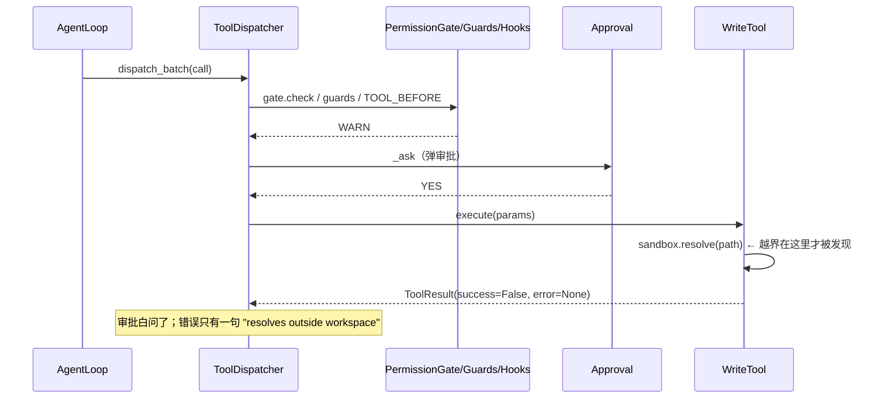
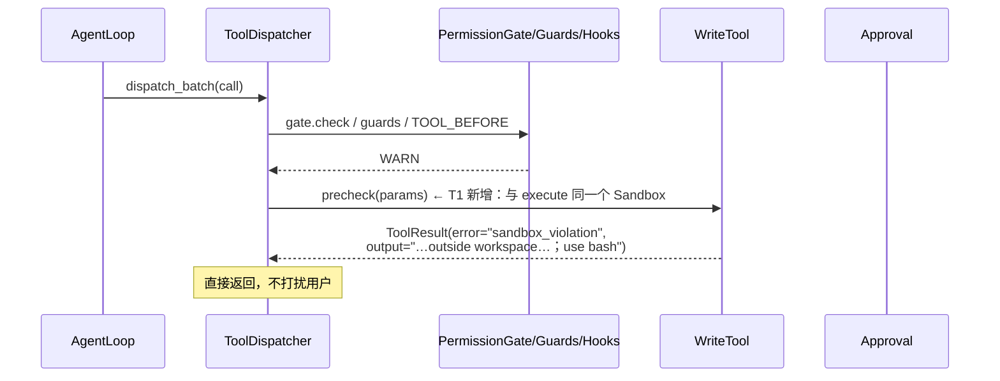
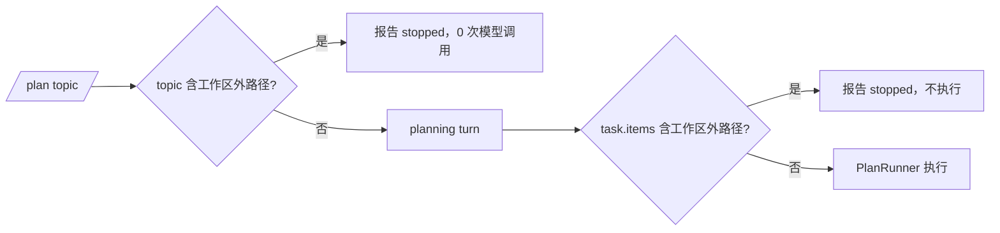

# P0 编排与记忆修复 Implementation Plan

> **For agentic workers:** REQUIRED SUB-SKILL: Use superpowers:subagent-driven-development (recommended) or superpowers:executing-plans to implement this plan task-by-task. Steps use checkbox (`- [ ]`) syntax for tracking.

**Goal:** 切掉 2026-10-08 酒店会话暴露的六个根因中不需要新架构的那一半：越界调用在审批/执行前被可行动地拒绝、/plan 在规划期就拦截工作区外目标、记忆拒绝序列化碎片并自愈存量、账本回到回合语义、压缩不再吞掉当前指令并能被观测、ledger-gate 退役为纯观测。

**Architecture:** 全部改动落在既有契约的延伸上，不引入新子系统：(1) `BaseTool` 增加一个可选的 `precheck` 契约，dispatcher 在审批前调用；(2) plan_runner 增加一个保守的纯函数路径闸门；(3) 记忆层用「首字符」规则把形状门装进 `MemoryNote`（写读同源）；(4) `TurnReporter.begin_turn` 重置 ledger；(5) `ContextManager` 出口增加 pin 兜底 + `ContextCompacted` 事件；(6) 删除 ledger-gate 的注入链路与随之死掉的代码。

**Tech Stack:** Python 3.13 · pytest(+asyncio strict) · ruff · mypy · 无新增依赖

**Spec:** `docs/orchestration-explore/2026-10-08-redesign-brief.md`（P0 段）；证据与勘误：`docs/orchestration-explore/2026-10-08-hotel-session-audit.md`（含附录 A）

## Global Constraints

- TDD：每个任务先写失败测试，再实现；不允许先实现后补测试。
- 门禁（每个任务提交前依次跑）：
  - `.venv/bin/python -m pytest -p no:warnings -q`
  - `.venv/bin/ruff check .`
  - `.venv/bin/python -m mypy ai_coding`
- 只改本任务列出的文件与行；不顺手重构、不新增依赖、不新增配置项。
- 既有测试只有在本计划显式声明的契约变更下才可修改，且必须在同一 commit 里说明为什么。
- 每个任务一个 commit；commit message 用下面给出的原文。
- 任何「说不清作用」的中间抽象一律不做。

---

## 0. 范围与两处修订（相对 redesign-brief 的 P0）

### 修订 A：**砍掉**「L0 选举改 relevance×importance」（实证否定）

侦察时用真实 `.memory` + 真实 ranking 函数做了实验（46 条库，查询取 T5 步文本与沙箱问句）：

```
q1="写 app/schemas.py：三个实体各自的 Create/Update/Out Pydantic 模型"
  → 沙箱 decision 5bf4b09d 排名 #11/46，relevance=0.000，未过闸
q2="read/write 工具被沙箱限制，访问外部路径会报 resolves outside workspace"
  → b0d87e1c(fact) #1 relevance=1.0；5bf4b09d(decision) 仅 #2，relevance=0.202 < 0.25 闸
默认 L0 选举（现状）：4/9 条 decision 入选（506/600 字符），5bf4b09d 排 #5，被预算截掉
```

结论：无论用任务窗口还是原句做 query，该约束都进不了常驻块。**该机制达不到验收目标，P0 不做**（避免安慰剂）。跨回合的约束投递归入 P1「会话约束集」（redesign-brief §4.2 L0 / §4.4），P0 改由 T1 的「失败点可行动错误」承接——约束在需要它的那一刻送达，且不依赖任何检索。

### 修订 B：**延后** extractor 用量入账到 P1

`_chat → build_extractor → MemoryService.harvest → TurnMemory.harvest → loop → ledger/trace` 需要五层追踪每个调用的 usage 与归属，且 harvest 发生在 `TurnFinished` 之后（trace 的写入时序另有约束）。属于观测性（原则 P3），不影响本次任何验收目标；与 P1 的账本/约束工作捆绑更省。P0 只修账本的**正确性**（T4）。

### P0 任务清单

| 任务 | 对应根因 | 主要文件 |
|---|---|---|
| T1 工具 precheck + 沙箱错误可行动 | R2/R3 | `tools/base.py`、4 个 file 工具、`dispatch.py`、`sandbox.py` |
| T2 /plan 工作区闸门 | R2 | `core/plan_runner.py` |
| T3 记忆形状门 + 加载自愈 + 存量清洗 | 记忆 HIGH#3 | `memory/note.py`、`memory/service.py`、数据操作 |
| T4 账本回合语义 | R8/A6 | `core/turn_report.py` |
| T5 压缩指令锚定 + 事件 | R5 | `core/context_compression.py`、`compaction.py`、`request_assembly.py`、`events.py`、`turn_books.py`、`agent_loop.py` |
| T6 ledger-gate 退役 | R8/A8/D1 | `core/turn_policy.py`、`turn_books.py`、`agent_loop.py`、`domain/ledger.py` |

---

## 1. 影响分析与数据流（现状 → 修改后）

### 1.1 工具调用链（T1）

现状（写路径，来自 `dispatch.py:271-344`、`write_tool.py:71`）：



修改后：



- 数据流：拒绝结果沿既有 `_handle → ToolFinished(error=…)、write_back → history` 通道回到模型；错误文案里带补救指令（`SandboxViolation` 是四个 file 工具的唯一消息出处，改一处）。
- 不做的：glob 不加 precheck（它的 execute 本来就限制在工作区内且从未越界，pattern 语义不同）；不为审批引入新档位（D6 已定）。

### 1.2 /plan 生命周期（T2）

现状：`plan_and_run`（`plan_runner.py:68-104`）→ `begin_plan(topic)` → `process_input(PLAN_PROMPT)`（模型自由探索+建计划）→ **无条件** `PlanRunner.run` 执行。工作区外的目标一路跑到工具层才撞墙（酒店会话：17 次失败 + 6 次假审批 + 12 条跨项目记忆污染）。

修改后：入口先扫 `topic`，规划后扫 `task.items`，命中即 `PlanReport(stopped=…)` 返回，不产生任何模型调用（入口拦截时）/不进入执行（计划后拦截时）。判定用保守正则（只认 `/home|/etc|/tmp|/opt|/srv|/mnt|/media|/var|/root|/Users` 这类文件系统根 + 负向环视排除 URL 与前缀），`/rooms`、`https://…` 不会误报。



### 1.3 记忆写入与加载（T3）

现状：写入口 4 个（`_reconcile`、`write_note`、deprecated `remember/dream/store.add`），唯一的形状校验是「非空」；`_load` 对每行只捕获异常，**非空即通过**——12 条 JSON 碎片就是这么进来的（`schema.py:110-115` 的补丁只堵了行解析，不堵 `MemoryNote` 本身）。

修改后：`is_plausible_note_text`（首字符不能是 `{ [ ] } "` 之一）+ `MemoryNote.__post_init__` 抛 `ValueError`，形成两个自动效果：**写入**在 `_reconcile`/`write_note` 显式跳过；**加载**复用 `_load` 现成的逐行 `except ValueError` 自动跳过（内存中不可见，下一次 save 落盘即净化）。

### 1.4 账本（T4）

现状：`TurnReporter.__init__` 建一次 `BudgetLedger`（`turn_report.py:92`），`begin_turn` 只记 observer 失败数（`:112-114`）→ `finish_turn` 的 `outcome.usage` 是**进程累计** → `session.record_turn_usage` 把累计值写成「单回合行」→ `turnUsages` 末行 1,682,856 标成 turn 4；`tokens_spent()` 在第二回合起虚高（`turn_token_budget` 配置下会开局即判超支）。

修改后：`begin_turn` 重置 ledger → `outcome.usage`、`turnUsages`、`plan_runner._turn_usage`、`tokens_spent()` 全部回到单回合语义。**summary.json / `/budget` 不受影响**（TraceRecorder 有自己的累计，绝不改）。

### 1.5 压缩（T5）

现状：`Compactor.compress → ContextManager.compress_if_needed → compress`（L3→L1 snip→L2→L4→hard_trim→sanitize）。L1 的 tail 窗口 `messages[-20:]` 会把更早的当前指令滑出（T15：指令在索引 80，被 `[snipped N]` 取代，模型随即串台）。没有任何压缩事件。

修改后：`assemble(..., pinned=…)` 把**当前回合用户消息的引用**一路传到 `ContextManager`，在 `compress` 和 `compress_if_needed` 的出口各做一次 `_ensure_pinned`（按同一对象或同 role+同内容判定；缺失则追加到 history 末尾）。`RequestAssembler` 在 `did_compact` 为真时发一次 `ContextCompacted`（before/after 条数与字符数），用 `books.compaction_announced` 防重复（与 `memory_announced` 同款）。

### 1.6 ledger-gate（T6）

现状：`decide_next_iteration` 的 flat 分支（`turn_policy.py:264-277`）在「open 集连续 2 轮不变」时返回 NUDGE，注入 `[ledger-gate]` 用户消息。A8 证据：每回合从 `books.failures` 重建、`resolves` 恒空、预算边缘注入占掉最后一格。修改后：删分支与随之死掉的字段/文案/计数器；`_refresh_ledger` + `LedgerUpdated` 保留为纯观测（trace 里仍能看到 open 集变化）。

---

## 2. 文件影响矩阵

| 文件 | T1 | T2 | T3 | T4 | T5 | T6 |
|---|---|---|---|---|---|---|
| `ai_coding/tools/base.py` | +precheck | | | | | |
| `ai_coding/tools/{read,write,edit}_tool.py` | +precheck、error 标注 | | | | | |
| `ai_coding/security/sandbox.py` | 文案 | | | | | |
| `ai_coding/core/dispatch.py` | +3 行闸 | | | | | |
| `ai_coding/core/plan_runner.py` | | +闸门 | | | | |
| `ai_coding/memory/note.py` | | | +谓词 | | | |
| `ai_coding/memory/service.py` | | | +2 处跳过 | | | |
| `ai_coding/core/turn_report.py` | | | | +1 行 | | |
| `ai_coding/core/context_compression.py` | | | | | +pin | |
| `ai_coding/core/compaction.py` | | | | | +pin 透传 | |
| `ai_coding/core/request_assembly.py` | | | | | +pinned/事件 | |
| `ai_coding/core/events.py` | | | | | +ContextCompacted | |
| `ai_coding/core/turn_books.py` | | | | | +flag | -dead |
| `ai_coding/core/agent_loop.py` | | | | | +pin 传参 | -2 行 |
| `ai_coding/core/turn_policy.py` | | | | | | -分支/-死码 |
| `ai_coding/domain/ledger.py` | | | | | | -孤儿（如确认） |
| `docs/features.md` | | | | | | 更新描述 |
| `tests/…` | 3+1 | 4 | 5 | 2 | 4 | 改写 2 |

---

## 3. 任务

### Task 1: 工具 precheck + 沙箱错误可行动

**Files:**
- Modify: `ai_coding/tools/base.py`（`BaseTool` 增加 `precheck`）
- Modify: `ai_coding/tools/read_tool.py:73-76`、`write_tool.py:70-73`、`edit_tool.py:63-66`（新增 `precheck`；`execute` 的 sandbox 例外加 `error=`）
- Modify: `ai_coding/security/sandbox.py:31-33`（消息加补救）
- Modify: `ai_coding/core/dispatch.py`（`_decide` 中 WARN 分支之前，约 `:329`）
- Test: `tests/test_tool_sandbox_precheck.py`（新建）、`tests/test_tool_dispatch.py`（追加）、`tests/test_sandbox.py`（追加）

**Interfaces:**
- Produces: `BaseTool.precheck(self, params: dict[str, Any]) -> ToolResult | None`（默认 `None`）；`SandboxViolation` 消息含 `bash` 补救词；dispatcher 在审批前消费 `precheck`。

- [ ] **Step 1: 写失败测试（新建 `tests/test_tool_sandbox_precheck.py`）**

```python
"""T1: file tools refuse outside-workspace calls before anyone is asked to approve."""

import pytest

from ai_coding.security.file_state_tracker import FileStateTracker
from ai_coding.security.sandbox import Sandbox, SandboxViolation
from ai_coding.tools.edit_tool import EditTool
from ai_coding.tools.read_tool import ReadTool
from ai_coding.tools.write_tool import WriteTool


def _tools(tmp_path):
    sb = Sandbox(tmp_path)
    fst = FileStateTracker()
    return {"read": ReadTool(sb, fst), "write": WriteTool(sb, fst), "edit": EditTool(sb, fst)}


@pytest.mark.parametrize("name", ["read", "write", "edit"])
def test_precheck_refuses_outside_paths(tmp_path, name):
    verdict = _tools(tmp_path)[name].precheck({"path": "/outside/x.py"})
    assert verdict is not None
    assert verdict.success is False
    assert verdict.error == "sandbox_violation"
    assert "bash" in verdict.output


@pytest.mark.parametrize("name", ["read", "write", "edit"])
def test_precheck_allows_inside_paths(tmp_path, name):
    assert _tools(tmp_path)[name].precheck({"path": "app/main.py"}) is None


def test_sandbox_violation_message_names_the_way_out(tmp_path):
    with pytest.raises(SandboxViolation) as exc:
        Sandbox(tmp_path).resolve("/outside/x")
    assert "outside workspace" in str(exc.value)
    assert "bash" in str(exc.value)
```

- [ ] **Step 2: 跑测试确认失败**

Run: `.venv/bin/python -m pytest tests/test_tool_sandbox_precheck.py -q -p no:warnings`
Expected: FAIL（`AttributeError: 'ReadTool' object has no attribute 'precheck'`）

- [ ] **Step 3: 实现**

`ai_coding/tools/base.py`，在 `execute` 抽象方法之后：

```python
    def precheck(self, params: dict[str, Any]) -> ToolResult | None:
        """Cheap refusal for calls that cannot execute — checked before approval.

        The dispatcher runs this *before* asking the user: a call the sandbox
        will reject must not prompt for consent (hotel audit, root cause R2).
        Default ``None`` means "no opinion"; file tools override it with the
        same ``Sandbox`` they execute against, so the two can never disagree.
        """
        return None
```

`ai_coding/security/sandbox.py:31-33`：

```python
            raise SandboxViolation(
                f"path '{path}' resolves outside workspace '{self.workspace}'"
                " — file tools cannot touch it; use bash instead"
                " (cat, sed -n, or a heredoc write)"
            ) from exc
```

`ai_coding/tools/read_tool.py`（write/edit 同构，参数都是 `path`），放在 `execute` 之前：

```python
    def precheck(self, params: dict[str, Any]) -> ToolResult | None:
        path_str = str(params.get("path", ""))
        if not path_str:
            return None
        try:
            self._sandbox.resolve(path_str)
        except SandboxViolation as exc:
            return ToolResult(success=False, output=str(exc), error="sandbox_violation")
        return None
```

同时把三个工具 `execute` 里的 sandbox 例外补上 `error="sandbox_violation"`：

```python
        except SandboxViolation as exc:
            return ToolResult(success=False, output=str(exc), error="sandbox_violation")
```

`ai_coding/core/dispatch.py`，`_decide` 中「hooks REWRITE 重过 gate」之后、`if verdict is PermissionDecision.WARN:` 之前插入：

```python
        # T1: a call that cannot execute must not be offered for approval.
        tool = item.tool
        if tool is None:  # pragma: no cover - checked at the top of _decide
            return self._unknown(call), True, False
        blocked = tool.precheck(call.params)
        if blocked is not None:
            return blocked, True, False
```

- [ ] **Step 4: 追加 dispatcher 级测试（`tests/test_tool_dispatch.py` 末尾）**

```python
class _SandboxedWrite(_FakeTool):
    """A write-shaped fake whose precheck refuses before the WARN approval runs."""

    def precheck(self, params):
        return ToolResult(
            success=False, output="outside workspace; use bash", error="sandbox_violation"
        )


@pytest.mark.asyncio
async def test_precheck_refusal_skips_approval_and_execution():
    tool = _SandboxedWrite("write")
    approval = _NeverAsked()
    dispatcher = _dispatcher([tool], approval=approval)

    outcomes = await dispatcher.dispatch_batch(
        [_ref("c1", "write", '{"path": "/outside/x.py"}')], _ctx()
    )

    assert outcomes[0].result.error == "sandbox_violation"
    assert outcomes[0].denied is True
    assert tool.executed is False
```

- [ ] **Step 5: 跑全部相关测试**

Run: `.venv/bin/python -m pytest tests/test_tool_sandbox_precheck.py tests/test_tool_dispatch.py tests/test_sandbox.py tests/test_tool_read.py tests/test_tool_write.py tests/test_tool_edit.py tests/test_tool_glob.py tests/test_dispatch_grants.py tests/test_dispatch_approval_timeout.py -q -p no:warnings`
Expected: PASS（注意 `test_sandbox.py` 的 `match="outside workspace"` 仍成立）

- [ ] **Step 6: 门禁 + 提交**

```bash
.venv/bin/python -m pytest -p no:warnings -q && .venv/bin/ruff check . && .venv/bin/python -m mypy ai_coding
git add ai_coding/tools/base.py ai_coding/tools/read_tool.py ai_coding/tools/write_tool.py ai_coding/tools/edit_tool.py ai_coding/security/sandbox.py ai_coding/core/dispatch.py tests/test_tool_sandbox_precheck.py tests/test_tool_dispatch.py tests/test_sandbox.py
git commit -m "fix(tools): refuse outside-workspace calls before approval, with a way out"
```

---

### Task 2: /plan 工作区闸门

**Files:**
- Modify: `ai_coding/core/plan_runner.py`（新增纯函数 + 两处闸门，`plan_and_run` 在 `:68-104`）
- Test: `tests/test_plan_workspace_gate.py`（新建）

**Interfaces:**
- Consumes: `Sandbox` / `SandboxViolation`（`ai_coding.security.sandbox`）
- Produces: `outside_workspace_paths(texts: Iterable[str], workspace: str) -> list[str]`

- [ ] **Step 1: 写失败测试（新建 `tests/test_plan_workspace_gate.py`）**

```python
"""/plan refuses to start when its target lives outside the workspace."""

from types import SimpleNamespace

import pytest

from ai_coding.config.models import AIConfig
from ai_coding.core.plan_runner import outside_workspace_paths, plan_and_run
from ai_coding.core.turn_policy import TurnPolicy, TurnPolicyConfig
from ai_coding.domain.session import SessionData


def test_finds_the_real_target(tmp_path):
    text = "把项目放到 /home/linsir365/projects/awesome-tool-kit/hotel 里并跑 pytest"
    assert outside_workspace_paths([text], str(tmp_path)) == [
        "/home/linsir365/projects/awesome-tool-kit/hotel"
    ]


def test_ignores_routes_urls_and_inside_paths(tmp_path):
    text = (
        f"GET /rooms 与 /health；参考 https://x.dev/home/a/b；"
        f"项目在 {tmp_path}/app；另见 /etc/passwd"
    )
    assert outside_workspace_paths([text], str(tmp_path)) == ["/etc/passwd"]


class _StubLoop:
    def __init__(self, workspace, *, items=()):
        self.workspace = workspace
        self.settings = SimpleNamespace(
            plan_step_max_iterations=8, plan_max_step_turns=0, stop_policy="todo_aware"
        )
        self.policy = TurnPolicy(TurnPolicyConfig(max_iterations=100))
        self.calls = []
        self._items = tuple(items)

    async def process_input(self, session, text, on_delta=None, observer=None):
        self.calls.append(text)
        session.begin_plan("t")
        for content in self._items:
            session.task.add(content)
        return "planned"


async def _never_asked():
    raise AssertionError("topic was given; ask_topic must not run")


def _session():
    return SessionData(session_id="s", title="", created_time="t", last_access_time="t")


@pytest.mark.asyncio
async def test_outside_topic_stops_before_any_planning(tmp_path):
    loop = _StubLoop(str(tmp_path))
    report = await plan_and_run(
        loop, _session(), None, topic="把项目建到 /home/x/y", ask_topic=_never_asked
    )
    assert report.stopped is not None and "/home/x/y" in report.stopped
    assert loop.calls == []


@pytest.mark.asyncio
async def test_outside_plan_item_stops_before_execution(tmp_path):
    loop = _StubLoop(str(tmp_path), items=("写代码到 /home/x/y/app.py",))
    report = await plan_and_run(
        loop, _session(), None, topic="实现一个小系统", ask_topic=_never_asked
    )
    assert report.stopped is not None and "/home/x/y/app.py" in report.stopped
    assert len(loop.calls) == 1  # planned once, execution never started
```

- [ ] **Step 2: 跑测试确认失败**

Run: `.venv/bin/python -m pytest tests/test_plan_workspace_gate.py -q -p no:warnings`
Expected: FAIL（`ImportError: cannot import name 'outside_workspace_paths'`）

- [ ] **Step 3: 实现（`ai_coding/core/plan_runner.py`）**

文件头补 imports：`import re`、`from collections.abc import Iterable, Sequence`（按现有 import 风格合并）、`from ai_coding.security.sandbox import Sandbox, SandboxViolation`。

在 `plan_and_run` 之前加入：

```python
# Conservative on purpose: only well-known filesystem roots are candidates, and
# a leading word/colon is excluded so URLs and prose never match.  The gate
# exists because file tools refuse outside paths anyway; failing at plan time
# beats seventeen failed calls (hotel-session audit, root cause R2).
_OUTSIDE_PATH_RE = re.compile(
    r"(?<![:\w])/(?:home|Users|etc|tmp|opt|srv|mnt|media|var|root)/[^\s'\"`,;)\]]+"
)


def outside_workspace_paths(texts: Iterable[str], workspace: str) -> list[str]:
    """Absolute filesystem paths in ``texts`` that file tools cannot reach."""
    sandbox = Sandbox(workspace or ".")
    offenders: list[str] = []
    for text in texts:
        for raw in _OUTSIDE_PATH_RE.findall(str(text or "")):
            candidate = raw.rstrip(".,")
            if candidate in offenders:
                continue
            try:
                sandbox.resolve(candidate)
            except SandboxViolation:
                offenders.append(candidate)
    return offenders


def _outside_workspace_message(paths: Sequence[str]) -> str:
    return (
        "目标路径在工作区外：" + ", ".join(paths)
        + "。文件工具（read/write/edit/glob）无法访问工作区外的路径；"
        "请 cd 到目标目录重新启动 ai-coding，或把计划改为工作区内的路径。"
    )
```

`plan_and_run` 内、`begin_plan` 之前：

```python
    workspace = str(getattr(loop, "workspace", "") or ".")
    offenders = outside_workspace_paths([topic], workspace)
    if offenders:
        return PlanReport(stopped=_outside_workspace_message(offenders))
```

`process_input(PLAN_PROMPT…)` 之后、`PlanRunner(loop).run(...)` 之前：

```python
    items = getattr(getattr(session, "task", None), "items", ())
    offenders = outside_workspace_paths([item.content for item in items], workspace)
    if offenders:
        return PlanReport(stopped=_outside_workspace_message(offenders))
```

- [ ] **Step 4: 跑测试确认通过，并回归既有 plan 测试**

Run: `.venv/bin/python -m pytest tests/test_plan_workspace_gate.py tests/test_plan_runner.py tests/test_plan_proof.py tests/test_plan_budget.py tests/test_plan_attestation.py tests/test_plan_command.py tests/test_plan_m1.py -q -p no:warnings`
Expected: PASS（既有 `_StubLoop` 无 `workspace` 属性 → 用 `"."`，其短文本主题不命中正则）

- [ ] **Step 5: 门禁 + 提交**

```bash
.venv/bin/python -m pytest -p no:warnings -q && .venv/bin/ruff check . && .venv/bin/python -m mypy ai_coding
git add ai_coding/core/plan_runner.py tests/test_plan_workspace_gate.py
git commit -m "feat(plan): stop before the wall when the target is outside the workspace"
```

---

### Task 3: 记忆形状门 + 加载自愈 + 存量清洗

**Files:**
- Modify: `ai_coding/memory/note.py`（谓词 + `__post_init__`）
- Modify: `ai_coding/memory/service.py`（`write_note` 与 `_reconcile` 两处跳过）
- Test: `tests/test_memory_shape_gate.py`（新建）
- Data: `.memory` 一次性清洗（备份 + 脚本，非 shipped code）

**Interfaces:**
- Produces: `is_plausible_note_text(text: str) -> bool`（`ai_coding.memory.note`）
- Consumes: `MemoryNote.__post_init__` 的 `ValueError` 被 `store._load` 逐行捕获（既有行为）

- [ ] **Step 1: 写失败测试（新建 `tests/test_memory_shape_gate.py`）**

```python
"""Serialized-record fragments never enter memory, and old ones fall out."""

import json

import pytest

from ai_coding.memory.note import is_plausible_note_text, new_note
from ai_coding.memory.store import MemoryStore


def test_predicate_rejects_the_observed_fragments():
    assert not is_plausible_note_text('"text": "AI-Coding 的编排')
    assert not is_plausible_note_text('"kind": "decision",')
    assert not is_plausible_note_text("[]")
    assert not is_plausible_note_text("")
    assert is_plausible_note_text("酒店项目使用 FastAPI")


def test_new_note_refuses_a_fragment():
    with pytest.raises(ValueError):
        new_note('"kind": "decision",')


def test_load_skips_fragments_written_by_the_old_bug(tmp_path):
    path = tmp_path / "m.json"
    path.write_text(
        json.dumps(
            {
                "version": 2,
                "notes": [
                    {"id": "a" * 32, "text": '"text": "AI-Coding 的编排', "kind": "fact"},
                    {"id": "b" * 32, "text": "[]", "kind": "fact"},
                    {"id": "c" * 32, "text": "酒店使用 SQLite", "kind": "fact"},
                ],
            },
            ensure_ascii=False,
        ),
        encoding="utf-8",
    )
    store = MemoryStore(path)
    assert [note.id[:1] for note in store.all()] == ["c"]
```

> 构造细节照抄 `tests/test_memory_store_v2.py:31-46`（v2 文件形状）。

- [ ] **Step 2: 跑测试确认失败**

Run: `.venv/bin/python -m pytest tests/test_memory_shape_gate.py -q -p no:warnings`
Expected: FAIL（`ImportError: is_plausible_note_text`）

- [ ] **Step 3: 实现（`ai_coding/memory/note.py`）**

模块级（放 `new_note` 附近）：

```python
_SERIALIZED_PREFIXES = ('{', '[', ']', '}', '"')


def is_plausible_note_text(text: str) -> bool:
    """A memory is a sentence, not a serialized record.

    One real turn put twelve JSON fragments into ``.memory``; the loader accepted
    any non-empty text, so they stayed.  Positional rule, not JSON parsing: every
    fragment starts with a brace, bracket or quote.
    """
    body = str(text or "").strip()
    return bool(body) and body[0] not in _SERIALIZED_PREFIXES
```

`MemoryNote.__post_init__`，在现有非空检查之后：

```python
        if not is_plausible_note_text(self.text):
            raise ValueError("memory note text looks like a serialized record")
```

`ai_coding/memory/service.py`：

- `write_note`（`:651` 的 `if not self.enabled or not body:` 之后）：

```python
        if not is_plausible_note_text(body):
            return HarvestReport()
```

- `_reconcile`（`:712-714` 的 `text = candidate.text.strip(); if not text: continue` 之后）：

```python
            if not is_plausible_note_text(text):
                continue
```

import 行改为包含 `is_plausible_note_text`。

- [ ] **Step 4: 追写路径测试（同文件）**

```python
from ai_coding.memory.service import MemoryService
from ai_coding.memory.config import MemoryConfig  # 实际路径以 test_memory_write.py:20-24 为准


def test_write_note_rejects_a_fragment(tmp_path):
    store = MemoryStore(tmp_path / "m.json")
    service = MemoryService(store, config=MemoryConfig())
    report = service.write_note('"text": "AI-Coding 的编排')
    assert report.added == ()
    assert store.all() == []
```

> harvest 路径的跳过测试：复制 `tests/test_memory_service_v2.py:66-226` harvest 组的 extractor/service 夹具，令 extractor 同时返回一条 `"kind": "decision",` 碎片与一条正常文本；断言 `store.all()` 只含正常那条。`import` 与构造细节以该文件为准。

- [ ] **Step 5: 跑记忆全套，确认没有既有 fixture 依赖坏行为**

Run: `.venv/bin/python -m pytest tests/test_memory_shape_gate.py tests/test_memory_note.py tests/test_memory_store.py tests/test_memory_store_v2.py tests/test_memory_service_v2.py tests/test_memory_write.py tests/test_memory_schema.py tests/test_memory_index_invariants.py -q -p no:warnings`
Expected: PASS。若某 fixture 恰好用了以引号/括号开头的文本，修 fixture（它编码的是旧漏洞），并在 commit message 注明。

- [ ] **Step 6: 一次性清洗 `.memory`（数据操作，有备份）**

```bash
cd /home/linsir365/projects/ai-coding
cp .memory "/tmp/opencode/memory-backup-$(date +%Y%m%d-%H%M%S).json"
.venv/bin/python - <<'EOF'
import json
from pathlib import Path

p = Path(".memory")
data = json.loads(p.read_text(encoding="utf-8"))
notes = data.get("notes", [])
keep = [
    n for n in notes
    if "酒店" not in n.get("text", "")
    and (n.get("text", "").lstrip()[:1] not in '{}[]"')
]
data["notes"] = keep
p.write_text(json.dumps(data, ensure_ascii=False, indent=2), encoding="utf-8")
print(f"notes {len(notes)} -> {len(keep)}")
EOF
.venv/bin/python -c "from ai_coding.memory.store import MemoryStore; print(len(MemoryStore('.memory').all()))"
```

Expected: `notes 46 -> 23`；复查输出 `23`。（备份在 `/tmp/opencode/`，可逆。）

- [ ] **Step 7: 门禁 + 提交**

```bash
.venv/bin/python -m pytest -p no:warnings -q && .venv/bin/ruff check . && .venv/bin/python -m mypy ai_coding
git add ai_coding/memory/note.py ai_coding/memory/service.py tests/test_memory_shape_gate.py
git commit -m "fix(memory): reject serialized fragments at write and load; purge the backlog

.memory cleaned 46 -> 23 (11 hotel-project notes + 12 JSON fragments), backup in /tmp/opencode/."
```

---

### Task 4: 账本回合语义

**Files:**
- Modify: `ai_coding/core/turn_report.py:112-114`（`begin_turn` 重置 ledger）
- Test: `tests/test_turn_reporter.py`（追加）

**Interfaces:**
- Produces: `TurnOutcome.usage` / `session.turnUsages` 行 / `tokens_spent()` 均为单回合语义（summary.json 不变）。

- [ ] **Step 1: 写失败测试（`tests/test_turn_reporter.py` 末尾，复用文件内 `_reporter()`）**

```python
def test_begin_turn_resets_the_ledger_so_usage_is_per_turn():
    reporter, _sink = _reporter()
    observer = RecordingObserver()

    reporter.begin_turn(observer)
    reporter.report_step(
        index=1,
        step=StepResult(
            usage={"prompt_tokens": 1000, "completion_tokens": 100, "total_tokens": 1100}
        ),
        latency_ms=1,
    )
    reporter.finish_turn(TurnOutcome(status=TurnStatus.COMPLETED), observer)

    reporter.begin_turn(observer)
    reporter.report_step(
        index=1,
        step=StepResult(usage={"prompt_tokens": 7, "completion_tokens": 3, "total_tokens": 10}),
        latency_ms=1,
    )
    second = reporter.finish_turn(TurnOutcome(status=TurnStatus.COMPLETED), observer)

    assert second.usage == {"prompt_tokens": 7, "completion_tokens": 3, "total_tokens": 10}
    assert reporter.tokens_spent() == 10
```

- [ ] **Step 2: 跑测试确认失败**

Run: `.venv/bin/python -m pytest tests/test_turn_reporter.py::test_begin_turn_resets_the_ledger_so_usage_is_per_turn -q -p no:warnings`
Expected: FAIL（`second.usage` 含第一回合的 1100）

- [ ] **Step 3: 实现（`ai_coding/core/turn_report.py`）**

```python
    def begin_turn(self, observer: LoopObserver) -> None:
        """Remember the observer's failure count so the turn can report its own."""
        self._failures_before = int(getattr(observer, "failures", 0) or 0)
        # T4: the ledger is *this turn's* spend.  It used to live for the whole
        # loop, so turn 2's usage re-stated turn 1's, `session.turnUsages` rows
        # were cumulative values shaped as per-turn, and `tokens_spent()` made a
        # configured turn-token budget trip at the start of every later turn.
        self._ledger = BudgetLedger()
```

- [ ] **Step 4: 跑测试与相关回归**

Run: `.venv/bin/python -m pytest tests/test_turn_reporter.py tests/test_turn_closure.py tests/test_budget_ledger.py tests/test_agent_loop_r4_wiring.py tests/test_plan_budget.py tests/test_trace_recorder.py -q -p no:warnings`
Expected: PASS（仓库内无任何测试依赖「多回合累计的 outcome.usage」）

- [ ] **Step 5: 门禁 + 提交**

```bash
.venv/bin/python -m pytest -p no:warnings -q && .venv/bin/ruff check . && .venv/bin/python -m mypy ai_coding
git add ai_coding/core/turn_report.py tests/test_turn_reporter.py
git commit -m "fix(loop): per-turn ledger — usage reports a turn, not the process"
```

---

### Task 5: 压缩指令锚定 + ContextCompacted 事件

**Files:**
- Modify: `ai_coding/core/context_compression.py`（`compress`/`compress_if_needed` 增加 `pinned`；新增 `_ensure_pinned`）
- Modify: `ai_coding/core/compaction.py`（`compress` 透传 `pinned`）
- Modify: `ai_coding/core/request_assembly.py`（`assemble` 增加 `pinned`；发事件）
- Modify: `ai_coding/core/events.py`（`ContextCompacted` + union + `__all__`）
- Modify: `ai_coding/core/turn_books.py`（`compaction_announced`）
- Modify: `ai_coding/core/agent_loop.py`（`_begin_turn` 记录当前指令；所有 `assemble`/`compress` 调用点传 `pinned`）
- Modify: `tests/test_request_assembly.py`（`_Compactor.compress` 接受 `pinned=()`）
- Test: `tests/test_context_compression.py`、`tests/test_context_compression_l4.py`、`tests/test_request_assembly.py`（追加）

**Interfaces:**
- Produces: `ContextManager.compress(messages, *, on_summary=None, pinned: Sequence[ChatMessage] = ())`；`ContextCompacted(before_messages, after_messages, before_chars, after_chars)`；`TurnBooks.compaction_announced: bool`；`RequestAssembler.assemble(..., pinned: Sequence[ChatMessage] = ())`。

- [ ] **Step 1: 写失败测试**

`tests/test_context_compression.py` 追加：

```python
from ai_coding.core.context_compression import _ensure_pinned


def test_snip_can_lose_the_instruction_and_pin_brings_it_back():
    instruction = _user("审查一下这个项目")
    msgs = [_user(f"m{i}") for i in range(60)]
    msgs.insert(5, instruction)

    out = snip_middle(msgs, max_messages=10, keep_head=3, keep_tail=4)
    assert instruction not in out  # the T15 failure, reproduced

    out = _ensure_pinned(out, [instruction])
    assert out[-1] is instruction
    assert sum(1 for m in out if m.content == "审查一下这个项目") == 1
```

`tests/test_context_compression_l4.py` 追加（复用该文件 `_settings` 夹具，用小 `max_messages`）：

```python
async def test_compress_reinserts_the_pinned_instruction(tmp_path):
    manager = ContextManager(_settings(max_messages=10), tmp_path)
    instruction = _user("审查一下这个项目")
    msgs = [_user(f"m{i}") for i in range(34)]
    msgs.insert(5, instruction)

    out = await manager.compress(msgs, pinned=[instruction])

    assert any(m.content == "审查一下这个项目" for m in out)
```

`tests/test_request_assembly.py` 追加（先在 `_Compactor.compress` 签名加 `pinned=()` 并忽略之）：

```python
async def test_a_compacted_history_reports_itself_exactly_once():
    assembler, parts = _assembler(rewrite=True)
    session = _session([_digest()])
    books = TurnBooks()

    await _assemble(assembler, session=session, books=books)
    await _assemble(assembler, session=session, books=books)

    from ai_coding.core.events import ContextCompacted

    assert len([e for e in parts["events"] if isinstance(e, ContextCompacted)]) == 1
```

- [ ] **Step 2: 跑测试确认失败**

Run: `.venv/bin/python -m pytest tests/test_context_compression.py::test_snip_can_lose_the_instruction_and_pin_brings_it_back tests/test_context_compression_l4.py::test_compress_reinserts_the_pinned_instruction tests/test_request_assembly.py::test_a_compacted_history_reports_itself_exactly_once -q -p no:warnings`
Expected: FAIL（`_ensure_pinned` / `pinned` / `ContextCompacted` 不存在）

- [ ] **Step 3: 实现 `ai_coding/core/events.py`**

在 `ContextAssembled` 附近：

```python
@dataclass(frozen=True)
class ContextCompacted:
    """The history was rewritten before this request (hotel audit, root cause R5).

    Emitted once per turn, on the first assembly whose history the pipeline
    actually rewrote; per-iteration sizes stay in ``ContextAssembled``.
    """

    before_messages: int = 0
    after_messages: int = 0
    before_chars: int = 0
    after_chars: int = 0
```

加入 `LoopEvent` union 与 `__all__`。

- [ ] **Step 4: 实现 `context_compression.py`**

`compress` 签名与出口：

```python
    async def compress(
        self,
        messages: list[ChatMessage],
        *,
        on_summary: Callable[[str], None] | None = None,
        pinned: Sequence[ChatMessage] = (),
    ) -> list[ChatMessage]:
        ...
        out = _ensure_pinned(out, pinned)
        return sanitize_pairs(out)
```

`compress_if_needed` 签名加 `pinned: Sequence[ChatMessage] = ()`，`self.compress(messages, on_summary=on_summary, pinned=pinned)`；函数末尾（while hard_trim 循环之后、return 之前）再 `out = _ensure_pinned(out, pinned)`。

模块级：

```python
def _ensure_pinned(
    messages: list[ChatMessage], pinned: Sequence[ChatMessage]
) -> list[ChatMessage]:
    """Keep the live user instruction through every stage.

    L1/L4/hard-trim cut by position; the instruction can be older than the tail
    window (hotel T15: index 80 fell out of a 20-message tail) and the model
    then re-anchors on whatever survived.  A missing pin is re-appended at the
    end of the history — closest to the tail blocks, where recency helps.
    """
    for pin in pinned:
        if any(
            m is pin or (m.role == pin.role and m.content == pin.content)
            for m in messages
        ):
            continue
        messages = [*messages, pin]
    return messages
```

- [ ] **Step 5: 实现 `compaction.py`**

`Compactor.compress` 增加 `pinned: Sequence[ChatMessage] = ()`；`aware` 调用改为：

```python
            if aware is not None:
                kwargs: dict[str, Any] = {"on_summary": on_summary, "force": force}
                if pinned:
                    kwargs["pinned"] = pinned
                return await run_with_deadline(
                    aware(history, **kwargs),
                    timeout=budget,
                    label="context_compress",
                )
```

- [ ] **Step 6: 实现 `request_assembly.py`**

`assemble` 增加 `pinned: Sequence[ChatMessage] = ()`；compress 调用传 `pinned=pinned`；`compacted` 之后：

```python
        if compacted and not books.compaction_announced:
            self._emit(
                ContextCompacted(
                    before_messages=len(session.messages),
                    after_messages=len(history),
                    before_chars=sum(len(m.content or "") for m in session.messages),
                    after_chars=sum(len(m.content or "") for m in history),
                )
            )
            books.compaction_announced = True
```

`turn_books.py` 在 `memory_announced` 旁加 `compaction_announced: bool = False`。

- [ ] **Step 7: 实现 `agent_loop.py`**

- `__init__` 增加 `self._current_instruction: ChatMessage | None = None`
- `_begin_turn`（`:587` 的 `session.add_message(user_message(user_input, now_utc()))` 之后）：`self._current_instruction = session.messages[-1]`
- 所有 `self.assembler.assemble(`（`:448-457` 主循环、`:877-935` 收尾、其余以 grep 为准）追加 `pinned=(self._current_instruction,) if self._current_instruction else ()`
- 反应式压缩的 `self._compactor.compress(`（约 `:476-497`）同样传 `pinned=`

Run: `grep -n "assembler.assemble(\|_compactor.compress(" ai_coding/core/agent_loop.py` 确认无遗漏。

- [ ] **Step 8: 跑压缩/装配/回环全套**

Run: `.venv/bin/python -m pytest tests/test_context_compression.py tests/test_context_compression_policy.py tests/test_context_compression_l4.py tests/test_context_compression_l2_window.py tests/test_request_assembly.py tests/test_loop_reactive_compaction.py tests/test_compact_command.py tests/test_loop_refactor_equivalence.py tests/test_agent_loop_memory.py -q -p no:warnings`
Expected: PASS。`test_loop_refactor_equivalence.py` 的 golden 若因新事件失败：说明该 golden 会话确实发生了压缩——需确认后重录（重录前先看 diff 是只有新事件还是别的变化，只有新事件才允许）。

- [ ] **Step 9: 门禁 + 提交**

```bash
.venv/bin/python -m pytest -p no:warnings -q && .venv/bin/ruff check . && .venv/bin/python -m mypy ai_coding
git add ai_coding/core/context_compression.py ai_coding/core/compaction.py ai_coding/core/request_assembly.py ai_coding/core/events.py ai_coding/core/turn_books.py ai_coding/core/agent_loop.py tests/test_context_compression.py tests/test_context_compression_l4.py tests/test_request_assembly.py
git commit -m "fix(context): keep the live instruction through compaction, and report rewrites"
```

---

### Task 6: ledger-gate 退役为观测 + 死代码清理

**Files:**
- Modify: `ai_coding/core/turn_policy.py`（删 flat 分支、`ledger_message`、`LEDGER_GATE_LEAD`、`LEDGER_FLAT_ROUNDS`、`max_ledger_nudges`、`TurnSnapshot` 相关字段）
- Modify: `ai_coding/core/turn_books.py`（删 `ledger_nudges`、`note_ledger_nudge`、flat 计数）
- Modify: `ai_coding/core/agent_loop.py:423-424`（删 gate 计数分支）
- Modify: `ai_coding/domain/ledger.py`（若 `ledger_states`/`LedgerState` 确认无消费方则删）
- Modify: `docs/features.md`（更新 ledger 描述为观测）
- Test: `tests/test_ledger.py`（改写两条）

**Interfaces:**
- 保留：`_refresh_ledger`、`LedgerUpdated(items)`、`build_ledger`、`TurnBooks.ledger_items`。
- 移除：`[ledger-gate]` 注入路径及其专有字段。

- [ ] **Step 1: 先改测试（把 gate 测试改成退役契约，`tests/test_ledger.py`）**

把 `test_policy_ledger_gate_fires_only_after_two_flat_rounds`（`:77-86`）替换为（snapshot 构造沿用原测试的字段写法，去掉即将删除的字段）：

```python
def test_policy_never_nudges_on_a_flat_ledger():
    """D1: the gate is retired — a flat ledger stays observable, not persuasive."""
    policy = TurnPolicy(TurnPolicyConfig())
    snapshot = TurnSnapshot(iteration=3, attempted_calls=1, successful_calls=1)
    decision = policy.decide_next_iteration(snapshot)
    assert decision.reason != "uncertainty ledger flat"
    assert decision.inject is None
```

`test_books_tracks_flat_rounds_and_resets_on_change`（`:60-74`）：若只断言 flat 计数，删除；若同时断言 `note_ledger` 的 moved 返回值，保留 moved 断言、删 flat 断言。

- [ ] **Step 2: 跑测试确认失败**

Run: `.venv/bin/python -m pytest tests/test_ledger.py -q -p no:warnings`
Expected: FAIL（`TurnSnapshot` 仍要求 `ledger_open` 或决策仍是 NUDGE——视构造而定）

- [ ] **Step 3: 删除实现**

- `turn_policy.py`：`decide_next_iteration` 中删除 `if (snapshot.ledger_open and snapshot.ledger_flat_rounds >= LEDGER_FLAT_ROUNDS …)` 整个分支；删除 `ledger_message`、`LEDGER_GATE_LEAD`、`LEDGER_FLAT_ROUNDS`、`TurnPolicyConfig.max_ledger_nudges` 字段与 `from_ai_config` 中对应行；`TurnSnapshot` 删除 `ledger`、`ledger_nudges`、`ledger_flat_rounds` 字段。
- `turn_books.py`：删除 `ledger_flat_rounds`、`ledger_nudges`、`note_ledger_nudge`；`note_ledger` 保留「签名变化 → moved」语义，删除 flat 计数与 items 投影中仅服务 gate 的部分（`ledger_current` 若仍被 `_refresh_ledger` 的 event 使用则保留）。
- `agent_loop.py:423-424`：删除 `if decision.reason == "uncertainty ledger flat": books.note_ledger_nudge()` 两行。
- `domain/ledger.py`：`grep -rn "ledger_states\|LedgerState" ai_coding tests` → 无消费方则删。
- `docs/features.md` 对应段落改为「ledger 只作 trace 观测，不再注入」。

- [ ] **Step 4: 全仓 grep 确认没有残留引用**

Run: `grep -rn "ledger-gate\|LEDGER_GATE_LEAD\|ledger_message\|note_ledger_nudge\|ledger_nudges\|ledger_flat_rounds\|max_ledger_nudges" ai_coding tests docs | grep -v test_ledger.py`
Expected: 空输出。

- [ ] **Step 5: 跑相关回归**

Run: `.venv/bin/python -m pytest tests/test_ledger.py tests/test_turn_books.py tests/test_turn_policy.py tests/test_agent_loop_react.py tests/test_loop_events.py -q -p no:warnings`
Expected: PASS

- [ ] **Step 6: 门禁 + 提交**

```bash
.venv/bin/python -m pytest -p no:warnings -q && .venv/bin/ruff check . && .venv/bin/python -m mypy ai_coding
git add -A ai_coding/core/turn_policy.py ai_coding/core/turn_books.py ai_coding/core/agent_loop.py ai_coding/domain/ledger.py docs/features.md tests/test_ledger.py
git commit -m "refactor(loop): retire the ledger gate; the ledger stays as observation"
```

---

## 4. 终态走查（按此计划实施完，世界长什么样）

1. **酒店剧本重放（同一 topic、同一错误的工作区）**：`/plan 给我写…放到 /home/linsir365/projects/awesome-tool-kit 里` → 入口闸门命中 → 报告 `止于：目标路径在工作区外…`，**0 次模型调用**（对照：原 687K tokens 的 T3 + 后续 17 次失败全部消失）。
2. **正确姿势重跑（cd 到目标目录启动）**：计划照常执行；若某步命令确实触达工作区外文件，`read/write/edit` 的第一次调用收到 `sandbox_violation + "use bash instead (cat, sed -n, or a heredoc write)"`，模型当场改道；不会再出现「先弹审批再失败」。
3. **记忆**：新碎片写不进（写入口显式拒绝）、旧碎片读不出（加载跳过）；`.memory` 46 → 23，ai-coding 会话的常驻块不再出现酒店项目笔记。跨回合的约束投递仍靠 T1 在失败点送达（P1 会做会话约束集，届时 L0 选举不动）。
4. **账本**：第二回合的 `outcome.usage`、`turnUsages` 行、`/plan` 的 `tokens_used` 都只含本回合；`/budget` 与 summary.json 的数字与今天完全一致（那是另一条独立口径，刻意不动）。
5. **压缩**：T15 形状的场景里，指令字符串必在装配结果中（fixture 复现）；trace 里每次真正压缩出现一条 `ContextCompacted`（before/after 条数+字符数），每回合至多一条。
6. **ledger**：trace 里 `LedgerUpdated` 仍在，但会话中再也不会出现 `[ledger-gate]` 用户消息；相关字段/文案/配置全部消失（grep 为空）。

预期收益（粗估，需 dogfood 实测）：异工作区计划从「101 步 / 1.68M / 17 次失败」变成「0 步 / 0 token / 1 条清晰报错」；同工作区任务的步骤数减少量与 T1/T5 的失败次数成正比。

## 5. 风险与自检

**Spec 覆盖**（redesign-brief P0 对照）：工作区治理→T1+T2；记忆四连→T3（选举项经实证砍掉，见 §0-A）；收割可见化→延后（§0-B）；账本→T4；压缩锚点+事件→T5；ledger 降级→T6。

**Placeholder 扫描**：无 TBD/TODO；所有测试给到可执行代码；两处「以某文件夹具为准」均给出精确文件与行段。

**类型/命名一致性**：`precheck`、`outside_workspace_paths`、`is_plausible_note_text`、`ContextCompacted(before_messages, after_messages, before_chars, after_chars)`、`compaction_announced`、`_ensure_pinned`——各任务之间只通过这组名字耦合。

**已知风险与对策**：
1. `MemoryNote.__post_init__` 抛错可能触及 deprecated 入口（`remember/dream/store.add`）：跑记忆全套验证；这些入口无产品调用方，若测试喂碎片则修 fixture（它编码旧漏洞）。
2. `_ensure_pinned` 的「同 role+同内容」判重可能在用户重复发送同一句时把第二条视为已存在：影响仅是少一次重注入，无正确性风险。
3. 新事件进入 golden 事件序列测试：仅当该场景真的压缩时出现；步骤 8 已要求先 diff 再决定重录。
4. plan 闸门误报：正则只认文件系统根、负向环视排除 URL；误报时报告会列出具体路径，用户一眼可辨。
5. 清洗 `.memory` 是数据操作：已备份至 `/tmp/opencode/`，可逆。

**实施顺序**：T1 → T2 → T3 → T4 → T5 → T6（T3 的数据清洗在代码 commit 之后执行；T5 的 goldens 若需重录单独确认）。

## 6. 验收清单（实现完成后必须全部为真）

- [ ] `.venv/bin/python -m pytest -p no:warnings -q` 全绿；ruff / mypy 干净。
- [ ] `tests/test_plan_workspace_gate.py` 用真实酒店 topic 文本断言 0 次 `process_input`。
- [ ] `tests/test_tool_dispatch.py` 断言 precheck 拒绝时审批回调从未被调用。
- [ ] `tests/test_context_compression*.py` 断言 60 条消息 + 索引 5 的指令在压缩后仍在。
- [ ] `.memory` 加载后 `len(all()) == 23`；畸形与酒店笔记均不可见。
- [ ] `tests/test_turn_reporter.py` 断言同 loop 两回合的 usage 互不污染。
- [ ] `grep` ledger-gate 系名词在 `ai_coding/`、`tests/`、`docs/` 无残留（`test_ledger.py` 的退役断言除外）。
- [ ] 端到端 dogfood（受控）：重放酒店 topic → 入口即止；从目标目录重跑同类任务 → 0 次越界工具调用、0 次假审批。
